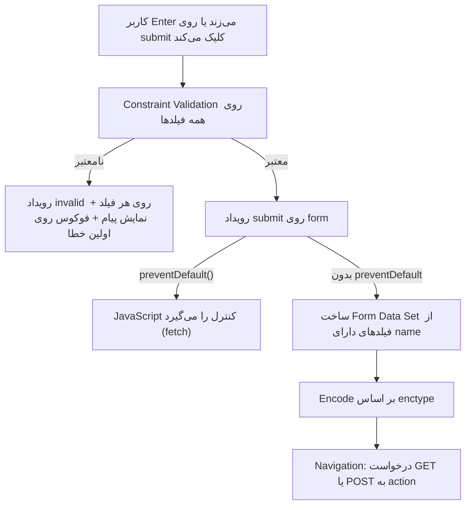

## Form چیست و چطور کار می‌کند؟

`form` مکانیزم بومی مرورگر برای **جمع‌آوری داده از کاربر و ارسال آن** به سرور است. حتی بدون یک خط JavaScript، مرورگر داده‌ها را سریال‌سازی، اعتبارسنجی و ارسال می‌کند.

```html
<form action="/api/register" method="post">
  <label for="email">ایمیل</label>
  <input id="email" name="email" type="email" required autocomplete="email" />

  <label for="password">رمز عبور</label>
  <input id="password" name="password" type="password" required minlength="8"
         autocomplete="new-password" />

  <button type="submit">ثبت‌نام</button>
</form>
```

### چرخه کامل Submit در Runtime



نکات کلیدی:

- **فقط فیلدهایی که `name` دارند** ارسال می‌شوند. `id` برای ارتباط با `label` است، `name` کلید داده.
- فیلدهای `disabled` ارسال **نمی‌شوند**؛ فیلدهای `readonly` ارسال **می‌شوند**.
- Checkbox تیک‌نخورده اصلاً ارسال نمی‌شود (نه با مقدار false).
- `form.submit()` در JavaScript **Validation و رویداد submit را رد می‌کند**. `form.requestSubmit()` مثل کلیک کاربر رفتار می‌کند.

## Elementهای فرم

### input

`type` رفتار، کیبورد موبایل، اعتبارسنجی و UI را تعیین می‌کند:

| type | کاربرد | مزیت بومی |
| --- | --- | --- |
| `text` | متن عمومی | — |
| `email` | ایمیل | Validation فرمت، کیبورد با `@` |
| `password` | رمز | مخفی‌سازی، پیشنهاد Password Manager |
| `tel` | تلفن | کیبورد عددی (بدون Validation فرمت) |
| `url` | آدرس | Validation فرمت |
| `number` | عدد | `min`، `max`، `step`، فلش‌ها |
| `search` | جستجو | دکمه پاک کردن، رفتار Enter در موبایل |
| `date`، `time`، `datetime-local` | تاریخ و زمان | Date Picker بومی (میلادی) |
| `checkbox`، `radio` | انتخاب | گروه‌بندی radio با `name` یکسان |
| `file` | فایل | `accept`، `multiple`، `capture` |
| `range`، `color` | اسلایدر، رنگ | |
| `hidden` | داده نامرئی | مثلاً CSRF Token |

<Callout type="tip">
برای کد OTP یا کد پستی از `type="text"` همراه با `inputmode="numeric"` و `autocomplete="one-time-code"` استفاده کنید. `type="number"` برای «اعدادی که محاسبه نمی‌شوند» مناسب نیست: صفرهای ابتدایی حذف می‌شوند، با Scroll ماوس تغییر می‌کند و `e` را قبول می‌کند.
</Callout>

### textarea، select، option

```html
<label for="bio">درباره شما</label>
<textarea id="bio" name="bio" rows="4" maxlength="500"></textarea>

<label for="city">شهر</label>
<select id="city" name="city" required>
  <option value="">انتخاب کنید</option>
  <optgroup label="شمال">
    <option value="rasht">رشت</option>
  </optgroup>
  <option value="tehran" selected>تهران</option>
</select>
```

- `select` با `required` و یک option با `value=""` در ابتدا، Placeholder معتبری می‌سازد.
- `multiple` چند انتخاب را مجاز می‌کند.

### button

```html
<button type="submit">ذخیره</button>   <!-- پیش‌فرض داخل form -->
<button type="button">پیش‌نمایش</button> <!-- هیچ رفتار پیش‌فرض -->
<button type="reset">پاک کردن</button>  <!-- به ندرت مفید -->
<button type="submit" formaction="/draft" formnovalidate>ذخیره پیش‌نویس</button>
```

<Callout type="mistake">
هر `button` داخل `form` به‌طور پیش‌فرض `type="submit"` دارد. دکمه‌ای مثل «نمایش رمز» بدون `type="button"` فرم را ارسال می‌کند — یکی از رایج‌ترین باگ‌ها.
</Callout>

### label

`label` نام دسترسی‌پذیر فیلد را می‌سازد و **ناحیه کلیک** را بزرگ می‌کند (کلیک روی label فیلد را فعال می‌کند).

```html
<!-- روش صریح (Explicit) -->
<label for="agree">قوانین را می‌پذیرم</label>
<input id="agree" type="checkbox" name="agree" />

<!-- روش ضمنی (Implicit) -->
<label>
  <input type="checkbox" name="news" /> عضویت در خبرنامه
</label>
```

`placeholder` جایگزین `label` **نیست**: با تایپ ناپدید می‌شود، کنتراست پایینی دارد و برخی Screen Readerها آن را نمی‌خوانند.

### fieldset و legend

گروه‌بندی فیلدهای مرتبط، به‌خصوص radioها. Screen Reader هنگام ورود به گروه، `legend` را اعلام می‌کند:

```html
<fieldset>
  <legend>روش ارسال</legend>
  <label><input type="radio" name="shipping" value="post" required /> پست</label>
  <label><input type="radio" name="shipping" value="courier" /> پیک</label>
</fieldset>
```

`fieldset disabled` همه فیلدهای داخلش را یکجا غیرفعال می‌کند.

## Validation بومی (Constraint Validation API)

| Attribute | محدودیت | Validity Flag |
| --- | --- | --- |
| `required` | خالی نباشد | `valueMissing` |
| `type="email"`/`url` | فرمت | `typeMismatch` |
| `pattern` | Regex (روی کل مقدار، بدون نیاز به `^` و `$`) | `patternMismatch` |
| `min` / `max` | بازه عدد یا تاریخ | `rangeUnderflow` / `rangeOverflow` |
| `step` | گام | `stepMismatch` |
| `minlength` / `maxlength` | طول متن | `tooShort` / `tooLong` |
| `setCustomValidity()` | قانون دلخواه | `customError` |

```html
<input name="username" required pattern="[a-z0-9_]{3,16}"
       title="۳ تا ۱۶ کاراکتر: حروف کوچک انگلیسی، عدد و _" />
```

### Validation با JavaScript

```js
const form = document.querySelector("form");
const password = form.elements.password;
const confirm = form.elements.confirm;

confirm.addEventListener("input", () => {
  // پیام خالی = معتبر
  confirm.setCustomValidity(confirm.value === password.value ? "" : "رمزها یکسان نیستند");
});

form.addEventListener("submit", async (event) => {
  event.preventDefault();
  if (!form.checkValidity()) return form.reportValidity();

  const data = new FormData(form);           // فقط فیلدهای دارای name
  const response = await fetch(form.action, { method: "POST", body: data });
  if (!response.ok) showServerErrors(await response.json());
});
```

| متد/ویژگی | کار |
| --- | --- |
| `el.validity` | شیء ValidityState با Flagهای بالا |
| `el.validationMessage` | پیام بومی مرورگر |
| `el.checkValidity()` | بررسی + رویداد `invalid`، بدون نمایش پیام |
| `el.reportValidity()` | بررسی + نمایش پیام بومی |
| `form.noValidate` / `novalidate` | خاموش کردن UI بومی (برای نمایش خطای سفارشی) |

CSS هم به وضعیت Validation دسترسی دارد. `:user-invalid` (Baseline 2023) فقط **پس از تعامل کاربر** فعال می‌شود و از قرمز شدن فیلدها در بارگذاری اول جلوگیری می‌کند:

```html live
<style>
  input { padding: 8px; border: 2px solid #ccc; border-radius: 6px; margin: 6px 0; display:block }
  input:user-invalid { border-color: #c92a2a; }
  input:valid { border-color: #2b8a3e; }
</style>
<form onsubmit="event.preventDefault(); alert('معتبر است!')">
  <input type="email" required placeholder="ایمیل" />
  <input required minlength="8" type="password" placeholder="حداقل ۸ کاراکتر" />
  <button>ارسال</button>
</form>
```

<Callout type="warning">
Validation در Frontend فقط برای **تجربه کاربری** است، نه امنیت. هر کسی می‌تواند با DevTools یا curl درخواست دلخواه بفرستد. اعتبارسنجی واقعی همیشه باید در سرور تکرار شود.
</Callout>

## autocomplete

`autocomplete` به مرورگر و Password Manager می‌گوید هر فیلد چه داده‌ای است. اثر مستقیم روی نرخ تبدیل و Accessibility دارد (WCAG 1.3.5).

```html
<input name="name" autocomplete="name" />
<input name="email" autocomplete="email" />
<input name="tel" autocomplete="tel" inputmode="tel" />
<input name="address" autocomplete="street-address" />
<input name="password" type="password" autocomplete="current-password" />  <!-- ورود -->
<input name="password" type="password" autocomplete="new-password" />      <!-- ثبت‌نام -->
<input name="otp" autocomplete="one-time-code" inputmode="numeric" />
<input name="cc" autocomplete="cc-number" inputmode="numeric" />
```

`autocomplete="off"` روی فیلدهای رمز معمولاً توسط مرورگرها نادیده گرفته می‌شود — و نباید هم مانع Password Manager شد.

## ارسال فرم: GET در مقابل POST

| | GET | POST |
| --- | --- | --- |
| محل داده | Query String در URL: `?q=react&page=2` | Body درخواست |
| قابل Bookmark/اشتراک | بله | خیر |
| Cache و History | قابل Cache، در History | معمولاً Cache نمی‌شود؛ Refresh هشدار ارسال مجدد می‌دهد |
| محدودیت حجم | طول URL (عملاً چند KB) | بدون محدودیت عملی |
| Idempotent | بله (نباید داده را تغییر دهد) | خیر |
| کاربرد | جستجو، فیلتر | ثبت، ورود، پرداخت، آپلود |

### enctype

| مقدار | فرمت Body | کاربرد |
| --- | --- | --- |
| `application/x-www-form-urlencoded` (پیش‌فرض) | `name=Ali&age=30` | فرم‌های ساده |
| `multipart/form-data` | بخش‌های جدا با Boundary | **الزامی برای آپلود فایل** |
| `text/plain` | ساده | تقریباً هرگز |

وقتی `FormData` را به `fetch` می‌دهید، Header `Content-Type` با Boundary را **خودتان تنظیم نکنید**؛ مرورگر این کار را می‌کند.

### الگوی PRG

`Post/Redirect/Get`: بعد از POST موفق، سرور با `303 See Other` به یک صفحه GET Redirect می‌کند. با Refresh کردن صفحه، فرم دوباره ارسال نمی‌شود (جلوگیری از پرداخت دوباره).

## فرم‌ها در React 19

React 19 فرم‌های بومی را دوباره محوری کرده است: `action` می‌تواند یک Function باشد.

```jsx
import { useActionState } from "react";
import { useFormStatus } from "react-dom";

async function signup(prevState, formData) {
  const email = formData.get("email");
  const res = await fetch("/api/signup", { method: "POST", body: formData });
  if (!res.ok) return { error: "این ایمیل قبلاً ثبت شده است" };
  return { error: null, email };
}

function SubmitButton() {
  const { pending } = useFormStatus(); // وضعیت نزدیک‌ترین form والد
  return <button disabled={pending}>{pending ? "در حال ارسال…" : "ثبت‌نام"}</button>;
}

export function SignupForm() {
  const [state, formAction] = useActionState(signup, { error: null });
  return (
    <form action={formAction}>
      <input name="email" type="email" required />
      <SubmitButton />
      {state.error && <p role="alert">{state.error}</p>}
    </form>
  );
}
```

جزئیات در فصل [Hookها در React](/react/hooks).

## اشتباهات رایج

- فراموش کردن `name` و تعجب از اینکه داده ارسال نمی‌شود.
- `button` بدون `type` داخل فرم.
- استفاده از `placeholder` به جای `label`.
- اعتماد به Validation سمت کلاینت برای امنیت.
- `type="number"` برای شماره کارت، تلفن یا کد.
- تنظیم دستی `Content-Type: multipart/form-data` در fetch (Boundary از دست می‌رود).
- استفاده از `form.submit()` و انتظار اجرای Validation و Handler رویداد submit.
- نمایش خطا فقط با رنگ قرمز (برای کوررنگ‌ها و Screen Reader نامرئی است).

## سوالات مصاحبه

<QA q="چرا مقدار یک فیلد فرم ارسال نمی‌شود؟ دلایل ممکن را بگویید." level="junior" n={1}>
<Answer>

رایج‌ترین دلایل: فیلد `name` ندارد، `disabled` است، Checkbox/Radio انتخاب نشده، فیلد خارج از `form` است (و Attribute `form="id"` ندارد)، یا JavaScript با `preventDefault` ارسال را متوقف کرده و داده را خودش نمی‌فرستد.

</Answer>
<Deep>

مرورگر هنگام Submit یک Form Data Set می‌سازد که فقط شامل Elementهای «Submittable» با `name` و غیر disabled است. Submit Button که فرم را ارسال کرده نیز اگر `name` داشته باشد ارسال می‌شود. `readonly` برخلاف `disabled` ارسال می‌شود.

</Deep>
<Mistake>

استفاده از `disabled` برای فیلدی که فقط نباید ویرایش شود ولی باید ارسال شود (باید `readonly` باشد).

</Mistake>
<FollowUp>

چطور یک input را که خارج از تگ form است به فرم متصل می‌کنید؟ (Attribute `form="formId"`.)

</FollowUp>
</QA>

<QA q="تفاوت `form.submit()` و `form.requestSubmit()` چیست؟" level="mid" n={2}>
<Answer>

`submit()` فرم را مستقیماً ارسال می‌کند: Constraint Validation اجرا نمی‌شود و رویداد `submit` Dispatch نمی‌شود. `requestSubmit()` دقیقاً مثل کلیک کاربر رفتار می‌کند: Validation، رویداد submit و احترام به `preventDefault`.

</Answer>
<Deep>

`requestSubmit(submitter)` می‌تواند یک دکمه به‌عنوان Submitter بگیرد تا `formaction` و `name/value` آن دکمه لحاظ شود. در کتابخانه‌هایی که submit را برنامه‌ای فعال می‌کنند (مثلاً Auto-save) استفاده از `requestSubmit` باعث می‌شود Handlerهای React یا Framework اجرا شوند.

</Deep>
<Mistake>

فراخوانی `form.submit()` در Handler و تعجب از اینکه منطق داخل `onSubmit` اجرا نمی‌شود.

</Mistake>
<FollowUp>

اگر یک input با `name="submit"` در فرم باشد، `form.submit` چه می‌شود؟ (Named property آن را Shadow می‌کند و `form.submit` دیگر Function نیست — باگ کلاسیک.)

</FollowUp>
</QA>

<QA q="GET یا POST برای یک فرم جستجو؟ چرا؟" level="junior" n={3}>
<Answer>

GET. جستجو داده‌ای را تغییر نمی‌دهد (Safe و Idempotent است) و نتیجه آن باید قابل Bookmark، اشتراک، Cache و بازگشت با دکمه Back باشد.

</Answer>
<Deep>

POST برای عملیات دارای Side Effect است. ارسال POST برای جستجو باعث هشدار «ارسال مجدد فرم» هنگام Refresh، عدم امکان اشتراک URL و از دست رفتن Cache می‌شود. داده حساس (رمز) نباید با GET ارسال شود چون در History، Log سرور و Header `Referer` ثبت می‌شود.

</Deep>
<Mistake>

گفتن اینکه POST «امن‌تر» است. هر دو بدون HTTPS قابل شنود هستند؛ تفاوت فقط در محل داده است.

</Mistake>
<FollowUp>

الگوی Post/Redirect/Get چیست و چه مشکلی را حل می‌کند؟

</FollowUp>
</QA>

<QA q="چطور یک فرم Accessible طراحی می‌کنید؟" level="senior" n={4}>
<Answer>

Label واقعی برای هر فیلد، گروه‌بندی radioها با `fieldset/legend`، `autocomplete` صحیح، پیام خطای متنی نزدیک فیلد که با `aria-describedby` متصل است، `aria-invalid` روی فیلد نامعتبر، فوکوس روی اولین خطا یا یک Error Summary پس از Submit، و عدم تکیه صرف بر رنگ.

</Answer>
<Deep>

```html
<label for="email">ایمیل</label>
<input id="email" name="email" type="email" aria-invalid="true"
       aria-describedby="email-hint email-error" />
<p id="email-hint">برای ارسال رسید استفاده می‌شود.</p>
<p id="email-error">ایمیل وارد‌شده معتبر نیست.</p>
```

خطاهای ناهمگام (پاسخ سرور) باید از طریق یک Live Region (`role="alert"` یا `aria-live="polite"`) اعلام شوند. Validation را روی `blur` یا Submit انجام دهید، نه روی هر Keystroke، تا کاربر هنگام تایپ پیام خطا نشنود.

</Deep>
<Mistake>

غیرفعال کردن دکمه Submit تا زمانی که فرم معتبر شود؛ کاربر نمی‌فهمد چرا دکمه کار نمی‌کند و پیام خطایی هم نمی‌بیند.

</Mistake>
<FollowUp>

در یک فرم چندمرحله‌ای (Wizard)، مدیریت فوکوس هنگام رفتن به مرحله بعد چطور باید باشد؟

</FollowUp>
</QA>

## جمع‌بندی

<Recap>

- فرم داده را جمع می‌کند و با Submit، بر اساس `action` و `method`، به سرور می‌فرستد؛ فقط فیلدهایی که `name` دارند ارسال می‌شوند.
- `type` روی `input` هم کیبورد موبایل را عوض می‌کند و هم Validation بومی را فعال می‌کند (`email`، `url`، `number`، `tel`).
- هر فیلد یک `label` مرتبط لازم دارد (با `for`/`id` یا قرار دادن input داخل label)؛ placeholder جای label نیست.
- `button` داخل فرم به‌صورت پیش‌فرض `type="submit"` است؛ برای دکمه‌های دیگر `type="button"` بنویسید.
- `fieldset` و `legend` گروه‌های مرتبط مثل Radioها را برای Screen Reader معنادار می‌کنند.
- Validation بومی با `required`، `pattern`، `min`/`max` و Constraint Validation API (`setCustomValidity`، `checkValidity`) کار می‌کند؛ اعتبارسنجی سرور همیشه لازم است.
- `autocomplete` درست پر کردن خودکار و مدیر رمز عبور را ممکن می‌کند.
- GET داده را در URL می‌گذارد (جستجو، فیلتر)؛ POST در بدنه درخواست (ثبت و تغییر داده). آپلود فایل `enctype="multipart/form-data"` می‌خواهد.
- الگوی PRG (Post/Redirect/Get) جلوی ارسال دوباره فرم با Refresh را می‌گیرد؛ React 19 با `action` و `useActionState` فرم را ساده‌تر می‌کند.

</Recap>
