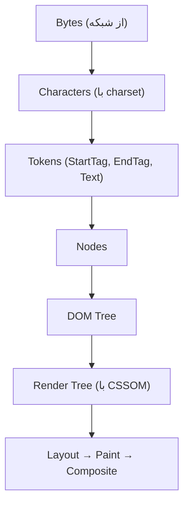
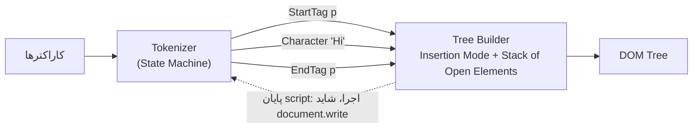
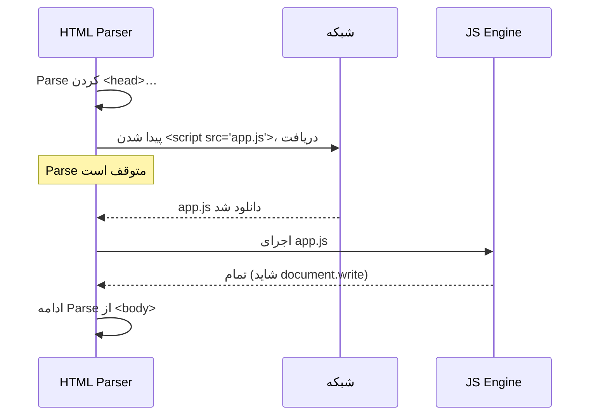
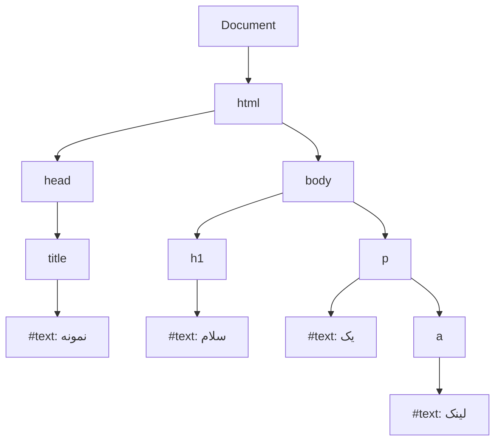
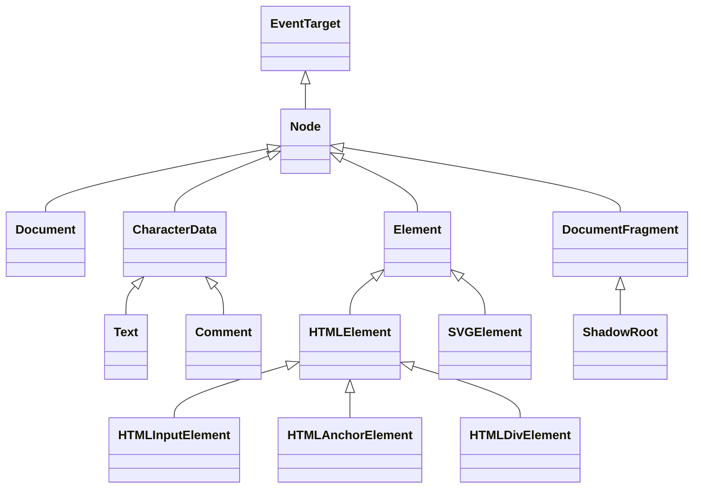

## HTML چیست؟

`HTML (HyperText Markup Language — زبان نشانه‌گذاری ابرمتن)` زبانی برای توصیف **ساختار و معنای** محتوای یک صفحه وب است. HTML زبان برنامه‌نویسی نیست؛ منطق، حلقه یا شرط ندارد. کار آن این است که به مرورگر بگوید «این بخش یک عنوان است»، «این یک لینک است» یا «این یک فرم ورود است».

سه لایه اصلی Frontend را می‌توان این‌طور تفکیک کرد:

| لایه | مسئولیت | مثال |
| --- | --- | --- |
| HTML | ساختار و معنا (Structure & Semantics) | این متن یک `h1` است |
| CSS | ظاهر و چیدمان (Presentation) | رنگ و اندازه `h1` |
| JavaScript | رفتار و تعامل (Behavior) | با کلیک روی دکمه، Modal باز شود |

### چرا HTML وجود دارد؟

وب در ابتدا برای اشتراک اسناد علمی ساخته شد. نیاز اصلی این بود که یک سند بتواند **به اسناد دیگر لینک بدهد (HyperText)** و ساختار آن (عنوان، پاراگراف، لیست) مستقل از دستگاه نمایش‌دهنده قابل فهم باشد. همین ایده امروز هم پابرجاست: یک HTML خوب باید هم برای مرورگر، هم برای `Screen Reader (صفحه‌خوان)` و هم برای موتور جستجو معنادار باشد.

## HTML در Runtime چه می‌شود؟

وقتی مرورگر یک فایل HTML دریافت می‌کند، آن را مستقیماً «نمایش» نمی‌دهد. ابتدا آن را به یک ساختار درختی در حافظه تبدیل می‌کند:



1. **Bytes → Characters:** مرورگر بایت‌ها را با `charset` اعلام‌شده (معمولاً UTF-8) به کاراکتر تبدیل می‌کند. اگر charset اشتباه باشد، متن فارسی به‌هم‌ریخته نمایش داده می‌شود.
2. **Tokenization (توکن‌سازی):** کاراکترها به توکن‌هایی مثل `StartTag: p`، `Text: سلام` و `EndTag: p` تبدیل می‌شوند.
3. **Tree Construction (ساخت درخت):** از توکن‌ها Nodeها ساخته و در یک درخت قرار می‌گیرند؛ نتیجه `DOM (Document Object Model — مدل شیء سند)` است.
4. Parser در HTML **خطاپذیر (Error-tolerant)** است. اگر تگی را نبندید، مرورگر طبق الگوریتم استاندارد HTML حدس می‌زند. به همین دلیل HTML نامعتبر هم معمولاً «کار می‌کند»، اما ممکن است درختی متفاوت با انتظار شما بسازد.

<Callout type="interview">
اگر بپرسند «HTML چطور به صفحه تبدیل می‌شود؟»، فقط نگویید «مرورگر آن را رندر می‌کند». مسیر Bytes → Tokens → DOM و سپس ترکیب با CSSOM و مراحل Layout و Paint را توضیح دهید. این پاسخ نشان می‌دهد Browser Internals را می‌شناسید.
</Callout>

### داخل Parser: Tokenizer، Tree Builder و Stack of Open Elements

HTML Parser یک **State Machine** است که در HTML Living Standard با جزئیات کامل تعریف شده. دو مرحله همکار دارد:

| مرحله | ورودی | خروجی | چه چیزی را دنبال می‌کند |
| --- | --- | --- | --- |
| **Tokenizer** | جریان کاراکترها | Tokenها: DOCTYPE، Start Tag، End Tag، Comment، Character، End-of-file | *State* فعلی خودش (data، tag open، attribute name، script data، …) حدود ۸۰ State |
| **Tree Builder** | Tokenها | Nodeهای DOM که در سند درج می‌شوند | **Insertion Mode** (in head، in body، in table، …) و **Stack of Open Elements** |



**Stack of Open Elements** همان چیزی است که تودرتو بودن را ممکن می‌کند. هر Start Tag یک Element را Push و End Tag آن تا همان Element را Pop می‌کند. وقتی Tree Builder به Tokenی برسد که در Context فعلی مجاز نیست، به‌جای شکست، یک قانون بازیابی دقیق را اجرا می‌کند. به همین دلیل همه مرورگرها از یک Markup خراب، **یک DOM یکسان** می‌سازند.

#### بازیابی خطاهایی که واقعاً با آن‌ها روبه‌رو می‌شوید

| شما می‌نویسید | DOMی که ساخته می‌شود | چرا |
| --- | --- | --- |
| `Hello` (بدون `html`، `head`، `body`) | `<html><head></head><body>Hello</body></html>` | این Elementها به‌طور ضمنی ساخته می‌شوند |
| `<table><tr><td>1</td></tr></table>` | یک `<tbody>` دور ردیف درج می‌شود | ردیف‌ها باید داخل یک Table Section باشند |
| `<table><div>x</div><tr>…</tr></table>` | `div` به **قبل از** جدول منتقل می‌شود | «Foster Parenting»: محتوای نامعتبر داخل جدول به بیرون برده می‌شود |
| `<p>one<p>two` | دو پاراگراف هم‌سطح | Start Tag جدید `p` پاراگراف باز را به‌طور ضمنی می‌بندد |
| `<b><i>text</b></i>` | `b > i` درست تودرتو به‌علاوه یک `i` کپی‌شده | «Adoption Agency Algorithm» تگ‌های Formatting بدتودرتو را تعمیر می‌کند |
| `<p><div>…</div></p>` | `<p></p><div>…</div><p></p>` | `div` از نوع Phrasing Content نیست، پس پاراگراف را می‌بندد |

امتحان کنید: پیش‌نمایش زیر HTML عمداً خراب را Parse می‌کند و DOMی را که مرورگر واقعاً ساخته چاپ می‌کند.

```html live
<div id="out" style="font: 13px/1.6 monospace; white-space: pre-wrap; direction: ltr"></div>
<script>
  const samples = [
    "<table><tr><td>cell</td></tr></table>",
    "<table><div>moved out</div><tr><td>x</td></tr></table>",
    "<p>one<p>two",
    "<b><i>text</b> after</i>",
    "<p><div>block</div></p>",
  ];
  const out = document.getElementById("out");
  for (const html of samples) {
    const doc = new DOMParser().parseFromString(html, "text/html");
    out.textContent += "SOURCE: " + html + "\nDOM:    " + doc.body.innerHTML + "\n\n";
  }
</script>
```

<Callout type="interview">
«چرا HTML نامعتبر باز هم نمایش داده می‌شود؟» چون HTML Parser هیچ‌وقت خطا پرتاب نمی‌کند: مشخصات برای هر خطا یک روش بازیابی تعریف کرده، پس همه مرورگرها درخت یکسانی می‌سازند. هزینه‌اش این است که درخت ممکن است همانی نباشد که منظورتان بوده؛ و این خودش را به‌صورت Selectorهای CSS خراب یا خطای Hydration در React نشان می‌دهد.
</Callout>

### Scriptها می‌توانند Parser را متوقف کنند

وقتی Tree Builder به یک `<script>` کلاسیک (بدون `async`، `defer` یا `type="module"`) می‌رسد باید **توقف کند**: ممکن است Script تابع `document.write()` را صدا بزند که کاراکترها را مستقیماً به ورودی Tokenizer تزریق می‌کند. پس Parser صبر می‌کند تا Script دانلود **و** اجرا شود. یک Stylesheet که هنوز بارگذاری نشده هم می‌تواند همان Script را مسدود کند، چون Script ممکن است Computed Styleها را بخواند.



مرورگرها این مشکل را با **Preload Scanner** کم می‌کنند؛ یک Parser سبک دوم که در HTML خام جلوتر را نگاه می‌کند و تا وقتی Parser اصلی متوقف است، دانلود تصاویر، Scriptها و Stylesheetها را شروع می‌کند. داستان کامل بارگذاری (`async`، `defer`، `module`، Resource Hintها) در [Performance در HTML](/html/performance) آمده است.

## HTML در مقابل XML

`XML (eXtensible Markup Language)` هم یک زبان نشانه‌گذاری است، اما هدف آن **انتقال و ذخیره داده** است، نه نمایش سند.

| ویژگی | HTML | XML |
| --- | --- | --- |
| هدف | ساختار و نمایش سند | ذخیره و انتقال داده |
| تگ‌ها | از پیش تعریف‌شده (`p`, `div`, …) | دلخواه و توسط کاربر تعریف می‌شوند |
| خطاپذیری | Parser خطاها را تحمل و اصلاح می‌کند | هر خطای ساختاری کل سند را نامعتبر می‌کند |
| حساسیت به حروف | تگ‌ها Case-insensitive هستند | Case-sensitive |
| تگ خالی | `<br>` بدون بستن مجاز است | باید `<br/>` باشد |
| Whitespace | معمولاً Collapse می‌شود | حفظ می‌شود |

`XHTML` تلاشی برای نوشتن HTML با قوانین سخت‌گیرانه XML بود. امروز استاندارد اصلی `HTML Living Standard` است که توسط WHATWG نگهداری می‌شود.

## DOM چیست؟

`DOM` نمایش **شیءگرا و زنده** سند در حافظه است که از طریق JavaScript قابل خواندن و تغییر است. نکات کلیدی:

- DOM **همان HTML نیست**. HTML متن منبع است؛ DOM درختی است که مرورگر از آن ساخته و ممکن است با آن متفاوت باشد (مثلاً مرورگر به‌طور خودکار `tbody` را به جدول اضافه می‌کند).
- DOM **زنده** است: اگر JavaScript یک Node اضافه کند، DOM تغییر می‌کند ولی فایل HTML نه.
- DOM یک API استاندارد و مستقل از زبان است؛ در مرورگر از طریق JavaScript در دسترس است.

```html
<!DOCTYPE html>
<html lang="fa" dir="rtl">
  <head>
    <title>نمونه</title>
  </head>
  <body>
    <h1>سلام</h1>
    <p>یک <a href="/about">لینک</a></p>
  </body>
</html>
```



<Callout type="note">
Whitespace بین تگ‌ها هم Text Node می‌سازد. برای همین `childNodes` معمولاً بیشتر از `children` عضو دارد: `children` فقط Elementها را برمی‌گرداند.
</Callout>

## Element، Tag، Attribute و Content

این چهار مفهوم اغلب با هم اشتباه گرفته می‌شوند:

```html
<a href="https://example.com" target="_blank">مشاهده سایت</a>
```

| مفهوم | در مثال بالا | توضیح |
| --- | --- | --- |
| Tag (تگ) | `<a ...>` و `</a>` | نشانه‌گذاری متنی در فایل منبع؛ Opening tag و Closing tag |
| Attribute (ویژگی) | `href` و `target` | اطلاعات اضافه درباره Element که در Opening tag می‌آید |
| Content (محتوا) | `مشاهده سایت` | آنچه بین دو تگ قرار دارد |
| Element (عنصر) | کل عبارت | واحد منطقی‌ای که از Tag، Attribute و Content ساخته شده و در DOM به یک Node تبدیل می‌شود |

### Void Elements

برخی Elementها Content ندارند و Closing tag نمی‌گیرند؛ به آن‌ها `Void Element (عنصر تهی)` می‌گویند: `img`، `input`، `br`، `hr`، `meta`، `link`، `source`. نوشتن `` در HTML مجاز است اما اسلش پایانی هیچ معنایی ندارد.

### Attribute در مقابل Property

یکی از سوالات رایج مصاحبه: تفاوت **HTML Attribute** با **DOM Property**.

- Attribute در **HTML** نوشته می‌شود و مقدار آن همیشه String است.
- Property روی **شیء DOM** در JavaScript قرار دارد و می‌تواند هر نوعی باشد.
- برخی Attributeها با Property همگام هستند (`id`)، اما برخی فقط **مقدار اولیه** را تعیین می‌کنند (`value` در `input`).

```js run
// این کد در Worker اجرا می‌شود؛ رفتار مرورگر را با یک شیء ساده شبیه‌سازی می‌کنیم
// در مرورگر واقعی:
// <input id="name" value="Ali">
// input.value = "Sara"
// input.getAttribute("value") → "Ali"   (مقدار اولیه، Attribute)
// input.value                 → "Sara"  (وضعیت فعلی، Property)
// input.defaultValue          → "Ali"   (Property متناظر با Attribute)

const attributes = { value: "Ali" };
const input = { value: attributes.value, get defaultValue() { return attributes.value; } };
input.value = "Sara";
console.log(attributes.value, input.value, input.defaultValue);
```

#### Reflection با جزئیات

«Reflection» یعنی Property و Attribute با هم همگام می‌مانند. قوانین برای هر Attribute متفاوت است و دقیقاً همین چیزی است که مصاحبه‌کننده می‌سنجد:

| Attribute | Property | رابطه |
| --- | --- | --- |
| `id` | `el.id` | کاملاً دوطرفه Reflect می‌شود |
| `class` | `el.className` / `el.classList` | Reflect می‌شود؛ نام Property متفاوت است چون `class` کلمه رزرو است |
| `for` (روی `label`) | `label.htmlFor` | با نام متفاوت Reflect می‌شود |
| `href` | `a.href` | Property، **URL مطلق Resolve‌شده** را برمی‌گرداند؛ `getAttribute("href")` دقیقاً همان متنی که نوشته‌اید |
| `value` (روی `input`) | `input.value` در مقابل `input.defaultValue` | Attribute فقط مقدار **اولیه** است؛ `value` وضعیت زنده است و `defaultValue` همان Attribute را Reflect می‌کند |
| `checked` | `input.checked` در مقابل `input.defaultChecked` | همان تفکیک `value` |
| `disabled`، `hidden`، `required` | Propertyهای Boolean | **Boolean Attribute**: وجود داشتن یعنی true. `disabled="false"` هم غیرفعال می‌کند! |
| `style` | `el.style` | Property یک Object است (`CSSStyleDeclaration`)، نه String |
| `data-*` | `el.dataset.*` | با نام camelCase Reflect می‌شود |
| `aria-*` | `el.ariaLabel`، `el.ariaExpanded` … | Reflect می‌شود (ARIA Reflection) |

```html live
<a id="link" href="/docs?page=2">Docs</a>
<label id="lbl" for="email">Email</label>
<input id="email" value="initial" />
<input id="agree" type="checkbox" disabled="false" />
<pre id="log" style="font-size:13px; direction:ltr"></pre>
<script>
  const log = (l) => (document.getElementById("log").textContent += l + "\n");
  const a = document.getElementById("link");
  log('a.getAttribute("href") → ' + a.getAttribute("href"));
  log("a.href                → " + a.href);

  log("label.htmlFor         → " + document.getElementById("lbl").htmlFor);

  const input = document.getElementById("email");
  input.value = "typed by user";
  log("input.value           → " + input.value);
  log('getAttribute("value") → ' + input.getAttribute("value"));
  log("input.defaultValue    → " + input.defaultValue);

  const agree = document.getElementById("agree");
  log('disabled="false" → agree.disabled = ' + agree.disabled + "  (presence is what counts)");
  agree.disabled = false;   // Attribute را حذف می‌کند
  log("after .disabled=false → hasAttribute: " + agree.hasAttribute("disabled"));
</script>
```

قاعده عملی: **State را از طریق Property بخوانید و بنویسید** (`input.value`، `el.hidden = true`) و `setAttribute` را برای Attributeهایی که Property ندارند یا وقتی دقیقاً متن منبع را می‌خواهید به کار ببرید.

## Global Attributes

برخی Attributeها روی **همه** Elementها معتبرند. شناختن آن‌ها جلوی دوباره‌سازی رفتارها با JavaScript را می‌گیرد.

| Attribute | کارکرد | نکته |
| --- | --- | --- |
| `id` | شناسه یکتا در سند | هدف لینک‌های `#fragment`، `label for` و ارجاع‌های `aria-*`. یک متغیر سراسری `window[id]` هم می‌سازد (به آن تکیه نکنید) |
| `class` | فهرست کلاس‌ها با فاصله | به‌شکل `el.className` (String) و `el.classList` (`DOMTokenList`) در دسترس است |
| `style` | CSS درون‌خطی | بالاترین Specificity در Author Style؛ به‌شکل `el.style` (یک `CSSStyleDeclaration`) |
| `title` | Tooltip توصیه‌ای | برای کاربران لمسی و کیبورد در دسترس نیست؛ اطلاعات ضروری را فقط اینجا نگذارید |
| `lang` | زبان محتوا | روی تلفظ Screen Reader، Hyphenation، `:lang()` و انتخاب فونت اثر دارد |
| `dir` | جهت متن: `ltr`، `rtl`، `auto` | `auto` جهت را از اولین کاراکتر قوی تشخیص می‌دهد |
| `hidden` | Element مرتبط نیست (مثل `display: none`) | `hidden="until-found"` آن را با Ctrl+F قابل پیدا شدن نگه می‌دارد |
| `tabindex` | ترتیب Focus | `0` = Focusable به ترتیب DOM، `-1` = فقط با Script؛ از مقادیر مثبت پرهیز کنید |
| `contenteditable` | محتوا را قابل ویرایش می‌کند | پایه Rich Text Editorها |
| `draggable` | فعال کردن Drag and Drop API | |
| `inert` | Subtree را از Focus، کلیک و Accessibility Tree حذف می‌کند | ایده‌آل برای محتوای پشت Modal |
| `popover` | Element را به Popover کنترل‌شده با `popovertarget` تبدیل می‌کند | Top Layer، بسته شدن با کلیک بیرون، بدون JS |
| `data-*` | داده سفارشی برای Scriptها | خواندن با `el.dataset` |
| `translate` | مقدار `no` ترجمه ماشینی را دور نگه می‌دارد (مثلاً نام برند، کد) | |
| `spellcheck`، `autocapitalize`، `enterkeyhint`، `inputmode` | راهنمایی کیبورد دسکتاپ و موبایل برای ورود متن | |

### Attributeهای data-* و dataset

`data-*` اجازه می‌دهد بدون ساختن Attributeهای غیراستاندارد، اطلاعات را به Elementها متصل کنید. در JavaScript روی `el.dataset` ظاهر می‌شوند و نام‌ها از kebab-case به camelCase تبدیل می‌شوند. مقادیر همیشه **String** هستند.

```html live
<button data-product-id="42" data-in-stock="true" data-price="19.90">Add to cart</button>
<pre id="log" style="font-size:13px; direction:ltr"></pre>
<script>
  const btn = document.querySelector("button");
  const log = (line) => (document.getElementById("log").textContent += line + "\n");

  log("productId: " + btn.dataset.productId);          // "42" (String!)
  log("inStock:   " + (btn.dataset.inStock === "true")); // تبدیل صریح
  log("price:     " + Number(btn.dataset.price));

  btn.dataset.lastClicked = "never";                    // data-last-clicked می‌سازد
  btn.addEventListener("click", () => {
    btn.dataset.lastClicked = new Date().toLocaleTimeString();
    log("outerHTML: " + btn.outerHTML);
  });
</script>
```

این Attributeها Hook عالی برای CSS هم هستند: `[data-state="open"] { … }` یک Component را بر اساس State آن و بدون کلاس اضافه استایل می‌دهد. Radix و Headless UI وضعیت Componentها را دقیقاً همین‌طور در اختیار می‌گذارند.

### Attribute popover: رفتار بدون JavaScript

```html live
<button popovertarget="menu">Open menu</button>
<div id="menu" popover style="padding:12px;border-radius:8px;border:1px solid #ccc">
  <p style="margin:0 0 8px">I'm in the top layer. Press Esc or click outside.</p>
  <button popovertarget="menu" popovertargetaction="hide">Close</button>
</div>
```

`popover` به شما Top Layer (بدون درگیری با `z-index`)، Light Dismiss (کلیک بیرون یا Esc) و مدیریت درست Focus را می‌دهد. پیش از آن، هر Dropdown به یک کتابخانه JavaScript نیاز داشت.

## Nested Elements (عناصر تودرتو)

Elementها می‌توانند داخل هم قرار بگیرند و رابطه **Parent / Child / Sibling** بسازند. قانون اصلی: تگ‌ها باید **به ترتیب معکوس باز شدن** بسته شوند.

```html
<!-- درست -->
<p>این <strong>مهم</strong> است</p>

<!-- نادرست: Overlap -->
<p>این <strong>مهم</p></strong>
```

همچنین **Content Model** هر Element تعیین می‌کند چه چیزی می‌تواند داخل آن باشد. برای مثال، `p` فقط می‌تواند `Phrasing Content` (محتوای درون‌خطی) داشته باشد. اگر یک `div` داخل `p` بنویسید، Parser پاراگراف را **قبل از div می‌بندد**:

```html
<p><div>متن</div></p>
```

DOM حاصل:

```text
<p></p>
<div>متن</div>
<p></p>
```

این یکی از دلایل `Hydration Mismatch` در React است: سرور HTML را رشته‌ای می‌سازد، ولی مرورگر هنگام Parse آن را تغییر می‌دهد و درخت React با DOM واقعی جور درنمی‌آید.

## Block در مقابل Inline

در HTML قدیم، Elementها به دو دسته Block و Inline تقسیم می‌شدند. امروز این رفتار در واقع توسط **CSS (`display`)** تعیین می‌شود و HTML به جای آن `Content Category` دارد. اما در مصاحبه هنوز این تقسیم‌بندی رایج است:

| ویژگی | Block | Inline |
| --- | --- | --- |
| شروع از خط جدید | بله | خیر |
| عرض پیش‌فرض | کل عرض Container | به اندازه محتوا |
| `width` / `height` | اعمال می‌شود | نادیده گرفته می‌شود |
| `margin` / `padding` عمودی | روی چیدمان اثر دارد | Padding رسم می‌شود اما خطوط اطراف را جابه‌جا نمی‌کند؛ Margin عمودی اثری ندارد |
| مثال | `div`, `p`, `h1`, `section`, `ul` | `span`, `a`, `strong`, `em`, `code` |

```html live
<style>
  .block { background: #dbe4ff; margin: 6px 0; }
  .inline { background: #ffe8cc; width: 300px; height: 80px; padding: 10px; margin: 20px; }
</style>
<div class="block">div یک — Block</div>
<div class="block">div دو — Block</div>
<p>
  متن قبل
  <span class="inline">span (width و height نادیده گرفته می‌شوند)</span>
  متن بعد
</p>
```

<Callout type="tip">
`inline-block` ترکیبی از هر دو است: در جریان متن قرار می‌گیرد (خط جدید نمی‌سازد) ولی `width`، `height` و `margin` عمودی را می‌پذیرد. جزئیات کامل در فصل [Box Model و Display](/css/box-model-display).
</Callout>

## Semantic HTML — معرفی

`Semantic HTML (HTML معنایی)` یعنی انتخاب Elementی که **معنای محتوا** را توصیف می‌کند، نه فقط ظاهر آن را. برای مثال `<button>` به جای `<div onclick>`، یا `<nav>` برای منوی اصلی. این موضوع در فصل [Semantic HTML](/html/semantic) به‌طور کامل بررسی شده است.

```html
<!-- غیرمعنایی -->
<div class="header"><div class="nav">...</div></div>

<!-- معنایی -->
<header><nav aria-label="اصلی">...</nav></header>
```

## انواع Node، فاصله‌ها و Text Nodeها

همه چیز در DOM یک `Node` است، اما چند نوع دارد:

| `nodeType` | ثابت | مثال | در `children`؟ |
| --- | --- | --- | --- |
| 1 | `ELEMENT_NODE` | `<p>`، `<div>` | ✓ |
| 3 | `TEXT_NODE` | متن، از جمله فاصله بین تگ‌ها | ✗ |
| 8 | `COMMENT_NODE` | `<!-- note -->` | ✗ |
| 9 | `DOCUMENT_NODE` | `document` | — |
| 10 | `DOCUMENT_TYPE_NODE` | `<!DOCTYPE html>` | — |
| 11 | `DOCUMENT_FRAGMENT_NODE` | `DocumentFragment`، Shadow Root | — |



این زنجیره وراثت در واقع یک **Prototype Chain** است: `input.value` روی `HTMLInputElement.prototype` و `addEventListener` روی `EventTarget.prototype` پیدا می‌شود.

```html live
<ul id="list">
  <li>one</li>
  <!-- a comment -->
  <li>two</li>
</ul>
<pre id="log" style="font-size:13px; direction:ltr"></pre>
<script>
  const list = document.getElementById("list");
  const log = (l) => (document.getElementById("log").textContent += l + "\n");
  log("childNodes: " + list.childNodes.length + "   children: " + list.children.length);
  list.childNodes.forEach((n, i) =>
    log(i + ": nodeType " + n.nodeType + "  " + JSON.stringify(n.nodeName) + "  " + JSON.stringify(n.textContent)),
  );
  log("prototype chain of an <li>: ");
  let p = Object.getPrototypeOf(list.children[0]);
  while (p) { log("  → " + p.constructor.name); p = Object.getPrototypeOf(p); }
</script>
```

Text Nodeهای فاصله، چند باگ واقعی را توضیح می‌دهند: `firstChild` که به‌جای اولین `li` یک Text Node برمی‌گرداند، فاصله بین Elementهای `inline-block` و بزرگ‌تر بودن `childNodes.length` از انتظار. APIهای مخصوص Element را ترجیح دهید: `children`، `firstElementChild`، `nextElementSibling`.

## Character Reference و Escape کردن

برخی کاراکترها در HTML معنای خاص دارند. برای نمایش آن‌ها به‌عنوان متن از **Character Reference** (یا Entity) استفاده می‌شود:

| کاراکتر | Reference | چرا مهم است |
| --- | --- | --- |
| `<` | `&lt;` | یک تگ را شروع می‌کند |
| `>` | `&gt;` | تگ را می‌بندد (در متن امن است، برای تقارن Escape می‌شود) |
| `&` | `&amp;` | یک Reference را شروع می‌کند |
| `"` | `&quot;` | مقدار Attribute با کوتیشن دوتایی را می‌بندد |
| `'` | `&#39;` | مقدار Attribute با کوتیشن تکی را می‌بندد |
| فاصله نشکن | `&nbsp;` | جلوی شکستن خط را می‌گیرد، مثلاً `10&nbsp;kg` |
| © | `&copy;` یا `&#169;` | Reference نام‌دار یا عددی |

Escape کردن یک موضوع **امنیتی** است، نه فقط قالب‌بندی. اگر ورودی کاربر بدون Escape داخل HTML قرار بگیرد، به‌عنوان Markup پارس می‌شود: این همان **XSS** (Cross-Site Scripting) است.

```html live
<p>Comment: <span id="unsafe"></span></p>
<p>Comment: <span id="safe"></span></p>
<script>
  const userInput = 'Nice post!';
  document.getElementById("unsafe").innerHTML = userInput;   // ✗ به‌عنوان HTML پارس و Handler اجرا می‌شود
  document.getElementById("safe").textContent = userInput;   // ✓ به‌صورت متن ساده نمایش داده می‌شود
</script>
```

حاشیه قرمز ثابت می‌کند که Handler تزریق‌شده اجرا شده است. قاعده سرانگشتی: برای متن از `textContent` (یا یک Framework که به‌طور پیش‌فرض Escape می‌کند) استفاده کنید و وقتی واقعاً مجبورید HTML درج کنید، با کتابخانه‌ای مثل DOMPurify (یا Sanitizer API) آن را پاک‌سازی کنید. نام `dangerouslySetInnerHTML` در React عمداً این‌طور انتخاب شده است. [امنیت مرورگر](/browser/security) را ببینید.

## چه کسی HTML را تعریف می‌کند؟ استانداردها و Validation

- **WHATWG** نگه‌دارنده **HTML Living Standard** است. دیگر نسخه شماره‌دار وجود ندارد؛ «HTML5» آخرین بود و مشخصات اکنون به‌طور پیوسته به‌روز می‌شود.
- **W3C** روی مشخصات مرتبط (CSS، Accessibility/WAI-ARIA) کار می‌کند.
- قابلیت‌های جدید وقتی به اجماع برسند در مرورگرها عرضه می‌شوند؛ پشتیبانی را در caniuse.com یا جدول‌های سازگاری MDN بررسی کنید.
- Markup را با W3C Validator (validator.w3.org/nu) اعتبارسنجی یا در ویرایشگر Lint کنید. معتبر بودن مهم است چون بازیابی خطای بالا ممکن است درختی بسازد که منظورتان نبوده.

## اشتباهات رایج

- **فرض اینکه DOM برابر با HTML منبع است.** مرورگر تگ‌ها را اصلاح، اضافه یا جابه‌جا می‌کند.
- **قرار دادن Block داخل `p`** یا لینک داخل لینک؛ ساختار نامعتبر DOM غیرمنتظره می‌سازد.
- **استفاده از `div` برای همه چیز** و از دست دادن Accessibility رایگانی که Elementهای معنایی دارند.
- **اشتباه گرفتن Attribute و Property** — مثلاً انتظار اینکه `getAttribute("value")` مقدار فعلی input را برگرداند.
- **فراموش کردن `lang` و `dir`** در صفحات فارسی؛ هم برای Screen Reader و هم برای چیدمان RTL ضروری است.

## سوالات مصاحبه

<QA q="DOM چیست و چه تفاوتی با HTML دارد؟" level="junior" n={1}>
<Answer>

DOM نمایش درختی و زنده سند در حافظه است که مرورگر پس از Parse کردن HTML می‌سازد و JavaScript از طریق آن صفحه را می‌خواند و تغییر می‌دهد. HTML متن منبع است؛ DOM ساختار داده‌ای است که از آن ساخته شده.

</Answer>
<Deep>

Parser ورودی را Tokenize کرده و طبق الگوریتم Tree Construction درخت Node می‌سازد. در این مسیر خطاها اصلاح می‌شوند (تگ‌های بسته‌نشده بسته می‌شوند، `tbody` اضافه می‌شود). پس از بارگذاری، هر تغییر JavaScript فقط DOM را تغییر می‌دهد. «View Source» متن اصلی را نشان می‌دهد و «Elements» در DevTools وضعیت فعلی DOM را.

</Deep>
<Mistake>

گفتن اینکه «DOM همان کد HTML است» یا اینکه DOM بخشی از JavaScript است. DOM یک Web API است که مرورگر فراهم می‌کند؛ موتور JavaScript (مثلاً V8) به‌تنهایی DOM ندارد — به همین دلیل Node.js به‌صورت پیش‌فرض `document` ندارد.

</Mistake>
<FollowUp>

چرا در React از Virtual DOM یا به‌طور کلی از Batch کردن تغییرات DOM استفاده می‌شود؟ (پاسخ: عملیات DOM ممکن است Style Recalculation و Layout را فعال کنند؛ تجمیع تغییرات هزینه را کاهش می‌دهد.)

</FollowUp>
</QA>

<QA q="تفاوت Attribute و Property را با مثال `value` در input توضیح دهید." level="mid" n={2}>
<Answer>

Attribute در HTML تعریف می‌شود و رشته است؛ Property روی شیء DOM است. در `input`، Attribute `value` فقط مقدار اولیه را تعیین می‌کند (معادل `defaultValue`)، ولی Property `value` وضعیت فعلی را نگه می‌دارد و با تایپ کاربر تغییر می‌کند.

</Answer>
<Deep>

برای برخی Attributeها Reflection وجود دارد: تغییر `el.id` Attribute را هم تغییر می‌دهد. اما `value` و `checked` این‌طور نیستند: `checked` Attribute معادل `defaultChecked` است. Boolean attributeها (`disabled`, `checked`) با حضورشان True می‌شوند؛ `disabled="false"` همچنان Disabled است.

</Deep>
<Mistake>

نوشتن `disabled="false"` برای فعال کردن دکمه، یا استفاده از `setAttribute("value", x)` برای تغییر مقداری که کاربر می‌بیند (بعد از تایپ کاربر، این کار اثر دیداری ندارد).

</Mistake>
<FollowUp>

در React چرا `defaultValue` در کنار `value` وجود دارد؟ (Controlled در مقابل Uncontrolled input.)

</FollowUp>
</QA>

<QA q="اگر یک `div` را داخل `p` قرار دهیم چه اتفاقی می‌افتد؟" level="mid" n={3}>
<Answer>

Parser مرورگر `p` را قبل از شروع `div` به‌طور خودکار می‌بندد، چون `p` فقط Phrasing Content می‌پذیرد. نتیجه دو پاراگراف خالی و یک div جدا در DOM است.

</Answer>
<Deep>

این رفتار در الگوریتم Tree Construction استاندارد HTML تعریف شده است. در Server-Side Rendering باعث `Hydration Mismatch` می‌شود، چون HTML تولیدشده با DOM ساخته‌شده یکسان نیست.

</Deep>
<Mistake>

فرض اینکه مرورگر خطا می‌دهد یا Element را همان‌طور که نوشته شده نگه می‌دارد.

</Mistake>
<FollowUp>

چه ابزاری برای پیدا کردن این خطاها استفاده می‌کنید؟ (W3C Validator، هشدارهای React در Development، Lint rules.)

</FollowUp>
</QA>

<QA q="تفاوت Block و Inline چیست و `inline-block` چه مشکلی را حل می‌کند؟" level="junior" n={4}>
<Answer>

Block از خط جدید شروع می‌شود و کل عرض را می‌گیرد و width/height را می‌پذیرد. Inline در جریان متن قرار می‌گیرد و width/height را نادیده می‌گیرد. `inline-block` در جریان متن می‌ماند ولی ابعاد را می‌پذیرد — مثلاً برای دکمه‌های کنار هم.

</Answer>
<Deep>

در CSS مدرن `display` دو بعد دارد: Outer display (رفتار Element نسبت به اطراف: block یا inline) و Inner display (رفتار فرزندان: flow، flex، grid). بنابراین `inline-block` در واقع `inline flow-root` است و `inline-flex` یعنی بیرون Inline و درون Flex.

</Deep>
<Mistake>

فکر کردن اینکه Block/Inline یک ویژگی ثابت HTML است. این رفتار از Stylesheet پیش‌فرض مرورگر (User Agent Stylesheet) می‌آید و با CSS قابل تغییر است.

</Mistake>
<FollowUp>

فاصله ناخواسته بین عناصر `inline-block` از کجا می‌آید؟ (Whitespace در HTML به‌عنوان یک کاراکتر فاصله رندر می‌شود.)

</FollowUp>
</QA>

<QA q="مرورگر با HTML نامعتبری مثل `<p><div>x</div></p>` یا یک `div` داخل `table` چه می‌کند؟" level="mid" n={5}>
<Answer>

HTML Parser هیچ‌وقت خطا پرتاب نمی‌کند. Tree Builder قوانین بازیابی تعریف‌شده در مشخصات را اجرا می‌کند: Start Tag `div` پاراگراف باز را می‌بندد (و یک `<p></p>` خالی بعد از آن می‌ماند) و محتوایی که داخل جدول مجاز نیست «Foster Parent» می‌شود، یعنی به قبل از جدول منتقل می‌شود. چون قوانین استاندارد هستند، همه مرورگرها DOM یکسانی می‌سازند.

</Answer>
<Deep>

Tree Builder یک *Insertion Mode* و یک *Stack of Open Elements* را دنبال می‌کند. تگ‌های Formatting بدتودرتو (`<b><i></b></i>`) با Adoption Agency Algorithm تعمیر می‌شوند که ممکن است Elementها را کپی کند. در SSR این موضوع مهم است: اگر HTML سرور متفاوت از درختی که React انتظار دارد تعمیر شود، Hydration خطای Mismatch می‌دهد.

</Deep>
<Mistake>

فرض اینکه DOM کپی یک‌به‌یک منبع است و بعد تعجب از اینکه چرا Selectorهای `p > div` یا نتایج `querySelector` جور درنمی‌آیند.

</Mistake>
<FollowUp>

چرا `document.write` باعث می‌شود Scriptهای کلاسیک Parser را مسدود کنند و Preload Scanner چطور این مشکل را کم می‌کند؟

</FollowUp>
</QA>

<QA q="Attributeهای `data-*` چه هستند و چطور خوانده می‌شوند؟ Type آن‌ها چیست؟" level="junior" n={6}>
<Answer>

Attributeهای سفارشی استاندارد برای ذخیره داده روی Elementها هستند: `data-user-id="7"`. JavaScript آن‌ها را با `el.dataset.userId` (kebab-case به camelCase تبدیل می‌شود) یا `getAttribute("data-user-id")` می‌خواند. مقادیر همیشه String هستند، پس صریحاً تبدیلشان کنید.

</Answer>
<Deep>

به‌عنوان Hook وضعیت در CSS (`[data-state="open"]`) و برای Event Delegation (`event.target.closest("[data-action]")?.dataset.action`) عالی‌اند. داده حجیم یا حساس در آن‌ها نگذارید: در DOM دیده می‌شوند و با `cloneNode` کپی می‌شوند.

</Deep>
<Mistake>

ساختن Attributeهای غیراستاندارد مثل `<div userid="7">` به‌جای `data-userid`.

</Mistake>
<FollowUp>

چطور با Attributeهای `data-action` یک Click Handler واحد برای کل یک Toolbar پیاده می‌کنید؟

</FollowUp>
</QA>

## جمع‌بندی

<Recap>

- HTML زبان نشانه‌گذاری است، نه برنامه‌نویسی: ساختار و معنای محتوا را توصیف می‌کند.
- مرورگر HTML را با Tokenizer و Tree Builder به DOM تبدیل می‌کند و HTML نامعتبر را هم با قواعد مشخص اصلاح می‌کند.
- تگ `<script>` معمولی Parser را متوقف می‌کند تا دانلود و اجرا شود؛ `defer` و `async` این را حل می‌کنند.
- DOM درختی از Nodeهاست که JavaScript می‌تواند بخواند و تغییر دهد؛ HTML فقط نقطه شروع آن است.
- Element از تگ شروع، محتوا و تگ پایان ساخته می‌شود؛ Void Elementها (`img`، `input`، `br`) محتوا و تگ پایان ندارند.
- Attribute در HTML نوشته می‌شود و مقدار اولیه است؛ Property روی Object در DOM است و مقدار فعلی را نگه می‌دارد (مثل `value`).
- `data-*` برای داده سفارشی است و از طریق `dataset` در JavaScript خوانده می‌شود.
- فاصله‌ها و خط‌های جدید هم Text Node می‌سازند؛ `children` فقط Elementها را برمی‌گرداند و `childNodes` همه را.
- کاراکترهای `<` و `&` در متن باید Escape شوند؛ وگرنه علاوه بر خرابی، راه XSS باز می‌شود.

</Recap>
