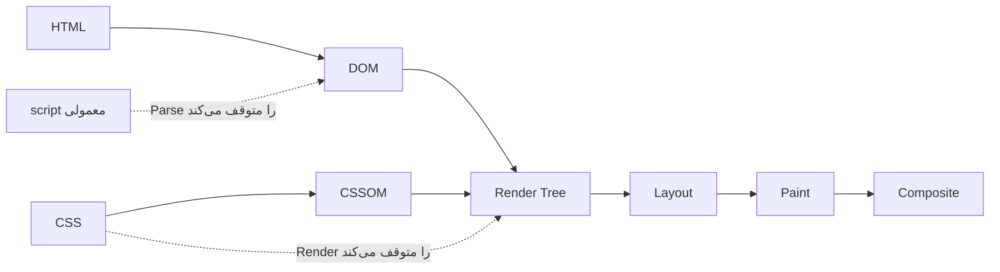
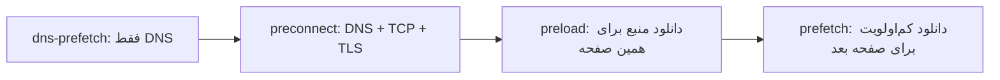

## چرا HTML روی Performance اثر دارد؟

مرورگر HTML را **به‌صورت جریانی (Streaming)** Parse می‌کند. هر منبعی که در HTML پیدا می‌کند — CSS، اسکریپت، فونت، تصویر — می‌تواند Parse یا Render را متوقف کند. ترتیب و نحوه تعریف این منابع در HTML تعیین می‌کند کاربر **چقدر زود** محتوا را ببیند.

معیارهای کلیدی (`Core Web Vitals`):

| معیار | معنا | هدف خوب |
| --- | --- | --- |
| `LCP (Largest Contentful Paint)` | زمان رندر بزرگ‌ترین محتوای قابل مشاهده | ≤ 2.5s |
| `INP (Interaction to Next Paint)` | تأخیر پاسخ به تعاملات کاربر | ≤ 200ms |
| `CLS (Cumulative Layout Shift)` | میزان جابه‌جایی ناخواسته Layout | ≤ 0.1 |
| `FCP (First Contentful Paint)` | اولین رندر محتوا | ≤ 1.8s |
| `TTFB (Time to First Byte)` | زمان دریافت اولین بایت از سرور | ≤ 0.8s |

## Critical Rendering Path



دو نوع Blocking وجود دارد:

- **Render-blocking:** مرورگر تا آماده شدن آن منبع **چیزی رسم نمی‌کند**. CSS در `head` به‌طور پیش‌فرض Render-blocking است، چون رندر بدون CSS باعث `FOUC (Flash of Unstyled Content)` می‌شود.
- **Parser-blocking:** Parser HTML **متوقف** می‌شود. اسکریپت‌های معمولی (بدون async/defer) Parser-blocking هستند. همچنین اسکریپت معمولی باید منتظر CSS‌های قبل از خود بماند، چون ممکن است Style را بخواند (`getComputedStyle`).

### Preload Scanner

خوشبختانه مرورگر یک **Preload Scanner** دارد: وقتی Parser اصلی متوقف است، یک Parser سبک ادامه HTML را اسکن و دانلود منابع (`img`، `link`، `script`) را زودتر شروع می‌کند. منابعی که **در HTML نیستند** (تصویر پس‌زمینه در CSS، فونت داخل CSS، اسکریپتی که با JS اضافه می‌شود، تصویری که با React بعداً رندر می‌شود) از دید Preload Scanner پنهان‌اند — اینجاست که `preload` لازم می‌شود.

## Script Loading: async، defer و module

```text
<script>          HTML ██████░░░░░░░░░░░░░██████████
                  Script      ▓▓▓▓▓▓▓█████
                              دانلود   اجرا   (Parser منتظر می‌ماند)

<script async>    HTML ██████████████░░░░░███████
                  Script   ▓▓▓▓▓▓▓▓▓█████
                           دانلود موازی، اجرا به محض آماده شدن (Parser متوقف می‌شود)

<script defer>    HTML ████████████████████████████
                  Script   ▓▓▓▓▓▓▓▓▓              █████
                           دانلود موازی            اجرا بعد از پایان Parse، قبل از DOMContentLoaded
```

| ویژگی | معمولی | `async` | `defer` | `type="module"` |
| --- | --- | --- | --- | --- |
| Parser را برای دانلود متوقف می‌کند | بله | خیر | خیر | خیر |
| زمان اجرا | فوراً | به محض دانلود | بعد از Parse کامل | مثل defer (یا async با `async`) |
| ترتیب اجرا حفظ می‌شود | بله | **خیر** | بله | بله |
| قبل از `DOMContentLoaded` | بله | شاید | بله | بله |
| دسترسی به کل DOM | فقط بالای خودش | تضمین نشده | بله | بله |
| کاربرد | به‌ندرت | Analytics، اسکریپت‌های مستقل | اسکریپت اصلی اپ | ES Modules مدرن |

```html
<!-- اسکریپت اصلی اپلیکیشن -->
<script src="/app.js" defer></script>

<!-- اسکریپت مستقل که به چیزی وابسته نیست -->
<script src="https://analytics.example/a.js" async></script>

<!-- ES Module (به‌طور پیش‌فرض defer و Strict Mode) -->
<script type="module" src="/main.js"></script>
<!-- Fallback برای مرورگرهای خیلی قدیمی -->
<script nomodule src="/legacy.js" defer></script>
```

<Callout type="interview">
سوال کلاسیک: «async و defer چه تفاوتی دارند؟» پاسخ کامل سه بخش دارد: هر دو دانلود را موازی انجام می‌دهند؛ async به محض دانلود و بدون حفظ ترتیب اجرا می‌شود؛ defer بعد از پایان Parse و با حفظ ترتیب، قبل از `DOMContentLoaded` اجرا می‌شود. `defer` و `async` روی Inline Script اثری ندارند (به‌جز `type="module"` که همیشه Deferred است).
</Callout>

### DOMContentLoaded در مقابل load

| رویداد | زمان |
| --- | --- |
| `DOMContentLoaded` | HTML کامل Parse شده و اسکریپت‌های defer اجرا شده‌اند. منتظر تصاویر و Stylesheetها نمی‌ماند (مگر اسکریپتی منتظر CSS باشد) |
| `load` | همه منابع (تصاویر، iframe، فونت) بارگذاری شده‌اند |

## Resource Hints



### dns-prefetch

```html
<link rel="dns-prefetch" href="https://cdn.example.com" />
```

فقط DNS Lookup را زودتر انجام می‌دهد (چند ده میلی‌ثانیه صرفه‌جویی). ارزان است و برای دامنه‌های ثالثی که «احتمالاً» استفاده می‌شوند مناسب است.

### preconnect

```html
<link rel="preconnect" href="https://fonts.gstatic.com" crossorigin />
```

DNS + اتصال TCP + TLS Handshake را از قبل انجام می‌دهد؛ روی شبکه موبایل می‌تواند ۱۰۰ تا ۵۰۰ میلی‌ثانیه صرفه‌جویی کند.

- فقط برای **۲ تا ۴ Origin** حیاتی؛ هر اتصال باز هزینه CPU و حافظه دارد و اگر حدود ۱۰ ثانیه استفاده نشود بسته می‌شود.
- اگر منبع با CORS دانلود می‌شود (فونت‌ها همیشه)، `crossorigin` لازم است؛ وگرنه اتصال جداگانه‌ای ساخته می‌شود و Preconnect هدر می‌رود.

### preload

```html
<link rel="preload" href="/fonts/vazirmatn.woff2" as="font" type="font/woff2" crossorigin />
<link rel="preload" href="/hero.avif" as="image" fetchpriority="high" />
<link rel="preload" href="/critical.css" as="style" />
```

یک منبع **حیاتی برای همین صفحه** را با اولویت بالا زودتر دانلود می‌کند، بدون اینکه اجرا یا اعمالش کند.

- `as` **الزامی** است: اولویت، Header `Accept` و CSP را تعیین می‌کند. بدون `as` منبع دو بار دانلود می‌شود.
- مناسب برای منابعی که Preload Scanner نمی‌بیند: فونت‌ها، تصویر LCP که در CSS یا با JS لود می‌شود.
- اگر Preload شده‌ای تا ۳ ثانیه استفاده نشود، Console هشدار می‌دهد. Preload بیش از حد، پهنای باند منابع واقعاً مهم را می‌گیرد.

### prefetch

```html
<link rel="prefetch" href="/checkout.js" />
```

منبعی که **احتمالاً در Navigation بعدی** لازم است را با کمترین اولویت، در زمان بیکاری دانلود و در HTTP Cache نگه می‌دارد. مثلاً Chunk صفحه پرداخت وقتی کاربر در سبد خرید است.

### modulepreload

```html
<link rel="modulepreload" href="/src/main.js" />
```

مخصوص ES Moduleها: علاوه بر دانلود، Parse و Compile می‌کند و Dependencyها را در Module Map قرار می‌دهد. Vite این را خودکار برای Chunkهای وابسته اضافه می‌کند.

### Speculation Rules (پیشرفته)

```html
<script type="speculationrules">
  { "prerender": [{ "where": { "href_matches": "/products/*" }, "eagerness": "moderate" }] }
</script>
```

API جدید Chromium برای **Prerender** کامل صفحه بعدی در پس‌زمینه؛ Navigation تقریباً آنی می‌شود.

| Hint | کار | اولویت | صفحه |
| --- | --- | --- | --- |
| `dns-prefetch` | DNS | — | — |
| `preconnect` | DNS + TCP + TLS | — | — |
| `preload` | دانلود | بالا | فعلی |
| `modulepreload` | دانلود + Parse ماژول | بالا | فعلی |
| `prefetch` | دانلود | پایین | بعدی |
| `prerender` (Speculation) | رندر کامل | — | بعدی |

## fetchpriority

```html
          <!-- تصویر LCP -->

<script src="/non-critical.js" async fetchpriority="low"></script>
```

مرورگر خودش اولویت تعیین می‌کند (تصاویر داخل Viewport بعد از Layout ارتقا پیدا می‌کنند)، اما `fetchpriority="high"` روی تصویر LCP آن را از همان ابتدا با اولویت بالا دانلود می‌کند و معمولاً LCP را صدها میلی‌ثانیه بهبود می‌دهد.

## Lazy Loading

```html


<iframe src="https://www.youtube.com/embed/..." loading="lazy" title="ویدیو آموزشی"></iframe>
```

- `loading="lazy"` دانلود را تا نزدیک شدن به Viewport به تعویق می‌اندازد.
- **هرگز تصویر LCP یا بالای صفحه را Lazy نکنید**؛ دانلودش تا بعد از Layout عقب می‌افتد.
- `width` و `height` را **همیشه** بنویسید: مرورگر از نسبت آن‌ها `aspect-ratio` می‌سازد و قبل از دانلود جای تصویر را رزرو می‌کند (جلوگیری از CLS).
- `decoding="async"` اجازه می‌دهد Decode تصویر Main Thread را مسدود نکند.

### تصاویر Responsive

```html
<picture>
  <source type="image/avif" srcset="/hero-800.avif 800w, /hero-1600.avif 1600w" sizes="100vw" />
  <source type="image/webp" srcset="/hero-800.webp 800w, /hero-1600.webp 1600w" sizes="100vw" />
  
</picture>


```

- `srcset` با `w` گزینه‌ها را معرفی و `sizes` به مرورگر می‌گوید تصویر در چه عرضی نمایش داده می‌شود. مرورگر بر اساس DPR بهترین را انتخاب می‌کند.
- `picture` + `source type` برای انتخاب **فرمت** (AVIF، WebP، JPEG fallback) و `media` برای **Art Direction** (برش متفاوت در موبایل).

## Font Loading

```html
<link rel="preload" href="/fonts/vazirmatn.woff2" as="font" type="font/woff2" crossorigin />
<style>
  @font-face {
    font-family: "Vazirmatn";
    src: url("/fonts/vazirmatn.woff2") format("woff2");
    font-display: swap;
    unicode-range: U+0600-06FF, U+200C-200F, U+FB50-FDFF;
  }
</style>
```

| `font-display` | رفتار | ریسک |
| --- | --- | --- |
| `block` | تا ۳ ثانیه متن نامرئی (FOIT) | متن دیر دیده می‌شود |
| `swap` | فوراً Fallback، سپس جایگزینی (FOUT) | Layout Shift |
| `fallback` | ۱۰۰ms نامرئی، سپس Fallback؛ فونت فقط تا ۳s جایگزین می‌شود | |
| `optional` | فقط اگر فوری آماده باشد استفاده می‌شود | ممکن است در بار اول دیده نشود؛ بهترین برای CLS |

`size-adjust`، `ascent-override` و `descent-override` روی فونت Fallback، اندازه آن را به فونت اصلی نزدیک و Layout Shift ناشی از swap را حذف می‌کنند.

## مثال واقعی: head بهینه

```html
<head>
  <meta charset="UTF-8" />
  <meta name="viewport" content="width=device-width, initial-scale=1" />
  <title>فروشگاه</title>

  <!-- 1. اتصال زودهنگام به Originهای حیاتی -->
  <link rel="preconnect" href="https://cdn.shop.example" crossorigin />
  <link rel="dns-prefetch" href="https://analytics.example" />

  <!-- 2. منابعی که Preload Scanner نمی‌بیند -->
  <link rel="preload" href="/fonts/vazirmatn.woff2" as="font" type="font/woff2" crossorigin />
  <link rel="preload" as="image" href="/hero.avif" fetchpriority="high" />

  <!-- 3. Critical CSS به‌صورت Inline، بقیه به‌صورت غیرمسدودکننده -->
  <style>/* CSS بالای صفحه */</style>
  <link rel="stylesheet" href="/main.css" media="print" onload="this.media='all'" />

  <!-- 4. اسکریپت‌ها -->
  <script type="module" src="/app.js"></script>
  <script src="https://analytics.example/a.js" async></script>
</head>
```

<Callout type="note">
ترفند `media="print" onload="this.media='all'"` باعث می‌شود Stylesheet با اولویت پایین و بدون Render-blocking دانلود شود و پس از بارگذاری اعمال شود. فقط برای CSS غیرحیاتی مناسب است؛ اگر CSS بالای صفحه را این‌طور لود کنید FOUC خواهید داشت.
</Callout>

## اشتباهات رایج

- اسکریپت‌های معمولی در `head` بدون `defer`.
- `async` برای اسکریپت‌هایی که به هم وابسته‌اند (ترتیب اجرا تضمین نمی‌شود).
- Lazy کردن تصویر LCP.
- ننوشتن `width` و `height` تصاویر و در نتیجه ایجاد CLS.
- `preload` بدون `as` یا فونت بدون `crossorigin` (دانلود دوباره).
- Preconnect به ده‌ها Origin.
- استفاده از `prefetch` برای منابع صفحه فعلی.

## سوالات مصاحبه

<QA q="تفاوت `async` و `defer` چیست؟ هرکدام را کجا استفاده می‌کنید؟" level="junior" n={1}>
<Answer>

هر دو اسکریپت را موازی با Parse دانلود می‌کنند. `async` به محض دانلود اجرا می‌شود (Parser را برای اجرا متوقف می‌کند) و ترتیب را حفظ نمی‌کند — مناسب اسکریپت‌های مستقل مثل Analytics. `defer` پس از پایان Parse و به ترتیب، قبل از `DOMContentLoaded` اجرا می‌شود — مناسب اسکریپت اصلی اپ.

</Answer>
<Deep>

Module Scriptها به‌طور پیش‌فرض Deferred هستند و با `async` رفتار async پیدا می‌کنند. Inline Scriptهای معمولی `defer`/`async` را نادیده می‌گیرند. اسکریپت‌های اضافه‌شده با `document.createElement('script')` به‌طور پیش‌فرض async هستند؛ برای حفظ ترتیب باید `script.async = false` تنظیم شود.

</Deep>
<Mistake>

گفتن اینکه `async` «اسکریپت را در Background اجرا می‌کند». اجرای JavaScript همیشه روی Main Thread است؛ فقط **دانلود** موازی است.

</Mistake>
<FollowUp>

چرا یک اسکریپت معمولی که بعد از یک `link rel="stylesheet"` آمده، منتظر CSS می‌ماند؟

</FollowUp>
</QA>

<QA q="preload، prefetch و preconnect را مقایسه کنید." level="mid" n={2}>
<Answer>

`preconnect` فقط اتصال (DNS + TCP + TLS) را زودتر برقرار می‌کند. `preload` یک منبع حیاتی برای **صفحه فعلی** را با اولویت بالا دانلود می‌کند. `prefetch` یک منبع برای **Navigation بعدی** را با اولویت پایین در زمان بیکاری دانلود می‌کند.

</Answer>
<Deep>

Preload برای منابعی ارزشمند است که دیر کشف می‌شوند (فونت داخل CSS، تصویر LCP پس‌زمینه، Chunkهای Lazy مسیر فعلی). Preload بی‌مورد با منابع حیاتی رقابت می‌کند و LCP را بدتر می‌کند. Header `Link: </font.woff2>; rel=preload; as=font` و پاسخ `103 Early Hints` اجازه می‌دهند Preload حتی قبل از آماده شدن HTML در سرور شروع شود.

</Deep>
<Mistake>

Preload کردن همه چیز یا استفاده از prefetch برای منابع صفحه جاری.

</Mistake>
<FollowUp>

103 Early Hints چیست و چه مشکلی را حل می‌کند؟

</FollowUp>
</QA>

<QA q="چطور LCP یک صفحه محصول را بهبود می‌دهید؟" level="senior" n={3}>
<Answer>

ابتدا عنصر LCP و زمان‌بندی آن را با DevTools شناسایی می‌کنم و آن را به چهار بخش تقسیم می‌کنم: TTFB، تأخیر کشف منبع، زمان دانلود و تأخیر رندر. سپس: تصویر LCP در HTML اولیه (نه با JS)، `fetchpriority="high"`، بدون `loading="lazy"`، فرمت AVIF/WebP با `srcset` مناسب، Preconnect به CDN، کاهش CSS و JS Render-blocking و بهبود TTFB با Cache و SSR/SSG.

</Answer>
<Deep>

| بخش LCP | علت رایج | راه‌حل |
| --- | --- | --- |
| TTFB | سرور کند، بدون CDN | Cache، Edge، SSG |
| Resource load delay | تصویر دیر کشف می‌شود (CSS background یا Client Render) | `img` در HTML، `preload`، `fetchpriority` |
| Resource load duration | تصویر سنگین | AVIF، `srcset`، فشرده‌سازی |
| Element render delay | CSS/JS مسدودکننده، Hydration | Critical CSS، `defer`، کاهش JS |

</Deep>
<Mistake>

تمرکز فقط روی حجم تصویر، در حالی که بیشترین زمان معمولاً در «تأخیر کشف» است — مثلاً وقتی تصویر Hero توسط React بعد از دانلود و اجرای Bundle رندر می‌شود.

</Mistake>
<FollowUp>

تفاوت داده Lab (Lighthouse) و Field (CrUX، RUM) چیست و چرا Core Web Vitals بر اساس Field سنجیده می‌شود؟

</FollowUp>
</QA>

## جمع‌بندی

<Recap>

- Critical Rendering Path یعنی مسیر HTML → DOM، CSS → CSSOM، ساختن Render Tree، Layout و Paint؛ CSS رندر را و Script معمولی Parser را مسدود می‌کند.
- Preload Scanner منابع را جلوتر از Parser کشف می‌کند؛ منابعی که در HTML دیده نمی‌شوند (مثل عکس داخل CSS یا JS) دیر کشف می‌شوند.
- `defer` دانلود موازی و اجرای به‌ترتیب بعد از Parse است؛ `async` به محض دانلود اجرا می‌شود و ترتیب ندارد؛ `type="module"` به‌صورت پیش‌فرض defer است.
- `DOMContentLoaded` بعد از ساخته شدن DOM و اجرای Scriptهای defer است؛ `load` بعد از همه منابع از جمله عکس‌ها.
- `preconnect` اتصال به Origin دیگر را زودتر برقرار می‌کند؛ `preload` یک منبع حیاتی صفحه فعلی را زود دانلود می‌کند؛ `prefetch` منبع صفحه بعدی را با اولویت پایین.
- `fetchpriority="high"` روی تصویر LCP و `loading="lazy"` برای تصاویر پایین صفحه (هرگز روی تصویر LCP).
- `srcset` و `sizes` به مرورگر اجازه می‌دهند تصویر با اندازه مناسب دستگاه را انتخاب کند؛ `width` و `height` جلوی Layout Shift را می‌گیرند.
- فونت: `font-display: swap`، preload فونت حیاتی با `crossorigin`، و فرمت WOFF2.

</Recap>
