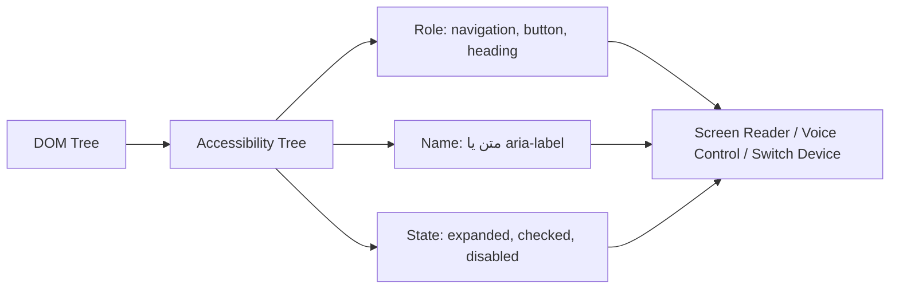

## Semantic HTML چیست؟

`Semantic HTML (HTML معنایی)` یعنی استفاده از Elementی که **نقش و معنای** محتوا را توصیف می‌کند. `div` و `span` هیچ معنایی ندارند؛ فقط ظرف هستند. اما `nav` می‌گوید «این ناوبری است» و `button` می‌گوید «این قابل کلیک و فعال‌سازی با کیبورد است».

### یک مقایسه ساده

این دو قطعه کد در مرورگر **دقیقاً یکسان** دیده می‌شوند (با CSS یکسان):

```html
<!-- نسخه ۱: «سوپ div» -->
<div class="header">
  <div class="logo">فروشگاه</div>
  <div class="menu"><div onclick="go('/')">خانه</div><div onclick="go('/cart')">سبد خرید</div></div>
</div>
<div class="content">
  <div class="title">کفش ورزشی</div>
  <div class="btn" onclick="buy()">خرید</div>
</div>

<!-- نسخه ۲: Semantic -->
<header>
  <a href="/">فروشگاه</a>
  <nav><a href="/">خانه</a> <a href="/cart">سبد خرید</a></nav>
</header>
<main>
  <h1>کفش ورزشی</h1>
  <button type="button" onclick="buy()">خرید</button>
</main>
```

ولی برای هر کسی که صفحه را **نمی‌بیند**، این دو کاملاً متفاوت‌اند:

| | نسخه ۱ (div) | نسخه ۲ (Semantic) |
| --- | --- | --- |
| Screen Reader چه می‌گوید | «فروشگاه، خانه، سبد خرید، کفش ورزشی، خرید» (فقط متن، بدون هیچ نقشی) | «Banner. لینک فروشگاه. Navigation. Heading سطح ۱: کفش ورزشی. دکمه: خرید» |
| کاربر کیبورد با Tab | به هیچ‌کدام نمی‌رسد؛ `div` فوکوس نمی‌گیرد | به همه لینک‌ها و دکمه می‌رسد و با Enter فعالشان می‌کند |
| Google | نمی‌فهمد عنوان اصلی صفحه چیست | `h1` و `main` را محتوای اصلی می‌شناسد |
| کلیک وسط ماوس روی «سبد خرید» | کار نمی‌کند | در تب جدید باز می‌شود |

نسخه دوم حتی **کوتاه‌تر** است و هیچ JavaScript اضافه‌ای برای ناوبری لازم ندارد. Semantic HTML یعنی همین: Element را بر اساس **معنا** انتخاب کنید، و ظاهر را به CSS بسپارید.

### چرا وجود دارد؟

مرورگر برای هر Element معنایی، اطلاعاتی را در **Accessibility Tree (درخت دسترسی‌پذیری)** قرار می‌دهد. Screen Readerها و فناوری‌های کمکی به‌جای DOM، این درخت را می‌خوانند.



هر Node در Accessibility Tree سه ویژگی اصلی دارد:

| ویژگی | منبع | مثال |
| --- | --- | --- |
| Role (نقش) | خود Element (Implicit) یا `role` | `button`، `link`، `heading level 2` |
| Name (نام دسترسی‌پذیر) | محتوا، `label`، `alt`، `aria-label` | «ثبت سفارش» |
| State/Value (وضعیت) | Attributeها | `checked`، `expanded`، `disabled` |

## Landmark Elementها

Landmarkها بخش‌های اصلی صفحه را مشخص می‌کنند. کاربر Screen Reader می‌تواند مستقیماً بین آن‌ها پرش کند (مثلاً در NVDA با کلید `D`).

```html
<body>
  <header>
    <a href="/">لوگو</a>
    <nav aria-label="اصلی">
      <ul>
        <li><a href="/" aria-current="page">خانه</a></li>
        <li><a href="/blog">وبلاگ</a></li>
      </ul>
    </nav>
  </header>

  <main>
    <article>
      <header>
        <h1>آشنایی با Event Loop</h1>
        <p>نوشته <address><a href="/authors/sara">سارا</a></address>
           در <time datetime="2026-03-14">۲۴ اسفند ۱۴۰۴</time></p>
      </header>

      <section aria-labelledby="stack">
        <h2 id="stack">Call Stack</h2>
        <p>...</p>
        <figure>
          
          <figcaption>شکل ۱: وضعیت Call Stack هنگام فراخوانی تو در تو</figcaption>
        </figure>
      </section>
    </article>

    <aside aria-label="مطالب مرتبط">...</aside>
  </main>

  <footer>
    <small>© ۱۴۰۵</small>
  </footer>
</body>
```

| Element | Role ضمنی | کاربرد | نکته |
| --- | --- | --- | --- |
| `header` | `banner` (فقط وقتی مستقیم داخل body باشد) | سربرگ صفحه یا یک بخش | داخل `article` نقش banner ندارد |
| `nav` | `navigation` | گروه لینک‌های اصلی ناوبری | همه لینک‌ها nav نیستند؛ اگر چند nav دارید با `aria-label` متمایز کنید |
| `main` | `main` | محتوای اصلی و یکتای صفحه | فقط **یک** `main` قابل مشاهده در صفحه |
| `section` | `region` (فقط اگر نام داشته باشد) | بخش موضوعی که معمولاً عنوان دارد | بدون عنوان، معمولاً `div` درست‌تر است |
| `article` | `article` | محتوای مستقل و قابل انتشار جداگانه | پست، کامنت، کارت محصول، Widget |
| `aside` | `complementary` | محتوای مرتبط ولی جانبی | Sidebar، Tip، تبلیغ |
| `footer` | `contentinfo` (مستقیم داخل body) | پاورقی صفحه یا یک بخش | |
| `figure` / `figcaption` | `figure` | محتوای خودکفا با توضیح | تصویر، نمودار، Code Snippet |
| `address` | `group` | اطلاعات تماس نزدیک‌ترین `article` یا `body` | برای هر آدرس پستی نیست |
| `time` | `time` | تاریخ/زمان قابل خواندن توسط ماشین | `datetime` استاندارد ISO |

## `div` در مقابل `section`

یکی از پرتکرارترین سوالات:

- `div` **هیچ معنایی** ندارد. برای Styling و گروه‌بندی صرفاً بصری استفاده می‌شود.
- `section` یک **بخش موضوعی** از سند است که معمولاً عنوان (`h2` تا `h6`) دارد.

قانون عملی: **اگر بخش در فهرست مطالب (Outline) سند جایی دارد، `section` است. اگر فقط برای Flexbox یا Grid لازم است، `div` است.**

```html
<!-- غلط: section فقط برای Layout -->
<section class="flex-row">
  <section class="col">...</section>
</section>

<!-- درست -->
<section aria-labelledby="pricing-title">
  <h2 id="pricing-title">قیمت‌گذاری</h2>
  <div class="grid">...</div>
</section>
```

### `article` در مقابل `section`

سؤال کلیدی: **آیا این محتوا اگر به‌تنهایی در سایت دیگر یا یک RSS منتشر شود، معنا دارد؟** اگر بله، `article`. یک پست وبلاگ `article` است؛ بخش «نظرات» آن `section` است؛ هر نظر به‌تنهایی یک `article` است.

## Headingها و Outline

- `h1` تا `h6` ساختار سلسله‌مراتبی صفحه را می‌سازند. کاربران Screen Reader اغلب ابتدا لیست Headingها را مرور می‌کنند.
- سطح Heading را **بر اساس ساختار** انتخاب کنید، نه اندازه فونت. ظاهر را با CSS تنظیم کنید.
- سطح‌ها را **رد نکنید** (`h2` بعد `h4`).
- الگوریتم «Document Outline» که قرار بود `h1` داخل هر `section` را خودکار سطح‌بندی کند، **هرگز در مرورگرها پیاده‌سازی نشد** و از استاندارد حذف شد. پس `h1` داخل section همچنان `h1` است.

## Elementهای معنایی درون‌خطی

| Element | معنا | به جای |
| --- | --- | --- |
| `strong` | اهمیت زیاد | `b` (فقط ظاهر Bold) |
| `em` | تأکید که معنای جمله را تغییر می‌دهد | `i` (فقط Italic، مثل اصطلاح خارجی) |
| `mark` | برجسته‌سازی (مثل نتیجه جستجو) | `span.highlight` |
| `code`، `kbd`، `samp` | کد، کلید کیبورد، خروجی برنامه | `span.mono` |
| `abbr` | مخفف با `title` | |
| `cite`، `q`، `blockquote` | منبع و نقل‌قول | |
| `del`، `ins` | متن حذف/اضافه‌شده | `s` |
| `dfn` | تعریف یک اصطلاح | |

## Interactive Elementها: `button` در مقابل `a` در مقابل `div`

این بخش در مصاحبه‌ها بسیار مهم است:

| | `button` | `a href` | `div onClick` |
| --- | --- | --- | --- |
| معنا | انجام **عمل** (Submit، باز کردن Modal) | **رفتن** به مکان/URL دیگر | هیچ |
| فوکوس با Tab | بله | بله | خیر |
| فعال‌سازی | `Enter` و `Space` | `Enter` | هیچ |
| Role | `button` | `link` | `generic` |
| کلیک وسط / Open in new tab | خیر | بله | خیر |
| داخل فرم | پیش‌فرض `type="submit"` | — | — |

برای اینکه یک `div` واقعاً مثل دکمه رفتار کند باید این‌ها را اضافه کنید:

```html
<div role="button" tabindex="0" aria-pressed="false"
     onclick="toggle()" onkeydown="if (event.key === 'Enter' || event.key === ' ') toggle()">
  ذخیره
</div>
```

و هنوز هم چیزهایی کم دارد (رفتار `Space` روی keyup، Disabled، Submit فرم). پاسخ ساده: **`<button type="button">` بنویسید.**

<Callout type="interview">
جمله کلیدی برای مصاحبه: «اولین قانون ARIA این است که از ARIA استفاده نکنید، اگر یک Element بومی HTML همان معنا و رفتار را دارد.» Elementهای بومی Role، فوکوس، رفتار کیبورد و State را رایگان می‌دهند.
</Callout>

## تأثیر Semantic HTML

### Accessibility

- Screen Reader نقش هر بخش را اعلام می‌کند: «Navigation، فهرست، ۵ مورد».
- پرش بین Landmarkها و Headingها ممکن می‌شود.
- فوکوس و رفتار کیبورد برای `button`، `a`، `input` و `details` بومی است.

### SEO

- موتورهای جستجو از ساختار Heading و `main`/`article` برای فهم بخش اصلی محتوا استفاده می‌کنند.
- `time datetime` و Structured Data به Rich Results کمک می‌کنند.
- محتوای داخل `nav` و `footer` به‌عنوان Boilerplate شناخته می‌شود و وزن کمتری می‌گیرد.

### Maintainability

- `<nav>` خواناتر از `<div class="nav-wrapper-2">` است.
- Selectorهای CSS و تست‌ها پایدارتر می‌شوند؛ Testing Library توصیه می‌کند با Role جستجو کنید: `getByRole('button', { name: 'ذخیره' })`.
- Reader Mode مرورگر و ابزارهای ترجمه بهتر کار می‌کنند.

## Elementهای بومی که اغلب فراموش می‌شوند

```html
<!-- Accordion بدون JavaScript -->
<details>
  <summary>شرایط ارسال</summary>
  <p>ارسال رایگان برای سفارش‌های بالای ۵۰۰ هزار تومان.</p>
</details>

<!-- Modal با Focus Trap و Escape داخلی -->
<dialog id="confirm">
  <form method="dialog">
    <p>حذف شود؟</p>
    <button value="cancel">انصراف</button>
    <button value="ok">حذف</button>
  </form>
</dialog>

<!-- Popover بدون JavaScript (Baseline 2024) -->
<button popovertarget="menu">منو</button>
<div id="menu" popover>...</div>
```

- `dialog.showModal()` بقیه صفحه را `inert` می‌کند، Escape را مدیریت می‌کند و `::backdrop` دارد.
- `popover` در Top Layer نمایش داده می‌شود، پس مشکل z-index ندارد و با کلیک بیرون بسته می‌شود.

```html live
<details open>
  <summary>این یک details بومی است</summary>
  <p>بدون یک خط JavaScript باز و بسته می‌شود و با کیبورد هم کار می‌کند.</p>
</details>
<br />
<button popovertarget="pop">باز کردن Popover</button>
<div id="pop" popover style="padding:16px;border-radius:8px">
  من در Top Layer هستم. بیرون کلیک کنید تا بسته شوم.
</div>
```

## اشتباهات رایج

- **Div soup:** همه چیز `div` با کلاس‌های توصیفی.
- **`section` برای Layout** بدون Heading.
- **انتخاب Heading بر اساس اندازه** و رد شدن از سطح‌ها.
- **لینکی که کار دکمه را می‌کند:** `<a href="#" onclick="openModal()">` — به URL نمی‌رود، پس `button` است.
- **دکمه‌ای که کار لینک را می‌کند:** `<button onclick="location.href='/about'">` — کلیک وسط و Open in new tab را از بین می‌برد.
- **چند `main`** یا `main` داخل `article`.
- **`b` و `i` برای اهمیت و تأکید** به جای `strong` و `em`.

## سوالات مصاحبه

<QA q="تفاوت `div` و `section` چیست؟ چه زمانی از هرکدام استفاده می‌کنید؟" level="junior" n={1}>
<Answer>

`div` بدون معناست و برای گروه‌بندی بصری یا Styling است. `section` یک بخش موضوعی سند است که معمولاً Heading دارد. اگر بخش در Outline سند جای دارد `section`، و اگر فقط برای Layout است `div`.

</Answer>
<Deep>

`section` فقط زمانی که Accessible Name داشته باشد (با `aria-labelledby` یا `aria-label`) در Accessibility Tree به‌عنوان Landmark `region` ظاهر می‌شود. یعنی section بدون نام از نظر Screen Reader تقریباً با div یکی است؛ ارزش اصلی آن خوانایی و ساختار است.

</Deep>
<Mistake>

جایگزین کردن همه divها با section به خیال «Semantic بودن» — این Outline را شلوغ و بی‌معنا می‌کند.

</Mistake>
<FollowUp>

تفاوت `article` و `section` چیست؟ (محتوای مستقل و قابل انتشار جداگانه در مقابل بخش موضوعی.)

</FollowUp>
</QA>

<QA q="چرا نباید از `div` با `onClick` به جای `button` استفاده کرد؟" level="mid" n={2}>
<Answer>

`div` قابل فوکوس با Tab نیست، با Enter و Space فعال نمی‌شود، Role ندارد و Screen Reader آن را دکمه اعلام نمی‌کند. `button` همه این‌ها را به‌صورت بومی دارد.

</Answer>
<Deep>

برای بازسازی رفتار باید `role="button"`، `tabindex="0"`، مدیریت `keydown` برای Enter و `keyup` برای Space (برای جلوگیری از اسکرول صفحه با `preventDefault`)، مدیریت Disabled با `aria-disabled` و جلوگیری از کلیک را پیاده کنید. این کد بیشتر، باگ بیشتر و تست بیشتر یعنی.

</Deep>
<Mistake>

اضافه کردن فقط `role="button"` و فکر کردن مشکل حل شده؛ Role فقط معنا اضافه می‌کند، نه رفتار.

</Mistake>
<FollowUp>

اگر Design System شما دکمه‌ای می‌خواهد که ظاهر لینک دارد، کدام Element را استفاده می‌کنید؟ (بر اساس رفتار: Navigation → `a`، Action → `button`. ظاهر با CSS.)

</FollowUp>
</QA>

<QA q="Semantic HTML چه تأثیری روی SEO دارد؟" level="mid" n={3}>
<Answer>

به موتور جستجو کمک می‌کند ساختار (Headingها)، محتوای اصلی (`main`، `article`) و بخش‌های جانبی (`nav`، `footer`، `aside`) را تشخیص دهد و Snippet و Rich Result بهتری بسازد.

</Answer>
<Deep>

Semantic HTML به‌تنهایی سیگنال رتبه‌بندی بزرگی نیست؛ اثر اصلی آن غیرمستقیم است: Crawl و درک بهتر محتوا، Core Web Vitals بهتر (HTML سبک‌تر)، و Structured Data (JSON-LD با schema.org) که مستقیماً Rich Result می‌سازد.

</Deep>
<Mistake>

ادعای اینکه «استفاده از `article` رتبه را بالا می‌برد». اثر مستقیم و قابل اندازه‌گیری ندارد.

</Mistake>
<FollowUp>

Structured Data چیست و چه تفاوتی با Semantic HTML دارد؟

</FollowUp>
</QA>

<QA q="یک Modal را با HTML بومی چطور می‌سازید و چه مزیتی نسبت به div دارد؟" level="senior" n={4}>
<Answer>

با `dialog` و `showModal()`. مرورگر Focus Trap، بستن با Escape، `::backdrop`، قرار گرفتن در Top Layer (بدون مشکل z-index) و `inert` کردن بقیه صفحه را خودکار انجام می‌دهد. با `form method="dialog"` دکمه‌ها Dialog را می‌بندند و `returnValue` را تنظیم می‌کنند.

</Answer>
<Deep>

Modal دست‌ساز با div نیازمند: مدیریت فوکوس اولیه، بازگرداندن فوکوس به Trigger، Focus Trap، `aria-modal="true"`، `role="dialog"`، `aria-labelledby`، بستن با Escape، جلوگیری از اسکرول پس‌زمینه و حل مشکل Stacking Context است. `dialog` بیشتر این‌ها را رایگان می‌دهد؛ هنوز بازگرداندن فوکوس و قفل اسکرول ممکن است نیاز به کد داشته باشد.

</Deep>
<Mistake>

استفاده از `dialog.show()` به جای `showModal()` برای Modal؛ `show()` غیرمودال است و Focus Trap یا Backdrop ندارد.

</Mistake>
<FollowUp>

Top Layer چیست و چرا z-index روی آن اثر ندارد؟

</FollowUp>
</QA>

## جمع‌بندی

<Recap>

- Semantic HTML یعنی انتخاب Element بر اساس معنا، نه ظاهر؛ ظاهر کار CSS است.
- مرورگر از روی Elementها Accessibility Tree می‌سازد: هر Node یک Role، یک Name و State دارد.
- Landmarkها (`header`، `nav`، `main`، `aside`، `footer`) بخش‌های اصلی صفحه‌اند و کاربر Screen Reader بینشان پرش می‌کند؛ فقط یک `main` داشته باشید.
- `section` بخش موضوعی با عنوان است؛ برای چیدمان صرف `div` درست است. `article` محتوایی است که جدا هم معنا دارد.
- سطح Headingها بر اساس ساختار است، نه اندازه؛ سطحی را جا نیندازید.
- برای عمل `button`، برای رفتن به آدرس دیگر `a href`؛ `div` با `onclick` نه فوکوس می‌گیرد، نه با کیبورد کار می‌کند.
- قانون اول ARIA: اگر Element بومی هست، ARIA ننویسید.
- `details`، `dialog` و `popover` رفتارهای پیچیده را بدون JavaScript و با Accessibility درست می‌دهند.

</Recap>
