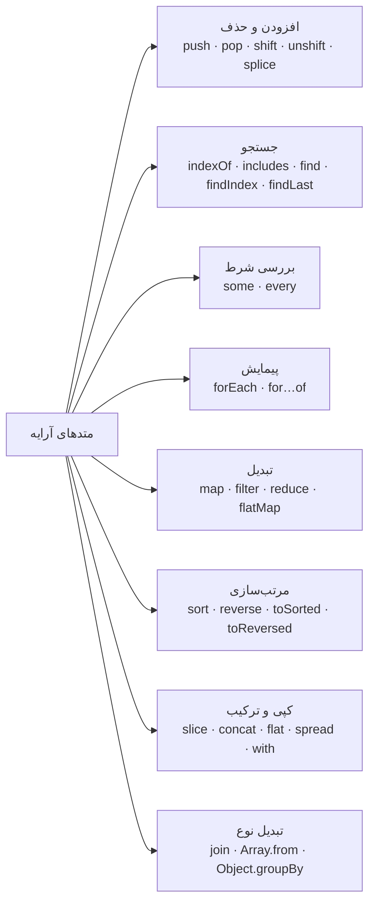
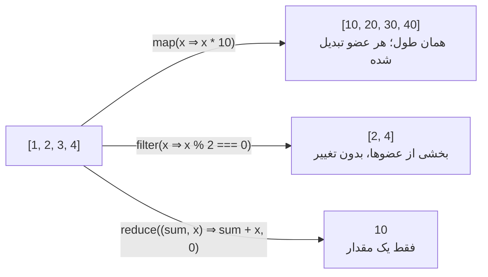
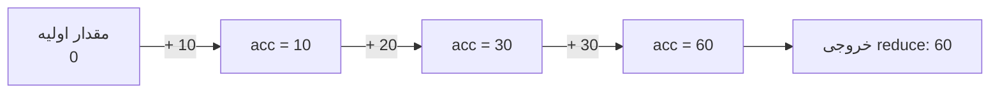

## آرایه چیست؟

**آرایه (Array)** فهرستی مرتب از مقدارهاست. هر مقدار در یک خانه شماره‌دار قرار می‌گیرد که به آن **ایندکس (Index)** می‌گویند و شماره‌گذاری از **صفر** شروع می‌شود.

```text
  index:    0        1        2        3
         ┌────────┬────────┬────────┬────────┐
fruits = │ "apple"│"banana"│ "cherry"│ "date" │     fruits.length === 4
         └────────┴────────┴────────┴────────┘
  fruits[0] → "apple"          fruits[fruits.length - 1] → "date"
```

هر جا **ترتیب مهم باشد** یا **تعداد زیادی مقدار از یک نوع** داشته باشید، سراغ آرایه می‌روید: فهرست کاربران، اقلام سبد خرید، ردیف‌های یک جدول، مراحل یک فرم چندمرحله‌ای.

سه ویژگی، آرایه در JavaScript را با آرایه در زبان‌هایی مثل C یا Java متفاوت می‌کند:

| ویژگی | یعنی چه | مثال |
| --- | --- | --- |
| اندازه ثابت ندارد | با `push` بزرگ و با `pop` کوچک می‌شود | `[1, 2].push(3)` |
| هر نوع مقداری می‌پذیرد | عدد، رشته، Object، تابع و حتی آرایه دیگر، همه با هم | `[1, "a", { x: 1 }, [2]]` |
| در واقع یک Object است | `typeof []` برابر `"object"` است و ایندکس‌ها در اصل کلیدهای `"0"`، `"1"` و… هستند | `Array.isArray([])` → `true` |

## ساختن آرایه

```js run
// ۱. Array Literal: در ۹۹٪ مواقع همین را می‌نویسید
const empty = [];
const nums = [10, 20, 30];

// ۲. Array.of: آرایه‌ای از آرگومان‌هایش
console.log(Array.of(7));          // [7]

// ۳. Array.from: از هر چیز قابل پیمایش (Iterable) یا شبه‌آرایه، با تابع تبدیل اختیاری
console.log(Array.from("hey"));                    // ['h', 'e', 'y']
console.log(Array.from({ length: 4 }, (_, i) => i * i)); // [0, 1, 4, 9]
console.log(Array.from(new Set([1, 1, 2])));        // [1, 2]

// ۴. Spread: کپی کردن یا ترکیب
const copy = [...nums];
console.log(copy, copy === nums);                   // محتوای یکسان، آرایه‌ای دیگر

// ۵. سازنده Array: مراقب باشید!
console.log(new Array(3));         // سه خانه خالی، نه [3]
console.log(new Array(3, 4));      // [3, 4]
console.log(new Array(3).fill(0)); // [0, 0, 0]
```

<Callout type="mistake">
`new Array(3)` آرایه `[3]` را نمی‌سازد. وقتی سازنده فقط یک عدد بگیرد، آرایه‌ای به همان **طول** می‌سازد که خانه‌هایش خالی‌اند (به این خانه‌ها Hole می‌گویند). متدهایی مثل `map` از روی خانه‌های خالی رد می‌شوند؛ پس `new Array(3).map((_, i) => i)` همچنان سه خانه خالی است. به‌جایش بنویسید `Array.from({ length: 3 }, (_, i) => i)`.
</Callout>

## خواندن، نوشتن و `length`

```js run
const letters = ["a", "b", "c"];

console.log(letters[0]);              // "a"
console.log(letters[5]);              // undefined — خواندن بیرون از آرایه خطا نمی‌دهد
console.log(letters.at(-1));          // "c" — متد at ایندکس منفی هم قبول می‌کند
console.log(letters[letters.length - 1]); // "c" — روش قدیمی

letters[1] = "B";                     // بازنویسی
letters[letters.length] = "d";        // اضافه کردن به انتها (مثل push)
console.log(letters, letters.length);

letters.length = 2;                   // ✂ می‌شود length را تغییر داد و آرایه کوتاه می‌شود
console.log(letters);
letters.length = 0;                   // روشی رایج برای خالی کردن همان آرایه
console.log(letters);
```

`length` لزوماً «تعداد عضوها» نیست؛ **بزرگ‌ترین ایندکس به‌علاوه یک** است:

```js run
const sparse = [];
sparse[9] = "x";
console.log(sparse.length);      // 10، با اینکه فقط یک عضو وجود دارد
console.log(0 in sparse);        // false — خانه صفر خالی است
```

## آرایه یک Object است (و این چرا مهم است)

```js run
const arr = ["x", "y"];
console.log(typeof arr);                     // "object"
console.log(Array.isArray(arr));             // true — روش مطمئن تشخیص آرایه
console.log(Object.keys(arr));               // ['0', '1'] — ایندکس‌ها کلید رشته‌ای هستند
console.log(Object.getPrototypeOf(arr) === Array.prototype); // متدها اینجا هستند

arr.label = "not an index";                  // مجاز است، اما length و بیشتر متدها آن را نادیده می‌گیرند
console.log(arr.length, arr);
```

چون همه متدها (`map`، `push` و…) روی `Array.prototype` تعریف شده‌اند، همه آرایه‌ها از یک نسخه مشترک استفاده می‌کنند. [Objectها و Prototype](/javascript/objects-prototypes) را ببینید.

<Callout type="note" title="پشت صحنه: Elements Kind">
موتور V8 بسته به محتوای آرایه، آن را به شکل‌های مختلفی ذخیره می‌کند: `PACKED_SMI` (فقط عدد صحیح کوچک، سریع‌ترین حالت)، `PACKED_DOUBLE`، `PACKED_ELEMENTS` (هر نوع مقدار) و نسخه‌های `HOLEY_*`. این تغییر حالت فقط یک‌طرفه است: وقتی آرایه یک رشته بگیرد یا خانه خالی پیدا کند، دیگر به حالت سریع‌تر برنمی‌گردد. نتیجه عملی: در کدی که بارها اجرا می‌شود، آرایه را بدون خانه خالی و هم‌نوع نگه دارید.
</Callout>

## نقشه متدها

آرایه بیش از ۳۵ متد دارد. اگر آن‌ها را بر اساس **کاری که انجام می‌دهند** دسته‌بندی کنید، به خاطر سپردنشان خیلی ساده‌تر می‌شود:



### متدهایی که آرایه اصلی را تغییر می‌دهند و آن‌هایی که نه

مهم‌ترین سؤالی که درباره هر متد باید بپرسید: **آیا آرایه‌ای را که رویش صدا زده‌ام تغییر می‌دهد؟** (به این تغییر Mutation می‌گویند.)

| ✗ آرایه اصلی را تغییر می‌دهد | ✓ چیز جدیدی برمی‌گرداند | جایگزین بدون تغییر (ES2023) |
| --- | --- | --- |
| `push`، `pop`، `shift`، `unshift` | `map`، `filter`، `reduce`، `slice` | — |
| `splice` | `concat`، `flat`، `flatMap` | `toSpliced()` |
| `sort` | `find`، `findIndex`، `some`، `every` | `toSorted()` |
| `reverse` | `includes`، `indexOf`، `join`، `at` | `toReversed()` |
| `fill`، `copyWithin` | `[...arr]`، `Array.from` | — |
| `arr[i] = x` | | `with(i, x)` |

```js run
const original = [3, 1, 2];

const sorted = original.toSorted();     // ✓ آرایه جدید
console.log(original, sorted);          // [3, 1, 2] [1, 2, 3]

const same = original.sort();           // ✗ خود آرایه را مرتب می‌کند و همان را برمی‌گرداند
console.log(original, same === original);

const updated = original.with(0, 99);   // نسخه بدون تغییرِ «arr[0] = 99»
console.log(original, updated);
```

<Callout type="interview">
در React هرگز آرایه State را مستقیم تغییر ندهید: با `items.push(x); setItems(items)` صفحه دوباره Render نمی‌شود، چون مرجع (Reference) آرایه عوض نشده و React مقایسه را با `Object.is` انجام می‌دهد. آرایه جدید بسازید: `setItems([...items, x])`، `items.filter(…)` یا `items.toSorted(…)`.
</Callout>

## افزودن و حذف از دو سر آرایه

```text
          unshift(x) / shift()                     push(x) / pop()
              ⟶ ابتدا                                    انتها ⟵
              ┌────┬────┬────┬────┐
              │ a  │ b  │ c  │ d  │
              └────┴────┴────┴────┘
     کند: ایندکس همه عضوها یکی جابه‌جا می‌شود        سریع: بقیه عضوها تکان نمی‌خورند
```

<Api name="push / pop / unshift / shift" sig="arr.push(...items) · arr.pop() · arr.unshift(...items) · arr.shift()" returns="`push` و `unshift` **طول جدید** آرایه را برمی‌گردانند؛ `pop` و `shift` **عضو حذف‌شده** را (و اگر آرایه خالی باشد `undefined`)." mutates="yes">

- `...items`: یک یا چند مقدار برای اضافه شدن (`push` به انتها و `unshift` به ابتدا).
- `pop` و `shift` آرگومانی نمی‌گیرند.

</Api>

```js run
const queue = ["b", "c"];
console.log(queue.push("d", "e"));   // 4 — طول جدید، نه خود آرایه!
console.log(queue.unshift("a"));     // 5
console.log(queue.pop());            // "e" — عضو حذف‌شده
console.log(queue.shift());          // "a"
console.log(queue);                  // ['b', 'c', 'd']
console.log([].pop());               // undefined — روی آرایه خالی خطا نمی‌دهد
```

| متد | پیچیدگی زمانی | چرا |
| --- | --- | --- |
| `push` / `pop` | O(1) | فقط انتهای آرایه تغییر می‌کند |
| `unshift` / `shift` | O(n) | همه عضوها باید به ایندکس جدید منتقل شوند |

پس آرایه برای **پشته (Stack)** با `push` و `pop` عالی است، اما به‌عنوان **صف (Queue)** با `push` و `shift` روی داده زیاد کند می‌شود. برای صف‌های بزرگ از یک اشاره‌گر ایندکس یا Linked List استفاده کنید ([الگوریتم‌ها](/algorithms/level-2)).

## splice: چاقوی همه‌کاره (آرایه را تغییر می‌دهد)

<Api name="Array.prototype.splice()" sig="arr.splice(start, deleteCount?, ...itemsToInsert)" returns="آرایه‌ای از عضوهای **حذف‌شده** (اگر چیزی حذف نشود، آرایه خالی)." mutates="yes">

- `start`: ایندکسی که کار از آن شروع می‌شود. عدد منفی از انتها می‌شمارد (`-1` یعنی آخرین عضو).
- `deleteCount` (اختیاری): چند عضو حذف شود. اگر ننویسید، از `start` تا انتها حذف می‌شود؛ `0` یعنی هیچ چیز حذف نشود.
- `...itemsToInsert` (اختیاری): مقدارهایی که در محل `start` درج می‌شوند.

</Api>

```js run
const months = ["Jan", "Mar", "Apr", "Jun"];

months.splice(1, 0, "Feb");          // درج: در ایندکس ۱، صفر حذف، "Feb" اضافه
console.log(months);                 // ['Jan', 'Feb', 'Mar', 'Apr', 'Jun']

const removed = months.splice(3, 1); // حذف یک عضو در ایندکس ۳
console.log(removed, months);        // ['Apr'] ['Jan', 'Feb', 'Mar', 'Jun']

months.splice(-1, 1, "May", "Jun");  // جایگزینی آخرین عضو با دو عضو
console.log(months);

const all = [1, 2, 3, 4, 5];
console.log(all.splice(2), all);     // [3, 4, 5] [1, 2] — بدون deleteCount: حذف تا انتها

// نسخه بدون تغییر:
const base = [1, 2, 3];
console.log(base.toSpliced(1, 1, "x"), base);   // [1, 'x', 3] [1, 2, 3]
```

## slice: کپی بخشی از آرایه (بدون تغییر)

<Api name="Array.prototype.slice()" sig="arr.slice(start?, end?)" returns="آرایه‌ای **جدید** شامل عضوها از `start` تا **قبل از** `end`. یک کپی سطحی (Shallow)." mutates="no">

- `start` (اختیاری، پیش‌فرض `0`): اولین ایندکسی که برداشته می‌شود. منفی از انتها می‌شمارد.
- `end` (اختیاری، پیش‌فرض `length`): ایندکسی که **قبل از آن** متوقف می‌شود. منفی از انتها می‌شمارد.

</Api>

```js run
const nums = [10, 20, 30, 40, 50];
console.log(nums.slice(1, 3));   // [20, 30]  — ایندکس‌های ۱ و ۲
console.log(nums.slice(2));      // [30, 40, 50]
console.log(nums.slice(-2));     // [40, 50]  — دو عضو آخر
console.log(nums.slice());       // کپی سطحی کامل
console.log(nums);               // دست‌نخورده
```

| | `slice(start, end)` | `splice(start, count, ...items)` |
| --- | --- | --- |
| آرایه اصلی را تغییر می‌دهد | خیر | **بله** |
| آرگومان دوم | **ایندکس پایان** (خودش شامل نمی‌شود) | **تعداد** عضوهایی که حذف می‌شوند |
| خروجی | بخش کپی‌شده | بخش حذف‌شده |
| کاربرد رایج | کپی، صفحه‌بندی، برداشتن N عضو آخر | درج، حذف یا جایگزینی در همان آرایه |

**ترفند به خاطر سپردن:** در splice حرف **p** هست؛ یعنی تغییر **p**ermanent (دائمی).

## ترکیب و تخت کردن (Flatten)

```js run
const a = [1, 2];
const b = [3, [4, 5]];

console.log(a.concat(b));          // [1, 2, 3, [4, 5]] — آرایه جدید؛ آرایه تودرتو همان‌طور می‌ماند
console.log([...a, ...b]);         // همان نتیجه با Spread
console.log(b.flat());             // [3, 4, 5] — یک سطح
console.log([1, [2, [3, [4]]]].flat(Infinity)); // [1, 2, 3, 4] — همه سطح‌ها

const sentences = ["hello world", "good morning"];
console.log(sentences.map((s) => s.split(" ")));      // [['hello','world'], ['good','morning']]
console.log(sentences.flatMap((s) => s.split(" "))); // ['hello','world','good','morning']
```

`flatMap(fn)` همان `map(fn).flat()` (یک سطح) است، اما در یک مرحله. اگر Callback آن `[]` برگرداند، آن عضو حذف می‌شود و اگر `[x, y]` برگرداند، به دو عضو تبدیل می‌شود؛ پس عملاً ترکیبی از map و filter است.

## جستجو

| سؤالی که می‌پرسید | متد | خروجی وقتی چیزی پیدا نشود |
| --- | --- | --- |
| آیا دقیقاً این مقدار در آرایه هست؟ | `includes(value)` | `false` |
| این مقدار در کدام ایندکس است؟ | `indexOf(value)` / `lastIndexOf(value)` | `-1` |
| **اولین عضوی** که شرط را دارد کدام است؟ | `find(fn)` / `findLast(fn)` | `undefined` |
| **ایندکس** اولین عضوِ دارای شرط چیست؟ | `findIndex(fn)` / `findLastIndex(fn)` | `-1` |
| **حداقل یک** عضو شرط را دارد؟ | `some(fn)` | `false` |
| **همه** عضوها شرط را دارند؟ | `every(fn)` | `true` (برای آرایه خالی!) |

```js run
const nums = [5, 12, 8, 130, 44, NaN];

console.log(nums.includes(8), nums.indexOf(8));   // true 2
console.log(nums.includes(NaN), nums.indexOf(NaN)); // true -1  ← indexOf با === مقایسه می‌کند و NaN !== NaN
console.log(nums.find((n) => n > 10));            // 12 — خود عضو
console.log(nums.findIndex((n) => n > 10));       // 1  — ایندکس آن
console.log(nums.findLast((n) => n > 10));        // 44 — جستجو از انتها
console.log(nums.some((n) => n > 100));           // true
console.log(nums.every((n) => n > 1));            // false (چون NaN > 1 برابر false است)
console.log([].every((n) => n > 1000));           // true — برای آرایه خالی همیشه true
```

`includes` و `indexOf` مقایسه را با `===` (و SameValueZero) انجام می‌دهند؛ پس برای Objectها **یکی بودن مرجع** را می‌سنجند، نه شبیه بودن محتوا را:

```js run
const users = [{ id: 1 }, { id: 2 }];
console.log(users.includes({ id: 1 }));             // false — یک Object دیگر است
console.log(users.some((u) => u.id === 1));         // true  — مقایسه بر اساس یک فیلد
```

`find`، `some`، `every` و `findIndex` به محض مشخص شدن جواب **متوقف می‌شوند**؛ برای همین روی آرایه‌های بزرگ از `filter(...).length` ارزان‌ترند.

## سه‌گانه Callback: یعنی map، filter و reduce

این سه متد اساس تبدیل داده در کار روزمره‌اند و الگوی مشترکی دارند: یک **Callback** (تابعی که به متد می‌دهید) می‌گیرند و آرایه آن را برای هر عضو یک بار صدا می‌زند.

هر سه، Callback را با این سه آرگومان صدا می‌زنند:

| آرگومان | معنا |
| --- | --- |
| `element` | عضو فعلی |
| `index` | ایندکس آن |
| `array` | کل آرایه‌ای که متد روی آن صدا زده شده |



### map: تبدیل تک‌تک عضوها

<Api name="Array.prototype.map()" sig="arr.map(callback(element, index, array), thisArg?)" returns="آرایه‌ای **جدید** با **همان طول**؛ در هر خانه، مقداری که Callback برای آن عضو برگردانده است." mutates="no">

- `callback`: برای هر عضو یک بار اجرا می‌شود و **مقدار بازگشتی‌اش** عضو جدید می‌شود. اگر `return` را فراموش کنید، `undefined` می‌گیرید.
- `thisArg` (اختیاری): مقدار `this` داخل Callback معمولی (با Arrow Function تقریباً هیچ‌وقت لازم نمی‌شود).

</Api>

```js run
const users = [
  { id: 1, name: "Ali", age: 28 },
  { id: 2, name: "Sara", age: 34 },
];

console.log(users.map((u) => u.name));                        // ['Ali', 'Sara']
console.log(users.map(({ id, name }) => ({ id, label: name.toUpperCase() })));
console.log(users.map((u, index, array) => `${index + 1}/${array.length}`));

// فراموش کردن return وقتی بدنه تابع آکولاد دارد:
console.log(users.map((u) => { u.name; }));                   // [undefined, undefined]
```

وقتی **به ازای هر ورودی یک خروجی** می‌خواهید از `map` استفاده کنید. اگر از آرایه‌ای که برمی‌گرداند استفاده نمی‌کنید، در واقع `forEach` لازم داشتید.

### filter: نگه داشتن بعضی عضوها

<Api name="Array.prototype.filter()" sig="arr.filter(callback(element, index, array), thisArg?)" returns="آرایه‌ای **جدید** فقط شامل عضوهایی که Callback برایشان مقدار **Truthy** برگردانده. خود عضوها کپی یا تغییر داده نمی‌شوند." mutates="no">

- `callback`: برای نگه داشتن عضو `true` (یا هر مقدار Truthy) و برای کنار گذاشتنش `false` (یا Falsy) برگردانید.

</Api>

```js run
const products = [
  { name: "Laptop", price: 1200, inStock: true },
  { name: "Mouse", price: 25, inStock: false },
  { name: "Monitor", price: 300, inStock: true },
];

console.log(products.filter((p) => p.inStock).map((p) => p.name));
console.log(products.filter((p) => p.price < 500).length);
console.log([0, 1, "", "a", null, NaN, 2].filter(Boolean));     // حذف همه مقدارهای Falsy

// حذف تکراری‌ها: هر عضو فقط در اولین ظهورش نگه داشته می‌شود
const tags = ["js", "css", "js", "html", "css"];
console.log(tags.filter((tag, i, all) => all.indexOf(tag) === i)); // (یا [...new Set(tags)])
```

### reduce: تبدیل همه عضوها به یک مقدار

`reduce` قوی‌ترین و در عین حال کم‌فهم‌ترین متد این سه‌تاست؛ پس آهسته و قدم‌به‌قدم جلو می‌رویم.

**ایده اصلی:** آرایه را از اول تا آخر پیمایش می‌کنیم و یک «نتیجه در حال ساخت» را با خودمان حمل می‌کنیم که به آن **Accumulator** (مقدار انباشته) می‌گویند. در هر قدم، Callback مقدار انباشته تا آن لحظه و عضو فعلی را می‌گیرد و **مقدار انباشته جدید را برمی‌گرداند**. وقتی پیمایش تمام شد، آخرین مقدار انباشته همان خروجی `reduce` است.

مثل صندوق‌داری که جمع یک فاکتور را حساب می‌کند: از صفر شروع می‌کند (**مقدار اولیه**)، هر ردیف را به جمع فعلی اضافه می‌کند و در آخر جمع کل را اعلام می‌کند.

<Api name="Array.prototype.reduce()" sig="arr.reduce(callback(accumulator, currentValue, currentIndex, array), initialValue?)" returns="**آخرین مقدار انباشته**؛ یعنی چیزی که Callback در آخرین اجرایش برگردانده. می‌تواند هر نوعی باشد: عدد، رشته، Object، آرایه، Map و حتی Promise." mutates="no">

- `callback`: برای هر عضو یک بار با **چهار** آرگومان اجرا می‌شود:
  - `accumulator`: نتیجه تا این لحظه (مقدار بازگشتی اجرای قبلی، یا `initialValue` در اولین اجرا).
  - `currentValue`: عضوی که الان پردازش می‌شود.
  - `currentIndex`: ایندکس آن عضو.
  - `array`: آرایه‌ای که `reduce` روی آن صدا زده شده.
- `initialValue` (اختیاری، اما **به‌شدت توصیه می‌شود**): مقدار شروع Accumulator. اگر ندهید، **اولین عضو** آرایه مقدار شروع می‌شود و پیمایش از ایندکس ۱ شروع می‌شود.

</Api>

#### دیدن reduce قدم‌به‌قدم

```js run
const prices = [10, 20, 30];

const total = prices.reduce((acc, price, index) => {
  console.log(`index ${index}: acc = ${acc}, price = ${price} → returns ${acc + price}`);
  return acc + price;
}, 0);

console.log("total:", total);
```

| اجرا | `accumulator` (ورودی) | `currentValue` | مقدار بازگشتی Callback (مقدار انباشته جدید) |
| --- | --- | --- | --- |
| ۱ | `0` ← مقدار اولیه | `10` | `10` |
| ۲ | `10` | `20` | `30` |
| ۳ | `30` | `30` | `60` ← نتیجه نهایی |



#### با مقدار اولیه و بدون آن

```js run
const nums = [1, 2, 3];

// با مقدار اولیه: ۳ اجرا، acc از 0 شروع می‌شود
console.log(nums.reduce((acc, n) => acc + n, 0));      // 6

// بدون مقدار اولیه: ۲ اجرا، acc از nums[0] شروع و پیمایش از ایندکس ۱
console.log(nums.reduce((acc, n) => acc + n));         // 6 — اینجا فرقی نکرد، اما…

// …در دو حالت رایج خراب می‌شود:
try {
  [].reduce((acc, n) => acc + n);                      // آرایه خالی و بدون مقدار اولیه
} catch (e) {
  console.log(e.name + ": " + e.message);
}

const cart = [{ price: 5 }, { price: 7 }];
console.log(cart.reduce((acc, item) => acc + item.price));     // "[object Object]7" — acc از یک Object شروع شد!
console.log(cart.reduce((acc, item) => acc + item.price, 0));  // 12 ✓
```

| | با `initialValue` | بدون `initialValue` |
| --- | --- | --- |
| اولین `accumulator` | `initialValue` | `arr[0]` |
| اولین `currentValue` | `arr[0]` | `arr[1]` |
| تعداد اجرای Callback | به اندازه `length` | `length - 1` |
| آرایه خالی | همان `initialValue` را برمی‌گرداند | **TypeError** |
| آرایه تک‌عضوی | Callback یک بار اجرا می‌شود | همان عضو را **بدون اجرای Callback** برمی‌گرداند |

<Callout type="tip">
**همیشه مقدار اولیه بدهید** و آن را هم‌نوع با نتیجه‌ای که می‌خواهید انتخاب کنید: `0` برای جمع، `""` برای رشته، `{}` برای Object، `[]` برای آرایه و `new Map()` برای Map.
</Callout>

#### آیا reduce آرایه اصلی را تغییر می‌دهد؟

**خیر.** خود `reduce` هیچ‌وقت آرایه را تغییر نمی‌دهد و فقط آن را می‌خواند. اما **Callback شما** ممکن است چیزهایی را که به آن‌ها دسترسی دارد تغییر دهد؛ مثلاً Objectهای داخل آرایه، یا یک Object مشترک که به‌عنوان Accumulator استفاده شده:

```js run
const items = [{ qty: 1 }, { qty: 2 }];
const before = JSON.stringify(items);

const total = items.reduce((sum, item) => sum + item.qty, 0);
console.log(total, JSON.stringify(items) === before);   // 3 true — دست‌نخورده

// ✗ Callbackی که عضوها را تغییر می‌دهد: reduce جلویش را نمی‌گیرد، اما این باگ شماست
items.reduce((_, item) => { item.qty *= 10; return _; }, null);
console.log(items);                                      // [{ qty: 10 }, { qty: 20 }]
```

#### الگوهای کلاسیک reduce

```js run
const orders = [
  { id: 1, customer: "ali", amount: 120, status: "paid" },
  { id: 2, customer: "sara", amount: 80, status: "pending" },
  { id: 3, customer: "ali", amount: 40, status: "paid" },
  { id: 4, customer: "reza", amount: 200, status: "paid" },
];

// ۱. جمع یک فیلد
const revenue = orders.reduce((sum, o) => sum + o.amount, 0);

// ۲. بیشینه (از ‎-Infinity شروع می‌کنیم تا هر عددی از آن بزرگ‌تر باشد)
const biggest = orders.reduce((max, o) => Math.max(max, o.amount), -Infinity);

// ۳. شمردن تکرارها ← Object
const byStatus = orders.reduce((counts, o) => {
  counts[o.status] = (counts[o.status] ?? 0) + 1;
  return counts;                                   // همیشه Accumulator را برگردانید!
}, {});

// ۴. گروه‌بندی در آرایه‌ها
const byCustomer = orders.reduce((groups, o) => {
  (groups[o.customer] ??= []).push(o.id);
  return groups;
}, {});

// ۵. ساختن ایندکس بر اساس id ← جستجوی سریع در ادامه
const byId = orders.reduce((map, o) => map.set(o.id, o), new Map());

console.log(revenue, biggest);
console.log(byStatus);
console.log(byCustomer);
console.log(byId.get(4).customer);
```

```js run
// ۶. ترکیب توابع: اجرای فهرستی از توابع به ترتیب
const pipeline = [(x) => x + 1, (x) => x * 2, (x) => `Result: ${x}`];
console.log(pipeline.reduce((value, fn) => fn(value), 5));   // "Result: 12"

// ۷. اجرای کارهای Async یکی پس از دیگری (ترتیبی)
const delay = (ms, label) => new Promise((r) => setTimeout(() => r(label), ms));
const tasks = [() => delay(30, "A"), () => delay(10, "B"), () => delay(20, "C")];

tasks
  .reduce((chain, task) => chain.then((results) => task().then((r) => [...results, r])), Promise.resolve([]))
  .then((results) => console.log("sequential:", results));   // ['A', 'B', 'C']
```

#### reduce روی رشته‌ها

رشته‌ها متد `reduce` ندارند، اما می‌توانید اول رشته را به آرایه‌ای از کاراکترها تبدیل کنید:

```js run
const word = "mississippi";

// شمردن تعداد هر کاراکتر
const freq = [...word].reduce((counts, ch) => {
  counts[ch] = (counts[ch] ?? 0) + 1;
  return counts;
}, {});
console.log(freq);                                    // { m: 1, i: 4, s: 4, p: 2 }

// برعکس کردن رشته (این بار Accumulator یک رشته است!)
console.log([..."hello"].reduce((rev, ch) => ch + rev, ""));   // "olleh"

// قرض گرفتن مستقیم متد آرایه: رشته شبه‌آرایه است
console.log(Array.prototype.reduce.call("abc", (acc, ch) => acc + ch.toUpperCase(), "")); // "ABC"

// ساختن یک رشته از آرایه
const words = ["learn", "javascript", "deeply"];
console.log(words.reduce((s, w, i) => s + (i ? " " : "") + w[0].toUpperCase() + w.slice(1), ""));
```

برای جدا کردن کاراکترها از `[...str]` استفاده کنید، نه `str.split("")`؛ تا Emoji و کاراکترهای خارج از محدوده پایه Unicode سالم بمانند. فصل [Stringها](/javascript/strings) را ببینید.

#### reduceRight

`reduceRight` دقیقاً مثل `reduce` کار می‌کند، با این تفاوت که از **آخرین** عضو به سمت اولین عضو حرکت می‌کند:

```js run
console.log(["a", "b", "c"].reduce((acc, x) => acc + x, ""));      // "abc"
console.log(["a", "b", "c"].reduceRight((acc, x) => acc + x, "")); // "cba"

// کاربرد کلاسیک: compose(f, g, h)(x) === f(g(h(x)))
const compose = (...fns) => (x) => fns.reduceRight((value, fn) => fn(value), x);
console.log(compose((x) => x + 1, (x) => x * 10)(2));               // 21
```

#### چه زمانی از reduce استفاده نکنیم

با `reduce` هر کاری می‌شود کرد و همین باعث می‌شود راحت کد ناخوانا نوشته شود. اگر متد مخصوص آن کار وجود دارد، همان را ترجیح دهید:

| به‌جای… | بنویسید |
| --- | --- |
| `arr.reduce((acc, x) => [...acc, f(x)], [])` | `arr.map(f)` (و از کپی‌های O(n²) هم خلاص شوید!) |
| `reduce`ی که عضوهای دارای شرط را push می‌کند | `arr.filter(fn)` |
| `reduce`ی که دنبال یک عضو می‌گردد | `arr.find(fn)` |
| `reduce` برای جمع یا بیشینه | اینجا `reduce` مناسب است؛ برای آرایه کوچک `Math.max(...arr)` هم خوب است |
| `reduce` برای گروه‌بندی | `Object.groupBy(arr, fn)` (ES2024) |

```js run
const people = [{ name: "Ali", team: "web" }, { name: "Sara", team: "data" }, { name: "Reza", team: "web" }];
console.log(Object.groupBy(people, (p) => p.team));
```

### forEach: فقط پیمایش

<Api name="Array.prototype.forEach()" sig="arr.forEach(callback(element, index, array), thisArg?)" returns="همیشه `undefined`. فقط برای کارهای جانبی (Side Effect) مثل Log، تغییر DOM یا اضافه کردن به جای دیگر." mutates="no">

- `callback`: برای هر عضو اجرا می‌شود و مقدار بازگشتی‌اش نادیده گرفته می‌شود.

</Api>

```js run
const names = ["Ali", "Sara", "Reza"];
names.forEach((name, i) => console.log(i, name));

console.log(names.forEach((n) => n.toUpperCase()));  // undefined — forEach چیزی برنمی‌گرداند

// از forEach نمی‌شود با break بیرون آمد؛ به‌جایش for...of، some یا find:
for (const name of names) {
  if (name === "Sara") break;
  console.log("visited", name);
}
```

| | `forEach` | `map` |
| --- | --- | --- |
| خروجی | `undefined` | آرایه جدید |
| هدف | کار جانبی | تبدیل داده |
| قابل زنجیر کردن | خیر | بله (`.map().filter()…`) |
| توقف زودهنگام با `break` یا `return` | ممکن نیست (`return` فقط از همان عضو رد می‌شود) | ممکن نیست |

<Callout type="warning" title="forEach و async">
`forEach` منتظر Promiseها نمی‌ماند. `arr.forEach(async (x) => await save(x))` همه ذخیره‌ها را هم‌زمان شروع می‌کند و بلافاصله ادامه می‌دهد. برای اجرای یکی‌یکی از `for...of` همراه با `await` و برای اجرای موازی از `await Promise.all(arr.map(save))` استفاده کنید.
</Callout>

#### یک دام کلاسیک: map همراه با parseInt

```js predict
console.log(["1", "2", "3"].map(parseInt));
```

```output
[1, NaN, NaN]
```

`map` به Callback **سه** آرگومان `(element, index, array)` می‌دهد و `parseInt` دو آرگومان می‌پذیرد: `(string, radix)`. پس فراخوانی‌ها این‌ها هستند: `parseInt("1", 0)` ← ۱ (مبنای ۰ یعنی «خودت تشخیص بده»)، `parseInt("2", 1)` ← NaN (مبنای ۱ نامعتبر است) و `parseInt("3", 2)` ← NaN (رقم ۳ در مبنای دو وجود ندارد). راه‌حل: `.map(Number)` یا `.map((s) => parseInt(s, 10))`.

## مرتب‌سازی

<Api name="Array.prototype.sort()" sig="arr.sort(compareFn?(a, b))" returns="**همان** آرایه، که حالا مرتب شده است (در جا). برای گرفتن نسخه مرتب‌شده از `toSorted()` استفاده کنید." mutates="yes">

- `compareFn` (اختیاری): دو عضو را می‌گیرد و یک عدد برمی‌گرداند:
  - **منفی** ← `a` جلوتر قرار می‌گیرد،
  - **مثبت** ← `b` جلوتر قرار می‌گیرد،
  - **صفر** ← ترتیب نسبی‌شان حفظ می‌شود (از ES2019 مرتب‌سازی **Stable** است).
- بدون `compareFn`، عضوها به **رشته** تبدیل و بر اساس کدهای UTF-16 مقایسه می‌شوند.

</Api>

```js predict
console.log([10, 9, 1, 100, 25].sort());
console.log([10, 9, 1, 100, 25].sort((a, b) => a - b));
```

```output
[1, 10, 100, 25, 9]
[1, 9, 10, 25, 100]
```

مرتب‌سازی پیش‌فرض `"10"`، `"9"`، `"1"` و… را **مثل متن** مقایسه می‌کند؛ برای همین `"100"` قبل از `"25"` می‌آید. برای عدد همیشه Comparator بدهید: `(a, b) => a - b` (صعودی) یا `(a, b) => b - a` (نزولی).

```js run
const team = [
  { name: "Sara", role: "dev", age: 34 },
  { name: "ali", role: "design", age: 28 },
  { name: "Reza", role: "dev", age: 28 },
];

// بر اساس عدد
console.log(team.toSorted((a, b) => a.age - b.age).map((p) => p.name));

// بر اساس متن، درست برای زبان‌های انسانی و حروف کوچک و بزرگ (localeCompare)
console.log(team.toSorted((a, b) => a.name.localeCompare(b.name)).map((p) => p.name));

// بر اساس چند کلید: اول role، بعد age به‌صورت نزولی
console.log(
  team.toSorted((a, b) => a.role.localeCompare(b.role) || b.age - a.age).map((p) => `${p.role}:${p.name}`),
);

console.log(team[0].name);   // "Sara" — toSorted به آرایه اصلی دست نزد
```

`reverse()` آرایه را در جا برعکس می‌کند (و همان آرایه را برمی‌گرداند)؛ `toReversed()` یک کپی برعکس‌شده برمی‌گرداند.

## پر کردن و جایگزینی

```js run
console.log(new Array(3).fill(0));        // [0, 0, 0]
console.log([1, 2, 3, 4].fill("x", 1, 3)); // [1, 'x', 'x', 4] — از ایندکس ۱ تا قبل از ۳

// ✗ پر کردن با Object، یک Object مشترک را در همه خانه‌ها می‌گذارد
const grid = new Array(3).fill([]);
grid[0].push("oops");
console.log(grid);                        // [['oops'], ['oops'], ['oops']]

// ✓ برای هر خانه یک Object جدید بسازید
const grid2 = Array.from({ length: 3 }, () => []);
grid2[0].push("ok");
console.log(grid2);
```

## تبدیل آرایه به چیزهای دیگر

```js run
const parts = ["2026", "10", "06"];
console.log(parts.join("-"));      // "2026-10-06"
console.log(parts.join());         // "2026,10,06" — جداکننده پیش‌فرض کاما است
console.log(String([1, [2, 3]]));  // "1,2,3"

// شبه‌آرایه‌ها (length و ایندکس دارند، اما متدهای آرایه را نه) ← آرایه واقعی
const arrayLike = { 0: "a", 1: "b", length: 2 };
console.log(Array.from(arrayLike));        // ['a', 'b']
// در مرورگر: Array.from(document.querySelectorAll("li")) یا [...nodeList]

// entries: جفت ایندکس و مقدار
for (const [i, v] of ["x", "y"].entries()) console.log(i, v);
```

## کپی کردن: سطحی (Shallow) در مقابل عمیق (Deep)

همه روش‌های کپی این صفحه (`slice`، Spread، `concat`، `Array.from`، `map`) **سطحی** هستند: خود آرایه جدید است، اما Objectهای داخلش **مشترک** می‌مانند.

```js run
const original = [{ name: "Ali" }, [1, 2]];
const shallow = [...original];
shallow[0].name = "Changed";              // Object داخلی مشترک است
console.log(original[0].name);           // "Changed"

const deep = structuredClone(original);   // یک کپی عمیق واقعی
deep[1].push(3);
console.log(original[1], deep[1]);        // [1, 2] [1, 2, 3]
```

```text
original ──► [ ref●, ref● ]           shallow ──► [ ref●, ref● ]
                 │      │                             │      │
                 ▼      ▼                             │      │
           {name}   [1,2]  ◄──────── همان Objectها ───┘──────┘
```

## حلقه‌ها: for در مقابل for...of در مقابل for...in

| حلقه | چه چیزی به شما می‌دهد | `break` / `continue` | `await` داخلش | برای آرایه؟ |
| --- | --- | --- | --- | --- |
| `for (let i = 0; …)` | ایندکس | ✓ | ✓ | ✓ وقتی ایندکس یا گام دلخواه لازم است |
| `for (const x of arr)` | مقدار | ✓ | ✓ | ✓ **انتخاب پیش‌فرض** |
| `arr.forEach(fn)` | مقدار و ایندکس | ✗ | ✗ (منتظر نمی‌ماند) | برای کارهای جانبی ساده |
| `for (const k in arr)` | کلیدهای **رشته‌ای**، حتی کلیدهای به ارث رسیده | ✓ | ✓ | ✗ مخصوص Object است |

```js run
const arr = ["a", "b"];
arr.extra = "!";
for (const k in arr) console.log("for...in:", k, typeof k);   // '0'، '1'، 'extra' — رشته، و extra هم آمد!
for (const v of arr) console.log("for...of:", v);             // 'a'، 'b'
```

## خلاصه Performance

| عملیات | پیچیدگی |
| --- | --- |
| `arr[i]`، `arr.at(i)`، `push`، `pop`، `length` | O(1) |
| `shift`، `unshift`، `splice` در وسط آرایه | O(n) |
| `includes`، `indexOf`، `find`، `some`، `every` | O(n) (با پیدا شدن جواب متوقف می‌شوند) |
| `map`، `filter`، `reduce`، `forEach`، `slice`، `concat` | O(n) |
| `sort`، `toSorted` | O(n log n) |
| `[...acc, x]` داخل حلقه یا reduce | در مجموع O(n²): روی آرایه بزرگ پرهیز کنید |

اگر بارها باید بررسی کنید «این مقدار در آرایه هست؟»، یک بار آرایه را به `Set` تبدیل کنید؛ `set.has(x)` از O(1) است. [Map و Set](/javascript/collections) را ببینید.

## اشتباهات رایج

- انتظار `[3]` از `new Array(3)`؛ و `fill({})` یا `fill([])` که یک Object را در همه خانه‌ها می‌گذارد.
- `sort()` بدون Comparator روی عددها.
- فراموش کردن `return` در Callback متدهای `map` و `reduce` وقتی بدنه آکولاد دارد.
- صدا زدن `reduce` بدون مقدار اولیه روی داده‌ای که ممکن است خالی باشد.
- انتظار اینکه `push` آرایه را برگرداند (طول جدید را برمی‌گرداند).
- تغییر مستقیم آرایه State در React (`push`، `sort`، `reverse`، `splice`، `arr[i] = x`).
- `indexOf(NaN)` (همیشه `-1`؛ به‌جایش `includes` یا `findIndex(Number.isNaN)`).
- `for...in` روی آرایه و `await` داخل `forEach`.
- فکر کردن به اینکه Spread یا `slice` کپی عمیق می‌سازند.

## سوالات مصاحبه

<QA q="متد `reduce` را توضیح دهید: Callback چه آرگومان‌هایی می‌گیرد، `initialValue` چه کاری می‌کند و بدون آن چه می‌شود؟" level="mid" n={1}>
<Answer>

`reduce(callback, initialValue)` آرایه را پیمایش می‌کند و یک Accumulator را همراه خودش می‌برد. Callback آرگومان‌های `(accumulator, currentValue, currentIndex, array)` را می‌گیرد و باید Accumulator جدید را برگرداند؛ آخرین Accumulator خروجی نهایی است. `initialValue` مقدار شروع Accumulator است. بدون آن، اولین عضو Accumulator می‌شود و پیمایش از ایندکس ۱ شروع می‌شود؛ در نتیجه آرایه خالی `TypeError` می‌دهد و روی آرایه‌ای از Objectها ممکن است نتیجه بی‌معنایی مثل `"[object Object]7"` بگیرید.

</Answer>
<Deep>

`reduce` آرایه را تغییر نمی‌دهد، اما Callback می‌تواند عضوها یا یک Accumulator مشترک را تغییر دهد. ساختن آرایه با `[...acc, x]` داخل reduce در مجموع O(n²) است؛ یا مستقیم در Accumulator (که محلی است) `push` کنید یا از `map`/`filter` استفاده کنید. `reduceRight` از انتها پیمایش می‌کند و روش طبیعی نوشتن `compose` است.

</Deep>
<Mistake>

فراموش کردن `return acc` در Callbackی که بدنه آکولاددار دارد؛ در این صورت Accumulator بعدی `undefined` می‌شود.

</Mistake>
<FollowUp>

`map` و `filter` را فقط با `reduce` پیاده‌سازی کنید. چرا نسخه ساده‌ای که با Spread نوشته می‌شود کند است؟

</FollowUp>
</QA>

<QA q="تفاوت `map` و `forEach` چیست؟" level="junior" n={2}>
<Answer>

`map` آرایه‌ای جدید با همان طول از مقدارهای بازگشتی Callback می‌سازد؛ `forEach` همیشه `undefined` برمی‌گرداند و فقط برای کارهای جانبی است. هیچ‌کدام با `break` متوقف نمی‌شوند. برای تبدیل داده `map` و برای «انجام کاری به ازای هر عضو» `forEach` (یا `for...of`).

</Answer>
<Deep>

هیچ‌کدام با Callback از نوع `async` آن‌طور که انتظار می‌رود رفتار نمی‌کنند: `forEach` همه Promiseها را بدون صبر کردن راه می‌اندازد؛ `map` آرایه‌ای از Promiseها برمی‌گرداند که می‌توانید با `await Promise.all(...)` منتظرشان بمانید. هر دو از روی خانه‌های خالی آرایه رد می‌شوند.

</Deep>
<Mistake>

استفاده از `map` فقط برای کار جانبی و دور ریختن خروجی‌اش (هم هدر دادن حافظه است و هم خواننده کد را گمراه می‌کند).

</Mistake>
<FollowUp>

چطور عضوها را یکی پس از دیگری با `await` پردازش می‌کنید؟ (با `for...of` و `await`.)

</FollowUp>
</QA>

<QA q="کدام متدهای آرایه، آرایه اصلی را تغییر می‌دهند و چرا این موضوع در React مهم است؟" level="mid" n={3}>
<Answer>

`push`، `pop`، `shift`، `unshift`، `splice`، `sort`، `reverse`، `fill`، `copyWithin` و مقداردهی مستقیم به ایندکس. React برای تصمیم‌گیری درباره Render دوباره، State قبلی و جدید را با `Object.is` مقایسه می‌کند؛ آرایه‌ای که مستقیم تغییر کرده همان مرجع قبلی است، پس ممکن است React به‌روزرسانی را نادیده بگیرد و Componentهای Memo‌شده تغییر را نبینند.

</Answer>
<Deep>

ES2023 نسخه‌های بدون تغییر را اضافه کرد: `toSorted`، `toReversed`، `toSpliced` و `with(index, value)`. برای به‌روزرسانی داده تودرتو، مسیر را کپی کنید (`items.map(i => i.id === id ? { ...i, done: true } : i)`) یا از Immer استفاده کنید که تغییرات را روی یک پیش‌نویس ثبت و ساختار جدید و تغییرناپذیر تولید می‌کند.

</Deep>
<Mistake>

اینکه فکر کنید `const items = [...]` جلوی تغییر آرایه را می‌گیرد. `const` فقط جلوی انتساب دوباره متغیر را می‌گیرد.

</Mistake>
<FollowUp>

چرا `items.sort()` داخل تابع Render باگ است، حتی اگر هیچ‌وقت `setState` صدا زده نشود؟

</FollowUp>
</QA>

<QA q="چرا `[10, 9, 1, 100].sort()` نتیجه `[1, 10, 100, 9]` می‌دهد؟" level="junior" n={4}>
<Answer>

بدون Comparator، `sort` عضوها را به رشته تبدیل می‌کند و آن‌ها را مثل متن، کاراکتر به کاراکتر مقایسه می‌کند: `"1" < "10" < "100" < "9"`. راه‌حل، دادن Comparator است: `(a, b) => a - b`.

</Answer>
<Deep>

Comparator باید منسجم باشد (منفی، صفر یا مثبت برگرداند و ترتیبش متعدی باشد)؛ برگرداندن Boolean مثل `a > b` باگی است که فقط در بعضی موتورها اتفاقاً درست کار می‌کند. از ES2019 مرتب‌سازی تضمیناً Stable است، پس مرتب‌سازی چندکلیدی با زنجیره `||` درست کار می‌کند. برای رشته‌های زبان انسانی از `localeCompare` یا `Intl.Collator` استفاده کنید.

</Deep>
<Mistake>

نوشتن `.sort((a, b) => a > b)`: این تابع `true` یا `false` (یعنی ۱ یا ۰) برمی‌گرداند و هیچ‌وقت منفی نیست؛ پس ترتیب اشتباه می‌شود.

</Mistake>
<FollowUp>

چطور فهرستی را اول بر اساس نام خانوادگی و بعد نام مرتب می‌کنید، بدون حساسیت به حروف کوچک و بزرگ و اعراب؟

</FollowUp>
</QA>

<QA q="تفاوت `slice` و `splice` چیست؟" level="junior" n={5}>
<Answer>

`slice(start, end)` یک کپی سطحی از بخشی از آرایه برمی‌گرداند و آرایه را تغییر نمی‌دهد؛ آرگومان دومش **ایندکس پایان** است (خودش شامل نمی‌شود). `splice(start, deleteCount, ...items)` همان آرایه را تغییر می‌دهد (حذف، درج یا جایگزینی) و عضوهای حذف‌شده را برمی‌گرداند؛ آرگومان دومش **تعداد** است.

</Answer>
<Deep>

`toSpliced` نسخه بدون تغییر `splice` است. هر دو ایندکس منفی را می‌پذیرند. `slice()` بدون آرگومان روشی رایج برای کپی آرایه است (معادل `[...arr]`).

</Deep>
<Mistake>

دادن ایندکس پایان به `splice` به خیال اینکه مثل `slice` است؛ نتیجه‌اش حذف خیلی بیشتر از چیزی است که می‌خواستید.

</Mistake>
<FollowUp>

عضوی با `id === 3` را بدون تغییر آرایه اصلی حذف کنید. (`arr.filter(x => x.id !== 3)` یا `toSpliced(index, 1)`.)

</FollowUp>
</QA>

<QA q="خروجی `['1', '2', '3'].map(parseInt)` چیست و چرا؟" level="mid" n={6}>
<Answer>

`[1, NaN, NaN]`. `map`، Callback را با `(element, index, array)` صدا می‌زند و `parseInt` آرگومان دوم را مبنای عددنویسی (Radix) در نظر می‌گیرد: `parseInt("1", 0)` = 1، `parseInt("2", 1)` = NaN و `parseInt("3", 2)` = NaN.

</Answer>
<Deep>

درس کلی: وقتی مستقیماً یک تابع را به `map`، `filter` یا `forEach` می‌دهید، **همه** آرگومان‌ها به آن پاس داده می‌شوند. با توابع تک‌آرگومانی مثل `Number` یا `Boolean` بی‌خطر است، اما با توابعی که پارامتر اختیاری دارند خطرناک است.

</Deep>
<Mistake>

مقصر دانستن `parseInt` به‌جای فهمیدن نحوه پاس شدن آرگومان‌ها.

</Mistake>
<FollowUp>

`['a', 'b'].map(String.prototype.toUpperCase.call, String.prototype.toUpperCase)` چه کاری انجام می‌دهد؟

</FollowUp>
</QA>

<QA q="چطور تکراری‌ها را از آرایه حذف می‌کنید؟ روش‌ها را مقایسه کنید." level="mid" n={7}>
<Answer>

برای مقدارهای Primitive: `[...new Set(arr)]` که O(n) است و ترتیب اولین ظهور را حفظ می‌کند. روش‌های دیگر: `arr.filter((x, i) => arr.indexOf(x) === i)` (که O(n²) است)، یا `reduce` همراه با یک Set برای مقدارهای دیده‌شده. برای Objectها بر اساس یک کلید: `[...new Map(arr.map(o => [o.id, o])).values()]` (برای هر id **آخرین** Object را نگه می‌دارد).

</Answer>
<Deep>

`Set` از مقایسه SameValueZero استفاده می‌کند؛ پس `NaN` به‌درستی تکراری تشخیص داده می‌شود (برخلاف `indexOf`) و `0` و `-0` برابر حساب می‌شوند. Objectها با مرجع مقایسه می‌شوند؛ پس دو Object با محتوای یکسان از نظر `Set` تکراری نیستند.

</Deep>
<Mistake>

استفاده از `filter` همراه با `indexOf` روی آرایه‌های بزرگ؛ پیچیدگی‌اش درجه دو است.

</Mistake>
<FollowUp>

چطور تکراری‌ها را حذف می‌کنید طوری که برای هر id **اولین** Object نگه داشته شود؟

</FollowUp>
</QA>

<QA q="متد `myReduce` را خودتان روی `Array.prototype` پیاده‌سازی کنید." level="senior" n={8}>
<Answer>

```js
Array.prototype.myReduce = function (callback, ...rest) {
  if (typeof callback !== "function") throw new TypeError(callback + " is not a function");
  const arr = Object(this);
  const len = arr.length >>> 0;
  let i = 0;
  let acc;
  if (rest.length) {
    acc = rest[0];
  } else {
    while (i < len && !(i in arr)) i++;          // رد شدن از خانه‌های خالی
    if (i >= len) throw new TypeError("Reduce of empty array with no initial value");
    acc = arr[i++];
  }
  for (; i < len; i++) {
    if (i in arr) acc = callback(acc, arr[i], i, arr);
  }
  return acc;
};
```

</Answer>
<Deep>

استفاده از `...rest` (به‌جای `initialValue === undefined`) حالت «مقدار اولیه داده نشده» را از «مقدار اولیه برابر `undefined` است» جدا می‌کند. بررسی `i in arr` با رفتار مشخصات در برابر خانه‌های خالی هماهنگ است. `len` فقط یک بار خوانده می‌شود، پس عضوهایی که حین پیمایش اضافه شوند پیمایش نمی‌شوند.

</Deep>
<Mistake>

نوشتن `if (!initialValue)` که برای مقدار اولیه `0`، `""` یا `false` خراب می‌شود.

</Mistake>
<FollowUp>

چرا گسترش دادن `Array.prototype` در مصاحبه اشکالی ندارد، اما در کد Production ایده بدی است؟

</FollowUp>
</QA>

## جمع‌بندی

<Recap>

- آرایه فهرست مرتب با ایندکس از صفر است؛ اندازه ثابت ندارد و هر نوع مقداری می‌پذیرد، و در واقع یک Object است.
- `Array.from({ length: n }, fn)` به‌جای `new Array(n)` که خانه خالی (Hole) می‌سازد.
- `at(-1)` آخرین عضو را می‌دهد؛ خواندن بیرون از آرایه `undefined` است، نه خطا.
- متدهای تغییردهنده: `push`، `pop`، `shift`، `unshift`، `splice`، `sort`، `reverse`، `fill`. نسخه‌های بدون تغییر: `toSorted`، `toReversed`، `toSpliced`، `with`.
- `slice(start, end)` کپی بدون تغییر است و `end` شامل نمی‌شود؛ `splice(start, count, ...items)` آرایه را تغییر می‌دهد.
- `map` آرایه هم‌طول، `filter` زیرمجموعه و `reduce` یک مقدار برمی‌گرداند؛ برای `reduce` همیشه مقدار اولیه بدهید.
- `find` اولین عضو یا `undefined`، `findIndex` ایندکس یا `-1`، `includes` بولین و `NaN` را هم پیدا می‌کند، `some`/`every` بولین.
- `sort()` بدون Comparator رشته‌ای مرتب می‌کند (`[10, 9, 1]` ← `[1, 10, 9]`)؛ برای عدد `(a, b) => a - b`.
- Spread و `slice` کپی سطحی‌اند؛ برای حلقه `for...of` روی مقدارها و هرگز `for...in` روی آرایه.

</Recap>
