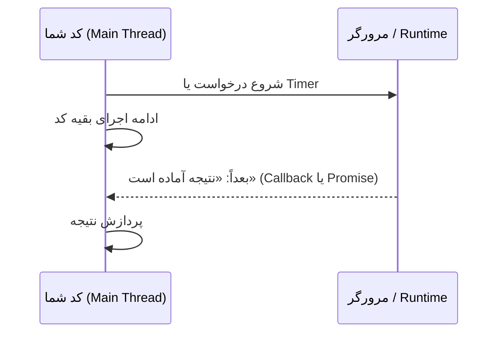
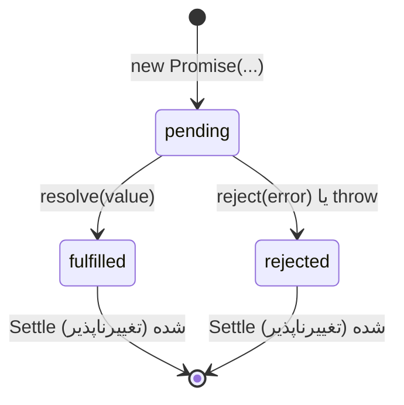

## چرا کد ناهمگام (Asynchronous)؟

JavaScript کد شما را روی **یک Thread** اجرا می‌کند. اگر یک عملیات کند (درخواست شبکه، Timer، خواندن فایل) آن Thread را مسدود می‌کرد، صفحه یخ می‌زد: نه کلیکی، نه اسکرولی و نه انیمیشنی، تا وقتی کار تمام شود.

برای همین عملیات کند **ناهمگام (Async)** هستند: آن‌ها را *شروع* می‌کنید، JavaScript به خط بعدی می‌رود و **بعداً**، وقتی نتیجه آماده شد، به شما خبر داده می‌شود. سازوکاری که این خبرها را تحویل می‌دهد [Event Loop](/javascript/event-loop) است.

```js run
console.log("1. order a coffee");
setTimeout(() => console.log("3. coffee is ready ☕"), 100);   // شروع کن، صبر نکن
console.log("2. sit down and read the news");                 // بلافاصله اجرا می‌شود
```



داستان کد Async در JavaScript سه نسل دارد و هر نسل روی نسل قبلی ساخته شده است:

| نسل | سبک | مشکلی که حل کرد | مشکلی که باقی گذاشت |
| --- | --- | --- | --- |
| Callback | `doThing(arg, (err, result) => …)` | مسدود نکردن Thread | تودرتو شدن («Callback Hell»)، پراکندگی مدیریت خطا، نبود هیچ تضمینی |
| Promise (ES2015) | `doThing(arg).then(…).catch(…)` | مقداری که نماینده نتیجه آینده است؛ زنجیره کردن؛ یک مسیر واحد برای خطا | هنوز شبیه کد «معمولی» نیست |
| `async`/`await` (ES2017) | `const result = await doThing(arg)` | کد Async که از بالا به پایین خوانده می‌شود و با `try/catch` | راحت می‌شود ناخواسته کارها را پشت سر هم اجرا کرد |

## Callback

**Callback** تابعی است که به تابع دیگری می‌دهید تا وقتی کار تمام شد صدایش بزند. Node.js قرارداد **Error-first** را رایج کرد: آرگومان اول خطاست (یا `null`) و بقیه نتیجه.

```js run
function loadUser(id, callback) {
  setTimeout(() => {
    if (id <= 0) callback(new Error("invalid id"));
    else callback(null, { id, name: `User ${id}` });
  }, 20);
}

loadUser(7, (err, user) => {
  if (err) return console.log("failed:", err.message);
  console.log("loaded:", user.name);
});
loadUser(-1, (err) => console.log("failed:", err.message));
```

### Callback Hell و وارونگی کنترل (Inversion of Control)

مرحله‌های وابسته هر بار یک سطح عمیق‌تر می‌شوند و هر سطح بررسی خطای خودش را لازم دارد:

```js
getUser(id, (err, user) => {
  if (err) return handle(err);
  getOrders(user.id, (err, orders) => {
    if (err) return handle(err);
    getDetails(orders[0].id, (err, details) => {
      if (err) return handle(err);
      render(details);          // «هرم عذاب»
    });
  });
});
```

مشکل عمیق‌تر **وارونگی کنترل** است: ادامه کارتان را به کد دیگری می‌سپارید و اعتماد می‌کنید که آن را **دقیقاً یک بار**، **به‌صورت Async** و با آرگومان‌های درست صدا بزند. یک کتابخانه باگ‌دار ممکن است آن را دو بار، هیچ‌بار یا به شکل همگام صدا بزند. Promise این مشکل را حل می‌کند، چون یک Object به دست *خود شما* می‌دهد.

## Promise

**Promise** یک Object است که **نتیجه نهایی یک عملیات Async** را نمایندگی می‌کند. شبیه زنگ‌های رستوران‌های سلف‌سرویس: همان اول آن را می‌گیرید و بعداً به شما می‌گوید «سفارشتان آماده است» یا «متأسفیم، این غذا تمام شده».

Promise همیشه در یکی از سه حالت است و وقتی **Settle** شد (به نتیجه رسید)، دیگر هرگز تغییر نمی‌کند:



| حالت | معنا | Handlerی که اجرا می‌شود |
| --- | --- | --- |
| `pending` | هنوز تمام نشده | — |
| `fulfilled` | با یک **مقدار** موفق شده | `.then(onFulfilled)` |
| `rejected` | با یک **دلیل** (معمولاً یک `Error`) شکست خورده | `.catch(onRejected)` یا `.then(_, onRejected)` |

### ساختن Promise

<Api name="new Promise()" sig="new Promise((resolve, reject) => { … })" returns="یک Promise جدید در حالت `pending`. وقتی Executor تابع `resolve` یا `reject` را صدا بزند (یا خطا پرتاب کند) Settle می‌شود." mutates="n/a">

- تابع **Executor** بلافاصله و **همگام (Synchronous)** اجرا می‌شود و دو تابع دریافت می‌کند:
  - `resolve(value)`: Promise را با `value` موفق می‌کند (اگر `value` خودش Promise یا Thenable باشد، آن را دنبال می‌کند).
  - `reject(reason)`: Promise را با `reason` شکست‌خورده می‌کند.
- فقط **اولین** فراخوانی حساب می‌شود؛ فراخوانی‌های بعدی `resolve` و `reject` نادیده گرفته می‌شوند.
- اگر Executor خطا پرتاب کند، Promise با همان خطا Reject می‌شود.

</Api>

```js run
// تبدیل یک API مبتنی بر Callback به Promise («Promisify»)
const wait = (ms, value) =>
  new Promise((resolve) => setTimeout(() => resolve(value), ms));

function loadUser(id) {
  return new Promise((resolve, reject) => {
    console.log("executor runs synchronously");
    setTimeout(() => {
      if (id <= 0) reject(new Error("invalid id"));
      else resolve({ id, name: `User ${id}` });
      resolve("ignored: a promise settles only once");
    }, 20);
  });
}

const p = loadUser(3);
console.log("after creating:", p instanceof Promise);
p.then((user) => console.log("fulfilled:", user.name));
wait(10, "hello").then(console.log);
```

در کد برنامه‌ها به‌ندرت به `new Promise` نیاز پیدا می‌کنید؛ بیشتر APIها خودشان Promise برمی‌گردانند (`fetch`، `response.json()`، APIهای فایل، کلاینت‌های پایگاه داده). از آن برای پوشاندن APIهای مبتنی بر Callback یا Event استفاده کنید.

### مصرف Promise با `then`، `catch` و `finally`

<Api name="Promise.prototype.then()" sig="promise.then(onFulfilled?, onRejected?)" returns="یک Promise **جدید** که با خروجی Handler به نتیجه می‌رسد (مقدار آن را موفق می‌کند، Promise برگشتی دنبال می‌شود و خطای پرتاب‌شده آن را Reject می‌کند)." mutates="no">

- `onFulfilled(value)`: اگر Promise موفق شود اجرا می‌شود.
- `onRejected(reason)` (اختیاری): اگر Reject شود اجرا می‌شود. معمولاً به شکل یک `.catch` جداگانه نوشته می‌شود.
- Handlerها همیشه **Async** (به شکل Microtask) اجرا می‌شوند، حتی اگر Promise از قبل Settle شده باشد.

</Api>

| متد | کی اجرا می‌شود | چه می‌گیرد | Promise برگشتی… |
| --- | --- | --- | --- |
| `.then(fn)` | موفقیت | مقدار | با نتیجه `fn` به نتیجه می‌رسد |
| `.catch(fn)` | شکست (در هر جای بالاتر زنجیره) | خطا | با نتیجه `fn` به نتیجه می‌رسد: برگشتن عادی یعنی **بازیابی** |
| `.finally(fn)` | هر دو حالت | هیچ چیز | مقدار یا خطای اصلی را عبور می‌دهد (مگر اینکه `fn` خطا پرتاب کند) |

### زنجیره کردن: مهم‌ترین قانون

**هر `.then` یک Promise جدید برمی‌گرداند.** هر چه از یک Handler `return` کنید، ورودی مرحله بعد می‌شود. همین چیزی است که هرم Callbackها را به یک زنجیره صاف تبدیل می‌کند:

```js run
const getUser = (id) => Promise.resolve({ id, name: "Sara" });
const getOrders = (user) => Promise.resolve([{ id: 101, total: 40 }, { id: 102, total: 15 }]);

getUser(1)
  .then((user) => {
    console.log("1. user:", user.name);
    return getOrders(user);              // برگرداندن Promise ← then بعدی منتظرش می‌ماند
  })
  .then((orders) => {
    console.log("2. orders:", orders.length);
    return orders.reduce((s, o) => s + o.total, 0);   // برگرداندن یک مقدار ساده
  })
  .then((total) => {
    console.log("3. total:", total);
    throw new Error("payment service down");          // throw ← پرش به اولین catch بعدی
  })
  .then(() => console.log("never runs"))
  .catch((err) => {
    console.log("4. caught:", err.message);
    return "fallback";                   // بازیابی: زنجیره دوباره در حالت موفق است
  })
  .then((v) => console.log("5. continues with:", v))
  .finally(() => console.log("6. cleanup (always)"));
```

| داخل Handler شما… | مرحله بعد دریافت می‌کند |
| --- | --- |
| `return value` | `value` (موفق) |
| `return somePromise` | هر چیزی که `somePromise` با آن Settle شود (منتظر می‌ماند) |
| `throw error` | یک Rejection ← تا `catch` بعدی رد می‌شود |
| چیزی برنمی‌گردانید | `undefined` |

<Callout type="mistake" title="return فراموش‌شده">
`.then((user) => { getOrders(user); })` تابع `getOrders` را شروع می‌کند اما آن را برنمی‌گرداند؛ پس `.then` بعدی بلافاصله با `undefined` اجرا می‌شود و خطاهای `getOrders` گم می‌شوند (به این Promise سرگردان یا «Floating Promise» می‌گویند). وقتی آکولاد دارید، همیشه `return` کنید.
</Callout>

### انتشار خطا

Rejection در طول زنجیره پایین می‌رود و از همه `then`ها رد می‌شود تا به یک `catch` (یا `then` با آرگومان دوم) برسد. یک `catch` خطاهای **همه مراحل بالای خودش** را مدیریت می‌کند.

```js run
Promise.resolve(1)
  .then((x) => x * 2)
  .then(() => { throw new TypeError("step 2 failed"); })
  .then(() => console.log("skipped"))
  .then(() => console.log("skipped too"))
  .catch((e) => console.log(`${e.name}: ${e.message}`));

// بدون هیچ catch: یک «Unhandled Rejection» (خطا در Console مرورگر؛ Node ممکن است متوقف شود)
// Promise.reject(new Error("nobody handles me"));
```

## ترکیب Promiseها

| متد | منتظر چه می‌ماند | با چه موفق می‌شود | کی Reject می‌شود | کاربرد |
| --- | --- | --- | --- | --- |
| `Promise.all(list)` | موفقیت **همه** | آرایه مقدارها، **به ترتیب ورودی** | با **اولین** Rejection (شکست سریع) | درخواست‌های مستقلی که همه لازم‌اند |
| `Promise.allSettled(list)` | Settle شدن همه | آرایه‌ای از `{status, value}` یا `{status, reason}` | هیچ‌وقت | عملیات دسته‌ای که ممکن است بعضی‌هایش شکست بخورند |
| `Promise.race(list)` | **اولین** Promiseی که Settle شود | مقدار همان | اگر اولین Settle‌شده Reject شده باشد | Timeout |
| `Promise.any(list)` | **اولین موفقیت** | مقدار همان | فقط اگر **همه** Reject شوند (`AggregateError`) | سریع‌ترین از بین چند سرور آینه |

```js run
const ok = (ms, v) => new Promise((r) => setTimeout(() => r(v), ms));
const fail = (ms, msg) => new Promise((_, j) => setTimeout(() => j(new Error(msg)), ms));

(async () => {
  console.log("all:", await Promise.all([ok(30, "a"), ok(10, "b"), ok(20, "c")]));   // ترتیب حفظ می‌شود

  try { await Promise.all([ok(30, "a"), fail(10, "b failed")]); }
  catch (e) { console.log("all rejects fast:", e.message); }

  const settled = await Promise.allSettled([ok(10, "a"), fail(5, "nope")]);
  console.log("allSettled:", settled.map((r) => r.status === "fulfilled" ? r.value : r.reason.message));

  console.log("race:", await Promise.race([ok(30, "slow"), ok(10, "fast")]));
  console.log("any:", await Promise.any([fail(5, "x"), ok(20, "first success")]));

  try { await Promise.any([fail(5, "x"), fail(10, "y")]); }
  catch (e) { console.log("any:", e.constructor.name, e.errors.map((x) => x.message)); }
})();
```

```text
زمان →        0ms      10ms      20ms      30ms
ok(30,"a")    ─────────────────────────────● a
ok(10,"b")    ─────────● b
ok(20,"c")    ───────────────────● c
Promise.all   ─────────────────────────────● ["a","b","c"]   (منتظر کندترین می‌ماند)
Promise.race  ─────────● "b"                                  (اولین Settle‌شده)
```

ابزارهای دیگر: `Promise.resolve(v)` و `Promise.reject(e)` Promiseهای از قبل Settle‌شده می‌سازند؛ `Promise.withResolvers()` (ES2024) یک `{ promise, resolve, reject }` برمی‌گرداند تا بتوانید Promise را از بیرون Executor به نتیجه برسانید.

## async و await

`async`/`await` یک Syntax روی Promiseهاست که باعث می‌شود کد Async **مثل کد همگام خوانده شود**.

<Api name="async function / await" sig="async function f(…) { const value = await somePromise; … }" returns="تابع `async` **همیشه یک Promise برمی‌گرداند**: مقدار `return` آن را موفق و خطای پرتاب‌شده آن را Reject می‌کند. `await p` برابر مقدار موفق `p` است، یا دلیل Rejection آن را **پرتاب می‌کند**." mutates="n/a">

- `await` فقط داخل توابع `async` (و در سطح بالای ES Moduleها) قابل استفاده است.
- `await` **فقط همین تابع** را متوقف می‌کند؛ بقیه برنامه به کارش ادامه می‌دهد.
- `await` روی مقداری که Promise نیست فقط آن را می‌پیچد (`await 5` بعد از یک Microtask برابر `5` است).

</Api>

```js run
const fetchUser = (id) => new Promise((r) => setTimeout(() => r({ id, name: "Ali" }), 20));
const fetchPosts = (userId) => new Promise((r) => setTimeout(() => r(["post A", "post B"]), 20));

async function showProfile(id) {
  console.log("start");
  const user = await fetchUser(id);       // اینجا متوقف می‌شود، بدون مسدود کردن Thread
  const posts = await fetchPosts(user.id);
  return `${user.name} has ${posts.length} posts`;
}

const result = showProfile(1);
console.log("showProfile returned a", result.constructor.name);   // Promise — بلافاصله
result.then(console.log);
```

همین تابع با Promise، تا ببینید `await` جای چه چیزی را می‌گیرد:

```js
function showProfile(id) {
  console.log("start");
  return fetchUser(id)
    .then((user) => fetchPosts(user.id).then((posts) => ({ user, posts })))
    .then(({ user, posts }) => `${user.name} has ${posts.length} posts`);
}
```

### مدیریت خطا با try/catch

`await` روی Promise ردشده **خطا پرتاب می‌کند**؛ پس همان `try/catch/finally` معمولی کار می‌کند:

```js run
const request = (ok) => new Promise((resolve, reject) =>
  setTimeout(() => (ok ? resolve({ data: 42 }) : reject(new Error("HTTP 500"))), 10));

async function load(ok) {
  try {
    const res = await request(ok);
    return res.data;
  } catch (err) {
    console.log("handled:", err.message);
    return null;                          // مقدار جایگزین
  } finally {
    console.log("loading spinner off");   // همیشه اجرا می‌شود
  }
}

(async () => {
  console.log(await load(true));
  console.log(await load(false));
})();
```

### پشت سر هم در مقابل موازی: رایج‌ترین باگ Performance

```js run
const task = (name, ms) => new Promise((r) => setTimeout(() => r(name), ms));

(async () => {
  let t = Date.now();
  const a = await task("a", 100);          // ۱۰۰ میلی‌ثانیه صبر…
  const b = await task("b", 100);          // …بعد تازه b شروع می‌شود: ۱۰۰ میلی‌ثانیه دیگر
  console.log("sequential:", a, b, Math.round((Date.now() - t) / 100) * 100, "ms");

  t = Date.now();
  const [c, d] = await Promise.all([task("c", 100), task("d", 100)]);  // هر دو همین حالا شروع می‌شوند
  console.log("parallel:  ", c, d, Math.round((Date.now() - t) / 100) * 100, "ms");
})();
```

**قاعده:** اگر دو عملیات به هم وابسته نیستند، **هر دو را شروع کنید و بعد با هم** با `Promise.all` منتظرشان بمانید. `await` پشت سر هم را فقط وقتی به کار ببرید که مرحله دوم به نتیجه مرحله اول نیاز دارد.

### حلقه‌ها

```js run
const save = (id) => new Promise((r) => setTimeout(() => r(`saved ${id}`), 20));
const ids = [1, 2, 3];

(async () => {
  // ✗ forEach منتظر نمی‌ماند: "done" قبل از ذخیره شدن هر چیزی چاپ می‌شود
  ids.forEach(async (id) => console.log("forEach:", await save(id)));
  console.log("forEach 'done' (too early!)");

  await new Promise((r) => setTimeout(r, 50));

  // ✓ یکی پس از دیگری
  for (const id of ids) console.log("for...of:", await save(id));

  // ✓ همه با هم، و نتایج به ترتیب
  console.log("all:", await Promise.all(ids.map(save)));
})();
```

### await در سطح بالا (Top-level await)

در ES Moduleها، `await` بیرون از توابع هم کار می‌کند. آن ماژول (و هر ماژولی که آن را import کند) منتظر می‌ماند:

```js
// config.js (یک ES Module)
const response = await fetch("/config.json");
export const config = await response.json();
```

## الگوهای دنیای واقعی

### Timeout

```js run
function withTimeout(promise, ms) {
  let timer;
  const timeout = new Promise((_, reject) => {
    timer = setTimeout(() => reject(new Error(`timed out after ${ms}ms`)), ms);
  });
  return Promise.race([promise, timeout]).finally(() => clearTimeout(timer));
}

const slow = new Promise((r) => setTimeout(() => r("data"), 200));
withTimeout(slow, 50).then(console.log, (e) => console.log(e.message));
```

### لغو کردن با AbortController

خود Promiseها قابل لغو نیستند، اما کاری که پشتشان انجام می‌شود اغلب قابل لغو است. `AbortController` روش استاندارد این کار است: `signal` آن را به عملیات می‌دهید و برای متوقف کردنش `abort()` را صدا می‌زنید.

```js run
function cancellableDelay(ms, { signal } = {}) {
  return new Promise((resolve, reject) => {
    if (signal?.aborted) return reject(signal.reason);
    const timer = setTimeout(() => resolve(`waited ${ms}ms`), ms);
    signal?.addEventListener("abort", () => {
      clearTimeout(timer);
      reject(signal.reason);
    }, { once: true });
  });
}

const controller = new AbortController();
cancellableDelay(500, { signal: controller.signal })
  .then(console.log)
  .catch((e) => console.log("cancelled:", e.name));
setTimeout(() => controller.abort(), 50);

// fetch به‌طور داخلی از آن پشتیبانی می‌کند:
//   fetch(url, { signal: controller.signal })
//   fetch(url, { signal: AbortSignal.timeout(5000) })   // Timeout داخلی
```

### تلاش دوباره با تأخیر نمایی (Exponential Backoff)

```js run
async function retry(fn, { retries = 3, baseDelay = 50 } = {}) {
  for (let attempt = 0; ; attempt++) {
    try {
      return await fn(attempt);
    } catch (err) {
      if (attempt >= retries) throw err;
      const delay = baseDelay * 2 ** attempt + Math.random() * 20;   // 50، 100، 200… به‌علاوه کمی تصادف
      console.log(`attempt ${attempt + 1} failed (${err.message}), retrying in ~${Math.round(delay)}ms`);
      await new Promise((r) => setTimeout(r, delay));
    }
  }
}

let calls = 0;
const flaky = async () => {
  if (++calls < 3) throw new Error("network error");
  return "success on call " + calls;
};
retry(flaky).then(console.log);
```

### محدود کردن هم‌زمانی (Concurrency)

`Promise.all(urls.map(fetch))` **همه را با هم** شروع می‌کند. با ۱۰۰۰ آدرس، شبکه و سرور غرق درخواست می‌شوند. یک Pool کوچک حداکثر N کار را هم‌زمان اجرا می‌کند:

```js run
async function mapWithLimit(items, limit, fn) {
  const results = new Array(items.length);
  let next = 0;
  let active = 0, maxActive = 0;

  async function worker() {
    while (next < items.length) {
      const i = next++;                     // برداشتن ایندکس بعدی (امن است چون JS تک‌Thread است)
      active++; maxActive = Math.max(maxActive, active);
      results[i] = await fn(items[i], i);
      active--;
    }
  }
  await Promise.all(Array.from({ length: Math.min(limit, items.length) }, worker));
  console.log("max running at once:", maxActive);
  return results;
}

const fakeFetch = (n) => new Promise((r) => setTimeout(() => r(n * 10), 10 + (n % 3) * 10));
mapWithLimit([1, 2, 3, 4, 5, 6, 7, 8], 3, fakeFetch).then((r) => console.log(r));
```

### Race Condition در رابط کاربری (پاسخ‌های قدیمی)

وقتی کاربر «re»، بعد «rea» و بعد «react» را تایپ می‌کند، سه درخواست ارسال می‌شود و **ممکن است به ترتیب دیگری برگردند**. اگر پاسخ «re» آخر از همه برسد، رابط کاربری نتایج یک جستجوی اشتباه را نشان می‌دهد.

```js run
const search = (q) => new Promise((r) => setTimeout(() => r(`results for "${q}"`), { re: 90, rea: 30, react: 50 }[q]));

// ✗ روش ساده: هر چیزی که آخر برسد نمایش داده می‌شود
let shown = "";
for (const q of ["re", "rea", "react"]) search(q).then((res) => (shown = res));

// ✓ نادیده گرفتن پاسخ‌هایی که مال آخرین درخواست نیستند
let latest = 0;
let shownSafe = "";
for (const q of ["re", "rea", "react"]) {
  const id = ++latest;
  search(q).then((res) => { if (id === latest) shownSafe = res; });
}

setTimeout(() => console.log("naive:", shown, "| safe:", shownSafe), 150);
```

در React همین کار را با یک پرچم پاک‌سازی یا `AbortController` داخل `useEffect` انجام می‌دهید، یا اجازه می‌دهید یک کتابخانه داده (TanStack Query، SWR) آن را مدیریت کند.

## اشتباهات رایج

- فراموش کردن `return` داخل `.then` (Promise سرگردان) یا فراموش کردن `await`.
- نداشتن `.catch` یا `try` ← Unhandled Rejection.
- `await` پشت سر هم برای عملیات مستقل (به‌جایش `Promise.all`).
- Callbackهای `async` داخل `forEach`.
- پیچیدن بی‌دلیل یک Promise داخل `new Promise` (ضدالگوی «ساخت صریح»).
- استفاده از `Promise.all` وقتی شکست بخشی از کارها قابل قبول است (به‌جایش `allSettled`).
- انتظار اینکه `Promise.race` بقیه Promiseها را لغو کند (به اجرا ادامه می‌دهند).
- نادیده گرفتن پاسخ‌های بی‌ترتیب در جستجو و تکمیل خودکار.

## سوالات مصاحبه

<QA q="Promise چه حالت‌هایی دارد و `.then` چه چیزی برمی‌گرداند؟" level="junior" n={1}>
<Answer>

`pending`، و بعد Settle شدن به یکی از دو حالت `fulfilled` (با یک مقدار) یا `rejected` (با یک دلیل)؛ Promise بعد از Settle شدن هرگز تغییر نمی‌کند. `.then` یک Promise **جدید** برمی‌گرداند که با خروجی Handler به نتیجه می‌رسد: مقدار آن را موفق می‌کند، Promise برگشتی دنبال می‌شود و خطای پرتاب‌شده آن را Reject می‌کند. زنجیره کردن به همین دلیل کار می‌کند.

</Answer>
<Deep>

Handlerها همیشه به شکل Microtask و Async اجرا می‌شوند، حتی روی Promiseهای از قبل Settle‌شده؛ این ترتیب اجرای یکسان را تضمین می‌کند (باگ‌های «گاهی همگام» پیش نمی‌آید). برگرداندن یک Thenable چند Tick اضافه در Microtask هزینه دارد (فصل Event Loop را ببینید).

</Deep>
<Mistake>

فکر کردن به اینکه `.then` همان Promise اصلی را تغییر می‌دهد، یا اینکه همه زنجیره یک Promise مشترک است.

</Mistake>
<FollowUp>

تفاوت `.then(a, b)` با `.then(a).catch(b)` چیست؟ (در حالت دوم، `b` خطاهای پرتاب‌شده از `a` را هم می‌گیرد.)

</FollowUp>
</QA>

<QA q="متدهای `Promise.all`، `allSettled`، `race` و `any` را مقایسه کنید." level="mid" n={2}>
<Answer>

`all` وقتی همه موفق شوند با همه مقدارها به ترتیب ورودی موفق می‌شود و با اولین Rejection رد می‌شود. `allSettled` منتظر همه می‌ماند و نتیجه هر کدام را گزارش می‌کند؛ هیچ‌وقت Reject نمی‌شود. `race` مثل اولین Promiseی که Settle شود به نتیجه می‌رسد (موفق یا ناموفق). `any` با اولین موفقیت موفق می‌شود و فقط وقتی همه Reject شوند، با یک `AggregateError` رد می‌شود.

</Answer>
<Deep>

هیچ‌کدام عملیات باقی‌مانده را لغو نمی‌کنند؛ در صورت نیاز آن‌ها را با `AbortController` ترکیب کنید. `all` با آرایه خالی بلافاصله با `[]` موفق می‌شود؛ `race` با آرایه خالی برای همیشه pending می‌ماند؛ `any` با آرایه خالی Reject می‌شود.

</Deep>
<Mistake>

استفاده از `race` برای «اولین موفقیت»؛ `race` با اولین *شکست* هم به نتیجه می‌رسد. آن کار `any` است.

</Mistake>
<FollowUp>

`Promise.all` را خودتان پیاده‌سازی کنید.

</FollowUp>
</QA>

<QA q="متد `Promise.all` را پیاده‌سازی کنید." level="senior" n={3}>
<Answer>

```js
function promiseAll(iterable) {
  return new Promise((resolve, reject) => {
    const items = Array.from(iterable);
    const results = new Array(items.length);
    let remaining = items.length;
    if (remaining === 0) return resolve(results);
    items.forEach((item, i) => {
      Promise.resolve(item).then((value) => {
        results[i] = value;              // حفظ ترتیب ورودی
        if (--remaining === 0) resolve(results);
      }, reject);                        // اولین Rejection برنده است
    });
  });
}
```

</Answer>
<Deep>

`Promise.resolve(item)` مقدارهای غیر Promise و Thenableهای خارجی را مدیریت می‌کند. ذخیره بر اساس ایندکس، ترتیب را صرف‌نظر از ترتیب تمام شدن کارها حفظ می‌کند. چند بار صدا زدن `reject` بی‌ضرر است، چون Promise فقط یک بار Settle می‌شود.

</Deep>
<Mistake>

اضافه کردن نتایج با `results.push(value)` که آن‌ها را به ترتیب زمان تمام شدن مرتب می‌کند.

</Mistake>
<FollowUp>

حالا `allSettled` و `any` را پیاده‌سازی کنید.

</FollowUp>
</QA>

<QA q="یک تابع `async` چه چیزی برمی‌گرداند و وقتی `await` یک Promise ردشده بگیرد چه می‌شود؟" level="junior" n={4}>
<Answer>

تابع async همیشه یک Promise برمی‌گرداند: با مقدار return موفق و با هر خطای پرتاب‌شده Reject می‌شود. `await` روی Promise ردشده، دلیل آن را در همان خط پرتاب می‌کند؛ پس با `try/catch` (یا `.catch` روی Promise برگشتی) مدیریتش می‌کنید.

</Answer>
<Deep>

`await` فقط تابع async را متوقف می‌کند؛ باقی تابع را برای زمانی که Promise مورد انتظار Settle شد، به شکل یک Microtask زمان‌بندی می‌کند. `return await p` داخل `try` معنا دارد (خطاها همان‌جا گرفته می‌شوند)؛ `return p` بدون await اجازه می‌دهد Rejection از `try` فرار کند.

</Deep>
<Mistake>

انتظار اینکه `const x = asyncFn()` به‌جای Promise خود مقدار را بدهد.

</Mistake>
<FollowUp>

چه زمانی `return await` لازم است و چه زمانی زائد؟

</FollowUp>
</QA>

<QA q="باید ۱۰۰۰ آدرس را دریافت کنید. چطور این کار را بهینه و امن انجام می‌دهید؟" level="senior" n={5}>
<Answer>

نه با یک `Promise.all` روی همه آن‌ها که ۱۰۰۰ درخواست را یکجا شروع می‌کند. از محدودیت هم‌زمانی استفاده کنید (یک Pool از مثلاً ۶ Worker که از یک ایندکس مشترک کار برمی‌دارند)، نتایج را بر اساس ایندکس جمع کنید، شکست هر مورد را جداگانه مدیریت کنید (با try/catch یا معنای `allSettled`)، برای خطاهای گذرا تلاش دوباره با Backoff بگذارید و امکان لغو با `AbortController` را فراهم کنید.

</Answer>
<Deep>

مرورگرها خودشان تعداد اتصال به هر Origin را محدود می‌کنند (حدود ۶ اتصال در HTTP/1.1)، اما Promiseهای بی‌حد همچنان حافظه مصرف می‌کنند و می‌توانند سرور یا Rate Limitها را از کار بیندازند. کتابخانه‌هایی مثل `p-limit` الگوی Pool را پیاده کرده‌اند؛ در رابط کاربری، نتایج را به محض رسیدن نشان دهید، به‌جای اینکه منتظر همه بمانید.

</Deep>
<Mistake>

`await` کردن هر درخواست در یک حلقه `for` (کاملاً پشت سر هم و کند) یا شلیک همه با هم (بی‌حد و حصر).

</Mistake>
<FollowUp>

چطور با Pool خودتان پیشرفت را گزارش می‌کنید (مثلاً «۳۴۰ از ۱۰۰۰ انجام شد»)؟

</FollowUp>
</QA>

## جمع‌بندی

<Recap>

- کار زمان‌بر (شبکه، تایمر، فایل) نباید Thread را مسدود کند؛ JavaScript با Callback، Promise و async/await آن را مدیریت می‌کند.
- Callbackهای تودرتو به Callback Hell و مشکل اعتماد (Inversion of Control) می‌رسند.
- Promise سه حالت دارد: pending، fulfilled، rejected؛ وقتی Settle شد دیگر عوض نمی‌شود.
- `then` همیشه Promise جدید برمی‌گرداند؛ مقدار برگردانده‌شده یا Promise برگردانده‌شده زنجیره بعدی را تغذیه می‌کند. یادتان نرود `return` کنید.
- یک `catch` در انتهای زنجیره خطای هر مرحله را می‌گیرد؛ `finally` در هر دو حالت اجرا می‌شود و مقدار را تغییر نمی‌دهد.
- `Promise.all` همه یا اولین خطا، `allSettled` نتیجه همه، `race` اولین Settle شده، `any` اولین موفق.
- `async` همیشه Promise برمی‌گرداند و `await` تا Settle شدن صبر می‌کند؛ خطا با `try/catch` گرفته می‌شود.
- کارهای مستقل را با `Promise.all` موازی کنید، نه `await` پشت سر هم؛ `await` داخل `forEach` منتظر نمی‌ماند.
- برای لغو درخواست از `AbortController` استفاده کنید و Promise Rejection را هرگز بدون Handler رها نکنید.

</Recap>
