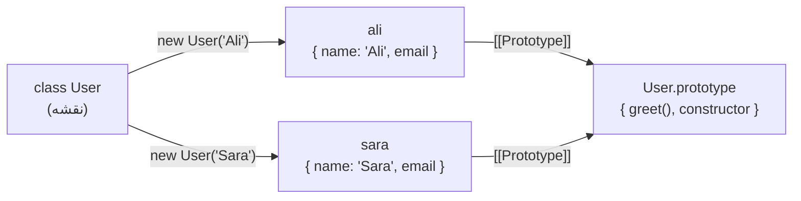
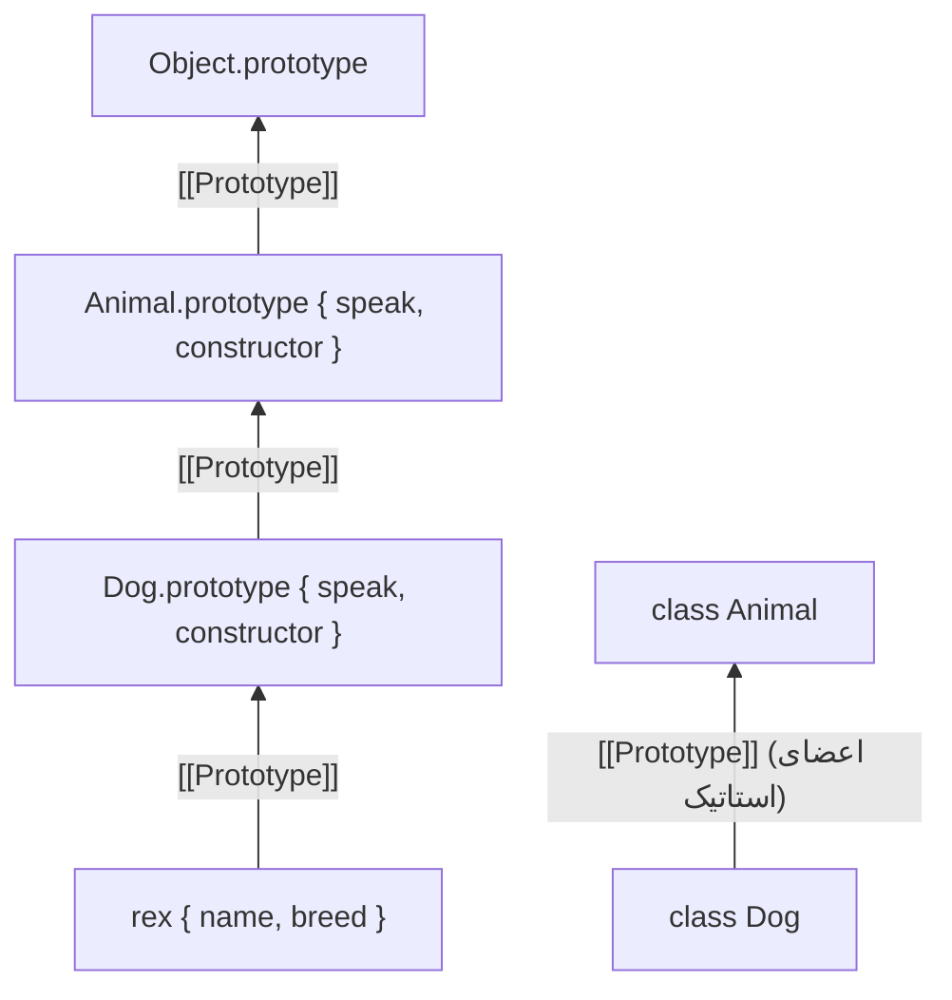

## کلاس (Class) چیست؟

**کلاس** نقشه‌ای برای ساختن Objectهایی است که **شکل** (Propertyها) و **رفتار** (متدهای) یکسانی دارند. به‌جای اینکه یک Object Literal را بارها و بارها بنویسید، یک بار آن را توصیف می‌کنید و با `new` هر تعداد **نمونه (Instance)** که لازم دارید می‌سازید.

```js run
class User {
  constructor(name, email) {   // برای هر User جدید یک بار اجرا می‌شود
    this.name = name;          // Propertyهای Instance: هر Object نسخه خودش را دارد
    this.email = email;
  }

  greet() {                    // متد: بین همه Instanceها مشترک است
    return `Hi, I'm ${this.name}`;
  }
}

const ali = new User("Ali", "ali@example.com");
const sara = new User("Sara", "sara@example.com");

console.log(ali.greet(), sara.greet());
console.log(ali instanceof User);           // true
console.log(ali.greet === sara.greet);      // true — یک تابع مشترک
```



**ایده اصلی:** کلاس‌های JavaScript **Syntaxی روی همان سیستم Prototype** هستند. هر کلاس یک تابع سازنده (Constructor Function) و یک Object به نام `prototype` می‌سازد که متدها را نگه می‌دارد؛ Instanceها کارهایشان را به همین Prototype می‌سپارند. اگر Prototype برایتان تازه است، اول [Objectها و Prototype](/javascript/objects-prototypes) را بخوانید. تمرکز این فصل روی امکاناتی است که Syntax کلاس می‌دهد و روش درست استفاده از آن.

```js run
class Point { constructor(x) { this.x = x; } show() { return this.x; } }
console.log(typeof Point);                                   // "function"
console.log(Object.getOwnPropertyNames(Point.prototype));    // ['constructor', 'show']
console.log(Object.getPrototypeOf(new Point(1)) === Point.prototype); // true
```

## اجزای یک کلاس

```js run
class BankAccount {
  // ۱. فیلد عمومی (Public Field): روی هر Instance ساخته می‌شود، قبل از اجرای بدنه constructor
  currency = "USD";

  // ۲. فیلد خصوصی (Private Field): فقط کد داخل بدنه همین کلاس می‌تواند آن را بخواند یا بنویسد
  #balance = 0;

  // ۳. فیلد استاتیک (Static Field): روی خود کلاس است، نه روی Instanceها
  static bankName = "JS Bank";
  static #count = 0;

  // ۴. Constructor: با new اجرا می‌شود و آرگومان‌ها را می‌گیرد
  constructor(owner, initial = 0) {
    this.owner = owner;
    this.deposit(initial);
    BankAccount.#count++;
  }

  // ۵. متد: روی BankAccount.prototype و مشترک
  deposit(amount) {
    if (amount < 0) throw new RangeError("negative amount");
    this.#balance += amount;
    return this;                 // برگرداندن this امکان زنجیره کردن متدها را می‌دهد
  }

  // ۶. Getter: مثل یک Property خوانده می‌شود
  get balance() {
    return this.#balance;
  }

  // ۷. متد خصوصی
  #log(message) {
    return `[${this.owner}] ${message}`;
  }
  report() {
    return this.#log(`balance ${this.#balance} ${this.currency}`);
  }

  // ۸. متد استاتیک: روی خود کلاس صدا زده می‌شود
  static count() {
    return BankAccount.#count;
  }
}

const acc = new BankAccount("Ali", 100).deposit(50);
console.log(acc.balance, acc.report());
console.log(BankAccount.bankName, BankAccount.count());
console.log(Object.keys(acc));           // ['currency', 'owner'] — فیلدهای خصوصی دیده نمی‌شوند
```

| عضو | Syntax | کجا ذخیره می‌شود | نحوه دسترسی |
| --- | --- | --- | --- |
| Constructor | `constructor(…) {}` | خود تابع کلاس | `new BankAccount(…)` |
| فیلد عمومی | `currency = "USD"` | **روی هر Instance** | `acc.currency` |
| فیلد خصوصی | `#balance = 0` | روی هر Instance (در یک خانه پنهان) | فقط `this.#balance` داخل کلاس |
| متد | `deposit() {}` | `BankAccount.prototype` | `acc.deposit()` |
| Getter / Setter | `get balance() {}` | `BankAccount.prototype` | `acc.balance` |
| متد خصوصی | `#log() {}` | پنهان، مخصوص همین کلاس | فقط داخل کلاس |
| فیلد یا متد استاتیک | `static count() {}` | خود کلاس (`BankAccount`) | `BankAccount.count()` |
| بلوک استاتیک | `static { … }` | یک بار، هنگام تعریف کلاس اجرا می‌شود | — |

## Constructor

<Api name="constructor" sig="constructor(...params) { … }" returns="لازم نیست چیزی برگرداند؛ `new` خودش Instance جدید را برمی‌گرداند (مگر اینکه Constructor صراحتاً یک **Object** دیگر برگرداند)." mutates="n/a">

- `...params`: آرگومان‌هایی که به `new ClassName(...)` داده می‌شوند.
- داخل آن، `this` همان Instance تازه‌ساخته است. در کلاس پایه، وقتی بدنه شروع می‌شود فیلدها از قبل مقدار گرفته‌اند.
- هر کلاس **حداکثر یک** Constructor دارد. اگر ننویسید، یک Constructor خالی ساخته می‌شود (در Subclass: `constructor(...args) { super(...args) }`).

</Api>

`new User("Ali")` قدم‌به‌قدم چه کار می‌کند:

```mermaid
flowchart TD
    N["new User('Ali')"] --> O["۱. ساختن یک Object خالی<br/>که [[Prototype]] آن User.prototype است"]
    O --> F["۲. مقداردهی فیلدها<br/>(عمومی و خصوصی، به ترتیب)"]
    F --> C["۳. اجرای بدنه constructor<br/>با this = همان Object جدید"]
    C --> R{"۴. constructor یک Object برگرداند؟"}
    R -->|خیر (حالت معمول)| I["برگرداندن Instance جدید"]
    R -->|بله| X["برگرداندن همان Object"]
```

```js run
class Order {
  status = "new";                         // اول فیلدها اجرا می‌شوند…
  constructor(id) {
    console.log("in constructor, status =", this.status);   // …پس status از قبل وجود دارد
    this.id = id;
  }
}
const o = new Order(7);
console.log(o);

try {
  Order(8);                               // کلاس را نمی‌شود بدون new صدا زد
} catch (e) {
  console.log(e.name + ": " + e.message);
}
```

## فیلدها: عمومی و خصوصی

### فیلدهای عمومی

تعریف یک فیلد (`name = value`) روی **هر Instance یک Own Property** می‌سازد. عبارت مقدار **برای هر Instance جداگانه** اجرا می‌شود؛ پس هر Object آرایه یا Object مخصوص خودش را می‌گیرد:

```js run
class TodoList {
  items = [];                 // برای هر Instance یک آرایه جدید ✓
  createdAt = Date.now();
}
const a = new TodoList();
const b = new TodoList();
a.items.push("buy milk");
console.log(a.items, b.items);            // ['buy milk'] [] — مشترک نیستند
```

مقایسه کنید با گذاشتن داده روی Prototype که **مشترک** است:

```js run
function Old() {}
Old.prototype.items = [];                 // ✗ یک آرایه برای همه Instanceها
const x = new Old(), y = new Old();
x.items.push("shared!");
console.log(y.items);                     // ['shared!']
```

### فیلدها و متدهای خصوصی (`#`)

اعضای `#name` **واقعاً خصوصی‌اند**: موتور JavaScript اجازه دسترسی از بیرون بدنه کلاس را نمی‌دهد. این با قرارداد قدیمی `_name` فرق دارد که فقط یک اشاره به برنامه‌نویس‌های دیگر است.

```js run
class Counter {
  #count = 0;
  #step;
  constructor(step = 1) { this.#step = step; }
  increment() { this.#count += this.#step; return this.#count; }

  // `#x in obj` بررسی می‌کند که آیا obj فیلد خصوصی این کلاس را دارد («Brand Check»)
  static isCounter(obj) { return #count in obj; }
}

const c = new Counter(5);
console.log(c.increment(), c.increment());   // 5 10
console.log(c.count, Object.keys(c));        // undefined [] — هیچ چیز دیده نمی‌شود
console.log(JSON.stringify(c));              // {}
console.log(Counter.isCounter(c), Counter.isCounter({}));   // true false
// c.#count  ← بیرون از کلاس SyntaxError است (حتی نوشتنش هم ممکن نیست)
```

| | `_name` (قرارداد) | `#name` (خصوصی) | متغیر Closure |
| --- | --- | --- | --- |
| واقعاً پنهان است | ✗ | ✓ | ✓ |
| در `Object.keys`، JSON و DevTools دیده می‌شود | ✓ | ✗ | ✗ |
| Subclass به آن دسترسی دارد | ✓ | ✗ (فقط همان کلاسی که تعریفش کرده) | ✗ |
| حافظه | متدها مشترک | متدها مشترک | برای هر Object یک تابع جدید |

نام‌های خصوصی **مخصوص کلاس** هستند، نه مخصوص یک Object: کد داخل `Counter` می‌تواند `#count` یک Instance *دیگر* از `Counter` را هم بخواند (برای پیاده‌سازی `equals(other)` مفید است).

## متدها و `this`

متدها یک بار روی Prototype تعریف می‌شوند. وقتی `obj.method()` را صدا می‌زنید، `this` همان `obj` است. مشکل از جایی شروع می‌شود که متد را از Objectش **جدا** کنید؛ مثلاً وقتی آن را به‌عنوان Callback پاس می‌دهید:

```js run
class Timer {
  seconds = 0;
  tick() {
    this.seconds++;
    return this.seconds;
  }
}

const t = new Timer();
console.log(t.tick());            // 1 — به شکل t.tick() صدا زده شد، پس this = t

const detached = t.tick;
try {
  detached();                     // this = undefined (بدنه کلاس همیشه Strict است)
} catch (e) {
  console.log(e.name + ": " + e.message);
}
```

سه روش برای ثابت نگه داشتن `this`:

```js run
class Button {
  label = "Save";
  constructor() {
    this.handleBind = this.handleBind.bind(this);   // ۱. bind در constructor
  }
  handleBind() { return "bind: " + this.label; }

  handleArrow = () => "arrow field: " + this.label;  // ۲. Arrow Function به‌عنوان فیلد

  handleNormal() { return "normal: " + this.label; }
}

const b = new Button();
const callbacks = [b.handleBind, b.handleArrow, () => b.handleNormal()]; // ۳. پیچیدن در محل صدا زدن
callbacks.forEach((fn) => console.log(fn()));
```

| روش | تابع کجا قرار دارد | هزینه |
| --- | --- | --- |
| متد Prototype به‌علاوه `bind` در constructor | یک نسخه Bind‌شده برای هر Instance | یک تابع به ازای هر Instance |
| Arrow Function به‌عنوان فیلد | Own Property روی هر Instance | یک تابع به ازای هر Instance؛ روی Prototype نیست، پس با `super` قابل Override نیست |
| پیچیدن در محل صدا زدن `() => obj.m()` | Prototype | یک Wrapper جدید در هر محل استفاده یا هر Render |

همه قوانین `this` در فصل [this و Functionها](/javascript/this-functions) آمده است.

## Getter و Setter در کلاس

Accessorها مقدار محاسبه‌شده یا اعتبارسنجی‌شده را شبیه یک Property ساده نشان می‌دهند. آن‌ها روی Prototype قرار دارند:

```js run
class Rectangle {
  #width; #height;
  constructor(w, h) { this.width = w; this.height = h; }   // از مسیر Setterها عبور می‌کند

  get width() { return this.#width; }
  set width(v) {
    if (!(v > 0)) throw new RangeError("width must be > 0");
    this.#width = v;
  }
  get height() { return this.#height; }
  set height(v) {
    if (!(v > 0)) throw new RangeError("height must be > 0");
    this.#height = v;
  }
  get area() { return this.#width * this.#height; }        // مقدار محاسبه‌شده فقط‌خواندنی
}

const r = new Rectangle(3, 4);
console.log(r.area);
r.width = 10;
console.log(r.area);
try { r.width = -1; } catch (e) { console.log(e.message); }
try { r.area = 5; } catch (e) { console.log(e.name); }      // Setter ندارد ← TypeError (در Strict)
```

داستان کامل (Descriptorها، دام‌های وراثت، Getter تنبل) در بخش [Getter و Setter](/javascript/objects-prototypes#getter-و-setter-accessor-property) آمده است.

## اعضای استاتیک

اعضای `static` متعلق به **خود کلاس** هستند. از آن‌ها برای چیزهایی استفاده کنید که به خود مفهوم مربوط‌اند، نه به یک Instance مشخص: توابع سازنده جایگزین (Factory)، ثابت‌ها، Cache، شمارنده‌ها و توابع کمکی اعتبارسنجی.

```js run
class Color {
  static #cache = new Map();
  static WHITE = new Color(255, 255, 255);    // یک ثابت استاتیک (می‌تواند از خود کلاس استفاده کند)

  constructor(r, g, b) { Object.assign(this, { r, g, b }); }

  // سازنده جایگزین (Named Constructor یا Factory)
  static fromHex(hex) {
    if (Color.#cache.has(hex)) return Color.#cache.get(hex);
    const [r, g, b] = hex.match(/\w\w/g).map((h) => parseInt(h, 16));
    const color = new Color(r, g, b);
    Color.#cache.set(hex, color);
    return color;
  }

  static {                                    // بلوک مقداردهی استاتیک: فقط یک بار اجرا می‌شود
    console.log("Color class initialized");
  }

  toString() { return `rgb(${this.r}, ${this.g}, ${this.b})`; }
}

console.log(String(Color.fromHex("#ff8800")));
console.log(Color.fromHex("#ff8800") === Color.fromHex("#ff8800"));   // true — از Cache آمد
console.log(String(Color.WHITE));
console.log(new Color(1, 2, 3).fromHex);      // undefined — اعضای استاتیک روی Instance نیستند
```

داخل متد استاتیک، `this` همان کلاسی است که متد روی آن صدا زده شده؛ این در Subclassها مهم است (`static create() { return new this(); }` یک Instance از Subclass می‌سازد).

## وراثت با `extends` و `super`

`class Child extends Parent` باعث می‌شود `Child` همه چیز را از `Parent` به ارث ببرد: متدهای Instance (از طریق Prototype Chain) **و** اعضای استاتیک (Prototype خود کلاس فرزند، کلاس والد است).

```js run
class Animal {
  constructor(name) { this.name = name; }
  speak() { return `${this.name} makes a sound`; }
  static create(name) { return new this(name); }   // `this` = کلاسی که متد روی آن صدا زده شده
}

class Dog extends Animal {
  constructor(name, breed) {
    super(name);                 // باید قبل از هر استفاده‌ای از `this` صدا زده شود
    this.breed = breed;
  }
  speak() {                      // Override
    return `${super.speak()}… a loud woof!`;   // super.method() نسخه والد را صدا می‌زند
  }
}

const rex = new Dog("Rex", "Labrador");
console.log(rex.speak());
console.log(rex instanceof Dog, rex instanceof Animal);
console.log(Dog.create("Max") instanceof Dog);     // متد استاتیک به ارث رسید و `this` = Dog
```



### قوانین `super`

| کجا | `super` یعنی چه | قانون |
| --- | --- | --- |
| در constructor کلاس فرزند | `super(...args)` constructor والد را صدا می‌زند | باید **قبل از** هر دسترسی به `this` اجرا شود؛ تا آن موقع `this` وجود ندارد |
| داخل یک متد | `super.method()` متد والد را با همان `this` فعلی صدا می‌زند | در متدها و Accessorها کار می‌کند، نه در توابع معمولی |
| داخل متد استاتیک | `super.staticMethod()` متد استاتیک والد را صدا می‌زند | |

```js predict
class A {
  constructor() { this.who = "A"; }
}
class B extends A {
  constructor() {
    try {
      this.early = true;
    } catch (e) {
      console.log(e.name);
    }
    super();
    console.log(this.who);
  }
}
new B();
```

```output
ReferenceError
A
```

در کلاس فرزند، `this` تا زمانی که `super()` تمام نشده در **Temporal Dead Zone** است؛ چون در واقع constructor **والد** است که Object را می‌سازد. به همین دلیل Subclass ساختن از کلاس‌های داخلی مثل `Array`، `Error` یا `Map` با Syntax کلاس درست کار می‌کند.

### گسترش کلاس‌های داخلی (Built-in)

```js run
class ValidationError extends Error {
  constructor(field, message) {
    super(message);              // message (و stack) را روی Instance تنظیم می‌کند
    this.name = "ValidationError";
    this.field = field;
  }
}

try {
  throw new ValidationError("email", "Email is required");
} catch (e) {
  console.log(e instanceof ValidationError, e instanceof Error);
  console.log(`${e.name} on ${e.field}: ${e.message}`);
}

class Stack extends Array {
  peek() { return this.at(-1); }
}
const s = Stack.from([1, 2, 3]);
console.log(s.peek(), s.length, s instanceof Array, s.map((x) => x * 2) instanceof Stack);
```

به خط آخر دقت کنید: `map` روی یک `Stack` هم یک `Stack` برمی‌گرداند، چون متدهای آرایه نتیجه را از طریق `this.constructor` می‌سازند (`Symbol.species`).

## ترکیب (Composition) به‌جای وراثت

وراثت یک درخت خشک «است‌یک» (is-a) می‌سازد. وقتی باید رفتارها را آزادانه با هم ترکیب کنید، معمولاً **ترکیب** («دارد»، has-a) یا **Mixin** انتخاب بهتری است.

```js run
// Mixin: تابعی که یک کلاس می‌گیرد و نسخه گسترش‌یافته‌اش را برمی‌گرداند
const Serializable = (Base) => class extends Base {
  toJSON() { return { type: this.constructor.name, ...this }; }
};
const Timestamped = (Base) => class extends Base {
  createdAt = new Date(0).toISOString();
};

class Entity { constructor(id) { this.id = id; } }
class Product extends Serializable(Timestamped(Entity)) {
  constructor(id, title) { super(id); this.title = title; }
}

console.log(JSON.stringify(new Product(1, "Keyboard")));
```

```js run
// ترکیب: Object ابزارهای کمکی را «دارد»، به‌جای اینکه Subclass آن‌ها «باشد»
class Logger { log(msg) { console.log(`[log] ${msg}`); } }
class Cache {
  #store = new Map();
  get(k) { return this.#store.get(k); }
  set(k, v) { this.#store.set(k, v); }
}

class UserService {
  constructor({ logger = new Logger(), cache = new Cache() } = {}) {
    this.logger = logger;          // تزریق‌شده (Injected): در تست راحت جایگزین می‌شود
    this.cache = cache;
  }
  getUser(id) {
    const hit = this.cache.get(id);
    if (hit) return hit;
    this.logger.log(`loading user ${id}`);
    const user = { id, name: `User ${id}` };
    this.cache.set(id, user);
    return user;
  }
}

const service = new UserService();
service.getUser(1);
service.getUser(1);                // بار دوم از Cache می‌آید و Log نمی‌شود
```

| | وراثت (`extends`) | ترکیب (Composition) |
| --- | --- | --- |
| نوع رابطه | «است‌یک» (سگ یک حیوان است) | «دارد» (سرویس یک Logger دارد) |
| استفاده دوباره از کد | ضمنی، از طریق زنجیره | صریح، از طریق فیلدها و پارامترها |
| انعطاف | هنگام تعریف ثابت می‌شود؛ فقط یک والد | آزادانه ترکیب و حتی در زمان اجرا جایگزین می‌شود |
| تست | جایگزین کردن رفتار والد سخت است | تزریق نسخه جعلی (Fake) ساده است |
| خطر | کلاس پایه شکننده و سلسله‌مراتب عمیق | کد اتصال بیشتر |

React هم همین انتخاب را کرده است: Componentها با ترکیب (children، props، Hookها) کنار هم قرار می‌گیرند و وراثت کلاسی بین Componentها توصیه نمی‌شود.

## کلاس در مقابل Factory Function در مقابل Object Literal

```js run
// Factory Function: تابعی که یک Object برمی‌گرداند
function createCounter(start = 0) {
  let count = start;                   // با Closure خصوصی است
  return {
    increment: () => ++count,
    get value() { return count; },
  };
}
const fc = createCounter(10);
fc.increment();
console.log(fc.value, fc instanceof Object);
```

| | `class` | Factory Function | Object Literal |
| --- | --- | --- | --- |
| ساختن Instanceهای زیاد | ✓ | ✓ | ✗ (فقط یک Object) |
| متدهای مشترک از طریق Prototype | ✓ | ✗ (برای هر Object کپی می‌شود) مگر با `Object.create` | — |
| خصوصی بودن | فیلدهای `#` | Closure | ✗ |
| بررسی با `instanceof` | ✓ | ✗ | ✗ |
| دام‌های `this` | بله، وقتی متد جدا شود | اگر از `this` استفاده نکنید، هیچ | بله |
| وراثت | `extends` | ترکیب | `Object.create` یا Spread |

## Hoisting و دیگر تفاوت‌ها با تابع سازنده

| | `class` | تابع سازنده `function` |
| --- | --- | --- |
| Hoisting | Hoist می‌شود، اما در **TDZ** است (مثل `let`) | کامل Hoist می‌شود |
| صدا زدن بدون `new` | `TypeError` | اجرا می‌شود و `this` برابر undefined یا Global است (باگ) |
| حالت بدنه | همیشه **Strict** | Sloppy، مگر با `"use strict"` |
| Enumerable بودن متدها | خیر | بله، اگر روی `prototype` مقداردهی شوند |
| اعضای خصوصی | `#field` | فقط Closure |

```js run
try {
  new Early();          // TDZ: کلاس وجود دارد اما هنوز مقداردهی نشده
} catch (e) {
  console.log(e.name + ": " + e.message);
}
class Early {}
```

## اشتباهات رایج

- استفاده از `this` قبل از `super()` در constructor کلاس فرزند.
- پاس دادن `obj.method` به‌عنوان Callback و از دست دادن `this`.
- گذاشتن داده تغییرپذیر (آرایه، Object) روی Prototype به‌جای فیلد.
- انتظار خصوصی بودن از `_private`، یا انتظار دسترسی Subclass به `#private`.
- Override کردن فقط Getter از یک جفت Getter/Setter (Setter برای آن نام از بین می‌رود).
- ساختن سلسله‌مراتب وراثت عمیق، وقتی ترکیب ساده‌تر است.
- فراموش کردن اینکه Getterها و متدهای کلاس با `JSON.stringify` Serialize نمی‌شوند.

## سوالات مصاحبه

<QA q="آیا کلاس‌های JavaScript مثل کلاس‌های Java واقعی هستند؟ `class` در عمل چه چیزی می‌سازد؟" level="mid" n={1}>
<Answer>

خیر. `class` یک Syntax روی سیستم Prototype است. یک تابع سازنده می‌سازد (`typeof` آن `"function"` است) که Object مربوط به `prototype` آن متدها را نگه می‌دارد؛ Instanceها همین Object را به‌عنوان `[[Prototype]]` می‌گیرند و کارها را به آن می‌سپارند. هنگام ساختن Instance چیزی کپی نمی‌شود، جز فیلدها که برای هر Instance جداگانه ساخته می‌شوند.

</Answer>
<Deep>

البته کلاس‌ها معنای واقعی تازه‌ای هم به تابع سازنده اضافه می‌کنند: بدون `new` صدا زده نمی‌شوند، بدنه‌شان Strict است، متدها Non-enumerable هستند، اعضای `#private` واقعی دارند، `super` از طریق Home Object متد کار می‌کند و در کلاس فرزند، constructor والد `this` را می‌سازد (همین چیزی است که Subclass ساختن از `Array` و `Error` را ممکن می‌کند).

</Deep>
<Mistake>

گفتن اینکه کلاس‌ها متدها را داخل هر Instance «کپی» می‌کنند.

</Mistake>
<FollowUp>

چطور `class Dog extends Animal` را فقط با تابع سازنده و `Object.create` می‌نویسید؟

</FollowUp>
</QA>

<QA q="چرا در constructor کلاس فرزند باید `super()` قبل از `this` صدا زده شود؟" level="mid" n={2}>
<Answer>

در کلاس فرزند، Object را constructor **والد** می‌سازد. تا وقتی `super()` اجرا نشده `this` وجود ندارد و دست زدن به آن `ReferenceError` می‌دهد (`this` در Temporal Dead Zone است).

</Answer>
<Deep>

این طراحی به کلاس‌های داخلی اجازه می‌دهد Objectهای خاص بسازند: Instance یک Subclass از `Array` باید یک آرایه واقعی با `length` جادویی باشد که خود `Array` آن را می‌سازد. فیلدهای کلاس فرزند درست بعد از برگشتن `super()` و قبل از ادامه بدنه constructor مقداردهی می‌شوند.

</Deep>
<Mistake>

فکر کردن به اینکه `super()` فقط وقتی لازم است که constructor والد آرگومان بگیرد.

</Mistake>
<FollowUp>

ترتیب اجرای فیلدهای والد، بدنه constructor والد، فیلدهای فرزند و بدنه constructor فرزند چیست؟

</FollowUp>
</QA>

<QA q="تفاوت `#private`، `_private` و خصوصی‌سازی با Closure چیست؟" level="mid" n={3}>
<Answer>

`_name` فقط یک قرارداد نام‌گذاری است و Property عمومی است. `#name` توسط خود زبان تضمین می‌شود: فقط داخل بدنه کلاس قابل دسترسی است و در `Object.keys`، JSON و Proxy دیده نمی‌شود. متغیرهای Closure (در Factory یا constructor) هم واقعاً خصوصی‌اند، اما برای دسترسی به آن‌ها به توابعی جداگانه برای هر Object نیاز است.

</Answer>
<Deep>

نام‌های خصوصی از نظر Scope به کلاس تعلق دارند، نه به Instance: یک Instance می‌تواند `#field` یک Instance دیگر را بخواند. `#x in obj` یک Brand Check است که می‌گوید `obj` با همین کلاس ساخته شده یا نه. Subclassها اعضای خصوصی والد را نمی‌بینند؛ رفتارهای «Protected» را از طریق متدها در اختیارشان بگذارید.

</Deep>
<Mistake>

تلاش برای خواندن `this.#field` از داخل Subclass؛ اگر Subclass آن را تعریف نکرده باشد SyntaxError است.

</Mistake>
<FollowUp>

چرا Proxyی که دور یک Instance پیچیده شده نمی‌تواند متدهایی را که از فیلدهای `#private` استفاده می‌کنند صدا بزند؟

</FollowUp>
</QA>

<QA q="متدی که به‌عنوان Event Handler پاس داده شده خطای `Cannot read properties of undefined` می‌دهد. چرا و چطور درستش می‌کنید؟" level="junior" n={4}>
<Answer>

با پاس دادن `obj.method` فقط خود تابع پاس داده می‌شود؛ وقتی بعداً مثل یک تابع معمولی صدا زده شود، `this` برابر `undefined` است (کد کلاس Strict است). راه‌حل: Bind در constructor (`this.method = this.method.bind(this)`)، تعریف متد به شکل فیلد Arrow Function، یا پیچیدن در محل استفاده (`() => obj.method()`).

</Answer>
<Deep>

فیلدهای Arrow برای هر Instance یک تابع می‌سازند و روی خود Instance قرار می‌گیرند، نه روی Prototype؛ پس از طریق `super.method()` قابل Override نیستند و کمی حافظه بیشتری مصرف می‌کنند. برای بیشتر کدهای UI این هزینه قابل قبول است.

</Deep>
<Mistake>

فرض اینکه `this` در لحظه تعریف متد ثابت می‌شود؛ `this` در لحظه صدا زدن تعیین می‌شود.

</Mistake>
<FollowUp>

چرا این مشکل برای متدهایی که با Arrow Function داخل یک Factory Function تعریف شده‌اند وجود نداشت؟

</FollowUp>
</QA>

<QA q="چه زمانی ترکیب (Composition) را به وراثت ترجیح می‌دهید؟ مثال بزنید." level="senior" n={5}>
<Answer>

وقتی رفتارها باید به شکل‌های مختلف با هم ترکیب شوند، وقتی رابطه «دارد» است نه «است‌یک»، یا وقتی می‌خواهید پیاده‌سازی را عوض کنید (مثلاً در تست). مثال: `UserService`ی که یک `logger` و یک `cache` دریافت می‌کند، به‌جای اینکه از یک کلاس پایه `CachedLoggingService` ارث ببرد.

</Answer>
<Deep>

سلسله‌مراتب عمیق از مشکل «کلاس پایه شکننده» رنج می‌برند: تغییر والد ممکن است بی‌صدا فرزندان را خراب کند. ترکیب، وابستگی‌ها را صریح نگه می‌دارد و Dependency Injection را ممکن می‌کند. Mixinها (کارخانه‌های کلاس) در JavaScript حالتی میانه‌اند، اما ممکن است باعث تداخل نام‌ها و زنجیره‌های پیچیده `super` شوند.

</Deep>
<Mistake>

ساختن یک کلاس پایه فقط برای به اشتراک گذاشتن یک تابع کمکی.

</Mistake>
<FollowUp>

مدل Component در React چطور اصل «ترکیب به‌جای وراثت» را نشان می‌دهد؟

</FollowUp>
</QA>

## جمع‌بندی

<Recap>

- `class` یک الگو برای ساختن Objectهای هم‌شکل است و زیر پوست همان تابع سازنده و Prototype است.
- `constructor` هنگام `new` اجرا می‌شود و Object جدید را مقداردهی می‌کند؛ صدا زدن کلاس بدون `new` خطا می‌دهد.
- فیلدهای عمومی روی خود Instance ساخته می‌شوند؛ متدها روی Prototype و بین همه Instanceها مشترک‌اند.
- فیلدها و متدهای `#private` واقعاً خصوصی‌اند و بیرون از کلاس حتی قابل خواندن نیستند.
- متدها `this` را از نحوه صدا زدن می‌گیرند؛ جدا کردن متد (`const f = obj.method`) `this` را از دست می‌دهد؛ Arrow Function به‌عنوان فیلد یا `bind` حلش می‌کند.
- اعضای `static` مال خود کلاس‌اند، نه Instanceها؛ برای Factoryها و Utilityها.
- در کلاس فرزند باید قبل از استفاده از `this`، `super()` صدا زده شود؛ `super.method()` نسخه والد را صدا می‌زند.
- کلاس‌ها Hoist می‌شوند ولی در TDZ می‌مانند و بدنه‌شان همیشه Strict است.
- برای ترکیب رفتارها Composition اغلب از وراثت عمیق ساده‌تر و انعطاف‌پذیرتر است.

</Recap>
