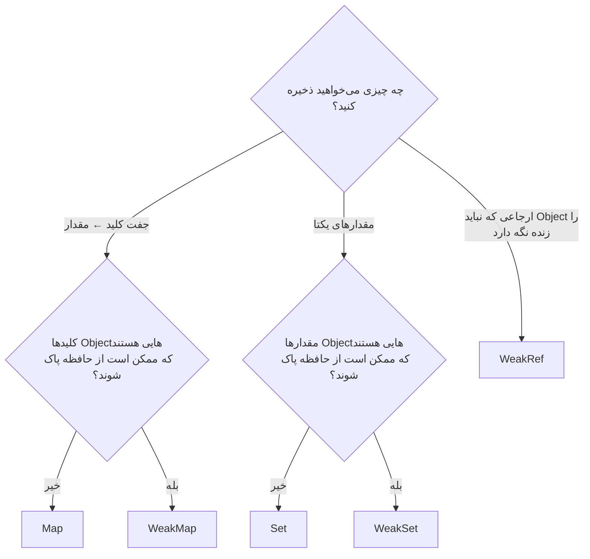
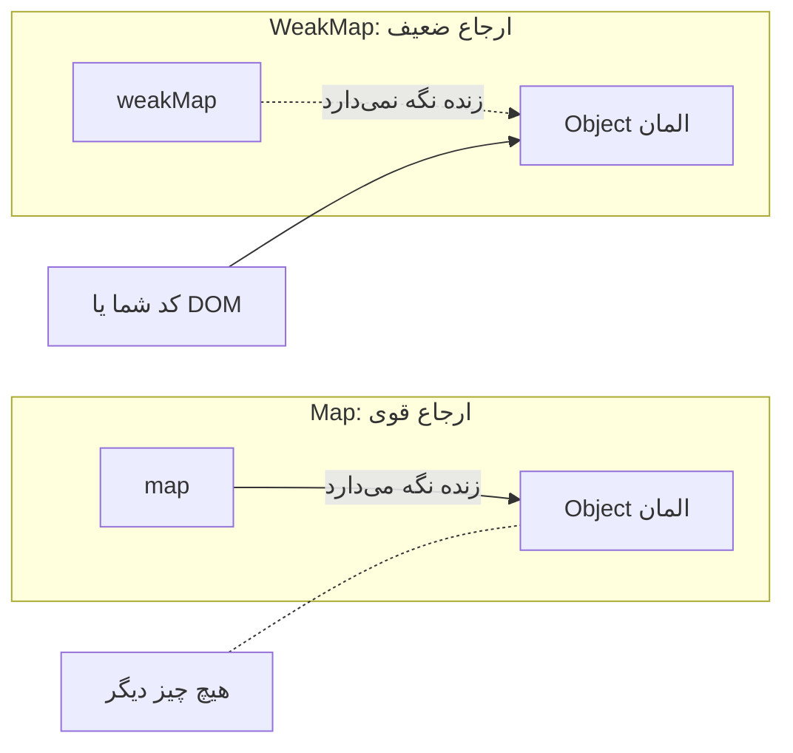

## چرا به چیزی بیشتر از Object و آرایه نیاز داریم؟

برنامه‌نویس‌های JavaScript سال‌ها از Object ساده به‌عنوان دیکشنری و از آرایه به‌عنوان مجموعه (Set) استفاده می‌کردند. هر دو کار می‌کنند، اما هر دو دام‌هایی دارند:

| نیاز | با Object یا آرایه ساده | مشکل |
| --- | --- | --- |
| جستجوی کلید ← مقدار | `obj[key]` | کلیدها همیشه **رشته یا Symbol** هستند (`obj[1]` و `obj["1"]` یکی می‌شوند و کلیدِ Object به `"[object Object]"` تبدیل می‌شود)؛ کلیدهای به ارث رسیده مثل `"constructor"` یا `"__proto__"` تداخل ایجاد می‌کنند؛ `size` سریع وجود ندارد |
| مجموعه‌ای از مقدارهای یکتا | `arr.includes(x)` قبل از `push` | `includes` از O(n) است، پس ساختن فهرست یکتا O(n²) می‌شود |
| چسباندن داده به Objectی که مال شما نیست (مثلاً یک Node در DOM) | `node._data = …` | Object را آلوده می‌کند و داده به اندازه عمر Object زنده می‌ماند؛ اگر در فهرست جداگانه نگهش دارید، حتی بیشتر |

ES2015 چهار نوع مجموعه (Collection) اضافه کرد که دقیقاً همین مشکلات را حل می‌کنند: **`Map`**، **`Set`**، **`WeakMap`** و **`WeakSet`**. ES2021 هم **`WeakRef`** و **`FinalizationRegistry`** را برای کدهای پیشرفته‌ای که به حافظه حساس‌اند اضافه کرد.



## Map: یک دیکشنری واقعی

**`Map`** جفت‌های کلید و مقدار را نگه می‌دارد، ترتیب اضافه شدن را به خاطر می‌سپارد و **هر مقداری را به‌عنوان کلید** می‌پذیرد: Object، تابع، `NaN` و عدد (بدون اینکه آن را به رشته تبدیل کند).

<Api name="Map" sig="new Map(iterable?) · map.set(key, value) · map.get(key) · map.has(key) · map.delete(key) · map.clear() · map.size" returns="`set` **خود Map** را برمی‌گرداند (پس می‌شود فراخوانی‌ها را زنجیر کرد)؛ `get` مقدار یا `undefined` را؛ `has` و `delete` مقدار Boolean؛ `size` تعداد ورودی‌هاست." mutates="yes">

- `iterable` (اختیاری): ورودی‌های اولیه به شکل جفت‌های `[key, value]`؛ مثلاً `new Map([["a", 1], ["b", 2]])` یا `new Map(Object.entries(obj))`.
- `key`: هر مقداری. کلیدها با **SameValueZero** مقایسه می‌شوند (مثل `===`، با این تفاوت که `NaN` با `NaN` برابر است).

</Api>

```js run
const user = { id: 1 };
const config = new Map();

config.set("theme", "dark")          // کلید رشته‌ای
      .set(42, "the answer")        // کلید عددی: عدد باقی می‌ماند
      .set(user, { visits: 3 })     // کلید از نوع Object!
      .set(NaN, "not a number");    // حتی NaN هم کار می‌کند

console.log(config.get("theme"));   // "dark"
console.log(config.get(42), config.get("42"));   // "the answer" undefined — تبدیل به رشته انجام نمی‌شود
console.log(config.get(user));      // { visits: 3 }
console.log(config.get({ id: 1 })); // undefined — یک Object دیگر است
console.log(config.get(NaN));       // "not a number"
console.log(config.has(user), config.size);       // true 4

config.delete(42);
console.log([...config.keys()]);    // ترتیب اضافه شدن حفظ می‌شود
```

### پیمایش Map

```js run
const stock = new Map([
  ["apples", 12],
  ["bananas", 0],
  ["cherries", 40],
]);

for (const [fruit, count] of stock) {           // پیمایش Map جفت‌های [key, value] می‌دهد
  console.log(`${fruit}: ${count}`);
}

stock.forEach((count, fruit) => {               // دقت کنید: (value, key)؛ اول مقدار!
  if (count === 0) console.log("out of stock:", fruit);
});

console.log([...stock.keys()], [...stock.values()]);
console.log([...stock.entries()]);

// تبدیل: به آرایه ببرید، متدهای آرایه را بزنید، دوباره Map بسازید
const doubled = new Map([...stock].map(([k, v]) => [k, v * 2]));
console.log(doubled);
```

### تبدیل بین Object و Map

```js run
const obj = { a: 1, b: 2 };
const map = new Map(Object.entries(obj));       // Object ← Map
console.log(map);

map.set("c", 3);
console.log(Object.fromEntries(map));           // Map ← Object (کلیدها رشته می‌شوند)

console.log(JSON.stringify(map));               // "{}" — JSON با Map آشنا نیست!
console.log(JSON.stringify([...map]));          // به‌جایش آرایه‌ای از جفت‌ها را Serialize کنید
```

### Map در مقابل Object ساده

| | `Map` | Object ساده `{}` |
| --- | --- | --- |
| نوع کلیدها | **هر چیزی** | فقط رشته و Symbol |
| کلیدهای ناخواسته | ندارد | کلیدهای به ارث رسیده (`toString`، `constructor`، `__proto__`) مگر با `Object.create(null)` |
| ترتیب | همیشه ترتیب اضافه شدن | اول کلیدهای عددی، بعد ترتیب اضافه شدن |
| اندازه | `map.size` (از O(1)) | `Object.keys(obj).length` (از O(n)) |
| پیمایش | مستقیماً با `for...of` | نیاز به `Object.keys` یا `entries` |
| اضافه و حذف مکرر | برای همین بهینه شده | ممکن است Object را به «Dictionary Mode» کند ببرد |
| JSON | مستقیماً پشتیبانی نمی‌شود | پشتیبانی داخلی |
| مناسب برای | دیکشنری‌های پویا، Cache، شمارش، کلیدهای Object | رکوردهایی با شکل ثابت، تنظیمات، داده JSON |

**قاعده سرانگشتی:** اگر فهرست کلیدها **از قبل معلوم است** (مثلاً یک کاربر با `name` و `email`)، Object بسازید. اگر کلیدها خودشان **داده** هستند (شناسه‌ها، کلمه‌ها، ورودی کاربر) و مدام اضافه و حذف می‌شوند، از `Map` استفاده کنید.

### مثال‌های کاربردی Map

```js run
// ۱. شمردن تکرارها (برای هر نوع کلیدی کار می‌کند)
const words = "the cat and the hat and the bat".split(" ");
const counts = new Map();
for (const w of words) counts.set(w, (counts.get(w) ?? 0) + 1);
console.log(counts);

// ۲. گروه‌بندی (ES2024 یک متد داخلی برایش دارد)
const people = [{ name: "Ali", team: "web" }, { name: "Sara", team: "data" }, { name: "Reza", team: "web" }];
console.log(Map.groupBy(people, (p) => p.team));

// ۳. یک Cache ساده برای Memoization بر اساس آرگومان
function memoize(fn) {
  const cache = new Map();
  return (arg) => {
    if (cache.has(arg)) return cache.get(arg);
    const result = fn(arg);
    cache.set(arg, result);
    return result;
  };
}
const slowSquare = (n) => { console.log("computing", n); return n * n; };
const fastSquare = memoize(slowSquare);
console.log(fastSquare(9), fastSquare(9));   // "computing 9" فقط یک بار چاپ می‌شود
```

`Map` ترتیب اضافه شدن را حفظ می‌کند و اگر کلیدی را حذف و دوباره اضافه کنید، به انتها منتقل می‌شود. به همین دلیل Map پایه استاندارد پیاده‌سازی **LRU Cache** است ([الگوریتم‌های سطح ۳](/algorithms/level-3)).

## Set: مقدارهای یکتا

**`Set`** مجموعه‌ای است که هر مقدار **فقط یک بار** در آن می‌آید. اضافه کردن مقداری که از قبل هست، هیچ اثری ندارد.

<Api name="Set" sig="new Set(iterable?) · set.add(value) · set.has(value) · set.delete(value) · set.clear() · set.size" returns="`add` **خود Set** را برمی‌گرداند (قابل زنجیر کردن)؛ `has` و `delete` مقدار Boolean؛ `size` تعداد مقدارهاست." mutates="yes">

- `iterable` (اختیاری): مقدارهای اولیه؛ مثلاً یک آرایه یا یک رشته.
- `value`: هر مقداری؛ یکتا بودن با **SameValueZero** سنجیده می‌شود (`NaN` با `NaN` برابر است، `0` با `-0` برابر است و Objectها بر اساس مرجع).

</Api>

```js run
const tags = new Set(["js", "css"]);
tags.add("html").add("js");              // "js" از قبل هست: نادیده گرفته می‌شود
console.log(tags, tags.size);            // Set(3) { 'js', 'css', 'html' } 3
console.log(tags.has("css"));            // true — به‌طور میانگین O(1)، برخلاف array.includes

// معروف‌ترین کاربرد یک‌خطی: حذف تکراری‌ها
const nums = [3, 1, 3, 2, 1, NaN, NaN];
console.log([...new Set(nums)]);         // [3, 1, 2, NaN]

// کاراکترهای یکتای یک رشته
console.log([...new Set("mississippi")].join(""));   // "misp"

// Objectها بر اساس مرجع یکتا هستند، نه بر اساس محتوا
const s = new Set([{ id: 1 }, { id: 1 }]);
console.log(s.size);                     // 2
```

### عملیات مجموعه‌ها (اجتماع، اشتراک، تفاضل)

موتورهای امروزی (ES2025) متدهای داخلی برای جبر مجموعه‌ها دارند. همه آن‌ها یک Set **جدید** برمی‌گردانند:

```js run
const frontend = new Set(["js", "css", "html", "react"]);
const backend = new Set(["js", "sql", "node"]);

const has = (name) => typeof Set.prototype[name] === "function";
if (has("union")) {
  console.log(frontend.union(backend));                 // اجتماع: همه
  console.log(frontend.intersection(backend));          // اشتراک: هر دو؛ یعنی js
  console.log(frontend.difference(backend));            // تفاضل: فقط frontend
  console.log(frontend.symmetricDifference(backend));   // دقیقاً در یکی از دو مجموعه
  console.log(new Set(["js"]).isSubsetOf(frontend));    // true
} else {
  // همین کارها با Spread و filter برای موتورهای قدیمی‌تر
  console.log(new Set([...frontend, ...backend]));
  console.log(new Set([...frontend].filter((x) => backend.has(x))));
  console.log(new Set([...frontend].filter((x) => !backend.has(x))));
}
```

```text
 frontend            backend
┌───────────────┬────────┬──────────┐
│ css html react│   js   │ sql node │
└───────────────┴────────┴──────────┘
   difference    intersection
  └──────────── union ─────────────┘
```

### چرا Set برای جستجو سریع‌تر است

```js run
const size = 20000;
const arr = Array.from({ length: size }, (_, i) => i);
const set = new Set(arr);

let t = performance.now();
for (let i = 0; i < size; i++) arr.includes(i);       // هر جستجو O(n) ← در مجموع O(n²)
console.log("array.includes:", Math.round(performance.now() - t), "ms");

t = performance.now();
for (let i = 0; i < size; i++) set.has(i);            // هر جستجو O(1) ← در مجموع O(n)
console.log("set.has:       ", Math.round(performance.now() - t), "ms");
```

Set (و Map) به شکل **Hash Table** پیاده‌سازی شده است: موتور محل هر مقدار را محاسبه می‌کند، به‌جای اینکه همه عضوها را یکی‌یکی بگردد.

## WeakMap: داده متصل به Objectها، بدون نشت حافظه

**`WeakMap`** شبیه Map است، با دو تفاوت مهم:

1. **کلیدها باید Object باشند** (یا Symbolهای ثبت‌نشده).
2. **کلیدها به شکل ضعیف (Weak) نگه داشته می‌شوند**: اگر هیچ چیز دیگری به Object کلید اشاره نکند، Garbage Collector می‌تواند آن را پاک کند و ورودی‌اش خودبه‌خود از WeakMap حذف می‌شود.

چون ورودی‌ها ممکن است هر لحظه ناپدید شوند، WeakMap **قابل پیمایش نیست** و **`size` ندارد**. فقط می‌توانید با کلیدی که در دست دارید `get`، `set`، `has` و `delete` کنید.

<Api name="WeakMap" sig="new WeakMap() · wm.set(objectKey, value) · wm.get(objectKey) · wm.has(objectKey) · wm.delete(objectKey)" returns="`set` خود WeakMap را برمی‌گرداند؛ `get` مقدار یا `undefined` را؛ `has` و `delete` مقدار Boolean." mutates="yes">

- `objectKey`: باید Object باشد (کلید Primitive خطای `TypeError` می‌دهد).
- `value`: هر چیزی؛ فقط تا وقتی کلید زنده است، زنده می‌ماند.

</Api>



```js run
const metadata = new WeakMap();

function track(element) {
  metadata.set(element, { clicks: 0, firstSeen: Date.now() });
}

let button = { id: "save" };         // به‌جای یک Node واقعی در DOM
track(button);
metadata.get(button).clicks++;
console.log(metadata.get(button), metadata.has(button));

button = null;                       // تنها ارجاع از بین رفت…
// …پس GC حالا می‌تواند هم Object و هم داده‌اش را پاک کند. این را نمی‌توانیم ببینیم:
// WeakMap نه size دارد و نه قابل پیمایش است.

try {
  metadata.set("string key", 1);     // Primitive نمی‌تواند کلید باشد
} catch (e) {
  console.log(e.name + ": " + e.message);
}
```

### کاربردهای واقعی WeakMap

| کاربرد | چرا ضعیف بودن کلید مهم است |
| --- | --- |
| داده مربوط به Nodeهای DOM (Tooltip، اندازه‌گیری‌ها، Listenerها) | وقتی Node حذف و رها شود، داده‌اش هم می‌رود: نشت حافظه رخ نمی‌دهد |
| Cache نتیجه به ازای هر Object (مثلاً `memoize(fn)` با آرگومان Object) | Cache هیچ‌وقت آرگومان‌ها را زنده نگه نمی‌دارد |
| داده خصوصی برای Instanceهای کلاس (الگوی قبل از `#private`) | داده همراه Instance از بین می‌رود |
| ثبت Objectهایی که قبلاً پردازش شده‌اند (مثلاً در Deep Clone با ارجاع چرخشی) | بعد از پایان عملیات نیازی به پاک‌سازی نیست |

```js run
// یک Cache به ازای هر Object که نمی‌تواند باعث نشت حافظه شود
const areaCache = new WeakMap();
function area(shape) {
  if (!areaCache.has(shape)) {
    console.log("computing area for", shape.name);
    areaCache.set(shape, shape.w * shape.h);
  }
  return areaCache.get(shape);
}
const box = { name: "box", w: 3, h: 4 };
console.log(area(box), area(box));   // فقط یک بار محاسبه می‌شود
```

React DevTools، سیستم Reactivity در Vue (`targetMap`) و خیلی از کتابخانه‌ها دقیقاً همین‌طور از WeakMap استفاده می‌کنند.

## WeakSet

نسبت **`WeakSet`** به `Set` مثل نسبت `WeakMap` به `Map` است: **فقط Object** نگه می‌دارد، به شکل ضعیف، و قابل پیمایش نیست. فقط به یک سؤال جواب می‌دهد: «این Object را قبلاً دیده‌ام؟»

```js run
const visited = new WeakSet();

function deepCount(node) {
  if (node === null || typeof node !== "object") return 0;
  if (visited.has(node)) return 0;     // جلوی ارجاع چرخشی را می‌گیرد
  visited.add(node);
  return 1 + Object.values(node).reduce((sum, child) => sum + deepCount(child), 0);
}

const a = { name: "a" };
const b = { name: "b", parent: a };
a.child = b;                           // a ↔ b: یک چرخه
console.log(deepCount(a));             // 2 — بدون بازگشت بی‌پایان
```

## جدول مقایسه

| | `Map` | `Set` | `WeakMap` | `WeakSet` |
| --- | --- | --- | --- | --- |
| چه چیزی نگه می‌دارد | کلید ← مقدار | مقدار | کلید Object ← مقدار | Object |
| نوع کلید یا مقدار | هر چیزی | هر چیزی | کلید: فقط Object | فقط Object |
| ورودی‌ها را زنده نگه می‌دارد | ✓ (قوی) | ✓ (قوی) | ✗ (کلید ضعیف) | ✗ (ضعیف) |
| `size` | ✓ | ✓ | ✗ | ✗ |
| قابل پیمایش (`for...of`، Spread) | ✓ | ✓ | ✗ | ✗ |
| `clear()` | ✓ | ✓ | ✗ | ✗ |
| کاربرد رایج | دیکشنری، Cache، شمارش | یکتایی، بررسی عضویت سریع | فراداده یا Cache به ازای هر Object | بررسی «قبلاً دیده شده؟» |

## WeakRef و FinalizationRegistry (پیشرفته)

**`WeakRef`** یک ارجاع ضعیف به **یک** Object نگه می‌دارد. `ref.deref()` اگر Object هنوز زنده باشد آن را برمی‌گرداند و بعد از پاک شدنش `undefined`.

```js run
let bigData = { rows: new Array(1000).fill("row") };
const ref = new WeakRef(bigData);

console.log(ref.deref()?.rows.length);   // 1000 — هنوز زنده است

bigData = null;   // بعد از یک دور GC در آینده، ref.deref() مقدار undefined برمی‌گرداند
// اینجا نمی‌توانیم GC را اجباری کنیم، پس آن لحظه را به‌طور قطعی نمی‌توانیم نشان دهیم.

const registry = new FinalizationRegistry((label) => {
  console.log(`${label} was garbage-collected`);   // ممکن است بعداً اجرا شود، یا هیچ‌وقت
});
registry.register({ temp: true }, "temporary object");
console.log("registered");
```

<Callout type="warning" title="به‌ندرت از آن‌ها استفاده کنید">
زمان Garbage Collection قابل پیش‌بینی نیست و بین موتورها و حتی اجراهای مختلف فرق می‌کند. هرگز برای درستی برنامه (بستن فایل، ذخیره داده) به Callback یک `FinalizationRegistry` تکیه نکنید؛ ممکن است اصلاً اجرا نشود. `WeakRef` برای Cacheهای Objectهای پرهزینه اما قابل ساخت دوباره مفید است. تقریباً برای همه کارهای دیگر، `WeakMap` ابزار درست است.
</Callout>

## اشتباهات رایج

- استفاده از `{}` به‌عنوان دیکشنری برای کلیدهای دلخواه (کلیدهای عددی و Object با هم تداخل دارند و `"__proto__"` رفتار خاصی دارد).
- نوشتن `map[key] = value` روی یک `Map`: این کار یک Property معمولی می‌سازد، نه یک ورودی Map (`map.size` صفر می‌ماند).
- فراموش کردن اینکه `map.forEach` آرگومان‌ها را به ترتیب `(value, key)` می‌دهد.
- `JSON.stringify(map)` نتیجه `"{}"` می‌دهد؛ `[...map]` یا `Object.fromEntries(map)` را Serialize کنید.
- انتظار اینکه `new Set([{a:1}, {a:1}])` Objectها را بر اساس محتوا یکتا کند.
- نگه داشتن Nodeهای DOM در `Map` یا آرایه بعد از حذفشان از صفحه: نشت حافظه. از `WeakMap` یا `WeakSet` استفاده کنید.
- تلاش برای پیمایش یا شمردن یک `WeakMap`.

## سوالات مصاحبه

<QA q="چه زمانی به‌جای Object ساده از `Map` استفاده می‌کنید؟" level="junior" n={1}>
<Answer>

وقتی کلیدها داده پویا هستند نه مجموعه‌ای ثابت از فیلدها؛ وقتی کلیدها رشته نیستند (Object، یا عددی که نمی‌خواهید به رشته تبدیل شود)؛ وقتی ورودی‌ها مدام اضافه و حذف می‌شوند؛ یا وقتی `size` یا پیمایش با ترتیب تضمین‌شده لازم دارید. Object همچنان برای رکوردهایی با شکل ثابت و هر چیزی که به JSON تبدیل می‌شود یا از آن می‌آید بهتر است.

</Answer>
<Deep>

Objectهایی که کلیدهایشان پویا اضافه و حذف می‌شوند ممکن است در V8 به Dictionary Mode کند بروند و کلیدهای ورودی کاربر مثل `"__proto__"` می‌توانند باگ Prototype Pollution ایجاد کنند. `Map` کلید به ارث رسیده ندارد و برای تغییرات مکرر طراحی شده است.

</Deep>
<Mistake>

نوشتن `map[key] = value` روی Map؛ این کار یک Property معمولی می‌سازد و کلاً Map را دور می‌زند.

</Mistake>
<FollowUp>

چطور یک `Map` را به JSON تبدیل و دوباره بازسازی می‌کنید؟

</FollowUp>
</QA>

<QA q="تفاوت `Map` و `WeakMap` چیست؟ یک کاربرد واقعی برای `WeakMap` بگویید." level="mid" n={2}>
<Answer>

`WeakMap` فقط Object را به‌عنوان کلید می‌پذیرد و آن را ضعیف نگه می‌دارد: اگر جای دیگری به Object کلید اشاره نشود، ورودی می‌تواند توسط Garbage Collector پاک شود. به همین دلیل `size` ندارد، قابل پیمایش نیست و `clear` ندارد. کاربرد رایج: چسباندن فراداده یا نتایج Cache‌شده به Nodeهای DOM یا Objectهایی که مال شما نیستند، بدون ایجاد نشت حافظه.

</Answer>
<Deep>

مقدار فقط تا وقتی کلید زنده است به شکل قوی نگه داشته می‌شود (به این ساختار «Ephemeron» می‌گویند). مقداری که به کلید خودش اشاره کند، کلید را زنده نگه نمی‌دارد. WeakMap پیش از معرفی فیلدهای `#private` روش استاندارد پیاده‌سازی داده خصوصی Instanceها هم بود.

</Deep>
<Mistake>

گفتن اینکه مقدارها ضعیف‌اند؛ این **کلیدها** هستند که ضعیف نگه داشته می‌شوند.

</Mistake>
<FollowUp>

چرا WeakMap نمی‌تواند قابل پیمایش باشد؟ (چون محتوایش به زمان‌بندی Garbage Collection وابسته می‌شد.)

</FollowUp>
</QA>

<QA q="چطور تکراری‌ها را از یک آرایه حذف می‌کنید و `Set` چطور تصمیم می‌گیرد دو مقدار برابرند؟" level="junior" n={3}>
<Answer>

با `[...new Set(array)]`. Set از SameValueZero استفاده می‌کند: مثل `===` است، جز اینکه `NaN` با `NaN` برابر است؛ `0` و `-0` برابرند؛ و Objectها فقط وقتی برابرند که دقیقاً یک مرجع باشند.

</Answer>
<Deep>

برای یکتا کردن Objectها بر اساس یک فیلد، از Mapی استفاده کنید که کلیدش همان فیلد است: `[...new Map(items.map(i => [i.id, i])).values()]` برای هر id آخرین مورد را نگه می‌دارد. این روش O(n) است، درحالی‌که `filter` همراه با `findIndex` از O(n²) است.

</Deep>
<Mistake>

انتظار اینکه `new Set([{ id: 1 }, { id: 1 }])` اندازه ۱ داشته باشد.

</Mistake>
<FollowUp>

اشتراک دو آرایه را چطور به شکل بهینه محاسبه می‌کنید؟

</FollowUp>
</QA>

<QA q="چرا `set.has(x)` از `array.includes(x)` سریع‌تر است؟" level="mid" n={4}>
<Answer>

`includes` آرایه را عضو به عضو می‌گردد: O(n). Set یک Hash Table است، پس `has` محل (Bucket) مقدار `x` را محاسبه می‌کند و فقط همان‌جا را بررسی می‌کند: به‌طور میانگین O(1). برای تعداد زیادی جستجو، تفاوت بین O(n²) و O(n) است.

</Answer>
<Deep>

تبدیل آرایه به Set یک بار هزینه O(n) دارد؛ پس وقتی بیش از چند جستجو انجام می‌دهید ارزشش را دارد. برای آرایه‌های خیلی کوچک (چند عضوی) `includes` به دلیل سربار کمتر ممکن است به همان اندازه سریع باشد.

</Deep>
<Mistake>

تبدیل آرایه به Set داخل حلقه؛ که هزینه O(n) را در هر دور تکرار می‌کند.

</Mistake>
<FollowUp>

برای نگه داشتن ترتیب اضافه شدن و حذف قدیمی‌ترین ورودی از چه ساختاری استفاده می‌کنید؟ (یک Map؛ یعنی LRU Cache.)

</FollowUp>
</QA>

## جمع‌بندی

<Recap>

- `Map` کلید از هر نوعی (حتی Object) می‌پذیرد، ترتیب درج را حفظ می‌کند و `size` دارد؛ برای دیکشنری‌هایی که مرتب تغییر می‌کنند بهتر از Object است.
- `Set` مقدارهای یکتا نگه می‌دارد؛ `[...new Set(arr)]` تکراری‌ها را حذف می‌کند. مقایسه با الگوریتم SameValueZero است (`NaN` با خودش برابر).
- متدهای جدید `Set` (`union`، `intersection`، `difference`، …) عملیات مجموعه‌ای را بدون حلقه انجام می‌دهند.
- `WeakMap` و `WeakSet` فقط Object (و Symbol غیرثبت‌شده) را به‌عنوان کلید می‌پذیرند و آن را زنده نگه نمی‌دارند.
- Weakها قابل پیمایش نیستند و `size` ندارند، چون محتوایشان به زمان اجرای GC بستگی دارد.
- کاربرد WeakMap: داده خصوصی یا Cache متصل به یک Object (مثلاً DOM Node) بدون نشت حافظه.
- `WeakRef` و `FinalizationRegistry` ابزارهای پیشرفته و غیرقطعی‌اند؛ منطق برنامه را به آن‌ها وابسته نکنید.

</Recap>
