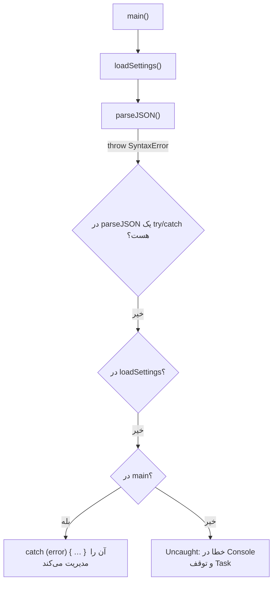
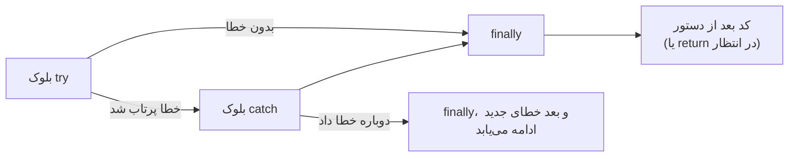

## خطا (Error) چیست؟

**خطا** روشی است که برنامه با آن می‌گوید «نمی‌توانم کاری را که خواستی ادامه بدهم». در JavaScript، خطاها **Object** هستند که **پرتاب (Throw)** می‌شوند. پرتاب کردن، کد فعلی را فوراً متوقف می‌کند و Call Stack را به عقب برمی‌گرداند تا جایی که کدی خطا را **بگیرد (Catch)**. اگر هیچ کدی آن را نگیرد، خطا **Uncaught** می‌شود: در Console گزارش می‌شود و همان Task (یا کل Process در Node) متوقف می‌شود.



خطاها سه دسته‌اند و هر دسته برخورد متفاوتی لازم دارد:

| نوع | مثال | چه باید کرد |
| --- | --- | --- |
| **خطای برنامه‌نویس** (باگ) | `undefined is not a function`، نوع اشتباه آرگومان | کد را درست کنید. با try/catch پنهانش نکنید |
| **خطای عملیاتی** (شکست قابل انتظار) | قطع شبکه، 404، ورودی نامعتبر کاربر، Timeout، نبود مجوز | مدیریتش کنید: تلاش دوباره، نمایش پیام، مقدار جایگزین |
| **خطای مرگبار یا محیطی** | تمام شدن حافظه، سرریز Stack | معمولاً قابل بازیابی نیست؛ ثبت (Log) کنید و به شکل امن شکست بخورید |

## Object خطا (`Error`)

<Api name="Error" sig="new Error(message?, { cause }?)" returns="یک Object خطا با `name`، `message`، `stack` و (به‌طور اختیاری) `cause`." mutates="n/a">

- `message` (اختیاری): توضیحی قابل فهم برای انسان.
- `options.cause` (اختیاری، ES2022): خطای اصلی که باعث این خطا شده است.

</Api>

```js run
const err = new Error("Could not load profile", { cause: new Error("HTTP 503") });

console.log(err.name);                    // "Error"
console.log(err.message);                 // "Could not load profile"
console.log(err.cause.message);           // "HTTP 503"
console.log(err instanceof Error);        // true
console.log(typeof err.stack, err.stack.split("\n")[0]);   // Call Stack در لحظه ساخته شدن خطا
```

| Property | معنا |
| --- | --- |
| `name` | نوع خطا (`"TypeError"`، `"ValidationError"` و…) |
| `message` | چه اشتباهی رخ داده؛ برای برنامه‌نویس (و گاهی کاربر) |
| `stack` | استاندارد نیست اما همه جا وجود دارد: جایی که خطا **ساخته** شده (نه جایی که پرتاب شده) |
| `cause` | خطای اصلی؛ برای افزودن زمینه بدون از دست دادن علت ریشه‌ای |

### انواع خطای داخلی

| نوع | چه زمانی پرتاب می‌شود | مثال |
| --- | --- | --- |
| `TypeError` | مقدار از نوع مورد انتظار نیست یا آن عملیات روی آن مجاز نیست | `null.x`، `undefined()`، مقدار دادن به Property ثابت در Strict Mode |
| `ReferenceError` | متغیر وجود ندارد یا در TDZ استفاده شده | `missingVar`، استفاده از `let x` قبل از خط تعریفش |
| `SyntaxError` | کد یا داده قابل Parse نیست | `JSON.parse("{bad}")`، `eval("if(")` |
| `RangeError` | عدد بیرون از محدوده مجاز است | `new Array(-1)`، بازگشت بیش از حد، `(1).toFixed(200)` |
| `URIError` | ورودی نادرست برای توابع URI | `decodeURIComponent("%")` |
| `EvalError` | قدیمی و عملاً بلااستفاده | — |
| `AggregateError` | چند خطا با هم | `Promise.any` وقتی همه Reject شوند |
| `DOMException` | APIهای مرورگر | `AbortError`، `NotAllowedError`، `QuotaExceededError` |

```js run
const attempts = [
  () => null.name,
  () => missingVariable,
  () => JSON.parse("{not json}"),
  () => new Array(-1),
  () => decodeURIComponent("%"),
];
for (const fn of attempts) {
  try { fn(); } catch (e) { console.log(`${e.name}: ${e.message}`); }
}
```

## پرتاب کردن با `throw`

`throw` **هر مقداری** را می‌پذیرد، اما همیشه باید Object از نوع `Error` (یا Subclassهای آن) پرتاب کنید. رشته‌ها و Objectهای ساده `stack` ندارند و بررسی با `instanceof` را خراب می‌کنند.

```js run
function divide(a, b) {
  if (typeof a !== "number" || typeof b !== "number") {
    throw new TypeError(`divide expects numbers, got ${typeof a} and ${typeof b}`);
  }
  if (b === 0) throw new RangeError("cannot divide by zero");
  return a / b;
}

console.log(divide(10, 4));
try { divide(1, 0); } catch (e) { console.log(e.name, "-", e.message); }

try { throw "just a string"; } catch (e) {
  console.log(typeof e, e.stack);           // "string" undefined — بدون Stack Trace!
}
```

## ساختار try / catch / finally

<Api name="try…catch…finally" sig="try { … } catch (error) { … } finally { … }" returns="یک دستور (Statement) است، نه مقدار. `catch` فقط وقتی اجرا می‌شود که `try` خطا داده باشد؛ `finally` **همیشه** اجرا می‌شود: بعد از `try`، بعد از `catch`، حتی بعد از `return` یا `break`." mutates="n/a">

- `catch (error)`: مقدار پرتاب‌شده را می‌گیرد. اگر به آن نیاز ندارید، نوشتن متغیر اختیاری است (`catch { … }`).
- `finally`: برای پاک‌سازی (بستن منابع، مخفی کردن Spinner، آزاد کردن قفل). حداقل یکی از `catch` یا `finally` لازم است.

</Api>

```js run
function readConfig(text) {
  console.log("1. start");
  try {
    const config = JSON.parse(text);
    console.log("2. parsed");
    return config;                          // finally قبل از برگشتن همچنان اجرا می‌شود
  } catch (error) {
    console.log("3. caught:", error.name);
    return { fallback: true };
  } finally {
    console.log("4. finally (always)");
  }
}

console.log(readConfig('{"debug":true}'));
console.log(readConfig("oops"));
```



### چیزهایی که `finally` می‌تواند بازنویسی کند

```js predict
function f() {
  try {
    return "from try";
  } finally {
    console.log("finally runs");
  }
}
function g() {
  try {
    throw new Error("lost");
  } finally {
    return "from finally";
  }
}
console.log(f());
console.log(g());
```

```output
finally runs
from try
from finally
```

`return` داخل `finally` مقدار بازگشتی در انتظار را **جایگزین** می‌کند و حتی خطای پرتاب‌شده را **می‌بلعد**. هرگز داخل `finally` مقدار برنگردانید؛ از آن فقط برای پاک‌سازی استفاده کنید.

### try/catch فقط خطاهای همگام را می‌گیرد

```js run
try {
  setTimeout(() => {
    try {
      throw new Error("inside the timer");
    } catch (e) {
      console.log("caught INSIDE the callback:", e.message);   // ✓ تنها جایی که می‌شود گرفتش
    }
  }, 0);
} catch (e) {
  console.log("never printed: the callback runs later, outside this try");
}
console.log("the outer try finished long ago");
```

در Promiseها، خطا بعداً به شکل یک **Rejection** می‌رسد؛ آن را با `await` داخل `try` یا با `.catch()` بگیرید. فصل [Async JavaScript](/javascript/async) را ببینید.

```js run
async function load() {
  try {
    await Promise.reject(new Error("network failed"));
  } catch (e) {
    console.log("async error caught with await:", e.message);
  }
}
load();

Promise.reject(new Error("also fine")).catch((e) => console.log(".catch():", e.message));
```

## کلاس‌های خطای سفارشی

خطاهای سفارشی به کد صداکننده اجازه می‌دهند به **نوع** شکست واکنش نشان دهد، به‌جای اینکه متن پیام‌ها را تجزیه کند:

```js run
class AppError extends Error {
  constructor(message, options) {
    super(message, options);
    this.name = this.constructor.name;          // "ValidationError"، "NotFoundError" و…
  }
}
class ValidationError extends AppError {
  constructor(field, message) {
    super(message);
    this.field = field;
  }
}
class HttpError extends AppError {
  constructor(status, url, options) {
    super(`HTTP ${status} for ${url}`, options);
    this.status = status;
  }
  get isRetryable() { return this.status >= 500 || this.status === 429; }
}

function handle(error) {
  if (error instanceof ValidationError) return `Fix the "${error.field}" field: ${error.message}`;
  if (error instanceof HttpError && error.status === 404) return "Not found";
  if (error instanceof HttpError && error.isRetryable) return "Server busy, retrying…";
  throw error;                                   // ناشناخته: نبلعیدش، دوباره پرتابش کنید
}

console.log(handle(new ValidationError("email", "is required")));
console.log(handle(new HttpError(404, "/api/user/9")));
console.log(handle(new HttpError(503, "/api/feed")));
try { handle(new TypeError("a real bug")); } catch (e) { console.log("rethrown:", e.name); }
```

<Callout type="tip" title="محدود بگیرید، بقیه را دوباره پرتاب کنید">
بلوک `catch` باید خطاهایی را که می‌شناسد مدیریت کند و **بقیه را دوباره پرتاب کند**. یک `catch (e) {}` کلی، باگ‌های واقعی را به رفتار نادرست و بی‌صدایی تبدیل می‌کند که پیدا کردنش خیلی سخت‌تر است.
</Callout>

### پیچیدن خطاها با `cause`

وقتی یک خطای سطح پایین از مرز یک لایه عبور می‌کند، آن را داخل خطایی بپیچید که در آن سطح معنا دارد و خطای اصلی را به‌عنوان `cause` نگه دارید:

```js run
async function fetchJson(url) {
  try {
    throw new SyntaxError("Unexpected token < in JSON at position 0");   // مثلاً سرور HTML فرستاده
  } catch (err) {
    throw new Error(`Failed to load ${url}`, { cause: err });
  }
}

fetchJson("/api/settings").catch((e) => {
  console.log(e.message);                          // زمینه سطح بالا
  console.log("  caused by:", e.cause.name, "-", e.cause.message);   // علت ریشه‌ای حفظ شده
});
```

## خطا در مقابل مقدار بازگشتی

همه شکست‌ها نباید Exception باشند. برای نتیجه‌های **قابل انتظار** (نامعتبر بودن یک فیلد فرم، پیدا نشدن نتیجه جستجو)، برگرداندن یک نتیجه اغلب واضح‌تر است:

```js run
// سبک «Result»: صداکننده باید ok یا error را بررسی کند
function parseAge(input) {
  const age = Number(input);
  if (!Number.isInteger(age)) return { ok: false, error: "Age must be a whole number" };
  if (age < 0 || age > 150) return { ok: false, error: "Age must be between 0 and 150" };
  return { ok: true, value: age };
}

for (const input of ["34", "abc", "-3"]) {
  const result = parseAge(input);
  console.log(input, "→", result.ok ? result.value : `error: ${result.error}`);
}
```

| | پرتاب خطا | برگرداندن نتیجه |
| --- | --- | --- |
| مناسب برای | شکست‌های غیرمنتظره یا استثنایی؛ زنجیره‌های عمیق فراخوانی | نتیجه‌های قابل انتظار و پرتکرار (اعتبارسنجی، «پیدا نشد») |
| صداکننده می‌تواند نادیده‌اش بگیرد | خیر (خودش بالا می‌رود) | بله (اگر بی‌دقت باشد) |
| جریان کنترل | به بالای Stack پرش می‌کند | صریح و محلی |
| Performance | ساختن Stack Trace اگر هزاران بار انجام شود زمان‌بر است | ارزان |
| مثال | `JSON.parse`، درخواست شبکه ناموفق | اعتبارسنجی فرم، `Array.prototype.find` که `undefined` برمی‌گرداند |

## Handlerهای سراسری خطا

از آن‌ها به‌عنوان **تور ایمنی** برای ثبت و گزارش خطا استفاده کنید، نه به‌عنوان روش معمول مدیریت خطا:

```js
// مرورگر: خطاهای همگامی که گرفته نشده‌اند
window.addEventListener("error", (event) => {
  report({ message: event.message, stack: event.error?.stack, source: event.filename });
});

// مرورگر: Rejectionهایی که هیچ‌کس مدیریتشان نکرده
window.addEventListener("unhandledrejection", (event) => {
  report({ message: String(event.reason), stack: event.reason?.stack });
  // event.preventDefault() پیام پیش‌فرض Console را پنهان می‌کند
});

// Node.js
process.on("uncaughtException", (err) => { log(err); process.exit(1); });  // ممکن است State خراب باشد: Restart کنید
process.on("unhandledRejection", (reason) => { log(reason); });
```

ابزارهایی مثل Sentry، Datadog یا Bugsnag این Handlerها را برایتان نصب می‌کنند، زمینه (کاربر، Route، نسخه انتشار) را اضافه می‌کنند و با **Source Map** ردپای خطاهای Minify‌شده را به کد اصلی شما برمی‌گردانند.

### خطا در React

Componentی که هنگام Render خطا بدهد، کل درخت را سفید می‌کند. **Error Boundary**ها (یک Class Component با `static getDerivedStateFromError` و `componentDidCatch`، یا کتابخانه‌هایی مثل `react-error-boundary`) خطاهای Render زیر خودشان را می‌گیرند و یک UI جایگزین نشان می‌دهند. خطاهای Event Handlerها، Timerها و کدهای Async را نمی‌گیرند؛ آنجا از try/catch استفاده کنید.

```jsx
<ErrorBoundary fallback={<p>Something went wrong.</p>} onError={report}>
  <Dashboard />
</ErrorBoundary>
```

## راهنمای عملی

| انجام دهید | انجام ندهید |
| --- | --- |
| Object از نوع `Error` (یا Subclassهایش) با پیام واضح پرتاب کنید | رشته یا Object ساده پرتاب کنید |
| ورودی را در مرزها اعتبارسنجی کنید (پاسخ API، ورودی کاربر، آرگومان‌های APIهای عمومی) | به داده خارجی اعتماد کنید |
| جایی Catch کنید که واقعاً **کاری از دستتان برمی‌آید** (تلاش دوباره، مقدار جایگزین، پیام) | هر خطی را داخل try/catch بپیچید |
| خطاهایی را که نمی‌شناسید دوباره پرتاب کنید | خطاها را با `catch {}` خالی ببلعید |
| با `cause` زمینه اضافه کنید | هنگام پیچیدن، خطای اصلی را از دست بدهید |
| به کاربر پیام قابل فهم نشان دهید و جزئیات فنی را Log کنید | Stack Trace را به کاربر نشان دهید |
| در `finally` پاک‌سازی کنید | از `finally` مقدار برگردانید |
| همه Promiseها را مدیریت کنید (`await` در try، یا `.catch`) | Promise سرگردان رها کنید |

## اشتباهات رایج

- `catch (e) {}` خالی (شکست‌های بی‌صدا).
- انتظار اینکه `try/catch` خطاهای داخل Callbackها یا Promiseهای await‌نشده را بگیرد.
- پرتاب رشته (`throw "failed"`): بدون Stack Trace و بدون `instanceof`.
- استفاده از Exception برای جریان کنترل معمولی در حلقه‌های پرتکرار.
- فراموش کردن `this.name` در خطاهای سفارشی (همه به اسم «Error» چاپ می‌شوند).
- برگرداندن مقدار از `finally` که خطاها را پنهان می‌کند.
- مقایسه متن پیام خطا (`e.message === "..."`) به‌جای نوع یا کد خطا.

## سوالات مصاحبه

<QA q="تفاوت `throw new Error('x')` و `throw 'x'` چیست؟" level="junior" n={1}>
<Answer>

هر دو اجرا را متوقف می‌کنند و قابل گرفتن‌اند، اما Object خطا یک `name`، یک `message` و یک `stack` دارد که نشان می‌دهد کجا ساخته شده و با `instanceof` و ابزارهای گزارش خطا کار می‌کند. رشته پرتاب‌شده هیچ‌کدام از این‌ها را ندارد و Debug را خیلی سخت‌تر می‌کند.

</Answer>
<Deep>

Stack هنگام **ساخته شدن** خطا ثبت می‌شود، نه هنگام پرتاب. Subclass کردن `Error` (همراه با تنظیم `this.name`) به صداکننده‌ها اجازه می‌دهد انواع خطا را از هم تشخیص دهند؛ `cause` زنجیره را وقتی خطاها بین لایه‌ها پیچیده می‌شوند حفظ می‌کند.

</Deep>
<Mistake>

فکر کردن به اینکه فقط Object خطا را می‌شود `throw` کرد. هر مقداری قابل پرتاب است؛ فقط ایده بدی است.

</Mistake>
<FollowUp>

برای یک API Client چه سلسله‌مراتبی از خطاها طراحی می‌کنید؟

</FollowUp>
</QA>

<QA q="آیا `finally` همیشه اجرا می‌شود؟ وجود `return` داخل `try` و `finally` چه اثری دارد؟" level="mid" n={2}>
<Answer>

بله: `finally` بعد از پایان عادی `try`، بعد از `catch` و حتی وقتی `try` یا `catch` با `return` یا `break` خارج شوند اجرا می‌شود. اگر خود `finally` مقداری برگرداند، آن مقدار جای return در انتظار را می‌گیرد و حتی Exception در انتظار را هم می‌بلعد.

</Answer>
<Deep>

تنها حالت‌هایی که `finally` اجرا نمی‌شود وقتی است که خود Process یا Thread از بین برود (مثلاً تب بسته شود، `process.exit()`، یا یک حلقه بی‌پایان داخل `try`). در Generatorها، `finally` وقتی Generator زودتر بسته شود (`return()`) اجرا می‌شود؛ برای همین آنجا برای پاک‌سازی استفاده می‌شود.

</Deep>
<Mistake>

گذاشتن یک `return` در `finally` «محض احتیاط» که خطاها را پنهان می‌کند.

</Mistake>
<FollowUp>

خروجی `(() => { try { throw 1 } finally { return 2 } })()` چیست؟ (`2`؛ خطا بلعیده می‌شود.)

</FollowUp>
</QA>

<QA q="چرا try/catch خطایی را که داخل `setTimeout` یا یک Promise پرتاب شده نمی‌گیرد؟" level="mid" n={3}>
<Answer>

`try/catch` فقط کدی را پوشش می‌دهد که داخل بلوک `try` به‌صورت همگام اجرا می‌شود. Callback مربوط به `setTimeout` بعداً و در یک Task جدید اجرا می‌شود، وقتی `try` مدت‌هاست تمام شده؛ Rejection یک Promise هم به‌صورت Async تحویل داده می‌شود. خطا را داخل خود Callback بگیرید، یا برای Promiseها از `await` داخل `try` (یا `.catch()`) استفاده کنید.

</Answer>
<Deep>

Rejectionهای مدیریت‌نشده در مرورگر رویداد `unhandledrejection` را فعال می‌کنند و ممکن است Process را در Node متوقف کنند. Stack Traceهای Async در DevTools (فریم‌های «async») کمک می‌کنند شکست را به کدی که آن را زمان‌بندی کرده وصل کنید.

</Deep>
<Mistake>

پیچیدن `fetch(url).then(...)` داخل `try/catch` بدون await کردن آن.

</Mistake>
<FollowUp>

چطور مطمئن می‌شوید هیچ Promiseی در برنامه‌تان بدون مدیریت رها نشده؟ (قوانین Lint مثل `@typescript-eslint/no-floating-promises` و یک Handler سراسری برای گزارش.)

</FollowUp>
</QA>

<QA q="چه زمانی خطا پرتاب کنیم و چه زمانی یک Object نتیجه برگردانیم؟" level="senior" n={4}>
<Answer>

برای موقعیت‌های استثنایی یا غیرمنتظره که صداکننده مستقیم معمولاً نمی‌تواند ادامه دهد خطا پرتاب کنید (باگ‌ها، نقض شدن شرط‌های ثابت، شکست I/O در عمق زنجیره فراخوانی). برای نتیجه‌های قابل انتظار و پرتکرار که صداکننده به‌هرحال باید مدیریتشان کند، مثل شکست اعتبارسنجی یا «پیدا نشد»، یک نتیجه (`{ ok, value, error }` یا `null`) برگردانید.

</Answer>
<Deep>

Exceptionها خودکار بالا می‌روند (برای Stackهای عمیق خوب است و اگر صداکننده فراموش کند که ممکن است رخ دهند بد)؛ نتیجه‌ها شکست را در Type صریح می‌کنند (Discriminated Union در TypeScript). ساختن Stack Trace نسبتاً پرهزینه است؛ پس هزاران بار پرتاب خطا در یک حلقه پرتکرار کند است. بسیاری از کدبیس‌ها هر دو را ترکیب می‌کنند: نتیجه در منطق دامنه و Exception در مرزهای زیرساخت.

</Deep>
<Mistake>

استفاده از Exception برای جریان کنترل معمولی (مثلاً پرتاب خطا برای خارج شدن از حلقه).

</Mistake>
<FollowUp>

چطور در TypeScript برای یک Object نتیجه Type تعریف می‌کنید تا Compiler صداکننده‌ها را مجبور به بررسی `ok` کند؟

</FollowUp>
</QA>

## جمع‌بندی

<Recap>

- خطا یک Object از نوع `Error` (یا زیرکلاس‌هایش مثل `TypeError`، `ReferenceError`، `SyntaxError`، `RangeError`) با `name`، `message` و `stack` است.
- `throw` اجرا را متوقف می‌کند و خطا را تا نزدیک‌ترین `catch` بالا می‌برد؛ همیشه Object `Error` پرتاب کنید، نه رشته.
- `finally` در هر حالتی اجرا می‌شود، حتی بعد از `return`؛ `return` داخل `finally` نتیجه قبلی را Override می‌کند.
- `cause` (در `new Error(msg, { cause })`) خطای اصلی را هنگام بسته‌بندی دوباره حفظ می‌کند.
- کلاس خطای سفارشی با `extends Error` و تنظیم `name` بسازید تا با `instanceof` تشخیص داده شود.
- خطاهای قابل انتظار (مثل «کاربر پیدا نشد») را می‌شود به‌جای پرتاب، به‌عنوان مقدار بازگرداند؛ خطای غیرمنتظره را پرتاب کنید.
- `try/catch` خطای Callbackهای Async بعدی را نمی‌گیرد؛ برای Promise از `catch` یا `await` داخل `try` استفاده کنید.
- Handlerهای سراسری (`window.onerror`، `unhandledrejection`) و Error Boundary در React برای گزارش خطا به سرویس مانیتورینگ‌اند.
- هرگز خطا را بی‌صدا نبلعید: یا مدیریتش کنید، یا دوباره پرتابش کنید.

</Recap>
