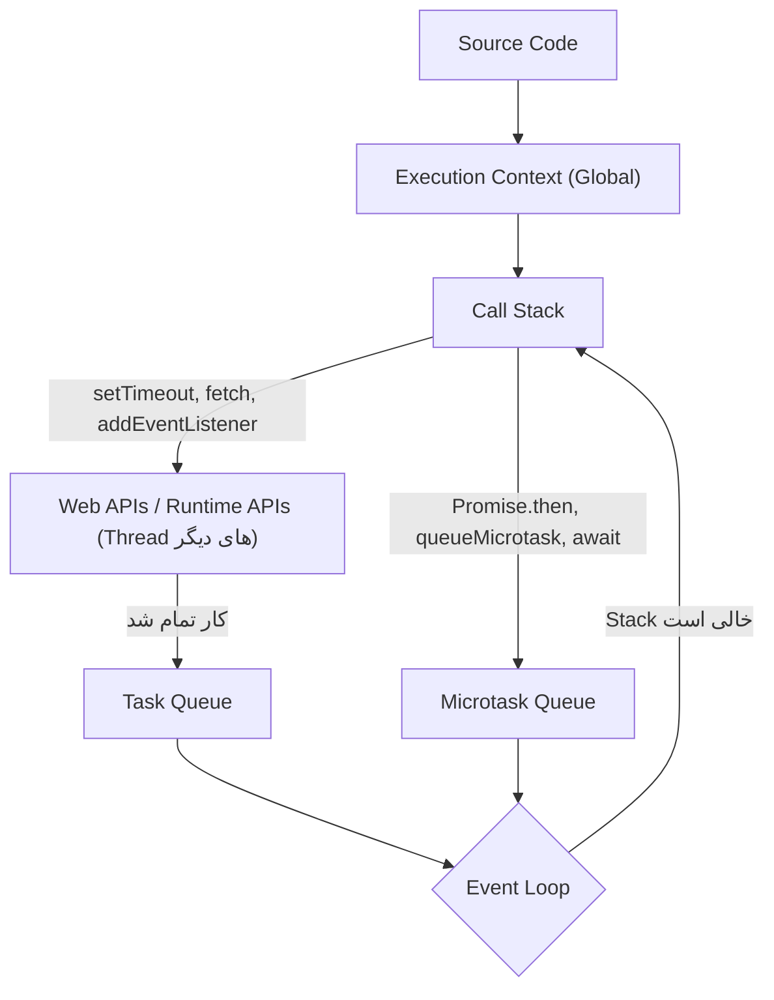
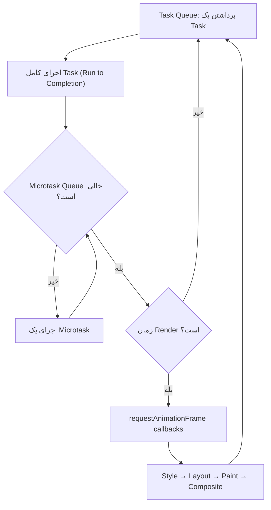
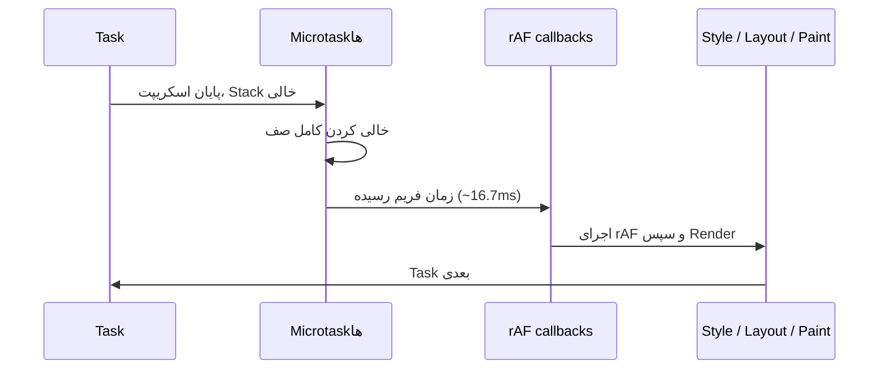

## چرا Event Loop وجود دارد؟

JavaScript **یک Call Stack** دارد؛ یعنی در هر لحظه فقط یک قطعه کد اجرا می‌شود. اگر درخواست شبکه یا Timer هم Synchronous بود، کل صفحه — کلیک، اسکرول، انیمیشن — تا رسیدن پاسخ قفل می‌شد.

راه‌حل: **کار طولانی به Runtime (Web APIs) سپرده می‌شود** که در Threadهای دیگر انجام می‌دهد. وقتی کار تمام شد، یک **Callback در صف** قرار می‌گیرد. `Event Loop (حلقه رویداد)` مکانیزمی است که تصمیم می‌گیرد **چه زمانی و به چه ترتیبی** این Callbackها روی Call Stack اجرا شوند.

## نقشه کامل Runtime

```text
JavaScript Engine (V8)
       │
       ├── Heap ............. Objectها، Closureها، Environment Recordها
       │
       └── Call Stack ........ Execution Contextها (Frameها)

Browser Runtime
       │
       ├── Web APIs ......... Timer، fetch، DOM Events، IndexedDB، ... (خارج از Engine)
       ├── Task Queue(s) .... Callbackهای Timer، Event، Message، I/O
       ├── Microtask Queue .. Promise Reactions، queueMicrotask، MutationObserver
       └── Event Loop ....... هماهنگ‌کننده: Stack خالی؟ → Microtaskها → Render → Task بعدی
```



### هر بخش دقیقاً چه کاری انجام می‌دهد؟

| بخش | مسئولیت | متعلق به |
| --- | --- | --- |
| **Call Stack** | اجرای کد Synchronous؛ هر فراخوانی تابع یک Frame (Execution Context) Push و با return Pop می‌شود | Engine |
| **Heap** | حافظه Objectها؛ توسط Garbage Collector مدیریت می‌شود | Engine |
| **Web APIs** | اجرای کارهای Async خارج از Thread اصلی (شمارش زمان، شبکه، گوش دادن به رویدادها) | Browser |
| **Task Queue** (Macrotask / Callback Queue) | صف(های) FIFO از Callbackهای آماده؛ مرورگر می‌تواند چند صف با اولویت متفاوت داشته باشد (مثلاً ورودی کاربر بالاتر از Timer) | Browser (HTML Spec) |
| **Microtask Queue** | یک صف FIFO با اولویت بالاتر؛ **کاملاً** خالی می‌شود قبل از هر Task بعدی و قبل از Render | ECMAScript (Job Queue) + HTML |
| **Event Loop** | حلقه بی‌پایان که این صف‌ها و Rendering را هماهنگ می‌کند | Browser |

## الگوریتم Event Loop (Processing Model)

نسخه ساده‌شده الگوریتم مشخصات HTML:

```js
// شبه‌کد — نه کد واقعی مرورگر
while (true) {
  // 1. یک Task (قدیمی‌ترین از صفی که مرورگر انتخاب می‌کند)
  const task = pickOldestTask(taskQueues);
  if (task) runToCompletion(task);          // Call Stack تا خالی شدن اجرا می‌شود

  // 2. Microtask Checkpoint: همه Microtaskها — از جمله آن‌هایی که حین اجرا اضافه می‌شوند
  while (microtaskQueue.length > 0) {
    runToCompletion(microtaskQueue.shift());
  }

  // 3. Rendering (اگر زمان Frame رسیده باشد؛ معمولاً هر ~16.7ms)
  if (isRenderingOpportunity()) {
    runResizeAndScrollSteps();
    runAnimationFrameCallbacks();            // requestAnimationFrame
    recalcStyleLayoutPaint();                // Style → Layout → Paint → Composite
  }

  // 4. اگر وقت آزاد هست: requestIdleCallback
}
```



### سه قانون طلایی

1. **Run to Completion:** هیچ Callbackی نمی‌تواند کدی را که در حال اجراست قطع کند. یک Task یا Microtask تا خالی شدن Call Stack اجرا می‌شود.
2. **Microtaskها قبل از Task بعدی:** بعد از **هر** Task (و بعد از اجرای اسکریپت اصلی)، **کل** Microtask Queue خالی می‌شود — حتی Microtaskهایی که در همین حین اضافه می‌شوند.
3. **Render بین Taskها:** مرورگر فقط وقتی Call Stack و Microtask Queue خالی هستند می‌تواند صفحه را رسم کند.

## Microtask در مقابل Task

| | Microtask | Task (Macrotask) |
| --- | --- | --- |
| منابع | `Promise.then/catch/finally`، ادامه `await`، `queueMicrotask`، `MutationObserver` | `setTimeout`، `setInterval`، رویدادهای DOM (click، input)، `MessageChannel`/`postMessage`، I/O شبکه، اجرای `<script>` |
| در هر دور Event Loop | **همه** اجرا می‌شوند | **یکی** اجرا می‌شود |
| قبل از Render | بله | Render می‌تواند بین دو Task رخ دهد |
| خطر | **Starvation**: Microtaskهای بی‌پایان Render و Taskها را برای همیشه مسدود می‌کنند | Taskهای طولانی (Long Task > 50ms) صفحه را کند می‌کنند |
| در مشخصات | ECMAScript Jobs + HTML Microtask Queue | HTML Task Sources |

اصطلاح «Macrotask» در مشخصات وجود ندارد؛ نام رسمی **Task** است. «Callback Queue» هم نام غیررسمی دیگر همان Task Queue است.

### چرا Microtask Queue وجود دارد؟

Promiseها نیاز داشتند واکنش‌ها **Async** باشند (تا رفتار قابل پیش‌بینی باشد: then هیچ‌وقت Synchronous اجرا نشود) ولی **در اسرع وقت**، قبل از اینکه مرورگر Render یا رویداد دیگری را پردازش کند — تا State میانی ناسازگار هرگز روی صفحه دیده نشود. MutationObserver هم به همین دلیل Microtask است: همه تغییرات DOM یک Task را یکجا، قبل از Render، گزارش می‌کند.

## Visualizer: مثال پایه گام‌به‌گام

با دکمه‌ها Call Stack و صف‌ها را مرحله به مرحله ببینید:

<EventLoopViz example="basic" />

```js predict
console.log("A");

setTimeout(() => {
  console.log("B");
}, 0);

Promise.resolve().then(() => {
  console.log("C");
});

console.log("D");
```

```output
A
D
C
B
```

**توضیح مرحله‌به‌مرحله:**

1. اسکریپت خودش یک **Task** است. Global Execution Context روی Call Stack می‌رود.
2. `console.log("A")` → چاپ **A**.
3. `setTimeout(cb, 0)` → Callback به **Timer Web API** سپرده می‌شود. پس از حدود 0ms، `cb` به **Task Queue** می‌رود. `setTimeout` فوراً return می‌کند.
4. `Promise.resolve()` یک Promise از قبل Fulfilled است، پس `.then(cb)` فوراً یک **Microtask** در صف قرار می‌دهد.
5. `console.log("D")` → چاپ **D**.
6. اسکریپت تمام شد؛ Call Stack خالی. **Microtask Checkpoint:** `C` چاپ می‌شود.
7. Microtask Queue خالی. (فرصت Render.) Event Loop Task بعدی را برمی‌دارد: **B**.

## مثال‌های پیشرفته Event Loop

### مثال ۱: زنجیره Promise و queueMicrotask

```js predict
setTimeout(() => console.log(1));
Promise.resolve()
  .then(() => console.log(2))
  .then(() => console.log(3));
queueMicrotask(() => console.log(4));
console.log(5);
```

```output
5
2
4
3
1
```

- Sync: `5`. Microtask Queue: `[then→2, micro→4]`. Task Queue: `[timeout→1]`.
- اجرای `then→2`: چاپ 2؛ Promise بعدی Resolve می‌شود و `then→3` **به انتهای** صف می‌رود: `[micro→4, then→3]`.
- چاپ 4، سپس 3. صف خالی → Task: 1.

نکته: `then` دوم تا وقتی then اول اجرا نشده، در صف **نیست**. هر حلقه زنجیره یک Tick جدا می‌گیرد.

### مثال ۲: Executor در Promise Synchronous است

```js predict
console.log(1);
new Promise((resolve) => {
  console.log(2);
  resolve();
  console.log(3);
}).then(() => console.log(4));
console.log(5);
```

```output
1
2
3
5
4
```

تابع Executor در `new Promise(executor)` **همان لحظه و Synchronous** اجرا می‌شود. `resolve()` اجرا را متوقف نمی‌کند (مثل return نیست)؛ فقط وضعیت را Fulfilled می‌کند. فقط Callback داخل `then` Async است.

### مثال ۳: async/await

<EventLoopViz example="async-await" />

```js predict
async function a() {
  console.log("a1");
  await b();
  console.log("a2");
}
async function b() {
  console.log("b");
}

console.log("start");
a();
setTimeout(() => console.log("timeout"), 0);
Promise.resolve().then(() => console.log("promise"));
console.log("end");
```

```output
start
a1
b
end
a2
promise
timeout
```

- `async function` تا اولین `await` **Synchronous** اجرا می‌شود: `a1` و سپس فراخوانی `b()` که `b` را Synchronous چاپ می‌کند.
- `await` روی Promise برگشتی از `b` (که Fulfilled است): ادامه تابع `a` (یعنی `console.log("a2")`) به‌عنوان Microtask زمان‌بندی می‌شود و `a()` به Caller برمی‌گردد.
- `then→promise` **بعد از** آن در صف قرار می‌گیرد، پس `a2` قبل از `promise` چاپ می‌شود.

```text
await x  ≈  Promise.resolve(x).then(continuation)
```

<Callout type="note">
از V8 7.2 (2019) به بعد، `await` روی یک **Native Promise** فقط **یک Tick** هزینه دارد. قبلاً سه Tick بود و خروجی برخی از این سوالات در Chrome قدیمی و Node 10 متفاوت بود. اگر در مصاحبه به این تفاوت اشاره کنید، نشانه عمق دانش است.
</Callout>

### مثال ۴: Task داخل Microtask، Microtask داخل Task

<EventLoopViz example="nested" />

```js predict
setTimeout(() => {
  console.log("T1");
  Promise.resolve().then(() => console.log("M-in-T1"));
}, 0);
setTimeout(() => console.log("T2"), 0);
Promise.resolve().then(() => {
  console.log("M1");
  setTimeout(() => console.log("T3"), 0);
});
```

```output
M1
T1
M-in-T1
T2
T3
```

قانون کلیدی: **بعد از هر Task، کل Microtask Queue خالی می‌شود.** پس `M-in-T1` که حین Task اول ساخته شده، قبل از `T2` اجرا می‌شود. `T3` آخرین است چون در زمان اجرای `M1` به انتهای Task Queue اضافه شده.

### مثال ۵: return کردن Promise از then (دو Tick اضافه)

```js predict
Promise.resolve()
  .then(() => {
    console.log("A");
    return Promise.resolve("x");
  })
  .then((v) => console.log("B", v));

Promise.resolve()
  .then(() => console.log(1))
  .then(() => console.log(2))
  .then(() => console.log(3))
  .then(() => console.log(4));
```

```output
A
1
2
3
B x
4
```

این یکی از سخت‌ترین سوالات است. وقتی Callback یک then، یک **Thenable** (هر چیزی با متد then، از جمله Promise) برمی‌گرداند، Promise بیرونی نمی‌تواند فوراً Resolve شود. مشخصات دو Job اضافه انجام می‌دهد:

| Tick | Microtask Queue قبل از اجرا | چه اتفاقی می‌افتد | چاپ |
| --- | --- | --- | --- |
| 1 | `[A, 1]` | A یک Promise برمی‌گرداند → `NewPromiseResolveThenableJob` در صف؛ 1 → صف‌گذاری 2 | A، 1 |
| 2 | `[ThenableJob, 2]` | ThenableJob: `x.then(resolveOuter)` → چون x Fulfilled است، یک Reaction در صف؛ 2 → صف‌گذاری 3 | 2 |
| 3 | `[resolveOuter, 3]` | Promise بیرونی Resolve → صف‌گذاری B؛ 3 → صف‌گذاری 4 | 3 |
| 4 | `[B, 4]` | | B x، 4 |

نتیجه عملی: `return await somePromise` در async function و return کردن Promise در then، **ترتیب** را جابه‌جا می‌کند (هرچند در کد واقعی معمولاً اهمیت ندارد).

### مثال ۶: async function که Promise برمی‌گرداند

```js predict
async function returnsValue() {
  return 1;
}
async function returnsPromise() {
  return Promise.resolve(2);
}

returnsPromise().then((v) => console.log(v));
returnsValue().then((v) => console.log(v));
```

```output
1
2
```

با اینکه `returnsPromise` اول صدا زده شده، `2` بعد از `1` چاپ می‌شود. return کردن یک Promise از async function همان مکانیزم Thenable مثال ۵ را دارد و دو Tick اضافه می‌گیرد.

### مثال ۷: Timerها با تأخیرهای مختلف

```js predict
setTimeout(() => console.log("t100"), 100);
setTimeout(() => console.log("t0"), 0);
setTimeout(() => console.log("t10"), 10);
Promise.resolve().then(() => {
  setTimeout(() => console.log("t0 from micro"), 0);
});
console.log("sync");
```

```output
sync
t0
t0 from micro
t10
t100
```

- Timerها بر اساس **زمان انقضا** به Task Queue می‌روند، نه ترتیب ثبت.
- `t0 from micro` در Microtask (بلافاصله پس از اسکریپت) ثبت شده؛ زمان انقضای آن بعد از `t0` ولی قبل از `t10` است.
- تأخیر setTimeout **حداقل** است، نه تضمین: اگر Stack مشغول باشد، دیرتر اجرا می‌شود. در Timerهای تودرتو (عمق بیش از ۵) مرورگرها حداقل **4ms** اعمال می‌کنند و در تب‌های پس‌زمینه Timerها به حداقل ۱ ثانیه یا بیشتر Throttle می‌شوند.

### مثال ۸: Microtaskهای بازگشتی و Starvation

```js predict
let count = 0;
function loop() {
  if (count++ < 3) {
    console.log("micro", count);
    queueMicrotask(loop);
  }
}
setTimeout(() => console.log("timeout"));
queueMicrotask(loop);
```

```output
micro 1
micro 2
micro 3
timeout
```

Microtaskی که Microtask جدید اضافه می‌کند، **همان دور** اجرا می‌شود. اگر شرط پایان نداشت (`queueMicrotask(loop)` بی‌قید)، `timeout` **هرگز** اجرا نمی‌شد و صفحه کاملاً یخ می‌زد — بدتر از یک حلقه بی‌نهایت معمولی، چون حتی Render هم انجام نمی‌شود. این **Microtask Starvation** است. همین کد با `setTimeout(loop)` به جای queueMicrotask صفحه را قفل نمی‌کرد.

### مثال ۹: Error Handling در زنجیره Promise

```js predict
Promise.reject(new Error("boom"))
  .then(() => console.log("then 1"))
  .catch((e) => {
    console.log("catch", e.message);
    return "recovered";
  })
  .then((v) => console.log("then 2", v))
  .finally(() => console.log("finally"));

Promise.resolve()
  .then(() => console.log("other 1"))
  .then(() => console.log("other 2"))
  .then(() => console.log("other 3"));
```

```output
other 1
catch boom
other 2
then 2 recovered
other 3
finally
```

- `then 1` اجرا نمی‌شود؛ Rejection از then بدون Handler خطا **عبور (Pass-through)** می‌کند — ولی همین عبور یک Tick مصرف می‌کند! به همین دلیل `catch` بعد از `other 1` است.
- `catch` خطا را مدیریت و مقدار برمی‌گرداند، پس زنجیره دوباره **Fulfilled** می‌شود.
- دو زنجیره مستقل Tick به Tick در هم تنیده (Interleave) می‌شوند.

### مثال ۱۰: await در حلقه — ترتیبی در مقابل موازی

```js predict
const wait = (ms, value) => new Promise((r) => setTimeout(() => r(value), ms));
const round = (ms) => Math.round(ms / 100) * 100;

(async () => {
  let start = Date.now();
  for (const ms of [100, 100, 100]) await wait(ms);
  console.log("sequential ~", round(Date.now() - start), "ms");

  start = Date.now();
  await Promise.all([100, 100, 100].map((ms) => wait(ms)));
  console.log("parallel ~", round(Date.now() - start), "ms");
})();
```

```output
sequential ~ 300 ms
parallel ~ 100 ms
```

در حلقه، هر `await` تا Resolve شدن Promise قبلی صبر می‌کند و Timer بعدی تازه بعد از آن **شروع** می‌شود. با `map` همه Timerها هم‌زمان شروع می‌شوند و `Promise.all` منتظر کندترین می‌ماند. این تفاوت در درخواست‌های شبکه مستقل، زمان بارگذاری را چند برابر می‌کند.

### مثال ۱۱: ترکیب همه چیز

```js predict
console.log("1");

setTimeout(() => {
  console.log("2");
  Promise.resolve().then(() => console.log("3"));
}, 0);

new Promise((resolve) => {
  console.log("4");
  setTimeout(() => {
    console.log("5");
    resolve();
  }, 0);
}).then(() => console.log("6"));

(async () => {
  console.log("7");
  await null;
  console.log("8");
  await new Promise((r) => setTimeout(r, 0));
  console.log("9");
})();

queueMicrotask(() => console.log("10"));
console.log("11");
```

```output
1
4
7
11
8
10
2
3
5
6
9
```

| فاز | اتفاق | Task Queue | Microtask Queue | چاپ |
| --- | --- | --- | --- | --- |
| Script | Sync: 1، 4 (Executor)، 7 (async تا await)، 11 | `[T-2, T-5]` | `[cont-8, m-10]` | 1 4 7 11 |
| Microtaskها | ادامه async: 8؛ سپس `await new Promise(setTimeout)` → T-r ثبت می‌شود؛ m-10 | `[T-2, T-5, T-r]` | — | 8 10 |
| Task T-2 | چاپ 2؛ Microtask m-3 | `[T-5, T-r]` | `[m-3]` | 2، 3 |
| Task T-5 | چاپ 5؛ resolve → then-6 | `[T-r]` | `[then-6]` | 5، 6 |
| Task T-r | Resolve Promise داخل async → ادامه تابع | — | `[cont-9]` | 9 |

## Rendering و requestAnimationFrame

مرورگر حدود ۶۰ بار در ثانیه (یا هماهنگ با نرخ نوسازی نمایشگر) **فرصت Render** دارد. Render فقط **بین Taskها** و پس از خالی شدن Microtask Queue رخ می‌دهد.

```js
button.addEventListener("click", () => {
  box.style.display = "block";
  // ... محاسبه سنگین 2 ثانیه‌ای ...
  box.style.display = "none";
  // کاربر هرگز box را نمی‌بیند: Render فقط بعد از پایان این Task رخ می‌دهد
});
```

### requestAnimationFrame

`requestAnimationFrame(cb)` Callback را **درست قبل از Paint فریم بعدی** اجرا می‌کند — نه Task است نه Microtask؛ بخشی از مرحله Rendering است.

| | `setTimeout(fn, 16)` | `requestAnimationFrame(fn)` |
| --- | --- | --- |
| زمان‌بندی | تقریبی؛ ممکن است وسط فریم یا دو بار در یک فریم اجرا شود | دقیقاً یک بار قبل از هر Paint |
| هماهنگ با نمایشگر 120Hz | خیر | بله |
| تب پس‌زمینه | Throttle | **متوقف** (صرفه‌جویی باتری) |
| مناسب برای | Delay عمومی | انیمیشن، خواندن/نوشتن Layout هماهنگ با فریم |

```js
// ترتیب در یک دور Event Loop مرورگر:
setTimeout(() => console.log("timeout"), 0);
requestAnimationFrame(() => console.log("rAF"));
Promise.resolve().then(() => console.log("microtask"));
// microtask همیشه اول؛ ترتیب timeout و rAF بستگی به زمان فریم دارد
```



### شکستن کارهای طولانی

یک Task طولانی (بیش از 50ms) = **Long Task**؛ تعاملات کاربر تا پایان آن پاسخ داده نمی‌شوند و INP بد می‌شود. راه‌حل: تقسیم کار و **Yield** کردن به Event Loop:

```js run
async function processInChunks(items, handle) {
  const yieldToMain = () =>
    globalThis.scheduler?.yield?.() ?? new Promise((r) => setTimeout(r, 0));

  let lastYield = performance.now();
  for (const item of items) {
    handle(item);
    if (performance.now() - lastYield > 40) {   // هر ~40ms یک بار نفس بکش
      await yieldToMain();                        // به Event Loop اجازه پردازش Click و Render
      lastYield = performance.now();
    }
  }
}

let sum = 0;
processInChunks(Array.from({ length: 200000 }, (_, i) => i), (n) => { sum += Math.sqrt(n); })
  .then(() => console.log("done", Math.round(sum)));
```

<Callout type="interview">
چرا `await Promise.resolve()` برای Yield کافی نیست؟ چون Microtask است و قبل از Render و قبل از هر رویداد کاربر اجرا می‌شود — Event Loop هیچ فرصتی پیدا نمی‌کند. Yield واقعی نیازمند یک **Task** جدید است (`setTimeout`، `MessageChannel` یا `scheduler.yield()` که ادامه کار را در اولویت بالا قرار می‌دهد).
</Callout>

## MutationObserver

```js
const observer = new MutationObserver((mutations) => {
  console.log("mutations:", mutations.length);   // یک بار برای همه تغییرات این Task
});
observer.observe(list, { childList: true });

list.append(itemA);
list.append(itemB);
list.append(itemC);
console.log("sync done");
// خروجی: "sync done"، سپس "mutations: 3" — به‌صورت Microtask و Batch
```

## Event Loop در Node.js

Node از **libuv** استفاده می‌کند و Event Loop آن **فاز** دارد:

```text
   ┌───────────────────────────┐
┌─>│          timers           │  setTimeout، setInterval
│  ├───────────────────────────┤
│  │     pending callbacks     │  برخی Callbackهای سیستمی
│  ├───────────────────────────┤
│  │       idle, prepare       │  داخلی
│  ├───────────────────────────┤
│  │           poll            │  I/O جدید؛ انتظار برای رویداد
│  ├───────────────────────────┤
│  │           check           │  setImmediate
│  ├───────────────────────────┤
└──┤      close callbacks      │  socket.on("close")
   └───────────────────────────┘
   بین هر Callback: process.nextTick Queue، سپس Promise Microtask Queue
```

| | مرورگر | Node.js |
| --- | --- | --- |
| اولویت بالاتر از Promise | — | `process.nextTick` |
| `setImmediate` | ✗ | فاز check |
| `setTimeout(0)` در مقابل `setImmediate` | — | در Main Module ترتیب **نامعین**؛ داخل I/O Callback همیشه setImmediate اول |
| Rendering | بخشی از Loop | ندارد |

## اشتباهات رایج

- گفتن «setTimeout(fn, 0) فوراً اجرا می‌شود».
- فکر کردن اینکه Executor در `new Promise` Async است.
- فکر کردن اینکه کد بعد از `await` Synchronous ادامه می‌یابد.
- استفاده از `await Promise.resolve()` برای Yield به مرورگر.
- Microtask بازگشتی بی‌پایان.
- فرض اینکه Event Loop در Node و مرورگر یکسان است.
- تکیه بر ترتیب دقیق Tickها در کد Production (شکننده است؛ صریح هماهنگ کنید).

## سوالات مصاحبه

<QA q="Event Loop را توضیح دهید." level="mid" n={1}>
<Answer>

JavaScript یک Call Stack دارد. کارهای Async به Web APIها سپرده می‌شوند و پس از اتمام، Callbackها در صف قرار می‌گیرند: Microtask Queue (Promise، queueMicrotask، MutationObserver) و Task Queue (Timer، Event، Message). Event Loop وقتی Stack خالی است: یک Task اجرا می‌کند، سپس کل Microtask Queue را خالی می‌کند، سپس در صورت نیاز Render (شامل rAF) و دوباره از نو.

</Answer>
<Deep>

Event Loop در مشخصات HTML تعریف شده است، نه ECMAScript؛ ECMAScript فقط Job Queue را تعریف می‌کند. مرورگر چند Task Queue با اولویت متفاوت دارد (ورودی کاربر معمولاً بالاتر). Microtask Checkpoint بعد از هر Callback اجرا می‌شود — حتی بین Listenerهای یک رویداد اگر رویداد توسط کاربر Dispatch شده باشد (اما نه با `element.click()` در اسکریپت، چون آنجا Stack خالی نیست).

</Deep>
<Mistake>

گفتن اینکه Event Loop «کد را موازی اجرا می‌کند» یا اینکه setTimeout بخشی از Engine است.

</Mistake>
<FollowUp>

چرا ترتیب اجرای Microtask بین دو Listener کلیک وقتی کاربر کلیک می‌کند با وقتی `button.click()` صدا زده می‌شود متفاوت است؟

</FollowUp>
</QA>

<QA q="تفاوت Microtask و Macrotask چیست؟ مثال بزنید." level="mid" n={2}>
<Answer>

Microtaskها (Promise Callbacks، `queueMicrotask`، ادامه `await`، MutationObserver) بعد از هر Task و قبل از Render **همه** اجرا می‌شوند. Taskها (setTimeout، setInterval، Events، MessageChannel) در هر دور **یکی** اجرا می‌شوند. پس `Promise.resolve().then(a)` همیشه قبل از `setTimeout(b, 0)` اجرا می‌شود.

</Answer>
<Deep>

Microtaskی که Microtask جدید اضافه کند در همان Checkpoint اجرا می‌شود و می‌تواند Taskها و Render را برای همیشه Starve کند. از این ویژگی برای Batch کردن به‌روزرسانی‌ها استفاده می‌شود (مثلاً Vue `nextTick` و Batching در برخی کتابخانه‌های State).

</Deep>
<Mistake>

فکر کردن اینکه Microtaskها و Taskها به نوبت (یکی در میان) اجرا می‌شوند.

</Mistake>
<FollowUp>

اگر یک then بی‌پایان Microtask اضافه کند چه اتفاقی برای صفحه می‌افتد؟ تفاوت آن با `while(true)` چیست؟

</FollowUp>
</QA>

<QA q="چرا `setTimeout(fn, 0)` بلافاصله اجرا نمی‌شود؟" level="junior" n={3}>
<Answer>

چون Callback پس از گذشت تأخیر فقط به Task Queue می‌رود و باید منتظر بماند تا Call Stack خالی شود، تمام Microtaskها اجرا شوند، و Taskهای قبلی و احتمالاً یک Render انجام شوند. 0 یعنی «حداقل 0ms»، نه «فوراً».

</Answer>
<Deep>

مرورگرها برای Timerهای تودرتو با عمق بیش از ۵ حداقل 4ms اعمال می‌کنند، در تب‌های پس‌زمینه Timerها به ۱ ثانیه یا بیشتر Throttle می‌شوند، و در حالت صرفه‌جویی انرژی ممکن است Align شوند. برای Yield سریع‌تر از `MessageChannel` یا `scheduler.postTask` استفاده می‌شود (React Scheduler از MessageChannel استفاده می‌کند).

</Deep>
<Mistake>

استفاده از `setTimeout(fn, 0)` برای «اطمینان از اینکه DOM به‌روز شده» بدون فهم دلیل.

</Mistake>
<FollowUp>

React Scheduler چرا از MessageChannel به جای setTimeout استفاده می‌کند؟

</FollowUp>
</QA>

<QA q="خروجی را پیش‌بینی کنید و توضیح دهید." level="senior" n={4}>
<Answer>

```js
async function f() {
  console.log(1);
  await Promise.resolve();
  console.log(2);
}
setTimeout(() => console.log(3));
f();
Promise.resolve().then(() => console.log(4)).then(() => console.log(5));
console.log(6);
```

خروجی: `1 6 2 4 5 3`. تابع async تا await Synchronous است (1)؛ ادامه آن یک Microtask است که قبل از then→4 در صف قرار گرفته؛ 6 Sync است؛ سپس Microtaskها به ترتیب: 2، 4، و بعد 5 (که پس از اجرای 4 به صف رفته)؛ در نهایت Task: 3.

</Answer>
<Deep>

اگر به جای `await Promise.resolve()` نوشته شود `await` روی یک Thenable غیر Native (`{ then(r) { r(); } }`)، دو Tick اضافه لازم است و ترتیب به `1 6 4 2 5 3` تغییر می‌کند. در موتورهای قدیمی (قبل از V8 7.2) حتی Native Promise هم سه Tick می‌گرفت.

</Deep>
<Mistake>

قرار دادن 2 بعد از 4 به این دلیل که «then زودتر از await نوشته شده» — ترتیب صف‌گذاری مهم است، نه ترتیب نوشتن.

</Mistake>
<FollowUp>

اگر در f به جای `await Promise.resolve()` بنویسیم `await new Promise(r => setTimeout(r))`، خروجی چه می‌شود؟ (`1 6 4 5 3 2`.)

</FollowUp>
</QA>

<QA q="Rendering در کجای Event Loop اتفاق می‌افتد و چرا یک Task طولانی Synchronous رابط کاربری را قفل می‌کند؟" level="mid" n={5}>
<Answer>

Rendering (Callbackهای rAF، Style، Layout، Paint) فقط بین Taskها و پس از خالی شدن Call Stack و Microtask Queue انجام می‌شود. Task طولانی Stack را مشغول نگه می‌دارد؛ پس تا پایان آن هیچ فریمی رسم و هیچ رویداد ورودی پردازش نمی‌شود.

</Answer>
<Deep>

راه‌حل: تقسیم کار به تکه‌ها و Yield با یک Task واقعی (`scheduler.yield()`، `setTimeout`، `MessageChannel`)، انتقال به Web Worker یا Incremental کردن کار. Concurrent Rendering در React دقیقاً همین کار را می‌کند: در برش‌های حدود 5ms کار می‌کند و Yield می‌کند تا ورودی کاربر پاسخ‌گو بماند.

</Deep>
<Mistake>

قرار دادن کار سنگین داخل یک Promise با این انتظار که «در پس‌زمینه» اجرا شود؛ Callbackهای Promise هم روی Main Thread اجرا می‌شوند.

</Mistake>
<FollowUp>

چطور وجود Long Task را در Production اندازه می‌گیرید؟ (Long Animation Frames API یا `PerformanceObserver` با `longtask` و INP از Real User Monitoring.)

</FollowUp>
</QA>

## جمع‌بندی

<Recap>

- JavaScript یک Call Stack دارد؛ Event Loop وقتی Stack خالی است کار بعدی را از صف‌ها برمی‌دارد.
- هر دور Event Loop: یک Task، بعد **همه** Microtaskها، بعد در صورت نیاز Rendering.
- Task: `setTimeout`، `setInterval`، رویدادهای DOM، پیام‌ها. Microtask: Callbackهای Promise (`then`/`catch`/`finally`)، `await`، `queueMicrotask`، MutationObserver.
- Microtaskها همیشه قبل از Task بعدی اجرا می‌شوند؛ Microtaskی که Microtask جدید بسازد می‌تواند Rendering را گرسنه نگه دارد.
- `setTimeout(fn, 0)` یعنی «حداقل صفر»، نه «فوراً»؛ بعد از کد هم‌زمان و همه Microtaskها اجرا می‌شود.
- کد بعد از `await` یک Microtask است؛ پس تابع async تا اولین `await` هم‌زمان اجرا می‌شود.
- `requestAnimationFrame` درست قبل از رسم فریم بعدی اجرا می‌شود و جای درست به‌روزرسانی‌های بصری است.
- Node فازهای جداگانه دارد (timers، poll، check) و صف `process.nextTick` حتی قبل از Microtaskهای Promise است.
- کد هم‌زمان طولانی Event Loop را مسدود می‌کند؛ کار سنگین را تکه کنید یا به Web Worker بسپارید.

</Recap>
