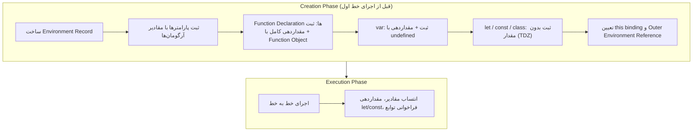
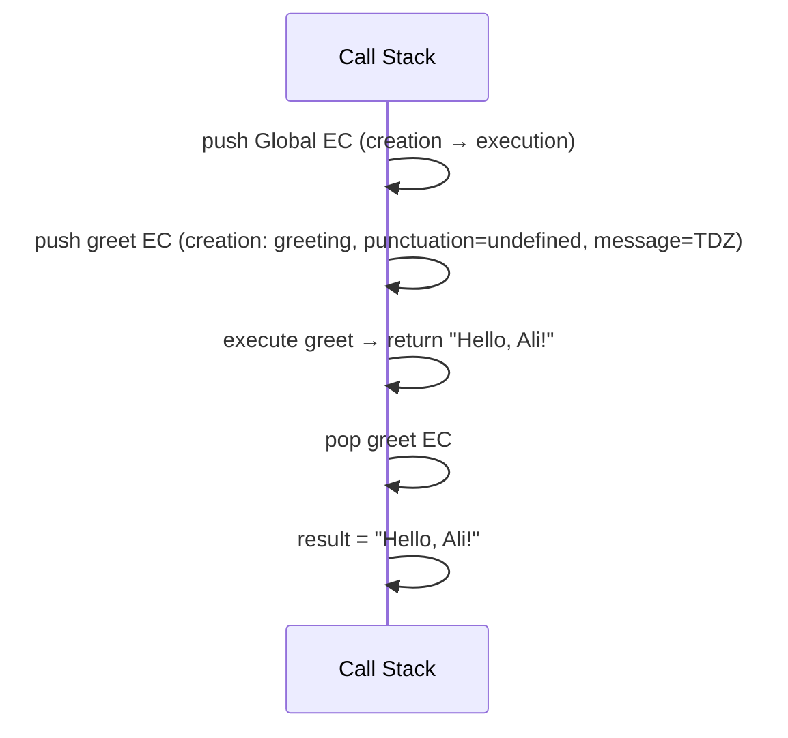
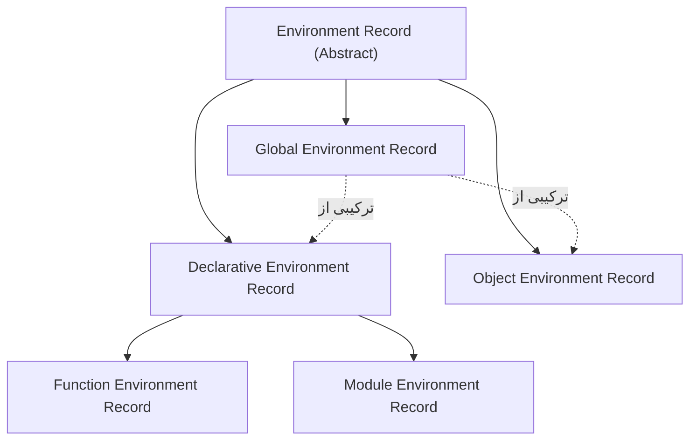
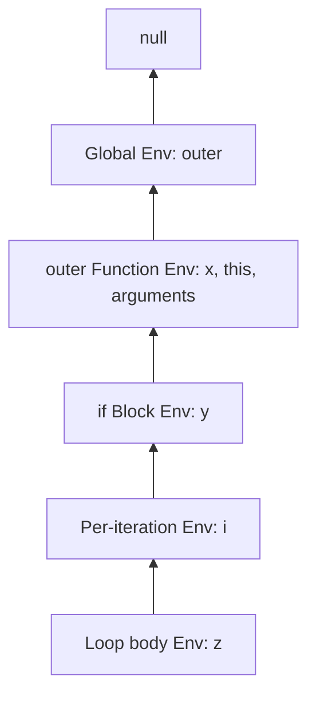

## Execution Context چیست؟

`Execution Context (زمینه اجرا)` ساختاری درونی در Engine است که **همه اطلاعات لازم برای اجرای یک قطعه کد** را نگه می‌دارد: کدام متغیرها در دسترس‌اند، `this` چیست، و اجرا تا کجا پیش رفته است. هر بار که کد اجرا می‌شود، داخل یک Execution Context اجرا می‌شود.

Execution Contextها روی **Call Stack** قرار می‌گیرند. Context بالای Stack همان **Running Execution Context** است.

### انواع Execution Context

| نوع | زمان ساخت | تعداد |
| --- | --- | --- |
| **Global Execution Context** | شروع اجرای Script | یکی برای هر Script/Realm |
| **Function Execution Context** | **هر بار** فراخوانی تابع | به تعداد فراخوانی‌ها (بازگشت = Contextهای متعدد) |
| **Eval Execution Context** | اجرای کد با `eval()` | — (استفاده نکنید) |
| **Module Execution Context** | ارزیابی هر ES Module | یکی برای هر Module |

### اجزای Execution Context

در مشخصات ECMAScript، هر Execution Context این اجزا را دارد:

```text
Execution Context
├── LexicalEnvironment    → Environment Record برای let، const، class، function و پارامترها
├── VariableEnvironment   → Environment Record برای var (در توابع معمولاً همان ابتدای LexicalEnvironment)
├── PrivateEnvironment    → نام‌های #private کلاس‌ها
├── this binding          → (در Function Environment Record نگهداری می‌شود)
├── Function / ScriptOrModule
├── Realm                 → Global Object و Intrinsicها (Array.prototype و …)
└── Code evaluation state → اجرا کجاست (برای Generator و async قابل تعلیق و ادامه است)
```

`VariableEnvironment` و `LexicalEnvironment` در ابتدای یک تابع یکی هستند. وقتی اجرا وارد یک Block می‌شود، **LexicalEnvironment** به یک Environment جدید (برای `let`/`const` داخل Block) اشاره می‌کند، ولی VariableEnvironment تغییر نمی‌کند — به همین دلیل `var` به Block اهمیت نمی‌دهد.

## دو فاز: Creation و Execution

هر Execution Context در دو فاز ساخته و اجرا می‌شود:



### مثال گام‌به‌گام

```js
var name = "Ali";
let age = 30;

function greet(greeting) {
  var punctuation = "!";
  const message = greeting + ", " + name + punctuation;
  return message;
}

const result = greet("Hello");
```

**۱. Global Creation Phase:**

| Binding | مقدار | محل |
| --- | --- | --- |
| `name` | `undefined` | Object Environment Record (Global Object در Script) |
| `greet` | `<function>` | Object Environment Record |
| `age` | uninitialized (TDZ) | Declarative Environment Record سراسری |
| `result` | uninitialized (TDZ) | Declarative Environment Record سراسری |
| `this` | `globalThis` (در Script) | — |

**۲. Global Execution Phase:** `name = "Ali"`، `age = 30`، سپس `greet("Hello")` فراخوانی می‌شود → یک Function Execution Context جدید روی Stack.

**۳. Function Creation Phase (`greet`):**

| Binding | مقدار |
| --- | --- |
| `greeting` | `"Hello"` (پارامتر) |
| `punctuation` | `undefined` |
| `message` | uninitialized (TDZ) |
| `arguments` | `{ 0: "Hello", length: 1 }` |
| `this` | `undefined` (Strict) یا `globalThis` (Sloppy) |
| Outer Reference | Global Environment (چون `greet` در Global **تعریف** شده) |

**۴. Function Execution Phase:** `punctuation = "!"`، `message = "Hello, Ali!"` (جستجوی `name` از طریق Outer Reference به Global)، `return`؛ Context از Stack Pop می‌شود و `result` مقداردهی می‌شود.



## Lexical Environment

`Lexical Environment (محیط واژگانی)` ساختاری است که **نگاشت Identifierها به مقادیر** را نگه می‌دارد و به یک محیط بیرونی متصل است. در مشخصات مدرن به آن **Environment Record** گفته می‌شود که از دو بخش تشکیل شده:

1. **Environment Record:** خود جدول Bindingها (نام → مقدار + وضعیت).
2. **Outer Environment Reference (`[[OuterEnv]]`):** اشاره‌گر به Environment بیرونی، یا `null` برای Global.

```text
Current Lexical Environment
        │  [[OuterEnv]]
        ↓
Outer Lexical Environment
        │  [[OuterEnv]]
        ↓
Outer Lexical Environment
        │  [[OuterEnv]]
        ↓
Global Environment
        │
        ↓
      null
```

«Lexical» یعنی **محل نوشته شدن کد در متن** (نه محل فراخوانی) تعیین می‌کند Outer Reference به کجا اشاره کند.

### انواع Environment Record



| نوع | چه چیزی را نگه می‌دارد | کجا ساخته می‌شود |
| --- | --- | --- |
| **Declarative** | `let`، `const`، `class`، پارامترها، Function Declaration در Block، `catch (e)` | هر Block، Function، `catch` |
| **Function** (زیرنوع Declarative) | علاوه بر Bindingها: `this`، `super`، `new.target`، وضعیت this binding | هر فراخوانی تابع (به‌جز Arrow که this ندارد) |
| **Module** (زیرنوع Declarative) | Bindingهای Module و **Import Bindingهای Live** | هر Module |
| **Object** | Bindingها **به عنوان Property یک Object واقعی** | Global Object، دستور `with` |
| **Global** | ترکیب یک Object Record (روی `globalThis`: var و function) و یک Declarative Record (let/const/class سراسری) | یکی برای هر Realm |

### Global Environment

```js
var a = 1;          // → Object Record → globalThis.a
function f() {}     // → Object Record → globalThis.f
let b = 2;          // → Declarative Record (نه روی globalThis)
const c = 3;        // → Declarative Record
```

به همین دلیل در Script، `window.a` برابر 1 است ولی `window.b` تعریف نشده است. در Module، Global Environment بیرونی‌ترین است ولی هیچ Declaration سطح بالای Module وارد آن نمی‌شود — Module Environment Record بین آن‌ها قرار دارد.

### Block Environment

هر Block که Declaration بلوکی داشته باشد Environment خودش را می‌گیرد:

```js
function outer() {
  const x = 1;            // Function Environment of outer
  if (true) {
    const y = 2;          // Block Environment (Outer → Function Env)
    for (let i = 0; i < 1; i++) {
      const z = 3;        // Block Environment of loop body (Outer → per-iteration Env → if Block Env)
      console.log(x + y + z + i);
    }
  }
}
```



## Scope Chain و Identifier Resolution

وقتی کد به یک نام (Identifier) می‌رسد، Engine این الگوریتم را اجرا می‌کند (`ResolveBinding`):

1. در Environment Record فعلی بگرد.
2. اگر پیدا نشد، به `[[OuterEnv]]` برو و تکرار کن.
3. اگر به `null` رسید: در خواندن → `ReferenceError: x is not defined`؛ در انتساب در Sloppy Mode → متغیر سراسری ضمنی ساخته می‌شود (در Strict → `ReferenceError`).

```js run
const level = "global";

function outer() {
  const level = "outer";
  function inner() {
    console.log(level);     // اول inner، بعد outer → "outer"
  }
  return inner;
}

const fn = outer();
fn();                        // "outer" — نه "global"؛ مهم محل تعریف inner است
```

`inner` در هر جایی فراخوانی شود، `[[OuterEnv]]` آن به Environment تابع `outer` اشاره دارد — چون هنگام **ساخته شدن** تابع، Environment جاری در Slot داخلی `[[Environment]]` تابع ذخیره می‌شود. این همان پایه **Closure** است ([فصل بعد](/javascript/scope-closures)).

## Hoisting — بررسی کامل

### Hoisting واقعاً چیست؟

«بالا رفتن» یک استعاره است. واقعیت: **در Creation Phase، Engine کل Scope را اسکن و همه Declarationها را قبل از اجرای خط اول در Environment Record ثبت می‌کند.** نحوه ثبت برای هر نوع فرق دارد:

| Declaration | Hoist می‌شود؟ | مقدار اولیه | قبل از خط تعریف |
| --- | --- | --- | --- |
| `var x` | ✓ | `undefined` | `undefined` |
| `let x` | ✓ | uninitialized | `ReferenceError` (TDZ) |
| `const x` | ✓ | uninitialized | `ReferenceError` (TDZ) |
| `function f() {}` | ✓ | **Function Object کامل** | قابل فراخوانی |
| `var f = function () {}` | ✓ (فقط `f`) | `undefined` | `TypeError: f is not a function` |
| `const f = () => {}` | ✓ | uninitialized | `ReferenceError` |
| `class C {}` | ✓ | uninitialized | `ReferenceError` |
| `import` | ✓ | Live Binding (بعد از ارزیابی Dependencyها) | قابل استفاده |

### Function Declaration در مقابل Function Expression

```js run
console.log(declared());          // ✓ "declared"
function declared() { return "declared"; }

console.log(typeof expressed);    // "undefined" — فقط var hoist شده
try {
  expressed();
} catch (error) {
  console.log(error.name + ": " + error.message);
}
var expressed = function () { return "expressed"; };
```

### اولویت: Function یا var؟

اگر یک نام هم Function Declaration و هم `var` داشته باشد، **Function Declaration برنده Creation Phase است** (var بدون مقدار آن را بازنویسی نمی‌کند)، اما انتساب var در Execution Phase آن را تغییر می‌دهد:

```js predict sloppy
console.log(typeof foo);
var foo = "string";
function foo() {}
console.log(typeof foo);
```

```output
function
string
```

این کد به‌صورت Script کلاسیک اجرا می‌شود؛ در ES Module، تابع سطح بالا Lexical است و تعریف هم‌نام var با آن `SyntaxError` می‌دهد.

1. Creation: `foo` ابتدا از Function Declaration مقدار Function می‌گیرد؛ `var foo` بدون مقدار اثری ندارد چون Binding از قبل هست.
2. Execution: خط اول `"function"`، سپس `foo = "string"` و در نهایت `"string"`.

### var، let و const از دید Engine

```js
var x;
let y;
const z;   // ✗ SyntaxError: Missing initializer in const declaration
```

- `var x;` در Creation Phase با `undefined` مقداردهی شده؛ خط `var x;` در Execution Phase **هیچ کاری نمی‌کند** (No-op).
- `let y;` در Creation Phase Uninitialized است؛ خط `let y;` در Execution Phase آن را **با undefined مقداردهی** و TDZ را تمام می‌کند. پس این خط یک عملیات واقعی است.
- `const z;` اصلاً Parse نمی‌شود، چون const بدون Initializer معنایی ندارد.

### Hoisting در Function داخل Block (تله)

رفتار Function Declaration داخل Block در Sloppy Mode برای سازگاری با گذشته عجیب است (Annex B مشخصات). در Strict Mode ساده است: **Block-scoped** است.

```js run
"use strict";
{
  function inBlock() { return "hi"; }
}
console.log(typeof inBlock); // "undefined" در Strict (و در Module)
```

<Callout type="warning">
در Sloppy Mode همین کد `"function"` چاپ می‌کند (تابع به Function Scope هم کپی می‌شود). هرگز به این رفتار تکیه نکنید؛ داخل Block از `const fn = () => {}` استفاده کنید.
</Callout>

## this Binding در Execution Context

`this` بخشی از Execution Context است و **در زمان فراخوانی** (نه تعریف) تعیین می‌شود — برخلاف Scope که Lexical است. تنها استثنا Arrow Function است که this binding ندارد و `this` را مثل یک متغیر معمولی از Lexical Environment بیرونی می‌گیرد. جزئیات کامل در فصل [this و Functionها](/javascript/this-functions).

| Context | `this` |
| --- | --- |
| Global (Script) | `globalThis` |
| Global (Module) | `undefined` |
| تابع معمولی، Strict | `undefined` |
| تابع معمولی، Sloppy | `globalThis` |
| Method (`obj.fn()`) | `obj` |
| `new Fn()` | Object جدید |
| Arrow Function | `this` محیط بیرونی (Lexical) |

## Eval Execution Context

`eval(code)` یک Execution Context جدید می‌سازد. **Direct eval** به Scope فعلی دسترسی دارد و در Sloppy Mode می‌تواند `var` جدید به آن اضافه کند؛ **Indirect eval** (`(0, eval)(code)`) در Global Scope اجرا می‌شود.

دلایل پرهیز از `eval`: امنیت (اجرای کد ناشناخته → XSS)، Performance (Engine نمی‌تواند Scope را بهینه کند چون هر نامی ممکن است در Runtime اضافه شود)، و CSP آن را مسدود می‌کند (`unsafe-eval`).

## اشتباهات رایج

- تصور اینکه Hoisting کد را فیزیکی جابه‌جا می‌کند.
- اشتباه گرفتن Scope (Lexical، زمان تعریف) و `this` (Dynamic، زمان فراخوانی).
- انتظار اینکه Function Expression مثل Declaration قابل فراخوانی قبل از تعریف باشد.
- فکر کردن اینکه تابع به متغیرهای محل **فراخوانی** دسترسی دارد (آن Dynamic Scope است که JavaScript ندارد).
- تعریف Function داخل Block و تکیه بر رفتار Sloppy.

## سوالات مصاحبه

<QA q="Execution Context چیست و چه زمانی ساخته می‌شود؟" level="mid" n={1}>
<Answer>

ساختاری درونی که اطلاعات لازم برای اجرای کد را نگه می‌دارد: Lexical و Variable Environment، this binding، Realm و وضعیت اجرا. یک Global Context در شروع Script، یک Function Context با **هر** فراخوانی تابع، و Context جداگانه برای هر Module و eval ساخته می‌شود. Contextها روی Call Stack Push و Pop می‌شوند.

</Answer>
<Deep>

هر Context دو فاز دارد: Creation (ساخت Environment Record، Hoisting، تعیین this و Outer Reference) و Execution. برای Generator و async function، Context می‌تواند از Stack خارج شود و بعداً با همان وضعیت ادامه یابد — به همین دلیل `await` بدون بلاک کردن Thread، اجرای تابع را متوقف می‌کند.

</Deep>
<Mistake>

یکی دانستن Execution Context و Scope. Scope (Lexical Environment) فقط یکی از اجزای Context است.

</Mistake>
<FollowUp>

وقتی یک async function به `await` می‌رسد، چه بلایی سر Execution Context آن می‌آید؟

</FollowUp>
</QA>

<QA q="Lexical Environment چیست و از چه بخش‌هایی تشکیل شده؟" level="senior" n={2}>
<Answer>

ساختاری که نام‌ها را به مقادیر نگاشت می‌کند و از یک Environment Record (جدول Bindingها) و یک Outer Environment Reference (اشاره به Environment بیرونی) تشکیل شده. زنجیره این Referenceها Scope Chain را می‌سازد. «Lexical» است چون Outer Reference بر اساس محل نوشته شدن کد تعیین می‌شود.

</Answer>
<Deep>

انواع Record: Declarative (let/const/class/پارامترها)، Function (به‌علاوه this، super، new.target)، Module (با Import Bindingهای Live)، Object (Bindingها به‌عنوان Property یک Object — Global Object و `with`) و Global (ترکیب Object Record و Declarative Record). هنگام ساخت تابع، Environment جاری در `[[Environment]]` تابع ذخیره می‌شود و هنگام فراخوانی، Environment جدید با Outer = همان `[[Environment]]` ساخته می‌شود؛ این مکانیزم Closure است.

</Deep>
<Mistake>

گفتن اینکه Scope Chain بر اساس Call Stack (ترتیب فراخوانی) ساخته می‌شود.

</Mistake>
<FollowUp>

چرا `with` و direct `eval` برای Performance مضرند؟ (Scope را Dynamic می‌کنند و Engine نمی‌تواند Resolution نام‌ها را در زمان Compile انجام دهد.)

</FollowUp>
</QA>

<QA q="خروجی این کد چیست و چرا؟" level="mid" n={3}>
<Answer>

```js
var x = 1;
function test() {
  console.log(x);
  var x = 2;
}
test();
```

خروجی `undefined` است. `var x` داخل تابع در Creation Phase تابع با undefined Hoist می‌شود و x سراسری را Shadow می‌کند.

</Answer>
<Deep>

Function Environment در Creation Phase Binding `x` با مقدار undefined دارد؛ ResolveBinding آن را در Environment فعلی پیدا می‌کند و هرگز به Global نمی‌رسد. اگر به جای var از let استفاده شده بود، `ReferenceError` می‌گرفتیم (TDZ).

</Deep>
<Mistake>

پاسخ `1` با استدلال اینکه x داخلی هنوز تعریف نشده.

</Mistake>
<FollowUp>

اگر `var x = 2` را حذف کنیم و `x = 2` بنویسیم چه؟ (`1` چاپ می‌شود و سپس x سراسری 2 می‌شود.)

</FollowUp>
</QA>

<QA q="تفاوت Hoisting در Function Declaration و Function Expression چیست؟" level="junior" n={4}>
<Answer>

Function Declaration در Creation Phase **به‌طور کامل** (نام + بدنه) Hoist می‌شود و قبل از تعریف قابل فراخوانی است. در Function Expression فقط متغیر Hoist می‌شود: با `var` مقدار undefined دارد (فراخوانی → `TypeError`) و با `let/const` در TDZ است (`ReferenceError`).

</Answer>
<Deep>

Named Function Expression (`const f = function inner() {}`) نامش (`inner`) فقط داخل بدنه خودش و در یک Environment مخصوص با Binding Immutable در دسترس است — مفید برای Recursion و Stack Trace خواناتر.

</Deep>
<Mistake>

گفتن اینکه Arrow Function Hoist نمی‌شود. متغیر نگهدارنده آن مانند هر const/let دیگر Hoist می‌شود و در TDZ است.

</Mistake>
<FollowUp>

اگر یک var و یک Function Declaration هم‌نام باشند، کدام برنده است؟

</FollowUp>
</QA>

## جمع‌بندی

<Recap>

- هر اجرای کد داخل یک Execution Context است: Global، یک Context برای **هر فراخوانی** تابع، Module و Eval.
- Contextها روی Call Stack قرار می‌گیرند؛ Context بالای Stack همان کدی است که الان اجرا می‌شود.
- هر Context دو فاز دارد: Creation (ثبت Bindingها) و Execution (اجرای خط به خط).
- در فاز Creation: Function Declarationها کامل، `var` با `undefined` و `let`/`const`/`class` بدون مقدار (TDZ) ثبت می‌شوند.
- Lexical Environment جدول نام به مقدار است به‌علاوه اشاره‌گری به Environment بیرونی؛ این زنجیره همان Scope Chain است.
- Environment بیرونی بر اساس **جای نوشته شدن** تابع تعیین می‌شود، نه جای صدا زدن (Lexical Scoping).
- Hoisting در واقع همان فاز Creation است؛ کد جابه‌جا نمی‌شود.
- Function Declaration کامل Hoist می‌شود ولی Function Expression فقط به‌اندازه متغیرش.
- `this` جزئی از Context است و هنگام فراخوانی تعیین می‌شود (به‌جز Arrow Function).

</Recap>
