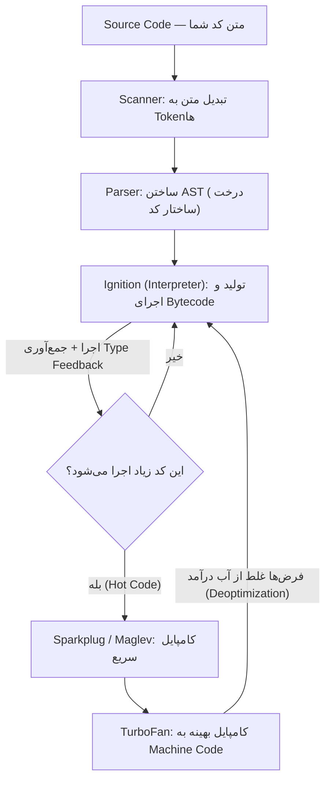

## JavaScript از کجا آمد و چه کاری می‌کند؟

سال ۱۹۹۵ صفحه‌های وب کاملاً ثابت بودند: متن و عکس، بدون هیچ واکنشی. اگر کاربر فرمی را اشتباه پر می‌کرد، باید فرم به سرور می‌رفت و چند ثانیه بعد صفحه خطا برمی‌گشت. شرکت Netscape زبانی کوچک می‌خواست که **داخل خود مرورگر** اجرا شود تا صفحه بتواند بدون رفتن به سرور واکنش نشان دهد. Brendan Eich نسخه اول آن را در حدود ده روز ساخت و اسمش را (به دلایل تبلیغاتی و بی‌ارتباط با Java) **JavaScript** گذاشتند.

امروز JavaScript تنها زبانی است که همه مرورگرها مستقیم اجرا می‌کنند، و بیرون از مرورگر هم (Node.js، Deno، Bun) برای سرور، ابزارهای Build و حتی اپلیکیشن دسکتاپ استفاده می‌شود.

```js run
// ساده‌ترین برنامه: مقداری را در Console چاپ می‌کند
console.log("سلام از JavaScript!");

// JavaScript با داده کار می‌کند و تصمیم می‌گیرد
const price = 120;
const discount = price > 100 ? 0.1 : 0; // اگر قیمت بیشتر از ۱۰۰ بود، ۱۰٪ تخفیف
console.log("قیمت نهایی:", price * (1 - discount)); // 108
```

<Callout type="note">
همه کدهایی که برچسب «اجرا» دارند در همین صفحه قابل ویرایش و اجرا هستند. عددها را عوض کنید و دوباره اجرا کنید؛ این بهترین راه یادگیری است.
</Callout>

## تعریف دقیق JavaScript، کلمه به کلمه

در مصاحبه معمولاً این تعریف را می‌شنوید یا از شما می‌خواهند:

> JavaScript یک زبان **High-level**، **Dynamically typed** و **Weakly typed**، **Multi-paradigm** و **Single-threaded** است که به لطف **Event Loop** به‌صورت **Non-blocking** کار می‌کند و موتورهای امروزی آن را **JIT Compile** می‌کنند.

حفظ کردن این جمله فایده ندارد؛ باید بتوانید هر کلمه‌اش را با مثال توضیح دهید. پس تک‌تک‌شان را باز می‌کنیم.

### High-level (سطح بالا)

یک زبان **سطح بالا** شما را از جزئیات سخت‌افزار دور نگه می‌دارد. در زبانی مثل C باید خودتان حافظه بگیرید (`malloc`) و خودتان آزادش کنید (`free`)؛ اگر فراموش کنید، برنامه حافظه هدر می‌دهد و اگر دو بار آزاد کنید، برنامه کرش می‌کند.

در JavaScript فقط مقدار می‌سازید. موتور خودش حافظه می‌گیرد و وقتی دیگر به آن مقدار دسترسی نداشته باشید، بخشی به نام **Garbage Collector** (جمع‌کننده زباله) آن را آزاد می‌کند. اشاره‌گر (Pointer) هم ندارید که مستقیم به آدرس حافظه دست بزنید.

```js run
function makeList() {
  const big = new Array(1_000_000).fill(0); // یک میلیون خانه؛ حافظه را موتور می‌گیرد
  return big.length;
}

console.log(makeList()); // 1000000
// بعد از برگشتن تابع، هیچ‌کس به big دسترسی ندارد،
// پس Garbage Collector بعداً حافظه‌اش را آزاد می‌کند. لازم نیست کاری بکنید.
```

جزئیات این فرایند در فصل [Call Stack، Heap و Garbage Collection](/javascript/memory-gc) آمده است.

### Dynamically typed (نوع‌دهی پویا)

در زبان‌های **Statically typed** مثل Java یا TypeScript، نوع هر متغیر موقع نوشتن کد مشخص است و کامپایلر قبل از اجرا آن را بررسی می‌کند. در JavaScript نوع به **مقدار** چسبیده، نه به متغیر. یک متغیر الان عدد نگه می‌دارد و خط بعد می‌تواند رشته نگه دارد. نوع‌ها فقط **موقع اجرا** (Runtime) بررسی می‌شوند.

```js run
let value = 42;
console.log(typeof value); // "number"

value = "چهل و دو";        // همان متغیر، حالا یک رشته
console.log(typeof value); // "string"

value = [4, 2];
console.log(typeof value); // "object" — آرایه‌ها در JavaScript نوعی Object هستند
```

**مزیت:** نوشتن سریع و انعطاف زیاد. **هزینه:** خطای نوع تا لحظه اجرا پیدا نمی‌شود. مثلاً اگر جایی انتظار عدد دارید ولی رشته برسد، برنامه تا رسیدن به آن خط چیزی نمی‌گوید. TypeScript دقیقاً برای حل همین مشکل ساخته شد (فصل [TypeScript](/typescript/fundamentals)).

### Weakly typed (نوع‌دهی ضعیف)

«Dynamic» درباره **زمان** بررسی نوع است؛ «Weak» درباره این است که زبان وقتی دو نوع ناسازگار کنار هم قرار می‌گیرند **چه می‌کند**. JavaScript در این حالت خطا نمی‌دهد؛ یکی از مقدارها را بی‌صدا به نوع دیگر تبدیل می‌کند. به این تبدیل خودکار **Coercion** (تبدیل نوع ضمنی) می‌گویند.

```js run
console.log("5" * 2);   // 10   — عملگر * فقط با عدد کار می‌کند، پس "5" به 5 تبدیل شد
console.log("5" + 2);   // "52" — عملگر + با رشته یعنی چسباندن، پس 2 به "2" تبدیل شد
console.log(true + 1);  // 2    — true به 1 تبدیل شد
console.log([] + {});   // "[object Object]" — هر دو به رشته تبدیل شدند
```

Python هم Dynamic است ولی **Strong**: `"5" + 2` در Python خطای `TypeError` می‌دهد. پس این دو ویژگی مستقل از هم هستند:

| | Static (بررسی قبل از اجرا) | Dynamic (بررسی موقع اجرا) |
| --- | --- | --- |
| **Strong** (تبدیل خودکار نمی‌کند) | Java، Rust | Python، Ruby |
| **Weak** (تبدیل خودکار می‌کند) | C | **JavaScript**، PHP |

قواعد دقیق Coercion و تفاوت `==` و `===` موضوع فصل [Typeها، Equality و Coercion](/javascript/types-coercion) است.

### Multi-paradigm (چندالگویی)

**Paradigm** یعنی سبک فکر کردن و نوشتن برنامه. JavaScript شما را به یک سبک مجبور نمی‌کند و هر سه سبک اصلی را پشتیبانی می‌کند:

```js run
const prices = [100, 250, 40];

// ۱. Imperative (دستوری): قدم به قدم به کامپیوتر می‌گویید چه کند
let total = 0;
for (let i = 0; i < prices.length; i++) {
  total += prices[i];
}
console.log("imperative:", total); // 390

// ۲. Functional (تابعی): توابع مثل مقدار پاس داده می‌شوند و داده تغییر نمی‌کند
const sum = prices.reduce((acc, p) => acc + p, 0);
console.log("functional:", sum); // 390

// ۳. Object-oriented (شیءگرا) بر پایه Prototype: داده و رفتار کنار هم
const cart = {
  items: prices,
  total() {
    return this.items.reduce((a, b) => a + b, 0);
  },
};
console.log("OOP:", cart.total()); // 390
```

یک نکته مهم: شیءگرایی در JavaScript بر پایه **Prototype** است، نه Class. کلمه `class` که در ES2015 اضافه شد فقط ظاهر آشناتری روی همان سیستم Prototype است (فصل [Objectها و Prototype](/javascript/objects-prototypes) و [Classها](/javascript/classes)).

### Single-threaded (تک‌نخی)

**Thread** (نخ اجرا) یک مسیر مستقل اجرای دستورها است. JavaScript فقط **یک** Thread برای اجرای کد شما دارد و در نتیجه یک **Call Stack** (پشته فراخوانی؛ فهرست توابعی که الان در حال اجرا هستند). معنی عملی‌اش این است: **در هر لحظه فقط یک قطعه از کد شما اجرا می‌شود** و هیچ کد دیگری نمی‌تواند وسط آن بپرد.

این ویژگی هم خوب است و هم بد. خوب است چون دیگر نگران نیستید دو Thread هم‌زمان یک متغیر را تغییر دهند (مشکلی به اسم Race Condition که در Java و C++ دردسر بزرگی است). بد است چون اگر یک کار سنگین Thread را مشغول کند، **همه چیز** منتظر می‌ماند. در مرورگر یعنی صفحه یخ می‌زند: کلیک کار نمی‌کند و انیمیشن متوقف می‌شود.

### Non-blocking (غیرمسدودکننده) و Event Loop

اگر فقط یک Thread داریم، دانلود یک فایل ۵ ثانیه‌ای چرا صفحه را ۵ ثانیه یخ نمی‌زند؟ چون JavaScript منتظر نمی‌ماند. کار زمان‌بر (درخواست شبکه، تایمر، خواندن فایل) به **محیط اجرا** (مرورگر یا Node) سپرده می‌شود و JavaScript به اجرای بقیه کد ادامه می‌دهد. وقتی آن کار تمام شد، محیط اجرا تابعی را که شما داده بودید (**Callback**) در صف می‌گذارد و **Event Loop** آن را وقتی Call Stack خالی شد اجرا می‌کند.

```js run
console.log("۱. سفارش قهوه");

setTimeout(() => {
  // این تابع (Callback) را به مرورگر می‌سپاریم تا ۱۰۰۰ میلی‌ثانیه بعد صدا بزند
  console.log("۳. قهوه آماده است");
}, 1000);

console.log("۲. در این فاصله ایمیل‌ها را چک می‌کنیم");
// خروجی به ترتیب ۱، ۲ و بعد از یک ثانیه ۳ است؛ کد منتظر تایمر نماند
```

مثل گارسونی که سفارش را به آشپزخانه می‌دهد و تا آماده شدن غذا سر میزهای دیگر می‌رود، نه اینکه جلوی آشپزخانه بایستد. Event Loop موضوع یک فصل کامل است: [Event Loop — بررسی عمیق](/javascript/event-loop).

### JIT-compiled (کامپایل در لحظه)

دو روش کلاسیک برای اجرای کد هست:

- **Interpreter** (مفسر): کد را همان لحظه می‌خواند و اجرا می‌کند. شروعش سریع است ولی اجرای خودش کند است.
- **Compiler** (کامپایلر): اول کل برنامه را به Machine Code (زبان خود پردازنده) تبدیل می‌کند و بعد اجرا می‌کند. اجرا سریع است ولی کامپایل وقت می‌گیرد.

موتورهای امروزی JavaScript هر دو را ترکیب می‌کنند: کد را با یک Interpreter سریع شروع می‌کنند و بخش‌هایی را که **زیاد اجرا می‌شوند** (به این بخش‌ها Hot Code می‌گویند) در حین اجرا به Machine Code بهینه کامپایل می‌کنند. به این روش **JIT** (Just-In-Time؛ کامپایل درست وقتی لازم است) می‌گویند. پس جمله «JavaScript یک زبان Interpreted است» برای موتورهای امروزی دقیق نیست. جزئیاتش را در بخش Engine می‌بینید.

## ECMAScript چیست و چه فرقی با JavaScript دارد؟

اگر چند شرکت مختلف مرورگر بسازند و هر کدام JavaScript را به سلیقه خودش پیاده کند، کدی که در یک مرورگر کار می‌کند در دیگری خراب می‌شود. دقیقاً همین اتفاق در دهه ۹۰ افتاد (Netscape در برابر Internet Explorer). راه حل یک **استاندارد مکتوب** بود.

- **ECMAScript** نام این استاندارد است: سندی به اسم **ECMA-262** که دقیق می‌گوید Syntax زبان چیست، `[1, 2].map(fn)` باید چه کار کند، `typeof null` چه برگرداند و…
- این سند را کمیته‌ای به اسم **TC39** در سازمان Ecma International می‌نویسد. اعضایش نمایندگان Google، Mozilla، Apple، Microsoft و شرکت‌های دیگرند.
- **JavaScript** پیاده‌سازی این استاندارد است (به‌علاوه چیزهایی که محیط اجرا اضافه می‌کند).

یک تشبیه: ECMAScript مثل **دفترچه قوانین فوتبال** است و هر موتور JavaScript (V8، SpiderMonkey و…) مثل یک تیم که طبق همان قوانین بازی می‌کند. قانون یکی است، ولی هر تیم سبک و سرعت خودش را دارد.

### زبان چه چیزهایی دارد و چه چیزهایی ندارد؟

این مهم‌ترین نکته این بخش برای مصاحبه است: **`setTimeout`، `fetch`، `document`، `localStorage` و حتی `console` بخشی از ECMAScript نیستند.** این‌ها را محیط اجرا (مرورگر یا Node) در اختیار کد می‌گذارد.

| بخشی از ECMAScript (هسته زبان) | بخشی از محیط اجرا (Host) |
| --- | --- |
| Syntax: `if`، `for`، `function`، `class`، `import` | `document`، `window`، DOM — در مرورگر |
| Typeها: `number`، `string`، `object`، … | `setTimeout`، `setInterval` — در مرورگر و Node |
| Objectهای داخلی: `Array`، `Object`، `Promise`، `Map`، `JSON`، `Math`، `Date` | `fetch`، `localStorage`، `WebSocket` — در مرورگر |
| قواعد Scope، Closure و `this` | `fs`، `http`، `process`، `require` — در Node |
| صف Job برای Promiseها | `console` — هر دو محیط دارند، ولی جزو زبان نیست |

```js run
// همه این‌ها در هر محیط JavaScript وجود دارند چون جزو زبان‌اند:
console.log(typeof Array, typeof Promise, typeof Map, typeof JSON);

// این‌ها به محیط اجرا بستگی دارند. اینجا کد در یک Web Worker اجرا می‌شود که DOM ندارد:
console.log(typeof setTimeout); // "function" — Worker هم تایمر دارد
console.log(typeof document);   // "undefined" — Worker به DOM دسترسی ندارد
```

### فرایند TC39: یک ویژگی جدید چطور به زبان اضافه می‌شود؟

هر پیشنهاد (Proposal) باید از چند مرحله (Stage) عبور کند. هر چه Stage بالاتر باشد، احتمال تغییرش کمتر است:

| Stage | اسم | یعنی چه |
| --- | --- | --- |
| 0 | Strawperson | فقط یک ایده؛ هر عضو TC39 می‌تواند مطرحش کند |
| 1 | Proposal | کمیته قبول کرده که مسئله ارزش بررسی دارد؛ یک نفر مسئول (Champion) دارد |
| 2 | Draft | Syntax و رفتار تقریبی نوشته شده؛ احتمال زیاد وارد زبان می‌شود |
| 2.7 | Approved in principle | طراحی تأیید شده؛ منتظر تست‌های رسمی (Test262) و پیاده‌سازی آزمایشی |
| 3 | Candidate | طراحی نهایی است؛ مرورگرها شروع به پیاده‌سازی می‌کنند |
| 4 | Finished | حداقل دو موتور پیاده‌سازی کرده‌اند؛ در نسخه سالانه بعدی منتشر می‌شود |

**نکته عملی:** ابزارهایی مثل Babel و TypeScript گاهی ویژگی‌های Stage 3 را زودتر در اختیارتان می‌گذارند. استفاده از ویژگی Stage 2 یا پایین‌تر در کد Production ریسک دارد، چون ممکن است عوض شود.

### نسخه‌ها: از ES5 تا امروز

تا سال ۲۰۰۹ نسخه‌ها با شماره نام‌گذاری می‌شدند (ES3، ES5). نسخه بزرگ بعدی، ES6، در سال ۲۰۱۵ منتشر شد و از آن به بعد **هر سال** یک نسخه با نام سال منتشر می‌شود (ES2016، ES2017، …). پس ES6 و ES2015 یک چیزند.

| نسخه | ویژگی‌هایی که در مصاحبه زیاد می‌پرسند |
| --- | --- |
| ES5 (2009) | Strict Mode، `JSON`، `map`/`filter`/`forEach` برای آرایه، `Object.defineProperty` |
| ES2015 (ES6) | بزرگ‌ترین تغییر تاریخ زبان: `let`/`const`، Arrow Function، `class`، `Promise`، ES Modules، Template Literal، Destructuring، `Map`/`Set`، `Symbol`، Iterator و Generator |
| ES2017 | `async`/`await`، `Object.entries`/`Object.values` |
| ES2018 | Rest/Spread برای Object (`{...obj}`)، `Promise.prototype.finally`، `for await...of` |
| ES2020 | Optional Chaining `?.`، Nullish Coalescing `??`، `BigInt`، `Promise.allSettled`، `globalThis` |
| ES2021 | `Promise.any`، عملگرهای `??=` و `||=` و `&&=`، `replaceAll`، `WeakRef` |
| ES2022 | `await` در سطح بالای ماژول، فیلدهای Class و `#private`، `.at()`، `Object.hasOwn`، `Error.cause` |
| ES2023 | متدهای بدون تغییر آرایه: `toSorted`، `toReversed`، `toSpliced`، `with`؛ و `findLast` |
| ES2024 | `Object.groupBy`، `Promise.withResolvers`، ArrayBuffer قابل تغییر اندازه |
| ES2025 | Iterator Helpers، متدهای مجموعه‌ای `Set` (`union`، `intersection`، …)، `Promise.try`، `RegExp.escape` |

## JavaScript Engine: برنامه‌ای که کد شما را اجرا می‌کند

کامپیوتر فقط Machine Code می‌فهمد؛ یعنی دستورهای خیلی ساده‌ای مثل «این دو عدد را جمع کن» یا «این مقدار را در این خانه حافظه بگذار». **JavaScript Engine** (موتور JavaScript) برنامه‌ای است که متن کد شما را می‌گیرد و آن را به چیزی تبدیل می‌کند که پردازنده بتواند اجرا کند.

| Engine | سازنده | کجا استفاده می‌شود |
| --- | --- | --- |
| **V8** | Google | Chrome، Edge، Opera، Node.js، Deno |
| **SpiderMonkey** | Mozilla | Firefox |
| **JavaScriptCore** (JSC، Nitro) | Apple | Safari، همه مرورگرهای iOS، Bun |

هر Engine دو بخش اصلی حافظه دارد که در ادامه زیاد اسمشان را می‌شنوید:

- **Call Stack:** فهرست توابعی که الان در حال اجرا هستند، به ترتیب صدا زده شدن. هر بار تابعی صدا زده می‌شود یک **Frame** (قاب) روی آن قرار می‌گیرد و وقتی تابع برمی‌گردد، Frame برداشته می‌شود.
- **Heap:** فضای بزرگ و بی‌نظمی که Objectها، آرایه‌ها و توابع در آن ذخیره می‌شوند.

### مسیر کد در V8، قدم به قدم

بیایید ببینیم این یک خط کد از متن تا اجرا چه مسیری را طی می‌کند:

```js
let total = price * 2;
```



<Steps>
<Step title="Scanner: شکستن متن به Token">

Engine اول متن را کاراکتر به کاراکتر می‌خواند و آن را به واحدهای معنادار به اسم **Token** تقسیم می‌کند؛ مثل وقتی یک جمله را به کلمه‌هایش می‌شکنید. فاصله‌ها و کامنت‌ها اینجا کنار گذاشته می‌شوند.

```text
let   total   =   price   *   2   ;
 │      │     │     │     │   │   │
keyword name  op   name   op num  punctuator
```

</Step>
<Step title="Parser: ساختن درخت AST">

Tokenها به‌تنهایی نشان نمی‌دهند چه چیزی به چه چیزی وابسته است. **Parser** از روی قواعد گرامر زبان یک درخت به اسم **AST** (Abstract Syntax Tree؛ درخت نحو انتزاعی) می‌سازد. اگر کد Syntax Error داشته باشد (مثلاً پرانتزی بسته نشده باشد) همین‌جا مشخص می‌شود و **هیچ خطی از کد اجرا نمی‌شود**.

```text
VariableDeclaration (let)
└── VariableDeclarator
    ├── id:   Identifier "total"
    └── init: BinaryExpression "*"
              ├── left:  Identifier "price"
              └── right: NumericLiteral 2
```

ابزارهایی مثل Babel، ESLint و Prettier هم دقیقاً با همین AST کار می‌کنند. می‌توانید در سایت astexplorer.net هر کدی را بنویسید و درختش را ببینید.

**Lazy Parsing:** Parse کامل همه توابع وقت‌گیر است. V8 بدنه توابعی را که هنوز صدا زده نشده‌اند فقط سطحی بررسی می‌کند (Pre-parse) و Parse کامل را به اولین فراخوانی موکول می‌کند. به همین دلیل صفحه سریع‌تر شروع به کار می‌کند.

</Step>
<Step title="Ignition: تبدیل به Bytecode و اجرا">

**Ignition** (مفسر V8) درخت AST را به **Bytecode** تبدیل می‌کند: دستورهای ساده و فشرده‌ای که از متن کد نزدیک‌تر به زبان ماشین‌اند، ولی هنوز به نوع پردازنده وابسته نیستند. بعد همین Bytecode را اجرا می‌کند. نمای ساده‌شده:

```text
LdaGlobal  [price]     ; مقدار price را در رجیستر اصلی (Accumulator) بگذار
MulSmi     [2]         ; آن را در عدد کوچک 2 ضرب کن
StaCurrentContextSlot  ; نتیجه را در خانه متغیر total ذخیره کن
```

</Step>
<Step title="جمع‌آوری Type Feedback">

Ignition موقع اجرا یادداشت برمی‌دارد: «تا الان `price` همیشه یک عدد صحیح کوچک بوده»، «این تابع همیشه با Objectهایی به یک شکل صدا زده شده». به این یادداشت‌ها **Type Feedback** می‌گویند و سوخت مرحله بعد است.

</Step>
<Step title="JIT: کامپایل کد پرتکرار">

اگر یک تابع یا حلقه زیاد اجرا شود (Hot)، V8 آن را به کامپایلرهای JIT می‌دهد. چند لایه دارد: **Sparkplug** خیلی سریع و بدون بهینه‌سازی کامپایل می‌کند، **Maglev** بهینه‌سازی متوسط دارد و **TurboFan** با تکیه بر Type Feedback سریع‌ترین Machine Code را می‌سازد. مثلاً اگر `price` همیشه عدد صحیح بوده، TurboFan یک دستور ضرب عدد صحیح پردازنده تولید می‌کند و همه بررسی‌های نوع را حذف می‌کند.

</Step>
<Step title="Deoptimization: وقتی فرض غلط از آب درمی‌آید">

کد بهینه بر اساس یک **فرض** ساخته شده است. اگر روزی `price` یک رشته باشد، آن فرض می‌شکند. V8 کد بهینه را دور می‌ریزد و به Bytecode برمی‌گردد. به این کار **Deoptimization** (یا Deopt) می‌گویند. اگر این اتفاق مرتب تکرار شود، کد کند می‌شود.

</Step>
</Steps>

```js run
// یک تابع ساده که با نوع ثابت صدا زده می‌شود: کاندید خوب برای بهینه‌سازی
function double(n) {
  return n * 2;
}

let sum = 0;
for (let i = 0; i < 100_000; i++) {
  sum += double(i); // صد هزار بار با عدد: Hot و Monomorphic
}
console.log(sum);

// اگر ناگهان رشته بدهیم، فرض «همیشه عدد» می‌شکند و ممکن است Deopt رخ دهد.
// نتیجه هنوز درست است (Coercion)، فقط مسیر سریع از دست می‌رود.
console.log(double("21")); // 42
```

### Hidden Class و Inline Cache: چرا شکل Objectها مهم است

در JavaScript هر Object می‌تواند هر لحظه Property جدیدی بگیرد. اگر Engine برای پیدا کردن `user.name` هر بار در یک جدول جستجو کند، کند می‌شود. راه حل V8 این است که به هر Object یک **Hidden Class** (کلاس پنهان؛ در V8 به آن Map یا Shape هم می‌گویند) بدهد که می‌گوید «این Object، Propertyهای `x` و `y` را دارد و `x` در خانه ۰ و `y` در خانه ۱ است».

```text
const a = {};        Shape S0: {}
a.x = 1;             Shape S1: { x → خانه 0 }          (S0 → S1)
a.y = 2;             Shape S2: { x → خانه 0, y → خانه 1 }  (S1 → S2)

const b = {};  b.x = 5;  b.y = 6;   ← همان مسیر انتقال: b هم Shape S2 دارد ✓
const c = {};  c.y = 6;  c.x = 5;   ← ترتیب فرق دارد: Shape متفاوت ✗
```

حالا **Inline Cache** وارد می‌شود: وقتی یک خط کد مثل `point.x` اجرا می‌شود، V8 یادش می‌ماند «دفعه قبل Shape این Object، S2 بود و `x` در خانه ۰ بود». اگر دفعه بعد هم Shape همان باشد، مستقیم خانه ۰ را می‌خواند، بدون جستجو.

| وضعیت یک خط کد | چند Shape دیده | سرعت |
| --- | --- | --- |
| Monomorphic | فقط ۱ | سریع‌ترین |
| Polymorphic | ۲ تا ۴ | کمی کندتر؛ چند حالت را چک می‌کند |
| Megamorphic | بیشتر از ۴ | Inline Cache کنار گذاشته می‌شود؛ جستجوی کند |

```js
// خوب: همه Pointها با یک ترتیب ساخته می‌شوند → یک Shape مشترک
function Point(x, y) {
  this.x = x;
  this.y = y;
}
const p1 = new Point(1, 2);
const p2 = new Point(3, 4);

// بد: ترتیب متفاوت → دو Shape متفاوت
const q1 = { x: 1, y: 2 };
const q2 = { y: 2, x: 1 };

// بد: delete روی Object، آن را به حالت Dictionary (جدول جستجوی کند) می‌برد
delete p1.x;
// بهتر: اگر فقط می‌خواهید مقدار را پاک کنید
p2.x = undefined;
```

<Callout type="interview">
این سطح از جزئیات (AST، Bytecode، JIT، Hidden Class، Deopt) معمولاً در مصاحبه Senior پرسیده می‌شود. لازم نیست اسم همه کامپایلرهای V8 را حفظ باشید؛ مهم این است که بتوانید زنجیره **Parse → Bytecode → Feedback → کامپایل بهینه → Deopt** را توضیح دهید و نتیجه عملی‌اش را بگویید: Objectها را با شکل ثابت بسازید، در کد پرتکرار از `delete` پرهیز کنید و نوع پارامترهای توابع پرکاربرد را ثابت نگه دارید.
</Callout>

## Runtime: Engine به‌تنهایی کافی نیست

Engine فقط زبان را می‌فهمد. نه شبکه را می‌شناسد، نه تایمر، نه صفحه نمایش و نه فایل. اگر V8 را خالی اجرا کنید، `setTimeout` هم ندارید! **Runtime** (محیط اجرا) همه چیزهایی است که دور Engine قرار می‌گیرد تا کد بتواند با دنیای بیرون کار کند:

> **Runtime = Engine + APIهای محیط (Host APIs) + Event Loop + صف‌های Callback**

```text
┌──────────────────────────── Browser Runtime ─────────────────────────────┐
│  ┌──────── JS Engine (V8) ────────┐     ┌──────── Web APIs ────────────┐ │
│  │  Heap         Call Stack       │     │ DOM, fetch, setTimeout,      │ │
│  │  (Objects)    (Frames)         │ ──► │ XMLHttpRequest, IndexedDB,   │ │
│  └────────────────────────────────┘     │ WebSocket, Geolocation ...   │ │
│                 ▲                       └──────────────┬───────────────┘ │
│                 │  Event Loop                          │ callbacks        │
│                 └──── Microtask Queue ◄────────────────┤                  │
│                 └──── Task Queues     ◄────────────────┘                  │
│                       Rendering (rAF, Style, Layout, Paint)               │
└──────────────────────────────────────────────────────────────────────────┘
```

### سفر یک `setTimeout`، از ابتدا تا انتها

برای اینکه نقش هر بخش روشن شود، دنبال می‌کنیم وقتی این کد اجرا می‌شود دقیقاً چه اتفاقی می‌افتد:

```js
console.log("A");
setTimeout(() => console.log("B"), 0);
console.log("C");
```

<Steps>
<Step title='`console.log("A")` روی Call Stack اجرا می‌شود'>
A چاپ می‌شود و Frame آن از Stack برداشته می‌شود.
</Step>
<Step title="`setTimeout` صدا زده می‌شود">
این تابع مال مرورگر است، نه Engine. Engine فقط آن را صدا می‌زند و Callback را تحویل می‌دهد. **مرورگر** در یک بخش جداگانه تایمر را شروع می‌کند. خود `setTimeout` فوراً برمی‌گردد.
</Step>
<Step title='`console.log("C")` اجرا می‌شود'>
C چاپ می‌شود. حتی اگر تایمر صفر میلی‌ثانیه باشد، Callback هنوز نمی‌تواند اجرا شود چون Call Stack مشغول است.
</Step>
<Step title="تایمر تمام می‌شود و Callback در صف قرار می‌گیرد">
مرورگر Callback را در **Task Queue** (صف کارها) می‌گذارد.
</Step>
<Step title="Event Loop، Callback را اجرا می‌کند">
Event Loop مرتب بررسی می‌کند: «Call Stack خالی است؟» وقتی خالی بود، اولین Task را از صف برمی‌دارد و روی Stack می‌گذارد. B چاپ می‌شود. ترتیب نهایی: **A، C، B**.
</Step>
</Steps>

### Runtime مرورگر در برابر Runtime در Node.js

هر دو از V8 استفاده می‌کنند، پس **زبان** یکی است؛ ولی APIهای اطرافشان کاملاً متفاوت است چون نیازهایشان فرق دارد. مرورگر باید صفحه را نمایش دهد و کاربر را از سایت‌های مخرب محافظت کند؛ Node باید با فایل، شبکه و سیستم‌عامل کار کند.

| | مرورگر | Node.js |
| --- | --- | --- |
| Engine | V8، SpiderMonkey یا JSC (بسته به مرورگر) | V8 |
| Object سراسری | `window` (در Worker: `self`) | `global` |
| `globalThis` (نام یکسان در همه محیط‌ها) | ✓ | ✓ |
| APIهای خاص | DOM، `fetch`، `localStorage`، Web Workers | `fs`، `http`، `process`، `Buffer` |
| پیاده‌سازی Event Loop | طبق HTML Spec؛ مرحله Rendering دارد | کتابخانه **libuv** با فازهای timers، poll، check، close |
| سیستم ماژول | ES Modules | ES Modules و CommonJS (`require`) |
| دسترسی به سیستم | محدود (Sandbox)؛ فایل‌ها را نمی‌بیند | کامل؛ می‌تواند فایل حذف کند |
| `setImmediate` و `process.nextTick` | ✗ | ✓ |

**`process.nextTick` در Node** یک صف مخصوص دارد که حتی قبل از Microtaskهای Promise اجرا می‌شود. اگر در مصاحبه ترتیب خروجی کدی در Node را پرسیدند، این نکته را فراموش نکنید.

## تک‌نخی ولی هم‌زمان: یعنی چه؟

این دو کلمه متناقض به نظر می‌رسند، پس دقیق تعریفشان کنیم:

- **Parallelism** (موازی بودن): دو کار **دقیقاً در یک لحظه** روی دو هسته پردازنده اجرا شوند.
- **Concurrency** (هم‌زمانی): چند کار **در یک بازه زمانی** پیش بروند، حتی اگر در هر لحظه فقط یکی‌شان واقعاً اجرا شود.

کد JavaScript شما روی یک Thread اجرا می‌شود، پس **موازی نیست**. ولی مرورگر خودش چند Thread دارد: دانلود از شبکه، شمارش تایمرها، Decode کردن عکس‌ها و ترکیب لایه‌های صفحه (Compositing) در Threadهای دیگر انجام می‌شوند. JavaScript کار را شروع می‌کند، به محیط می‌سپارد و ادامه می‌دهد. نتیجه: **Concurrency بدون Parallelism در کد شما**.

این مثال نشان می‌دهد هیچ Callbackی نمی‌تواند کد هم‌زمانی (Synchronous) در حال اجرا را قطع کند:

```js run
const start = Date.now();

// تایمر صفر میلی‌ثانیه: «هر چه زودتر اجرا کن»
setTimeout(() => console.log("تایمر بعد از", Date.now() - start, "میلی‌ثانیه اجرا شد"), 0);

// ۳۰۰ میلی‌ثانیه Thread را مشغول نگه می‌داریم (Busy-wait)
while (Date.now() - start < 300) {
  // Call Stack اشغال است؛ Event Loop نمی‌تواند Callback را اجرا کند
}
console.log("حلقه تمام شد");
// خروجی: اول «حلقه تمام شد» و بعد «تایمر بعد از ~300 میلی‌ثانیه»
```

با اینکه تأخیر صفر بود، Callback حدود ۳۰۰ میلی‌ثانیه بعد اجرا شد. **تأخیر `setTimeout` حداقل زمان انتظار است، نه زمان دقیق.** در مرورگر واقعی، همین ۳۰۰ میلی‌ثانیه یعنی صفحه‌ای که به کلیک جواب نمی‌دهد.

### اگر واقعاً به موازی‌سازی نیاز داشتیم: Web Worker

برای کارهای سنگین پردازشی (فشرده‌سازی عکس، پردازش فایل بزرگ، محاسبات ریاضی) می‌توانید یک **Web Worker** بسازید. Worker یک Thread جداگانه است با Engine، Heap و Event Loop خودش. Worker به DOM دسترسی ندارد و با صفحه اصلی فقط از طریق **پیام** صحبت می‌کند.

```js
// main.js — صفحه اصلی
const worker = new Worker("heavy.js");
worker.postMessage({ numbers: [1, 2, 3, 4] }); // داده کپی می‌شود (Structured Clone)
worker.onmessage = (event) => {
  console.log("نتیجه از Worker:", event.data); // 10
};

// heavy.js — در Thread جداگانه اجرا می‌شود
self.onmessage = (event) => {
  const sum = event.data.numbers.reduce((a, b) => a + b, 0);
  self.postMessage(sum); // صفحه اصلی در این مدت آزاد بود
};
```

همین هندبوک کدهای قابل اجرا را در یک Web Worker اجرا می‌کند تا یک حلقه بی‌نهایت در مثال‌ها صفحه را قفل نکند. در Node معادلش **Worker Threads** است.

## Strict Mode: نسخه سخت‌گیرتر زبان

JavaScript اولیه خیلی «بخشنده» طراحی شد: خیلی از اشتباه‌ها را بدون خطا قبول می‌کرد و رفتار عجیبی نشان می‌داد. چون حذف این رفتارها سایت‌های قدیمی را خراب می‌کرد، ES5 راه دیگری انتخاب کرد: یک حالت اختیاری به اسم **Strict Mode** که این اشتباه‌ها را به **خطای واقعی** تبدیل می‌کند. به حالت عادی و قدیمی **Sloppy Mode** (حالت شُل) می‌گویند.

### چطور فعالش کنیم؟

```js
// ۱. برای کل فایل: اولین خط فایل
"use strict";

// ۲. فقط برای یک تابع: اولین خط بدنه تابع
function strictOnly() {
  "use strict";
  // فقط اینجا Strict است
}

// ۳. خودکار: هر ES Module (import/export یا <script type="module">)
//    و بدنه هر class، همیشه Strict هستند و نیازی به نوشتن چیزی نیست.
```

`"use strict"` فقط وقتی کار می‌کند که **اولین دستور** فایل یا تابع باشد. اگر بعد از هر دستور دیگری بیاید، فقط یک رشته بی‌اثر است.

### Strict Mode دقیقاً چه چیزهایی را عوض می‌کند؟

**۱. انتساب به متغیر تعریف‌نشده خطا می‌دهد.** در Sloppy Mode، یک غلط تایپی بی‌صدا یک متغیر سراسری جدید می‌سازد:

```js run sloppy
// Sloppy Mode: غلط تایپی در اسم متغیر
let counter = 0;
countr = 5; // اشتباه تایپی! خطا نمی‌دهد و یک متغیر سراسری جدید می‌سازد
console.log(counter);         // 0 — متغیر اصلی دست نخورد
console.log(globalThis.countr); // 5 — یک متغیر سراسری ناخواسته
```

```js run
// همین کد در Strict Mode (اینجا کدها به‌صورت پیش‌فرض Strict اجرا می‌شوند)
let counter = 0;
try {
  countr = 5;
} catch (e) {
  console.log(e.name, "-", e.message); // ReferenceError - countr is not defined
}
```

**۲. `this` در فراخوانی ساده تابع `undefined` است.** در Sloppy Mode برابر Object سراسری است و کد ممکن است ناخواسته روی `window` بنویسد:

```js run sloppy
function sloppyThis() {
  return this === globalThis;
}
console.log(sloppyThis()); // true — this به Object سراسری اشاره می‌کند
```

```js run
function strictThis() {
  return this;
}
console.log(strictThis()); // undefined — اشتباه زود پیدا می‌شود
```

**۳. نوشتن روی Property فقط‌خواندنی خطا می‌دهد.** در Sloppy Mode عملیات بی‌صدا نادیده گرفته می‌شود و شما فکر می‌کنید مقدار عوض شده:

```js run
const config = Object.freeze({ mode: "dark" }); // Object کاملاً قفل شده
try {
  config.mode = "light";
} catch (e) {
  console.log(e.name); // TypeError — در Sloppy Mode هیچ اتفاقی نمی‌افتاد
}
console.log(config.mode); // "dark"
```

**۴. چند Syntax خطرناک ممنوع می‌شود.** این‌ها اصلاً Parse نمی‌شوند و `SyntaxError` می‌دهند:

| کد | چرا ممنوع است |
| --- | --- |
| `function f(a, a) {}` | پارامتر تکراری؛ معلوم نیست `a` کدام است |
| `with (obj) { x = 1 }` | معلوم نیست `x` متغیر است یا `obj.x`؛ بهینه‌سازی را غیرممکن می‌کند |
| `delete myVariable` | حذف متغیر معنی ندارد؛ در Sloppy بی‌صدا شکست می‌خورد |
| `let yield = 1` یا `let package = 1` | کلمه‌های رزروشده برای آینده زبان |
| `010` (عدد Octal قدیمی) | گیج‌کننده است: `010` برابر ۸ بود! به‌جایش `0o10` بنویسید |

<Callout type="tip">
در پروژه‌های امروزی تقریباً همیشه در Strict Mode هستید، چون هر فایلی که `import` یا `export` دارد یک ES Module است و ماژول‌ها خودکار Strict هستند. ولی اگر کد قدیمی با `<script>` معمولی دارید یا در Console مرورگر کد می‌نویسید، در Sloppy Mode هستید.
</Callout>

## Typeهای JavaScript، یک نگاه سریع

JavaScript **۸ نوع داده** دارد. هفت‌تا **Primitive** (مقدار ساده و تغییرناپذیر) و یکی **Object** (مجموعه‌ای از Propertyها که می‌تواند تغییر کند). جزئیات کامل در فصل [Typeها و Coercion](/javascript/types-coercion) آمده است.

| Type | مثال | توضیح کوتاه |
| --- | --- | --- |
| `string` | `"سلام"` | متن |
| `number` | `42`، `3.14`، `NaN`، `Infinity` | همه اعداد، صحیح و اعشاری، در یک نوع |
| `bigint` | `10n` | اعداد صحیح بزرگ‌تر از `2^53 - 1` |
| `boolean` | `true`، `false` | درست یا غلط |
| `undefined` | `undefined` | «هنوز مقداری داده نشده» |
| `null` | `null` | «عمداً خالی است» |
| `symbol` | `Symbol("id")` | شناسه یکتا؛ هیچ دو Symbolی برابر نیستند |
| `object` | `{}`، `[]`، `function(){}`، `new Date()` | همه چیز دیگر |

عملگر `typeof` نوع یک مقدار را به‌صورت رشته برمی‌گرداند. دو استثنای معروفش را در خروجی ببینید:

```js run
console.log(typeof "hi", typeof 42, typeof 10n, typeof true);
// string number bigint boolean

console.log(typeof undefined, typeof Symbol(), typeof {});
// undefined symbol object

console.log(typeof null);           // "object"   ← استثنای ۱: باگ تاریخی
console.log(typeof function () {}); // "function" ← استثنای ۲: تابع Object است ولی نتیجه جداگانه دارد
console.log(typeof []);             // "object"   — برای آرایه از Array.isArray استفاده کنید
```

**چرا `typeof null` برابر `"object"` است؟** در اولین پیاده‌سازی JavaScript هر مقدار با یک برچسب نوع (Type Tag) چند بیتی ذخیره می‌شد و برچسب Objectها `000` بود. `null` به‌صورت اشاره‌گر صفر (NULL Pointer) نمایش داده می‌شد که همه بیت‌هایش صفر است. پس `typeof` برچسب `000` را دید و گفت `"object"`. اصلاح این باگ پیشنهاد شد ولی رد شد، چون کدهای زیادی در وب به همین رفتار تکیه کرده بودند.

## اشتباهات رایج

<Callout type="mistake">
**«`setTimeout` و `fetch` جزو JavaScript هستند.»** این‌ها APIهای محیط اجرا هستند و در ECMAScript تعریف نشده‌اند. دلیلش هم ساده است: در Node تا مدت‌ها `fetch` وجود نداشت و در Worker هم `document` وجود ندارد.
</Callout>

<Callout type="mistake">
**«JavaScript زبانی Interpreted است و خط به خط اجرا می‌شود.»** موتورهای امروزی کد را Parse و به Bytecode تبدیل می‌کنند و کد پرتکرار را JIT Compile می‌کنند. اگر کد خط به خط اجرا می‌شد، یک Syntax Error در خط ۱۰۰ باعث نمی‌شد خط ۱ هم اجرا نشود؛ ولی می‌شود، چون کل فایل قبل از اجرا Parse می‌شود.
</Callout>

<Callout type="mistake">
**«Single-threaded یعنی JavaScript نمی‌تواند دو کار را هم‌زمان انجام دهد.»** اجرای کد شما روی یک Thread است، ولی کارهای I/O (شبکه، تایمر، فایل) را محیط اجرا به‌صورت موازی انجام می‌دهد. JavaScript فقط شروع و پایانشان را مدیریت می‌کند.
</Callout>

<Callout type="mistake">
**«Event Loop در مرورگر و Node دقیقاً یکی است.»** مفهوم پایه یکی است، ولی Node فازهای جداگانه (timers، poll، check) و صف `process.nextTick` دارد و مرورگر مرحله Rendering دارد. ترتیب خروجی بعضی کدها بین این دو فرق می‌کند.
</Callout>

## سوالات مصاحبه

<QA q="تفاوت JavaScript، ECMAScript، Engine و Runtime چیست؟" level="junior" n={1}>
<Answer>

- **ECMAScript** استاندارد مکتوب زبان است (سند ECMA-262 که کمیته TC39 می‌نویسد).
- **JavaScript** پیاده‌سازی این استاندارد است.
- **Engine** (مثل V8) برنامه‌ای است که کد را Parse و اجرا می‌کند و Heap و Call Stack دارد.
- **Runtime** یعنی Engine به‌علاوه APIهای محیط (DOM و `fetch` در مرورگر، `fs` در Node)، Event Loop و صف‌های Callback.

</Answer>
<Deep>

ECMAScript فقط صف Job برای Promiseها را تعریف می‌کند. Event Loop کامل با Taskها و Rendering در HTML Spec آمده و Node آن را با کتابخانه libuv پیاده کرده است. به همین دلیل ترتیب بعضی Callbackها، مثلاً `setImmediate` در برابر `setTimeout(fn, 0)`، بین محیط‌ها فرق دارد.

</Deep>
<Mistake>

گفتن اینکه `setTimeout` یا `console` جزو زبان JavaScript هستند.

</Mistake>
<FollowUp>

اگر JavaScript تک‌نخی است، مرورگر چطور هم‌زمان یک فایل دانلود می‌کند و انیمیشن اجرا می‌کند؟ (دانلود در Thread شبکه مرورگر انجام می‌شود و انیمیشن‌های CSS در Compositor Thread؛ فقط کد JS شما روی Main Thread است.)

</FollowUp>
</QA>

<QA q="V8 کد JavaScript را چطور اجرا می‌کند؟ JIT یعنی چه؟" level="senior" n={2}>
<Answer>

کد اول به Token و بعد به **AST** تبدیل می‌شود. مفسر **Ignition** از AST، **Bytecode** می‌سازد و اجرایش می‌کند و هم‌زمان **Type Feedback** جمع می‌کند. کدی که زیاد اجرا شود به کامپایلرهای **JIT** (Sparkplug، Maglev و در نهایت TurboFan) داده می‌شود تا با فرض‌هایی که از Feedback گرفته شده به Machine Code بهینه تبدیل شود. اگر فرضی بشکند (مثلاً تابعی که همیشه عدد می‌گرفت رشته بگیرد)، **Deoptimization** رخ می‌دهد و اجرا به Bytecode برمی‌گردد.

</Answer>
<Deep>

JIT تعادلی است بین «شروع سریع» (Interpreter) و «اجرای سریع» (کامپایل بهینه). Hidden Class و Inline Cache دسترسی به Property را سریع می‌کنند، به شرط اینکه شکل Objectها ثابت بماند. یک خط کد Monomorphic (یک Shape) سریع‌ترین است، Polymorphic (۲ تا ۴ Shape) کندتر، و Megamorphic (بیشتر) اصلاً Inline Cache ندارد.

</Deep>
<Mistake>

گفتن اینکه JavaScript «خط به خط تفسیر می‌شود».

</Mistake>
<FollowUp>

چرا `delete obj.prop` در کد پرتکرار مضر است و جایگزینش چیست؟ (Object را به Dictionary Mode می‌برد و Inline Cache از کار می‌افتد. مقدار را `undefined` کنید، یا با Destructuring یک Object جدید بدون آن Property بسازید.)

</FollowUp>
</QA>

<QA q="Strict Mode چیست و چطور فعال می‌شود؟" level="junior" n={3}>
<Answer>

حالتی اختیاری از ES5 که اشتباه‌های بی‌صدای زبان را به خطا تبدیل می‌کند: انتساب به متغیر تعریف‌نشده `ReferenceError` می‌دهد، `this` در فراخوانی ساده تابع `undefined` است، نوشتن روی Property فقط‌خواندنی `TypeError` می‌دهد و Syntaxهایی مثل `with` و پارامتر تکراری ممنوع می‌شوند. با `"use strict"` در اولین خط فایل یا تابع فعال می‌شود، و ES Moduleها و بدنه Classها خودکار Strict هستند.

</Answer>
<Mistake>

گذاشتن `"use strict"` وسط فایل و انتظار اینکه کار کند. فقط به‌عنوان اولین دستور اثر دارد.

</Mistake>
</QA>

<QA q="چرا `typeof null` برابر `'object'` است؟" level="junior" n={4}>
<Answer>

یک باگ تاریخی از اولین نسخه JavaScript: مقدارها با یک برچسب نوع ذخیره می‌شدند، برچسب Object برابر صفر بود و `null` هم اشاره‌گر صفر بود. پس `typeof` آن را Object تشخیص داد. اصلاحش کدهای موجود در وب را خراب می‌کرد، برای همین باقی ماند.

</Answer>
<Deep>

برای بررسی `null` از `value === null` استفاده کنید. برای اینکه بفهمید مقداری «واقعاً Object» است: `value !== null && typeof value === "object"`. برای تشخیص دقیق نوع هم `Object.prototype.toString.call(value)` مناسب است که برای `null` رشته `"[object Null]"` برمی‌گرداند.

</Deep>
<Mistake>

نتیجه گرفتن اینکه `null` یک Object است. `null` یک Primitive است.

</Mistake>
<FollowUp>

`typeof` برای یک تابع چه برمی‌گرداند و چرا جالب است؟ (`"function"`؛ در حالی که تابع در واقع Object است. تنها زیرنوع Object که `typeof` جداگانه دارد.)

</FollowUp>
</QA>

## جمع‌بندی

<Recap>

- JavaScript زبانی High-level، Dynamic و Weak typed، چندالگویی و تک‌نخی است که با Event Loop به‌صورت Non-blocking کار می‌کند.
- Dynamic یعنی نوع موقع اجرا بررسی می‌شود؛ Weak یعنی زبان نوع‌ها را خودکار تبدیل می‌کند (Coercion). این دو ویژگی مستقل از هم هستند.
- ECMAScript استاندارد زبان است و TC39 آن را نسخه به نسخه، با فرایند Stage 0 تا 4، به‌روز می‌کند.
- `setTimeout`، `fetch`، `document` و `console` جزو زبان نیستند؛ محیط اجرا آن‌ها را در اختیار کد می‌گذارد.
- Engine مسیر Token → AST → Bytecode → JIT را طی می‌کند و اگر فرض‌هایش بشکند Deopt می‌کند.
- شکل ثابت Objectها (Hidden Class) باعث می‌شود Inline Cache کار کند و کد سریع بماند.
- Runtime یعنی Engine + APIهای محیط + Event Loop + صف‌ها. مرورگر و Node زبان یکسان ولی APIهای متفاوت دارند.
- کد شما تک‌نخی است ولی I/O هم‌زمان پیش می‌رود؛ برای موازی‌سازی واقعی از Web Worker استفاده کنید.
- Strict Mode اشتباه‌های بی‌صدا را به خطا تبدیل می‌کند و در ES Moduleها و Classها خودکار فعال است.

</Recap>
