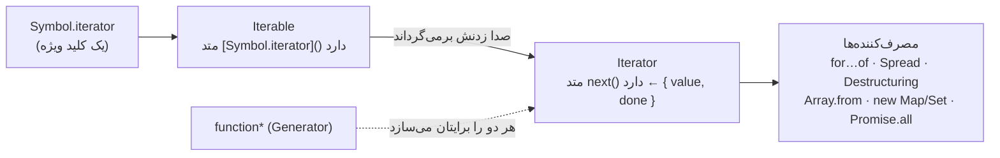
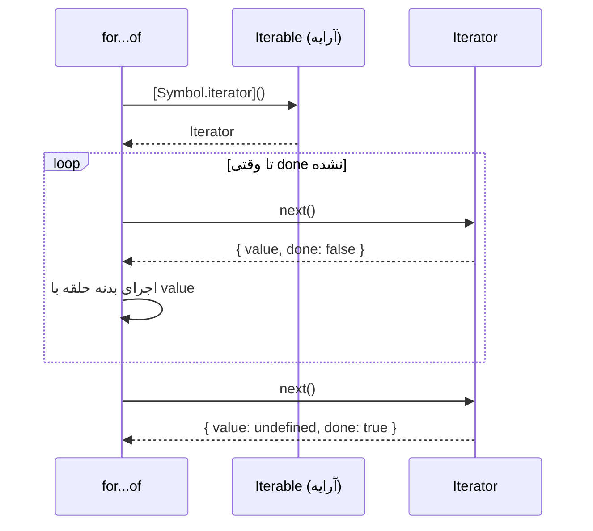
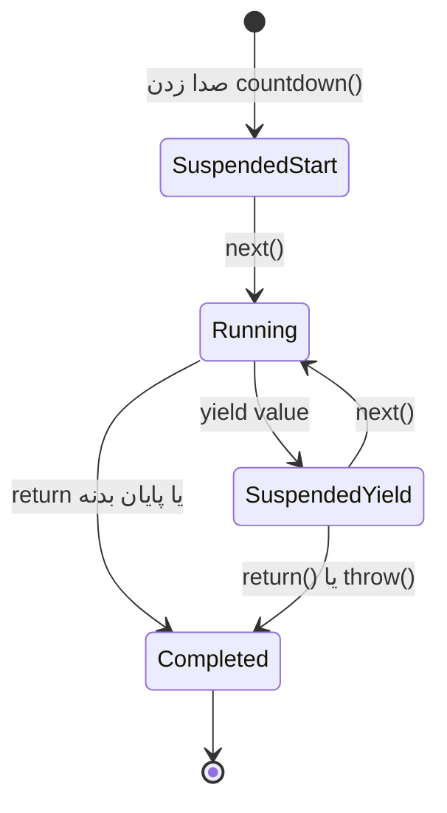

## تصویر کلی

چرا می‌توانید بنویسید `for (const x of array)`، `for (const ch of "text")`، `[...set]` و `const [a, b] = map`، اما `for (const x of { a: 1 })` خطای `TypeError: object is not iterable` می‌دهد؟

چون JavaScript یک **پروتکل پیمایش (Iteration Protocol)** دارد: یک قرارداد کوچک که هر Objectی می‌تواند پیاده‌سازی‌اش کند. آرایه، رشته، Map و Set این قرارداد را پیاده‌سازی کرده‌اند و Object ساده نه. برای فهمیدن این قرارداد اول به یک قطعه پایه نیاز دارید، یعنی **Symbol**؛ و وقتی آن را فهمیدید، **Generatorها** پیاده‌سازی‌اش را تقریباً بی‌زحمت می‌کنند.



## Symbol

**Symbol** یک مقدار Primitive است که **تضمین می‌شود یکتا باشد**. کار اصلی‌اش این است که کلید Propertyی باشد که هرگز با هیچ کلید دیگری تداخل نکند؛ حتی با کلیدهایی که کتابخانه‌های دیگر یا نسخه‌های آینده خود زبان اضافه می‌کنند.

<Api name="Symbol()" sig="Symbol(description?)" returns="یک Symbol کاملاً جدید و یکتا. دو فراخوانی هیچ‌وقت Symbolهای برابر برنمی‌گردانند، حتی با توضیح یکسان." mutates="n/a">

- `description` (اختیاری): یک برچسب فقط برای Debug؛ روی هویت Symbol اثری ندارد.

</Api>

```js run
const id1 = Symbol("id");
const id2 = Symbol("id");

console.log(typeof id1);                 // "symbol"
console.log(id1 === id2);                // false — همیشه یکتا
console.log(id1.description);            // "id"
console.log(id1.toString());             // "Symbol(id)"

const user = { name: "Ali", [id1]: 123 };  // Symbol به‌عنوان کلید Property
console.log(user[id1]);                    // 123
console.log(Object.keys(user));            // ['name'] — Symbolها نادیده گرفته می‌شوند
console.log(JSON.stringify(user));         // {"name":"Ali"} — و Serialize هم نمی‌شوند
console.log(Object.getOwnPropertySymbols(user)); // [Symbol(id)] — اما مخفی هم نیستند
console.log(Reflect.ownKeys(user));        // ['name', Symbol(id)]

try { `${id1}`; } catch (e) { console.log(e.name + ": " + e.message); } // تبدیل ضمنی به رشته ممکن نیست
```

| نوع کلید Property | در `for...in`، `Object.keys` و JSON دیده می‌شود | ممکن است با کد دیگر تداخل کند | واقعاً خصوصی است |
| --- | --- | --- | --- |
| رشته | ✓ | ✓ | ✗ |
| Symbol | ✗ | ✗ (یکتاست) | ✗ (`getOwnPropertySymbols` پیدایش می‌کند) |
| `#private` (در کلاس) | ✗ | ✗ | ✓ |

### رجیستری سراسری: `Symbol.for`

`Symbol.for(key)` یک Symbol را از **رجیستری سراسری** برمی‌گرداند: یک کلید یکسان همیشه همان Symbol را برمی‌گرداند، حتی بین iframeها و ماژول‌های مختلف.

```js run
const a = Symbol.for("app.theme");
const b = Symbol.for("app.theme");
console.log(a === b);                    // true — مشترک
console.log(Symbol.keyFor(a));           // "app.theme"
console.log(Symbol.keyFor(Symbol("x"))); // undefined — ثبت نشده
```

React برای علامت‌گذاری Elementهای JSX از `Symbol.for("react.element")` استفاده می‌کند. چون JSON نمی‌تواند Symbol داشته باشد، سرور نمی‌تواند از طریق داده JSON یک React Element جعلی تزریق کند؛ این یک لایه دفاعی در برابر XSS است.

### Symbolهای شناخته‌شده (Well-known): قلاب‌هایی به درون زبان

خود زبان دنبال متدهای خاصی با کلید Symbol روی Objectهای شما می‌گردد. با پیاده‌سازی آن‌ها می‌توانید رفتار داخلی زبان را برای Objectتان سفارشی کنید:

| Symbol | زبان چه زمانی صدایش می‌زند | مثال |
| --- | --- | --- |
| `Symbol.iterator` | هنگام پیمایش (`for...of`، Spread، Destructuring) | قابل پیمایش کردن یک کلاس |
| `Symbol.asyncIterator` | هنگام استفاده از `for await...of` | دریافت صفحه‌به‌صفحه از API |
| `Symbol.toPrimitive` | وقتی Object به Primitive تبدیل می‌شود (`+obj`، `` `${obj}` ``) | Object پولی که مثل عدد رفتار می‌کند |
| `Symbol.toStringTag` | وقتی `Object.prototype.toString` صدا زده می‌شود | `[object MyType]` |
| `Symbol.hasInstance` | `x instanceof C` | منطق سفارشی برای `instanceof` |
| `Symbol.species` | وقتی متدهای آرایه نتیجه جدید می‌سازند | Subclassهای Array |

```js run
class Money {
  constructor(amount, currency) { this.amount = amount; this.currency = currency; }
  [Symbol.toPrimitive](hint) {             // hint یکی از "number"، "string" یا "default" است
    return hint === "string" ? `${this.amount.toFixed(2)} ${this.currency}` : this.amount;
  }
  get [Symbol.toStringTag]() { return "Money"; }
}
const price = new Money(19.9, "USD");
console.log(`${price}`, price * 2, price + 1);
console.log(Object.prototype.toString.call(price));   // [object Money]
```

## پروتکل پیمایش

این پروتکل از دو رابط کوچک تشکیل شده است:

| نقش | چه چیزی باید داشته باشد | معنا |
| --- | --- | --- |
| **Iterable** | متدی با کلید `Symbol.iterator` که یک Iterator برمی‌گرداند | «می‌شود من را پیمایش کرد» |
| **Iterator** | متد `next()` که `{ value, done }` برمی‌گرداند | «این عضو بعدی است و این هم اینکه تمام شده‌ایم یا نه» |

ببینیم `for...of` پشت صحنه چه کار می‌کند:

```js run
const colors = ["red", "green", "blue"];

const iterator = colors[Symbol.iterator]();   // ۱. از Iterable یک Iterator می‌گیریم
console.log(iterator.next());                 // { value: 'red', done: false }
console.log(iterator.next());                 // { value: 'green', done: false }
console.log(iterator.next());                 // { value: 'blue', done: false }
console.log(iterator.next());                 // { value: undefined, done: true }
console.log(iterator.next());                 // در حالت done می‌ماند

// for...of دقیقاً همین حلقه است:
const it = colors[Symbol.iterator]();
let step = it.next();
while (!step.done) {
  console.log("for...of would give:", step.value);
  step = it.next();
}
```



### Iterableهای داخلی و چیزی که در هر قدم می‌دهند

| Iterable | در هر قدم می‌دهد |
| --- | --- |
| `Array` | عضوها (`arr.keys()`، `arr.values()` و `arr.entries()` نماهای دیگری می‌دهند) |
| `String` | **Code Point**ها (پس Emojiها سالم می‌مانند) |
| `Map` | جفت‌های `[key, value]` |
| `Set` | مقدارها |
| `arguments`، `NodeList` | عضوها |
| Generatorها | هر چیزی که `yield` کنند |
| Object ساده `{}` | ✗ قابل پیمایش نیست؛ از `Object.keys/values/entries(obj)` استفاده کنید |

### همه چیزهایی که Iterable مصرف می‌کنند

```js run
const set = new Set(["a", "b", "c"]);

for (const x of set) console.log("for...of", x);
console.log([...set]);                          // Spread به داخل یک آرایه
const [first, ...rest] = set;                   // Destructuring
console.log(first, rest);
console.log(Array.from(set, (x) => x.toUpperCase()));
console.log(new Map([["k", 1]].values()));       // سازنده‌ها Iterable می‌پذیرند
console.log(Math.max(...new Set([3, 9, 2])));    // Spread به‌عنوان آرگومان‌ها
console.log(Object.fromEntries(new Map([["a", 1]])));
```

## قابل پیمایش کردن Object خودتان

برای اینکه `for...of` روی Objectتان کار کند، یک متد `[Symbol.iterator]()` اضافه کنید که یک Iterator برگرداند.

```js run
const range = {
  from: 1,
  to: 5,
  [Symbol.iterator]() {
    let current = this.from;
    const last = this.to;
    return {
      next() {
        return current <= last
          ? { value: current++, done: false }
          : { value: undefined, done: true };
      },
    };
  },
};

console.log([...range]);                  // [1, 2, 3, 4, 5]
for (const n of range) if (n % 2) console.log("odd", n);
```

این کار می‌کند، اما نوشتن `next()` با دست دردسر دارد: باید وضعیت را در متغیرها نگه دارید و Objectهای `{ value, done }` را خودتان بسازید. **Generatorها** همه این کارها را برایتان انجام می‌دهند.

## Generatorها

**تابع Generator** (با `function*` نوشته می‌شود) تابعی است که می‌تواند وسط کار **متوقف** شود و بعداً **ادامه** دهد. صدا زدنش بدنه را اجرا نمی‌کند؛ یک **Generator Object** برمی‌گرداند که خودش یک Iterator است. هر بار که `next()` صدا زده شود، بدنه تا `yield` بعدی اجرا می‌شود، آن مقدار را تحویل می‌دهد و همان‌جا ثابت می‌ماند.

<Api name="function*" sig="function* name(params) { … yield value; … return finalValue; }" returns="صدا زدنش یک **Generator Object** برمی‌گرداند (هم Iterator است هم Iterable). بدنه فقط وقتی `next()` صدا زده شود اجرا می‌شود." mutates="n/a">

- `yield value`: متوقف می‌شود و `{ value, done: false }` تولید می‌کند.
- `return finalValue`: Generator را با `{ value: finalValue, done: true }` تمام می‌کند (`for...of` این مقدار را نادیده می‌گیرد).
- Generator Object متدهای `next(arg)`، `return(value)` و `throw(error)` دارد.

</Api>

```js run
function* countdown() {
  console.log("  (body starts)");
  yield 3;
  console.log("  (resumed after 3)");
  yield 2;
  yield 1;
  return "liftoff";
}

const gen = countdown();          // هنوز چیزی چاپ نشده: بدنه اجرا نشده است
console.log("created");
console.log(gen.next());          // تا اولین yield اجرا می‌شود ← { value: 3, done: false }
console.log(gen.next());          // { value: 2, done: false }
console.log(gen.next());          // { value: 1, done: false }
console.log(gen.next());          // { value: 'liftoff', done: true }
console.log(gen.next());          // { value: undefined, done: true }

console.log([...countdown()]);    // [3, 2, 1] — Spread مقدار return را نادیده می‌گیرد
```



### مثال range، بازنویسی‌شده با Generator

```js run
const range = {
  from: 1,
  to: 5,
  *[Symbol.iterator]() {                 // یک متد Generator
    for (let n = this.from; n <= this.to; n++) yield n;
  },
};
console.log([...range]);

class Tree {
  constructor(value, children = []) { this.value = value; this.children = children; }
  *[Symbol.iterator]() {                 // پیمایش عمق‌اول در سه خط
    yield this.value;
    for (const child of this.children) yield* child;   // yield* کار را به Iterable دیگری می‌سپارد
  }
}
const tree = new Tree("root", [new Tree("a", [new Tree("a1")]), new Tree("b")]);
console.log([...tree]);                  // ['root', 'a', 'a1', 'b']
```

`yield* iterable` همه مقدارهای یک Iterable (یا Generator) دیگر را یکی‌یکی `yield` می‌کند. به همین دلیل Generatorهای بازگشتی این‌قدر کوتاه می‌مانند.

### دنباله‌های تنبل (Lazy) و بی‌پایان

Generator مقدارها را **فقط وقتی درخواست شوند** محاسبه می‌کند. همین ساختن دنباله‌های بی‌پایان را ممکن می‌کند: هیچ‌وقت از مصرف‌کننده جلو نمی‌زنند.

```js run
function* naturals() {
  let n = 1;
  while (true) yield n++;             // بی‌پایان، اما فقط در صورت درخواست اجرا می‌شود
}

function* take(iterable, count) {
  if (count <= 0) return;
  for (const x of iterable) {
    yield x;
    if (--count === 0) return;        // return منبع را هم می‌بندد
  }
}

function* map(iterable, fn) { for (const x of iterable) yield fn(x); }
function* filter(iterable, fn) { for (const x of iterable) if (fn(x)) yield x; }

// پنج مربع اول از عددهای زوج، به شکل تنبل:
const result = take(map(filter(naturals(), (n) => n % 2 === 0), (n) => n * n), 5);
console.log([...result]);             // [4, 16, 36, 64, 100]

// تولیدکننده شناسه یکتا
function* idGenerator(prefix) { let i = 0; while (true) yield `${prefix}-${++i}`; }
const ids = idGenerator("order");
console.log(ids.next().value, ids.next().value);
```

| روش | با آرایه: `naturals().filter().map().slice(0,5)` | زنجیره Generator |
| --- | --- | --- |
| کار با داده بی‌پایان | ✗ (آرایه بی‌پایان نمی‌شود ساخت) | ✓ |
| حافظه | در هر مرحله یک آرایه میانی | هر بار فقط یک مقدار |
| زمان انجام کار | یکجا و از قبل (Eager) | تنبل، هر وقت مصرف‌کننده بخواهد |

موتورهای امروزی **Iterator Helper**ها (ES2025) را هم دارند تا لازم نباشد `map`، `filter` و `take` را خودتان بنویسید:

```js run
function* naturals() { let n = 1; while (true) yield n++; }
if (typeof Iterator !== "undefined" && Iterator.prototype.take) {
  console.log(naturals().filter((n) => n % 2 === 0).map((n) => n * n).take(5).toArray());
} else {
  console.log("Iterator helpers are not available in this engine yet");
}
```

### ارتباط دوطرفه: `next(value)`

`yield` یک **عبارت** هم هست: مقداری که به `next(value)` *بعدی* داده شود، نتیجه همان `yield` متوقف‌شده می‌شود. این‌طوری صداکننده می‌تواند داده را به داخل Generator بفرستد.

```js run
function* conversation() {
  const name = yield "What's your name?";
  const lang = yield `Hi ${name}! Favourite language?`;
  return `${name} likes ${lang}`;
}

const chat = conversation();
console.log(chat.next().value);          // شروعش می‌کند؛ آرگومان اولین next() نادیده گرفته می‌شود
console.log(chat.next("Sara").value);    // "Sara" مقدار اولین yield می‌شود
console.log(chat.next("JavaScript"));    // { value: 'Sara likes JavaScript', done: true }
```

```text
caller:     next()            next("Sara")                next("JavaScript")
              │                    │                             │
generator:  ──┴─► yield "What…" ◄──┘ name = "Sara"               │
                  ─────────────────► yield "Hi Sara…" ◄──────────┘ lang = "JavaScript"
                                     ───────────────────────────► return "Sara likes JavaScript"
```

کتابخانه‌هایی مثل `co` و Redux-Saga با همین مکانیزم «async/await قبل از وجود async/await» را ساختند: Generator یک Promise را `yield` می‌کند، اجراکننده منتظرش می‌ماند و نتیجه را با `next(result)` برمی‌گرداند.

### متدهای `return()` و `throw()`

```js run
function* resource() {
  try {
    yield 1;
    yield 2;
    yield 3;
  } finally {
    console.log("cleanup ran");          // وقتی Generator زودتر بسته شود اجرا می‌شود
  }
}

for (const x of resource()) {
  console.log(x);
  if (x === 2) break;                    // break متد gen.return() را صدا می‌زند ← finally اجرا می‌شود
}

const g = resource();
g.next();
try {
  g.throw(new Error("injected"));        // خطا را در همان yield متوقف‌شده ایجاد می‌کند
} catch (e) {
  console.log("caught outside:", e.message);
}
```

`break`، `return` و Exceptionها داخل `for...of` خودکار متد `return()` در Iterator را صدا می‌زنند؛ پس بلوک‌های `finally` در Generatorها جای مطمئنی برای پاک‌سازی منابع هستند.

## پیمایش Async با `for await...of`

**Async Iterable** در طول زمان Promise تولید می‌کند: داده‌ای که از شبکه می‌رسد، یک Stream یا نتایج صفحه‌بندی‌شده یک API. متد `next()` آن **Promise**ی از `{ value, done }` برمی‌گرداند و `for await...of` منتظر هر کدام می‌ماند.

```js run
// یک API صفحه‌بندی‌شده جعلی
const fetchPage = (page) =>
  new Promise((resolve) =>
    setTimeout(() => resolve({ items: [`item ${page}a`, `item ${page}b`], next: page < 3 ? page + 1 : null }), 30),
  );

// Async Generator: یعنی `async function*` که هم await می‌کند هم yield
async function* allItems() {
  let page = 1;
  while (page) {
    const { items, next } = await fetchPage(page);
    yield* items;                         // تک‌تک آیتم‌های این صفحه را yield می‌کند
    page = next;
  }
}

(async () => {
  for await (const item of allItems()) {
    console.log(item);
    if (item === "item 2b") break;        // دریافت صفحه‌های بعدی متوقف می‌شود
  }
  console.log("done");
})();
```

| | Iterator همگام | Iterator ناهمگام (Async) |
| --- | --- | --- |
| کلید | `Symbol.iterator` | `Symbol.asyncIterator` |
| `next()` برمی‌گرداند | `{ value, done }` | `Promise<{ value, done }>` |
| Syntax برای Generator | `function*` | `async function*` |
| حلقه | `for...of` | `for await...of` |
| نمونه‌های واقعی | آرایه، Map، درخت | `ReadableStream` (بدنه پاسخ fetch)، Streamهای Node، APIهای صفحه‌بندی‌شده |

## اشتباهات رایج

- انتظار اجرای Generator هنگام صدا زدنش (فقط با `next()` اجرا می‌شود).
- Spread کردن یک Generator بی‌پایان (`[...naturals()]` هیچ‌وقت تمام نمی‌شود).
- استفاده دوباره از یک Generator Object: یک‌بارمصرف است و وقتی `done` شد، `done` می‌ماند. برای نسخه تازه، تابع را دوباره صدا بزنید.
- فراموش کردن اینکه آرگومان اولین `next(value)` نادیده گرفته می‌شود.
- برگرداندن مقدار با return از Generator و انتظار اینکه `for...of` آن را ببیند.
- استفاده از `for...in` یا `for...of` روی Object ساده (به‌جایش `Object.entries`).
- فرض اینکه کلیدهای Symbol خصوصی‌اند (فقط از پیمایش‌های مبتنی بر رشته پنهان‌اند).

## سوالات مصاحبه

<QA q="تفاوت Iterable و Iterator چیست؟" level="mid" n={1}>
<Answer>

**Iterable** Objectی است که متد `[Symbol.iterator]()` دارد و صدا زدن آن یک **Iterator** برمی‌گرداند. Iterator هم Objectی است که متد `next()` دارد و `{ value, done }` برمی‌گرداند. آرایه، رشته، Map و Set همه Iterable هستند؛ `for...of`، Spread و Destructuring با گرفتن یک Iterator تازه از آن‌ها، مصرفشان می‌کنند.

</Answer>
<Deep>

Iteratorهای داخلی (و Generator Objectها) خودشان هم Iterable هستند: متد `[Symbol.iterator]()` آن‌ها `this` را برمی‌گرداند. به همین دلیل می‌توانید روی `map.entries()` حلقه `for...of` بزنید. Iteratorها ممکن است متد `return()` را برای پاک‌سازی پیاده کنند که `for...of` هنگام `break` یا Exception آن را صدا می‌زند.

</Deep>
<Mistake>

گفتن اینکه یک Object چون `length` دارد Iterable است (آن یک شبه‌آرایه است که `Array.from` می‌پذیرد، اما `for...of` نه).

</Mistake>
<FollowUp>

`{ from: 1, to: 3 }` را یک بار با Generator و یک بار بدون آن Iterable کنید.

</FollowUp>
</QA>

<QA q="Generator چیست و چه زمانی از آن استفاده می‌کنید؟" level="mid" n={2}>
<Answer>

تابع Generator (`function*`) یک Iterator برمی‌گرداند که بدنه‌اش تنبل اجرا می‌شود: هر `next()` تا `yield` بعدی پیش می‌رود و با حفظ وضعیت متغیرهای محلی متوقف می‌شود. برای پیاده‌سازی مختصر Iterableها، تولید دنباله‌های تنبل یا بی‌پایان، پیمایش درخت و گراف و ساختن زنجیره‌هایی که هر بار یک مورد را پردازش می‌کنند مناسب است.

</Answer>
<Deep>

`yield` دوطرفه است: `next(x)` Generator را با `x` به‌عنوان نتیجه `yield` متوقف‌شده ادامه می‌دهد؛ همین به اجراکننده‌های Coroutine مثل co و Redux-Saga اجازه داد جریان‌های Async بسازند. Async Generatorها `await` و `yield` را برای Streamها و صفحه‌بندی ترکیب می‌کنند و با `for await...of` مصرف می‌شوند.

</Deep>
<Mistake>

فکر کردن به اینکه کد با صدا زدن تابع Generator اجرا می‌شود.

</Mistake>
<FollowUp>

Redux-Saga چطور از Generator استفاده می‌کند و چه مزیتی برای تست دارد؟ (Effectها به شکل Objectهای ساده yield می‌شوند و می‌شود روی آن‌ها Assert نوشت.)

</FollowUp>
</QA>

<QA q="Symbol برای چه استفاده می‌شود؟ آیا کلیدهای Symbol خصوصی‌اند؟" level="mid" n={3}>
<Answer>

Symbolها مقدارهای Primitive یکتا هستند و به‌عنوان کلید Propertyهایی که نباید با کلیدهای دیگر تداخل کنند، برای قلاب‌های سطح زبان (`Symbol.iterator`، `Symbol.toPrimitive`) و به‌عنوان شناسه یا نشان یکتا (`Symbol.for("react.element")`) به کار می‌روند. کلیدهای Symbol **خصوصی نیستند**: `for...in`، `Object.keys` و JSON آن‌ها را نادیده می‌گیرند، اما `Object.getOwnPropertySymbols` و `Reflect.ownKeys` نشانشان می‌دهند.

</Answer>
<Deep>

`Symbol()` هر بار یک Symbol جدید می‌سازد؛ `Symbol.for(key)` از یک رجیستری سراسری مشترک بین Realmها استفاده می‌کند. Symbol به‌طور ضمنی به رشته تبدیل نمی‌شود و همین جلوی استفاده تصادفی‌اش به‌عنوان متن نمایشی را می‌گیرد. برای خصوصی بودن واقعی از فیلدهای `#private` یا Closure استفاده کنید.

</Deep>
<Mistake>

استفاده از Symbol برای «پنهان کردن» داده حساس.

</Mistake>
<FollowUp>

چرا React Elementها را با یک Symbol ثبت‌شده علامت می‌زند و نه با یک رشته؟

</FollowUp>
</QA>

<QA q="چطور یک API صفحه‌بندی‌شده را با `for await...of` مصرف می‌کنید؟" level="senior" n={4}>
<Answer>

یک `async function*` بنویسید که یک صفحه را دریافت کند، آیتم‌هایش را با `yield*` تحویل دهد و تا وقتی صفحه بعدی وجود دارد ادامه دهد. مصرف‌کننده از `for await (const item of allItems())` استفاده می‌کند و می‌تواند زودتر `break` کند؛ این کار Generator را می‌بندد و درخواست‌های بعدی ارسال نمی‌شوند.

</Answer>
<Deep>

Generator وضعیت صفحه‌بندی را داخل خودش نگه می‌دارد، پس مصرف‌کننده ساده می‌ماند و کار به اندازه درخواست انجام می‌شود (Backpressure). برای پاک‌سازی `try/finally` اضافه کنید (مثلاً لغو درخواست در جریان با `AbortController`). بدنه پاسخ fetch یک `ReadableStream` است که در Runtimeهای امروزی Async Iterable است.

</Deep>
<Mistake>

بارگذاری همه صفحه‌ها در یک آرایه قبل از پردازش؛ هم حافظه هدر می‌رود و هم اولین نتیجه دیر می‌رسد.

</Mistake>
<FollowUp>

چطور هم‌زمانی اضافه می‌کنید (دو صفحه جلوتر دریافت شود) بدون اینکه ترتیب به هم بخورد؟

</FollowUp>
</QA>

## جمع‌بندی

<Recap>

- `Symbol` یک مقدار یکتاست؛ برای کلیدهایی که با بقیه تداخل نکنند و برای Well-known Symbolها مثل `Symbol.iterator`.
- Iterator یک Object با متد `next()` است که `{ value, done }` برمی‌گرداند.
- Iterable یعنی Objectی که متد `[Symbol.iterator]()` دارد و یک Iterator برمی‌گرداند؛ آرایه، رشته، Map، Set و NodeList Iterable‌اند.
- `for...of`، Spread، Destructuring و `Array.from` همه از همین پروتکل استفاده می‌کنند.
- Generator (`function*`) با `yield` اجرا را متوقف و بعداً ادامه می‌دهد و خودش یک Iterator است.
- Generatorها تنبل‌اند: مقدار بعدی فقط وقتی درخواست شود ساخته می‌شود؛ پس دنباله بی‌نهایت ممکن است.
- `next(value)` مقداری را به داخل Generator می‌فرستد؛ `return()` و `throw()` آن را از بیرون تمام می‌کنند.
- `for await...of` روی Async Iterableها (مثل Stream یا صفحه‌بندی API) پیمایش می‌کند.

</Recap>
