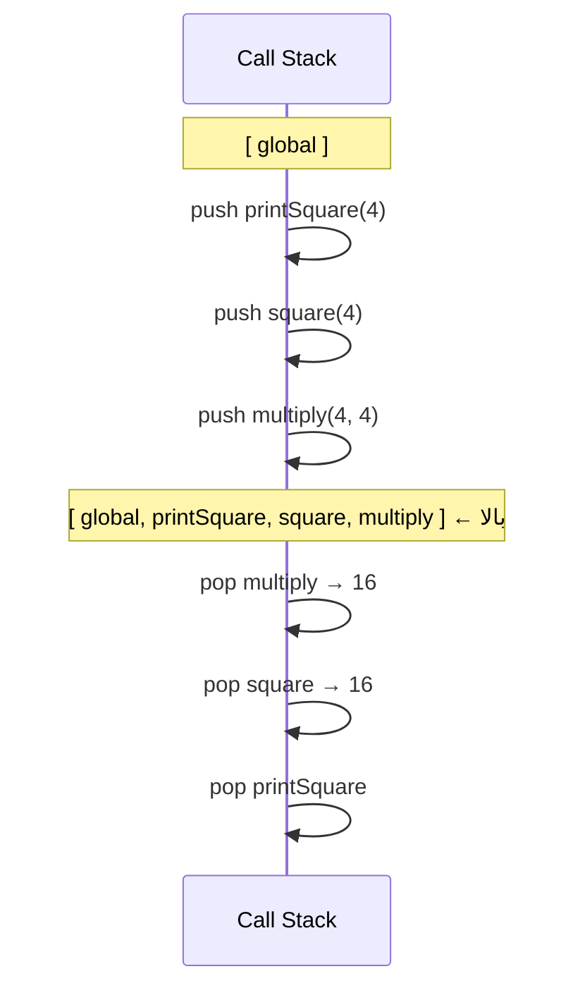
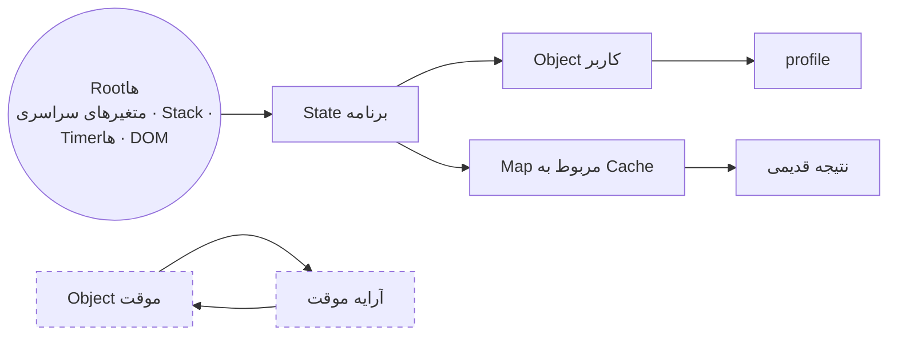
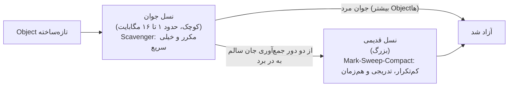
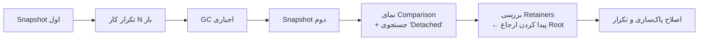

## چرخه عمر حافظه

هر برنامه‌ای، به هر زبانی، سه کار با حافظه انجام می‌دهد:

1. **گرفتن (Allocate)** حافظه وقتی چیزی ساخته می‌شود (متغیر، Object، تابع، رشته).
2. **استفاده** از آن (خواندن و نوشتن).
3. **آزاد کردن (Release)** وقتی دیگر لازم نیست.

در زبان C مرحله سوم را خودتان با `free()` انجام می‌دهید و فراموش کردنش (نشت حافظه) یا دو بار انجام دادنش (Crash) باگ‌های کلاسیک‌اند. JavaScript مرحله اول و سوم را **خودکار** انجام می‌دهد: موتور هنگام ساختن مقدارها حافظه می‌گیرد و یک **Garbage Collector (GC)** حافظه‌ای را که دیگر قابل استفاده نیست آزاد می‌کند. اما «خودکار» یعنی «بی‌مشکل» نیست: هنوز هم می‌توانید ناخواسته چیزها را زنده نگه دارید. نشت حافظه در JavaScript دقیقاً همین است.

```js run
let user = { name: "Ali", tags: ["admin"] };  // گرفتن حافظه: یک Object، یک آرایه و دو رشته
console.log(user.name);                       // استفاده
user = null;                                  // Object حالا دیگر قابل دسترسی نیست ← GC می‌تواند آزادش کند
```

## مقدارها کجا زندگی می‌کنند: Stack و Heap

| | Call Stack | Heap |
| --- | --- | --- |
| چه چیزی در آن است | **Frame**ها: یکی به ازای هر فراخوانی فعال تابع، با متغیرهای محلی و محل بازگشت | **Objectها**: Object Literal، آرایه، تابع، Environment مربوط به Closureها و رشته‌های بزرگ |
| اندازه | کوچک با سقف ثابت (حدود ۱ مگابایت؛ حدود ۱۰ هزار Frame) | بزرگ و در صورت نیاز رشد می‌کند (صدها مگابایت و بیشتر) |
| نحوه گرفتن حافظه | Push هنگام فراخوانی و Pop هنگام بازگشت: بسیار سریع | پویا: برای پاک‌سازی به GC نیاز دارد |
| ترتیب | آخرین ورودی، اولین خروجی (LIFO) | بدون ترتیب |

```text
CALL STACK                         HEAP
┌──────────────────────────┐
│ greet()                  │       ┌──────────────────────────┐
│   message ───────────────┼──────►│ "Hello, Ali"             │
│   user ──────────────────┼───┐   └──────────────────────────┘
├──────────────────────────┤   │   ┌──────────────────────────┐
│ main()                   │   └──►│ { name: "Ali", age: 30 } │
│   count = 3              │       └──────────────────────────┘
└──────────────────────────┘
```

یک مدل ذهنی ساده که برای مصاحبه کافی است:

- **Primitiveها** در متغیرهای محلی (`count = 3`) می‌توانند مستقیماً داخل Frame باشند.
- **Objectها** همیشه در Heap هستند و متغیرها فقط یک **ارجاع (Reference)**، یعنی آدرس آن‌ها را نگه می‌دارند.

<Callout type="note" title="این یک مدل است، نه تمام حقیقت">
موتورها هوشمندترند: V8 عددهای صحیح کوچک («Smi») را مستقیماً داخل خود ارجاع ذخیره می‌کند، بیشتر رشته‌ها را در Heap نگه می‌دارد و متغیرهایی را که Closureها به آن‌ها دسترسی دارند از Stack به یک **Context** در Heap منتقل می‌کند تا بعد از بازگشت تابع هم زنده بمانند. با این حال، تفکیک Stack و Heap بالا همچنان روش درست فکر کردن درباره کپی و طول عمر مقدارهاست.
</Callout>

### کپی شدن: مقدار در مقابل ارجاع

```js run
let a = 10;
let b = a;          // خود مقدار کپی می‌شود
b++;
console.log(a, b);  // 10 11 — مستقل از هم

const original = { score: 10 };
const alias = original;   // **ارجاع** کپی می‌شود: هر دو به یک Object اشاره می‌کنند
alias.score++;
console.log(original.score);           // 11 — همان Object
console.log(alias === original);       // true

const copy = { ...original };          // یک Object **جدید** (کپی سطحی)
copy.score = 0;
console.log(original.score, copy === original);   // 11 false
```

## Call Stack با جزئیات

هر فراخوانی تابع یک **Frame** (یک Execution Context) روی Call Stack می‌گذارد و `return` آن را برمی‌دارد. Frame بالایی همان کدی است که در این لحظه اجرا می‌شود.

```js run
function multiply(a, b) {
  console.log(new Error("where am I?").stack.split("\n").slice(1, 4).map((l) => l.trim().split(" (")[0]).join(" ← "));
  return a * b;
}
function square(n) { return multiply(n, n); }
function printSquare(n) { console.log("result:", square(n)); }

printSquare(4);
```



### سرریز Stack (Stack Overflow)

Stack سقف دارد. بازگشتی (Recursion) بدون شرط پایان (یا با عمق خیلی زیاد) آن را پر می‌کند:

```js run
let depth = 0;
function dive() {
  depth++;
  dive();                 // شرط پایان ندارد
}
try {
  dive();
} catch (e) {
  console.log(`${e.name}: ${e.message} (after ~${depth} frames)`);
}

// بازگشت‌های خیلی عمیق را با حلقه یا یک Stack صریح (آرایه‌ای روی Heap) جایگزین کنید
function sumTo(n) {
  let total = 0;
  for (let i = 1; i <= n; i++) total += i;
  return total;
}
console.log(sumTo(1e6));
```

## Garbage Collector چطور تصمیم می‌گیرد: قابل دسترسی بودن (Reachability)

GC نمی‌پرسد «آیا این هنوز **لازم** است؟» (نمی‌تواند نیت شما را بداند). می‌پرسد: **«آیا برنامه هنوز می‌تواند به این مقدار برسد؟»**

- **Root**ها همیشه قابل دسترسی‌اند: متغیرهای سراسری، متغیرهای توابعی که الان در حال اجرا هستند (Stack)، Timerها و Callbackهای فعال، درخت DOM و Listenerهای متصل به آن و غیره.
- هر چیزی که **یک مقدار قابل دسترسی** به آن ارجاع داشته باشد، خودش هم قابل دسترسی است.
- بقیه زباله‌اند و می‌توانند آزاد شوند.



«Object موقت» و «آرایه موقت» به هم ارجاع دارند، اما **هیچ مقدار قابل دسترسی‌ای به آن‌ها ارجاع ندارد**؛ پس هر دو جمع‌آوری می‌شوند. برای GCی که بر پایه Reachability کار می‌کند، ارجاع چرخشی مشکلی ندارد.

```js run
function createLinkedPair() {
  const a = { name: "a" };
  const b = { name: "b" };
  a.partner = b;              // a → b
  b.partner = a;              // b → a  (یک چرخه)
  return "done";              // a و b با هم غیرقابل دسترسی می‌شوند ← هر دو قابل جمع‌آوری‌اند
}
console.log(createLinkedPair());
```

### شمارش ارجاع (Reference Counting) و چرا چرخه‌ها قبلاً نشت می‌کردند

یک روش قدیمی‌تر، تعداد ارجاع‌هایی را که به هر Object اشاره می‌کنند می‌شمارد و وقتی به صفر رسید آن را آزاد می‌کند. این روش نمی‌تواند چرخه‌ها را آزاد کند (هر Object در چرخه حداقل یک ارجاع دارد). Internet Explorer قدیمی برای Objectهای DOM از شمارش ارجاع استفاده می‌کرد؛ برای همین چرخه بین Objectهای JavaScript و Nodeهای DOM نشت می‌کرد. موتورهای امروزی از روش **Tracing** (یعنی Mark-and-Sweep) استفاده می‌کنند که چرخه‌ها را هم مدیریت می‌کند.

## Mark-and-Sweep و GC نسلی (Generational)

**Mark-and-Sweep** در دو مرحله کار می‌کند:

1. **علامت‌گذاری (Mark):** از Rootها شروع می‌کند، همه ارجاع‌ها را دنبال می‌کند و هر Objectی را که به آن رسید علامت می‌زند.
2. **جاروب (Sweep):** کل Heap را مرور می‌کند و هر Objectی را که علامت نخورده آزاد می‌کند. (معمولاً بعدش **فشرده‌سازی (Compaction)** هم انجام می‌شود: Objectهای زنده کنار هم منتقل می‌شوند تا حافظه تکه‌تکه نشود.)

انجام این کار روی کل Heap باعث توقف‌های طولانی می‌شد؛ برای همین V8 (و موتورهای دیگر) طراحی **نسلی** دارند، بر اساس این مشاهده که **بیشتر Objectها جوان می‌میرند** (آرایه‌های موقت، رشته‌های میانی، Objectهای Event):



| | نسل جوان (Scavenger یا Minor GC) | نسل قدیمی (Major GC) |
| --- | --- | --- |
| شامل چه چیزی | Objectهای تازه | Objectهایی که از چند Minor GC جان سالم به در برده‌اند |
| تکرار | خیلی زیاد | کم |
| هزینه | متناسب با Objectهای **زنده** (اگر بیشترشان مرده باشند ارزان است) | بیشتر؛ تدریجی و روی Threadهای کمکی انجام می‌شود |
| الگوریتم | کپی کردن («Semi-space»): کپی بازمانده‌ها و دور ریختن بقیه | Mark–Sweep–Compact |

GC در V8 (با نام **Orinoco**) بیشتر کارش را **موازی** (با چند Thread)، **تدریجی** (برش‌های کوچک بین اجرای کد شما) و **هم‌زمان** (در حالی که JavaScript به اجرا ادامه می‌دهد) انجام می‌دهد و کار را در زمان‌های بیکاری بین فریم‌ها زمان‌بندی می‌کند. به همین دلیل توقف‌های GC معمولاً دیده نمی‌شوند، مگر اینکه در یک حلقه پرتکرار حجم عظیمی زباله بسازید.

## نشت حافظه در کد Frontend

**نشت حافظه (Memory Leak)** یعنی حافظه‌ای که با وجود اینکه برنامه دیگر هرگز از آن استفاده نمی‌کند، همچنان قابل دسترسی می‌ماند. در یک Single-Page App که ساعت‌ها باز می‌ماند، نشت‌های کوچک روی هم جمع می‌شوند تا تب کند شود یا Crash کند.

### ۱. Timerها و Intervalهای فراموش‌شده

```js run
function startPolling(component) {
  const id = setInterval(() => {
    // این Closure، component (و هر چیزی که به آن ارجاع دارد) را زنده نگه می‌دارد…
    component.ticks++;
  }, 10);
  return () => clearInterval(id);      // …تا وقتی کسی این را صدا بزند
}

const widget = { ticks: 0, bigData: new Array(100_000).fill("•") };
const stop = startPolling(widget);

setTimeout(() => {
  stop();                              // ✓ بدون این، widget هرگز جمع‌آوری نمی‌شود
  console.log("stopped after", widget.ticks, "ticks");
}, 60);
```

### ۲. Event Listenerهایی که بیشتر از Element یا Component خودشان عمر می‌کنند

```js
function mountTooltip(button) {
  const onScroll = () => positionTooltip(button);
  window.addEventListener("scroll", onScroll);         // window یک Root است…
  return () => window.removeEventListener("scroll", onScroll);   // …پس هنگام Unmount حذفش کنید!
}

// جایگزین امروزی: یک AbortController چند Listener را با هم حذف می‌کند
const controller = new AbortController();
window.addEventListener("resize", onResize, { signal: controller.signal });
window.addEventListener("scroll", onScroll, { signal: controller.signal });
controller.abort();                                     // هر دو حذف شدند
```

### ۳. Nodeهای جداشده از DOM (Detached)

Nodeی که از صفحه حذف شده، اگر JavaScript هنوز به آن ارجاع داشته باشد زنده می‌ماند؛ و کل زیردرختش هم با آن:

```js
const cache = [];
function showRow(data) {
  const row = document.createElement("tr");
  row.textContent = data;
  table.append(row);
  cache.push(row);              // ✗ برای همیشه نگه داشته می‌شود، حتی بعد از table.innerHTML = ""
}
// راه‌حل: ارجاع به Nodeها را بیش از نیاز نگه ندارید، یا از WeakMap/WeakSet با کلید Node استفاده کنید.
```

### ۴. Closureهایی که بیشتر از نیازشان را نگه می‌دارند

```js run
function createHandler() {
  const hugeReport = new Array(1_000_000).fill(0);   // حدود ۸ مگابایت
  const summary = hugeReport.length;                  // تنها چیزی که لازم داریم
  return () => summary;                               // ✓ فقط summary را نگه می‌دارد
  // return () => hugeReport.length;                  // ✗ کل آرایه را زنده نگه می‌داشت
}
const handler = createHandler();
console.log(handler());
```

موتورها متغیرهایی را نگه می‌دارند که Closure به آن‌ها **ارجاع دارد**. اگر در یک Scope چند Closure ساخته شود، همه یک Context مشترک دارند؛ پس متغیری که *هر کدام* از آن‌ها استفاده کند، برای *همه* زنده می‌ماند.

### ۵. Cacheهای بی‌حد و مجموعه‌های سراسری

```js run
const memo = new Map();                 // ✗ با هر آرگومان جدید برای همیشه بزرگ‌تر می‌شود
function slowLabel(id) {
  if (!memo.has(id)) memo.set(id, `label-${id}`);
  return memo.get(id);
}
for (let i = 0; i < 5000; i++) slowLabel(i);
console.log("cache size:", memo.size);

// ✓ برایش سقف بگذارید (LRU)، هنگام تغییر صفحه پاکش کنید، یا با WeakMap بر اساس Object کلید بزنید
class LRU {
  #max; #map = new Map();
  constructor(max) { this.#max = max; }
  get(k) { if (!this.#map.has(k)) return; const v = this.#map.get(k); this.#map.delete(k); this.#map.set(k, v); return v; }
  set(k, v) { this.#map.delete(k); this.#map.set(k, v); if (this.#map.size > this.#max) this.#map.delete(this.#map.keys().next().value); }
  get size() { return this.#map.size; }
}
const lru = new LRU(100);
for (let i = 0; i < 5000; i++) lru.set(i, i);
console.log("lru size:", lru.size);
```

### ۶. Subscriptionها و Observerها

`IntersectionObserver`، `ResizeObserver`، `MutationObserver`، Handlerهای WebSocket، Subscriptionهای Store (`store.subscribe`) و EventEmitterها: هر چیزی که در آن Subscribe کرده‌اید باید Unsubscribe شود. در React **تابع Cleanup** در `useEffect` دقیقاً برای همین است:

```js
useEffect(() => {
  const unsubscribe = store.subscribe(render);
  const observer = new ResizeObserver(onResize);
  observer.observe(ref.current);
  return () => {             // هنگام Unmount (و قبل از اجرای دوباره Effect) اجرا می‌شود
    unsubscribe();
    observer.disconnect();
  };
}, []);
```

### ۷. متغیرهای سراسری ناخواسته

```js run sloppy
function count() {
  total = 0;               // Sloppy Mode: بدون تعریف ← یک Property سراسری می‌سازد!
  for (let i = 0; i < 3; i++) total += i;
  return total;
}
count();
console.log("leaked global:", typeof globalThis.total, globalThis.total);
// Strict Mode (ماژول‌ها، کلاس‌ها) به‌جای این کار ReferenceError می‌دهد.
```

| منبع نشت | Rootی که زنده نگهش می‌دارد | راه‌حل |
| --- | --- | --- |
| `setInterval` یا `setTimeout` بازگشتی | فهرست Timerها | `clearInterval` هنگام پاک‌سازی |
| Listener روی `window` یا `document` | DOM یا window | `removeEventListener` یا `AbortController` |
| Nodeهای جداشده از DOM | آرایه‌ها، Mapها یا Closureهای شما | رها کردن ارجاع؛ `WeakMap` یا `WeakSet` |
| داده حجیم در Closure | Callback با عمر طولانی | فقط چیزی را نگه دارید که لازم است |
| Cache بی‌حد | `Map` در سطح ماژول | سقف LRU، زمان انقضا (TTL)، `WeakMap` |
| Subscription و Observer | Object منبع | Unsubscribe یا `disconnect()` |
| متغیر سراسری ناخواسته | `globalThis` | Strict Mode و Linter |

## پیدا کردن نشت با DevTools

1. **Performance Monitor** (در Chrome: More tools ← Performance monitor): وقتی یک کار را تکرار می‌کنید (مثلاً ۲۰ بار باز و بسته کردن یک Modal)، «JS heap size» و «DOM Nodes» را زیر نظر بگیرید. پله‌ای که هیچ‌وقت پایین نمی‌آید نشانه نشت است.
2. **پنل Memory ← Heap Snapshot**: یک Snapshot بگیرید، کار را تکرار کنید، GC را اجباری کنید (آیکون سطل زباله)، Snapshot دوم را بگیرید و از نمای **Comparison** استفاده کنید. بر اساس «# Delta» یا «Size Delta» مرتب کنید. برای پیدا کردن درخت‌های DOM جداشده عبارت **«Detached»** را جستجو کنید.
3. **پنل Retainers**: با انتخاب یک Object نشت‌کرده، زنجیره ارجاع‌هایی را می‌بینید که آن را تا یک Root زنده نگه داشته‌اند. همین زنجیره دقیقاً می‌گوید چه چیزی را باید پاک‌سازی کنید.
4. **Allocation instrumentation on timeline**: نشان می‌دهد حافظه *کجا* گرفته می‌شود و کدام‌ها زنده می‌مانند.



## گرفتن حافظه و Performance

GC سریع است، اما **ساختن زباله هم زمان می‌برد**. در مسیرهای پرتکرار (فریم‌های انیمیشن، Handler اسکرول، حلقه‌های بزرگ) از ساختن بی‌دلیل Objectهای جدید پرهیز کنید:

```js run
const points = Array.from({ length: 200_000 }, (_, i) => ({ x: i, y: i * 2 }));

let t = performance.now();
let sum1 = 0;
for (const p of points) sum1 += Object.values(p).reduce((a, b) => a + b, 0);  // برای هر نقطه دو آرایه موقت
console.log("allocating:", Math.round(performance.now() - t), "ms");

t = performance.now();
let sum2 = 0;
for (const p of points) sum2 += p.x + p.y;                                      // بدون گرفتن حافظه جدید
console.log("non-allocating:", Math.round(performance.now() - t), "ms", sum1 === sum2);
```

نکته‌های دیگر: در حلقه‌های انیمیشن Objectها را دوباره استفاده کنید، برای داده عددی حجیم از Typed Array استفاده کنید، داخل حلقه‌های خیلی پرتکرار Closure نسازید و ساختارهای بزرگ را بیش از نیاز نگه ندارید.

## اشتباهات رایج

- فکر کردن به اینکه «JavaScript GC دارد، پس نشت حافظه ممکن نیست».
- باور به اینکه چرخه‌ها در موتورهای امروزی نشت می‌کنند (نمی‌کنند؛ چرخه‌های غیرقابل دسترسی جمع‌آوری می‌شوند).
- فراموش کردن پاک‌سازی: Intervalها، Listenerها، Observerها، Subscriptionها و تابع بازگشتی `useEffect`.
- نگه داشتن ارجاع به Nodeهای حذف‌شده از DOM.
- Cacheهای بی‌حد و آرایه‌های سراسری که فقط بزرگ‌تر می‌شوند.
- `null` کردن متغیرها در همه جا «برای کمک به GC» (فقط برای ارجاع‌های طولانی‌مدت به داده حجیم مفید است).
- بازگشت عمیق بدون در نظر گرفتن سقف Stack.

## سوالات مصاحبه

<QA q="تفاوت Stack و Heap در JavaScript چیست؟" level="junior" n={1}>
<Answer>

Call Stack، Frameهای فراخوانی‌های فعال توابع را نگه می‌دارد (متغیرهای محلی، محل بازگشت)؛ کوچک، سریع و LIFO است. Heap، Objectها را نگه می‌دارد (آرایه، تابع، Environment مربوط به Closureها و بیشتر رشته‌ها)؛ بزرگ است و Garbage Collector مدیریتش می‌کند. متغیرهایی که Object نگه می‌دارند، فقط ارجاع به حافظه Heap را ذخیره می‌کنند؛ به همین دلیل انتساب یک Object، ارجاع را کپی می‌کند نه خود Object را.

</Answer>
<Deep>

V8 عددهای صحیح کوچک را مستقیماً در ارجاع ذخیره می‌کند و متغیرهایی را که Closureها به آن‌ها دسترسی دارند به Contextهایی در Heap منتقل می‌کند تا بیشتر از Frame عمر کنند. تعداد زیاد Frame باعث خطای `RangeError: Maximum call stack size exceeded` می‌شود.

</Deep>
<Mistake>

گفتن «Primitiveها روی Stack و Objectها روی Heap هستند» به‌عنوان یک قانون مطلق. این فقط یک مدل است؛ رشته‌ها و متغیرهای گرفته‌شده توسط Closure معمولاً در Heap هستند.

</Mistake>
<FollowUp>

چرا `const` یک Object را تغییرناپذیر نمی‌کند؟

</FollowUp>
</QA>

<QA q="Garbage Collection در موتورهای امروزی JavaScript چطور کار می‌کند؟" level="mid" n={2}>
<Answer>

بر اساس قابل دسترسی بودن: Collector از Rootها (متغیرهای سراسری، Stack فعلی، Callbackهای فعال، DOM) شروع می‌کند، هر چیزی را که قابل دسترسی است علامت می‌زند و بقیه را آزاد می‌کند (Mark-and-Sweep، معمولاً همراه با Compaction). موتورها نسلی‌اند: یک Scavenger ارزان و پرتکرار نسل جوان را که بیشتر Objectها در آن می‌میرند جمع‌آوری می‌کند و بازمانده‌ها به نسل قدیمی منتقل می‌شوند که کمتر جمع‌آوری می‌شود.

</Answer>
<Deep>

Orinoco در V8 مرحله علامت‌گذاری را هم‌زمان و تدریجی روی Threadهای کمکی اجرا می‌کند و از زمان بیکاری بین فریم‌ها استفاده می‌کند تا توقف‌ها کوتاه بمانند. چون Tracing از Rootها شروع می‌شود، چرخه‌های غیرقابل دسترسی جمع‌آوری می‌شوند؛ برخلاف شمارش ارجاع خالص (که در IE قدیمی باعث نشت چرخه‌های DOM↔JS می‌شد).

</Deep>
<Mistake>

ادعای اینکه `null` کردن یک متغیر حافظه را فوراً آزاد می‌کند. فقط یک ارجاع را حذف می‌کند؛ جمع‌آوری بعداً و فقط در صورتی انجام می‌شود که Object غیرقابل دسترسی باشد.

</Mistake>
<FollowUp>

چرا ساختن تعداد زیادی Object کوتاه‌عمر نسبتاً ارزان است، اما انتقال تعداد زیادی Object به نسل قدیمی پرهزینه است؟

</FollowUp>
</QA>

<QA q="دلایل رایج نشت حافظه در یک Single-Page App را نام ببرید و بگویید چطور جلویشان را می‌گیرید." level="mid" n={3}>
<Answer>

Interval و Timeoutهای پاک‌نشده؛ Event Listenerهای روی `window` یا `document` که هنگام Unmount حذف نشده‌اند؛ Nodeهای جداشده از DOM که هنوز در JavaScript به آن‌ها ارجاع هست؛ Closureهایی که داده حجیم نگه داشته‌اند؛ Cacheها یا آرایه‌های سراسری بی‌حد؛ Subscriptionها و Observerهایی که هیچ‌وقت لغو نشده‌اند؛ متغیرهای سراسری ناخواسته. پیشگیری: توابع پاک‌سازی (تابع بازگشتی `useEffect`، `AbortController` برای Listenerها)، Cache با سقف مشخص، `WeakMap`/`WeakSet` برای داده وابسته به Object و Strict Mode.

</Answer>
<Deep>

تشخیص با مقایسه Heap Snapshotها: کاری را تکرار کنید، GC را اجباری کنید، مقایسه کنید، «Detached» را جستجو کنید و بعد زنجیره Retainer را بخوانید تا Rootی را که Object را زنده نگه داشته پیدا کنید.

</Deep>
<Mistake>

مقصر دانستن Framework برای نشت‌هایی که از نبود پاک‌سازی در Effectهای خود شما می‌آیند.

</Mistake>
<FollowUp>

چطور ثابت می‌کنید که ۵۰ بار بستن یک Modal باعث نشت حافظه نمی‌شود؟

</FollowUp>
</QA>

<QA q="آیا ارجاع‌های چرخشی باعث نشت حافظه می‌شوند؟" level="junior" n={4}>
<Answer>

در موتورهای امروزی خیر. GC آن‌ها قابل دسترسی بودن را از Rootها دنبال می‌کند؛ پس چرخه‌ای از Objectها که هیچ مقدار قابل دسترسی‌ای به آن اشاره نمی‌کند، کامل جمع‌آوری می‌شود. چرخه‌ها فقط در Collectorهای مبتنی بر شمارش ارجاع نشت می‌کردند؛ مثل DOM در Internet Explorer قدیمی.

</Answer>
<Deep>

چرخه‌ها برای الگوریتم‌های دیگر همچنان مهم‌اند: `JSON.stringify` روی آن‌ها خطا می‌دهد و توابع ساده Deep Clone یا Deep Equal بی‌پایان بازگشت می‌کنند (برای ثبت Objectهای دیده‌شده از `WeakMap`/`WeakSet` یا از `structuredClone` که چرخه را پشتیبانی می‌کند استفاده کنید).

</Deep>
<Mistake>

شکستن دستی همه چرخه‌ها «برای کمک به GC».

</Mistake>
<FollowUp>

`structuredClone` با ارجاع چرخشی چه می‌کند؟

</FollowUp>
</QA>

## جمع‌بندی

<Recap>

- چرخه عمر حافظه: گرفتن، استفاده، آزاد کردن؛ در JavaScript مرحله اول و سوم خودکار است.
- Call Stack فریم توابع را نگه می‌دارد؛ Objectها، آرایه‌ها و Closureها در Heap هستند.
- بازگشت بی‌پایان Stack را پر می‌کند و `RangeError: Maximum call stack size exceeded` می‌دهد.
- GC چیزی را آزاد می‌کند که از ریشه‌ها (Global، Stack فعلی، Closureهای زنده) **قابل دسترسی** نباشد، نه چیزی که «دیگر استفاده نمی‌شود».
- Mark-and-Sweep ارجاع چرخه‌ای را هم جمع می‌کند؛ GC نسلی فرض می‌کند بیشتر Objectها جوان می‌میرند.
- نشت‌های رایج Frontend: Listener و تایمر پاک‌نشده، DOM Node جداشده که هنوز ارجاع دارد، Cache بی‌حد، Closureهای بزرگ و متغیرهای سراسری.
- در React پاک‌سازی را در تابع Cleanup هر `useEffect` انجام دهید.
- با Heap Snapshot و مقایسه دو Snapshot در DevTools نشت را پیدا کنید؛ دنبال «Detached» بگردید.

</Recap>
