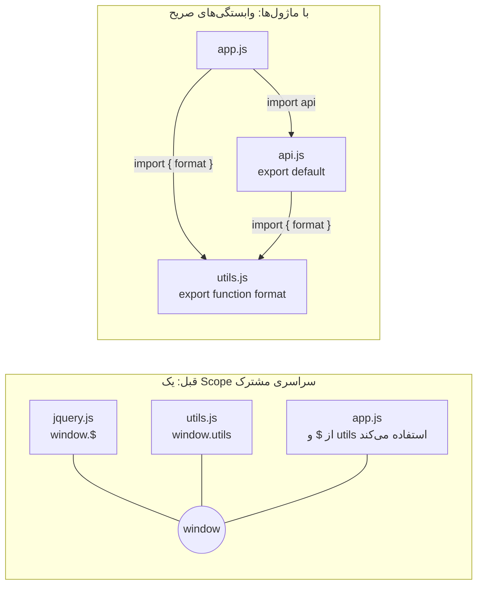
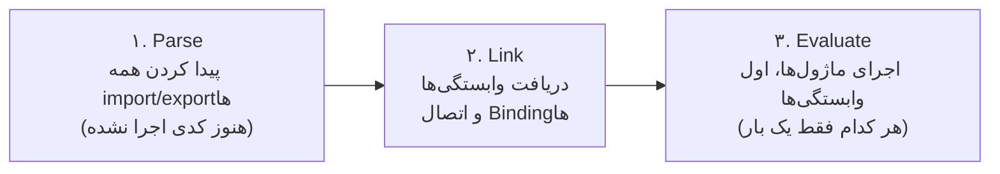
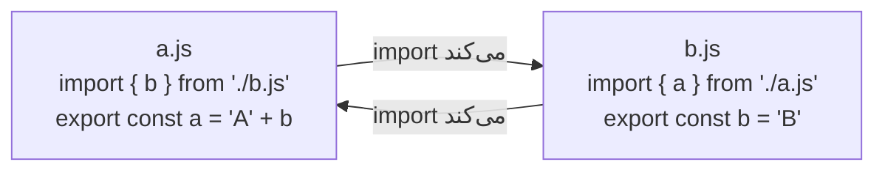

## چرا ماژول؟

**ماژول (Module)** فایلی است که متغیرهایش را خصوصی نگه می‌دارد، چیزهایی را که فایل‌های دیگر مجازند استفاده کنند صراحتاً **export** می‌کند و چیزهایی را که از فایل‌های دیگر لازم دارد صراحتاً **import** می‌کند.

قبل از ماژول‌ها، همه `<script>`ها در **یک Scope سراسری مشترک** بودند. این مشکلات واقعی ایجاد می‌کرد:

| مشکل | مثال |
| --- | --- |
| تداخل نام‌ها | دو کتابخانه هر دو یک `$` یا `utils` سراسری تعریف می‌کنند؛ آخرین فایلی که بارگذاری شود برنده است |
| وابستگی‌های پنهان | `app.js` بی‌صدا به این نیاز دارد که `jquery.js` زودتر بارگذاری شده باشد؛ ترتیب تگ‌ها را عوض کنید و همه چیز خراب می‌شود |
| نبود حریم خصوصی | هر تابع کمکی برای همه Scriptهای دیگر قابل دسترسی (و قابل تغییر) است |
| سختی بهینه‌سازی | ابزارها نمی‌توانند بفهمند کدام کد واقعاً استفاده می‌شود |

ماژول‌ها هر چهار مشکل را حل می‌کنند: هر فایل **Scope خودش** را دارد، وابستگی‌ها با `import` **اعلام** می‌شوند، فقط چیزهای `export`‌شده دیده می‌شوند و ساختار ایستا (Static) به Bundlerها اجازه می‌دهد کد استفاده‌نشده را حذف کنند.



### راه‌حل دوران پیش از ماژول: IIFE و Module Pattern

```js run
// یک IIFE (تابعی که بلافاصله اجرا می‌شود) یک Scope خصوصی می‌سازد
const counterModule = (function () {
  let count = 0;                         // خصوصی
  function increment() { return ++count; }
  return { increment, get count() { return count; } };   // «API عمومی»
})();

counterModule.increment();
console.log(counterModule.count, typeof count);   // 1 "undefined" — count سراسری نیست
```

این «Revealing Module Pattern» هنوز ارزش دانستن دارد (در کدهای قدیمی و خروجی Bundlerها می‌بینیدش)، اما امروز باید از ماژول‌های واقعی استفاده کنید.

## ES Modules (ESM): استاندارد زبان

### export کردن

```js
// math.js
export const PI = 3.14159;                       // Named Export (همراه با تعریف)
export function add(a, b) { return a + b; }      // Named Export
function multiply(a, b) { return a * b; }
function secret() {}                             // export نشده ← خصوصیِ همین فایل

export { multiply, multiply as times };          // فهرست export، همراه با تغییر نام
export default function subtract(a, b) {         // هر ماژول فقط یک Default Export
  return a - b;
}
```

### import کردن

```js
// app.js
import subtract, { add, PI, times as mul } from "./math.js";   // Default + Named (+ تغییر نام)
import * as math from "./math.js";                           // Namespace Object: math.add، math.default
import "./polyfills.js";                                     // فقط برای اثر جانبی‌اش اجرا می‌شود

console.log(add(2, 3), subtract(5, 1), mul(2, 4), math.PI);
```

| شکل | Syntax | توضیح |
| --- | --- | --- |
| Named Export | `export function add() {}` یا `export { a, b }` | با **همان نام** داخل آکولاد import می‌شود: `import { add }` |
| Default Export | `export default value` | با **هر نامی** و بدون آکولاد import می‌شود: `import anything from` |
| تغییر نام | `export { a as b }` یا `import { a as b }` | جلوی تداخل را می‌گیرد |
| Namespace Import | `import * as ns from` | همه Named Exportها به‌عنوان Property (به‌علاوه `ns.default`) |
| Re-export | `export { add } from "./math.js"` یا `export * from` | ساختن فایل‌های «Barrel» (`index.js`) |
| import برای اثر جانبی | `import "./styles.css"` | ماژول را اجرا می‌کند و چیزی import نمی‌کند |

### Named Export در مقابل Default Export

| | Named | Default |
| --- | --- | --- |
| تعداد در هر ماژول | هر تعداد | حداکثر یکی |
| نام هنگام import | باید یکسان باشد (یا صریحاً تغییر نام داده شود) | واردکننده انتخابش می‌کند |
| Refactor و پشتیبانی IDE | تغییر نام امن و Auto-import خوب کار می‌کند | هر فایل ممکن است آن را با نام دیگری صدا بزند |
| Tree Shaking | جزءبه‌جزء | خوب است، اما Objectی از توابع کمکی که export شود قابل حذف جزئی نیست |
| کاربرد رایج | کتابخانه‌های کمکی، چند Component | چیز اصلی و منحصربه‌فرد یک فایل (یک صفحه React، یک فایل تنظیمات) |

خیلی از تیم‌ها برای یکدستی و ابزارسازی بهتر **همه جا Named Export** را ترجیح می‌دهند؛ گاهی Frameworkها Default را الزامی می‌کنند (مثلاً صفحه‌های Next.js یا `React.lazy`).

### Live Binding: import کپی نیست

نامی که import می‌کنید یک **نمای زنده و فقط‌خواندنی** از متغیر ماژول صادرکننده است. وقتی صادرکننده متغیر را تغییر دهد، همه واردکننده‌ها مقدار جدید را می‌بینند؛ و واردکننده‌ها **نمی‌توانند** به آن مقدار بدهند.

```js run
// از یک رشته، یک ماژول واقعی می‌سازیم تا همین‌جا اجرا شود.
const source = `
  export let count = 0;
  export function increment() { count++; }
`;
const url = "data:text/javascript," + encodeURIComponent(source);

const counter = await import(url);
console.log(counter.count);          // 0
counter.increment();
console.log(counter.count);          // 1 — import، متغیر زنده ماژول را می‌بیند

const again = await import(url);     // همان URL ← همان Instance ماژول (از Cache)
console.log(again === counter, again.count);   // true 1

try {
  counter.count = 100;               // واردکننده‌ها نمی‌توانند به Binding مقدار بدهند
} catch (e) {
  console.log(e.name + ": " + e.message);
}
```

CommonJS رفتار متفاوتی دارد: `require` (برای Primitiveها) **کپی مقدار export‌شده در همان لحظه** را به شما می‌دهد؛ جلوتر می‌بینید.

### ماژول‌ها یک بار اجرا و Cache می‌شوند

وقتی یک ماژول را از ده فایل import می‌کنید، ده بار اجرا نمی‌شود. ماژول **یک بار**، اولین باری که import می‌شود، اجرا می‌شود و همه واردکننده‌ها یک Instance مشترک دارند. به همین دلیل یک متغیر در سطح ماژول مثل یک Singleton کار می‌کند (یک Store، یک Cache، یک Client تنظیم‌شده).

### ساختار ایستا (Static)

تعریف‌های `import` و `export` باید در **سطح بالای فایل** و با مسیرهای **رشته‌ای ثابت** باشند. موتور قبل از اجرای هر کدی آن‌ها را می‌خواند:



پیامدها:

- importها **Hoist** می‌شوند: هر جا که بنویسیدشان، قبل از اجرای بدنه ماژول Resolve می‌شوند.
- خطاهای Syntax و Named Exportهای ناموجود **قبل از** اجرای هر کدی تشخیص داده می‌شوند.
- ابزارها می‌توانند گراف وابستگی‌ها را به‌صورت ایستا تحلیل کنند و همین **Tree Shaking** (حذف exportهای استفاده‌نشده) را ممکن می‌کند.

### قوانین دیگر ESM

| قانون | توضیح |
| --- | --- |
| همیشه Strict Mode | نیازی به `"use strict"` نیست؛ `this` در سطح بالا برابر `undefined` است |
| Scope مستقل | `var` و `function` سطح بالا به Property روی `window` تبدیل نمی‌شوند |
| `import.meta` | اطلاعات ماژول فعلی: `import.meta.url`؛ Bundlerها `import.meta.env` را هم اضافه می‌کنند |
| `await` در سطح بالا | مجاز است؛ واردکننده‌ها منتظر تمام شدن ماژول می‌مانند |
| در مرورگر | `<script type="module">` به‌طور پیش‌فرض **Deferred** است، حتی اگر دو بار درج شود فقط یک بار اجرا می‌شود و برای Origin دیگر به CORS نیاز دارد |
| مسیر فایل‌ها | مرورگر و Node به مسیر کامل (`./utils.js`، با پسوند) نیاز دارند، یا به یک **Import Map** برای نام‌های خالی مثل `"react"` |

```html
<script type="importmap">
  { "imports": { "lodash-es/": "https://cdn.jsdelivr.net/npm/lodash-es/" } }
</script>
<script type="module">
  import debounce from "lodash-es/debounce.js";   // از طریق Import Map پیدا می‌شود
</script>
```

## import پویا با `import()`

`import(specifier)` یک **عبارت شبیه تابع** است که ماژولی را **در زمان اجرا** بارگذاری می‌کند و یک **Promise** از Namespace Object آن برمی‌گرداند. برخلاف import ایستا، هر جایی و با مسیرهای محاسبه‌شده قابل استفاده است.

<Api name="import()" sig="import(specifier, options?)" returns="یک `Promise` که با Namespace Object ماژول (`{ default, ...namedExports }`) موفق می‌شود. ماژول در اولین فراخوانی دریافت و اجرا می‌شود و بعد Cache می‌شود." mutates="n/a">

- `specifier`: یک رشته (می‌تواند در زمان اجرا محاسبه شود).
- `options` (اختیاری): مثلاً `{ with: { type: "json" } }` برای ماژول‌های JSON.

</Api>

```js run
async function loadFormatter(locale) {
  // در برنامه واقعی: await import(`./formatters/${locale}.js`) — اینجا یک ماژول درون‌خطی
  const code = `export default (n) => new Intl.NumberFormat(${JSON.stringify(locale)}).format(n);`;
  const mod = await import("data:text/javascript," + encodeURIComponent(code));
  return mod.default;
}

const fa = await loadFormatter("fa-IR");
const en = await loadFormatter("en-US");
console.log(fa(1234567.89), "|", en(1234567.89));
```

کاربردهای رایج:

| کاربرد | مثال |
| --- | --- |
| **Code Splitting** (بارگذاری یک Route یا Widget سنگین فقط در صورت نیاز) | `const Chart = lazy(() => import("./Chart"))` در React |
| بارگذاری شرطی | Polyfill فقط در مرورگرهای قدیمی؛ ابزارهای مدیریت فقط برای مدیرها |
| فایل‌های زبان یا Theme | ``import(`./locales/${lang}.js`)`` |
| بارگذاری از داخل CommonJS | `await import("esm-only-package")` |

Bundlerها (Vite، webpack، Rollup) هر import پویا را به یک فایل **Chunk جداگانه** تبدیل می‌کنند که در صورت نیاز دانلود می‌شود. همین سایت هم هر فصل، کتابخانه دیاگرام و ویرایشگر کد را همین‌طور بارگذاری می‌کند.

## CommonJS (CJS): سیستم ماژول اولیه Node

قبل از وجود ESM، Node.js از **CommonJS** استفاده می‌کرد و بخش بزرگی از npm هنوز با همین منتشر می‌شود.

```js
// math.cjs
const PI = 3.14159;
function add(a, b) { return a + b; }
module.exports = { PI, add };        // یا: exports.add = add;

// app.cjs
const { add, PI } = require("./math.cjs");   // همگام؛ module.exports را برمی‌گرداند
const fs = require("node:fs");
if (process.env.DEBUG) require("./debug-tools.cjs");   // require هر جایی کار می‌کند، حتی شرطی
```

`require` در CommonJS خود **Object** مربوط به `module.exports` را برمی‌گرداند؛ Destructuring مقدارها را در همان لحظه کپی می‌کند:

```js run
// شبیه‌سازی رفتار CommonJS با یک پیاده‌سازی کوچک از require()
function createModule(factory) {
  const module = { exports: {} };
  factory(module, module.exports);
  return module;
}

const counterModule = createModule((module) => {
  let count = 0;
  module.exports = { count, increment: () => { count++; module.exports.count = count; } };
});
const require = () => counterModule.exports;

const { count, increment } = require();   // Destructure شده: **کپی** عدد
increment();
console.log(count);                       // 0 — کپی کهنه
console.log(require().count);             // 1 — خواندن از طریق Object، تغییر را می‌بیند
```

### ESM در مقابل CommonJS

| | ES Modules | CommonJS |
| --- | --- | --- |
| Syntax | `import` / `export` | `require()` / `module.exports` |
| بارگذاری | ناهمگام و مرحله‌ای (Parse ← Link ← Evaluate) | همگام، در لحظه صدا زدن `require` |
| ساختار | **ایستا** (سطح بالا، مسیر ثابت) | **پویا** (هر جا، مسیر محاسبه‌شده) |
| Bindingها | **زنده** و فقط‌خواندنی | کپی مقدارها در لحظه `require` |
| Tree Shaking | ✓ قابل اعتماد | ✗ دشوار |
| `await` در سطح بالا | ✓ | ✗ |
| `this` در سطح بالا | `undefined` | `module.exports` |
| `__dirname` و `__filename` | ✗ (به‌جایش `import.meta.dirname` / `import.meta.url`) | ✓ |
| اجرا در مرورگر | ✓ به‌صورت بومی | ✗ (به Bundler نیاز دارد) |
| تشخیص در Node | `.mjs`، یا `.js` همراه با `"type": "module"` در package.json | `.cjs`، یا `.js` بدون `"type": "module"` |

### همکاری بین دو سیستم (Interop)

- ESM می‌تواند CommonJS را `import` کند: `module.exports` به **Default Export** تبدیل می‌شود (Node خیلی از Named Exportها را هم تشخیص می‌دهد).
- CommonJS در نسخه‌های قدیمی‌تر Node نمی‌تواند ESM را به‌صورت ایستا `require` کند؛ از `await import()` استفاده کنید. نسخه‌های جدید Node (۲۲ به بعد) از `require()` برای ESMهای همگام پشتیبانی می‌کنند.
- کتابخانه‌ها اغلب با استفاده از فیلد `"exports"` در `package.json` **هر دو** نسخه را منتشر می‌کنند («Dual Package»).

```json
{
  "name": "my-lib",
  "type": "module",
  "exports": {
    ".": {
      "import": "./dist/index.js",
      "require": "./dist/index.cjs",
      "types": "./dist/index.d.ts"
    }
  },
  "sideEffects": false
}
```

## وابستگی چرخشی (Circular Dependency)

وقتی `a.js` فایل `b.js` را import می‌کند و `b.js` هم `a.js` را، یکی از آن‌ها باید اول اجرا شود و دیگری را **هنوز مقداردهی‌نشده** می‌بیند:



```js
// main.js فایل a.js را import می‌کند ← Link شدن a.js شروع می‌شود ← به b.js نیاز دارد ← b.js **اول** اجرا می‌شود
// b.js: اگر در سطح بالا `a` را بخواند ← ReferenceError (a در TDZ است)
// b.js: اگر فقط داخل تابعی که بعداً صدا زده می‌شود از `a` استفاده کند ← مشکلی نیست
```

قاعده سرانگشتی: از چرخه‌ها پرهیز کنید (کد مشترک را به ماژول سوم منتقل کنید)؛ اگر نمی‌توانید، Bindingهای import‌شده را فقط **داخل توابعی** استفاده کنید که بعد از بارگذاری همه ماژول‌ها اجرا می‌شوند، نه در سطح بالا. Bundlerها (و ابزارهایی مثل `madge` یا قانون `import/no-cycle` در ESLint) می‌توانند چرخه‌ها را پیدا کنند.

## Tree Shaking و اثرهای جانبی

**Tree Shaking** یعنی Bundler exportهایی را که هیچ‌کس import نکرده حذف کند. این کار چون ESM ایستاست ممکن است. دو چیز جلویش را می‌گیرد:

1. **اثرهای جانبی در سطح بالای ماژول** (کدی که با import اجرا می‌شود؛ مثل ثبت یک متغیر سراسری یا تغییر یک Prototype). Bundler مجبور است این ماژول‌ها را نگه دارد. با تعریف `"sideEffects": false` (یا فهرست فایل‌هایی که واقعاً اثر جانبی دارند، مثل CSS) در `package.json` اجازه حذف تهاجمی‌تر را بدهید.
2. **export کردن یک Object بزرگ** (`export default { a, b, c }`): Bundler نمی‌تواند بفهمد از کدام Propertyها استفاده خواهید کرد.

```js
// ✓ قابل حذف جزئی: فقط چیزی را که لازم دارید import کنید
import { debounce } from "lodash-es";

// ✗ کل کتابخانه را می‌آورد (CommonJS، یک Object)
import _ from "lodash";
_.debounce(fn, 100);
```

## اشتباهات رایج

- ترکیب `import` و `require` در یک فایل بدون فهمیدن نوع ماژول.
- فراموش کردن پسوند `.js` در مسیرهای ESM مرورگر و Node.
- انتظار Tree Shaking از Objectهایی که با `export default` صادر شده‌اند.
- خواندن Binding وارداتی در سطح بالا، داخل یک وابستگی چرخشی.
- مقدار دادن به Binding وارداتی (فقط‌خواندنی است؛ به‌جایش یک تابع Setter را export کنید).
- استفاده از `__dirname` در ESM (به‌جایش `import.meta.dirname` یا `new URL(".", import.meta.url)`).
- گذاشتن کارهای کند (دریافت داده، محاسبه سنگین) در سطح بالای ماژول، که همه واردکننده‌ها را معطل می‌کند.

## سوالات مصاحبه

<QA q="تفاوت‌های اصلی ES Modules و CommonJS چیست؟" level="mid" n={1}>
<Answer>

ESM از `import`/`export` استفاده می‌کند، ایستاست (تعریف‌ها در سطح بالا با مسیر ثابت)، ناهمگام و در مراحل Parse ← Link ← Evaluate بارگذاری می‌شود، **Binding زنده و فقط‌خواندنی** export می‌کند، از await در سطح بالا و Tree Shaking پشتیبانی می‌کند و به‌صورت بومی در مرورگر اجرا می‌شود. CommonJS از `require`/`module.exports` استفاده می‌کند، پویا و همگام است و مقدارهای export‌شده را در لحظه `require` به شما می‌دهد.

</Answer>
<Deep>

چون ESM قبل از اجرا Link می‌شود، Named Exportهای ناموجود قبل از اجرای هر کدی خطا هستند و چرخه‌ها به‌جای Objectهای نیمه‌پر، Bindingهای مقداردهی‌نشده (TDZ) را می‌بینند. در Node نوع ماژول با پسوند فایل (`.mjs`/`.cjs`) یا فیلد `"type"` در `package.json` تعیین می‌شود؛ Dual Packageها از فیلد `"exports"` استفاده می‌کنند.

</Deep>
<Mistake>

گفتن اینکه ESM «فقط Syntax جدیدی برای require» است.

</Mistake>
<FollowUp>

یک فایل CommonJS چطور می‌تواند یک ES Module را بارگذاری کند؟

</FollowUp>
</QA>

<QA q="Live Binding چیست؟ یک مثال نشان دهید." level="senior" n={2}>
<Answer>

در ES Module، هر import یک کپی نیست؛ ارجاعی زنده به متغیر ماژول صادرکننده است. اگر `counter.js` یک `let count` و یک تابع `increment()` که آن را تغییر می‌دهد export کند، واردکننده‌ای که بعد از صدا زدن `increment()` مقدار `count` را بخواند، مقدار جدید را می‌بیند. واردکننده‌ها نمی‌توانند به Binding مقدار بدهند (از سمت آن‌ها فقط‌خواندنی است).

</Answer>
<Deep>

Live Bindingها همان چیزی هستند که import چرخشی را قابل استفاده می‌کنند (یک Binding می‌تواند بعد از Link شدن مقدار بگیرد) و دلیل اینکه Namespace Object ماژول یک Object خاص (Exotic) با Getter است. در CommonJS، Destructuring به شکل `const { count } = require(...)` مقدار را در همان لحظه کپی می‌کند؛ پس تغییرات بعدی دیده نمی‌شوند.

</Deep>
<Mistake>

تلاش برای `import { count } from "./c.js"; count++` به‌منظور تغییر State مشترک.

</Mistake>
<FollowUp>

چطور State تغییرپذیر مشترک را به شکل امن از یک ماژول در اختیار بقیه می‌گذارید؟

</FollowUp>
</QA>

<QA q="`import()` پویا چه امکانی می‌دهد و چه ارتباطی با Code Splitting دارد؟" level="mid" n={3}>
<Answer>

`import(path)` یک ماژول را در زمان اجرا بارگذاری می‌کند و Promiseی از Namespace آن برمی‌گرداند؛ می‌شود آن را به‌صورت شرطی، داخل تابع و با مسیر محاسبه‌شده صدا زد. Bundlerها هر import پویا را به یک Chunk جداگانه تبدیل می‌کنند؛ پس کد یک Route، یک Component سنگین یا قابلیتی که کم استفاده می‌شود فقط در صورت نیاز دانلود می‌شود. این همان Code Splitting است و `lazy(() => import("./Page"))` در React روی آن ساخته شده.

</Answer>
<Deep>

پیش‌بارگذاری (`<link rel="modulepreload">` یا Prefetch روتر هنگام Hover) تأخیر اضافه را پنهان می‌کند. چون ماژول‌ها Cache می‌شوند، صدا زدن چندباره `import()` بعد از بار اول ارزان است. تکه‌تکه کردن بیش از حد به Chunkهای خیلی کوچک می‌تواند به دلیل سربار درخواست‌ها و Waterfallها Performance را بدتر کند.

</Deep>
<Mistake>

استفاده از import پویا برای چیزی که به‌هرحال برای اولین Render لازم است؛ این فقط یک رفت‌وبرگشت شبکه اضافه می‌کند.

</Mistake>
<FollowUp>

وقتی یک Route تنبل خودش یک کتابخانه نمودار را تنبل import می‌کند، چطور از Waterfall بارگذاری جلوگیری می‌کنید؟

</FollowUp>
</QA>

<QA q="Tree Shaking چیست و چه چیزهایی جلویش را می‌گیرند؟" level="mid" n={4}>
<Answer>

Tree Shaking یعنی حذف کد مرده، یعنی exportهای استفاده‌نشده، که به لطف importهای ایستای ESM ممکن است. چیزهایی که جلویش را می‌گیرند: ماژول‌هایی با اثر جانبی در سطح بالا (مگر اینکه `package.json` مقدار `"sideEffects": false` را اعلام کند)، ماژول‌های CommonJS، import کردن کل Namespace در Objectهایی که پویا استفاده می‌شوند و export کردن یک Object پیش‌فرض شامل همه توابع کمکی.

</Answer>
<Deep>

Bundlerها باید مطمئن باشند حذف کد بی‌خطر است؛ Minifierها از حاشیه‌نویسی `/*#__PURE__*/` برای مشخص کردن فراخوانی‌های بدون اثر جانبی استفاده می‌کنند. کتابخانه‌هایی مثل `lodash-es` و `date-fns` به همین دلیل با یک تابع در هر ماژول طراحی شده‌اند.

</Deep>
<Mistake>

فرض اینکه هر کتابخانه ESMی خودبه‌خود قابل Tree Shaking است.

</Mistake>
<FollowUp>

چطور بررسی می‌کنید کدام ماژول‌ها در Bundle نهایی Production قرار گرفته‌اند؟ (Bundle Analyzer یا `vite-bundle-visualizer`.)

</FollowUp>
</QA>

## جمع‌بندی

<Recap>

- ماژول کد را به فایل‌های مستقل با Scope خودشان تقسیم می‌کند و وابستگی‌ها را صریح می‌کند.
- ES Modules با `import`/`export` استاندارد زبان‌اند، به‌صورت ایستا تحلیل می‌شوند و همیشه Strict هستند.
- Named Export با نام دقیق وارد می‌شود و Default Export با هر نامی؛ Named Export برای Refactor و Tree Shaking بهتر است.
- Importها Live Binding هستند: اگر ماژول صادرکننده مقدار را تغییر دهد، واردکننده مقدار جدید را می‌بیند؛ ولی نمی‌تواند خودش آن را تغییر دهد.
- هر ماژول فقط یک بار اجرا می‌شود و نتیجه‌اش Cache می‌شود.
- `import()` پویا یک Promise برمی‌گرداند و پایه Code Splitting و Lazy Loading است.
- CommonJS (`require`/`module.exports`) هم‌زمان و پویاست و مقدار را کپی می‌کند، نه Binding را.
- وابستگی چرخشی ممکن است مقدار نیمه‌کاره یا خطای TDZ بدهد؛ با جابه‌جا کردن کد مشترک به ماژول سوم حلش کنید.
- Tree Shaking کد استفاده‌نشده را حذف می‌کند، به شرط ESM و نداشتن اثر جانبی (`"sideEffects": false`).

</Recap>
