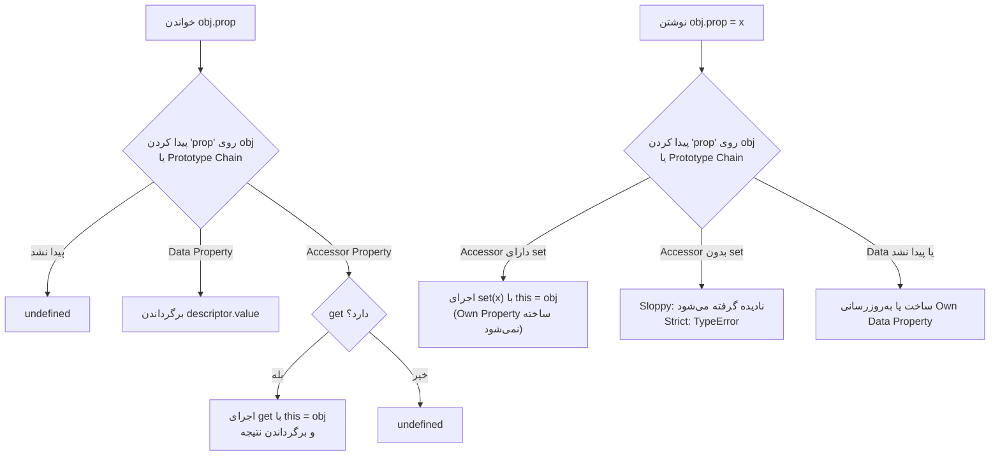
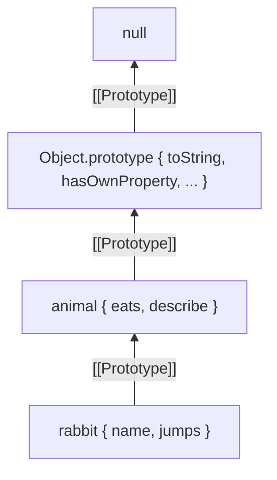
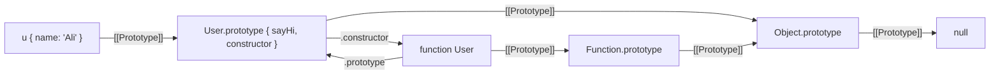

## Object در JavaScript

`Object` مجموعه‌ای از **Property**هاست؛ هر Property یک **کلید** (رشته یا Symbol) و یک **Descriptor** دارد. هر چیزی که Primitive نیست — آرایه، تابع، Date، Map، Class Instance — یک Object است.

## روش‌های ساخت Object

```js run
// 1. Object Literal — رایج‌ترین
const user = { name: "Ali", age: 30 };

// 2. Constructor Function با new
function Person(name) { this.name = name; }
const p = new Person("Sara");

// 3. Class (Syntax Sugar روی Constructor و Prototype)
class Animal { constructor(name) { this.name = name; } }
const a = new Animal("Rex");

// 4. Object.create — با Prototype دلخواه
const proto = { greet() { return "Hi " + this.name; } };
const o = Object.create(proto);
o.name = "Neda";

// 5. Object.create(null) — بدون Prototype (Dictionary خالص)
const dict = Object.create(null);

console.log(user, p, a, o.greet(), "toString" in dict);
```

## دسترسی به Property

```js run
const key = "first name";
const product = {
  title: "Laptop",
  "first name": "Ali",           // کلید با فاصله
  [`price_${2026}`]: 1200,      // Computed Property Name
  [Symbol.for("id")]: 7,
  greet() { return this.title; }, // Method Shorthand
};

console.log(product.title);               // Dot Notation
console.log(product[key]);                // Bracket Notation (کلید پویا)
console.log(product.price_2026);
console.log(product.missing?.deep);       // Optional Chaining → undefined
console.log(Object.keys(product));        // Symbolها در keys نیستند
```

کلیدهای غیر Symbol همیشه به **رشته** تبدیل می‌شوند: `obj[1]` و `obj["1"]` یکی هستند؛ `obj[{}]` کلید `"[object Object]"` می‌سازد. برای کلید Object از `Map` استفاده کنید.

### ترتیب کلیدها

`Object.keys` و `for...in` ترتیب مشخصی دارند: ابتدا کلیدهای **عدد صحیح** به ترتیب صعودی، سپس کلیدهای رشته‌ای به **ترتیب درج**، سپس Symbolها (فقط در `Reflect.ownKeys`).

```js run
console.log(Object.keys({ b: 1, 2: 1, a: 1, 1: 1 })); // ['1', '2', 'b', 'a']
```

## Property Descriptors

هر Property پشت صحنه یک **Descriptor** دارد که رفتار آن را تعیین می‌کند. دو نوع Property وجود دارد:

| Data Property | Accessor Property |
| --- | --- |
| `value` | `get` |
| `writable` | `set` |
| `enumerable` | `enumerable` |
| `configurable` | `configurable` |

| Attribute | معنا | پیش‌فرض با Literal/انتساب | پیش‌فرض با `defineProperty` |
| --- | --- | --- | --- |
| `writable` | قابل تغییر بودن مقدار | `true` | `false` |
| `enumerable` | ظاهر شدن در `for...in`، `Object.keys`، Spread، `JSON.stringify` | `true` | `false` |
| `configurable` | قابل حذف بودن و تغییر Descriptor | `true` | `false` |

```js run
const account = {};
Object.defineProperty(account, "id", {
  value: 42,
  writable: false,
  enumerable: false,
  configurable: false,
});

console.log(Object.getOwnPropertyDescriptor(account, "id"));
try {
  account.id = 100;                      // Sloppy: بی‌صدا نادیده گرفته می‌شود؛ Strict (اینجا): TypeError
} catch (error) {
  console.log(error.name + ": " + error.message);
}
console.log(account.id);                 // 42
```

```js run
const config = {};
Object.defineProperty(config, "secret", { value: "x", enumerable: false });
config.visible = true;

console.log(Object.keys(config));          // ['visible']
console.log(JSON.stringify(config));       // {"visible":true}
console.log({ ...config });                // Spread فقط Enumerable Own Properties
console.log(config.secret);                // "x" — هنوز قابل دسترسی است
console.log(Object.getOwnPropertyNames(config)); // ['secret', 'visible']
```

متدهای Built-in مثل `Array.prototype.map` به همین دلیل در `for...in` ظاهر نمی‌شوند: `enumerable: false` هستند.

## Getter و Setter (Accessor Property)

تا اینجا هر Property یک **مقدار** نگه می‌داشت. JavaScript نوع دومی از Property هم دارد به نام **Accessor Property** که اصلاً مقداری نگه نمی‌دارد؛ به‌جای آن حداکثر دو تابع دارد:

- **Getter** (`get`) که هر بار Property **خوانده** شود اجرا می‌شود،
- **Setter** (`set`) که هر بار به Property **مقدار داده** شود اجرا می‌شود.

از بیرون، Accessor دقیقاً شبیه یک Property معمولی است: `obj.fullName` و `obj.fullName = "…"`؛ بدون پرانتز و بدون صدا زدن تابع. نکته اصلی همین است: می‌توانید پشت چیزی که شبیه داده ساده است، منطق قرار دهید.



### سه روش تعریف Accessor

#### ۱. Syntax در Object Literal

```js run
const user = {
  firstName: "Sara",
  lastName: "Ahmadi",

  get fullName() {
    return `${this.firstName} ${this.lastName}`;
  },

  set fullName(value) {
    const [first, ...rest] = value.trim().split(/\s+/);
    this.firstName = first;
    this.lastName = rest.join(" ");
  },
};

console.log(user.fullName);         // "Sara Ahmadi" — get اجرا شد
user.fullName = "Reza  Karimi Nia";  // set اجرا شد
console.log(user.firstName);        // "Reza"
console.log(user.lastName);         // "Karimi Nia"
console.log(user);                  // fullName به‌شکل [Getter/Setter] نمایش داده می‌شود
```

Getter **هیچ پارامتری** نمی‌گیرد و Setter **دقیقاً یک** پارامتر می‌گیرد؛ هر حالت دیگری `SyntaxError` است.

#### ۲. `Object.defineProperty`

وقتی می‌خواهید روی یک Object موجود Accessor اضافه کنید، Accessorها را در حلقه بسازید یا `enumerable`/`configurable` را کنترل کنید.

```js run
const rect = { width: 4, height: 3 };

Object.defineProperty(rect, "area", {
  get() {
    return this.width * this.height;
  },
  enumerable: false,   // در defineProperty به‌هرحال پیش‌فرض همین است
  configurable: true,
});

console.log(rect.area);                 // 12
rect.width = 10;
console.log(rect.area);                 // 30 — همیشه به‌روز؛ چیزی برای همگام‌سازی نیست
console.log(Object.keys(rect));         // ['width', 'height'] — area مخفی است
console.log(Object.getOwnPropertyDescriptor(rect, "area"));
```

#### ۳. Syntax در `class`

در Class، `get`/`set` **فقط یک بار روی Prototype** تعریف می‌شوند و بین همه Instanceها مشترک‌اند. مثل متدهای Class، Non-enumerable هستند.

```js run
class Temperature {
  #celsius = 0;                     // Backing Field خصوصی

  get celsius() { return this.#celsius; }
  set celsius(value) {
    if (typeof value !== "number" || Number.isNaN(value)) {
      throw new TypeError("celsius must be a number");
    }
    if (value < -273.15) throw new RangeError("below absolute zero");
    this.#celsius = value;
  }

  get fahrenheit() { return this.#celsius * 1.8 + 32; }
  set fahrenheit(value) { this.celsius = (value - 32) / 1.8; } // استفاده دوباره از Validation

  static get absoluteZero() { return -273.15; }               // Static Accessor
}

const t = new Temperature();
t.celsius = 25;
console.log(t.fahrenheit);                   // 77
t.fahrenheit = 212;
console.log(t.celsius);                      // 100
console.log(Temperature.absoluteZero);       // -273.15

try { t.celsius = -500; } catch (e) { console.log(e.name + ": " + e.message); }

console.log(Object.hasOwn(t, "celsius"));    // false — روی Prototype است
console.log(Object.getOwnPropertyNames(Temperature.prototype));
```

### Descriptor در Accessor

Accessor Descriptor کلیدهای `get`، `set`، `enumerable` و `configurable` را دارد اما `value` و `writable` **ندارد**. ترکیب این دو نوع خطاست:

```js run
const o = {};
try {
  Object.defineProperty(o, "x", { value: 1, get() { return 2; } });
} catch (e) {
  console.log(e.name + ": " + e.message);
}

const literal = { get answer() { return 42; } };
console.log(Object.getOwnPropertyDescriptor(literal, "answer"));
// { get: [Function], set: undefined, enumerable: true, configurable: true }
```

| | Literal `{ get x() {} }` | `defineProperty(o, "x", { get })` | `class { get x() {} }` |
| --- | --- | --- | --- |
| محل تعریف | Own Property خود Object | Own Property خود Object | `Class.prototype` (مشترک) |
| `enumerable` | `true` | `false` (پیش‌فرض) | `false` |
| `configurable` | `true` | `false` (پیش‌فرض) | `true` |
| در `JSON.stringify` | می‌آید (مقدار محاسبه می‌شود) | نمی‌آید | نمی‌آید |

### Property فقط-Getter و فقط-Setter

```js run sloppy
const config = {
  get version() { return "2.1.0"; },   // بدون Setter → فقط خواندنی
  set log(message) { this.lines = [...(this.lines ?? []), message]; }, // بدون Getter → فقط نوشتنی
};

config.version = "9.9.9";               // Sloppy Mode: بی‌صدا نادیده گرفته می‌شود
console.log(config.version);            // "2.1.0"

config.log = "started";
config.log = "loaded";
console.log(config.log);                // undefined — Getter وجود ندارد
console.log(config.lines);              // ['started', 'loaded']
```

```js run
"use strict";
const config = { get version() { return "2.1.0"; } };
try {
  config.version = "9.9.9";             // Strict Mode: TypeError
} catch (e) {
  console.log(e.name + ": " + e.message);
}
```

کد داخل ES Moduleها و Classها همیشه Strict است؛ پس در کد مدرن، مقداردهی به Property فقط-Getter **خطا می‌دهد**.

### مقدار واقعی کجا ذخیره می‌شود؟ (Backing Storage)

جفت Getter/Setter معمولاً از یک فضای ذخیره پنهان می‌خواند و در آن می‌نویسد. چهار انتخاب رایج:

| محل ذخیره | مثال | واقعاً خصوصی؟ | توضیح |
| --- | --- | --- | --- |
| قرارداد Underscore | `this._age` | ✗ | فقط یک قرارداد نام‌گذاری؛ در `Object.keys` و DevTools دیده می‌شود |
| متغیر Closure | `let age` داخل Factory | ✓ | هر Object توابع خودش را دارد (حافظه بیشتر) |
| `WeakMap` با کلید Instance | `privates.get(this).age` | ✓ | الگوی Classها قبل از ۲۰۲۲ |
| فیلد `#private` | `this.#age` | ✓ | استاندارد مدرن؛ Engine آن را تضمین می‌کند |

```js run
// مبتنی بر Closure: هیچ‌کس نمی‌تواند Setter را دور بزند
function createAccount(owner) {
  let balance = 0;                       // از بیرون قابل دسترسی نیست
  const history = [];
  return {
    owner,
    get balance() { return balance; },
    set balance(_) { throw new Error("use deposit() / withdraw()"); },
    deposit(amount) {
      if (amount <= 0) throw new RangeError("amount must be positive");
      balance += amount;
      history.push(+amount);
    },
    get history() { return [...history]; },   // یک کپی برمی‌گرداند، نه آرایه داخلی
  };
}

const acc = createAccount("Ali");
acc.deposit(100);
acc.deposit(50);
console.log(acc.balance, acc.history);
try { acc.balance = 1e9; } catch (e) { console.log(e.message); }
acc.history.push(999999);               // فقط کپی تغییر می‌کند
console.log(acc.history);
```

### کاربردهای واقعی

#### مقادیر مشتق‌شده (Computed)

به‌جای ذخیره `fullName`، `area` یا `total` و تلاش برای همگام نگه داشتن آن‌ها، هنگام خواندن محاسبه‌شان کنید. یک منبع حقیقت (Single Source of Truth) وجود دارد و هیچ چیز از هم عقب نمی‌ماند.

```js run
class Cart {
  items = [];
  add(name, price, qty = 1) { this.items.push({ name, price, qty }); return this; }

  get count() { return this.items.reduce((n, i) => n + i.qty, 0); }
  get subtotal() { return this.items.reduce((s, i) => s + i.price * i.qty, 0); }
  get tax() { return Math.round(this.subtotal * 0.09); }
  get total() { return this.subtotal + this.tax; }
  get isEmpty() { return this.items.length === 0; }
}

const cart = new Cart().add("Keyboard", 1200, 1).add("Mouse", 300, 2);
console.log(cart.count, cart.subtotal, cart.tax, cart.total, cart.isEmpty);
```

#### Validation و Normalization

```js run
class Form {
  #email = "";
  set email(value) {
    const normalized = String(value).trim().toLowerCase();
    if (!/^[^\s@]+@[^\s@]+\.[^\s@]+$/.test(normalized)) {
      throw new TypeError(`invalid email: "${value}"`);
    }
    this.#email = normalized;
  }
  get email() { return this.#email; }
}

const f = new Form();
f.email = "  Sara@Example.COM ";
console.log(f.email);                     // "sara@example.com"
try { f.email = "not-an-email"; } catch (e) { console.log(e.message); }
```

#### Getter تنبل (Lazy) و Memoized

مقدار پرهزینه در اولین دسترسی محاسبه می‌شود و سپس Getter **خودش را با یک Data Property جایگزین می‌کند**؛ خواندن‌های بعدی هیچ هزینه‌ای ندارند.

```js run
const report = {
  rows: Array.from({ length: 5 }, (_, i) => ({ id: i, score: (i * 37) % 11 })),

  get stats() {
    console.log("…computing stats (runs once)");
    const scores = this.rows.map((r) => r.score);
    const value = {
      max: Math.max(...scores),
      avg: scores.reduce((a, b) => a + b, 0) / scores.length,
    };
    // Accessor را با یک Data Property که نتیجه را نگه می‌دارد جایگزین می‌کنیم
    Object.defineProperty(this, "stats", { value, writable: false, enumerable: true });
    return value;
  },
};

console.log(report.stats);
console.log(report.stats);   // خط "computing" دیگر چاپ نمی‌شود — حالا Data Property است
```

#### مشاهده تغییرات (Reactivity در Vue 2 این‌طور کار می‌کرد)

چون هر نوشتن از `set` عبور می‌کند، Setter بهترین جا برای خبر دادن به Listenerهاست. این نسخه کوچکی از کاری است که Vue 2 با `Object.defineProperty` روی هر فیلد داده انجام می‌داد.

```js run
function reactive(target, onChange) {
  const store = { ...target };
  for (const key of Object.keys(target)) {
    Object.defineProperty(target, key, {
      enumerable: true,
      get() {
        return store[key];
      },
      set(next) {
        const prev = store[key];
        if (Object.is(prev, next)) return;      // تغییری نکرده → Update لازم نیست
        store[key] = next;
        onChange(key, prev, next);
      },
    });
  }
  return target;
}

const state = reactive({ count: 0, title: "Todo" }, (key, prev, next) =>
  console.log(`render! ${key}: ${prev} → ${next}`),
);

state.count++;          // اول get، بعد set
state.count = 1;        // مقدار یکسان → Render نمی‌شود
state.title = "Done";
state.newKey = "x";     // ⚠ Reactive نیست: برای کلیدهایی که بعداً اضافه شوند Accessor وجود ندارد
```

خط آخر دقیقاً دلیل وجود `Vue.set()` در Vue 2 و دلیل مهاجرت Vue 3 به `Proxy` است؛ Proxy **هر** کلیدی را رهگیری می‌کند، از جمله کلیدهایی که بعداً اضافه می‌شوند و حذف‌ها.

#### Deprecate کردن یک API قدیمی بدون شکستن کد دیگران

```js run
class Settings {
  theme = "light";
  /** @deprecated use theme */
  get darkMode() {
    console.warn("darkMode is deprecated, use theme");
    return this.theme === "dark";
  }
  set darkMode(on) {
    console.warn("darkMode is deprecated, use theme");
    this.theme = on ? "dark" : "light";
  }
}
const s = new Settings();
s.darkMode = true;
console.log(s.theme);
```

### شما هر روز از Accessor استفاده می‌کنید: DOM

بیشتر Propertyهای DOM، Accessorهایی هستند که روی Prototypeهایی مثل `HTMLElement.prototype` و `Node.prototype` تعریف شده‌اند. به همین دلیل مقداردهی یک String می‌تواند باعث Parse، محاسبه Layout یا حتی درخواست شبکه شود:

```js
el.innerHTML = "<b>hi</b>";   // Setter: پارس HTML و جایگزینی فرزندان
el.textContent;               // Getter: متن همه نوادگان را به هم می‌چسباند
input.value = "x";            // Setter: State کنترل را به‌روز می‌کند
el.hidden = true;             // Setter: روی Attribute hidden منعکس می‌شود
el.offsetHeight;              // Getter: ممکن است Layout همگام (Reflow) را اجباری کند!

Object.getOwnPropertyDescriptor(Element.prototype, "innerHTML");
// { get: ƒ, set: ƒ, enumerable: true, configurable: true }
```

مورد `offsetHeight` در مصاحبه‌های Performance مهم است: خواندن یک Getter مربوط به Layout درست بعد از نوشتن Style، مرورگر را مجبور می‌کند Layout را فوراً محاسبه کند (Layout Thrashing).

### Accessorها و Prototype Chain

Accessorها مثل هر Property دیگری از طریق Prototype Chain پیدا می‌شوند و **`this` همیشه همان Objectی است که از آن شروع کرده‌اید** (Receiver)، نه Prototypeی که Accessor روی آن پیدا شده.

تفاوت بزرگ با Data Property: **مقداردهی به Propertyی که Setter آن به ارث رسیده، همان Setter را صدا می‌زند و Own Property نمی‌سازد** (Shadowing رخ نمی‌دهد).

```js predict
const base = {
  set name(v) { this._name = v.toUpperCase(); },
  get name() { return this._name; },
};
const child = Object.create(base);
child.name = "ali";

console.log(child.name);
console.log(Object.hasOwn(child, "name"));
console.log(Object.hasOwn(child, "_name"));
console.log(Object.hasOwn(base, "_name"));
```

```output
ALI
false
true
false
```

Setter به ارث رسیده با `this === child` اجرا شد، پس `_name` روی `child` نوشته شد؛ خود `name` همچنان فقط روی `base` است. برای Shadow کردن واقعی یک Accessor به ارث رسیده باید از `Object.defineProperty(child, "name", { value: … })` استفاده کنید.

#### Override کردن Accessor در Subclass

```js run
class Shape {
  get description() { return `a ${this.kind}`; }
  get kind() { return "shape"; }
}
class Circle extends Shape {
  constructor(r) { super(); this.r = r; }
  get kind() { return "circle"; }                         // Override
  get description() { return super.description + ` (r=${this.r})`; } // صدا زدن Getter والد
}
console.log(new Circle(2).description);   // "a circle (r=2)"
```

<Callout type="warning" title="Override یک نیمه، از دست رفتن نیمه دیگر">
اگر Subclass فقط `get x()` را تعریف کند، `set x()` والد برای این نام به ارث **نمی‌رسد**: Accessor Property در Subclass مقدار `set: undefined` دارد و مقداردهی‌ها شکست می‌خورند. وقتی یک نیمه از جفت را Override می‌کنید، هر دو را تعریف کنید.
</Callout>

```js run
class A {
  #v = 1;
  get v() { return this.#v; }
  set v(x) { this.#v = x; }
}
class B extends A {
  get v() { return super.v * 10; }   // فقط Getter!
}
const b = new B();
try { b.v = 5; } catch (e) { console.log(e.name + ": " + e.message); }
```

### دام‌ها

#### ۱. بازگشت بی‌نهایت

Setterی که به **نام خودش** مقدار بدهد، تا ابد خودش را صدا می‌زند:

```js predict
const person = {
  set name(value) {
    this.name = value;      // دوباره همین Setter را صدا می‌زند…
  },
};
try {
  person.name = "Ali";
} catch (e) {
  console.log(e.name);
}
```

```output
RangeError
```

راه‌حل: مقدار را جای دیگری نگه دارید: `this._name`، یک متغیر Closure یا `this.#name`.

#### ۲. `JSON.stringify`، Spread و `Object.assign` مقدار Getter را می‌خوانند

این‌ها Accessor را کپی نمی‌کنند؛ **Getter را یک بار صدا می‌زنند** و مقدار حاصل را کپی می‌کنند. و چون Accessorهای Class روی Prototype هستند، کلاً از JSON حذف می‌شوند.

```js predict
class User {
  constructor(first, last) { this.first = first; this.last = last; }
  get full() { return this.first + " " + this.last; }
}
const literal = { first: "Ali", get full() { return "Ali R"; } };

console.log(JSON.stringify(new User("Ali", "R")));
console.log(JSON.stringify(literal));

const copy = { ...literal };
console.log(Object.getOwnPropertyDescriptor(copy, "full").value);
```

```output
{"first":"Ali","last":"R"}
{"first":"Ali","full":"Ali R"}
Ali R
```

برای Serialize کردن Getterهای Class یک متد `toJSON()` اضافه کنید. برای کپی Accessorها **به‌صورت Accessor**، Descriptorهایشان را کپی کنید:

```js run
const source = {
  _n: 1,
  get double() { return this._n * 2; },
};

const snapshot = Object.assign({}, source);          // double به یک مقدار ثابت تبدیل می‌شود
const clone = Object.defineProperties({}, Object.getOwnPropertyDescriptors(source));

source._n = 10; snapshot._n = 10; clone._n = 10;
console.log(snapshot.double, clone.double);          // 2 20
```

#### ۳. `Object.assign` روی Target، Setterها را *صدا می‌زند*

```js run
const target = {
  set price(v) { console.log("setter called with", v); this._price = v; },
};
Object.assign(target, { price: 100 });   // Setter اجرا می‌شود
const spread = { ...target, price: 200 }; // Spread به‌جای آن یک Property ساده تعریف می‌کند
console.log(Object.getOwnPropertyDescriptor(spread, "price"));
```

#### ۴. Getterهای پرهزینه یا دارای Side Effect

Getter *به نظر* رایگان می‌آید، پس دیگران بی‌دغدغه آن را داخل حلقه‌ها و Render Functionها می‌خوانند. Getter را سبک و بدون Side Effect نگه دارید. اگر واقعاً کار سنگینی انجام می‌دهد، Memoize کنید (Getter تنبل بالا) یا آن را متد کنید (`computeStats()`) تا Syntax صدا زدن، هزینه را نشان دهد.

#### ۵. Arrow Function به‌عنوان Accessor کار نمی‌کند

Syntax در Literal و Class اجازه Arrow نمی‌دهد، اما `defineProperty` می‌دهد و Arrow در این حالت Receiver را نادیده می‌گیرد:

```js run
const counter = { n: 5 };
Object.defineProperty(counter, "bad", { get: () => this?.n });   // this لغوی → undefined
Object.defineProperty(counter, "good", { get() { return this.n; } });
console.log(counter.bad, counter.good);   // undefined 5
```

#### ۶. مقدار بازگشتی Setter نادیده گرفته می‌شود

عبارت انتساب همیشه برابر **سمت راست** است، فارغ از اینکه Setter چه برگرداند یا چه ذخیره کند:

```js run
const o = { set x(v) { this._x = v * 2; return "ignored"; }, get x() { return this._x; } };
const result = (o.x = 5);
console.log(result, o.x);   // 5 10
```

### Getter در مقابل Method در مقابل Proxy

| | Getter / Setter | Method (`getX()` / `setX(v)`) | `Proxy` |
| --- | --- | --- | --- |
| Syntax در محل استفاده | `obj.x`، `obj.x = v` | `obj.getX()`، `obj.setX(v)` | `obj.x`، `obj.x = v` |
| برای چه کلیدی تعریف می‌شود | یک کلید مشخص | یک کلید مشخص | **هر** کلیدی، حتی ناشناخته یا آینده |
| پذیرفتن آرگومان | خیر (Setter فقط یکی) | بله، به هر تعداد | — |
| نشان دادن هزینه به صداکننده | خیر (شبیه فیلد است) | بله | خیر |
| رهگیری `delete`، `in`، `Object.keys` | خیر | خیر | بله |
| کاربرد رایج | مقدار مشتق‌شده، Validation، سازگاری | کار با پارامتر یا هزینه واقعی | Reactivity (Vue 3، MobX)، لایه Validation، Mock |

**قاعده سرانگشتی:** برای مقداری سبک و بدون Side Effect که از نظر مفهومی واقعاً *یک Property* از Object است Getter بنویسید. وقتی آرگومان می‌گیرد، پرهزینه است یا اثر جانبی دارد، Method بنویسید. وقتی باید کلیدهایی را که از قبل نمی‌شناسید رهگیری کنید، از `Proxy` استفاده کنید.

## کپی و ترکیب Object

### Object.assign در مقابل Spread

```js run
const defaults = { theme: "light", size: "md" };
const options = { size: "lg" };

const a = Object.assign({}, defaults, options);   // Target اول، Sourceها به ترتیب
const b = { ...defaults, ...options };            // آخری برنده است
console.log(a, b);
```

| | `Object.assign(target, ...src)` | `{ ...src }` |
| --- | --- | --- |
| Object جدید | فقط اگر target `{}` باشد؛ **target را Mutate می‌کند** | همیشه جدید |
| Setterها روی target | **فراخوانی می‌شوند** | فراخوانی نمی‌شوند (Define) |
| Getterهای source | خوانده می‌شوند (مقدار کپی می‌شود) | خوانده می‌شوند |
| عمق | سطحی | سطحی |
| Prototype | از target | `Object.prototype` |

## Freeze، Seal و preventExtensions

| | افزودن Property | حذف Property | تغییر مقدار | تغییر Descriptor |
| --- | --- | --- | --- | --- |
| `Object.preventExtensions` | ✗ | ✓ | ✓ | ✓ |
| `Object.seal` | ✗ | ✗ | ✓ | ✗ |
| `Object.freeze` | ✗ | ✗ | ✗ | ✗ |

```js run sloppy
const settings = Object.freeze({ api: { url: "/v1" }, retries: 3 });
settings.retries = 10;           // Sloppy: بی‌صدا نادیده گرفته می‌شود
settings.api.url = "/v2";        // ✓ freeze سطحی است!
console.log(settings.retries, settings.api.url, Object.isFrozen(settings));

function deepFreeze(obj) {
  for (const value of Object.values(obj)) {
    if (value && typeof value === "object") deepFreeze(value);
  }
  return Object.freeze(obj);
}
const locked = deepFreeze({ api: { url: "/v1" } });
locked.api.url = "/v2";
console.log(locked.api.url);     // "/v1"
```

## Prototype

### Prototype چیست؟

هر Object یک Slot داخلی به نام **`[[Prototype]]`** دارد که به Object دیگر (یا `null`) اشاره می‌کند. وقتی Propertyای روی Object پیدا نشود، Engine آن را در `[[Prototype]]` جستجو می‌کند، سپس در Prototype آن، و الی آخر. این **Prototype Chain (زنجیره Prototype)** است — پایه وراثت در JavaScript.

```js run
const animal = {
  eats: true,
  describe() { return `${this.name} eats: ${this.eats}`; },
};
const rabbit = Object.create(animal);   // rabbit.[[Prototype]] = animal
rabbit.name = "Bugs";
rabbit.jumps = true;

console.log(rabbit.jumps);              // Own Property
console.log(rabbit.eats);               // از Prototype
console.log(rabbit.describe());         // متد از Prototype، ولی this = rabbit
console.log(Object.hasOwn(rabbit, "eats"), "eats" in rabbit);
```

### Prototype Chain در Runtime



الگوریتم خواندن `rabbit.toString`:

1. Own Property روی `rabbit`؟ ✗
2. روی `animal`؟ ✗
3. روی `Object.prototype`؟ ✓ → برگردان.
4. اگر به `null` برسد → `undefined`.

**نوشتن متفاوت است:** `rabbit.eats = false` روی Prototype نمی‌نویسد، بلکه یک **Own Property** جدید روی rabbit می‌سازد که Prototype را Shadow می‌کند (مگر Property روی Prototype یک Setter باشد یا `writable: false` باشد).

### `__proto__` در مقابل `prototype`

این مهم‌ترین و گیج‌کننده‌ترین تمایز است:

| | `obj.__proto__` | `Constructor.prototype` |
| --- | --- | --- |
| روی چه چیزی | **هر Object** | فقط **توابع** (به‌جز Arrow و Method) |
| چیست | Getter/Setter برای `[[Prototype]]` **خود این Object** | Objectی که به `[[Prototype]]` **Instanceهای آینده** تبدیل می‌شود |
| کی استفاده می‌شود | هنگام Lookup Property | هنگام `new Constructor()` |
| روش استاندارد | `Object.getPrototypeOf(obj)` / `Object.setPrototypeOf` | — |

```js run
function User(name) {
  this.name = name;
}
User.prototype.sayHi = function () {
  return "Hi, " + this.name;
};

const u = new User("Ali");

console.log(Object.getPrototypeOf(u) === User.prototype);   // true
console.log(u.__proto__ === User.prototype);                 // true (روش قدیمی)
console.log(User.prototype.constructor === User);            // true
console.log(Object.getPrototypeOf(User) === Function.prototype); // true — خود User یک تابع است
console.log(Object.hasOwn(u, "sayHi"), u.sayHi());           // false — از Prototype
```



جمله کلیدی: **`u.__proto__ === User.prototype`**. `prototype` یک Property معمولی روی تابع است؛ `__proto__` راهی برای دیدن Prototype خود Object.

### `new` دقیقاً چه کار می‌کند؟

```js run
function myNew(Constructor, ...args) {
  // 1. ساخت Object جدید با Prototype = Constructor.prototype
  const instance = Object.create(Constructor.prototype);
  // 2. اجرای Constructor با this = instance
  const result = Constructor.apply(instance, args);
  // 3. اگر Constructor یک Object برگرداند، همان؛ وگرنه instance
  return result !== null && (typeof result === "object" || typeof result === "function")
    ? result
    : instance;
}

function Car(model) { this.model = model; }
Car.prototype.drive = function () { return this.model + " is driving"; };

const car = myNew(Car, "Tesla");
console.log(car.drive(), car instanceof Car);
```

### instanceof

`a instanceof B` بررسی می‌کند آیا `B.prototype` **جایی در Prototype Chain** `a` وجود دارد:

```js run
function isInstance(obj, Constructor) {
  let proto = Object.getPrototypeOf(obj);
  while (proto !== null) {
    if (proto === Constructor.prototype) return true;
    proto = Object.getPrototypeOf(proto);
  }
  return false;
}
console.log(isInstance([], Array), isInstance([], Object), isInstance({}, Array));
```

تله: آرایه‌ای از یک iframe دیگر `instanceof Array` نیست (Realm متفاوت، `Array.prototype` متفاوت). به همین دلیل `Array.isArray` وجود دارد.

## وراثت

### وراثت با Constructor Function (روش قبل از ES6)

```js run
function Animal(name) {
  this.name = name;
}
Animal.prototype.speak = function () {
  return `${this.name} makes a sound`;
};

function Dog(name, breed) {
  Animal.call(this, name);                 // فراخوانی Constructor والد
  this.breed = breed;
}
Dog.prototype = Object.create(Animal.prototype);  // اتصال زنجیره
Dog.prototype.constructor = Dog;                  // بازگرداندن constructor
Dog.prototype.speak = function () {               // Override
  return `${this.name} barks`;
};

const d = new Dog("Rex", "Labrador");
console.log(d.speak(), d instanceof Animal, Animal.prototype.speak.call(d));
```

### class — Syntax Sugar روی همین مکانیزم

```js run
class Animal {
  #id = Math.random().toString(36).slice(2, 6);   // فیلد خصوصی واقعی
  static count = 0;                                // روی خود Class

  constructor(name) {
    this.name = name;
    Animal.count++;
  }
  speak() {                                        // روی Animal.prototype
    return `${this.name} makes a sound`;
  }
  get id() { return this.#id; }
}

class Dog extends Animal {
  constructor(name, breed) {
    super(name);                                   // باید قبل از this صدا زده شود
    this.breed = breed;
  }
  speak() {
    return super.speak() + " — woof";              // فراخوانی متد والد
  }
}

const d = new Dog("Rex", "Lab");
console.log(d.speak(), Animal.count, typeof d.id);
console.log(typeof Animal, Object.getPrototypeOf(Dog) === Animal);
console.log(Object.getPrototypeOf(Dog.prototype) === Animal.prototype);
```

| تفاوت class با Constructor Function | |
| --- | --- |
| فراخوانی بدون `new` | `TypeError` |
| Hoisting | TDZ (مثل let) |
| بدنه | همیشه Strict Mode |
| متدها | `enumerable: false` |
| `extends` | هم `prototype` و هم خود Constructor (برای static) را زنجیره می‌کند |
| فیلدهای `#private` | واقعاً خصوصی؛ نه حتی با Reflection قابل دسترسی |
| `super` | دسترسی به متدهای والد با Home Object |

### Delegation در مقابل وراثت کلاسیک

در زبان‌های کلاس‌محور (Java، C#) Class یک **قالب** است و Instance یک **کپی** از ساختار آن. در JavaScript هیچ کپی‌ای رخ نمی‌دهد: Instance فقط یک **لینک زنده** به Prototype دارد و Lookup را به آن **واگذار (Delegate)** می‌کند. پیامد: افزودن متد به Prototype پس از ساخت Instanceها، روی همه آن‌ها فوراً اثر می‌گذارد.

```js run
const a = [1, 2, 3];
Array.prototype.last = function () { return this[this.length - 1]; };
console.log(a.last());       // 3 — a قبل از تعریف last ساخته شده بود
delete Array.prototype.last; // ⚠ هرگز Prototype سراسری را در کد واقعی تغییر ندهید
```

<Callout type="warning">
تغییر Prototypeهای Built-in (Monkey Patching) بد است: با کدهای دیگر و نسخه‌های آینده زبان تداخل دارد (ماجرای `Array.prototype.flatten` و MooTools باعث شد متد استاندارد `flat` نام بگیرد).
</Callout>

## Composition در مقابل Inheritance

زنجیره‌های عمیق وراثت شکننده‌اند. در Frontend مدرن **Composition** ترجیح داده می‌شود:

```js run
const canFly = (state) => ({ fly: () => `${state.name} flies` });
const canSwim = (state) => ({ swim: () => `${state.name} swims` });

function createDuck(name) {
  const state = { name };
  return { ...state, ...canFly(state), ...canSwim(state) };
}
const duck = createDuck("Donald");
console.log(duck.fly(), duck.swim());
```

React هم همین فلسفه را دارد: Componentها با Composition (children، Props، Hooks) ترکیب می‌شوند، نه با `extends`.

## Prototype Pollution (امنیت)

اگر کد کلیدهای کنترل‌شده توسط کاربر را بدون بررسی Merge کند، مهاجم می‌تواند `Object.prototype` را تغییر دهد:

```js run
function unsafeMerge(target, source) {
  for (const key in source) {
    if (typeof source[key] === "object" && source[key] !== null) {
      target[key] ??= {};
      unsafeMerge(target[key], source[key]);
    } else {
      target[key] = source[key];
    }
  }
  return target;
}

const payload = JSON.parse('{"__proto__": {"isAdmin": true}}');
unsafeMerge({}, payload);
console.log({}.isAdmin);   // true! همه Objectها آلوده شدند
delete Object.prototype.isAdmin;
```

دفاع: رد کلیدهای `__proto__`، `constructor` و `prototype`؛ استفاده از `Object.create(null)` یا `Map` برای داده کاربر؛ `Object.freeze(Object.prototype)` در محیط‌های حساس.

## اشتباهات رایج

- اشتباه گرفتن `__proto__` و `prototype`.
- تعریف متدها داخل Constructor (`this.fn = function…`) به جای Prototype — هر Instance یک کپی جدا می‌گیرد.
- فراموش کردن `super()` قبل از `this` در کلاس فرزند.
- فرض اینکه `Object.freeze` و Spread عمیق هستند.
- استفاده از `for...in` بدون `hasOwn` (Propertyهای Prototype هم پیمایش می‌شوند).
- استفاده از Object معمولی به عنوان Map با کلیدهای کاربر.

## سوالات مصاحبه

<QA q="تفاوت `__proto__` و `prototype` چیست؟" level="mid" n={1}>
<Answer>

`prototype` Propertyای روی توابع (Constructorها) است؛ Objectی که هنگام `new` به Prototype Instanceهای جدید تبدیل می‌شود. `__proto__` (یا `Object.getPrototypeOf`) روی هر Object، Prototype **خود آن Object** را نشان می‌دهد. پس `new User().__proto__ === User.prototype`.

</Answer>
<Deep>

`__proto__` در واقع یک Getter/Setter روی `Object.prototype` است، نه یک Property واقعی روی هر Object؛ برای همین `Object.create(null).__proto__` برابر undefined است. Arrow Functionها و Methodها `prototype` ندارند چون Constructor نیستند. تغییر Prototype با `setPrototypeOf` بعد از ساخت Object به‌شدت برای Performance مضر است (Hidden Classها را خراب می‌کند).

</Deep>
<Mistake>

گفتن اینکه هر Object یک Property به نام `prototype` دارد.

</Mistake>
<FollowUp>

`Object.getPrototypeOf(Function)` چیست؟ (`Function.prototype` — Function خودش یک تابع است.)

</FollowUp>
</QA>

<QA q="Prototype Chain را توضیح دهید. `obj.toString()` چطور پیدا می‌شود؟" level="junior" n={2}>
<Answer>

هر Object یک `[[Prototype]]` دارد. هنگام خواندن Property، اگر روی خود Object نباشد، Engine زنجیره Prototypeها را تا رسیدن به `null` جستجو می‌کند. `toString` روی Object Literal وجود ندارد ولی در `Object.prototype` پیدا می‌شود.

</Answer>
<Deep>

نوشتن روی Chain حرکت نمی‌کند: انتساب یک Own Property جدید می‌سازد (Shadowing)، مگر Property موروثی Setter یا Non-writable باشد. Engine برای سرعت از Inline Cache و Prototype Validity Cell استفاده می‌کند؛ تغییر Prototype‌ها بعد از اجرا این Cacheها را نامعتبر می‌کند.

</Deep>
<Mistake>

فکر کردن اینکه متدهای Prototype به Instance کپی می‌شوند.

</Mistake>
<FollowUp>

چطور یک Object بدون Prototype می‌سازید و چه کاربردی دارد؟

</FollowUp>
</QA>

<QA q="عملگر `new` چه مراحلی را انجام می‌دهد؟ آن را پیاده‌سازی کنید." level="senior" n={3}>
<Answer>

۱) ساخت Object جدید با `[[Prototype]]` برابر `Constructor.prototype`؛ ۲) اجرای Constructor با this برابر آن Object؛ ۳) اگر Constructor یک Object برگرداند همان، وگرنه Object جدید برگردانده می‌شود. پیاده‌سازی با `Object.create` و `apply` در بالای همین فصل آمده است.

</Answer>
<Deep>

برای class، `new` پیچیده‌تر است: در کلاس Derived، this تا فراخوانی `super()` مقداردهی نمی‌شود (TDZ برای this) و Object در واقع توسط Base Constructor ساخته می‌شود؛ به همین دلیل کلاس‌هایی که از `Array` یا `Error` ارث می‌برند درست کار می‌کنند. `new.target` اجازه تشخیص فراخوانی با new را می‌دهد.

</Deep>
<Mistake>

فراموش کردن مرحله سوم (بازگرداندن Object صریح از Constructor).

</Mistake>
<FollowUp>

چرا `class Foo extends Array` در ES5 با Constructor Function قابل شبیه‌سازی کامل نبود؟

</FollowUp>
</QA>

<QA q="Property Descriptor چیست؟ چطور یک Property فقط‌خواندنی و نامرئی در `Object.keys` می‌سازید؟" level="mid" n={4}>
<Answer>

متادیتای هر Property: `value`، `writable`، `enumerable`، `configurable` (یا `get`/`set` برای Accessor). با `Object.defineProperty(obj, "key", { value, writable: false, enumerable: false })`.

</Answer>
<Deep>

پیش‌فرض‌ها در `defineProperty` همه false هستند، برخلاف انتساب معمولی. `configurable: false` تقریباً برگشت‌ناپذیر است (فقط می‌توان writable را از true به false برد). Freeze و Seal در واقع configurable و writable همه Propertyها را false می‌کنند و Extension را می‌بندند.

</Deep>
<Mistake>

فکر کردن اینکه Property غیر Enumerable «خصوصی» است؛ هنوز با دسترسی مستقیم یا `getOwnPropertyNames` دیده می‌شود. برای خصوصی واقعی از `#private` یا Closure استفاده کنید.

</Mistake>
<FollowUp>

تفاوت `Object.keys`، `Object.getOwnPropertyNames` و `Reflect.ownKeys` چیست؟

</FollowUp>
</QA>

<QA q="تفاوت Data Property و Accessor Property چیست؟ چه زمانی سراغ Getter می‌روید؟" level="mid" n={5}>
<Answer>

Data Property یک `value` (به‌علاوه `writable`) ذخیره می‌کند. Accessor Property به‌جای مقدار، توابع `get`/`set` را نگه می‌دارد: خواندن، Getter و مقداردهی، Setter را صدا می‌زند و در هر دو `this` همان Receiver است. Getter برای مقدار مشتق‌شده سبک و بدون Side Effect (`fullName`، `total`، `isEmpty`) و Setter برای Validation، Normalization یا اطلاع‌رسانی تغییرات مناسب است.

</Answer>
<Deep>

Accessor را می‌توان در Literal (Own و Enumerable)، با `defineProperty` (به‌طور پیش‌فرض Non-enumerable) یا در Class (روی Prototype و Non-enumerable) تعریف کرد. Setter به ارث رسیده هنگام مقداردهی **صدا زده می‌شود** و Own Property ساخته نمی‌شود. بیشتر Propertyهای DOM (`innerHTML`، `value`، `offsetHeight`) Accessorهایی روی Prototype هستند و به همین دلیل برخی خواندن‌ها Layout را اجباری می‌کنند.

</Deep>
<Mistake>

نوشتن `set name(v) { this.name = v }`؛ Setter آن‌قدر خودش را صدا می‌زند تا `RangeError: Maximum call stack size exceeded` رخ دهد.

</Mistake>
<FollowUp>

چطور یک Lazy Getter پیاده می‌کنید که فقط یک بار محاسبه کند و بعد به Property ساده تبدیل شود؟

</FollowUp>
</QA>

<QA q="چرا `JSON.stringify(new User())` Getter کلاس را حذف می‌کند ولی Getter داخل Object Literal را نگه می‌دارد؟" level="senior" n={6}>
<Answer>

`JSON.stringify` فقط **Own Enumerable** Propertyها را Serialize می‌کند. Getter در Literal یک Accessor از نوع Own و Enumerable است، پس صدا زده می‌شود و مقدارش نوشته می‌شود. Getter کلاس روی `User.prototype` است و Non-enumerable، پس اصلاً بررسی نمی‌شود. راه‌حل: یک متد `toJSON()` که شکل دلخواه را برگرداند.

</Answer>
<Deep>

Spread و `Object.assign` هم همین رفتار را دارند: Getterها را یک بار می‌خوانند و **مقدار** را کپی می‌کنند؛ Accessor به یک Snapshot ثابت تبدیل می‌شود. `Object.assign` علاوه بر این Setterهای Target را **صدا می‌زند**، درحالی‌که Spread، Property ساده تعریف می‌کند. برای کپی Accessor به‌شکل Accessor از `Object.defineProperties(target, Object.getOwnPropertyDescriptors(source))` استفاده کنید.

</Deep>
<Mistake>

فرض اینکه Spread رفتار را هم کپی می‌کند؛ بعد از `{ ...obj }` آن Getter سابق یک مقدار ثابت است که دیگر منبع را دنبال نمی‌کند.

</Mistake>
<FollowUp>

`structuredClone` با Getterها و Instanceهای Class چه می‌کند؟

</FollowUp>
</QA>

## جمع‌بندی

<Recap>

- Object مجموعه‌ای از Propertyهاست؛ کلیدها رشته یا Symbol هستند و کلیدهای عددی همیشه اول و به ترتیب صعودی می‌آیند.
- هر Property یک Descriptor دارد: `value`، `writable`، `enumerable`، `configurable` (یا `get`/`set` برای Accessor).
- Getter و Setter Propertyهایی هستند که موقع خواندن یا نوشتن یک تابع اجرا می‌کنند؛ مقدار واقعی جای دیگری (مثلاً فیلد خصوصی) ذخیره می‌شود.
- Spread و `Object.assign` کپی سطحی‌اند؛ Getterها را اجرا می‌کنند و نتیجه را کپی می‌کنند، نه خود Getter را.
- `preventExtensions` جلوی Property جدید، `seal` جلوی حذف و `freeze` جلوی هر تغییری را می‌گیرد؛ هر سه سطحی‌اند.
- هر Object یک `[[Prototype]]` دارد؛ اگر Property روی خود Object نباشد، موتور در زنجیره Prototype بالا می‌رود.
- `prototype` یک Property روی توابع است؛ `__proto__` (یا `Object.getPrototypeOf`) Prototype یک Object را نشان می‌دهد.
- `new` یک Object خالی با Prototype تابع می‌سازد، تابع را با آن `this` اجرا می‌کند و آن را برمی‌گرداند (مگر تابع Object دیگری برگرداند).
- `class` همان وراثت Prototype با Syntax تمیزتر است؛ Composition را به وراثت عمیق ترجیح دهید و مراقب Prototype Pollution باشید.

</Recap>
