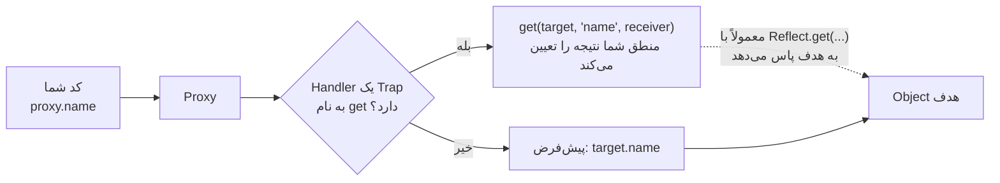

## Metaprogramming یعنی چه؟

کد معمولی **با** Objectها کار می‌کند: Property می‌خواند، متد صدا می‌زند و مقدار می‌دهد. **Metaprogramming** کدی است که **رفتار خود همین عملیات پایه** را تغییر می‌دهد. JavaScript این امکان را در سه سطح می‌دهد:

| سطح | ابزار | چه چیزی را کنترل می‌کند |
| --- | --- | --- |
| یک Property مشخص | Getter/Setter و `Object.defineProperty` | خواندن و نوشتن همان یک کلید |
| تبدیل‌ها و پروتکل‌های داخلی | Symbolهای شناخته‌شده (`Symbol.iterator`، `Symbol.toPrimitive`) | پیمایش، تبدیل به Primitive، `instanceof` |
| **همه** عملیات روی یک Object | **`Proxy`** (به‌همراه `Reflect`) | خواندن، نوشتن، `in`، `delete`، `Object.keys`، صدا زدن تابع، `new` و… برای **هر** کلیدی |

این فصل درباره ردیف آخر است. شاید هر روز به Proxy نیاز نداشته باشید، اما Reactivity در Vue 3 و MobX، به‌روزرسانی‌های Immutable در Immer، لایه‌های اعتبارسنجی، Mockهای API و Spyهای تست همه روی آن ساخته شده‌اند؛ مصاحبه‌کننده‌ها هم دوستش دارند، چون نشان می‌دهد Objectها واقعاً چطور کار می‌کنند.

## Proxy: پوششی که عملیات را رهگیری می‌کند

**Proxy** دور یک Object هدف (**Target**) پیچیده می‌شود. هر عملیاتی روی Proxy اول به یک **Handler** فرستاده می‌شود؛ اگر Handler برای آن عملیات یک **Trap** تعریف کرده باشد، Trap به‌جای رفتار پیش‌فرض اجرا می‌شود.

<Api name="Proxy" sig="new Proxy(target, handler)" returns="یک Proxy که از بیرون شبیه `target` است، اما همه عملیات را از مسیر `handler` عبور می‌دهد." mutates="n/a">

- `target`: Object (یا تابعی) که پوشانده می‌شود. اگر Trapی نباشد، عملیات مستقیم به آن می‌رسد.
- `handler`: Objectی که متدهایش **Trap** هستند: `get`، `set`، `has`، `deleteProperty`، `ownKeys`، `apply`، `construct` و…

</Api>



```js run
const user = { name: "Ali", age: 30 };

const logged = new Proxy(user, {
  get(target, key, receiver) {
    console.log(`GET ${String(key)}`);
    return Reflect.get(target, key, receiver);     // همان کار معمول را انجام بده
  },
  set(target, key, value, receiver) {
    console.log(`SET ${String(key)} = ${value}`);
    return Reflect.set(target, key, value, receiver);
  },
});

logged.name;              // GET name
logged.age = 31;          // SET age = 31
console.log(user.age);    // 31 — تغییر به Object هدف رسید
console.log(logged === user);   // false — Proxy یک Object دیگر است
```

### Trapها

هر Trap متناظر با یکی از عملیات داخلی زبان است:

| Trap | چه چیزی را رهگیری می‌کند | باید برگرداند |
| --- | --- | --- |
| `get(target, key, receiver)` | `proxy.key`، `proxy[key]` | مقدار |
| `set(target, key, value, receiver)` | `proxy.key = value` | در صورت موفقیت `true` (برگرداندن `false` در Strict Mode خطای `TypeError` می‌دهد) |
| `has(target, key)` | `key in proxy` | Boolean |
| `deleteProperty(target, key)` | `delete proxy.key` | Boolean |
| `ownKeys(target)` | `Object.keys`، `for...in`، `Reflect.ownKeys`، Spread | آرایه کلیدها |
| `getOwnPropertyDescriptor(target, key)` | `Object.getOwnPropertyDescriptor` و به‌طور غیرمستقیم `Object.keys` | Descriptor یا `undefined` |
| `defineProperty(target, key, desc)` | `Object.defineProperty` | Boolean |
| `getPrototypeOf` / `setPrototypeOf` | `Object.getPrototypeOf`، `instanceof` | Object / Boolean |
| `apply(target, thisArg, args)` | صدا زدن یک **تابع** پوشانده‌شده | نتیجه فراخوانی |
| `construct(target, args, newTarget)` | `new proxy(...)` | یک Object |

## Reflect: رفتار پیش‌فرض، به شکل تابع

**`Reflect`** یک Object ساده است که به ازای هر Trap یک متد استاتیک **با همان نام و همان آرگومان‌ها** دارد. هر متد عملیات پیش‌فرض را انجام می‌دهد. به همین دلیل طبیعی‌ترین راه برای گفتن «حالا همان کاری را بکن که در حالت عادی انجام می‌شد» داخل یک Trap است.

<Api name="Reflect" sig="Reflect.get(target, key, receiver?) · Reflect.set(target, key, value, receiver?) · Reflect.has(target, key) · Reflect.ownKeys(target) · Reflect.deleteProperty(target, key) · Reflect.apply(fn, thisArg, args) · Reflect.construct(C, args)" returns="نتیجه عملیات پیش‌فرض. متدهایی که چیزی را تغییر می‌دهند، به‌جای پرتاب خطا یک **Boolean** (موفقیت) برمی‌گردانند." mutates="n/a">

- آرگومان‌ها دقیقاً مثل Trap متناظرند؛ پس یک Trap می‌تواند با `Reflect.trap(...arguments)` کار را پاس دهد.

</Api>

```js run
const obj = { a: 1 };
console.log(Reflect.get(obj, "a"));                  // 1 — مثل obj.a
console.log(Reflect.has(obj, "a"));                  // true — مثل "a" in obj
console.log(Reflect.ownKeys({ x: 1, [Symbol("s")]: 2 })); // Symbolها را هم می‌آورد

// Boolean به‌جای Exception:
const frozen = Object.freeze({ x: 1 });
console.log(Reflect.set(frozen, "x", 2));            // false (بدون خطا)
console.log(Reflect.defineProperty(frozen, "y", { value: 1 }));  // false

console.log(Reflect.apply(Math.max, null, [3, 7, 2]));   // 7
```

### چرا `receiver` را پاس می‌دهیم؟

`receiver` همان Objectی است که عملیات از آن شروع شده (معمولاً خود Proxy). این آرگومان وقتی مهم می‌شود که Object هدف **Getter**هایی دارد که از `this` استفاده می‌کنند: اگر با `target[key]` پاس دهید، Getter با `this === target` اجرا می‌شود و خواندن‌های بعدی داخل آن از Proxy عبور نمی‌کنند.

```js run
const target = {
  first: "Ada",
  last: "Lovelace",
  get full() { return `${this.first} ${this.last}`; },
};
const reads = [];

const wrong = new Proxy(target, { get: (t, k) => (reads.push(k), t[k]) });
wrong.full;
console.log("wrong:", reads.splice(0));     // ['full'] — خواندن first و last داخل Getter دیده نشد

const right = new Proxy(target, { get: (t, k, r) => (reads.push(k), Reflect.get(t, k, r)) });
right.full;
console.log("right:", reads);               // ['full', 'first', 'last'] — Getter با this = proxy اجرا شد
```

**قاعده:** داخل Trapها کار را با `Reflect.method(...)` پاس دهید و `receiver` را هم همراهش بفرستید.

## کاربردهای عملی

### ۱. اعتبارسنجی (Validation)

```js run
function withSchema(target, schema) {
  return new Proxy(target, {
    set(t, key, value, receiver) {
      const check = schema[key];
      if (!check) throw new TypeError(`unknown field "${String(key)}"`);
      if (!check(value)) throw new TypeError(`invalid value for "${String(key)}": ${JSON.stringify(value)}`);
      return Reflect.set(t, key, value, receiver);
    },
  });
}

const person = withSchema({}, {
  name: (v) => typeof v === "string" && v.length > 0,
  age: (v) => Number.isInteger(v) && v >= 0 && v < 150,
});

person.name = "Sara";
person.age = 34;
console.log(person);
for (const [k, v] of [["age", -5], ["email", "x@y.z"]]) {
  try { person[k] = v; } catch (e) { console.log(e.message); }
}
```

### ۲. مقدار پیش‌فرض و دسترسی امن

```js run
const withDefault = (obj, fallback) =>
  new Proxy(obj, { get: (t, k, r) => (k in t ? Reflect.get(t, k, r) : fallback) });

const translations = withDefault({ hello: "سلام", bye: "خداحافظ" }, "[missing translation]");
console.log(translations.hello, translations.thanks);

// ایندکس منفی برای آرایه، به سبک Python
const pyArray = (arr) =>
  new Proxy(arr, {
    get(t, k, r) {
      const i = typeof k === "string" && /^-\d+$/.test(k) ? t.length + Number(k) : k;
      return Reflect.get(t, i, r);
    },
  });
const letters = pyArray(["a", "b", "c"]);
console.log(letters[-1], letters[-2], letters.length);
```

### ۳. Reactivity (سازوکار Vue 3)

ایده این است: Trap مربوط به `get` ثبت می‌کند **کدام Effect کدام کلید را خوانده است** (Track) و Trap مربوط به `set` **Effectهایی را که به آن کلید وابسته‌اند** دوباره اجرا می‌کند (Trigger).

```js run
const targetMap = new WeakMap();      // target ← Map(key ← Set(effects))
let activeEffect = null;

function track(target, key) {
  if (!activeEffect) return;
  let deps = targetMap.get(target);
  if (!deps) targetMap.set(target, (deps = new Map()));
  let effects = deps.get(key);
  if (!effects) deps.set(key, (effects = new Set()));
  effects.add(activeEffect);
}

function trigger(target, key) {
  targetMap.get(target)?.get(key)?.forEach((effect) => effect());
}

function reactive(obj) {
  return new Proxy(obj, {
    get(t, k, r) { track(t, k); return Reflect.get(t, k, r); },
    set(t, k, v, r) {
      const changed = !Object.is(t[k], v);
      const ok = Reflect.set(t, k, v, r);
      if (changed) trigger(t, k);
      return ok;
    },
  });
}

function effect(fn) {
  activeEffect = fn;
  fn();                    // اولین اجرا وابستگی‌ها را جمع می‌کند
  activeEffect = null;
}

const state = reactive({ count: 0, name: "cart" });
effect(() => console.log(`render: ${state.name} has ${state.count} items`));

state.count++;             // دوباره Render می‌شود: Effect کلید count را خوانده بود
state.count = 1;           // همان مقدار ← هیچ اتفاقی نمی‌افتد
state.name = "basket";     // دوباره Render می‌شود: Effect کلید name را خوانده بود
state.extra = true;        // کسی extra را نخوانده ← هیچ (اما کلیدهای جدید با Proxy واقعاً کار می‌کنند)
```

با نسخه Getter/Setter در بخش [Getter و Setter](/javascript/objects-prototypes#getter-و-setter-accessor-property) مقایسه کنید: با `defineProperty` کلیدهایی که بعداً اضافه شوند Reactive نیستند. Proxy **همه** کلیدها را می‌بیند، از جمله کلیدهای جدید و حذف‌ها؛ دقیقاً به همین دلیل Vue 3 به Proxy مهاجرت کرد.

### ۴. Proxy روی تابع: Spy و زمان‌سنجی

```js run
function spy(fn) {
  const calls = [];
  const proxy = new Proxy(fn, {
    apply(target, thisArg, args) {
      const result = Reflect.apply(target, thisArg, args);
      calls.push({ args, result });
      return result;
    },
  });
  return { proxy, calls };
}

const { proxy: add, calls } = spy((a, b) => a + b);
add(1, 2);
add(10, 20);
console.log(calls);           // تقریباً همان چیزی که jest.fn() یا vi.fn() ثبت می‌کنند
```

### ۵. نمای فقط‌خواندنی

```js run
function readonly(obj) {
  return new Proxy(obj, {
    get(t, k, r) {
      const value = Reflect.get(t, k, r);
      return value && typeof value === "object" ? readonly(value) : value;   // عمیق، و تنبل
    },
    set(_, k) { console.log(`blocked write to ${String(k)}`); return true; },
    deleteProperty(_, k) { console.log(`blocked delete of ${String(k)}`); return true; },
  });
}

const config = readonly({ api: { url: "/v1" }, retries: 3 });
config.retries = 10;
config.api.url = "/v2";        // برخلاف Object.freeze، Objectهای تودرتو هم محافظت می‌شوند
delete config.retries;
console.log(config.retries, config.api.url);
```

## محدودیت‌ها و دام‌ها

### فیلدهای خصوصی و Internal Slotها

بعضی Objectهای داخلی (`Map`، `Set`، `Date`، `Promise`) و فیلدهای `#private` کلاس‌ها داده را در **Internal Slot**هایی نگه می‌دارند که روی Object اصلی قرار دارند. Proxy یک Object دیگر است؛ پس متدهایی که به این Slotها نیاز دارند، وقتی `this` همان Proxy باشد شکست می‌خورند:

```js run
const map = new Map([["a", 1]]);
const proxied = new Proxy(map, {});
try {
  proxied.get("a");                 // Map.prototype.get با this = proxy صدا زده می‌شود
} catch (e) {
  console.log(e.name + ": " + e.message);
}

// راه‌حل: متدها را به Object هدف واقعی Bind کنید
const fixed = new Proxy(map, {
  get(t, k, r) {
    const value = Reflect.get(t, k, t);       // برای Getterهای وابسته به Slot (مثل size) هدف را Receiver بگذارید
    return typeof value === "function" ? value.bind(t) : value;
  },
});
console.log(fixed.get("a"), fixed.size);
```

### هویت، Performance و Invariantها

| دام | توضیح |
| --- | --- |
| هویت | `proxy !== target`؛ Setی که Object هدف را دارد، Proxy را ندارد |
| Performance | هر عملیات از یک تابع JavaScript عبور می‌کند؛ در حلقه‌های عددی سنگین از Proxy پرهیز کنید |
| Invariantها | Trapها نمی‌توانند درباره ویژگی‌های Non-configurable یا Non-extensible دروغ بگویند (مثلاً گزارش مقدار متفاوت برای یک Property منجمد `TypeError` می‌دهد) |
| Debug | DevTools خود Proxy را نشان می‌دهد و Trapها می‌توانند Log گرفتن را گیج‌کننده کنند (Log گرفتن هم `get` را صدا می‌زند!) |
| `typeof` | قابل رهگیری نیست: Proxy یک تابع همچنان `"function"` و Proxy یک Object همچنان `"object"` است |

### Proxy قابل لغو (Revocable)

```js run
const { proxy, revoke } = Proxy.revocable({ secret: 42 }, {});
console.log(proxy.secret);
revoke();                           // قطع دسترسی؛ مثلاً وقتی Object را به کد نامطمئن داده‌اید
try { proxy.secret; } catch (e) { console.log(e.name + ": " + e.message); }
```

## Proxy در مقابل Getter/Setter در مقابل `Object.defineProperty`

| | Getter/Setter | `defineProperty` برای هر کلید | `Proxy` |
| --- | --- | --- | --- |
| برای کلیدهایی که از قبل معلوم‌اند | ✓ | ✓ | ✓ |
| برای کلیدهای **جدیدی** که بعداً اضافه می‌شوند | ✗ | ✗ | ✓ |
| رهگیری `delete`، `in`، `Object.keys` | ✗ | ✗ | ✓ |
| رهگیری صدا زدن تابع و `new` | ✗ | ✗ | ✓ |
| Object اصلی را تغییر می‌دهد | بله (Accessor روی آن تعریف می‌کند) | بله | خیر (دورش پیچیده می‌شود) |
| سربار | کم | کم | بیشتر (یک Trap برای هر عملیات) |
| چه کسانی استفاده می‌کنند | کلاس‌ها، مقدارهای محاسبه‌شده | Reactivity در Vue 2 | Vue 3، MobX 6، Immer، Spyهای تست |

## اشتباهات رایج

- پاس دادن با `target[key]` به‌جای `Reflect.get(target, key, receiver)` (Getterها و وراثت را خراب می‌کند).
- فراموش کردن برگرداندن `true` از `set` یا `deleteProperty` (در Strict Mode خطای `TypeError` می‌دهد).
- پوشاندن `Map`، `Set`، `Date` یا کلاس‌های دارای فیلد `#private` بدون Bind کردن متدها به Object هدف.
- Log گرفتن از خود Proxy داخل Trap مربوط به `get` (بازگشت بی‌پایان).
- مقایسه Proxy با Object هدف (`===` برابر `false` است).
- استفاده از Proxy در حلقه‌های داخلی حساس به Performance.

## سوالات مصاحبه

<QA q="Proxy چیست و چه تفاوتی با Getter/Setter دارد؟" level="mid" n={1}>
<Answer>

Proxy دور یک Object هدف پیچیده می‌شود و به یک Handler اجازه می‌دهد عملیات پایه را از طریق Trapها رهگیری کند: `get`، `set`، `has`، `deleteProperty`، `ownKeys`، `apply`، `construct` و غیره. Getter/Setter فقط برای کلیدهای مشخص و از قبل معلومی کار می‌کنند که روی خود Object تعریف شده‌اند؛ Proxy عملیات روی **هر** کلیدی (از جمله کلیدهایی که بعداً اضافه می‌شوند) و همچنین `delete`، `in`، فهرست کردن کلیدها و صدا زدن توابع را بدون تغییر Object اصلی رهگیری می‌کند.

</Answer>
<Deep>

به همین دلیل Vue 2 برای کلیدهای جدید به `Vue.set` نیاز داشت (از `defineProperty` استفاده می‌کرد) ولی Vue 3 نیازی ندارد (از Proxy استفاده می‌کند). Proxyها به Invariantها مقیدند (نمی‌توانند درباره Propertyهای Non-configurable گزارش نادرست بدهند) و به ازای هر عملیات سربار دارند.

</Deep>
<Mistake>

فکر کردن به اینکه Proxy از Object کپی می‌گیرد. بدون Trap همه چیز را به همان Object هدف پاس می‌دهد.

</Mistake>
<FollowUp>

چرا Proxy نمی‌تواند `typeof` یا مقایسه با `===` را رهگیری کند؟

</FollowUp>
</QA>

<QA q="چرا Trapها معمولاً متدهای `Reflect` را صدا می‌زنند و آرگومان `receiver` برای چیست؟" level="senior" n={2}>
<Answer>

`Reflect` به ازای هر Trap یک متد با آرگومان‌های یکسان دارد که عملیات پیش‌فرض را انجام می‌دهد؛ پس Trap می‌تواند رفتاری اضافه کند و بعد تمیز کار را پاس دهد. `receiver` همان Objectی است که عملیات از آن شروع شده (معمولاً Proxy)؛ پاس دادنش به `Reflect.get/set` باعث می‌شود Getterها و Setterها با `this === proxy` اجرا شوند تا دسترسی‌های داخلی آن‌ها هم رهگیری شود و وراثت از طریق `Object.create(proxy)` درست کار کند.

</Answer>
<Deep>

متدهای `Reflect` به‌جای پرتاب خطا Boolean برمی‌گردانند (`Reflect.set` روی Object منجمد `false` برمی‌گرداند) که دقیقاً همان چیزی است که Trapهای `set` و `defineProperty` باید برگردانند. قبل از وجود `Reflect`، منطق معادل بین متدهای `Object.*` با رفتارهای ناهماهنگ پخش بود.

</Deep>
<Mistake>

نوشتن `get: (t, k) => t[k]` که بی‌صدا Receiver را از دست می‌دهد.

</Mistake>
<FollowUp>

موردی نشان دهید که `t[k]` و `Reflect.get(t, k, receiver)` نتیجه متفاوت بدهند.

</FollowUp>
</QA>

<QA q="به‌طور خلاصه توضیح دهید یک سیستم Reactivity مبتنی بر Proxy (مثل Vue 3) چطور کار می‌کند." level="senior" n={3}>
<Answer>

State را داخل یک Proxy بپیچید. در Trap مربوط به `get`، اگر Effectی در حال اجراست، آن را به‌عنوان وابسته به `(target, key)` در یک `WeakMap<target, Map<key, Set<effect>>>` ثبت کنید (Track). در Trap مربوط به `set`، اگر مقدار واقعاً تغییر کرده، Effectهای ثبت‌شده برای آن کلید را دوباره اجرا کنید (Trigger). Effectها توابعی مثل Render Function یا مقدارهای Computed هستند که یک بار در ابتدا اجرا می‌شوند تا وابستگی‌هایشان جمع شود.

</Answer>
<Deep>

سیستم‌های واقعی Proxyهای تودرتو را به‌صورت تنبل هنگام `get` می‌سازند، Proxy هر Object را در یک WeakMap Cache می‌کنند (تا هویت ثابت بماند)، Effectهای فعال‌شده را در یک Microtask دسته‌بندی (Batch) می‌کنند، قبل از هر اجرای دوباره وابستگی‌های قدیمی را پاک می‌کنند و آرایه‌ها (`length`، مقداردهی به ایندکس) و Collectionها را جداگانه مدیریت می‌کنند (Map و Set به دلیل Internal Slot به Handlerهای خاص نیاز دارند).

</Deep>
<Mistake>

اجرای دوباره همه Effectها با هر تغییر، به‌جای فقط Effectهایی که کلید تغییرکرده را خوانده‌اند.

</Mistake>
<FollowUp>

چرا Vue برای `targetMap` از WeakMap استفاده می‌کند و نه Map؟

</FollowUp>
</QA>

<QA q="چرا `new Proxy(new Map(), {}).get('a')` خطا می‌دهد؟" level="senior" n={4}>
<Answer>

`Map.prototype.get` ورودی‌ها را از یک **Internal Slot** (`[[MapData]]`) روی `this` می‌خواند. از طریق Proxy، `this` خود Proxy است که این Slot را ندارد؛ پس خطای `TypeError: Method Map.prototype.get called on incompatible receiver` رخ می‌دهد. راه‌حل: در Trap مربوط به `get` متدها را به Object هدف Bind کنید.

</Answer>
<Deep>

همین موضوع برای `Date`، `Set`، `Promise`، Typed Arrayها و فیلدهای `#private` کلاس‌ها هم صدق می‌کند. کتابخانه‌هایی مثل Vue «Collection Handler»های مخصوصی دارند که `get`، `set`، `has`، `size` و غیره را رهگیری می‌کنند و متدهای اصلی را روی Object خام صدا می‌زنند.

</Deep>
<Mistake>

فرض اینکه هر Objectی را می‌شود بی‌دردسر با Proxy پوشاند.

</Mistake>
<FollowUp>

چطور `size` را هم درست کار می‌دهید؟ (یک Getter است که به Object هدف به‌عنوان Receiver نیاز دارد.)

</FollowUp>
</QA>

## جمع‌بندی

<Recap>

- Proxy یک پوشش دور یک Object است که عملیات‌هایی مثل خواندن، نوشتن، حذف و `in` را با Trapها رهگیری می‌کند.
- هر Trap مثل `get`، `set`، `has`، `deleteProperty`، `apply` و `construct` یک عملیات داخلی زبان را پوشش می‌دهد.
- `Reflect` همان رفتار پیش‌فرض هر عملیات را به شکل تابع می‌دهد؛ داخل Trap با `Reflect.get(target, key, receiver)` رفتار عادی را حفظ کنید.
- Trap `set` باید `true` برگرداند؛ وگرنه در Strict Mode خطای `TypeError` پرتاب می‌شود.
- کاربردها: Validation، مقدار پیش‌فرض، Logging، Reactivity (Vue 3)، و API پویا.
- Proxy روی فیلدهای `#private` و Internal Slotها (مثل Map و Date) مستقیم کار نمی‌کند و `===` با Object اصلی برابر نیست.
- Proxy هزینه Performance دارد؛ برای یک Property مشخص Getter/Setter ساده‌تر است.

</Recap>
