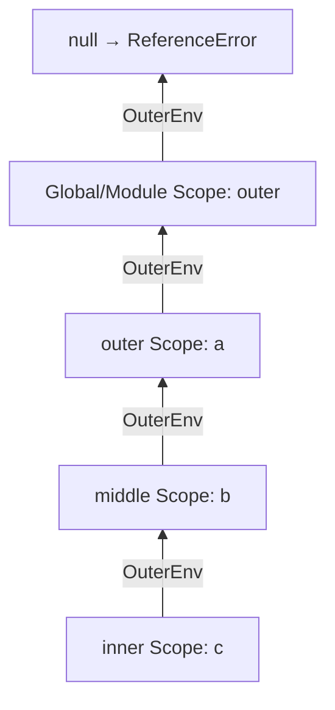
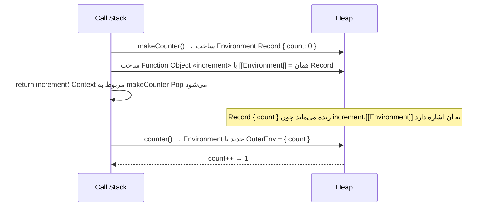

## Scope چیست؟

`Scope (حوزه دید)` مجموعه قوانینی است که تعیین می‌کند **یک Identifier در کدام بخش از کد قابل دسترسی است**. در سطح Engine، Scope همان Lexical Environment است (فصل [Execution Context](/javascript/execution-context)).

### انواع Scope

| Scope | ایجاد توسط | شامل |
| --- | --- | --- |
| **Global Scope** | سطح بالای Script | var و functionهای سطح بالا (روی globalThis) و let/const سراسری |
| **Module Scope** | هر ES Module | همه Declarationهای سطح بالای Module — خصوصی، مگر Export شوند |
| **Function Scope** | هر تابع | پارامترها، var، و هر Declaration داخل بدنه |
| **Block Scope** | `{ }`، `if`، `for`، `try/catch` | `let`، `const`، `class` (و function در Strict) |

```js run
const moduleLevel = "module";        // Module Scope (اینجا Worker Module است)

function fn(param) {                 // Function Scope: param
  var functionLevel = "function";
  if (true) {
    let blockLevel = "block";        // Block Scope
    console.log(moduleLevel, functionLevel, blockLevel, param);
  }
  // blockLevel اینجا قابل دسترسی نیست
}
fn("param");
```

## Lexical Scope در مقابل Dynamic Scope

JavaScript **Lexical (Static) Scope** دارد: دسترسی یک تابع به متغیرها بر اساس **محل تعریف** آن در کد مشخص می‌شود — قبل از اجرا و فقط با نگاه به متن کد.

در **Dynamic Scope** (مثل Bash یا Emacs Lisp قدیمی) دسترسی بر اساس **زنجیره فراخوانی** در Runtime تعیین می‌شود.

```js run
const value = "global";

function printValue() {
  console.log(value);
}

function caller() {
  const value = "caller";
  printValue();
}

caller();
// Lexical Scope (JavaScript): "global" — printValue در Global تعریف شده
// Dynamic Scope (فرضی):       "caller" — printValue از caller صدا زده شده
```

<Callout type="interview">
تنها چیزی در JavaScript که شبیه Dynamic Scope رفتار می‌کند **`this`** است: مقدار آن به نحوه فراخوانی بستگی دارد، نه محل تعریف. به همین دلیل گفته می‌شود «Scope لکسیکال است، this داینامیک».
</Callout>

## Scope Chain

وقتی یک Identifier خوانده می‌شود، Engine از Scope فعلی شروع و از طریق `[[OuterEnv]]` به بیرون حرکت می‌کند تا آن را پیدا کند:



```js run
const a = 1;
function outer() {
  const b = 2;
  function middle() {
    const c = 3;
    function inner() {
      console.log(a + b + c);   // c: inner✗ → middle✓ | b: … → outer✓ | a: … → global✓
    }
    inner();
  }
  middle();
}
outer();
```

- جستجو **فقط به سمت بیرون** است؛ Scope بیرونی هرگز به متغیرهای Scope داخلی دسترسی ندارد.
- اولین Binding پیدا شده برنده است (**Shadowing**).
- Engineها Resolution را در زمان Compile تا حد امکان پیش‌محاسبه می‌کنند (چون Scope ایستاست)؛ برای همین Lookup در عمل ارزان است — مگر `eval` یا `with` در کار باشد.

### Shadowing

```js
const theme = "light";
function render() {
  const theme = "dark";     // theme بیرونی را Shadow می‌کند
  console.log(theme);       // "dark"
}
```

Shadowing مجاز است ولی می‌تواند گیج‌کننده باشد (ESLint: `no-shadow`). **Illegal Shadowing:** `let` بیرونی را نمی‌توان با `var` در Block داخلی Shadow کرد، چون var به Function Scope Hoist می‌شود و با let تداخل دارد:

```js
let x = 1;
{
  var x = 2;   // ✗ SyntaxError: Identifier 'x' has already been declared
}
```

## Closure چیست؟

`Closure (بسته)` ترکیب یک **تابع** با **Lexical Environment محل ایجاد آن** است. به زبان ساده: تابعی که به متغیرهای Scope بیرونی‌اش دسترسی دارد، **حتی بعد از اینکه آن Scope اجرایش تمام شده باشد**.

```js run
function makeCounter() {
  let count = 0;                 // متغیر محلی makeCounter
  return function increment() {
    count += 1;                  // دسترسی به count بعد از return شدن makeCounter
    return count;
  };
}

const counter = makeCounter();   // makeCounter تمام شد و Context آن از Stack خارج شد
console.log(counter());          // 1
console.log(counter());          // 2

const another = makeCounter();   // Environment کاملاً جدید
console.log(another());          // 1
console.log(counter());          // 3
```

### Closure در Runtime چطور ساخته می‌شود؟



1. هر **Function Object** هنگام ساخته شدن، یک Slot داخلی به نام **`[[Environment]]`** می‌گیرد که به **Lexical Environment جاری** اشاره می‌کند.
2. وقتی `makeCounter` تمام می‌شود، **Execution Context** آن از Call Stack حذف می‌شود، اما **Environment Record** آن (که در Heap است) حذف نمی‌شود، چون `increment.[[Environment]]` هنوز به آن ارجاع دارد.
3. هر بار `counter()` صدا زده می‌شود، یک Environment جدید ساخته می‌شود که `[[OuterEnv]]` آن همان Environment قدیمی `makeCounter` است.
4. Garbage Collector تا زمانی که `counter` قابل دسترسی باشد، Environment را نگه می‌دارد.

**نکته کلیدی:** Closure **Binding** (رابطه زنده با متغیر) را نگه می‌دارد، **نه کپی مقدار** را. اگر متغیر بعداً تغییر کند، Closure مقدار جدید را می‌بیند.

```js run
let message = "first";
const show = () => console.log(message);
message = "second";
show();   // "second" — نه "first"
```

### چرا Closure وجود دارد؟

Closure نتیجه طبیعی دو ویژگی است: **Functionها First-class هستند** (می‌توان آن‌ها را return کرد و پاس داد) و **Scope لکسیکال است**. اگر تابعی که بیرون Scope خودش اجرا می‌شود به متغیرهای محل تعریفش دسترسی نداشت، Lexical Scope معنایی نداشت. در واقع **همه توابع JavaScript Closure هستند**؛ اصطلاح Closure معمولاً وقتی به کار می‌رود که تابع بیرون از Scope تعریفش استفاده شود.

## کاربردهای عملی Closure

### ۱. State خصوصی (Encapsulation)

```js run
function createBankAccount(initial) {
  let balance = initial;                     // از بیرون قابل دسترسی نیست
  const history = [];

  return {
    deposit(amount) {
      if (amount <= 0) throw new RangeError("amount must be positive");
      balance += amount;
      history.push({ type: "deposit", amount });
      return balance;
    },
    withdraw(amount) {
      if (amount > balance) throw new Error("insufficient funds");
      balance -= amount;
      history.push({ type: "withdraw", amount });
      return balance;
    },
    get balance() { return balance; },
    get history() { return [...history]; },  // کپی، تا state از بیرون تغییر نکند
  };
}

const account = createBankAccount(100);
account.deposit(50);
account.withdraw(30);
console.log(account.balance, account.history.length);
console.log(account.balanceValue, "← هیچ راهی برای دسترسی مستقیم به balance نیست");
```

قبل از `#private` در Classها، این الگو تنها راه Privacy واقعی بود (Module Pattern).

### ۲. Factory Function و Function Configuration

```js run
function createFormatter(locale, currency) {
  const formatter = new Intl.NumberFormat(locale, { style: "currency", currency });
  return (amount) => formatter.format(amount);   // formatter یک بار ساخته می‌شود
}

const toman = createFormatter("fa-IR", "IRR");
const dollars = createFormatter("en-US", "USD");
console.log(toman(1250000));
console.log(dollars(42.5));
```

### ۳. Memoization

```js run
function memoize(fn) {
  const cache = new Map();                       // در Closure باقی می‌ماند
  return function (...args) {
    const key = JSON.stringify(args);
    if (cache.has(key)) return cache.get(key);
    const result = fn.apply(this, args);
    cache.set(key, result);
    return result;
  };
}

let calls = 0;
const slowSquare = (n) => { calls++; return n * n; };
const fastSquare = memoize(slowSquare);
fastSquare(9); fastSquare(9); fastSquare(9);
console.log("result:", fastSquare(9), "real calls:", calls);
```

### ۴. Debounce / Throttle

```js run
function debounce(fn, delay) {
  let timerId;                                   // State مشترک بین همه فراخوانی‌ها
  return function (...args) {
    clearTimeout(timerId);
    timerId = setTimeout(() => fn.apply(this, args), delay);
  };
}

const search = debounce((q) => console.log("searching:", q), 100);
search("r"); search("re"); search("rea"); search("react");  // فقط آخری اجرا می‌شود
```

### ۵. Event Handlerها

```js
function setupTabs(buttons) {
  buttons.forEach((button, index) => {
    button.addEventListener("click", () => {
      activate(index);          // هر Handler، index مخصوص خودش را دارد
    });
  });
}
```

### ۶. Partial Application و Currying

```js run
const multiply = (a) => (b) => a * b;   // هر Arrow یک Closure روی پارامتر قبلی
const double = multiply(2);
const triple = multiply(3);
console.log(double(5), triple(5));
```

### ۷. Once

```js run
function once(fn) {
  let called = false;
  let result;
  return (...args) => {
    if (!called) {
      called = true;
      result = fn(...args);
    }
    return result;
  };
}
const init = once(() => { console.log("initializing…"); return 42; });
console.log(init(), init(), init());
```

## Closure و حافظه

### Closure کل Scope را نگه می‌دارد؟

از نظر مشخصات، Closure کل Environment را نگه می‌دارد. در عمل، **V8 بهینه‌سازی می‌کند**: فقط متغیرهایی که توسط **حداقل یکی** از توابع داخلی استفاده می‌شوند در یک Context Object در Heap قرار می‌گیرند؛ بقیه روی Stack می‌مانند و پس از return آزاد می‌شوند.

**تله:** همه Closureهای ساخته‌شده در یک Scope، **یک Context مشترک** دارند:

```js
function attach() {
  const hugeData = new Array(1_000_000).fill("x");   // ~8MB
  const small = 1;

  const logSize = () => console.log(hugeData.length); // از hugeData استفاده می‌کند
  return () => small;                                  // فقط small را لازم دارد
  // اما چون logSize از hugeData استفاده کرده، hugeData در Context مشترک است
  // و تابع return‌شده آن را زنده نگه می‌دارد → Memory Leak
}
```

### نشت حافظه رایج با Closure

```js
// Event Listener که هیچ‌وقت حذف نمی‌شود: Closure کل Component را زنده نگه می‌دارد
function mountWidget(element, bigState) {
  const onResize = () => element.style.width = bigState.width + "px";
  window.addEventListener("resize", onResize);
  return () => window.removeEventListener("resize", onResize); // ✓ Cleanup
}
```

| منبع نشت | راه‌حل |
| --- | --- |
| Event Listener روی window/document | `removeEventListener` یا `AbortController.signal` |
| `setInterval` فراموش‌شده | `clearInterval` در Cleanup |
| Cache نامحدود در Closure | محدود کردن اندازه (LRU) یا `WeakMap` |
| ارجاع به DOM حذف‌شده | Null کردن ارجاع، `WeakRef` |

جزئیات در فصل [Garbage Collection](/javascript/memory-gc).

## Closure و React

Hookهای React کاملاً بر پایه Closure کار می‌کنند. **هر Render یک فراخوانی جدید تابع Component است** و هر Handler و Effect، Closure روی Props و State **همان Render** است.

### Stale Closure

```jsx
function Timer() {
  const [count, setCount] = useState(0);

  useEffect(() => {
    const id = setInterval(() => {
      setCount(count + 1);   // ✗ count همیشه 0 است — Closure روی Render اول
    }, 1000);
    return () => clearInterval(id);
  }, []);                    // Effect فقط یک بار اجرا شد

  return <p>{count}</p>;     // 1 و همان‌جا می‌ماند
}
```

راه‌حل‌ها:

```jsx
// ۱. Functional Update: به Closure روی count نیاز ندارد
setCount((c) => c + 1);

// ۲. افزودن count به Dependencyها (Interval در هر تغییر دوباره ساخته می‌شود)
useEffect(() => { /* ... */ }, [count]);

// ۳. useRef برای آخرین مقدار (مثلاً در Callbackهای طولانی‌مدت)
const countRef = useRef(count);
countRef.current = count;
```

شبیه‌سازی همین مشکل بدون React:

```js run
function createComponent() {
  let renders = [];
  function render(count) {
    // هر render یک Closure جدید روی count همان render می‌سازد
    const handleClick = () => console.log("clicked with count =", count);
    renders.push(handleClick);
  }
  return { render, renders };
}

const component = createComponent();
component.render(0);
component.render(1);
component.render(2);

const staleHandler = component.renders[0];   // مثل Effect با [] که Handler اول را نگه داشته
staleHandler();                               // count = 0 ← Stale
component.renders.at(-1)();                   // count = 2 ← آخرین Render
```

جزئیات در فصل [Effectها در React](/react/effects).

## Closure در حلقه — دوباره

```js predict
const fns = [];
for (var i = 0; i < 3; i++) {
  fns.push(() => i);
}
console.log(fns.map((f) => f()));
```

```output
[3, 3, 3]
```

هر سه Closure به **یک Binding** `i` (Function/Module Scope) اشاره دارند. با `let`، هر Iteration Binding جدید دارد و نتیجه `[0, 1, 2]` می‌شود.

## اشتباهات رایج

- فکر کردن اینکه Closure **کپی مقدار** را نگه می‌دارد.
- Stale Closure در React Effectها و Callbackهای Async.
- ساختن Closure در حلقه‌هایی که میلیون‌ها بار اجرا می‌شوند (هر Closure یک Object جدید در Heap است).
- نگه داشتن ارجاع به داده‌های بزرگ در Closureهای طولانی‌مدت.
- فرض اینکه تابع به متغیرهای **محل فراخوانی** دسترسی دارد.

## سوالات مصاحبه

<QA q="Closure چیست؟ با یک مثال واقعی توضیح دهید." level="junior" n={1}>
<Answer>

Closure ترکیب یک تابع با Lexical Environment محل ایجاد آن است؛ تابع به متغیرهای Scope بیرونی دسترسی دارد حتی بعد از اینکه آن Scope اجرایش تمام شده. مثال واقعی: `debounce` که `timerId` را بین فراخوانی‌ها نگه می‌دارد، یا `createCounter` که `count` خصوصی دارد.

</Answer>
<Deep>

هر Function Object یک `[[Environment]]` دارد که هنگام ساخت به Environment جاری اشاره می‌کند. وقتی تابع بیرونی return می‌کند، Execution Context آن از Stack حذف می‌شود ولی Environment Record در Heap باقی می‌ماند چون هنوز ارجاع دارد. هر فراخوانی تابع داخلی Environment جدیدی می‌سازد که Outer آن همان Record است.

</Deep>
<Mistake>

گفتن اینکه «Closure تابعی داخل تابع دیگر است». تعریف تودرتو کافی نیست؛ مهم دسترسی به Environment بیرونی است و از نظر فنی همه توابع JavaScript Closure هستند.

</Mistake>
<FollowUp>

Closure کپی مقدار را نگه می‌دارد یا ارجاع به Binding را؟ چطور ثابت می‌کنید؟

</FollowUp>
</QA>

<QA q="Lexical Scope چیست و چه تفاوتی با Dynamic Scope دارد؟" level="mid" n={2}>
<Answer>

در Lexical Scope، Scope یک تابع بر اساس محل نوشته شدن آن در کد تعیین می‌شود و قبل از اجرا معلوم است. در Dynamic Scope بر اساس زنجیره فراخوانی در Runtime تعیین می‌شود. JavaScript لکسیکال است؛ فقط `this` رفتار شبه‌داینامیک دارد.

</Answer>
<Deep>

Lexical Scope اجازه می‌دهد Engine نام‌ها را در زمان Compile Resolve کند (مثلاً تبدیل به دسترسی با Index در Context) و ابزارهایی مثل Bundler و Minifier بتوانند نام‌ها را با اطمینان تغییر دهند (Mangling). `eval` و `with` این تضمین را می‌شکنند.

</Deep>
<Mistake>

نسبت دادن رفتار `this` به Scope.

</Mistake>
<FollowUp>

چرا Minifier نمی‌تواند نام متغیرها را در تابعی که direct eval دارد کوتاه کند؟

</FollowUp>
</QA>

<QA q="Stale Closure در React چیست و چطور رفع می‌شود؟" level="senior" n={3}>
<Answer>

هر Render یک فراخوانی جدید Component است و Handlerها و Effectها روی State همان Render Closure دارند. اگر یک Callback طولانی‌مدت (Interval، Subscription، Effect با Dependency ناقص) از Render قدیمی نگه داشته شود، مقادیر قدیمی را می‌بیند. راه‌حل: Functional Update (`setX(x => x + 1)`)، Dependency Array کامل، `useRef` برای آخرین مقدار، یا `useEffectEvent` (React 19.2+).

</Answer>
<Deep>

این باگ ذاتی مدل «UI = f(state)» نیست بلکه نتیجه ترکیب Closure با Callbackهایی است که عمرشان از Render طولانی‌تر است. قانون `react-hooks/exhaustive-deps` آن را تشخیص می‌دهد. `useEffectEvent` یک تابع پایدار می‌سازد که همیشه آخرین Props/State را می‌خواند، بدون اینکه Effect را دوباره اجرا کند.

</Deep>
<Mistake>

غیرفعال کردن قانون ESLint یا خالی گذاشتن Dependency Array برای «جلوگیری از اجرای دوباره» Effect.

</Mistake>
<FollowUp>

چرا `useCallback` بدون Dependency صحیح می‌تواند Stale Closure ایجاد کند؟

</FollowUp>
</QA>

<QA q="آیا Closure می‌تواند باعث Memory Leak شود؟ مثال بزنید." level="senior" n={4}>
<Answer>

بله. Closure Environment بیرونی را زنده نگه می‌دارد؛ اگر Closure طولانی‌مدت باشد (Listener ثبت‌شده روی window، Interval، Cache سراسری) و آن Environment داده بزرگ یا DOM حذف‌شده را ارجاع دهد، GC نمی‌تواند آن را آزاد کند. همچنین در V8 همه Closureهای یک Scope Context مشترک دارند، پس یک Closure کوچک ممکن است داده‌ای را که فقط Closure دیگر استفاده می‌کرد زنده نگه دارد.

</Answer>
<Deep>

برای Debug: Heap Snapshot در DevTools، مقایسه دو Snapshot و بررسی «Retainers» یک Object؛ Contextهای Closure با نام `(closure)` و `system / Context` دیده می‌شوند. پیشگیری: Cleanup در `useEffect`، استفاده از `AbortController` برای Listenerها، `WeakMap` برای Cache متصل به Object.

</Deep>
<Mistake>

گفتن اینکه Closureها ذاتاً «کند» یا «نشت‌دهنده» هستند؛ مشکل فقط در Closureهای طولانی‌مدت با ارجاعات غیرضروری است.

</Mistake>
<FollowUp>

Detached DOM Node چیست و چطور در Heap Snapshot پیدا می‌شود؟

</FollowUp>
</QA>

## جمع‌بندی

<Recap>

- Scope تعیین می‌کند یک متغیر کجا دیده می‌شود: Global، Module، Function و Block.
- JavaScript از Lexical Scope استفاده می‌کند: جای نوشته شدن کد، نه جای اجرا، Scope را تعیین می‌کند.
- موتور برای پیدا کردن یک نام، از Scope فعلی به بیرون در Scope Chain بالا می‌رود؛ متغیر داخلی هم‌نام، بیرونی را Shadow می‌کند.
- Closure یعنی تابع به‌علاوه محیطی که در آن ساخته شده؛ تابع متغیرهای بیرونی را حتی بعد از تمام شدن تابع بیرونی به یاد دارد.
- Closure به **خود متغیر** دسترسی دارد، نه به کپی مقدارش؛ تغییرات بعدی دیده می‌شوند.
- کاربردها: State خصوصی، Factory، Memoization، Debounce/Throttle، Currying و `once`.
- Closure می‌تواند حافظه را زنده نگه دارد؛ Listener یا تایمری که پاک نشود رایج‌ترین نشت است.
- در React، Stale Closure یعنی Callbackی که مقدار قدیمی State را دیده؛ راه حل آرایه وابستگی درست، Updater Function یا `useRef` است.

</Recap>
