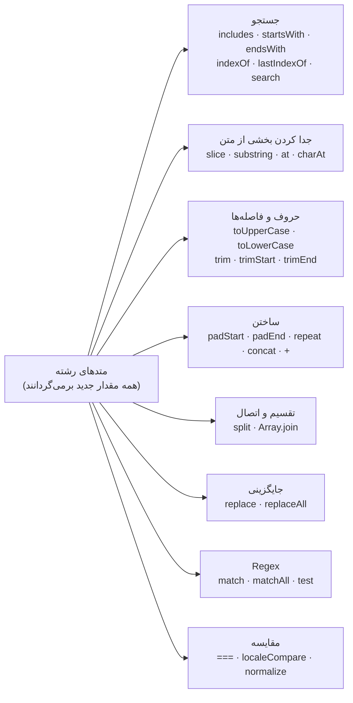

## رشته (String) چیست؟

**رشته (String)** یعنی یک تکه متن: دنباله‌ای از کاراکترها مثل `"hello"`، `"سلام"` یا `"👍"`. رشته یکی از نوع‌های **Primitive** در JavaScript است و دو واقعیت درباره آن، تقریباً همه رفتارهای عجیبی را که می‌بینید توضیح می‌دهد:

1. **رشته‌ها تغییرناپذیرند (Immutable).** هیچ متدی یک رشته را تغییر نمی‌دهد؛ همه متدها یک رشته **جدید** برمی‌گردانند.
2. **رشته دنباله‌ای از «Code Unit»های UTF-16 است، نه دنباله‌ای از «کاراکترها».** بیشتر حروف یک Code Unit هستند، اما Emoji و خیلی از نمادها دو Code Unit می‌گیرند؛ برای همین `length` همیشه با چیزی که انسان می‌بیند یکی نیست.

```text
  "Hi!"   →   index:  0     1     2
                    ┌─────┬─────┬─────┐
                    │ "H" │ "i" │ "!" │      "Hi!".length === 3
                    └─────┴─────┴─────┘
```

## ساختن رشته

```js run
const single = 'single quotes';
const double = "double quotes";            // دقیقاً مثل کوتیشن تکی
const name = "Sara";
const template = `Hello, ${name}! 2 + 3 = ${2 + 3}`;   // Template Literal: جایگذاری مقدار
const multiLine = `line 1
line 2`;                                    // شکستن خط واقعی، بدون نیاز به \n

console.log(template);
console.log(multiLine);
console.log("It's \"quoted\"\tand\\escaped");   // Escapeها: \" \' \\ \n \t \u{1F600}
console.log(String(42), String(null), String([1, 2]), `${{}}`);  // تبدیل به رشته
```

| Syntax | جایگذاری `${}` | چندخطی | کاربرد رایج |
| --- | --- | --- | --- |
| `'…'` / `"…"` | ✗ | ✗ (نیاز به `\n`) | متن ثابت |
| `` `…` `` | ✓ | ✓ | متنی که از مقدارها ساخته می‌شود؛ تکه‌های HTML، SQL یا CSS |

## دسترسی به کاراکترها

```js run
const word = "JavaScript";

console.log(word[0]);            // "J"
console.log(word.at(-1));        // "t" — at ایندکس منفی هم می‌پذیرد
console.log(word.charAt(4));     // "S"
console.log(word[99], word.charAt(99));  // undefined "" — رفتار بیرون از محدوده فرق دارد!
console.log(word.length);        // 10
console.log(word.charCodeAt(0)); // 74 — همان Code Unit در UTF-16 به‌صورت عدد
```

### رشته‌ها تغییرناپذیرند

```js run
"use strict";
let greeting = "hello";
try {
  greeting[0] = "H";             // Strict Mode: خطای TypeError (در Sloppy Mode بی‌صدا نادیده گرفته می‌شود)
} catch (e) {
  console.log(e.name + ": " + e.message);
}
console.log(greeting);           // "hello" — تغییری نکرد

greeting = "H" + greeting.slice(1);   // یک رشته جدید می‌سازیم و دوباره به متغیر می‌دهیم
console.log(greeting);           // "Hello"
```

**متغیر** `greeting` می‌تواند به رشته‌ای جدید اشاره کند؛ اما **خود مقدار رشته** هیچ‌وقت عوض نمی‌شود. به همین دلیل نوشتن `str.toUpperCase()` به‌تنهایی فایده‌ای ندارد؛ باید از مقدار بازگشتی‌اش استفاده کنید.

## نقشه متدها



## جستجو در رشته

| سؤال | متد | خروجی |
| --- | --- | --- |
| آیا شامل … هست؟ | `includes(sub, from?)` | `true` / `false` |
| آیا با … شروع/تمام می‌شود؟ | `startsWith(sub, pos?)` / `endsWith(sub, len?)` | `true` / `false` |
| اولین/آخرین بار کجا آمده؟ | `indexOf(sub, from?)` / `lastIndexOf(sub)` | ایندکس یا `-1` |
| یک **الگو (Pattern)** اولین بار کجا پیدا می‌شود؟ | `search(regex)` | ایندکس یا `-1` |

```js run
const url = "https://example.com/blog/post-42?ref=home";

console.log(url.includes("blog"));                 // true
console.log(url.startsWith("https://"));           // true
console.log(url.endsWith("home"));                 // true
console.log(url.indexOf("/"), url.lastIndexOf("/")); // 6 24
console.log(url.indexOf("missing"));               // -1
console.log(url.search(/\d+/));                    // 30 — ایندکس اولین رقم

// همه این متدها به بزرگی و کوچکی حروف حساس‌اند:
console.log("Hello".includes("hello"), "Hello".toLowerCase().includes("hello")); // false true
```

<Callout type="mistake">
`if (str.indexOf("x"))` یک باگ کلاسیک است: وقتی عبارت درست در ابتدای رشته باشد `indexOf` مقدار `0` برمی‌گرداند و `0` در شرط Falsy است. برای سؤال‌های بله/خیر از `includes` استفاده کنید.
</Callout>

## جدا کردن بخشی از رشته

<Api name="String.prototype.slice()" sig="str.slice(start, end?)" returns="یک رشته **جدید** از `start` تا قبل از `end`." mutates="no">

- `start`: ایندکس شروع. عدد منفی از انتها می‌شمارد.
- `end` (اختیاری، پیش‌فرض `length`): ایندکسی که قبل از آن متوقف می‌شود. عدد منفی از انتها می‌شمارد.

</Api>

```js run
const s = "frontend";
console.log(s.slice(0, 5));     // "front"
console.log(s.slice(5));        // "end"
console.log(s.slice(-3));       // "end"  — سه کاراکتر آخر
console.log(s.slice(-3, -1));   // "en"
console.log(s.slice(4, 2));     // ""     — شروع بعد از پایان ← رشته خالی

console.log(s.substring(4, 2)); // "on"   — substring جای آرگومان‌ها را عوض می‌کند
console.log(s.substring(-3));   // "frontend" — عدد منفی صفر حساب می‌شود
```

| | `slice(a, b)` | `substring(a, b)` | `substr(start, length)` |
| --- | --- | --- | --- |
| ایندکس منفی | از انتها می‌شمارد | صفر حساب می‌شود | `start` می‌تواند منفی باشد |
| وقتی `a > b` | رشته خالی | جای `a` و `b` را **عوض می‌کند** | — |
| آرگومان دوم | ایندکس پایان | ایندکس پایان | **طول** |
| وضعیت | ✓ همین را به کار ببرید | قابل قبول | ✗ قدیمی؛ استفاده نکنید |

## حروف بزرگ و کوچک و فاصله‌ها

```js run
const input = "   Ali.Rezaei@Example.COM \n";

const email = input.trim().toLowerCase();       // جفت کلاسیک برای یکدست کردن ورودی
console.log(JSON.stringify(email));             // "ali.rezaei@example.com"

console.log(JSON.stringify("  x  ".trimStart()), JSON.stringify("  x  ".trimEnd()));
console.log("istanbul".toLocaleUpperCase("tr-TR"));   // "İSTANBUL" — حروف بزرگ وابسته به زبان
```

`trim` فاصله، Tab، شکستن خط و دیگر فاصله‌های Unicode (از جمله فاصله نشکن) را از دو سر رشته حذف می‌کند؛ هرگز از وسط آن.

## ساختن رشته: پر کردن، تکرار، اتصال

```js run
console.log("7".padStart(3, "0"));        // "007"  — صفر گذاشتن جلوی عدد
console.log("5".padEnd(4, "."));          // "5..."
console.log("ab".repeat(3));              // "ababab"
console.log("-".repeat(20));              // یک خط جداکننده

const card = "4111111111111234";
console.log(card.slice(-4).padStart(card.length, "•"));   // پنهان کردن همه رقم‌ها جز چهار رقم آخر

const time = (h, m) => `${String(h).padStart(2, "0")}:${String(m).padStart(2, "0")}`;
console.log(time(9, 5));                  // "09:05"
```

برای وصل کردن تکه‌ها، `+` و Template Literal در موتورهای امروزی هم کافی‌اند و هم سریع. برای ساختن رشته در حلقه هم می‌توانید تکه‌ها را در آرایه `push` کنید و در پایان `join("")` بزنید؛ این روش همان‌قدر خوب و اغلب خواناتر است.

## متد split: تبدیل رشته به آرایه

<Api name="String.prototype.split()" sig="str.split(separator?, limit?)" returns="یک **آرایه جدید** از تکه‌های رشته. رشته اصلی تغییر نمی‌کند." mutates="no">

- `separator` (اختیاری): رشته یا Regular Expressionی که محل برش را مشخص می‌کند. اگر ندهید، آرایه‌ای با کل رشته برمی‌گردد. `""` یعنی تقسیم به Code Unitهای UTF-16.
- `limit` (اختیاری): حداکثر تعداد تکه‌هایی که برگردانده می‌شود.

</Api>

```js run
console.log("2026-10-06".split("-"));              // ['2026', '10', '06']
console.log("2026-10-06".split("-").map(Number));  // [2026, 10, 6]
console.log("a, b,c ,  d".split(/\s*,\s*/));       // ['a', 'b', 'c', 'd'] — جداکننده Regex
console.log("one two three".split(" ", 2));        // ['one', 'two'] — با limit
console.log("abc".split(""));                      // ['a', 'b', 'c']
console.log("abc".split());                        // ['abc']
console.log("".split(","));                        // [''] — آرایه خالی نیست!

// رفت و برگشت: split، متدهای آرایه و join
const title = "learn javascript the deep way";
console.log(title.split(" ").map((w) => w[0].toUpperCase() + w.slice(1)).join(" "));
```

## متدهای replace و replaceAll

<Api name="String.prototype.replace() / replaceAll()" sig="str.replace(pattern, replacement) · str.replaceAll(pattern, replacement)" returns="یک رشته **جدید** که مورد(های) پیدا شده در آن جایگزین شده‌اند." mutates="no">

- `pattern`: یک رشته یا Regular Expression.
  - `replace` با الگوی **رشته‌ای** فقط **اولین** مورد را جایگزین می‌کند.
  - `replace` با Regex اولین مورد را جایگزین می‌کند؛ با پرچم `g` **همه** موارد را.
  - `replaceAll` **همه** موارد را جایگزین می‌کند (اگر Regex بدهید، باید پرچم `g` داشته باشد).
- `replacement`: یک رشته (که می‌تواند از `$1`، `$2` و… برای گروه‌های Regex و `$&` برای کل مورد پیدا شده استفاده کند) **یا یک تابع** به شکل `(match, ...groups, offset, string) => newText`.

</Api>

```js run
const text = "cat, cat, cat";
console.log(text.replace("cat", "dog"));     // "dog, cat, cat" — فقط اولی
console.log(text.replaceAll("cat", "dog"));  // "dog, dog, dog"
console.log(text.replace(/cat/g, "dog"));    // "dog, dog, dog"

// استفاده از گروه‌های Regex در جایگزین: جابه‌جا کردن اجزای تاریخ
console.log("2026-10-06".replace(/(\d+)-(\d+)-(\d+)/, "$3/$2/$1"));   // "06/10/2026"

// تابع جایگزین: پر کردن یک قالب
const template = "Hi {name}, you have {count} new messages";
const data = { name: "Sara", count: 3 };
console.log(template.replace(/\{(\w+)\}/g, (match, key) => data[key] ?? match));

// ساختن Slug از یک عنوان
const slug = "  Hello, World! JS & CSS  ".trim().toLowerCase().replace(/[^a-z0-9]+/g, "-").replace(/^-|-$/g, "");
console.log(slug);   // "hello-world-js-css"
```

## Regular Expression در کنار رشته‌ها (خلاصه)

```js run
const log = "error 404 at 10:32, error 500 at 11:05";

console.log(/error/.test(log));                       // true — مطابقت دارد؟
console.log(log.match(/\d{3}/));                      // اولین مورد همراه با جزئیات
console.log(log.match(/\d{3}/g));                     // ['404', '500'] — همه موارد با g
for (const m of log.matchAll(/error (\d+) at (\d+:\d+)/g)) {
  console.log(`code ${m[1]} at ${m[2]} (index ${m.index})`);
}
```

## مقایسه رشته‌ها

```js run
console.log("apple" === "apple");          // true — محتوا مقایسه می‌شود
console.log("a" < "b", "Z" < "a");         // true true — بر اساس Code Unit: حروف بزرگ قبل از کوچک!
console.log("10" < "9");                   // true — مقایسه متنی است، نه عددی

// مقایسه مناسب زبان انسانی: localeCompare یا Intl.Collator
console.log("a".localeCompare("B"));                                // -1 (a قبل از B)
console.log(["ä", "a", "z"].sort((x, y) => x.localeCompare(y, "de"))); // ['a', 'ä', 'z']
console.log("2" < "10", "2".localeCompare("10", undefined, { numeric: true })); // false -1
```

## Unicode: چرا `length` گاهی دروغ می‌گوید

رشته‌های JavaScript به شکل **UTF-16** ذخیره می‌شوند و هر عضو آن یک **Code Unit** شانزده‌بیتی است. کاراکترهایی که بیرون از ۶۵٬۵۳۶ Code Point اول هستند (Emojiها، خیلی از خط‌های تاریخی و بخشی از خط‌های آسیای شرقی) به **دو** Code Unit نیاز دارند که به آن‌ها **Surrogate Pair** می‌گویند. علاوه بر این، چیزی که کاربر یک کاراکتر می‌بیند (یک **Grapheme**) ممکن است از ترکیب چند Code Point ساخته شده باشد.

| سطح | واحد | `"👍🏽"` چند تا حساب می‌شود |
| --- | --- | --- |
| Code Unit (همان چیزی که `length` و `[i]` می‌شمارند) | مقدار ۱۶ بیتی | 4 |
| Code Point (همان چیزی که `for...of` و `[...str]` می‌شمارند) | کاراکتر Unicode | 2 (👍 + تعیین‌کننده رنگ پوست) |
| Grapheme (چیزی که انسان می‌بیند) | کاراکتری که کاربر درک می‌کند | 1 |

```js run
const thumbs = "👍🏽";
console.log(thumbs.length);                       // 4
console.log([...thumbs].length);                  // 2
const segmenter = new Intl.Segmenter("en", { granularity: "grapheme" });
console.log([...segmenter.segment(thumbs)].length); // 1

console.log("👍".split(""));                      // دو نیمه خراب (Surrogate تنها)
console.log([..."👍"]);                           // ['👍'] — سالم

// برعکس کردن امن رشته
const text = "ab👍";
console.log(text.split("").reverse().join(""));  // Emoji خراب می‌شود
console.log([...text].reverse().join(""));       // "👍ba"
```

### یکسان‌سازی (Normalization)

یک متن ظاهراً یکسان می‌تواند به چند شکل کدگذاری شود. حرف `é` می‌تواند یک Code Point باشد (`U+00E9`) یا حرف `e` به‌علاوه یک علامت ترکیبی (`U+0301`):

```js run
const composed = "caf\u00e9";
const decomposed = "cafe\u0301";
console.log(composed, decomposed, composed === decomposed);              // café café false
console.log(composed.normalize("NFC") === decomposed.normalize("NFC"));  // true
```

ورودی کاربر را قبل از مقایسه یا جستجو یکسان‌سازی کنید. برای متن فارسی و عربی علاوه بر این، شکل‌های مختلف حروف را یکی کنید (`ي` ← `ی` و `ك` ← `ک`) و در صورت نیاز نیم‌فاصله (ZWNJ) را حذف کنید. جستجوی همین سایت دقیقاً همین کار را می‌کند.

## رشته Primitive است، اما متد دارد

`"abc".toUpperCase()` کار می‌کند چون وقتی روی یک مقدار Primitive به Property دسترسی پیدا می‌کنید، JavaScript موقتاً آن را درون یک Object از نوع `String` می‌پیچد (به این کار **Auto-boxing** می‌گویند)، متد را از `String.prototype` صدا می‌زند و بعد آن Object موقت را دور می‌اندازد.

```js run sloppy
const s = "hello";
console.log(typeof s, typeof new String("hello"));       // "string" "object"
console.log(s === "hello", new String("hello") === "hello"); // true false

s.custom = 1;                    // در Sloppy Mode روی یک Object موقت نوشته می‌شود… (در Strict Mode: TypeError)
console.log(s.custom);           // undefined — …که دیگر وجود ندارد
```

هیچ‌وقت رشته را با `new String(…)` نسازید: نتیجه‌اش یک Object است که همیشه Truthy است و هیچ‌وقت با یک رشته `===` نمی‌شود.

## Tagged Template

**Tag** تابعی است که قبل از یک Template Literal نوشته می‌شود. این تابع تکه‌های متنی ثابت و مقدارهای جایگذاری‌شده را جداگانه دریافت می‌کند؛ پس می‌تواند آن‌ها را پردازش کند (Escape، ترجمه، ساختن Query و…):

```js run
function safeHtml(strings, ...values) {
  const escape = (v) => String(v).replace(/[&<>"']/g, (c) => `&#${c.charCodeAt(0)};`);
  return strings.reduce((out, str, i) => out + str + (i < values.length ? escape(values[i]) : ""), "");
}

const userInput = '';
console.log(safeHtml`<p>Comment: ${userInput}</p>`);

// String.raw: یک Tag داخلی که Backslashها را همان‌طور که هستند نگه می‌دارد
console.log(String.raw`C:\new\table`);
```

کتابخانه‌هایی مثل `styled-components` (برای CSS-in-JS)، `graphql-tag`، `lit-html` و سازنده‌های امن SQL بر پایه Tagged Template کار می‌کنند.

## الگوریتم‌های کلاسیک رشته

```js run
// ۱. پالیندروم (با نادیده گرفتن حروف بزرگ و کوچک، فاصله و علائم)
const isPalindrome = (s) => {
  const clean = s.toLowerCase().replace(/[^a-z0-9]/g, "");
  return clean === [...clean].reverse().join("");
};
console.log(isPalindrome("A man, a plan, a canal: Panama"));   // true

// ۲. آناگرام: حروف یکسان با ترتیب متفاوت
const sortLetters = (s) => [...s.toLowerCase()].sort().join("");
console.log(sortLetters("listen") === sortLetters("silent"));   // true

// ۳. شمردن تکرار کاراکترها و پیدا کردن پرتکرارترین
const freq = [..."programming"].reduce((m, ch) => m.set(ch, (m.get(ch) ?? 0) + 1), new Map());
const [top] = [...freq].sort((a, b) => b[1] - a[1]);
console.log(top);                                                 // ['r', 2] (یا g و m که آن‌ها هم ۲ بارند)

// ۴. بزرگ کردن حرف اول هر کلمه
console.log("hello big world".replace(/\b\w/g, (c) => c.toUpperCase()));

// ۵. کوتاه کردن متن با «…» بدون نصفه کردن کلمه
const truncate = (s, max) => (s.length <= max ? s : s.slice(0, s.lastIndexOf(" ", max)) + "…");
console.log(truncate("JavaScript strings are immutable sequences", 25));
```

## اشتباهات رایج

- انتظار اینکه متد، خود رشته را تغییر دهد (نوشتن `name.trim();` بدون استفاده از خروجی).
- `if (str.indexOf(x))`: وقتی مورد در ایندکس صفر باشد اشتباه کار می‌کند؛ از `includes` استفاده کنید.
- `replace("a", "b")` به امید تغییر همه موارد؛ از `replaceAll` یا Regex با `g` استفاده کنید.
- استفاده از `length`، `split("")` یا `[i]` برای شمردن یا برعکس کردن کاراکترهایی که کاربر می‌بیند (Emoji و کاراکترهای ترکیبی را خراب می‌کند).
- مقایسه عددهایی که به شکل رشته ذخیره شده‌اند (`"10" < "9"` برابر `true` است).
- مقایسه ورودی کاربر بدون `trim()`، یکی کردن حروف بزرگ و کوچک و `normalize()`.
- `new String("x")` به‌جای مقدار Primitive.
- ساختن HTML با چسباندن رشته‌های ورودی کاربر (خطر XSS).

## سوالات مصاحبه

<QA q="چرا رشته‌ها تغییرناپذیرند و این در عمل یعنی چه؟" level="junior" n={1}>
<Answer>

مقدار رشته بعد از ساخته شدن هرگز تغییر نمی‌کند. متدهایی مثل `toUpperCase`، `replace` یا `slice` رشته **جدید** برمی‌گردانند و `str[0] = "X"` نادیده گرفته می‌شود (یا در Strict Mode خطا می‌دهد). در عمل باید از مقدار بازگشتی استفاده کنید: `name = name.trim()`.

</Answer>
<Deep>

تغییرناپذیری به موتور اجازه می‌دهد رشته‌ها را به اشتراک بگذارد و Intern کند، آن‌ها را بی‌خطر به‌عنوان کلید Object به کار ببرد و اتصال رشته‌ها را به شکل تنبل نگه دارد (V8 از «Cons String» یا Rope استفاده می‌کند و فقط وقتی لازم شد آن را تخت می‌کند). متغیری که رشته را نگه داشته همچنان قابل انتساب دوباره است؛ فقط خود مقدار تغییرناپذیر است.

</Deep>
<Mistake>

صدا زدن `str.replace(...)` و انتظار اینکه `str` عوض شود.

</Mistake>
<FollowUp>

چرا `s += x` داخل حلقه در JavaScript امروزی آن‌قدر که در بعضی زبان‌های دیگر کند است، کند نیست؟

</FollowUp>
</QA>

<QA q="تفاوت `slice`، `substring` و `substr` چیست؟" level="junior" n={2}>
<Answer>

هر سه بخشی از رشته را جدا می‌کنند. `slice(start, end)` ایندکس منفی را می‌پذیرد (از انتها می‌شمارد) و اگر `start > end` باشد `""` برمی‌گرداند. `substring(start, end)` عدد منفی را صفر حساب می‌کند و اگر `start > end` باشد جای آرگومان‌ها را عوض می‌کند. `substr(start, length)` به‌جای ایندکس پایان، طول می‌گیرد و یک قابلیت قدیمی است. `slice` را ترجیح دهید.

</Answer>
<Deep>

`slice` برای رشته و آرایه رفتار یکسانی دارد و همین، به خاطر سپردنش را ساده‌تر می‌کند. هر سه با Code Unitهای UTF-16 کار می‌کنند و ممکن است یک Surrogate Pair (یک Emoji) را از وسط نصف کنند.

</Deep>
<Mistake>

دادن طول به‌عنوان آرگومان دوم `slice` یا `substring`.

</Mistake>
<FollowUp>

چطور ۱۰ کاراکتر *قابل مشاهده* اول یک رشته را که ممکن است Emoji داشته باشد جدا می‌کنید؟ (با `Intl.Segmenter`.)

</FollowUp>
</QA>

<QA q="چرا `'👍'.length` برابر ۲ است و تعداد کاراکترها را چطور درست می‌شمارید؟" level="senior" n={3}>
<Answer>

رشته‌های JavaScript به شکل UTF-16 هستند و `length` تعداد Code Unitهای ۱۶ بیتی را می‌شمارد. 👍 بیرون از Basic Multilingual Plane است، پس به شکل یک Surrogate Pair با دو Code Unit ذخیره می‌شود. `[...str].length` تعداد Code Pointها را می‌شمارد و `Intl.Segmenter` با `granularity: "grapheme"` چیزی را می‌شمارد که کاربر یک کاراکتر می‌بیند (مثلاً 👍🏽 یا Emoji پرچم یک کاراکتر حساب می‌شود).

</Answer>
<Deep>

`for...of`، Spread و `Array.from` بر اساس Code Point پیمایش می‌کنند؛ `split("")`، ایندکس‌گذاری و `charCodeAt` با Code Unit کار می‌کنند. `codePointAt` و `String.fromCodePoint` با Code Point کامل کار می‌کنند. محدودیت‌های پایگاه داده یا API اغلب بر حسب بایت (UTF-8) هستند که معیار دیگری است؛ `new TextEncoder().encode(str).length` آن را می‌دهد.

</Deep>
<Mistake>

بررسی «حداکثر ۲۰ کاراکتر» با `length`؛ نام‌های کوتاهی که Emoji دارند رد می‌شوند و موقع کوتاه کردن هم ممکن است کاراکترها نصف شوند.

</Mistake>
<FollowUp>

وقتی یکی از دو `"é"` ترکیبی و دیگری جداشده باشد، `"é" === "é"` چه برمی‌گرداند و مقایسه را چطور درست می‌کنید؟ (با `normalize`.)

</FollowUp>
</QA>

<QA q="متد `replace` وقتی آرگومان دومش تابع باشد چطور کار می‌کند؟" level="mid" n={4}>
<Answer>

برای هر مورد پیدا شده، تابع با آرگومان‌های `(match, group1, group2, …, offset, fullString)` صدا زده می‌شود و هر چه برگرداند جای آن مورد قرار می‌گیرد. با Regex دارای `g` (یا با `replaceAll`) به ازای هر مورد یک بار اجرا می‌شود. برای قالب‌ها، Escape کردن یا تبدیل‌هایی که به متن پیدا شده بستگی دارند ایده‌آل است.

</Answer>
<Deep>

با گروه‌های نام‌دار (`(?<key>\w+)`) آخرین آرگومان یک Object به نام `groups` است. در جایگزین رشته‌ای (نه تابعی)، الگوهای ویژه‌ای مثل `$&`، `$1` و `$<name>` تفسیر می‌شوند؛ این موضوع وقتی متن ورودی کاربر شامل `$` باشد غافلگیرکننده است و استفاده از تابع جایگزین این مشکل را ندارد.

</Deep>
<Mistake>

استفاده از `replace` با الگوی رشته‌ای برای جایگزینی همه موارد؛ فقط اولین مورد تغییر می‌کند.

</Mistake>
<FollowUp>

تابعی بنویسید که `"some_variable_name"` را به `"someVariableName"` تبدیل کند.

</FollowUp>
</QA>

<QA q="Tagged Template چیست؟ یک کاربرد واقعی مثال بزنید." level="senior" n={5}>
<Answer>

Tag تابعی است که با تکه‌های ثابت قالب (به شکل آرایه) و مقدارهای جایگذاری‌شده (به‌عنوان آرگومان‌های جداگانه) صدا زده می‌شود: ``tag`a${x}b` `` معادل `tag(["a", "b"], x)` است. خروجی را خود Tag تعیین می‌کند (لزوماً رشته نیست). کاربردهای واقعی: Escape کردن HTML (در `lit-html`)، CSS-in-JS (در `styled-components`)، SQL پارامتری که جلوی Injection را می‌گیرد و ترجمه (i18n).

</Answer>
<Deep>

آرایه `strings` منجمد (Frozen) است و برای یک محل فراخوانی مشخص همیشه همان آرایه است؛ برای همین کتابخانه‌ها از آن به‌عنوان کلید Cache استفاده می‌کنند (lit-html هر قالب را فقط یک بار Parse می‌کند). `strings.raw` متن پردازش‌نشده را همراه با Escapeها می‌دهد و `String.raw` از همین استفاده می‌کند.

</Deep>
<Mistake>

فکر کردن به اینکه Template Literal مقدارها را خودکار Escape می‌کند؛ `` `${x}` `` ساده، مقدار خام را درج می‌کند.

</Mistake>
<FollowUp>

یک Tag به نام `sql` چطور جلوی SQL Injection را می‌گیرد؟

</FollowUp>
</QA>

## جمع‌بندی

<Recap>

- رشته‌ها Primitive و تغییرناپذیرند؛ همه متدها رشته جدید برمی‌گردانند.
- Template Literal (`` `…${x}` ``) چندخطی و درج مقدار را ساده می‌کند؛ Tagged Template به یک تابع اجازه می‌دهد پردازشش کند.
- `includes`، `startsWith`، `endsWith` برای جستجوی ساده؛ `indexOf` ایندکس یا `-1`.
- `slice` ایندکس منفی می‌پذیرد؛ `substring` آرگومان‌های منفی را صفر می‌کند؛ `substr` منسوخ است.
- `split` رشته را به آرایه تبدیل می‌کند و `join` برعکس؛ `replace` با رشته فقط اولین مورد را عوض می‌کند و `replaceAll` همه را.
- برای مقایسه حروف‌دار زبان‌ها از `localeCompare` یا `Intl.Collator` استفاده کنید، نه `<`.
- `length` تعداد واحدهای UTF-16 است، نه کاراکترهای قابل دیدن؛ ایموجی‌ها و بعضی حروف دو واحدند. `[...str]` بر اساس Code Point و `Intl.Segmenter` بر اساس کاراکتر قابل دیدن می‌شکند.
- Primitive رشته موقع صدا زدن متد موقتاً در یک Object `String` پیچیده می‌شود (Autoboxing).

</Recap>
