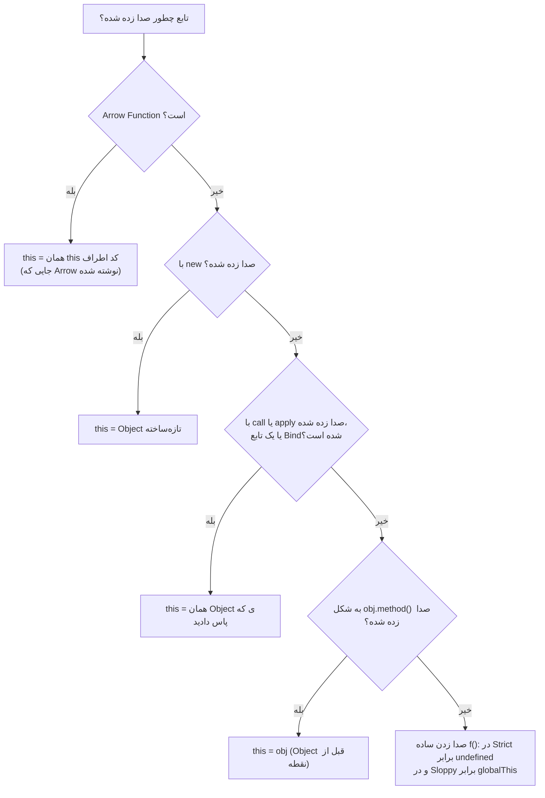

## تابع (Function) چیست؟

**تابع** یک بلوک کد قابل استفاده دوباره است که (با نام یا بدون نام) **ورودی‌هایی** (پارامترها) می‌گیرد، کاری انجام می‌دهد و یک **خروجی** (مقدار بازگشتی) برمی‌گرداند. یک بار تعریفش می‌کنید و هر چند بار که لازم باشد **صدایش می‌زنید (Call)**.

```js run
//        نام       پارامترها
function  greet(   name, greeting = "Hello"  ) {
  const message = `${greeting}, ${name}!`;   // بدنه
  return message;                            // خروجی
}

console.log(greet("Sara"));                  // صدا زدن با آرگومان ← "Hello, Sara!"
console.log(greet("Ali", "Salam"));
```

| اصطلاح | در مثال | معنا |
| --- | --- | --- |
| **پارامتر (Parameter)** | `name`، `greeting` | نام متغیرها در تعریف تابع |
| **آرگومان (Argument)** | `"Sara"`، `"Ali"`، `"Salam"` | مقدارهای واقعی که هنگام صدا زدن داده می‌شوند |
| **مقدار پیش‌فرض** | `greeting = "Hello"` | وقتی آرگومان `undefined` (داده‌نشده) باشد استفاده می‌شود |
| **بدنه** | کد داخل `{ }` | در هر فراخوانی، با متغیرهای محلی تازه اجرا می‌شود |
| **مقدار بازگشتی** | `message` | چیزی که عبارت صدا زدن تابع برابرش می‌شود |

در JavaScript توابع **مقدار** (و در واقع Object) هم هستند: می‌توانید آن‌ها را در متغیر ذخیره کنید، به توابع دیگر بدهید و از توابع برگردانید. همین یک واقعیت پایه Callbackها، Event Handlerها، `map`/`filter`، Closureها، Componentهای React و Hookهاست.

## سه روش تعریف تابع

```js run
// ۱. Function Declaration: Hoist می‌شود (قبل از خط تعریفش هم قابل استفاده است)
console.log(square(4));
function square(n) { return n * n; }

// ۲. Function Expression: یک مقدار تابعی که به متغیر داده می‌شود (Hoist نمی‌شود)
const cube = function (n) { return n ** 3; };

// ۳. Arrow Function: Syntax کوتاه، بدون this و arguments مخصوص خودش
const double = (n) => n * 2;            // برای یک عبارت، return ضمنی دارد
const sum = (a, b) => {                 // با آکولاد ← باید return بنویسید
  const total = a + b;
  return total;
};
const makeUser = (name) => ({ name });  // برگرداندن Object Literal: داخل ( ) بگذاریدش

console.log(cube(2), double(5), sum(2, 3), makeUser("Reza"));
```

| | Declaration | Expression | Arrow |
| --- | --- | --- | --- |
| Syntax | `function f() {}` | `const f = function () {}` | `const f = () => {}` |
| Hoist (قابل صدا زدن قبل از تعریف) | ✓ کامل | ✗ (با `let/const` در TDZ) | ✗ |
| `this` مخصوص خودش | ✓ با نحوه صدا زدن تعیین می‌شود | ✓ با نحوه صدا زدن تعیین می‌شود | ✗ از `this` اطرافش استفاده می‌کند |
| Object مربوط به `arguments` | ✓ | ✓ | ✗ |
| قابل استفاده با `new` | ✓ | ✓ | ✗ |
| کاربرد رایج | توابع نام‌دار سطح بالا | تعریف شرطی، Callback | Callback، توابع کمکی کوتاه، جاهایی که باید `this` بیرونی حفظ شود |

## پارامترها با جزئیات

### آرگومان کم یا زیاد

JavaScript تعداد آرگومان‌ها را بررسی نمی‌کند. پارامترهای جاافتاده `undefined` می‌شوند و آرگومان‌های اضافه نادیده گرفته می‌شوند (اما همچنان در دسترس‌اند).

```js run
function info(a, b) {
  return `a=${a}, b=${b}`;
}
console.log(info(1));           // a=1, b=undefined — جاافتاده
console.log(info(1, 2, 3));     // a=1, b=2 — عدد ۳ نادیده گرفته شد
console.log(info.length);       // 2 — تعداد پارامترهای تعریف‌شده
```

### پارامترهای پیش‌فرض

```js run
function createButton(label, { size = "md", variant = "primary", disabled = false } = {}) {
  return `<button class="${variant} ${size}"${disabled ? " disabled" : ""}>${label}</button>`;
}

console.log(createButton("Save"));
console.log(createButton("Delete", { variant: "danger" }));
console.log(createButton("Wait", { disabled: true, size: "sm" }));

// مقدار پیش‌فرض فقط برای undefined اعمال می‌شود، نه برای null یا دیگر مقدارهای Falsy
const withDefault = (x = "default") => x;
console.log(withDefault(undefined), withDefault(null), withDefault(0), withDefault(""));
```

الگوی `{ … } = {}` (یک «Object تنظیمات» که Destructure شده و مقدار پیش‌فرض دارد) روشی است که بیشتر APIهای امروزی با آن تنظیمات اختیاری زیادی می‌گیرند: صداکننده فقط چیزهایی را که لازم دارد، با هر ترتیبی می‌فرستد.

### Rest Parameter و Spread

```js run
// Rest (...): آرگومان‌های **باقی‌مانده** را در یک آرایه واقعی جمع می‌کند
function logAll(level, ...messages) {
  console.log(`[${level}]`, messages.length, "messages:", messages.join(" | "));
}
logAll("info", "server started", "port 3000", "ready");

// Spread (...): برعکس — یک آرایه را به آرگومان‌های جداگانه باز می‌کند
const scores = [12, 45, 7];
console.log(Math.max(...scores));          // همان Math.max(12, 45, 7)

// Object قدیمی arguments: شبه‌آرایه است و در Arrow Function وجود ندارد
function legacy() {
  return Array.from(arguments).reduce((a, b) => a + b, 0);
}
console.log(legacy(1, 2, 3));
```

| | Rest یعنی `...args` | `arguments` |
| --- | --- | --- |
| نوع | `Array` واقعی (با `map`، `filter` و…) | Object شبه‌آرایه |
| شامل چه چیزی | فقط آرگومان‌های باقی‌مانده و بی‌نام | **همه** آرگومان‌ها |
| در Arrow Function | ✓ | ✗ |
| توصیه | ✓ همین را به کار ببرید | فقط در کدهای قدیمی |

### آرگومان‌ها «به اشتراک» پاس داده می‌شوند

JavaScript همیشه **مقدار آرگومان** را پاس می‌دهد. برای Objectها این مقدار یک **ارجاع** است؛ پس تابع می‌تواند Object را تغییر دهد، اما نمی‌تواند متغیر صداکننده را با چیز دیگری عوض کند:

```js run
function mutate(obj) { obj.changed = true; }       // Object مشترک را تغییر می‌دهد
function reassign(obj) { obj = { replaced: true }; } // فقط پارامتر محلی را به چیز دیگری وصل می‌کند

const settings = { theme: "dark" };
mutate(settings);
reassign(settings);
console.log(settings);                             // { theme: 'dark', changed: true }
```

## مقدار بازگشتی

```js run
function noReturn() { const x = 1; }
function earlyReturn(n) {
  if (n < 0) return "negative";    // return بلافاصله از تابع خارج می‌شود
  return "non-negative";
}
function multiple() {
  return [200, "OK"];              // برگرداندن چند مقدار با یک آرایه (یا Object)
}

console.log(noReturn());           // undefined — هر تابعی چیزی برمی‌گرداند
console.log(earlyReturn(-5));
const [status, text] = multiple();
console.log(status, text);
```

<Callout type="mistake" title="درج خودکار نقطه‌ویرگول بعد از return">
شکستن خط درست بعد از `return` دستور را تمام می‌کند. اگر `return` بنویسید و `{ ok: true }` را در خط بعد، تابع `undefined` برمی‌گرداند. مقدار را در همان خط `return` بنویسید، یا پرانتز یا آکولاد را در همان خط باز کنید.
</Callout>

## توابع مقدار هستند (First-class Functions)

```js run
const operations = {
  add: (a, b) => a + b,
  sub: (a, b) => a - b,
};
operations.mul = (a, b) => a * b;               // ذخیره در یک Object

function calculate(op, a, b) {                  // دریافت به‌عنوان آرگومان
  return operations[op](a, b);
}
console.log(calculate("mul", 6, 7));

function multiplier(factor) {                   // برگرداندن یک تابع
  return (n) => n * factor;
}
const triple = multiplier(3);
console.log(triple(10), typeof triple, triple.name || "(anonymous)", triple.length);
```

### Callback

**Callback** تابعی است که به تابع دیگری داده می‌شود تا آن تابع بعداً صدایش بزند: وقتی رویدادی رخ دهد، وقتی داده برسد، یا برای هر عضو یک مجموعه.

```js run
// شما تعیین می‌کنید **چه کاری** انجام شود؛ filter تعیین می‌کند **کی** صدا زده شود
const isAdult = (person) => person.age >= 18;
const people = [{ name: "Ali", age: 17 }, { name: "Sara", age: 25 }];
console.log(people.filter(isAdult).map((p) => p.name));

// تابع خودتان که Callback می‌پذیرد
function repeat(times, callback) {
  for (let i = 0; i < times; i++) callback(i);
}
repeat(3, (i) => console.log("tick", i));
```

### توابع مرتبه بالا (Higher-order Functions)

**تابع مرتبه بالا** تابعی است که یا تابعی را به‌عنوان آرگومان **می‌گیرد** یا تابعی را **برمی‌گرداند** (یا هر دو). `map`، `filter`، `reduce`، `setTimeout`، `addEventListener`، `debounce` و `memo` در React همه توابع مرتبه بالا هستند.

```js run
// یک تابع مرتبه بالا که به **هر** تابعی Log اضافه می‌کند
function withLogging(fn) {
  return function (...args) {
    const result = fn(...args);
    console.log(`${fn.name}(${args.join(", ")}) → ${result}`);
    return result;
  };
}
const add = (a, b) => a + b;
const loggedAdd = withLogging(add);
loggedAdd(2, 3);

// once(): تابعی که فقط یک بار اجرا می‌شود
function once(fn) {
  let called = false, result;
  return (...args) => {
    if (!called) { called = true; result = fn(...args); }
    return result;
  };
}
const init = once(() => { console.log("initializing…"); return "ready"; });
console.log(init(), init(), init());   // "initializing…" فقط یک بار چاپ می‌شود
```

### توابع خالص (Pure) و اثرهای جانبی

**تابع خالص** (۱) برای ورودی یکسان همیشه خروجی یکسان می‌دهد و (۲) هیچ چیز بیرون از خودش را تغییر نمی‌دهد (**اثر جانبی** یا Side Effect ندارد: آرگومان‌ها یا متغیرهای سراسری را تغییر نمی‌دهد و I/O انجام نمی‌دهد).

```js run
// ✓ خالص
const total = (items) => items.reduce((sum, i) => sum + i.price * i.qty, 0);

// ✗ ناخالص: آرگومانش را تغییر می‌دهد و به State بیرونی وابسته است
let taxRate = 0.1;
function addTax(cart) {
  cart.total = cart.total * (1 + taxRate);   // تغییر مستقیم + خواندن یک متغیر سراسری
  return cart;
}

const items = [{ price: 10, qty: 2 }, { price: 5, qty: 1 }];
console.log(total(items), total(items));     // همیشه 25 25
const cart = { total: 100 };
addTax(cart); addTax(cart);
console.log(cart.total);                     // 121 — هر فراخوانی نتیجه را عوض می‌کند
```

تست کردن، Cache کردن (Memoize) و فکر کردن درباره توابع خالص ساده است. React هم به همین دلیل انتظار دارد Componentها و Reducerها خالص باشند. اثرهای جانبی لازم‌اند (ذخیره داده، Render)، اما آن‌ها را در لبه‌های برنامه نگه دارید.

### IIFE (تابعی که بلافاصله اجرا می‌شود)

```js run
const config = (() => {
  const env = "production";            // خصوصی
  return { apiUrl: env === "production" ? "https://api.example.com" : "http://localhost" };
})();
console.log(config.apiUrl);

// برای یک بلوک async وقتی await سطح بالا در دسترس نیست هم مفید است:
(async () => {
  const value = await Promise.resolve(42);
  console.log("async IIFE:", value);
})();
```

### بازگشت (Recursion)

تابع **بازگشتی** خودش را صدا می‌زند. هر تابع بازگشتی به یک **حالت پایه (Base Case)** نیاز دارد که بازگشت را متوقف کند و هر فراخوانی باید یک قدم به آن نزدیک‌تر شود.

```js run
function factorial(n) {
  if (n <= 1) return 1;            // حالت پایه
  return n * factorial(n - 1);     // حالت بازگشتی: یک مسئله کوچک‌تر
}
console.log(factorial(5));         // 5 * 4 * 3 * 2 * 1 = 120

// بازگشت برای داده‌های درختی می‌درخشد
const menu = { label: "root", children: [
  { label: "Products", children: [{ label: "Phones", children: [] }, { label: "Laptops", children: [] }] },
  { label: "About", children: [] },
] };
function printTree(node, depth = 0) {
  console.log("  ".repeat(depth) + "- " + node.label);
  node.children.forEach((child) => printTree(child, depth + 1));
}
printTree(menu);
```

```text
factorial(4)
  = 4 * factorial(3)
      = 3 * factorial(2)
          = 2 * factorial(1)
              = 1            ← حالت پایه؛ بعد Stack برمی‌گردد
          = 2
      = 6
  = 24
```

هر فراخوانی یک Frame به Call Stack اضافه می‌کند؛ بازگشت خیلی عمیق خطای `RangeError: Maximum call stack size exceeded` می‌دهد ([حافظه](/javascript/memory-gc) را ببینید).

### Currying و Partial Application

**Currying** تابع `f(a, b, c)` را به `f(a)(b)(c)` تبدیل می‌کند: زنجیره‌ای از توابع که هر کدام یک آرگومان می‌گیرند. **Partial Application** بعضی آرگومان‌ها را همین حالا ثابت می‌کند و بقیه را بعداً می‌گیرد.

```js run
const curriedAdd = (a) => (b) => (c) => a + b + c;
console.log(curriedAdd(1)(2)(3));

// یک curry عمومی برای توابعی با تعداد پارامتر ثابت
function curry(fn) {
  return function curried(...args) {
    return args.length >= fn.length ? fn(...args) : (...more) => curried(...args, ...more);
  };
}
const volume = curry((l, w, h) => l * w * h);
console.log(volume(2)(3)(4), volume(2, 3)(4), volume(2)(3, 4));

// Partial Application با bind (آرگومان اول this است)
const log = (level, message) => `[${level}] ${message}`;
const warn = log.bind(null, "WARN");
console.log(warn("disk almost full"));
```

### ترکیب توابع (Composition)

**ترکیب** با زنجیر کردن توابع موجود یک تابع جدید می‌سازد: خروجی هر تابع ورودی تابع بعدی می‌شود.

```js run
const pipe = (...fns) => (x) => fns.reduce((value, fn) => fn(value), x);

const trim = (s) => s.trim();
const lower = (s) => s.toLowerCase();
const slugify = (s) => s.replace(/[^a-z0-9]+/g, "-");

const toSlug = pipe(trim, lower, slugify);
console.log(toSlug("  Hello World From JS  "));   // "hello-world-from-js"
```

## `this`: چه کسی من را صدا زد؟

`this` یک مقدار ویژه است که داخل توابع معمولی در دسترس است. به **Objectی اشاره می‌کند که تابع روی آن صدا زده شده** و **در لحظه صدا زدن** تعیین می‌شود، نه جایی که تابع نوشته شده. یک تابع یکسان ممکن است در هر فراخوانی `this` متفاوتی ببیند.

```js run
function whoAmI() {
  return this?.name ?? String(this);
}

const alice = { name: "Alice", whoAmI };
const bob = { name: "Bob", whoAmI };

console.log(alice.whoAmI());          // "Alice" — روی alice صدا زده شد
console.log(bob.whoAmI());            // "Bob"   — همان تابع، روی bob
console.log(whoAmI());                // "undefined" — روی هیچ چیز صدا زده شد (Strict Mode)
console.log(whoAmI.call({ name: "Carol" }));   // "Carol" — this صریحاً تعیین شد
```

**چرا `this` وجود دارد؟** تا یک تابع (که مثلاً فقط یک بار روی Prototype ذخیره شده) بتواند با **Objectهای زیادی** کار کند. `Array.prototype.push` فقط یک تابع است؛ `this` به آن می‌گوید عضو جدید را به *کدام* آرایه اضافه کند.

برای پیدا کردن `this`، به **محل صدا زدن (Call Site)** نگاه کنید و این قوانین را به ترتیب بررسی کنید:



### قانون ۱: صدا زدن ساده ← Default Binding

```js run sloppy
function sloppyMode() { return this === globalThis; }
console.log(sloppyMode());       // true — در Sloppy Mode به Object سراسری برمی‌گردد
```

```js run
function strictMode() { return this; }
console.log(strictMode());       // undefined — در Strict Mode (ماژول‌ها و کلاس‌ها همیشه Strict هستند)
```

### قانون ۲: صدا زدن به شکل متد ← Implicit Binding

وقتی تابع **به شکل `object.method()`** صدا زده شود، `this` همان Objectی است که **در لحظه صدا زدن قبل از نقطه** قرار دارد:

```js run
const counter = {
  count: 0,
  increment() {
    this.count++;
    return this.count;
  },
};
console.log(counter.increment(), counter.increment());   // 1 2

const nested = { name: "outer", inner: { name: "inner", who() { return this.name; } } };
console.log(nested.inner.who());   // "inner" — فقط **آخرین** Object قبل از نقطه حساب می‌شود
```

#### از دست رفتن `this`

اتصال `this` **در لحظه صدا زدن** انجام می‌شود. اگر متد را از Object جدا کنید و بعداً صدایش بزنید، دیگر Objectی قبل از نقطه نیست:

```js run
const user = {
  name: "Ali",
  greet() { return `Hi, I'm ${this?.name}`; },
};

const greet = user.greet;           // فقط خود تابع، بدون Object
console.log(greet());               // "Hi, I'm undefined"

function runLater(callback) { return callback(); }
console.log(runLater(user.greet));  // همان مشکل: به شکل تابع ساده پاس داده شد

console.log(runLater(() => user.greet()));   // ✓ بپیچیدش: حالا به شکل user.greet() صدا زده می‌شود
console.log(runLater(user.greet.bind(user))); // ✓ یا Bindش کنید
```

این شماره یک منبع باگ‌های `this` است: پاس دادن متدها به‌عنوان Callback (`setTimeout(obj.method)`، `button.addEventListener("click", obj.method)`، `array.map(obj.method)`).

### قانون ۳: `call`، `apply` و `bind` ← Explicit Binding

<Api name="Function.prototype.call / apply / bind" sig="fn.call(thisArg, arg1, arg2, …) · fn.apply(thisArg, [args]) · fn.bind(thisArg, …presetArgs)" returns="`call` و `apply` تابع را **همان لحظه اجرا می‌کنند** و نتیجه‌اش را برمی‌گردانند. `bind` آن را **اجرا نمی‌کند**؛ یک **تابع جدید** برمی‌گرداند که `this` (و در صورت تمایل بعضی آرگومان‌ها) در آن برای همیشه ثابت شده است." mutates="n/a">

- `thisArg`: مقداری که به‌عنوان `this` استفاده می‌شود.
- `call` آرگومان‌ها را تک‌تک می‌گیرد؛ `apply` آن‌ها را به شکل **یک آرایه** (ترفند به خاطر سپردن: **a**pply = **a**rray).
- آرگومان‌های اضافه `bind` از قبل پر می‌شوند (Partial Application).

</Api>

```js run
function introduce(greeting, punctuation) {
  return `${greeting}, I'm ${this.name}${punctuation}`;
}
const sara = { name: "Sara" };

console.log(introduce.call(sara, "Hello", "!"));       // همین حالا اجرا، آرگومان‌ها تک‌تک
console.log(introduce.apply(sara, ["Hi", "?"]));       // همین حالا اجرا، آرگومان‌ها در آرایه

const saraIntro = introduce.bind(sara, "Salam");       // اجرا نمی‌شود: تابع جدید برمی‌گرداند
console.log(saraIntro("."));                           // "Salam, I'm Sara."
console.log(saraIntro.call({ name: "Other" }, "!"));   // همچنان Sara: تابع Bind‌شده دوباره Bind نمی‌شود
```

| | `call` | `apply` | `bind` |
| --- | --- | --- | --- |
| اجرای تابع | فوری | فوری | خیر: تابع جدید برمی‌گرداند |
| آرگومان‌ها | تک‌تک: `(this, a, b)` | آرایه: `(this, [a, b])` | از قبل پر می‌شوند: `(this, a)` و بقیه بعداً |
| کاربرد رایج | قرض گرفتن متد: `Array.prototype.slice.call(arguments)` | باز کردن آرایه‌ها (بیشترش را `...` جایگزین کرده) | ثابت کردن `this` برای Callbackها؛ Partial Application |

```js run
// قرض گرفتن متدها با call
const arrayLike = { 0: "a", 1: "b", length: 2 };
console.log(Array.prototype.map.call(arrayLike, (x) => x.toUpperCase()));

// پیاده‌سازی bind توسط خودتان (یک سوال کلاسیک مصاحبه)
Function.prototype.myBind = function (thisArg, ...preset) {
  const fn = this;                                  // تابعی که bind روی آن صدا زده شده
  return function (...later) {
    return fn.apply(thisArg, [...preset, ...later]);
  };
};
function hello(greeting, punctuation) { return `${greeting}, I'm ${this.name}${punctuation}`; }
console.log(hello.myBind({ name: "Reza" }, "Hey")("!"));
```

### قانون ۴: `new` ← Constructor Binding

صدا زدن تابع با `new` یک Object جدید می‌سازد و `this` را برابر آن قرار می‌دهد. [Objectها و Prototype](/javascript/objects-prototypes) و [کلاس‌ها](/javascript/classes) را ببینید.

```js run
function Person(name) {
  this.name = name;               // this = Object جدید
}
const p = new Person("Neda");
console.log(p.name, p instanceof Person);

const bound = Person.bind({ name: "ignored" });
console.log(new bound("Wins").name);   // "Wins" — new بر bind غلبه می‌کند
```

### قانون ۵: Arrow Function ← this لغوی (Lexical)

Arrow Functionها **`this` مخصوص خودشان را ندارند**. از `this` کدی استفاده می‌کنند که **دورشان** است، در همان جایی که نوشته شده‌اند؛ و هیچ چیز (نه `call`، نه `apply`، نه `bind` و نه صدا زدن به شکل متد) نمی‌تواند تغییرش دهد.

```js run
const timer = {
  seconds: 0,
  startWithRegularFunction() {
    return function () { return this?.seconds; };   // this مخصوص خودش ← وقتی تنها صدا زده شود از دست می‌رود
  },
  startWithArrow() {
    return () => this.seconds;                      // this مربوط به startWithArrow ← یعنی timer
  },
};

const regular = timer.startWithRegularFunction();
const arrow = timer.startWithArrow();
timer.seconds = 5;
console.log(regular());                 // undefined
console.log(arrow());                   // 5
console.log(arrow.call({ seconds: 99 }));   // 5 — call نمی‌تواند this یک Arrow را عوض کند
```

به همین دلیل Arrowها برای Callbackهای **داخل** متدها عالی‌اند و برای **خود** متدها نامناسب:

```js run
const team = {
  name: "Frontend",
  members: ["Ali", "Sara"],
  list() {
    return this.members.map((m) => `${m} @ ${this.name}`);   // ✓ Arrow مقدار this = team را حفظ می‌کند
  },
  badMethod: () => typeof this,          // ✗ Arrow به‌عنوان متد: this برابر team نیست
};
console.log(team.list());
console.log(team.badMethod());           // "undefined" (this در سطح بالای ماژول)
```

### اولویت قوانین

وقتی به نظر می‌رسد چند قانون هم‌زمان صدق می‌کنند، این ترتیب تصمیم می‌گیرد:

| اولویت | قانون | مثال | `this` برابر است با |
| --- | --- | --- | --- |
| ۱ (بالاترین) | Arrow Function | `() => this` | همیشه `this` بیرونی |
| ۲ | `new` | `new Fn()` | Object جدید (حتی اگر `Fn` Bind شده باشد) |
| ۳ | صریح یا Bind‌شده | `fn.call(o)`، `fn.bind(o)()` | `o` |
| ۴ | صدا زدن به شکل متد | `o.fn()` | `o` |
| ۵ (پایین‌ترین) | صدا زدن ساده | `fn()` | `undefined` (Strict) یا `globalThis` (Sloppy) |

```js predict
const obj = {
  name: "obj",
  regular() { return this.name; },
  arrow: () => typeof this,
  nested() {
    const inner = () => this.name;
    return inner();
  },
};
const { regular } = obj;
console.log(obj.regular());
console.log(obj.arrow());
console.log(obj.nested());
console.log(regular.call({ name: "other" }));
try {
  console.log(regular());
} catch (e) {
  console.log(e.constructor.name);
}
```

```output
obj
undefined
obj
other
TypeError
```

آخرین فراخوانی یک صدا زدن ساده است: `this` برابر `undefined` است (ماژول‌ها Strict هستند)؛ پس خواندن `this.name` خطای `TypeError` می‌دهد.

## `this` در دنیای واقعی

### کلاس‌ها و Class Componentهای React

```js run
class Toggle {
  on = false;
  constructor() { this.flipBound = this.flip.bind(this); }
  flip() { this.on = !this.on; return this.on; }
  flipArrow = () => { this.on = !this.on; return this.on; };   // فیلد Arrow: برای هر Instance Bind شده
}

const t = new Toggle();
const handlers = [t.flipBound, t.flipArrow];
handlers.forEach((h) => console.log(h()));     // کار می‌کند: هر دو this = t را حفظ می‌کنند
try { const { flip } = t; flip(); } catch (e) { console.log("unbound:", e.name); }
```

دقیقاً به همین دلیل Class Componentهای React به `this.handleClick = this.handleClick.bind(this)` یا فیلدهای Arrow Function نیاز داشتند. Function Componentها با Hookها اصلاً از `this` استفاده نمی‌کنند.

### Event Listenerهای DOM

```js
button.addEventListener("click", function (event) {
  console.log(this === event.currentTarget);   // true: Listener معمولی خود Element را به‌عنوان this می‌گیرد
});
button.addEventListener("click", (event) => {
  console.log(this);                            // Arrow: this بیرونی (در ماژول‌ها معمولاً undefined)
  console.log(event.currentTarget);             // ✓ در هر دو حالت از Object رویداد استفاده کنید
});
```

## اشتباهات رایج

- پاس دادن یک متد به‌عنوان Callback (`setTimeout(obj.method)`) و از دست دادن `this`.
- استفاده از Arrow Function به‌عنوان متد Object یا متد Prototype که به `this` نیاز دارد.
- انتظار اینکه `call` یا `bind` مقدار `this` یک Arrow Function را تغییر دهد، یا Bind دوباره یک تابع Bind‌شده.
- فراموش کردن `return` در بدنه آکولاددار، یا نوشتن مقدار بازگشتی در خط بعد از `return`.
- استفاده از `arguments` در Arrow Function (به `arguments` تابع بیرونی اشاره می‌کند).
- تغییر دادن آرگومان‌ها و ایجاد اثرهای جانبی غافلگیرکننده برای صداکننده.
- بازگشت بدون حالت پایه.

## سوالات مصاحبه

<QA q="قوانین تعیین `this` را توضیح دهید." level="mid" n={1}>
<Answer>

`this` با نحوه صدا زدن تابع تعیین می‌شود: با `new`، Object جدید است؛ با `call`/`apply`/`bind`، همان Object داده‌شده است؛ به شکل `obj.method()`، همان `obj` است؛ و در صدا زدن ساده، در Strict Mode برابر `undefined` (و در Sloppy Mode برابر `globalThis`) است. Arrow Functionها همه این‌ها را نادیده می‌گیرند و از `this` محیط اطراف استفاده می‌کنند.

</Answer>
<Deep>

اولویت: Arrow (لغوی) > `new` > صریح/Bind‌شده > ضمنی (متد) > پیش‌فرض. تابع Bind‌شده دوباره Bind نمی‌شود، اما `new` مقدار `this` Bind‌شده را کنار می‌گذارد. `this` بخشی از Execution Contextی است که برای هر فراخوانی ساخته می‌شود؛ برای همین مثل یک متغیر معمولی Capture نمی‌شود، مگر در Arrowها که آن را مثل یک متغیر به‌صورت لغوی پیدا می‌کنند.

</Deep>
<Mistake>

گفتن اینکه `this` به خود تابع، یا به Objectی که تابع در آن تعریف شده اشاره می‌کند.

</Mistake>
<FollowUp>

داخل Callback مربوط به `setTimeout` که به شکل تابع معمولی نوشته شده، در یک ماژول مرورگر، `this` چیست؟

</FollowUp>
</QA>

<QA q="تفاوت `call`، `apply` و `bind` چیست؟" level="junior" n={2}>
<Answer>

هر سه `this` را صریحاً تعیین می‌کنند. `call` و `apply` تابع را فوراً اجرا می‌کنند؛ `call` آرگومان‌ها را تک‌تک و `apply` آن‌ها را به شکل آرایه می‌گیرد. `bind` چیزی را اجرا نمی‌کند: تابع جدیدی برمی‌گرداند که `this` (و در صورت تمایل اولین آرگومان‌ها) در آن ثابت شده است.

</Answer>
<Deep>

تابع Bind‌شده تلاش‌های بعدی `call`/`apply`/`bind` برای تغییر `this` را نادیده می‌گیرد، اما `new` همچنان یک Object تازه می‌سازد. Syntax مربوط به Spread بیشتر کاربردهای `apply` را گرفته است (`Math.max(...arr)`). `bind` برای Partial Application هم به‌درد می‌خورد: `log.bind(null, "WARN")`.

</Deep>
<Mistake>

فکر کردن به اینکه `bind` تابع را صدا می‌زند.

</Mistake>
<FollowUp>

`Function.prototype.myBind` را پیاده‌سازی کنید، همراه با پشتیبانی از `new`.

</FollowUp>
</QA>

<QA q="چه زمانی نباید از Arrow Function استفاده کرد؟" level="mid" n={3}>
<Answer>

به‌عنوان متد Object یا Prototype که لازم است `this` همان Object باشد؛ به‌عنوان Constructor (با `new` قابل استفاده نیستند)؛ به‌عنوان Event Handler در DOM وقتی به `this` برابر Element تکیه دارید؛ و وقتی به Object مربوط به `arguments` نیاز دارید. Arrowها برای Callbackهای داخل متدها ایده‌آل‌اند، چون `this` متد را حفظ می‌کنند.

</Answer>
<Deep>

Arrow Functionها Property به نام `prototype` و `super` یا `new.target` مخصوص خودشان را هم ندارند. فیلدهای کلاس که به شکل Arrow تعریف شوند برای هر Instance ساخته می‌شوند؛ این کمی حافظه مصرف می‌کند، اما مشکل Binding برای Callbackها را از بین می‌برد.

</Deep>
<Mistake>

تعریف `const obj = { name: "x", getName: () => this.name }` با انتظار گرفتن `"x"`.

</Mistake>
<FollowUp>

یک Arrow Function در سطح بالای یک ES Module، `this` را چه می‌بیند؟ (`undefined`.)

</FollowUp>
</QA>

<QA q="تابع مرتبه بالا چیست؟ یکی بنویسید." level="junior" n={4}>
<Answer>

تابعی که تابعی را به‌عنوان آرگومان می‌گیرد و/یا تابعی برمی‌گرداند. مثال‌ها: `map`، `filter`، `setTimeout`، `debounce`. یک نمونه ساده: `const once = (fn) => { let done = false, r; return (...a) => done ? r : (done = true, r = fn(...a)); }`.

</Answer>
<Deep>

توابع مرتبه بالا بر Closure تکیه دارند: تابع برگشتی متغیرهایی مثل `done` و `fn` را به خاطر می‌سپارد. این توابع رفتارهای قابل استفاده دوباره (Log، Cache، تلاش دوباره، Throttle) را بدون تغییر تابع اصلی ممکن می‌کنند و پایه الگوهایی در React مثل Higher-Order Component و Custom Hook هستند.

</Deep>
<Mistake>

اشتباه گرفتن «تابع مرتبه بالا» با «تابعی که تابع دیگری را صدا می‌زند».

</Mistake>
<FollowUp>

تابع `memoize(fn)` را بنویسید و توضیح دهید Cache آن کی ممکن است باعث نشت حافظه شود.

</FollowUp>
</QA>

<QA q="تفاوت پارامتر و آرگومان چیست و اگر تعداد اشتباهی آرگومان بدهیم چه می‌شود؟" level="junior" n={5}>
<Answer>

پارامترها نام‌های داخل تعریف تابع‌اند و آرگومان‌ها مقدارهایی که هنگام صدا زدن داده می‌شوند. JavaScript تعداد را اجبار نمی‌کند: پارامترهای جاافتاده `undefined` (یا مقدار پیش‌فرضشان) می‌شوند و آرگومان‌های اضافه نادیده گرفته می‌شوند، اما از طریق Rest Parameter یا `arguments` در دسترس‌اند.

</Answer>
<Deep>

مقدار پیش‌فرض فقط وقتی اعمال می‌شود که آرگومان `undefined` باشد، نه `null`. `fn.length` پارامترهای قبل از اولین پارامتر دارای مقدار پیش‌فرض یا Rest را می‌شمارد. آرگومان‌ها به اشتراک پاس داده می‌شوند: تابع صداشده می‌تواند Objectها را تغییر دهد، اما انتساب دوباره پارامتر روی متغیر صداکننده اثری ندارد.

</Deep>
<Mistake>

انتظار اینکه `f(null)` از مقدار پیش‌فرض استفاده کند.

</Mistake>
<FollowUp>

مقدار `((a, b = 1, ...c) => {}).length` چیست؟ (`1`.)

</FollowUp>
</QA>

## جمع‌بندی

<Recap>

- سه روش تعریف تابع: Declaration (کامل Hoist می‌شود)، Expression و Arrow Function.
- آرگومان کمتر یعنی `undefined`؛ بیشتر نادیده گرفته می‌شود. پارامتر پیش‌فرض فقط برای `undefined` اعمال می‌شود، نه `null`.
- Rest Parameter آرگومان‌های اضافه را در یک آرایه واقعی جمع می‌کند؛ Spread برعکس، آرایه را پخش می‌کند.
- توابع مقدارند (First-class): می‌شود پاسشان داد، برگرداند و در متغیر گذاشت؛ پایه Callback و Higher-order Function.
- Pure Function با ورودی یکسان خروجی یکسان می‌دهد و اثر جانبی ندارد؛ تست و استدلال درباره‌اش ساده است.
- `this` را **نحوه صدا زدن** تعیین می‌کند: صدا زدن ساده (`undefined` در Strict)، متد (Object قبل از نقطه)، `call`/`apply`/`bind`، و `new`.
- اولویت: `new` > `bind`/`call`/`apply` > متد > پیش‌فرض.
- Arrow Function `this` ندارد و آن را از Scope بیرونی می‌گیرد؛ برای Callback داخل متد عالی است ولی خودش نباید متد Object باشد.
- پاس دادن متد به‌عنوان Callback (مثلاً به `addEventListener` یا `setTimeout`) `this` را از دست می‌دهد.

</Recap>
