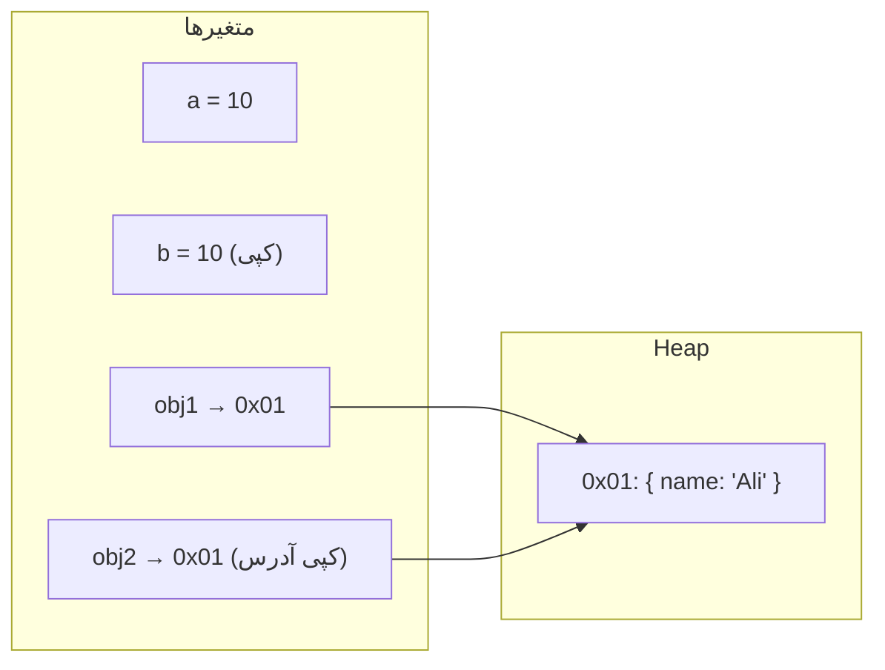
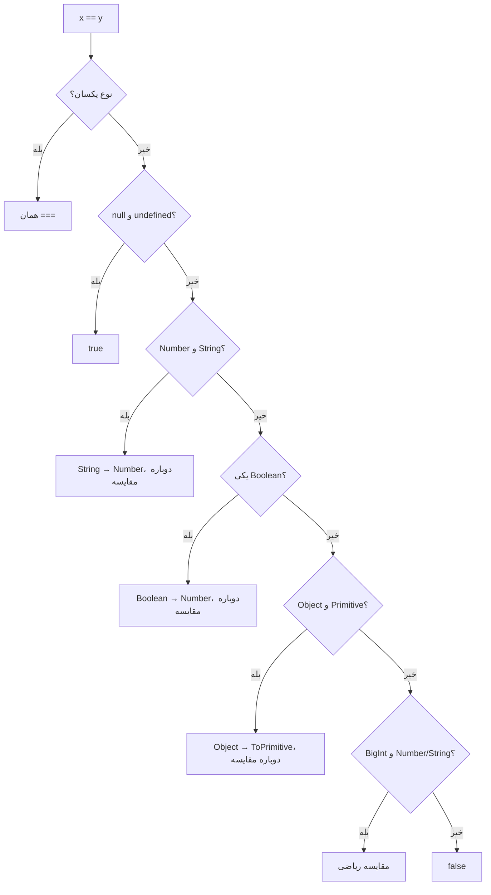
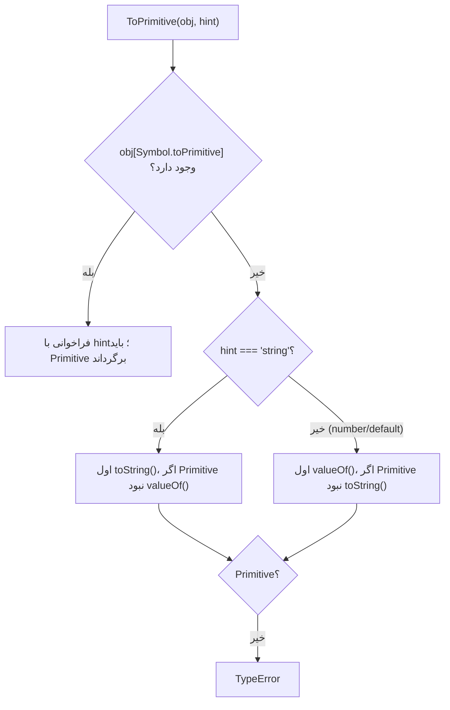

## انواع داده در JavaScript

JavaScript هشت نوع داده دارد: **هفت Primitive** و **Object**.

| نوع | مثال | `typeof` | نکته |
| --- | --- | --- | --- |
| `string` | `"سلام"`، `` `x=${x}` `` | `"string"` | Immutable؛ UTF-16 |
| `number` | `42`، `3.14`، `NaN`، `Infinity`، `-0` | `"number"` | IEEE 754 دقت مضاعف (64 بیتی) |
| `bigint` | `9007199254740993n` | `"bigint"` | اعداد صحیح با دقت دلخواه |
| `boolean` | `true`، `false` | `"boolean"` | |
| `undefined` | `undefined` | `"undefined"` | «مقداری تعیین نشده» |
| `null` | `null` | **`"object"`** | «عمداً خالی» — باگ تاریخی typeof |
| `symbol` | `Symbol("id")` | `"symbol"` | شناسه یکتا؛ کلید Property مخفی |
| `object` | `{}`، `[]`، `new Date()`، توابع | `"object"` / `"function"` | Mutable؛ با Reference |

### number و محدودیت‌هایش

`number` یک **Double-precision Floating Point** است. پیامدها:

```js run
console.log(0.1 + 0.2);                          // 0.30000000000000004
console.log(0.1 + 0.2 === 0.3);                  // false
console.log(Math.abs(0.1 + 0.2 - 0.3) < Number.EPSILON); // true — مقایسه صحیح

console.log(Number.MAX_SAFE_INTEGER);            // 9007199254740991 = 2^53 - 1
console.log(9007199254740992 === 9007199254740993); // true! دقت از دست رفته
console.log(9007199254740992n === 9007199254740993n); // false — BigInt دقیق است

console.log(1 / 0, -1 / 0, 0 / 0);               // Infinity -Infinity NaN
console.log(typeof NaN);                          // "number"
```

`0.1` در مبنای ۲ نمایش دقیق ندارد (مثل ⅓ در مبنای ۱۰). برای پول از **عدد صحیح به کوچک‌ترین واحد** (ریال، سنت) یا کتابخانه Decimal استفاده کنید.

## Primitive در مقابل Reference

این تمایز پایه درک Mutation، Equality، Props در React و Immutability است.



| مفهوم | Primitive | Object (Reference) |
| --- | --- | --- |
| **Value** | خود مقدار در متغیر | متغیر یک **Reference** (آدرس) به Object در Heap نگه می‌دارد |
| **کپی با انتساب** | کپی مقدار؛ مستقل | کپی **Reference**؛ هر دو به یک Object اشاره دارند |
| **Mutation** | ممکن نیست (Immutable) | ممکن است؛ از همه Referenceها دیده می‌شود |
| **Identity (هویت)** | برابری بر اساس مقدار | برابری بر اساس **هویت** (همان Object بودن) |
| **پاس دادن به تابع** | کپی مقدار | کپی Reference (**Call by Sharing**) |

```js run
// Primitive: کپی مستقل
let a = 10;
let b = a;
b++;
console.log(a, b);                       // 10 11

// Reference: یک Object، دو Reference
const user1 = { name: "Ali" };
const user2 = user1;
user2.name = "Sara";
console.log(user1.name);                 // "Sara" — Mutation از طریق user2

// Identity: دو Object با محتوای یکسان برابر نیستند
console.log({ x: 1 } === { x: 1 });     // false
console.log(user1 === user2);            // true — همان Object
```

### Primitiveها Immutable هستند

```js run sloppy
let text = "hello";
text[0] = "H";                 // در Sloppy بی‌اثر؛ در Strict Mode: TypeError (Property فقط‌خواندنی)
console.log(text);             // "hello"
const upper = text.toUpperCase();
console.log(text, upper);      // متد مقدار جدید برمی‌گرداند
```

اما چرا `"hello".toUpperCase()` کار می‌کند وقتی Primitive متد ندارد؟ چون JavaScript موقتاً Primitive را در یک **Wrapper Object** (`String`، `Number`، `Boolean`، `Symbol`، `BigInt`) می‌پیچد (**Autoboxing**)، متد را از `String.prototype` صدا می‌زند و Wrapper را دور می‌اندازد.

### Call by Sharing

JavaScript همیشه **Pass by Value** است؛ اما برای Objectها «مقدار» خود Reference است:

```js run
function mutate(obj) {
  obj.count = 99;        // ✓ Object اصلی تغییر می‌کند (همان Reference)
}
function reassign(obj) {
  obj = { count: -1 };   // ✗ فقط متغیر محلی را عوض می‌کند
}

const data = { count: 0 };
mutate(data);
console.log(data.count);  // 99
reassign(data);
console.log(data.count);  // 99 — reassign روی data اثری نداشت
```

### Shallow Copy در مقابل Deep Copy

```js run
const original = { name: "Ali", address: { city: "Tehran" }, tags: ["a"] };

const shallow = { ...original };              // یا Object.assign({}, original)
shallow.name = "Sara";                        // ✓ مستقل
shallow.address.city = "Shiraz";              // ✗ address مشترک است!
console.log(original.address.city);           // "Shiraz"

const deep = structuredClone(original);       // کپی عمیق بومی
deep.address.city = "Tabriz";
console.log(original.address.city);           // "Shiraz" — دست نخورده
```

| روش | عمق | محدودیت |
| --- | --- | --- |
| `{ ...obj }`، `Object.assign`، `[...arr]` | سطحی | Nested Objectها مشترک می‌مانند |
| `JSON.parse(JSON.stringify(x))` | عمیق | Function، `undefined`، Symbol، Date (رشته می‌شود)، Map، Set، BigInt (خطا) و Reference چرخشی (خطا) را خراب می‌کند |
| `structuredClone(x)` | عمیق | Function و DOM Node را پشتیبانی نمی‌کند؛ Prototype کلاس‌ها از دست می‌رود؛ Date، Map، Set و Reference چرخشی را درست کپی می‌کند |

## null در مقابل undefined

| | `undefined` | `null` |
| --- | --- | --- |
| معنا | «مقداری تعیین نشده / وجود ندارد» | «عمداً خالی / بدون مقدار» |
| چه کسی تنظیم می‌کند | معمولاً **Engine** | معمولاً **برنامه‌نویس** |
| `typeof` | `"undefined"` | `"object"` (باگ) |
| در عدد (`Number()`) | `NaN` | `0` |
| در JSON | Property حذف می‌شود | `null` حفظ می‌شود |
| Default Parameter فعال می‌کند | **بله** | **خیر** |
| `== null` | `true` | `true` |
| `=== null` | `false` | `true` |

منابع `undefined`: متغیر بدون مقدار، Property ناموجود، پارامتر پاس‌نشده، تابع بدون `return`، `void 0`، عضو Holeدار آرایه.

```js run
function greet(name = "guest") { return "Hi " + name; }
console.log(greet(undefined));    // "Hi guest" — undefined پیش‌فرض را فعال می‌کند
console.log(greet(null));         // "Hi null"  — null یک مقدار است

console.log(JSON.stringify({ a: undefined, b: null }));  // {"b":null}
console.log(null + 1, undefined + 1);                     // 1 NaN

// Nullish Coalescing و Optional Chaining
const config = { retries: 0, timeout: null };
console.log(config.retries || 3);   // 3 ✗ — صفر falsy است
console.log(config.retries ?? 3);   // 0 ✓ — فقط null/undefined
console.log(config.timeout ?? 5000);
console.log(config.server?.host ?? "localhost");
```

## Equality: `==`، `===` و `Object.is()`

| | `==` (Loose) | `===` (Strict) | `Object.is()` (SameValue) |
| --- | --- | --- | --- |
| تبدیل نوع | **بله** | خیر | خیر |
| `NaN` با `NaN` | `false` | `false` | **`true`** |
| `+0` با `-0` | `true` | `true` | **`false`** |
| `null` با `undefined` | **`true`** | `false` | `false` |
| `"1"` با `1` | `true` | `false` | `false` |
| Objectها | Identity | Identity | Identity |
| استفاده | فقط `x == null` | پیش‌فرض | `NaN` و `-0`؛ `useState` و `useEffect` در React |

```js run
console.log(NaN === NaN, Object.is(NaN, NaN));   // false true
console.log(0 === -0, Object.is(0, -0));         // true false
console.log(null == undefined, null === undefined); // true false
console.log(null == 0, null >= 0);               // false true  ← تله!
console.log([1, 2].includes(NaN), [NaN].includes(NaN), [NaN].indexOf(NaN)); // false true -1
```

`includes` از الگوریتم **SameValueZero** استفاده می‌کند (مثل Object.is ولی `+0` و `-0` را برابر می‌داند)، در حالی که `indexOf` از `===` استفاده می‌کند؛ به همین دلیل `indexOf(NaN)` همیشه `-1` است.

<Callout type="interview">
React برای مقایسه State قبلی و جدید و Dependencyهای Hookها از `Object.is` استفاده می‌کند. به همین دلیل Mutation یک Object و `setState` با همان Reference باعث Re-render نمی‌شود.
</Callout>

### الگوریتم `==` (Abstract Equality)



نکات مهم:

- `null` و `undefined` **فقط** با هم و با خودشان `==` هستند؛ نه با `0`، `""` یا `false`.
- Boolean **همیشه اول به عدد** تبدیل می‌شود: `true → 1`، `false → 0`.

### حل گام‌به‌گام `[] == false`

```text
[] == false
→ Boolean به Number:         [] == 0
→ Object به Primitive:       ToPrimitive([]) → [].valueOf() یک Object است → [].toString() → ""
                              "" == 0
→ String به Number:          0 == 0
→ true
```

و با این حال `[]` **Truthy** است: `if ([])` اجرا می‌شود! چون `if` از `ToBoolean` استفاده می‌کند (هر Object Truthy است) و `==` از الگوریتم بالا.

```js run
console.log([] == false);      // true
console.log(!![]);             // true — [] truthy است
console.log([] == ![]);        // true! ![] = false → [] == false → true
console.log([0] == false);     // true:  "0" → 0
console.log([1, 2] == "1,2");  // true
console.log({} == "[object Object]"); // true
```

## Type Coercion

`Type Coercion (تبدیل نوع)` تبدیل یک مقدار از یک نوع به نوع دیگر است:

- **Explicit (صریح):** `Number("42")`، `String(10)`، `Boolean(x)`، `parseInt`.
- **Implicit (ضمنی):** توسط عملگرها: `"5" * 2`، `if (x)`، `` `${x}` ``، `x == y`.

همه Coercionها از **چهار Abstract Operation** در مشخصات استفاده می‌کنند.

### ToBoolean

ساده‌ترین؛ فقط **۸ مقدار Falsy** وجود دارد. **همه چیز دیگر Truthy است**:

| Falsy |
| --- |
| `false`، `0`، `-0`، `0n`، `""` (رشته خالی)، `null`، `undefined`، `NaN` |

```js run
const values = [[], {}, "0", "false", " ", new Boolean(false), -1, Infinity, () => {}];
console.log(values.map(Boolean)); // همه true — حتی new Boolean(false) چون Object است
```

(`document.all` تنها Object Falsy است — یک استثنای تاریخی.)

### ToNumber

| ورودی | نتیجه |
| --- | --- |
| `undefined` | `NaN` |
| `null` | `0` |
| `true` / `false` | `1` / `0` |
| `""`، `"  "`، `"\n"` | `0` |
| `"42"`، `" 42 "` | `42` |
| `"42px"`، `"1,000"` | `NaN` |
| `"0x1F"`، `"0b11"`، `"1e3"` | `31`، `3`، `1000` |
| Symbol | `TypeError` |
| BigInt | `TypeError` با `+`؛ `Number(10n)` مجاز است |
| Object | `ToPrimitive(hint: "number")` سپس ToNumber |

```js run
console.log(Number(""), Number(" 12 "), Number("12px"), parseInt("12px"), parseFloat("3.5kg"));
console.log(+[], +[5], +[1, 2], +{}, +null, +undefined, +true, +"");
```

`parseInt` تا اولین کاراکتر نامعتبر می‌خواند؛ `Number` کل رشته را می‌خواهد. همیشه به `parseInt` **Radix** بدهید: `parseInt("08", 10)`.

### ToString

| ورودی | نتیجه |
| --- | --- |
| `null`، `undefined` | `"null"`، `"undefined"` |
| `-0` | `"0"` |
| `[1, [2, 3]]` | `"1,2,3"` |
| `[]` | `""` |
| `[null, undefined]` | `","` |
| `{}` | `"[object Object]"` |
| Symbol | `TypeError` در Implicit؛ `String(sym)` مجاز است |

### ToPrimitive

وقتی یک **Object** باید به Primitive تبدیل شود. یک **Hint** دارد: `"number"`، `"string"` یا `"default"`.



- Hint `"string"`: Template Literal، `String(obj)`، کلید Property.
- Hint `"number"`: عملگرهای ریاضی (`-`، `*`، `/`)، `<`، `Number(obj)`.
- Hint `"default"`: `+` دوتایی و `==`. (Date استثناست و default را مثل string رفتار می‌کند.)

```js run
const price = {
  amount: 42,
  valueOf() { return this.amount; },
  toString() { return `${this.amount} USD`; },
};
console.log(price * 2);        // 84  — hint number → valueOf
console.log(`${price}`);       // "42 USD" — hint string → toString
console.log(price + 1);        // 43 — hint default → valueOf

const temperature = {
  [Symbol.toPrimitive](hint) {
    return hint === "string" ? "25°C" : 25;
  },
};
console.log(`${temperature}`, temperature * 2, temperature + 1);
```

### عملگر `+`

`+` تنها عملگر ریاضی است که **دوگانه** است:

1. هر دو طرف را `ToPrimitive` (hint default) کن.
2. **اگر یکی رشته شد → هر دو را رشته کن و Concatenate.**
3. وگرنه هر دو را عدد کن و جمع.

```js run
console.log(1 + "2");          // "12"
console.log(1 + 2 + "3");      // "33"  — چپ به راست: 3 + "3"
console.log("1" + 2 + 3);      // "123"
console.log("5" - 2);          // 3    — منها فقط عددی است
console.log("5" * "2");        // 10
console.log(true + 1);         // 2
console.log([] + []);          // ""   — "" + ""
console.log([] + {});          // "[object Object]"
console.log({} + []);          // "[object Object]" (در Console به عنوان Statement ممکن است 0 نشان دهد)
console.log(1 + null, 1 + undefined); // 1 NaN
```

### مقایسه‌های رابطه‌ای `<` و `>`

- اگر **هر دو رشته** باشند: مقایسه **لغت‌نامه‌ای** بر اساس Code Unit.
- وگرنه: هر دو به عدد.

```js run
console.log("10" < "9");      // true  — مقایسه رشته‌ای: "1" < "9"
console.log("10" < 9);        // false — عددی
console.log(null >= 0, null > 0, null == 0); // true false false ← null در >= عدد می‌شود ولی در == نه
console.log(undefined >= 0);  // false — NaN
console.log([2] > 1);         // true  — "2" → 2
```

## سوالات دام‌دار کلاسیک

```js predict
console.log(typeof null);
console.log([] == false);
console.log([] === false);
console.log(typeof NaN);
console.log(NaN === NaN);
console.log(0.1 + 0.2 === 0.3);
console.log("b" + "a" + +"a" + "a");
console.log([1, 2, 3] + [4, 5, 6]);
console.log(true + true + "3");
console.log("3" - - "3");
```

```output
object
true
false
number
false
false
baNaNa
1,2,34,5,6
23
6
```

- `"b" + "a" + +"a" + "a"`: `+"a"` (Unary plus) → `NaN` → `"ba" + NaN + "a"` → `"baNaNa"`.
- `[1,2,3] + [4,5,6]`: هر دو به رشته `"1,2,3"` و `"4,5,6"` → Concatenate.
- `true + true + "3"`: `2 + "3"` → `"23"`.
- `"3" - - "3"`: `-"3"` → `-3`؛ `"3" - (-3)` → `6`.

```js predict
console.log(Math.max() < Math.min());
console.log([10, 1, 3].sort());
console.log(parseInt(0.0000005));
console.log(["1", "2", "3"].map(parseInt));
```

```output
true
[1, 10, 3]
5
[1, NaN, NaN]
```

- `Math.max()` بدون آرگومان `-Infinity` و `Math.min()` برابر `Infinity`.
- `sort` بدون Comparator عناصر را **رشته‌ای** مقایسه می‌کند.
- `0.0000005` به رشته `"5e-7"` تبدیل می‌شود و parseInt تا `e` می‌خواند → `5`.
- `map` سه آرگومان می‌دهد: `parseInt("1", 0)` → 1، `parseInt("2", 1)` → NaN (Radix نامعتبر)، `parseInt("3", 2)` → NaN (۳ در مبنای ۲ نیست).

## تشخیص دقیق نوع

```js run
const typeOf = (v) => Object.prototype.toString.call(v).slice(8, -1);
console.log([null, [], new Date(), /x/, new Map(), 1n, () => {}].map(typeOf));

console.log(Array.isArray([]), Number.isNaN("abc"), isNaN("abc"));   // true false true
console.log(Number.isInteger(5.0), Number.isSafeInteger(2 ** 53));    // true false
```

`isNaN` سراسری ابتدا Coercion انجام می‌دهد (`isNaN("abc") === true`)؛ `Number.isNaN` نه. همیشه `Number.isNaN` استفاده کنید.

## اشتباهات رایج

- استفاده از `==` به‌جز در `x == null`.
- `||` برای مقدار پیش‌فرض وقتی `0` یا `""` معتبر است (`??` استفاده کنید).
- مقایسه اعشاری با `===`.
- `sort()` بدون Comparator برای اعداد.
- `typeof x === "object"` بدون بررسی null.
- کپی سطحی و تعجب از Mutation اشیای تودرتو.
- پول با number اعشاری.

## سوالات مصاحبه

<QA q="تفاوت `==`، `===` و `Object.is` چیست؟" level="junior" n={1}>
<Answer>

`==` قبل از مقایسه تبدیل نوع انجام می‌دهد. `===` بدون تبدیل، نوع و مقدار را مقایسه می‌کند. `Object.is` مثل `===` است با دو تفاوت: `Object.is(NaN, NaN)` برابر true و `Object.is(0, -0)` برابر false است. برای Objectها هر سه Identity را مقایسه می‌کنند.

</Answer>
<Deep>

در مشخصات این‌ها IsLooselyEqual، IsStrictlyEqual و SameValue هستند؛ یک الگوریتم چهارم هم هست: SameValueZero (در `includes`، `Map` و `Set`) که NaN را برابر و ±0 را برابر می‌داند. React از Object.is برای Bail-out در setState و مقایسه Dependencyها استفاده می‌کند.

</Deep>
<Mistake>

گفتن اینکه `==` «فقط مقدار» و `===` «مقدار و نوع» را مقایسه می‌کند بدون دانستن قوانین Coercion؛ و اینکه `===` برای NaN کار می‌کند.

</Mistake>
<FollowUp>

تنها موردی که استفاده از `==` قابل قبول است چیست؟ (`x == null` برای بررسی هم‌زمان null و undefined.)

</FollowUp>
</QA>

<QA q="چرا `[] == ![]` برابر true است؟" level="mid" n={2}>
<Answer>

`![]` ابتدا ارزیابی می‌شود: `[]` Truthy است پس `![]` برابر false. حالا `[] == false`: Boolean به عدد (0)، آرایه با ToPrimitive به `""` و سپس به 0 تبدیل می‌شود؛ `0 == 0` → true.

</Answer>
<Deep>

نکته کلیدی تفاوت ToBoolean (که برای هر Object، true است) و الگوریتم `==` است که Object را به Primitive تبدیل می‌کند. ToPrimitive روی آرایه ابتدا valueOf (که خود آرایه را برمی‌گرداند و Primitive نیست) و سپس toString (`""`) را صدا می‌زند.

</Deep>
<Mistake>

فکر کردن اینکه چون `[]` Truthy است، `[] == true` باید true باشد. در واقع `[] == true` برابر false است (`0 == 1`).

</Mistake>
<FollowUp>

خروجی `[0] == false` و `[1] == true` چیست؟ (هر دو true.)

</FollowUp>
</QA>

<QA q="Primitive و Reference چه تفاوتی دارند؟ JavaScript Pass by Reference است؟" level="junior" n={3}>
<Answer>

Primitiveها Immutable هستند و با مقدار کپی و مقایسه می‌شوند. Objectها Mutable هستند و متغیر یک Reference به آن‌ها در Heap نگه می‌دارد؛ انتساب Reference را کپی می‌کند و مقایسه بر اساس هویت است. JavaScript همیشه Pass by Value است — برای Objectها مقدارِ پاس‌داده‌شده خود Reference است (Call by Sharing): Mutation دیده می‌شود ولی Reassign پارامتر نه.

</Answer>
<Deep>

در Engine، Primitiveهای کوچک (Smi در V8) مستقیماً در Register یا Stack هستند و بقیه (رشته، HeapNumber) در Heap ولی Immutable. Immutability رشته‌ها اجازه Interning و اشتراک حافظه می‌دهد. در React همین تمایز دلیل الزام به Immutable Update است: `setState` با همان Reference، Object.is را true می‌کند و Render رخ نمی‌دهد.

</Deep>
<Mistake>

گفتن «Objectها by reference پاس داده می‌شوند»؛ اگر این‌طور بود، `obj = {}` داخل تابع، متغیر بیرونی را هم عوض می‌کرد.

</Mistake>
<FollowUp>

`structuredClone` چه چیزهایی را نمی‌تواند کپی کند؟

</FollowUp>
</QA>

<QA q="ToPrimitive را توضیح دهید. خروجی `{} + []` و `[] + {}` چیست؟" level="senior" n={4}>
<Answer>

ToPrimitive یک Object را با Hint (number، string یا default) به Primitive تبدیل می‌کند: اول `Symbol.toPrimitive` اگر وجود داشته باشد؛ وگرنه برای string اول toString و برای بقیه اول valueOf. `[] + {}` → `"" + "[object Object]"` → `"[object Object]"`. `{} + []` در Expression هم همین است، اما در ابتدای یک Statement (مثلاً در Console)، `{}` به‌عنوان Block خالی Parse می‌شود و `+[]` → `0` نمایش داده می‌شود.

</Answer>
<Deep>

Date تنها Built-inی است که برای hint default مثل string رفتار می‌کند (`new Date() + 1` رشته می‌دهد). در `Symbol.toPrimitive` می‌توان رفتار را کامل کنترل کرد؛ مثلاً یک Money Object که در Template Literal فرمت‌شده و در محاسبه عدد باشد.

</Deep>
<Mistake>

یکسان دانستن رفتار Console و Expression؛ ابهام `{}` بین Block و Object Literal.

</Mistake>
<FollowUp>

چطور یک Object می‌سازید که `obj == 1 && obj == 2 && obj == 3` برابر true شود؟ (valueOf که هر بار شمارنده را افزایش می‌دهد.)

</FollowUp>
</QA>

## جمع‌بندی

<Recap>

- JavaScript هفت نوع Primitive (`string`، `number`، `bigint`، `boolean`، `undefined`، `null`، `symbol`) و یک نوع `object` دارد.
- `number` اعشاری ۶۴ بیتی است: `0.1 + 0.2 !== 0.3` و اعداد صحیح فقط تا `Number.MAX_SAFE_INTEGER` دقیق‌اند.
- Primitiveها با مقدار و Objectها با Reference مقایسه و کپی می‌شوند؛ پاس دادن آرگومان «Call by Sharing» است.
- کپی سطحی (Spread، `Object.assign`) فقط سطح اول را کپی می‌کند؛ برای کپی عمیق `structuredClone`.
- `undefined` یعنی «مقداری داده نشده»، `null` یعنی «عمداً خالی».
- `===` بدون تبدیل نوع مقایسه می‌کند؛ `==` قبلش Coercion انجام می‌دهد؛ `Object.is` حتی `NaN` و `-0` را درست مقایسه می‌کند.
- Coercion از سه تبدیل ToBoolean، ToNumber و ToString استفاده می‌کند و Objectها اول با ToPrimitive (`valueOf`/`toString`) به Primitive تبدیل می‌شوند.
- هشت مقدار Falsy داریم: `false`، `0`، `-0`، `0n`، `""`، `null`، `undefined`، `NaN`؛ بقیه، حتی `[]` و `{}`، Truthy‌اند.
- `+` اگر یکی از طرف‌ها رشته باشد چسباندن است؛ بقیه عملگرهای ریاضی به عدد تبدیل می‌کنند.

</Recap>
