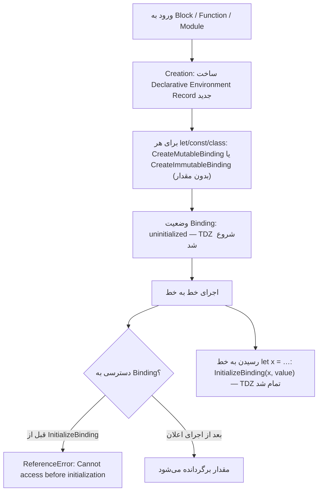

## سه روش اعلام متغیر

JavaScript سه کلمه کلیدی برای اعلام متغیر دارد: `var` (از ابتدای زبان)، و `let` و `const` (از ES2015). تفاوت آن‌ها فقط «قابل تغییر بودن» نیست؛ تفاوت اصلی در **Scope، زمان مقداردهی اولیه (Initialization) و نحوه ثبت در Environment Record** است.

| ویژگی | `var` | `let` | `const` |
| --- | --- | --- | --- |
| Scope | **Function** (یا Global) | **Block** | **Block** |
| Hoisting | بله | بله | بله |
| مقدار اولیه هنگام Hoisting | `undefined` | **Uninitialized (TDZ)** | **Uninitialized (TDZ)** |
| دسترسی قبل از خط اعلان | `undefined` | `ReferenceError` | `ReferenceError` |
| Redeclaration در همان Scope | مجاز | `SyntaxError` | `SyntaxError` |
| Reassignment | مجاز | مجاز | `TypeError` |
| مقداردهی اجباری هنگام اعلان | خیر | خیر | **بله** |
| Property روی Global Object در Script | **بله** (`window.x`) | خیر | خیر |
| در حلقه `for` | یک Binding برای کل حلقه | **Binding جدید برای هر Iteration** | Binding جدید برای هر Iteration (اگر تغییر نکند) |

## Scope: Function در مقابل Block

`Block` هر چیزی بین `{` و `}` است: بدنه `if`، `for`، `while`، `try` یا یک Block مستقل.

```js run
function demo() {
  if (true) {
    var a = "var";
    let b = "let";
    const c = "const";
  }
  console.log(a);              // "var" — var به Block اهمیت نمی‌دهد
  console.log(typeof b);       // "undefined" — b بیرون از Block وجود ندارد
  try {
    console.log(b);
  } catch (error) {
    console.log(error.name + ": " + error.message);
  }
}
demo();
```

`var` فقط به **Function** محدود است. این رفتار باعث نشت متغیرها از Blockها و باگ‌های کلاسیک می‌شد.

## const: ثابت بودن Binding، نه مقدار

`const` یعنی **Binding (اتصال نام به مقدار)** قابل تغییر نیست، نه اینکه خود مقدار Immutable باشد:

```js run
const user = { name: "Ali" };
user.name = "Sara";            // ✓ تغییر محتوای Object
console.log(user);

const list = [1, 2];
list.push(3);                  // ✓
console.log(list);

try {
  user = {};                   // ✗ تغییر Binding
} catch (error) {
  console.log(error.name + ": " + error.message);
}

const frozen = Object.freeze({ level: 1 });
frozen.level = 2;              // در Strict Mode → TypeError، در Sloppy بی‌صدا نادیده گرفته می‌شود
```

برای Immutability واقعی: `Object.freeze` (سطحی)، Deep Freeze بازگشتی، یا ساختارهای Immutable.

## Redeclaration و Reassignment

```js
var x = 1;
var x = 2;      // ✓ var اجازه اعلان دوباره می‌دهد — منبع باگ در فایل‌های بزرگ

let y = 1;
let y = 2;      // ✗ SyntaxError: Identifier 'y' has already been declared
                //   (این خطا در زمان Parse رخ می‌دهد؛ هیچ خطی از کد اجرا نمی‌شود)

let z = 1;
z = 2;          // ✓ Reassignment

const w = 1;
w = 2;          // ✗ TypeError: Assignment to constant variable (در Runtime)
```

## Hoisting — نگاه کوتاه

`Hoisting (بالا آوردن اعلان‌ها)` یعنی **اعلان‌ها قبل از اجرای هر خط کد، در Creation Phase در Environment Record ثبت می‌شوند**. کد به‌طور فیزیکی جابه‌جا نمی‌شود. تفاوت `var` و `let/const` در این است که **با چه مقداری** ثبت می‌شوند:

- `var` → ثبت و **فوراً با `undefined` مقداردهی** می‌شود.
- `let`، `const`، `class` → ثبت می‌شوند ولی **Uninitialized** می‌مانند تا اجرا به خط اعلان برسد.

جزئیات کامل در فصل [Execution Context و Hoisting](/javascript/execution-context).

## TDZ — Temporal Dead Zone

### تعریف

`TDZ (Temporal Dead Zone — منطقه مرده زمانی)` بازه‌ای است **از شروع Scope تا لحظه اجرای خط اعلان** یک متغیر `let`، `const` یا `class`. در این بازه Binding **وجود دارد ولی مقداردهی نشده (Uninitialized)** و هر دسترسی به آن `ReferenceError` می‌دهد.

```text
{                                   ◄── شروع Block: Binding «a» ساخته می‌شود (uninitialized)
   ┆  console.log(a);  // ✗           ┐
   ┆  typeof a;        // ✗           │  TDZ
   ┆  a = 5;           // ✗           ┘
   let a = 10;                      ◄── اجرای اعلان: a مقداردهی می‌شود → پایان TDZ
   console.log(a);     // ✓ 10
}
```

### چرا «Temporal» (زمانی)؟

چون TDZ به **زمان اجرا** وابسته است، نه به **موقعیت در متن کد**. تابعی که از نظر متنی قبل از اعلان نوشته شده ولی **بعد از** اعلان فراخوانی شود، مشکلی ندارد:

```js run
function read() {
  return value;      // از نظر متنی قبل از let نوشته شده
}

// read();          // ✗ اگر اینجا صدا بزنیم: ReferenceError (هنوز در TDZ)
let value = 42;
console.log(read()); // ✓ 42 — در زمان فراخوانی، TDZ تمام شده است
```

### چرا TDZ وجود دارد؟

1. **پیدا کردن باگ:** دسترسی به متغیر قبل از مقداردهی تقریباً همیشه باگ است. `var` در این حالت بی‌صدا `undefined` برمی‌گرداند؛ TDZ خطای واضح می‌دهد.
2. **معنای درست `const`:** اگر `const` مثل var با undefined Hoist می‌شد، یک `const` ممکن بود دو مقدار متفاوت داشته باشد (اول undefined، بعد مقدار واقعی) — که با تعریف «ثابت» تناقض دارد.
3. **آماده‌سازی برای Guardها و Moduleها:** رفتار قابل پیش‌بینی در Import Bindings و Classها.

### TDZ در Runtime: ارتباط با Lexical Environment و Binding



در مشخصات ECMAScript:

- هنگام ورود به یک Block، یک **Declarative Environment Record** جدید ساخته می‌شود.
- برای هر `let`/`const` یک Binding ایجاد می‌شود **بدون اینکه InitializeBinding صدا زده شود**.
- عمل‌گر `GetBindingValue` روی Binding مقداردهی‌نشده `ReferenceError` می‌اندازد.
- وقتی اجرا به `let x = expr` می‌رسد، ابتدا `expr` ارزیابی و سپس `InitializeBinding` صدا زده می‌شود.
- برای `let x;` بدون مقدار، در لحظه اجرای خط با `undefined` مقداردهی می‌شود.

### تفاوت TDZ با undefined

| | متغیر در TDZ | متغیر با مقدار `undefined` |
| --- | --- | --- |
| Binding وجود دارد؟ | بله | بله |
| مقداردهی شده؟ | **خیر** | بله (با `undefined`) |
| خواندن | `ReferenceError` | `undefined` |
| `typeof x` | **`ReferenceError`** | `"undefined"` |
| مثال | `let` قبل از خط اعلان | `var` قبل از خط اعلان، یا `let x;` بعد از اعلان |

نکته مهم: `typeof` معمولاً «امن» است و برای متغیر اعلام‌نشده `"undefined"` برمی‌گرداند — **اما برای متغیر در TDZ خطا می‌دهد**:

```js run
console.log(typeof neverDeclared);   // "undefined" — هیچ Bindingی نیست
try {
  console.log(typeof inTdz);         // ReferenceError — Binding هست ولی uninitialized
} catch (error) {
  console.log(error.name + ": " + error.message);
}
let inTdz = 1;
```

### مثال ۱: پایه

```js predict
console.log(a);
let a = 10;
```

```output
Uncaught ReferenceError: Cannot access 'a' before initialization
```

`a` در Creation Phase اسکریپت/ماژول ثبت شده (پس پیام خطا «not defined» نیست)، ولی در TDZ است.

### مثال ۲: TDZ در Block

```js predict
let a = 1;
{
  console.log(a);
  let a = 20;
}
```

```output
Uncaught ReferenceError: Cannot access 'a' before initialization
```

بسیاری انتظار دارند `1` چاپ شود (از Scope بیرونی). اما با ورود به Block، یک Binding جدید `a` در **Environment Record همان Block** ساخته می‌شود که `a` بیرونی را **Shadow** می‌کند. جستجوی Identifier `a` از Environment فعلی شروع می‌شود، Binding را آنجا پیدا می‌کند (هرچند uninitialized) و دیگر به بیرون نمی‌رود.

### مثال ۳: TDZ در Default Parameter

پارامترهای تابع از چپ به راست مقداردهی می‌شوند و هرکدام تا قبل از مقداردهی در TDZ هستند:

```js run
function ok(a, b = a * 2) {
  return [a, b];
}
console.log(ok(3));             // [3, 6]

function broken(a = b, b = 2) {
  return [a, b];
}
try {
  broken();
} catch (error) {
  console.log(error.name + ": " + error.message); // b هنوز در TDZ است
}
```

### مثال ۴: Self-reference

```js run
try {
  let x = x + 1;   // سمت راست قبل از InitializeBinding ارزیابی می‌شود
} catch (error) {
  console.log(error.name + ": " + error.message);
}

var y = y + 1;     // var: y در لحظه ارزیابی undefined است → NaN
console.log(y);
```

### مثال ۵: TDZ در Nested Scopes

```js predict
const value = "outer";

function test() {
  console.log(value);
  if (true) {
    const value = "inner";
  }
}
test();
```

```output
outer
```

اینجا خطا **نداریم**: `const value = "inner"` در Environment مربوط به Block `if` ثبت شده، نه در Environment تابع. وقتی `console.log(value)` اجرا می‌شود، Environment تابع Binding به نام value ندارد، پس جستجو به Scope بیرونی می‌رود و `"outer"` پیدا می‌شود. TDZ فقط **در Scope خودش** اثر دارد.

```js predict
const value = "outer";

function test() {
  console.log(value);
  const value = "inner";
}
test();
```

```output
Uncaught ReferenceError: Cannot access 'value' before initialization
```

این بار `const value` در همان Environment تابع است و `value` بیرونی را Shadow می‌کند.

### مثال ۶: TDZ و Closure

```js run
function makeCounter() {
  const increment = () => count++;   // Closure به Binding «count» در همین Scope
  // increment();                    // ✗ اینجا هنوز TDZ است
  let count = 0;
  increment();                        // ✓ count حالا مقداردهی شده
  increment();
  return count;
}
console.log(makeCounter());           // 2
```

Closure به **Binding** اشاره دارد، نه به مقدار. ساختن Closure در TDZ مشکلی ندارد؛ **اجرای** آن قبل از مقداردهی مشکل دارد.

### TDZ و `class`

`class` هم مثل `let` رفتار می‌کند. برخلاف Function Declaration نمی‌توان قبل از تعریف از آن استفاده کرد:

```js run
try {
  new Animal();
} catch (error) {
  console.log(error.name + ": " + error.message);
}
class Animal {}

console.log(typeof greet); // "function" — Function Declaration کامل Hoist می‌شود
function greet() {}
```

حتی داخل خود Class، در `extends`، نام Class در TDZ است: `class A extends A {}` → `ReferenceError`.

### `let`، `const` و `class` در مقایسه

| | `let` | `const` | `class` |
| --- | --- | --- | --- |
| TDZ | ✓ | ✓ | ✓ |
| Block Scope | ✓ | ✓ | ✓ |
| Reassignment | ✓ | ✗ | ✓ (به نام Class در Scope بیرونی؛ داخل بدنه Class نام Immutable است) |
| مقدار اولیه الزامی | ✗ | ✓ | — |
| بدنه در Strict Mode | — | — | ✓ |

### TDZ در Module Imports و وابستگی چرخشی

Import Bindingها **Live** هستند و اگر Moduleها وابستگی چرخشی داشته باشند، ممکن است Binding هنوز در TDZ باشد:

```js
// a.js
import { b } from "./b.js";
export const a = "A";
console.log(b);

// b.js
import { a } from "./a.js";
console.log(a);            // ✗ ReferenceError — a.js هنوز به خط export const نرسیده
export const b = "B";
```

اگر `a.js` نقطه ورود باشد، ابتدا `b.js` اجرا می‌شود (Dependency اول ارزیابی می‌شود)، و در آن لحظه `a` هنوز در TDZ است. این یکی از دلایل رایج خطای «Cannot access before initialization» در پروژه‌های بزرگ React است.

## Global Scope: var در مقابل let

در یک **Script معمولی** (نه Module)، `var` و Function Declarationهای سطح بالا به Property روی Global Object تبدیل می‌شوند؛ `let` و `const` در یک Declarative Record جداگانه ذخیره می‌شوند:

```js run sloppy
var a = 1;
let b = 2;
console.log(globalThis.a);  // 1
console.log(globalThis.b);  // undefined
```

این کد در حالت Sloppy (Script کلاسیک) اجرا می‌شود. در **ES Module** هیچ‌کدام روی Global Object قرار نمی‌گیرند، چون هر Module Scope مخصوص خودش را دارد.

## `let` در حلقه‌ها — سوال کلاسیک

```js predict
for (var i = 0; i < 3; i++) {
  setTimeout(() => console.log("var", i), 0);
}
for (let j = 0; j < 3; j++) {
  setTimeout(() => console.log("let", j), 0);
}
```

```output
var 3
var 3
var 3
let 0
let 1
let 2
```

- با `var` فقط **یک Binding** `i` برای کل Function/Script وجود دارد. سه Closure همه به همان Binding اشاره دارند و وقتی Callbackها اجرا می‌شوند (بعد از پایان حلقه)، مقدار آن `3` است.
- با `let`، مشخصات ECMAScript در هر Iteration یک **Environment جدید** می‌سازد و مقدار متغیر را در آن کپی می‌کند (`CreatePerIterationEnvironment`). هر Closure Binding مخصوص Iteration خودش را دارد.

راه‌حل قدیمی (قبل از ES6) با IIFE:

```js
for (var i = 0; i < 3; i++) {
  (function (captured) {
    setTimeout(() => console.log(captured), 0);
  })(i);
}
```

## Best Practices

1. پیش‌فرض: **`const`**. نشان می‌دهد Binding تغییر نمی‌کند و کد را قابل پیش‌بینی می‌کند.
2. **`let`** فقط وقتی واقعاً Reassignment لازم است (شمارنده، Accumulator).
3. **`var`** را در کد جدید استفاده نکنید (ESLint: `no-var`، `prefer-const`).
4. متغیرها را در **کوچک‌ترین Scope ممکن** و نزدیک محل استفاده اعلام کنید — TDZ هم کمتر مزاحم می‌شود.

## اشتباهات رایج

- فکر کردن اینکه `let` و `const` Hoist نمی‌شوند. **می‌شوند**؛ فقط مقداردهی نمی‌شوند.
- فکر کردن اینکه `const` مقدار را Immutable می‌کند.
- فرض امن بودن `typeof` برای همه متغیرها.
- انتظار دسترسی به متغیر بیرونی هم‌نام قبل از `let` داخلی (Shadowing).
- استفاده از `var` در حلقه با Callbackهای Async.
- Import چرخشی و خطای TDZ مبهم.

## سوالات مصاحبه

<QA q="TDZ چیست و چرا وجود دارد؟" level="mid" n={1}>
<Answer>

بازه‌ای از شروع Scope تا اجرای خط اعلان `let`، `const` یا `class` که در آن Binding وجود دارد ولی مقداردهی نشده؛ هر دسترسی `ReferenceError` می‌دهد. وجود دارد تا باگ استفاده قبل از مقداردهی را آشکار کند و تضمین کند `const` هرگز دو مقدار متفاوت ندارد.

</Answer>
<Deep>

در Creation Phase، Bindingهای `let/const` در Declarative Environment Record ساخته می‌شوند ولی `InitializeBinding` تا رسیدن اجرا به خط اعلان صدا زده نمی‌شود. «Temporal» است چون به ترتیب اجرا وابسته است نه به ترتیب متن: تابعی که قبل از اعلان تعریف ولی بعد از آن فراخوانی شود، بدون خطا به متغیر دسترسی دارد.

</Deep>
<Mistake>

گفتن «let و const Hoist نمی‌شوند». اگر Hoist نمی‌شدند، مثال `let a = 1; { console.log(a); let a = 2; }` باید 1 چاپ می‌کرد، اما ReferenceError می‌دهد.

</Mistake>
<FollowUp>

چرا `typeof x` برای متغیر در TDZ خطا می‌دهد ولی برای متغیر اعلام‌نشده نه؟

</FollowUp>
</QA>

<QA q="خروجی این کد چیست؟ `let x = 1; function f() { console.log(x); let x = 2; } f();`" level="mid" n={2}>
<Answer>

`ReferenceError: Cannot access 'x' before initialization`. `let x` داخل تابع، `x` بیرونی را Shadow می‌کند و در لحظه `console.log` هنوز در TDZ است.

</Answer>
<Deep>

Identifier Resolution از Environment Record فعلی شروع می‌شود. Binding `x` در Environment تابع وجود دارد (Hoist شده)، پس جستجو متوقف می‌شود و به Scope بیرونی نمی‌رسد؛ چون Binding Uninitialized است، خطا رخ می‌دهد.

</Deep>
<Mistake>

پاسخ «1» با این استدلال که x داخلی هنوز اعلام نشده و باید x بیرونی خوانده شود.

</Mistake>
<FollowUp>

اگر `let x = 2` داخل یک `if` در تابع باشد چه؟ (آنگاه `1` چاپ می‌شود چون Binding در Environment بلوک if است.)

</FollowUp>
</QA>

<QA q="تفاوت var، let و const را کامل توضیح دهید." level="junior" n={3}>
<Answer>

`var` Function-scoped است، با undefined Hoist و مقداردهی می‌شود، اعلان دوباره را می‌پذیرد و در Script سراسری Property روی window می‌سازد. `let` و `const` Block-scoped هستند، Hoist می‌شوند ولی تا خط اعلان در TDZ هستند و اعلان دوباره در همان Scope `SyntaxError` است. `const` Reassignment را ممنوع می‌کند ولی محتوای Object را Immutable نمی‌کند.

</Answer>
<Deep>

در حلقه `for`، `let` برای هر Iteration یک Binding جدید می‌سازد، پس Closureها مقدار همان Iteration را می‌گیرند؛ `var` یک Binding مشترک دارد. از نظر Engine، `const` به کامپایلر اجازه برخی بهینه‌سازی‌ها (مثل Constant Folding) را می‌دهد، ولی دلیل اصلی استفاده از آن خوانایی و جلوگیری از باگ است.

</Deep>
<Mistake>

گفتن «const یعنی مقدار ثابت» یا «let Hoist نمی‌شود».

</Mistake>
<FollowUp>

چرا `const` در `for...of` مجاز است ولی در `for (const i = 0; i < 3; i++)` خطا می‌دهد؟ (در for...of هر Iteration یک Binding جدید مقداردهی می‌شود؛ در for کلاسیک `i++` همان Binding را تغییر می‌دهد → TypeError.)

</FollowUp>
</QA>

<QA q="چرا در حلقه `for` با `var` و `setTimeout` عدد ۳ سه بار چاپ می‌شود؟ دو راه‌حل بگویید." level="junior" n={4}>
<Answer>

`var` یک Binding برای کل Function دارد؛ هر سه Callback Closure روی همان `i` هستند و وقتی پس از اتمام حلقه اجرا می‌شوند، `i` برابر 3 است. راه‌حل‌ها: `let` (Binding جدید برای هر Iteration) یا IIFE که مقدار فعلی را به‌عنوان پارامتر می‌گیرد. راه سوم: `setTimeout(fn, 0, i)` که آرگومان را به Callback پاس می‌دهد.

</Answer>
<Deep>

ترکیب دو مفهوم است: Closure (Callbackها به Binding دسترسی دارند، نه Snapshot مقدار) و Event Loop (Callbackهای setTimeout پس از تمام شدن کد Synchronous اجرا می‌شوند). در مشخصات، `CreatePerIterationEnvironment` برای let در هر Iteration Environment جدید با کپی مقدار قبلی می‌سازد.

</Deep>
<Mistake>

نسبت دادن مشکل فقط به setTimeout؛ همین رفتار با هر Closure ذخیره‌شده (مثلاً آرایه‌ای از توابع) رخ می‌دهد.

</Mistake>
<FollowUp>

اگر به جای setTimeout، توابع را در یک آرایه push کنیم و بعد صدا بزنیم، نتیجه با var چه می‌شود؟ (باز هم 3، 3، 3.)

</FollowUp>
</QA>

## جمع‌بندی

<Recap>

- `var` محدوده تابع دارد و `let` و `const` محدوده Block؛ `var` در Block «نشت» می‌کند.
- `const` اتصال (Binding) را ثابت می‌کند، نه مقدار را؛ محتوای یک Object یا آرایه `const` قابل تغییر است.
- `var` دوباره قابل اعلام است؛ `let` و `const` در یک Scope فقط یک بار اعلام می‌شوند.
- هر سه Hoist می‌شوند، ولی `var` با `undefined` مقداردهی اولیه می‌شود و `let`/`const`/`class` بدون مقدار می‌مانند.
- TDZ فاصله زمانی بین ورود به Scope تا رسیدن به خط اعلام است؛ دسترسی در این فاصله `ReferenceError` می‌دهد.
- TDZ زمانی است نه مکانی: تابعی که قبل از اعلام تعریف شده ولی بعد از آن صدا زده می‌شود، مشکلی ندارد.
- `var` در Global روی `window` Property می‌سازد؛ `let` و `const` نه.
- `let` در حلقه `for` برای هر دور یک Binding جدید می‌سازد؛ به همین دلیل مشکل کلاسیک `setTimeout` در حلقه با `var` رخ می‌دهد و با `let` نه.
- قاعده عملی: پیش‌فرض `const`، اگر لازم شد `let`، و `var` هرگز.

</Recap>
