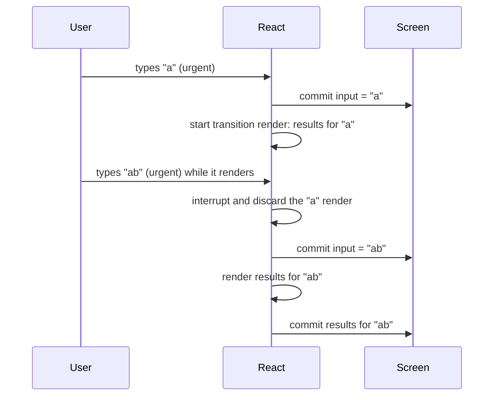
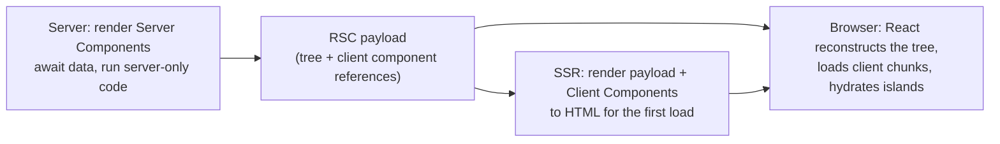

## این فصل درباره‌ی چیست

فصل‌های قبل درباره‌ی نوشتن Componentها بودند. این فصل درباره‌ی این است که **کی و کجا** اجرا می‌شوند:

- **Render همزمان (Concurrent Rendering)**: React می‌تواند UI جدید را در پس‌زمینه آماده کند، این کار را برای چیزی فوری قطع کند و اگر کهنه شد دورش بریزد. با `useTransition` و `useDeferredValue` کنترلش می‌کنید.
- **Suspense**: یک Component می‌تواند بگوید «هنوز آماده نیستم» و React برای آن بخش از درخت یک fallback نشان می‌دهد.
- **Render روی سرور**: SSR، Streaming و Hydration، Componentها را قبل از بارگذاری JavaScript به HTML تبدیل می‌کنند.
- **React Server Components**: Componentهایی که *فقط* روی سرور اجرا می‌شوند و کدشان هیچ‌وقت به مرورگر فرستاده نمی‌شود.

این چهار ایده روی هم ساخته شده‌اند و روی [Fiber و Laneها](/react/rendering). مصاحبه‌های Senior تقریباً همیشه حداقل به یکی‌شان می‌رسند.

## Render همزمان

### مشکل: Render، Main Thread را مسدود می‌کند

قبل از React 18، Render **همگام (Synchronous)** بود: وقتی React شروع به Render یک به‌روزرسانی می‌کرد، کل درخت را تمام می‌کرد و تا آن موقع مرورگر نمی‌توانست کار دیگری بکند. در یک جعبه‌ی جستجو که ۲۰٬۰۰۰ آیتم را فیلتر می‌کند تایپ کنید؛ هر کلید مثلاً ۲۰۰ میلی‌ثانیه Main Thread را مسدود می‌کند. input یخ می‌زند و حروف دسته‌دسته ظاهر می‌شوند.

Debounce مشکل را با کمتر Render کردن پنهان می‌کند، ولی Render وقتی بالاخره اتفاق بیفتد باز هم مسدود می‌کند. چیزی که می‌خواهیم فرق دارد: **لیست سنگین را Render کن بدون اینکه جلوی تایپ را بگیری**.

### ایده: به‌روزرسانی فوری و غیرفوری

React همزمان به‌روزرسانی‌ها را دو دسته می‌کند:

- به‌روزرسانی‌های **فوری (Urgent)** تعامل مستقیم را نشان می‌دهند: تایپ، کلیک، فشردن. کاربر انتظار دارد فوراً اتفاق بیفتند.
- به‌روزرسانی‌های **Transition** (گذار) UI را از یک نما به نمای دیگر می‌برند: نتیجه‌های فیلترشده، محتوای یک تب جدید. کمی تأخیر اشکالی ندارد؛ input یخ‌زده دارد.

Renderهای Transition در **تکه‌های کوچک** انجام می‌شوند: React چند Fiber را Render می‌کند و بعد (تقریباً هر ۵ میلی‌ثانیه) چک می‌کند آیا کار مهم‌تری منتظر است ([Work Loop](/react/rendering)). اگر کاربر دوباره تایپ کند، React آن Render نیمه‌کاره را **متوقف یا رها** می‌کند، کلید را مدیریت می‌کند و بعد Transition را با آخرین State از نو شروع می‌کند. تا Render مربوط به Transition تمام نشود هیچ چیز Commit نمی‌شود، پس کاربر هیچ‌وقت صفحه‌ی نیمه‌Renderشده نمی‌بیند.



### useTransition

<Api name="useTransition()" sig="const [isPending, startTransition] = useTransition()" returns="یک فلگ که تا وقتی Transitionی در انتظار است `true` است، و تابعی که Transition را شروع می‌کند." mutates="خیر">

- آرگومانی نمی‌گیرد.
- `isPending`: از لحظه‌ای که `startTransition` را صدا می‌زنید تا وقتی Render مربوط به Transition، Commit شود `true` است. از آن برای نشان دادن اینکه کاری در جریان است استفاده کنید، بدون پنهان کردن UI فعلی.
- `startTransition(action)`: تابع `action` را فوراً صدا می‌زند؛ هر به‌روزرسانی Stateی که **به‌صورت همگام داخل آن** زمان‌بندی شود Transition علامت می‌خورد. در React 19 این تابع می‌تواند async باشد ([Actionها](/react/react-19))؛ به‌روزرسانی‌های بعد از `await` یک `startTransition` دیگر لازم دارند.
- Setterهای State برای **inputهای Controlled نباید Transition باشند**: input باید حرف تایپ‌شده را فوراً نشان دهد.
- اگر همان State حین یک Transition در انتظار، یک به‌روزرسانی فوری بگیرد، اول فوری اعمال می‌شود و Transition روی آن دوباره Render می‌شود.

</Api>

یک `startTransition` مستقل هم از `react` Export می‌شود برای کدی که بیرون از Componentهاست (یک Router، یک Store). همان‌طور کار می‌کند ولی `isPending` نمی‌دهد.

```jsx live
import { memo, useState, useTransition } from 'react'

// عمداً کند: هر آیتم حدود ۰٫۳ میلی‌ثانیه وقت می‌سوزاند
const SlowItem = memo(function SlowItem({ text }) {
  const start = performance.now()
  while (performance.now() - start < 0.3) {}
  return <li>{text}</li>
})

const SlowList = memo(function SlowList({ query }) {
  const items = []
  for (let i = 0; i < 300; i++) items.push(<SlowItem key={i} text={`${query} result #${i}`} />)
  return <ul style={{ height: 120, overflow: 'auto' }}>{items}</ul>
})

export default function App() {
  const [text, setText] = useState('') // فوری: چیزی که input نشان می‌دهد
  const [query, setQuery] = useState('') // Transition: چیزی که لیست نشان می‌دهد
  const [useT, setUseT] = useState(true)
  const [isPending, startTransition] = useTransition()

  function handleChange(e) {
    setText(e.target.value) // همیشه فوری
    if (useT) startTransition(() => setQuery(e.target.value))
    else setQuery(e.target.value) // هر کلید حدود ۱۰۰ میلی‌ثانیه تایپ را مسدود می‌کند
  }

  return (
    <>
      <label>
        <input type="checkbox" checked={useT} onChange={(e) => setUseT(e.target.checked)} /> use a transition
      </label>
      <p>
        <input value={text} onChange={handleChange} placeholder="type fast…" />{' '}
        {isPending && <span>updating…</span>}
      </p>
      <div style={{ opacity: isPending ? 0.5 : 1 }}>
        <SlowList query={query} />
      </div>
    </>
  )
}
```

وقتی تیک خاموش است سریع تایپ کنید: input گیر می‌کند. تیک را بزنید: input روان می‌ماند، لیست پشت سرش می‌رسد و وقتی کهنه است کم‌رنگ می‌شود.

### useDeferredValue

گاهی به‌روزرسانی State دست شما نیست: مقدار به شکل prop یا از یک Hook می‌رسد. **`useDeferredValue`** اجازه می‌دهد بخشی از UI از یک مقدار **عقب بماند**.

<Api name="useDeferredValue()" sig="const deferred = useDeferredValue(value, initialValue?)" returns="در Renderهای فوری مقدار قبلی؛ بعد آخرین مقدار که در یک Transition پس‌زمینه Render می‌شود." mutates="خیر">

- `value`: مقداری که می‌خواهید عقب بیفتد؛ معمولاً یک Primitive یا یک Object Memoizeشده (Object جدید در هر Render، Render پس‌زمینه را هر بار از نو شروع می‌کند).
- `initialValue` (اختیاری، React 19): مقداری برای اولین Render Component، قبل از هر Render معوق. بدون آن، Render اول همان `value` را استفاده می‌کند.
- در یک به‌روزرسانی، React اول با مقدار معوق **قدیمی** دوباره Render می‌کند (سریع، چون فرزندان Memoizeشده رد می‌شوند)، آن را Commit می‌کند و بعد یک Render پس‌زمینه با مقدار جدید شروع می‌کند. اگر `value` قبل از تمام شدنش دوباره عوض شود، Render پس‌زمینه از نو شروع می‌شود.
- فقط وقتی کمک می‌کند که فرزند کند در `memo` پیچیده شده باشد (یا React Compiler کامپایلش کرده باشد)؛ وگرنه Render فوری به هر حال فرزند کند را Re-render می‌کند.

</Api>

```jsx live
import { memo, useDeferredValue, useState } from 'react'

const SlowList = memo(function SlowList({ query }) {
  const start = performance.now()
  while (performance.now() - start < 80) {} // فرض کنید لیست سنگین است
  return <p>Results for “{query}”</p>
})

export default function App() {
  const [query, setQuery] = useState('')
  const deferredQuery = useDeferredValue(query)
  const isStale = query !== deferredQuery // لیست یک عبارت قدیمی‌تر را نشان می‌دهد

  return (
    <>
      <input value={query} onChange={(e) => setQuery(e.target.value)} placeholder="type fast…" />
      <div style={{ opacity: isStale ? 0.5 : 1, transition: 'opacity 0.2s' }}>
        <SlowList query={deferredQuery} />
      </div>
    </>
  )
}
```

| | `useTransition` | `useDeferredValue` |
| --- | --- | --- |
| چه چیزی را می‌پیچید | **به‌روزرسانی State** | **مقداری** که می‌خوانید |
| کی استفاده کنید | وقتی Setter را خودتان صدا می‌زنید (Event Handler، Action) | وقتی مقدار از props، یک Hook یا یک کتابخانه می‌آید |
| نشانه‌ی در انتظار | `isPending` | `value !== deferredValue` |
| پشتیبانی از کار Async | بله (Actionها) | خیر |

<Callout type="note">
**Transition در برابر Debounce/Throttle.** Debounce یک زمان ثابت صبر می‌کند و همیشه کل کار را انجام می‌دهد؛ روی دستگاه سریع تأخیر بیهوده است و روی دستگاه کند باز هم مسدود می‌کند. Transition فوراً شروع می‌شود، خودش را با دستگاه تطبیق می‌دهد و قابل قطع است. Debounce هنوز برای محدود کردن **درخواست‌های شبکه** درست است؛ Transition برای هزینه‌ی **Render** است.
</Callout>

## Suspense

### اعلام وضعیت‌های بارگذاری

**`<Suspense>`** اجازه می‌دهد بخشی از درخت منتظر چیزی (کد، داده، تصویر) بماند و یک fallback نشان دهد، به‌جای اینکه هر Component `isLoading` خودش را مدیریت کند.

<Api name="<Suspense>" sig="<Suspense fallback={node}>…</Suspense>" returns="فرزندانش، یا تا وقتی یکی از فرزندان Suspend است، fallback." mutates="خیر">

- `children`: UIی که ممکن است Suspend شود.
- `fallback`: چیزی که به‌جایش نشان داده می‌شود؛ معمولاً Skeleton یا Spinner. می‌تواند هر React Nodeی باشد، از جمله `null`.
- یک Component وقتی **Suspend** می‌شود که چیزی را بخواند که هنوز آماده نیست: Component از نوع [`lazy`](/react/performance) که کدش در حال بارگذاری است، Promise در انتظاری که با [`use`](/react/react-19) خوانده شده، یا داده از یک کتابخانه یا Framework سازگار با Suspense. Fetch داخل Effect، Suspend **نمی‌کند**.
- React **نزدیک‌ترین** مرز Suspense بالای Component معلق را نشان می‌دهد. وقتی همه‌ی داخلش آماده شد، fallback یک‌جا جایگزین می‌شود.
- حین Suspend، در اولین Mount، State فرزندان **نگه داشته نمی‌شود** (چیزی برای نگه داشتن نیست)، اما در به‌روزرسانی‌های بعدی، مرزی که قبلاً نمایش داده شده Stateش را پشت fallback پنهان نگه می‌دارد.

</Api>

### مرزهای تودرتو: نمایش مرحله‌به‌مرحله

یک مرز یعنی «تا وقتی همه چیز آماده نشده هیچ چیز نشان نده». مرزهای تودرتو اجازه می‌دهند صفحه را با ترتیبی که طراحی کرده‌اید نمایش دهید:

```jsx live
import { Suspense, use, useState } from 'react'

const cache = new Map()
function load(key, ms) {
  // بر اساس key کش می‌شود، پس در هر Render همان Promise برمی‌گردد
  if (!cache.has(key)) cache.set(key, new Promise((r) => setTimeout(() => r(`${key} ✓`), ms)))
  return cache.get(key)
}

function Part({ name, ms }) {
  const value = use(load(name, ms))
  return <p>{value}</p>
}

export default function App() {
  const [run, setRun] = useState(0)
  return (
    <>
      <button onClick={() => { cache.clear(); setRun(run + 1) }}>reload</button>
      <div key={run}>
        <Suspense fallback={<p>⏳ loading the page shell…</p>}>
          <Part name="header" ms={400} />
          <Suspense fallback={<p>⏳ loading posts…</p>}>
            <Part name="posts" ms={1500} />
          </Suspense>
          <Suspense fallback={<p>⏳ loading sidebar…</p>}>
            <Part name="sidebar" ms={900} />
          </Suspense>
        </Suspense>
      </div>
    </>
  )
}
```

Header بعد از ۰٫۴ ثانیه همراه با دو fallback داخلی ظاهر می‌شود، Sidebar در ۰٫۹ ثانیه و پست‌ها در ۱٫۵ ثانیه. هر مرز یک واحد بارگذاری مستقل است. مرزها را دور **چیزی که کاربر یک واحد می‌بیند** طراحی کنید: برای هر بخش معنادار یک Spinner، نه برای هر Component.

### Transitionها UI قدیمی را به‌جای fallback نگه می‌دارند

اگر مرزی که **از قبل نمایش داده شده** به‌خاطر یک به‌روزرسانی عادی (فوری) Suspend شود، React محتوایش را با fallback عوض می‌کند که ممکن است مثل یک پرش حس شود. اگر به‌روزرسانی یک **Transition** باشد، React محتوای فعلی را تا آماده شدن محتوای جدید نشان می‌دهد (و `isPending` اجازه می‌دهد یک نشانگر ظریف نشان دهید). برای همین Routerها ناوبری را در `startTransition` می‌پیچند: به‌جای یک Spinner خالی، روی صفحه‌ی قبلی می‌مانید تا صفحه‌ی جدید بتواند Render شود.

### ترتیب نمایش و Throttling

برای جلوگیری از UI «پاپ‌کورنی»، React نمایش‌ها را **Throttle** می‌کند: مرزهایی که نزدیک به هم آماده می‌شوند با هم نمایش داده می‌شوند و وقتی یک fallback نمایش داده شد حداقل مدتی (حدود ۳۰۰ میلی‌ثانیه) می‌ماند تا چشمک نزند. در React 19، وقتی یکی از خواهر و برادرها Suspend شود، React فوراً fallback را Commit می‌کند و بعد بقیه را در پس‌زمینه **از قبل گرم (Pre-warm)** می‌کند تا درخواست‌های داده‌ی آن‌ها هم زود شروع شوند، نه با تأخیر.

## Render روی سرور

### چرا روی سرور Render کنیم

یک برنامه‌ی Render سمت Client (CSR) یک صفحه‌ی HTML تقریباً خالی و یک Bundle بزرگ JavaScript می‌فرستد. کاربر تا وقتی JavaScript دانلود، Parse و اجرا نشود و داده نگیرد هیچ چیز نمی‌بیند. این به **First Contentful Paint** و [LCP](/tooling/web-performance) ضربه می‌زند، و موتورهای جستجو و پیش‌نمایش لینک‌ها صفحه‌ی خالی می‌بینند.

**Server-side Rendering (SSR)** Componentها را روی سرور اجرا می‌کند تا HTML بسازد، پس مرورگر می‌تواند فوراً محتوا را نشان دهد. بعد JavaScript بارگذاری می‌شود و آن HTML را **Hydrate** می‌کند تا تعاملی شود.

| راهبرد | HTML کجا ساخته می‌شود | مناسب برای | هزینه |
| --- | --- | --- | --- |
| **CSR** (سمت Client) | در مرورگر | برنامه‌های پشت Login، ابزارهای خیلی تعاملی | اولین Paint کند، SEO ضعیف |
| **SSR** (برای هر درخواست) | روی سرور، در هر درخواست | صفحه‌های شخصی‌سازی‌شده یا پرتغییر | کار سرور در هر درخواست |
| **SSG** (تولید ایستا) | در زمان Build | مستندات، وبلاگ، صفحه‌های بازاریابی | برای به‌روزرسانی Build دوباره |
| **ISR** (ایستای تدریجی) | در زمان Build، بعد از N ثانیه در پس‌زمینه بازسازی می‌شود | کاتالوگ‌های بزرگ که گاهی عوض می‌شوند | پشتیبانی Framework/Host |
| **Streaming SSR** | روی سرور، تکه‌تکه با آماده شدن مرزهای Suspense فرستاده می‌شود | صفحه‌هایی با بخش‌های کند | پشتیبانی Streaming از سر تا ته |
| **Partial Pre-rendering** | پوسته‌ی ثابت در زمان Build + حفره‌های پویا در هر درخواست Stream می‌شوند | صفحه‌های بیشتر ثابت با چند بخش پویا | پشتیبانی Framework (`prerender` + `resume`) |

### Hydration

**Hydration** یعنی React به‌جای ساختن DOM جدید، به HTMLی که سرور Render کرده وصل شود: Componentها را در مرورگر Render می‌کند، هم‌زمان روی DOM موجود جلو می‌رود، چک می‌کند جور باشند و Event Listenerها و Refها را وصل می‌کند.

```jsx
// نقطه‌ی ورود Client برای صفحه‌ای که روی سرور Render شده
import { hydrateRoot } from 'react-dom/client'

hydrateRoot(document.getElementById('root'), <App />, {
  onRecoverableError: (error) => report(error), // مثلاً Mismatchهایی که React خودش درست کرد
})
```

<Steps>
<Step title="سرور HTML را Render می‌کند">
`renderToPipeableStream(<App />)` (Node) یا `renderToReadableStream(<App />)` (Web Streams: Deno، Bun، Edge Runtimeها، Node 18 به بعد) HTML می‌سازد. Effectها روی سرور اجرا نمی‌شوند و Event Handlerها هم همین‌طور.
</Step>
<Step title="مرورگر HTML را نشان می‌دهد">
صفحه دیده می‌شود، اما دکمه‌ها هنوز کار نمی‌کنند: هیچ Listenerی نیست.
</Step>
<Step title="JavaScript بارگذاری و hydrateRoot اجرا می‌شود">
React همان درخت را در مرورگر Render می‌کند و به‌جای ساختن DOM Nodeها، همان‌های موجود را به کار می‌گیرد.
</Step>
<Step title="Effectها اجرا می‌شوند و صفحه تعاملی است">
از اینجا به بعد یک برنامه‌ی معمولی React سمت Client است.
</Step>
</Steps>

### Hydration Mismatch

Hydration فرض می‌کند اولین Render سمت Client **دقیقاً همان خروجی** سرور را می‌سازد. اگر نسازد، React یک خطای Mismatch با Diff ثبت می‌کند و برای مرز Suspense مربوط (یا کل Root) HTML سرور را دور می‌ریزد و روی Client Render می‌کند؛ که کندتر است و ممکن است پرش داشته باشد.

علت‌های رایج و راه‌حل‌ها:

| علت | راه‌حل |
| --- | --- |
| `Date.now()`، `new Date().toLocaleString()`، `Math.random()` حین Render | مقدار را از سرور پاس دهید، یا بعد از Mount نشانش دهید (`useEffect` + State) |
| `typeof window !== 'undefined' ? A : B` حین Render | اول همان چیز را Render کنید و در یک Effect عوضش کنید؛ یا برای بخش‌های فقط Client از `use(browser())` استفاده کنید ([19.3](/react/react-19)) |
| خواندن `localStorage` (Theme، احراز هویت) حین Render | در Effect بخوانید، یا از Cookieی استفاده کنید که سرور هم بتواند بخواند |
| تودرتویی نامعتبر HTML (`<div>` داخل `<p>`، `<a>` داخل `<a>`) | Markup را درست کنید: Parser مرورگر قبل از اینکه React ببیند آن را جابه‌جا می‌کند |
| افزونه‌های مرورگر که DOM را عوض می‌کنند | React 19 بیشترشان را در `<head>`/`<body>` نادیده می‌گیرد؛ کاری لازم نیست |

برای یک تفاوت اجتناب‌ناپذیر (یک Timestamp)، `suppressHydrationWarning` را به همان Element اضافه کنید. فقط یک سطح عمق دارد و فقط برای متن و Attributeها کار می‌کند.

الگوی رایج «فقط Client»:

```jsx
function LocalTime({ iso }) {
  const [text, setText] = useState(null) // سرور و اولین Render سمت Client یکی‌اند: null
  useEffect(() => setText(new Date(iso).toLocaleTimeString()), [iso])
  return <time dateTime={iso}>{text ?? '—'}</time>
}
```

### Streaming SSR و Selective Hydration

با `renderToString` (API قدیمی)، سرور باید قبل از فرستادن هر HTMLی منتظر **همه‌ی** داده‌ها بماند و Client باید **کل** صفحه را Hydrate کند تا هر بخشی تعاملی شود. دو Waterfall.

Streaming هر دو را با مرزهای Suspense حل می‌کند:

1. سرور HTML پوسته را فوراً می‌فرستد، با fallback هر جا که مرزها هنوز منتظرند.
2. وقتی داده‌ی یک مرز آماده شد، سرور HTML آن را در همان پاسخ Stream می‌کند، به‌اضافه‌ی یک Script کوچک داخلی که آن را سر جایش می‌گذارد. درخواست اضافه‌ای در کار نیست.
3. **Selective Hydration** (Hydration انتخابی): Client هر مرز را مستقل و به‌محض رسیدن کد و HTMLش Hydrate می‌کند. اگر کاربر روی بخشی کلیک کند که هنوز Hydrate نشده، React **Hydrate کردن همان مرز را مقدم می‌کند** و بعد کلیک را دوباره اجرا (Replay) می‌کند.

```js
// سرور Node (Express) با Streaming
import { renderToPipeableStream } from 'react-dom/server'

app.get('/', (req, res) => {
  const { pipe } = renderToPipeableStream(<App />, {
    bootstrapScripts: ['/client.js'], // نقطه‌ی ورود hydrateRoot
    onShellReady() {
      // همه چیز بیرون از مرزهای Suspense آماده است: ارسال را شروع کن
      res.setHeader('Content-Type', 'text/html')
      pipe(res)
    },
    onShellError(error) {
      res.status(500).send('<h1>Something went wrong</h1>')
    },
    onError(error) {
      console.error(error) // خطاهای داخل مرزها: آن مرزها به Render سمت Client برمی‌گردند
    },
  })
})
```

`onAllReady` وقتی اجرا می‌شود که همه چیز (از جمله همه‌ی مرزها) Render شده باشد: برای Crawlerها یا تولید ایستا، که HTML کامل می‌خواهید، به‌جای `onShellReady` از آن استفاده کنید.

## React Server Components

### مشکل SSR به‌تنهایی

SSR روی سرور HTML می‌سازد، اما **کد همه‌ی Componentها همچنان برای Hydration به مرورگر فرستاده می‌شود**. Component یک پست وبلاگ که از یک کتابخانه‌ی Markdown سیصد کیلوبایتی و یک Syntax Highlighter استفاده می‌کند، هر دو را برای هر بازدیدکننده می‌فرستد، فقط برای اینکه HTMLی را که از قبل دارند دوباره Render کند. و گرفتن داده هم یا در یک Loader مخصوص Framework انجام می‌شود یا در مرورگر.

**React Server Components (RSC)** نوع جدیدی از Component اضافه می‌کنند که **فقط روی سرور** اجرا می‌شود (در زمان درخواست یا زمان Build) و **هیچ‌وقت Hydrate نمی‌شود**. کدش روی سرور می‌ماند؛ فقط خروجی Renderشده‌اش فرستاده می‌شود.

### Server Component و Client Component

| | Server Component (پیش‌فرض در Frameworkهای RSC) | Client Component (`'use client'`) |
| --- | --- | --- |
| کجا اجرا می‌شود | فقط روی سرور | روی سرور برای SSR، و در مرورگر |
| می‌تواند `async` باشد و مستقیم داده را `await` کند | ✅ | ❌ |
| دسترسی به دیتابیس، فایل‌سیستم، Secretها | ✅ | ❌ |
| State، Effect، Event Handler، APIهای مرورگر | ❌ | ✅ |
| JavaScriptش به مرورگر فرستاده می‌شود | ❌ هرگز | ✅ |
| می‌تواند Import کند | Server و Client Componentها | فقط Client Componentها (و کد مشترک) |

```jsx
// app/post/[id]/page.jsx — یک Server Component (Directive لازم نیست)
import { db } from '@/lib/db' // فقط سرور: هیچ‌وقت به مرورگر نمی‌رسد
import { marked } from 'marked' // ۳۰۰ کیلوبایتی که روی سرور می‌ماند
import LikeButton from './LikeButton' // یک Client Component

export default async function PostPage({ params }) {
  const post = await db.post.findUnique({ where: { id: params.id } }) // await داخل Component!
  return (
    <article>
      <h1>{post.title}</h1>
      <div dangerouslySetInnerHTML={{ __html: marked(post.body) }} />
      <LikeButton postId={post.id} initialLikes={post.likes} /> {/* یک جزیره‌ی تعاملی */}
    </article>
  )
}
```

```jsx
// LikeButton.jsx
'use client' // این فایل و هر چه Import کند کد Client می‌شود

import { useState } from 'react'

export default function LikeButton({ postId, initialLikes }) {
  const [likes, setLikes] = useState(initialLikes)
  return <button onClick={() => setLikes(likes + 1)}>♥ {likes}</button>
}
```

### 'use client' یک مرز را علامت می‌زند

`'use client'` یعنی «این Component فقط روی Client اجرا می‌شود» نیست (هنوز SSR می‌شود). یک **مرز Module** را علامت می‌زند: این فایل و هر Moduleی که Import کند بخشی از Bundle سمت Client است. آن را در **نقطه‌های ورود** جزیره‌های تعاملی می‌گذارید، نه روی همه‌ی فایل‌ها.

چه چیزی می‌تواند به شکل props از Server Component به Client Component از مرز رد شود: فقط **مقدارهای قابل Serialize**. رشته، عدد، Boolean، `null`/`undefined`، Object و آرایه‌ی ساده از همین‌ها، `Date`، `Map`، `Set`، Typed Arrayها، Promiseها (با `use` بخوانیدشان)، Elementهای JSX (از جمله Server Componentهایی که به‌عنوان `children` پاس می‌شوند) و **Server Functionها**. مجاز نیست: تابع‌های معمولی، نمونه‌های کلاس، Symbolهایی که سراسری نیستند.

### ترکیب از روی مرز

یک Client Component نمی‌تواند یک Server Component را `import` کند (Import کردن آن را کد Client می‌کند). اما می‌تواند آن را **به‌عنوان `children`** یا prop دیگری **بگیرد**، چون سرور اول Renderش می‌کند و نتیجه را پاس می‌دهد:

```jsx
// Server Component
<ClientTabs>
  <ServerRenderedReport /> {/* روی سرور Render شده و به شکل یک Element پاس داده می‌شود */}
</ClientTabs>
```

این همان [الگوی children](/react/patterns) در Composition است، این بار از روی شبکه.

### RSC Payload

خروجی چطور به مرورگر می‌رسد؟ سرور Server Componentها را به یک قالب فشرده‌ی Stream‌شدنی Render می‌کند به نام **RSC Payload** (که اغلب «Flight» صدایش می‌کنند): توصیفی از درخت که در آن Server Componentها از قبل به خروجی‌شان تبدیل شده‌اند، به‌اضافه‌ی **ارجاع (Reference)** به Client Componentها (کدام Module و Export باید بارگذاری شود) همراه propsشان.



موقع ناوبری، Framework فقط RSC Payload جدید را می‌گیرد و React **آن را در درخت موجود ادغام می‌کند**، پس State سمت Client در Client Componentها (یک Dropdown باز، متن تایپ‌شده) حفظ می‌شود.

### Server Functionها ('use server')

**Server Function** یک تابع async با علامت `'use server'` است که روی سرور اجرا می‌شود ولی از Client قابل صدا زدن است. Bundler آن را در Client با یک ارجاع جایگزین می‌کند؛ صدا زدنش یک درخواست POST با آرگومان‌های Serializeشده می‌فرستد.

```jsx
// actions.js
'use server'

export async function addComment(postId, formData) {
  const text = formData.get('text')
  if (!(await currentUser())) throw new Error('Not signed in') // همیشه احراز هویت را دوباره چک کنید: هر کسی می‌تواند صدایش بزند
  await db.comment.create({ data: { postId, text } })
}
```

```jsx
// یک Client Component
'use client'
import { addComment } from './actions'

export function CommentForm({ postId }) {
  return (
    <form action={addComment.bind(null, postId)}>
      <textarea name="text" />
      <button>Post</button>
    </form>
  )
}
```

وقتی به‌عنوان `action` فرم استفاده شود، **قبل از بارگذاری JavaScript** هم کار می‌کند (Progressive Enhancement): فرم مثل HTML ساده به سرور Post می‌شود. داخل `useActionState` هم وضعیت Pending و نتیجه را می‌دهد، مثل [Actionهای React 19](/react/react-19).

<Callout type="warning">
Server Function یک **Endpoint عمومی HTTP** است. داخلش آرگومان‌ها را اعتبارسنجی کنید و احراز هویت (Authentication) و مجوز (Authorization) را هر بار چک کنید، دقیقاً مثل یک API Route. Directive به نام `'use server'` آن را خصوصی نمی‌کند.
</Callout>

### cache و cacheSignal

در Server Componentها، `cache(fn)` از `react` یک تابع را **در طول یک درخواست سرور** Memoize می‌کند، پس چند Component می‌توانند `getUser(id)` را صدا بزنند و دیتابیس فقط یک بار خوانده شود. `cacheSignal()` (19.2) یک `AbortSignal` برمی‌گرداند که وقتی Render آن درخواست تمام یا رها شد Abort می‌شود، تا Fetchهایی را که کسی استفاده نمی‌کند لغو کنید.

```jsx
import { cache, cacheSignal } from 'react'

export const getUser = cache(async (id) => {
  const res = await fetch(`https://api.example.com/users/${id}`, { signal: cacheSignal() })
  return res.json()
})
```

### RSC در برابر SSR

اغلب با هم اشتباه گرفته می‌شوند و با هم کار می‌کنند:

- **SSR** جواب این سوال است: «Componentها را برای بارگذاری اول چطور به HTML تبدیل کنم؟» همه‌ی Componentها همچنان Hydrate می‌شوند.
- **RSC** جواب این سوال است: «کدام Componentها هیچ‌وقت نباید در مرورگر اجرا شوند؟» Server Componentها به RSC Payload Render می‌شوند، نه به HTML. در بارگذاری اول، SSR آن Payload را همراه Client Componentها به HTML تبدیل می‌کند.

می‌توانید SSR بدون RSC داشته باشید (صفحه‌های کلاسیک Next.js، Remix) و RSC بدون SSR (نادر، ولی ممکن). Frameworkهایی که امروز از RSC پشتیبانی می‌کنند: Next.js App Router، React Router (Framework Mode با پشتیبانی RSC)، Waku و بقیه‌ی Frameworkهایی که روی یکپارچگی Bundler ساخته شده‌اند؛ APIهای RSC در React برای Frameworkها طراحی شده‌اند، نه برای استفاده‌ی مستقیم در برنامه‌ها.

## اشتباه‌های رایج

<Callout type="mistake">
**پیچیدن State خود input در Transition.** `startTransition(() => setText(e.target.value))` روی یک input کنترل‌شده باعث کندی تایپ یا جا افتادن حروف می‌شود: input باید فوری به‌روز شود. دو State نگه دارید (متن فوری، Query معوق) یا از `useDeferredValue` استفاده کنید.
</Callout>

<Callout type="mistake">
**`useDeferredValue` بدون Memoize کردن فرزند کند.** اگر `<SlowList query={deferred} />` در `memo` پیچیده نشده باشد، Render فوری به هر حال آن را Re-render می‌کند و چیزی بهتر نمی‌شود.
</Callout>

<Callout type="mistake">
**گذاشتن `'use client'` روی همه چیز** (یا روی Root Layout). آن وقت هیچ چیز Server Component نیست و دوباره کل کد را می‌فرستید. مرزهای Client را تا برگ‌های تعاملی پایین ببرید.
</Callout>

<Callout type="mistake">
**Render کردن مقدارهای مخصوص مرورگر حین SSR.** `window.innerWidth`، `localStorage` یا `new Date()` حین Render، Mismatch می‌سازند. یک Placeholder ثابت Render کنید و بعد در یک Effect به‌روزش کنید.
</Callout>

## سوالات مصاحبه

<QA q="Render همزمان (Concurrent Rendering) چیست؟" level="senior" n={1}>
<Answer>

توانایی آماده کردن چند نسخه از UI در یک زمان و قطع کردن Render. Renderهای Transition در برش‌های کوچک زمانی اجرا می‌شوند؛ بین برش‌ها React چک می‌کند کار با اولویت بالاتری (ورودی کاربر) هست یا نه، و می‌تواند Render در جریان را متوقف یا دور بریزد تا آن را مدیریت کند و بعد با State تازه از نو شروع کند. تا یک Render تمام نشود هیچ چیز Commit نمی‌شود، پس UI یکدست می‌ماند. با `startTransition`، `useTransition`، `useDeferredValue` و Suspense فعال می‌شود.

</Answer>
<Deep>

در پشت صحنه به‌روزرسانی‌ها Lane می‌گیرند (`SyncLane`، `InputContinuousLane`، `DefaultLane`، `TransitionLanes`…). تابع `workLoopConcurrent` بین Fiberها `shouldYield()` را صدا می‌زند؛ یک به‌روزرسانی با اولویت بالاتر باعث می‌شود React درخت Work-in-progress را رها کند و از درخت فعلی دوباره شروع کند.

</Deep>
</QA>

<QA q="useTransition در برابر useDeferredValue؟" level="mid" n={2}>
<Answer>

هر دو کار را غیرفوری علامت می‌زنند. `useTransition` **به‌روزرسانی State**ی را که خودتان راه می‌اندازید می‌پیچد و `isPending` می‌دهد؛ از Actionهای Async هم پشتیبانی می‌کند. `useDeferredValue` **مقداری** را که دریافت می‌کنید (prop یا نتیجه‌ی Hook) می‌پیچد و نسخه‌ای برمی‌گرداند که در Renderهای فوری عقب می‌ماند؛ مقایسه‌اش با مقدار فعلی کهنه بودن را نشان می‌دهد. برای اینکه هر کدام کمک کند، فرزند کند باید Memoize شده باشد.

</Answer>
</QA>

<QA q="Suspense چطور کار می‌کند؟" level="mid" n={3}>
<Answer>

وقتی یک Component چیزی را می‌خواند که آماده نیست (کد lazy، Promise در انتظار از طریق `use`، یا یک منبع داده‌ی سازگار با Suspense)، Suspend می‌شود؛ React برای آن زیردرخت fallback نزدیک‌ترین مرز `<Suspense>` را Render می‌کند و وقتی منبع آماده شد دوباره تلاش می‌کند. مرزهای تودرتو UI را مرحله‌به‌مرحله نشان می‌دهند. اگر به‌روزرسانی یک Transition باشد، React به‌جای fallback محتوای قدیمی را نگه می‌دارد. روی سرور، مرزها واحدهای Streaming و Selective Hydration را تعیین می‌کنند.

</Answer>
</QA>

<QA q="Hydration چیست و علت Hydration Mismatch چیست؟" level="mid" n={4}>
<Answer>

Hydration یعنی React به HTMLی که سرور Render کرده وصل شود: همان Componentها را در مرورگر Render می‌کند، از DOM موجود استفاده می‌کند و Event Listenerها را وصل می‌کند. Mismatch وقتی پیش می‌آید که اولین Render سمت Client با HTML سرور فرق داشته باشد: زمان، مقدار تصادفی، چک `window`/`localStorage` حین Render، تودرتویی نامعتبر HTML. React 19 یک Diff ثبت می‌کند و برای آن مرز به Render سمت Client برمی‌گردد. راه‌حل: اول همان خروجی را Render کنید و در یک Effect به‌روزش کنید، یا برای یک متن اجتناب‌ناپذیر `suppressHydrationWarning`.

</Answer>
</QA>

<QA q="Streaming SSR و Selective Hydration چه مشکلی را حل می‌کنند؟" level="senior" n={5}>
<Answer>

با `renderToString` باید قبل از فرستادن HTML منتظر همه‌ی داده‌ها بمانید و قبل از اینکه چیزی تعاملی شود همه چیز را Hydrate کنید. Streaming (`renderToPipeableStream` / `renderToReadableStream`) پوسته را فوراً می‌فرستد و HTML هر مرز Suspense را وقتی آماده شد Stream می‌کند. Selective Hydration مرزها را مستقل Hydrate می‌کند و مرزی را که کاربر با آن تعامل دارد مقدم می‌کند و رویداد را بعداً Replay می‌کند.

</Answer>
</QA>

<QA q="React Server Components چیستند و چه فرقی با SSR دارند؟" level="senior" n={6}>
<Answer>

Server Componentها فقط روی سرور اجرا می‌شوند (می‌توانند async باشند و مستقیم به داده دسترسی داشته باشند) و هیچ‌وقت Hydrate نمی‌شوند، پس کد و وابستگی‌هایشان به مرورگر فرستاده نمی‌شود. به RSC Payload Render می‌شوند که درخت را توصیف می‌کند و به Client Componentها (با علامت `'use client'`) ارجاع می‌دهد که مرورگر بارگذاری و Hydrateشان می‌کند. SSR درباره‌ی ساختن HTML برای بارگذاری اول است؛ هر Componentی که SSR شود همچنان Hydrate می‌شود. مکمل هم‌اند: RSC تعیین می‌کند چه چیزی کجا اجرا شود و SSR نتیجه را به HTML تبدیل می‌کند.

</Answer>
<FollowUp>

چه چیزی را می‌شود از Server Component به Client Component پاس داد؟ props قابل Serialize: Primitiveها، Object/آرایه‌ی ساده، Date، Map، Set، Promiseها، JSX و Server Functionها؛ نه تابع‌های معمولی یا نمونه‌های کلاس.

</FollowUp>
</QA>

<QA q="Server Function چیست و باید مراقب چه چیزی باشید؟" level="senior" n={7}>
<Answer>

یک تابع async با علامت `'use server'` که روی سرور اجرا می‌شود ولی از کد Client صدا زده می‌شود یا به‌عنوان Action فرم پاس داده می‌شود؛ Framework فراخوانی‌ها را به درخواست POST تبدیل می‌کند. Progressive Enhancement را برای فرم‌ها ممکن می‌کند. در عمل یک Endpoint عمومی است، پس در هر فراخوانی باید ورودی را اعتبارسنجی و احراز هویت/مجوز را چک کند.

</Answer>
</QA>

## جمع‌بندی

<Recap>

- Render همزمان، Transitionها را در برش‌های قابل قطع Render می‌کند؛ به‌روزرسانی‌های فوری (تایپ) جلو می‌افتند و هیچ چیز نیمه‌کاره Commit نمی‌شود.
- `useTransition` به‌روزرسانی‌هایی را که خودتان راه می‌اندازید می‌پیچد (`isPending`، Actionهای Async)؛ `useDeferredValue` اجازه می‌دهد مقدار دریافتی عقب بماند.
- هر دو لازم دارند فرزند کند Memoize شده باشد؛ هیچ‌وقت State خود input کنترل‌شده را Transition نکنید.
- `<Suspense>` تا وقتی فرزندان منتظر کد یا داده‌اند نزدیک‌ترین fallback را نشان می‌دهد؛ برای نمایش مرحله‌ای مرزها را تودرتو کنید.
- Transitionها به‌جای برگشتن به Spinner، محتوای قابل دیدن را نگه می‌دارند.
- SSR اول HTML را می‌فرستد؛ Hydration آن را تعاملی می‌کند و اولین Render یکسان لازم دارد.
- Mismatch از زمان، تصادف، چک‌های مخصوص مرورگر و HTML نامعتبر می‌آید؛ خروجی ثابت Render کنید و بعد در Effect به‌روز کنید.
- Streaming SSR و Selective Hydration در سطح مرزهای Suspense کار می‌کنند و چیزی را که کاربر لمس می‌کند مقدم می‌کنند.
- Server Componentها فقط روی سرور اجرا می‌شوند، می‌توانند async باشند و JavaScript نمی‌فرستند؛ `'use client'` مرز Client را علامت می‌زند.
- Server Functionها (`'use server'`) Endpoint عمومی‌اند: داخلشان اعتبارسنجی و مجوز را چک کنید.

</Recap>
