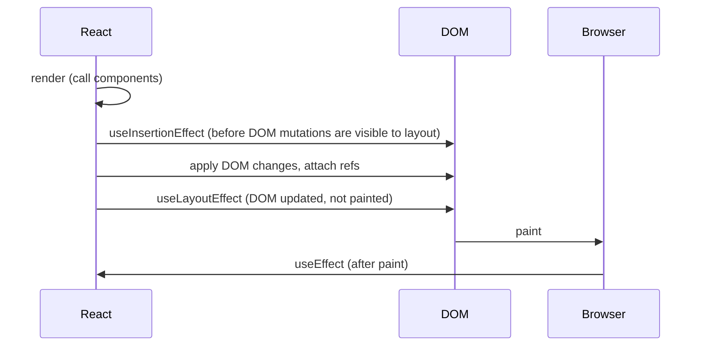

## اصلاً چرا Effect داریم

قرار است هر Component یک تابع **خالص** باشد: props و State را بگیرد، JSX برگرداند و کار دیگری نکند ([خالص بودن](/react/fundamentals)). کارهایی که *به‌خاطر یک کار کاربر* اتفاق می‌افتند هم جایشان Event Handler است: کلیک پیام می‌فرستد، Submit فرم را ذخیره می‌کند.

اما بعضی کدها باید اجرا شوند *چون Component روی صفحه است*، مهم نیست کدام کلیک باعثش شده. تا وقتی `ChatRoom` دیده می‌شود باید به سرور چت وصل باشد. وقتی prop `isPlaying` برابر `true` است، `<video>` باید پخش شود. عنوان تب باید با صفحه‌ی فعلی یکی باشد. اینجا کسی چیزی را «کلیک» نکرده؛ خود Render شدن لازم دارد که دنیای بیرون همگام بماند.

**Effect** دقیقاً همین است: کدی که **Component را با یک سیستم بیرونی همگام (Synchronize) نگه می‌دارد** (شبکه، یک API مرورگر، تایمر، یک ویجت Third-party، یک کتابخانه‌ی غیر React)، آن هم بعد از اینکه React صفحه را به‌روز کرد.

```text
 render (pure)          commit (React updates DOM)        after paint
┌──────────────┐       ┌─────────────────────────┐       ┌───────────────────────────────┐
│ compute JSX  │ ───►  │ insert / update nodes   │ ───►  │ useEffect: connect, subscribe, │
│ no side      │       │ attach refs             │       │ start timers, sync a widget    │
│ effects      │       │ useLayoutEffect         │       │                               │
└──────────────┘       └─────────────────────────┘       └───────────────────────────────┘
```

<Callout type="note">
«Effect» با E بزرگ یعنی همان قابلیت مشخص React (`useEffect` و خانواده‌اش). «Side Effect» (اثر جانبی) به‌طور کلی هر تغییری در دنیای بیرون است. Effectها یکی از دو جایی هستند که Side Effect مجاز است؛ جای دیگر Event Handlerها هستند و معمولاً انتخاب بهتری‌اند.
</Callout>

## useEffect

<Api name="useEffect()" sig="useEffect(setup, dependencies?)" returns="`undefined`." mutates="خیر (فقط اجرای setup را بعد از Commit زمان‌بندی می‌کند)">

- `setup`: تابعی که منطق Effect را دارد و می‌تواند یک تابع **Cleanup** (پاک‌سازی) برگرداند. React تابع `setup` را بعد از اضافه شدن Component به صفحه اجرا می‌کند (در بیشتر موارد بعد از Paint مرورگر). قبل از اجرای دوباره با مقدارهای جدید، Cleanup قبلی را با مقدارهای *قدیمی* صدا می‌زند. وقتی Component حذف شود، Cleanup برای آخرین بار اجرا می‌شود.
- `setup` نباید `async` باشد: تابع `async` یک Promise برمی‌گرداند، ولی React یا هیچ‌چیز یا یک تابع Cleanup انتظار دارد. یک تابع async *داخل* setup تعریف و صدایش کنید.
- `dependencies` (اختیاری): لیست همه‌ی مقدارهای Reactive (props، State و متغیرها یا تابع‌هایی که در بدنه‌ی Component تعریف شده‌اند) که `setup` می‌خواند. React هر آیتم را با مقدار قبلی‌اش با [`Object.is`](/javascript/types-coercion) مقایسه می‌کند. طول لیست باید ثابت باشد و مستقیم همان‌جا نوشته شود.
  - **بدون آرایه**: Effect بعد از **هر** Commit اجرا می‌شود.
  - **`[]`**: فقط یک بار بعد از Mount اجرا می‌شود (و در Unmount پاک‌سازی می‌کند).
  - **`[a, b]`**: بعد از Mount و بعد از هر Commitی که `a` یا `b` در آن عوض شده باشد.

</Api>

کوچک‌ترین Effect مفید، عنوان تب را با State همگام نگه می‌دارد:

```jsx live
import { useEffect, useState } from 'react'

export default function App() {
  const [count, setCount] = useState(0)

  useEffect(() => {
    // بعد از به‌روز شدن DOM، هر بار که count عوض شود اجرا می‌شود
    document.title = `Clicked ${count} times`
    console.log('effect: title set to', count)
  }, [count])

  return <button onClick={() => setCount(count + 1)}>Clicked {count} times</button>
}
```

اول کار، Console دو بار `effect: title set to 0` نشان می‌دهد. این باگ نیست: این دموها داخل [StrictMode](#strictmode-در-حالت-توسعه-هر-effect-را-دو-بار-اجرا-میکند) Render می‌شوند که در حالت توسعه یک بار Mount، Unmount و دوباره Mount می‌کند.

### سه شکل آرایه‌ی Dependency

یک Effect بسته به آرگومان دومش رفتار کاملاً متفاوتی دارد. روی دکمه‌ها کلیک کنید و Console را ببینید:

```jsx live
import { useEffect, useState } from 'react'

export default function App() {
  const [a, setA] = useState(0)
  const [b, setB] = useState(0)

  useEffect(() => {
    console.log('no array   → after every render')
  })
  useEffect(() => {
    console.log('[]         → only after mount')
  }, [])
  useEffect(() => {
    console.log('[a]        → after mount and when a changes, a =', a)
  }, [a])

  return (
    <>
      <button onClick={() => { console.clear(); setA(a + 1) }}>a = {a}</button>{' '}
      <button onClick={() => { console.clear(); setB(b + 1) }}>b = {b}</button>
    </>
  )
}
```

کلیک روی `b` فقط خط اول را چاپ می‌کند. کلیک روی `a` خط اول و سوم را. Effect با `[]` دیگر هیچ‌وقت اجرا نمی‌شود.

<Callout type="warning">
Dependencyها چیزی نیستند که *انتخاب کنید* تا بگویید Effect کی اجرا شود. آن‌ها **توصیف چیزهایی هستند که کد می‌خواند**. اگر setup از `roomId` استفاده می‌کند، `roomId` باید در آرایه باشد و قانون Linter یعنی `react-hooks/exhaustive-deps` همین را به شما می‌گوید. برای اینکه Effect کمتر اجرا شود، *کد* را طوری عوض کنید که به آن مقدار نیازی نداشته باشد؛ هیچ‌وقت درباره‌ی آرایه دروغ نگویید.
</Callout>

## Cleanup

بیشتر Effectها چیزی را شروع می‌کنند که باید متوقف شود: یک اتصال، یک Subscription، یک تایمر، یک Listener. تابعی که از setup **برمی‌گردانید** همان **Cleanup** است.

```jsx live
import { useEffect, useState } from 'react'

function Clock() {
  const [now, setNow] = useState(() => new Date())

  useEffect(() => {
    console.log('start interval')
    const id = setInterval(() => setNow(new Date()), 1000)
    // بدون این، هر Mount یک interval دیگر برای همیشه روشن جا می‌گذارد
    return () => {
      console.log('clear interval')
      clearInterval(id)
    }
  }, [])

  return <p>{now.toLocaleTimeString()}</p>
}

export default function App() {
  const [show, setShow] = useState(true)
  return (
    <>
      <button onClick={() => setShow(!show)}>{show ? 'Hide' : 'Show'} clock</button>
      {show && <Clock />}
    </>
  )
}
```

### Cleanup دقیقاً کی اجرا می‌شود

Cleanup فقط در دو حالت اجرا می‌شود:

1. **قبل از اجرای دوباره‌ی Effect** چون یک Dependency عوض شده. Cleanup مقدارهای Render *قبلی* را می‌بیند، چون Closureی است که در همان Render ساخته شده.
2. **وقتی Component، Unmount می‌شود.**

<Steps>
<Step title="Mount با roomId = 'general'">
setup اجرا می‌شود: `connect('general')`.
</Step>
<Step title="Re-render با roomId = 'travel'">
React می‌بیند Dependency عوض شده. اول Cleanup قدیمی: `disconnect('general')`. بعد setup جدید: `connect('travel')`.
</Step>
<Step title="Re-render با همان roomId">
Dependencyها طبق `Object.is` برابرند، پس هیچ چیز اجرا نمی‌شود.
</Step>
<Step title="Unmount">
آخرین Cleanup اجرا می‌شود: `disconnect('travel')`.
</Step>
</Steps>

```jsx live
import { useEffect, useState } from 'react'

function createConnection(room) {
  return {
    connect: () => console.log(`✅ connect to "${room}"`),
    disconnect: () => console.log(`❌ disconnect from "${room}"`),
  }
}

function ChatRoom({ roomId }) {
  useEffect(() => {
    const conn = createConnection(roomId)
    conn.connect()
    return () => conn.disconnect() // roomِ همین Render را به یاد دارد
  }, [roomId])
  return <h3>Welcome to {roomId}</h3>
}

export default function App() {
  const [roomId, setRoomId] = useState('general')
  const [open, setOpen] = useState(true)
  return (
    <>
      <select value={roomId} onChange={(e) => setRoomId(e.target.value)}>
        <option>general</option>
        <option>travel</option>
        <option>music</option>
      </select>{' '}
      <button onClick={() => setOpen(!open)}>{open ? 'Close' : 'Open'} chat</button>
      {open && <ChatRoom roomId={roomId} />}
    </>
  )
}
```

### به همگام‌سازی فکر کنید، نه به Lifecycle

Class Componentها عادتمان داده بودند که فکر کنیم «در Mount کار X، در Update کار Y، در Unmount کار Z». با Effectها سوال بهتر این است: **همگام‌سازی را چطور شروع کنم و چطور متوقفش کنم؟** Effect داخل `ChatRoom` اهمیتی نمی‌دهد که الان Mount است یا عوض شدن اتاق. فقط بلد است به *یک* اتاق وصل شود و از آن جدا شود. React این دو نیمه را هر چند بار که لازم باشد صدا می‌زند.

| فکر کردن با Lifecycle کلاس | فکر کردن با Effect |
| --- | --- |
| `componentDidMount`: وصل شو | setup: به `roomId` وصل شو |
| `componentDidUpdate`: اگر اتاق عوض شد، از قبلی جدا و به جدید وصل شو | (کار اضافه‌ای لازم نیست: React با عوض شدن `roomId` خودش Cleanup و setup را اجرا می‌کند) |
| `componentWillUnmount`: جدا شو | Cleanup: از `roomId` جدا شو |

هر Effect = یک فرایند همگام‌سازی مستقل. اگر یک Effect دو کار بی‌ربط انجام می‌دهد (وصل شدن به چت *و* فرستادن یک رویداد Analytics)، آن را به دو Effect با Dependencyهای خودشان بشکنید.

## StrictMode در حالت توسعه هر Effect را دو بار اجرا می‌کند

در حالت توسعه با `<StrictMode>`، React هر Component را Mount می‌کند، **بلافاصله Unmount می‌کند و دوباره Mount می‌کند**. پس شما setup ← Cleanup ← setup را می‌بینید. در Production فقط یک setup اجرا می‌شود.

هدف، پیدا کردن Cleanupهای جاافتاده است. اگر Effect شما وصل می‌شود ولی جدا نمی‌شود، این اجرای دوباره دو اتصال باز جا می‌گذارد و فوراً متوجه می‌شوید؛ نه در Production و بعد از اینکه کاربر چند بار بین صفحه‌ها رفت و برگشت.

<Callout type="mistake">
**راه‌حل غلط:** استفاده از یک Ref تا Effect «فقط یک بار» اجرا شود.

```jsx
const didRun = useRef(false)
useEffect(() => {
  if (didRun.current) return // فقط علامت بیماری را پنهان می‌کند
  didRun.current = true
  connect()
}, [])
```

این کار Mount دوباره را در حالت توسعه پنهان می‌کند، اما باگ اصلی سر جایش است: Component هیچ‌وقت جدا نمی‌شود و همان لحظه که واقعاً Unmount و دوباره Mount شود، نشتی (Leak) دارد. **راه درست:** یک Cleanup برگردانید که کار setup را خنثی کند. محک ساده است: setup ← Cleanup ← setup باید از دید کاربر دقیقاً مثل یک setup تنها باشد.
</Callout>

Cleanup درست به نوع Effect بستگی دارد:

| کاری که Effect می‌کند | کاری که Cleanup می‌کند |
| --- | --- |
| Subscribe به یک رویداد (`addEventListener`، `store.subscribe`) | Unsubscribe |
| شروع تایمر (`setTimeout`، `setInterval`) | `clearTimeout` / `clearInterval` |
| باز کردن یک اتصال | بستنش |
| شروع یک انیمیشن | برگرداندنش به مقدار اولیه |
| گرفتن داده | نادیده گرفتن یا لغو پاسخ کهنه ([پایین‌تر](#گرفتن-داده-در-effect)) |
| کنترل یک ویجت (`map.setZoom(z)`) | اغلب هیچ: دو بار صدا زدن با همان مقدار بی‌ضرر است |
| فرستادن رویداد Analytics | هیچ: یک تکرار در حالت توسعه مشکلی ندارد، Production یکی می‌فرستد |

چند کار واقعاً باید فقط یک بار در هر بار باز شدن برنامه انجام شوند (مثلاً راه‌اندازی یک SDK). جای این‌ها اصلاً داخل Component نیست: آن‌ها را در سطح بالای Module بنویسید یا با یک فلگ در سطح Module محافظت کنید.

## زمان اجرا: useEffect، useLayoutEffect و useInsertionEffect

React سه Hook برای Effect دارد که امضای یکسانی دارند. تنها فرقشان این است که **کی** در طول Commit اجرا می‌شوند ([زیرمرحله‌های Commit](/react/rendering)).



### useLayoutEffect

<Api name="useLayoutEffect()" sig="useLayoutEffect(setup, dependencies?)" returns="`undefined`." mutates="خیر">

- همان آرگومان‌ها و قانون‌های Cleanup که `useEffect` دارد.
- **به‌صورت همگام بعد از به‌روز شدن DOM و قبل از Paint مرورگر** اجرا می‌شود. هر به‌روزرسانی State داخلش هم همگام و قبل از Paint پردازش می‌شود.
- جلوی Paint را می‌گیرد، پس کد کند در آن برنامه را کند نشان می‌دهد. روی سرور هم کاری نمی‌کند (آنجا Layoutی وجود ندارد)، برای همین نباید انتخاب پیش‌فرض باشد.

</Api>

وقتی از آن استفاده کنید که باید **DOM را اندازه بگیرید و قبل از اینکه کاربر چیزی ببیند UI را اصلاح کنید**: جای Tooltip، برگرداندن Scroll، اندازه گرفتن متن برای انتخاب چیدمان. با `useEffect` ممکن است کاربر یک فریم با جای اشتباه ببیند (پرش یا Flicker).

```jsx live
import { useLayoutEffect, useRef, useState } from 'react'

function Tooltip({ text }) {
  const ref = useRef(null)
  const [width, setWidth] = useState(0)

  // قبل از Paint اندازه می‌گیریم تا اولین فریمی که کاربر می‌بیند از قبل وسط‌چین باشد
  useLayoutEffect(() => {
    setWidth(ref.current.getBoundingClientRect().width)
  }, [text])

  return (
    <div style={{ position: 'relative', height: 40 }}>
      <span
        ref={ref}
        style={{ position: 'absolute', left: `calc(50% - ${width / 2}px)`, padding: '4px 8px', background: '#334', color: 'white', borderRadius: 6 }}
      >
        {text}
      </span>
    </div>
  )
}

export default function App() {
  const [text, setText] = useState('Hi')
  return (
    <>
      <input value={text} onChange={(e) => setText(e.target.value)} />
      <Tooltip text={text} />
    </>
  )
}
```

### useInsertionEffect

<Api name="useInsertionEffect()" sig="useInsertionEffect(setup, dependencies?)" returns="`undefined`." mutates="خیر">

- همان امضا. **قبل از** Layout Effectها اجرا می‌شود، در لحظه‌ای که Refها هنوز وصل نشده‌اند و نمی‌شود State را عوض کرد.
- برای **کتابخانه‌های CSS-in-JS** ساخته شده که باید تگ‌های `<style>` را قبل از اینکه یک Layout Effect، Layout را بخواند تزریق کنند. کد برنامه تقریباً هیچ‌وقت لازمش ندارد.

</Api>

| Hook | کی اجرا می‌شود | جلوی Paint را می‌گیرد؟ | کاربرد معمول |
| --- | --- | --- | --- |
| `useInsertionEffect` | حین Commit، قبل از Layout Effectها | بله | تزریق `<style>` (فقط کتابخانه‌ها) |
| `useLayoutEffect` | بعد از تغییر DOM، قبل از Paint | بله | اندازه‌گیری DOM، جلوگیری از Flicker |
| `useEffect` | (معمولاً) بعد از Paint | خیر | بقیه‌ی کارها: Subscription، شبکه، تایمر |

<Callout type="note">
`useEffect` معمولاً بعد از Paint اجرا می‌شود، اما اگر Commit به‌خاطر یک ورودی گسسته‌ی کاربر (کلیک یا فشردن کلید) باشد، React آن را قبل از Paint اجرا می‌کند تا نتیجه‌ی تعامل یکدست باشد. به هیچ‌کدام از این دو زمان تکیه نکنید: اگر «قبل از Paint» لازم دارید، از `useLayoutEffect` استفاده کنید.
</Callout>

## Dependencyها با جزئیات

### Stale Closure: چرا Dependency جاافتاده باگ است

هر Render، props و State و تابع‌های خودش را دارد. Effect یک Closure است که مقدارهای همان Renderی را که در آن ساخته شده نگه داشته ([Closureها](/javascript/scope-closures)). اگر مقداری را از آرایه جا بیندازید، Effect برای همیشه مقدار *قدیمی* را نگه می‌دارد.

```jsx live
import { useEffect, useState } from 'react'

export default function App() {
  const [count, setCount] = useState(0)
  const [step, setStep] = useState(1)

  useEffect(() => {
    const id = setInterval(() => {
      // ❌ step در Dependencyها نیست: این Closure برای همیشه step = 1 را می‌بیند
      setCount((c) => c + step)
    }, 1000)
    return () => clearInterval(id)
  }, []) // eslint هشدار می‌دهد: React Hook useEffect has a missing dependency: 'step'

  return (
    <>
      <p>count: {count}</p>
      <label>
        step: <input type="number" value={step} onChange={(e) => setStep(Number(e.target.value))} />
      </label>
      <p>Change the step to 10: the counter still adds 1.</p>
    </>
  )
}
```

راه‌حل: `step` را به آرایه اضافه کنید. آن وقت هر بار `step` عوض شود interval از نو ساخته می‌شود، و این درست است: حالا «همگام‌سازی» به `step` وابسته است.

### حذف Dependency به روش درست

وقتی Effect بیش از حد اجرا می‌شود، کد را طوری عوض کنید که مقدارهای Reactive کمتری بخواند:

1. **از Updater Function استفاده کنید.** `setCount(count + 1)` مقدار `count` را می‌خواند؛ `setCount(c => c + 1)` نمی‌خواند. آن وقت interval بالا دیگر به `count` نیازی ندارد.
2. **مقدارهای غیر Reactive را بیرون Component ببرید.** یک ثابت یا یک تابع کمکی خالص در سطح Module، Dependency نیست.
3. **Objectها و تابع‌ها را داخل Effect ببرید.** Object Literalی که حین Render ساخته می‌شود، در هر Render یک Object *جدید* است، پس `Object.is` هر بار می‌گوید عوض شده:

```jsx
// ❌ options در هر Render یک Object جدید است ← Effect در هر Render دوباره وصل می‌شود
const options = { serverUrl, roomId }
useEffect(() => {
  const conn = createConnection(options)
  conn.connect()
  return () => conn.disconnect()
}, [options])

// ✅ داخل Effect بسازیدش و به مقدارهای Primitive سازنده‌اش وابسته شوید
useEffect(() => {
  const conn = createConnection({ serverUrl, roomId })
  conn.connect()
  return () => conn.disconnect()
}, [serverUrl, roomId])
```

4. **مقدارهای Primitive را از props از نوع Object بیرون بکشید**، قبل از Effect: `const { roomId } = options` و وابسته به `roomId` شوید.
5. **بخش غیر Reactive را با `useEffectEvent` جدا کنید** (بخش بعد).

قرار دادن تابع در [`useCallback`](/react/performance) یا Object در `useMemo` هم آن را پایدار می‌کند، ولی وقتی فقط Effect از آن استفاده می‌کند، بردنش به داخل Effect ساده‌تر است.

### آرایه‌ی Dependency یک بهینه‌سازی Performance است؟

تا حدی. رد شدن از Effect وقتی هیچ چیز مربوطی عوض نشده یک بهینه‌سازی است، اما اول درستی مهم است: React ممکن است Effect را بیشتر از چیزی که آرایه نشان می‌دهد اجرا کند (StrictMode، Fast Refresh، قابلیت‌هایی که Component را پنهان می‌کنند ولی Stateش را نگه می‌دارند). هر Effect باید با هر تعداد setup و Cleanup درست کار کند.

## useEffectEvent: خواندن آخرین مقدار بدون اجرای دوباره

گاهی Effect به مقداری نیاز دارد که **نباید** باعث همگام‌سازی دوباره شود. مثال: وقتی چت وصل شد، یک Notification با `theme` فعلی نشان بده. وصل شدن به `roomId` وابسته است. Theme فقط موقع رخ دادن رویداد «وصل شد» *خوانده* می‌شود؛ عوض کردن Theme نباید دوباره وصل کند.

```jsx
// ❌ theme در Dependencyهاست، پس روشن کردن Dark Mode دوباره به چت وصل می‌شود
useEffect(() => {
  const conn = createConnection(roomId)
  conn.on('connected', () => showNotification('Connected!', theme))
  conn.connect()
  return () => conn.disconnect()
}, [roomId, theme])
```

**`useEffectEvent`** (از React 19.2 پایدار است) بخش غیر Reactive را در یک **Effect Event** جدا می‌کند: تابعی که همیشه آخرین props و State را می‌بیند، ولی هویتش Dependency حساب نمی‌شود.

<Api name="useEffectEvent()" sig="const onEvent = useEffectEvent(callback)" returns="تابعی که آخرین نسخه‌ی `callback` را با آرگومان‌هایی که می‌دهید صدا می‌زند." mutates="خیر">

- `callback`: تابعی با منطقی که نباید به چیزی «واکنش» نشان دهد ولی باید آخرین مقدارها را *ببیند*. می‌تواند آرگومان بگیرد.
- تابع برگشتی را **فقط از داخل Effectها** (یا Effect Eventهای دیگر) صدا بزنید؛ هیچ‌وقت حین Render یا به‌عنوان Event Handlerی که به پایین پاس می‌دهید.
- آن را در آرایه‌ی Dependency نگذارید. Linter می‌داند که Reactive نیست.
- آن را به Componentها یا Hookهای دیگر پاس ندهید. درست کنار Effectی که از آن استفاده می‌کند تعریفش کنید.

</Api>

```jsx live
import { useEffect, useEffectEvent, useState } from 'react'

function ChatRoom({ roomId, theme }) {
  // Reactive نیست: همیشه آخرین theme را می‌خواند و هیچ‌وقت باعث اتصال دوباره نمی‌شود
  const onConnected = useEffectEvent(() => {
    console.log(`🔔 connected to ${roomId} (theme: ${theme})`)
  })

  useEffect(() => {
    console.log(`✅ connecting to ${roomId}`)
    const id = setTimeout(onConnected, 500) // فرض کنید سرور جواب داد
    return () => {
      clearTimeout(id)
      console.log(`❌ disconnect from ${roomId}`)
    }
  }, [roomId]) // theme اینجا نیست و این درست است

  return <h3 style={{ color: theme === 'dark' ? '#88f' : '#226' }}>Room: {roomId}</h3>
}

export default function App() {
  const [roomId, setRoomId] = useState('general')
  const [dark, setDark] = useState(false)
  return (
    <>
      <select value={roomId} onChange={(e) => setRoomId(e.target.value)}>
        <option>general</option>
        <option>travel</option>
      </select>{' '}
      <label>
        <input type="checkbox" checked={dark} onChange={(e) => setDark(e.target.checked)} /> dark theme
      </label>
      <ChatRoom roomId={roomId} theme={dark ? 'dark' : 'light'} />
    </>
  )
}
```

عوض کردن Theme چیزی چاپ نمی‌کند؛ عوض کردن اتاق دوباره وصل می‌شود و Notification همان Themeی را نشان می‌دهد که *در لحظه‌ی اجرا* فعال است.

<Callout type="interview">
«چطور آخرین State را در Effect بخوانم بدون اینکه به Dependencyها اضافه‌اش کنم؟» جواب قوی: اول بپرسید آیا آن مقدار واقعاً غیر Reactive است. اگر بله، از `useEffectEvent` (React 19.2 به بعد) استفاده کنید. قبل از آن، راه دور زدن یک Ref بود که در هر Render به‌روز می‌شد (`latestRef.current = value`) و داخل Effect خوانده می‌شد؛ همان کاری که `useEffectEvent` به شکل امن برایتان انجام می‌دهد. ساکت کردن Linter با `// eslint-disable-next-line` جواب غلط است.
</Callout>

## گرفتن داده در Effect

گرفتن داده (Fetch) در Effect الگوی «کلاسیک» است و یک باگ دارد که تقریباً همه بار اول می‌نویسند: **Race Condition** (شرایط مسابقه).

یک عبارت تایپ می‌کنید: درخواست‌های `"r"`، `"re"` و `"rea"` همزمان در راه‌اند. پاسخ‌ها می‌توانند با هر ترتیبی برسند. اگر `"r"` (که کند است) بعد از `"rea"` برسد، صفحه نتیجه‌ی عبارت اشتباه را نشان می‌دهد.

```jsx live
import { useEffect, useState } from 'react'

// API جعلی: عبارت کوتاه‌تر کندتر است، پس پاسخ‌های قدیمی آخر از همه می‌رسند
function search(q) {
  return new Promise((resolve) =>
    setTimeout(() => resolve([`${q}-1`, `${q}-2`]), 1500 - q.length * 400),
  )
}

export default function App() {
  const [query, setQuery] = useState('rea')
  const [results, setResults] = useState([])
  const [safe, setSafe] = useState(true)

  useEffect(() => {
    let ignore = false
    search(query).then((data) => {
      console.log(`response for "${query}"${ignore ? ' (ignored)' : ''}`)
      if (!safe || !ignore) setResults(data)
    })
    // وقتی query عوض شود Cleanup اجرا می‌شود: پاسخ درخواست قبلی دیگر کهنه است
    return () => {
      ignore = true
    }
  }, [query, safe])

  return (
    <>
      <label>
        <input type="checkbox" checked={safe} onChange={(e) => setSafe(e.target.checked)} /> ignore stale responses
      </label>
      <p>
        <button onClick={() => { console.clear(); setQuery('r'); setTimeout(() => setQuery('rea'), 50) }}>
          Type "r" then "rea" quickly
        </button>
      </p>
      <p>query: <b>{query}</b> → results: {results.join(', ')}</p>
    </>
  )
}
```

وقتی تیک خاموش است، نتیجه‌ی نهایی `r-1, r-2` است در حالی که عبارت `rea` است. با تیک روشن، پاسخ کهنه نادیده گرفته می‌شود.

### لغو کردن به‌جای نادیده گرفتن

`ignore` نتیجه را دور می‌ریزد ولی درخواست همچنان دانلود می‌شود. با [`fetch`](/browser/http-fetch) می‌توانید آن را با یک `AbortController` لغو کنید:

```jsx
useEffect(() => {
  const controller = new AbortController()
  async function load() {
    try {
      const res = await fetch(`/api/search?q=${encodeURIComponent(query)}`, { signal: controller.signal })
      setResults(await res.json())
    } catch (err) {
      if (err.name !== 'AbortError') setError(err) // لغو شدن انتظار می‌رفت، خطا نیست
    }
  }
  load() // خود setup نمی‌تواند async باشد، پس یک تابع async را صدا می‌زنیم
  return () => controller.abort()
}, [query])
```

### چرا معمولاً نباید در Effect داده بگیرید

حتی با رفع Race Condition، گرفتن داده‌ی دست‌ساز در Effect مشکل‌هایی دارد:

- **Cache ندارد**: از صفحه بروید و برگردید، داده دوباره گرفته می‌شود؛ دو Component که یک داده را لازم دارند دو بار می‌گیرندش.
- **Waterfall شبکه**: والد داده می‌گیرد، فرزند را Render می‌کند، فرزند داده می‌گیرد. هر درخواست منتظر Render قبلی می‌ماند.
- **شروع دیر**: Fetch فقط بعد از Render و Paint شروع می‌شود، هیچ‌وقت زودتر.
- **Render سمت سرور ندارد**: Effectها روی سرور اجرا نمی‌شوند.

لایه‌ی داده‌ی Framework خودتان، [TanStack Query](/react/state) یا [`use` همراه Suspense](/react/react-19) را ترجیح دهید. گرفتن داده در Effect برای برنامه‌های کوچک و یادگیری اشکالی ندارد، و بلد بودن روش درستش مهم است چون در مصاحبه می‌پرسند.

## شاید اصلاً Effect لازم نداشته باشید

Effectها راه فرار برای همگام شدن با چیزهای *بیرون* React هستند. رایج‌ترین اشتباه با Effect، استفاده از آن وقتی است که هیچ سیستم بیرونی در کار نیست. هر کدام از الگوهای زیر یک Render اضافه، یک لحظه UI غلط و کدی سخت‌خوان‌تر به برنامه اضافه می‌کند.

### داده‌ی مشتق‌شده: حین Render حسابش کنید

```jsx
// ❌ یک State اضافه، یک Render اضافه، و یک فریم با fullName کهنه
const [fullName, setFullName] = useState('')
useEffect(() => {
  setFullName(first + ' ' + last)
}, [first, last])

// ✅ فقط حسابش کنید
const fullName = first + ' ' + last
```

اگر محاسبه سنگین است، آن را در [`useMemo`](/react/performance) بگذارید؛ باز هم نه در Effect.

### ریست کردن کل State وقتی یک prop عوض می‌شود: از key استفاده کنید

```jsx
// ❌ پروفایل یک بار با کامنت کاربر قبلی Render می‌شود، بعد ریست می‌شود
function Profile({ userId }) {
  const [comment, setComment] = useState('')
  useEffect(() => setComment(''), [userId])
}

// ✅ key متفاوت = یک نمونه‌ی متفاوت از Component با State تازه
<Profile key={userId} userId={userId} />
```

این کار می‌کند چون [State به یک جایگاه در درخت و یک key تعلق دارد](/react/hooks).

### تنظیم بخشی از State وقتی یک prop عوض می‌شود: حین Render انجامش دهید

اگر فقط *بخشی* از State باید عوض شود، prop قبلی را نگه دارید و حین Render مقایسه کنید. React فوراً و قبل از دست زدن به DOM، Component را دوباره اجرا می‌کند، پس UI غلط حتی یک لحظه هم دیده نمی‌شود:

```jsx
function List({ items }) {
  const [selection, setSelection] = useState(null)
  const [prevItems, setPrevItems] = useState(items)
  if (items !== prevItems) {
    setPrevItems(items)
    setSelection(null) // مجاز است: به‌روزرسانی State همین Component حین Render
  }
  // ...
}
```

بهتر از آن، این State را حذف کنید: `selectedId` را نگه دارید و `items.find(i => i.id === selectedId)` را حین Render حساب کنید.

### منطقی که کار کاربر باعثش می‌شود: در Event Handler بگذاریدش

```jsx
// ❌ منطق «خرید» هر بار که محصول در سبد باشد اجرا می‌شود، حتی بعد از Reload صفحه
useEffect(() => {
  if (product.isInCart) showNotification(`Added ${product.name}!`)
}, [product])

// ✅ چون کاربر کلیک کرده اتفاق می‌افتد، پس جایش در Handler کلیک است
function handleBuyClick() {
  addToCart(product)
  showNotification(`Added ${product.name}!`)
}
```

محک: **«این کد چرا اجرا می‌شود؟»** اگر جواب «چون کاربر X را انجام داد» است، جایش در Handler همان X است. اگر «چون Component نمایش داده شده» است، Effect است.

### زنجیره‌ی Effectها

```jsx
// ❌ هر Effect یک State را عوض می‌کند که Effect بعدی را راه می‌اندازد: ۴ Render برای یک حرکت
useEffect(() => { if (card.gold) setGoldCount((c) => c + 1) }, [card])
useEffect(() => { if (goldCount > 3) { setRound((r) => r + 1); setGoldCount(0) } }, [goldCount])
useEffect(() => { if (round > 5) setIsGameOver(true) }, [round])
```

هر چه می‌شود حین Render حساب کنید (`isGameOver = round > 5`) و بقیه‌ی State بعدی را یک‌جا داخل همان Event Handlerی حساب کنید که کارت را بازی کرد.

### خبر دادن به والد درباره‌ی یک تغییر

```jsx
// ❌ فرزند به‌روز می‌شود، Render می‌شود، بعد به والد خبر می‌دهد که دوباره Render می‌شود
useEffect(() => { onChange(isOn) }, [isOn, onChange])

// ✅ هر دو را در همان رویداد به‌روز کنید: یک Render دسته‌ای (Batched)
function handleClick() {
  const next = !isOn
  setIsOn(next)
  onChange(next)
}
```

از آن هم بهتر، Component را [Controlled](/react/patterns) کنید تا State مال والد باشد.

### Subscribe کردن به یک Store بیرونی

یک Subscription دستی با `useEffect` و `useState` ممکن است در Render همزمان (Concurrent) دچار Tearing شود (بخش‌های مختلف UI مقدارهای متفاوتی ببینند). از [`useSyncExternalStore`](/react/hooks) استفاده کنید:

```jsx
const isOnline = useSyncExternalStore(
  (cb) => { addEventListener('online', cb); addEventListener('offline', cb); return () => { removeEventListener('online', cb); removeEventListener('offline', cb) } },
  () => navigator.onLine,
  () => true, // مقدار سمت سرور
)
```

### جدول خلاصه

| می‌خواهید | این کار را نکنید | این کار را بکنید |
| --- | --- | --- |
| مقداری را که از props/State حساب می‌شود نشان دهید | Effect + State | حین Render حساب کنید (اگر سنگین است `useMemo`) |
| با عوض شدن یک id کل State را ریست کنید | Effectی که ریست می‌کند | `key={id}` |
| بخشی از State را ریست کنید | Effectی که State را عوض می‌کند | تغییر State حین Render، یا نگه داشتن id |
| به کلیک یا Submit واکنش نشان دهید | Effectی که یک فلگ را زیر نظر دارد | Event Handler |
| به والد خبر تغییر را بدهید | Effectی که `onChange` را صدا می‌زند | در همان Handler صدایش کنید، یا State را بالا ببرید |
| از یک Store بیرونی بخوانید | Effect + State | `useSyncExternalStore` |
| داده بگیرید | Effect (در برنامه‌ی واقعی) | لایه‌ی داده‌ی Framework، TanStack Query، `use` |
| تا وقتی نمایش داده می‌شود به یک سیستم وصل باشید | | **Effect** ✅ |

## Effectها و Refها

Effectها بعد از وصل شدن Refها اجرا می‌شوند، پس جای درست برای صدا زدن APIهای دستوری (Imperative) DOM هستند. `ref.current` را داخل Effect بخوانید، نه حین Render:

```jsx live
import { useEffect, useRef, useState } from 'react'

function VideoLike({ isPlaying }) {
  const ref = useRef(null)
  useEffect(() => {
    // همگام کردن یک API دستوری با یک prop. دو بار صدا زدنش بی‌ضرر است، پس Cleanup نمی‌خواهد.
    ref.current.style.animationPlayState = isPlaying ? 'running' : 'paused'
    console.log(isPlaying ? '▶ play' : '⏸ pause')
  }, [isPlaying])
  return (
    <div
      ref={ref}
      style={{ width: 40, height: 40, background: 'tomato', borderRadius: 8, animation: 'spin 1.5s linear infinite' }}
    />
  )
}

export default function App() {
  const [playing, setPlaying] = useState(false)
  return (
    <>
      <style>{'@keyframes spin { to { transform: rotate(360deg) } }'}</style>
      <button onClick={() => setPlaying(!playing)}>{playing ? 'Pause' : 'Play'}</button>
      <VideoLike isPlaying={playing} />
    </>
  )
}
```

Refها به معنای مفیدش Dependency نیستند: خود `ref` پایدار است و تغییر `ref.current` باعث Re-render نمی‌شود، پس گذاشتن `ref.current` در آرایه آن کاری را که انتظار دارید نمی‌کند. اگر باید به ظاهر شدن یک DOM Node واکنش نشان دهید، از [Ref Callback](/react/hooks) استفاده کنید که در React 19 می‌تواند تابع Cleanup برگرداند.

## اشتباه‌های رایج

<Callout type="mistake">
**حلقه‌ی بی‌نهایت: تغییر Stateی که خودش Dependency است.**

```jsx
useEffect(() => {
  setCount(count + 1) // count را عوض می‌کند ← Effect دوباره اجرا می‌شود ← count را عوض می‌کند…
}, [count])
```

بپرسید این Effect با کدام سیستم بیرونی همگام می‌کند. معمولاً هیچ‌کدام، و منطق جایش در Render یا یک Event Handler است. Effectی که بدون شرط Stateی را که به آن وابسته است عوض کند، همیشه حلقه می‌سازد. همین اتفاق با یک Dependency از نوع Object یا تابع که در هر Render از نو ساخته می‌شود و Effectی که State را عوض می‌کند هم می‌افتد.
</Callout>

<Callout type="mistake">
**setup از نوع `async`.** `useEffect(async () => { … })` یک Promise برمی‌گرداند، پس React هیچ Cleanupی نمی‌گیرد و هشدار می‌دهد. بنویسید `useEffect(() => { async function load() {…} load() }, [deps])`.
</Callout>

<Callout type="mistake">
**Cleanup جاافتاده برای Listenerها.** `window.addEventListener('resize', onResize)` بدون `removeEventListener` در Cleanup، با هر Mount یک Listener جدید اضافه می‌کند؛ با StrictMode از همان اول دو تا می‌بینید. تابعی که به `removeEventListener` می‌دهید باید **همان تابعی** باشد که اضافه کردید، پس داخل Effect تعریفش کنید.
</Callout>

<Callout type="mistake">
**ساکت کردن Linter.** `// eslint-disable-next-line react-hooks/exhaustive-deps` تقریباً همیشه یک Stale Closure را پنهان می‌کند. به‌جایش کد را درست کنید: Updater Function، بردن چیزها به داخل Effect، یا `useEffectEvent`.
</Callout>

## سوالات مصاحبه

<QA q="useEffect برای چیست و کی اجرا می‌شود؟" level="junior" n={1}>
<Answer>

Component را با یک سیستم بیرونی همگام می‌کند: اتصال شبکه، Subscription، تایمر، APIهای مرورگر، ویجت‌های غیر React. بعد از اینکه React به‌روزرسانی را روی DOM، Commit کرد اجرا می‌شود (معمولاً بعد از Paint مرورگر)، و دوباره بعد از هر Commitی که یکی از Dependencyهایش (طبق `Object.is`) عوض شده باشد. Cleanupی که برمی‌گرداند قبل از اجرای بعدی و در Unmount اجرا می‌شود.

</Answer>
</QA>

<QA q="فرق بدون آرایه، [] و [a, b] چیست؟" level="junior" n={2}>
<Answer>

بدون آرایه: بعد از هر Commit. `[]`: یک بار بعد از Mount و Cleanup در Unmount. `[a, b]`: بعد از Mount و هر بار که `a` یا `b` عوض شود. آرایه باید همه‌ی مقدارهای Reactiveی را که Effect می‌خواند فهرست کند؛ توصیف کد است، نه کلید زمان‌بندی.

</Answer>
</QA>

<QA q="چرا Effect من در حالت توسعه دو بار اجرا می‌شود؟" level="mid" n={3}>
<Answer>

`<StrictMode>` در حالت توسعه هر Component را یک بار Mount، Unmount و دوباره Mount می‌کند تا مطمئن شود Effectها درست پاک‌سازی می‌کنند. در Production یک بار اجرا می‌شود. راه‌حل هیچ‌وقت جلوگیری از اجرای دوم نیست؛ باید Cleanupی بنویسید که setup ← Cleanup ← setup از یک setup تنها قابل تشخیص نباشد.

</Answer>
<Deep>

همین سازوکار کد را برای قابلیت‌هایی آماده می‌کند که Componentها را پنهان و دوباره نمایان می‌کنند ولی Stateشان را نگه می‌دارند، مثل [`<Activity>`](/react/performance): وقتی یک زیردرخت پنهان می‌شود Effectهایش Cleanup می‌شوند و وقتی دوباره نمایش داده شود دوباره setup می‌شوند.

</Deep>
</QA>

<QA q="فرق useEffect و useLayoutEffect؟" level="mid" n={4}>
<Answer>

API هر دو یکی است. `useLayoutEffect` بعد از تغییرات DOM و **قبل از Paint مرورگر** به‌صورت همگام اجرا می‌شود و جلوی Paint را می‌گیرد؛ برای اندازه‌گیری Layout و اصلاح UI بدون Flicker قابل دیدن (Tooltip، جای Scroll) از آن استفاده کنید. `useEffect` بعد از Paint اجرا می‌شود و چیزی را مسدود نمی‌کند، پس برای بقیه‌ی کارها پیش‌فرض است. `useLayoutEffect` روی سرور کاری نمی‌کند.

</Answer>
</QA>

<QA q="Stale Closure در Effect چیست و چطور رفعش می‌کنید؟" level="mid" n={5}>
<Answer>

تابع Effect، props و State همان Renderی را که ساختش نگه می‌دارد. اگر مقداری که می‌خواند در آرایه‌ی Dependency نباشد، Effect هیچ‌وقت با مقدار جدید دوباره اجرا نمی‌شود و همان مقدار قدیمی را استفاده می‌کند؛ مثلاً Callback یک interval که همیشه State اولیه را می‌بیند. راه‌حل: Dependency را اضافه کنید، یا نیاز به آن را حذف کنید: با Updater Function (`setX(x => x + 1)`)، با بردنش به داخل Effect، یا با `useEffectEvent` برای مقدارهایی که نباید همگام‌سازی دوباره راه بیندازند.

</Answer>
</QA>

<QA q="چطور هنگام گرفتن داده در useEffect از Race Condition جلوگیری می‌کنید؟" level="mid" n={6}>
<Answer>

در Cleanup درخواست را کهنه علامت بزنید: یک فلگ محلی `ignore = true` که `.then` قبل از تغییر State چکش می‌کند، یا `controller.abort()` روی یک `AbortController` که `signal`ش را به `fetch` داده‌اید (و `AbortError` را نادیده بگیرید). Cleanup هر بار که Dependency (عبارت جستجو) عوض شود اجرا می‌شود، پس فقط آخرین درخواست می‌تواند State را عوض کند.

</Answer>
<FollowUp>

چرا خیلی از تیم‌ها کلاً در Effect داده نمی‌گیرند؟ Cache و حذف درخواست تکراری ندارد، Waterfall شبکه می‌سازد، دیر شروع می‌شود و SSR ندارد. کتابخانه‌های داده و Loaderهای Framework این‌ها را حل می‌کنند.

</FollowUp>
</QA>

<QA q="useEffectEvent چیست؟" level="senior" n={7}>
<Answer>

Hookی (پایدار از React 19.2) که منطقی را دربرمی‌گیرد که Effect صدایش می‌زند ولی نباید باعث اجرای دوباره‌ی Effect شود. تابع برگشتی همیشه آخرین props و State را می‌بیند و از Dependencyها بیرون است. کاربرد معمول: Effectی که به `roomId` وابسته است `onConnected()` را صدا می‌زند که `theme` را می‌خواند؛ حالا عوض کردن Theme دیگر اتصال را از نو برقرار نمی‌کند. فقط از داخل Effectها صدا زده می‌شود و نباید به Componentهای دیگر پاس داده شود.

</Answer>
</QA>

<QA q="مثال‌هایی بزنید که Effect ابزار اشتباهی است." level="mid" n={8}>
<Answer>

محاسبه‌ی مقدار مشتق‌شده (حین Render حساب کنید)، ریست State با عوض شدن prop (`key`)، واکنش به کارهای کاربر (Event Handler)، خبر دادن به والد (Callback را در همان Handler صدا بزنید)، زنجیره‌ی به‌روزرسانی State (State بعدی را یک‌جا حساب کنید)، Subscribe به Store بیرونی (`useSyncExternalStore`)، و گرفتن داده در برنامه‌های واقعی (کتابخانه‌های داده). قاعده‌ی کلی: Effect برای همگام شدن با چیزی بیرون از React است، به این دلیل که Component نمایش داده شده.

</Answer>
</QA>

## جمع‌بندی

<Recap>

- Effect، Component را بعد از Commit با یک سیستم بیرونی همگام می‌کند؛ کارهای کاربر مال Event Handlerهاست.
- `useEffect(setup, deps)`: بدون آرایه = هر Commit، `[]` = فقط Mount، `[a, b]` = وقتی عوض شوند (`Object.is`).
- Cleanup برگشتی قبل از setup بعدی (با مقدارهای قدیمی) و در Unmount اجرا می‌شود.
- به «شروع/توقف همگام‌سازی» فکر کنید، نه Mount/Update/Unmount؛ برای هر فرایند مستقل یک Effect.
- StrictMode در حالت توسعه setup ← Cleanup ← setup اجرا می‌کند تا Cleanupهای جاافتاده پیدا شوند؛ Cleanup را درست کنید، نه اینکه جلوی اجرای دوم را بگیرید.
- `useLayoutEffect` قبل از Paint برای اندازه‌گیری و جلوگیری از Flicker است؛ `useInsertionEffect` مال کتابخانه‌های CSS-in-JS.
- Dependencyها توصیف چیزی‌اند که کد می‌خواند؛ با عوض کردن کد حذفشان کنید (Updater، بردن Object به داخل)، نه با دروغ.
- `useEffectEvent` اجازه می‌دهد Effect آخرین مقدارها را بخواند بدون اینکه به‌خاطرشان دوباره اجرا شود.
- گرفتن داده در Effect برای جلوگیری از Race Condition یک فلگ ignore یا `AbortController` می‌خواهد؛ برنامه‌های واقعی کتابخانه‌ی داده را ترجیح می‌دهند.
- برای داده‌ی مشتق‌شده، ریست (`key`)، منطق کارهای کاربر، خبر دادن به والد و Storeهای بیرونی از Effect استفاده نکنید.

</Recap>
