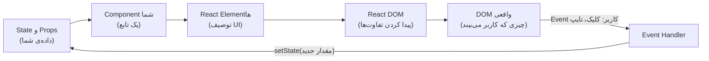
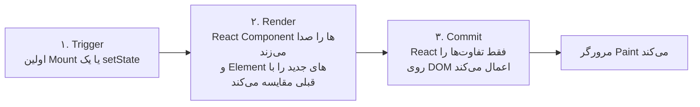

## چرا React؟

یک شمارنده را تصور کنید که یک عنوان، یک Badge و یک دکمه دارد و دکمه بعد از ۱۰ کلیک باید غیرفعال شود. در JavaScript خالص باید با هر کلیک همه‌ی این جاها را خودتان دستی به‌روز کنید:

```js
// DOM خالص: هماهنگ نگه داشتن تک‌تک بخش‌های UI با خود شماست
let count = 0
button.addEventListener('click', () => {
  count++
  title.textContent = `Clicked ${count} times`
  badge.textContent = count
  button.disabled = count >= 10   // یکی از این خط‌ها را فراموش کنید، UI دروغ می‌گوید
})
```

به این سبک **Imperative** (دستوری) می‌گویند: *قدم‌های* تغییر صفحه را توصیف می‌کنید. برای یک شمارنده جواب می‌دهد، اما در یک اپلیکیشن واقعی با صدها مقدار و هزاران المان، تعداد قانون‌های «وقتی X عوض شد، Y را هم به‌روز کن» منفجر می‌شود و فراموش کردن فقط یکی از آن‌ها یعنی باگ.

**React** یک کتابخانه‌ی JavaScript برای ساختن رابط کاربری است که این مدل را **Declarative** (اعلانی) می‌کند: شما توصیف می‌کنید *صفحه برای داده‌ی فعلی باید چه شکلی باشد* و خود React حساب می‌کند چه تغییراتی در DOM لازم است تا به آن برسد.

```jsx live
import { useState } from 'react'

export default function App() {
  // count یک «State» است: داده‌ای که React بین Renderها به خاطر می‌سپارد
  const [count, setCount] = useState(0)

  // UI را برای count فعلی توصیف کنید؛ هیچ‌جا DOM را دستی تغییر نمی‌دهیم
  return (
    <div>
      <h3>Clicked {count} times</h3>
      <span>badge: {count}</span>{' '}
      <button disabled={count >= 10} onClick={() => setCount(count + 1)}>
        +1
      </button>
    </div>
  )
}
```

دموی بالا قابل ویرایش است. `count >= 10` را به `count >= 3` تغییر دهید و ببینید پیش‌نمایش چطور به‌روز می‌شود.

<Callout type="note">
هر دموی **React زنده** در این بخش، React 19 واقعی (نسخه‌ی Development) را داخل یک فریم ایزوله اجرا می‌کند. دمو مثل یک اپ واقعی داخل `<StrictMode>` قرار گرفته، پس هشدارهای Development و اجراهای دوباره‌ی React دقیقاً مثل پروژه‌ی خودتان در Console زیر دمو دیده می‌شوند.
</Callout>

## مدل ذهنی: UI = f(state)

مهم‌ترین ایده‌ی React در یک خط جا می‌شود: **UI تابعی از State است**. شما Componentهایی می‌نویسید که داده می‌گیرند و توصیفی از UI برمی‌گردانند. وقتی داده عوض شود، React دوباره تابع شما را صدا می‌زند و صفحه را با توصیف جدید هماهنگ می‌کند.



دقت کنید که این حلقه فقط یک جهت دارد. داده به سمت **پایین** جریان دارد (از State به UI) و تنها راه برگشت به بالا، یک Event Handler است که از React می‌خواهد State را عوض کند. به این **One-way Data Flow** (جریان یک‌طرفه‌ی داده) می‌گویند و دلیل قابل‌پیش‌بینی بودن اپ‌های React همین است: برای فهمیدن اینکه چرا صفحه چیزی را نشان می‌دهد، کافی است به State نگاه کنید.

<Callout type="tip">
React یک **کتابخانه** است، نه یک Framework کامل. فقط UI را مدیریت می‌کند؛ Routing، گرفتن داده و Build را ابزارهای دیگر یا Frameworkهایی که روی React ساخته شده‌اند انجام می‌دهند (Next.js، React Router، Remix). برای همین گاهی در مصاحبه می‌پرسند «کتابخانه است یا Framework؟»؛ جواب صادقانه این است: «یک کتابخانه‌ی UI با یک اکوسیستم بزرگ».
</Callout>

## راه‌اندازی اپ: createRoot

یک اپ React به یک المان موجود در DOM وصل می‌شود، معمولاً `<div id="root">` در `index.html`. برای آن یک **Root** می‌سازید و Component اصلی‌تان را داخلش Render می‌کنید.

```jsx
import { StrictMode } from 'react'
import { createRoot } from 'react-dom/client'
import App from './App'

// ۱. کنترل یک نود خالیِ موجود در DOM را به دست بگیر
const root = createRoot(document.getElementById('root'))

// ۲. Component اصلی را Render کن؛ React داخل #root را می‌سازد
root.render(
  <StrictMode>
    <App />
  </StrictMode>,
)
```

<Api name="createRoot()" sig="createRoot(domNode, options?)" returns="یک Root با متدهای `render(reactNode)` و `unmount()`." mutates="yes (React محتوای domNode را در اختیار می‌گیرد)">

- `domNode` (المان DOM): ظرف اپ. React همه‌ی محتوای داخلش را جایگزین می‌کند؛ نگذارید کد دیگری به فرزندانش دست بزند.
- `options` (Object اختیاری):
  - `onUncaughtError(error, errorInfo)`: وقتی صدا زده می‌شود که حین Render خطایی پرتاب شود و هیچ [Error Boundary](/react/patterns) آن را نگیرد. در این حالت اپ Unmount می‌شود.
  - `onCaughtError(error, errorInfo)`: وقتی یک Error Boundary خطا را بگیرد صدا زده می‌شود.
  - `onRecoverableError(error, errorInfo)`: وقتی React خودش از خطا بازیابی می‌شود (مثلاً یک Hydration Mismatch که با Render دوباره سمت Client درستش می‌کند).
  - `identifierPrefix` (رشته): پیشوندی برای IDهایی که `useId` می‌سازد؛ وقتی دو Root در یک صفحه دارید به کار می‌آید.

`root.render(node)` را می‌شود دوباره صدا زد تا محتوای نمایش‌داده‌شده عوض شود؛ React به‌جای ساختن دوباره، همان DOM موجود را به‌روز می‌کند. `root.unmount()` کل درخت را حذف می‌کند و همه‌ی کدهای Cleanup را اجرا می‌کند.

</Api>

<Callout type="note">
پروژه‌هایی که با Vite یا یک Framework ساخته می‌شوند این فایل (`main.jsx` / `main.tsx`) را از قبل دارند و Frameworkهایی مثل Next.js خودشان آن را صدا می‌زنند. کمتر پیش می‌آید خودتان بنویسیدش، اما مصاحبه‌کننده‌ها دوست دارند بپرسند چه کار می‌کند.
</Callout>

## JSX

### JSX چیست

**JSX** یک افزونه‌ی Syntax است که اجازه می‌دهد داخل JavaScript، Markupی شبیه HTML بنویسید. مرورگر نمی‌تواند اجرایش کند: قبل از اجرای کد، یک Compiler (Babel، SWC، esbuild، TypeScript) هر تگ را به یک فراخوانی تابع ساده تبدیل می‌کند.

```jsx
const el = <h1 className="title">Hello, {name}!</h1>
```

از React 17 به بعد، Compiler از **Automatic JSX Runtime** استفاده می‌کند و این را تولید می‌کند:

```js
import { jsxs as _jsxs } from 'react/jsx-runtime'

// اسم تگ → آرگومان اول؛ Attributeها و فرزندان → Object مربوط به props
const el = _jsxs('h1', { className: 'title', children: ['Hello, ', name, '!'] })
```

(`jsxs` وقتی استفاده می‌شود که چند فرزند ثابت وجود دارد و `jsx` وقتی یک فرزند هست. قبل از React 17 خروجی `React.createElement(...)` بود؛ برای همین فایل‌های قدیمی با `import React from 'react'` شروع می‌شوند. دیگر لازم نیست.)

### حاصل یک عبارت JSX: React Element

آن فراخوانی یک **React Element** برمی‌گرداند: یک Object کوچک، ساده و تغییرناپذیر که یک تکه از UI را *توصیف* می‌کند. نود DOM نیست و هنوز چیزی کشیده نشده است.

```js
// حاصل <h1 className="title" key="k1">Hi</h1> در React 19.3 (نسخه‌ی Development)
{
  $$typeof: Symbol(react.transitional.element), // نشان می‌دهد Element واقعی است (جلوی تزریق JSON را می‌گیرد)
  type: 'h1',                                   // اسم تگ به‌صورت رشته، یا خود تابع Component
  key: 'k1',                                    // بیرون از props نگه داشته می‌شود
  props: { className: 'title', children: 'Hi' },
  _owner: null, _store: {}                      // اطلاعات مخصوص Development
}
```

سه نکته که باید یادتان بماند:

- Elementها و `props`شان در Development **Freeze** (منجمد) می‌شوند (`Object.isFrozen(el.props)` برابر `true` است)، پس نمی‌توانید اشتباهی تغییرشان دهید.
- `key` روی خود Element ذخیره می‌شود، **نه** داخل `props`. Componentی که `props.key` را بخواند `undefined` می‌گیرد و React هشدار می‌دهد.
- در React 19، `ref` یک prop معمولی است (`props.ref`) و فیلد جداگانه‌ی `element.ref` حذف شده. جزئیاتش در [React 19](/react/react-19).

`$$typeof` عمداً یک Symbol است: JSON نمی‌تواند Symbol داشته باشد، پس اگر مهاجمی بتواند یک Object JSON را جایی تزریق کند که کد شما انتظار Element دارد، React از Render کردنش خودداری می‌کند.

### قوانین JSX

JSX شبیه HTML است اما از قوانین JavaScript پیروی می‌کند. هر کدام از قوانین زیر به خاطر چیزی است که JSX به آن Compile می‌شود.

1. **فقط یک ریشه برگردانید.** Component یک مقدار برمی‌گرداند، پس دو المان هم‌سطح باید در چیزی بپیچند. با **Fragment** (`<>…</>`) می‌توانید بدون اضافه شدن المان به DOM گروهشان کنید. اگر گروه به key نیاز دارد، `<Fragment key={id}>` بنویسید.
2. **همه‌ی تگ‌ها را ببندید.** ``، `<br />`، `<input />`. JSX از HTML سخت‌گیرتر است.
3. **Attributeها اسم Propertyهای JavaScript به شکل camelCase هستند**: `className` (چون `class` کلمه‌ی رزروشده است)، `htmlFor` (به‌جای `for`)، `onClick`، `tabIndex`، `readOnly`. استثناها `aria-*` و `data-*` هستند که خط تیره‌شان می‌ماند.
4. **`style` یک Object می‌گیرد**، نه رشته: `style={{ fontSize: 14, marginTop: '1em' }}`. آکولاد بیرونی یعنی «اینجا JavaScript است» و آکولاد داخلی خود Object است. برای Propertyهای اندازه‌ای، عدد خالی پیکسل حساب می‌شود (`14` → `14px`).
5. **داخل آکولاد `{}` هر *Expression* (عبارت) JavaScript می‌آید**، یعنی هر چیزی که مقدار تولید کند: متغیر، فراخوانی تابع، Ternary، `.map()`. Statementهایی مثل `if`، `for` یا `const` آنجا مجاز نیستند؛ آن‌ها را قبل از `return` بنویسید.
6. **کامنت** داخل JSX به شکل `{/* comment */}` نوشته می‌شود.
7. **Attributeهای Boolean**: `<input disabled />` یعنی `disabled={true}`. با `disabled={false}` این Attribute حذف می‌شود.

```jsx live
export default function App() {
  const user = { name: 'Ada', unread: 3, isAdmin: true }
  const colors = ['tomato', 'gold', 'seagreen']

  return (
    // Fragment: دو المان هم‌سطح، بدون <div> اضافه در DOM
    <>
      {/* به‌جای class و for، از className و htmlFor استفاده می‌کنیم */}
      <label htmlFor="q" className="label">Search: </label>
      <input id="q" readOnly value={user.name} />

      {/* style یک Object است؛ 14 یعنی 14px */}
      <p style={{ fontSize: 14, color: '#555' }}>
        {user.name} has {user.unread * 10} points {user.isAdmin ? '(admin)' : ''}
      </p>

      {/* هر Expressionی داخل {} کار می‌کند؛ اینجا یک آرایه از Elementها */}
      <div>
        {colors.map((c) => (
          <span key={c} data-color={c} style={{ background: c, padding: '2px 8px', marginRight: 4 }}>
            {c}
          </span>
        ))}
      </div>
    </>
  )
}
```

### JSX متن را برای شما Escape می‌کند

هر متنی که داخل `{}` بگذارید **Escape** می‌شود: `<`، `>` و `&` قبل از رسیدن به DOM به Entityهای بی‌خطر تبدیل می‌شوند. رشته‌ای که شبیه HTML است به شکل متن نشان داده می‌شود و هرگز اجرا نمی‌شود؛ یعنی به‌طور پیش‌فرض جلوی بیشتر حمله‌های XSS (Cross-site Scripting) گرفته می‌شود.

```jsx
const comment = ''
<div>{comment}</div>
// HTML تولیدشده: <div>&lt;img src=x onerror=alert(1)&gt;</div>  → به شکل متن نمایش داده می‌شود، alertی اجرا نمی‌شود
```

وقتی واقعاً HTML قابل‌اعتمادی دارید (مثلاً خروجی Markdownی که Sanitize شده)، React شما را مجبور می‌کند اسم ترسناکی بنویسید:

```jsx
<div dangerouslySetInnerHTML={{ __html: trustedHtml }} />
```

<Callout type="warning">
`dangerouslySetInnerHTML` از Escape رد می‌شود. فقط HTMLی را بدهید که خودتان ساخته‌اید یا Sanitize کرده‌اید (مثلاً با DOMPurify). یادتان باشد Escape فقط **متن** را پوشش می‌دهد، نه URL را: `<a href={userUrl}>` با مقدار `javascript:alert(1)` همچنان خطرناک است، پس URLهایی را که از کاربر می‌آیند اعتبارسنجی کنید. React 19 جلوی URLهای `javascript:` را در `href` می‌گیرد. [امنیت مرورگر](/browser/security) را ببینید.
</Callout>

### چه چیزهایی می‌توانند داخل {} بیایند

React این مقدارها را به‌عنوان فرزند Render می‌کند. به موارد غافلگیرکننده دقت کنید: `0` و `NaN` به شکل متن Render می‌شوند، اما `true` هیچ چیزی Render نمی‌کند.

| مقدار | نتیجه‌ی Render |
| --- | --- |
| رشته و عدد (`'hi'`، `42`، `0`، `NaN`) | متن: `hi`، `42`، `0`، `NaN` |
| `''` (رشته‌ی خالی) | هیچ چیز |
| `null`، `undefined`، `true`، `false` | هیچ چیز |
| یک Element (`<b>x</b>`) | همان Element |
| یک آرایه (`[1, <i key="a">2</i>]`) | تک‌تک آیتم‌ها به ترتیب (آیتم‌هایی که Element هستند `key` لازم دارند) |
| یک Object ساده (`{ a: 1 }`) | **خطا**: "Objects are not valid as a React child" |
| یک تابع | هیچ چیز، به‌علاوه‌ی یک هشدار (احتمالاً می‌خواستید صدایش بزنید یا به شکل `<Fn />` Render کنید) |

## Componentها

### Component چیست

**Component** یک تابع JavaScript است که JSX برمی‌گرداند؛ یک تکه‌ی اسم‌دار و قابل استفاده‌ی دوباره از UI: یک دکمه، یک کارت یا یک صفحه‌ی کامل. مثل یک تگ HTML از آن استفاده می‌کنید.

```jsx
function Greeting() {
  return <p>Hello!</p>
}

// استفاده از آن یک Element می‌سازد که type آن خود تابع است
<Greeting />   // → { type: Greeting, props: {}, ... }
```

هر وقت React بخواهد بداند چه چیزی نشان دهد، `Greeting` را صدا می‌زند. تابع Element برمی‌گرداند، آن Elementها ممکن است خودشان Component باشند، و React آن‌قدر تابع صدا می‌زند تا فقط تگ‌های DOM (`'div'`، `'p'`…) باقی بمانند. نتیجه یک درخت است.

### Element در برابر Component در برابر Instance

این سه کلمه زیاد با هم قاطی می‌شوند و مصاحبه‌کننده‌ها این را می‌دانند.

| اصطلاح | چیست | مثال |
| --- | --- | --- |
| **Component** | تابع (یا Class) که شما می‌نویسید | `function Greeting() {…}` |
| **Element** | Object ساده‌ای که JSX می‌سازد: «`Greeting` را با این propsها Render کن» | `<Greeting />` |
| **Instance** | چیز زنده‌ای که React برای یک Component روی صفحه نگه می‌دارد: State، Effectها و جایگاهش در درخت. برای Function Componentها داخلی است (یک «Fiber»؛ [Rendering](/react/rendering) را ببینید) | — |

### اسم Component باید با حرف بزرگ شروع شود

Compiler بر اساس حرف اول تصمیم می‌گیرد که با تگ DOM طرف است یا با Component. `<button>` به `jsx('button')` تبدیل می‌شود، یعنی یک رشته، پس React یک المان HTML می‌سازد. `<Button>` به `jsx(Button)` تبدیل می‌شود، یعنی ارجاعی به تابع شما.

<Callout type="mistake">
```jsx
function profileCard() { return <div>…</div> }
<profileCard />   // ❌ به jsx('profilecard') تبدیل می‌شود: یک تگ HTML ناشناخته؛ تابع شما هیچ‌وقت اجرا نمی‌شود
```
اسم Componentها را PascalCase بنویسید: `ProfileCard`.
</Callout>

### هرگز Component را داخل Component دیگر تعریف نکنید

تعریف Componentها باید در بالاترین سطح Module باشد. اگر یک Component را داخل بدنه‌ی Component دیگری تعریف کنید، با هر Render یک **تابع کاملاً جدید** ساخته می‌شود. از نظر React تابع متفاوت یعنی نوع Component متفاوت، پس زیردرخت قبلی را با State و DOMش دور می‌اندازد و یک زیردرخت تازه Mount می‌کند.

داخل کادر زیر چیزی تایپ کنید و بعد روی **+1** کلیک کنید:

```jsx live
import { useState } from 'react'

export default function App() {
  const [count, setCount] = useState(0)

  // ❌ با هر Render شدن App یک تابع Input جدید (یعنی یک نوع Component جدید) ساخته می‌شود
  function Input() {
    const [text, setText] = useState('')
    return <input value={text} onChange={(e) => setText(e.target.value)} placeholder="type here, then click +1" />
  }

  return (
    <div>
      <Input />
      <button onClick={() => setCount((c) => c + 1)}>+1 ({count})</button>
    </div>
  )
}
```

تایپ کردن درست کار می‌کند، چون فقط `Input` دوباره Render می‌شود. کلیک روی **+1** باعث Render دوباره‌ی `App` می‌شود و یک نوع `Input` جدید ساخته می‌شود. React اینپوت قبلی را همراه متنی که تایپ کرده بودید Unmount می‌کند و Focus هم از دست می‌رود. راه‌حل این است که `function Input() {…}` را بالای `App` ببرید.

## Props

### فرستادن داده به Component

**Props** (کوتاه‌شده‌ی Properties) ورودی‌های یک Component هستند. Component والد آن‌ها را به شکل Attributeهای JSX می‌نویسد؛ React همه را در یک Object جمع می‌کند و به‌عنوان آرگومان اول به تابع می‌دهد.

```jsx live
// Object مربوط به props را Destructure می‌کنیم؛ اگر size نباشد یا undefined باشد، مقدار پیش‌فرض استفاده می‌شود
function Avatar({ name, size = 48 }) {
  const initials = name.split(' ').map((w) => w[0]).join('')
  return (
    <div style={{ width: size, height: size, borderRadius: '50%', background: '#6366f1',
                  color: 'white', display: 'grid', placeItems: 'center', fontSize: size / 3 }}>
      {initials}
    </div>
  )
}

// children = هر چیزی که بین <Card> و </Card> نوشته شود
function Card({ title, children }) {
  return (
    <section style={{ border: '1px solid #ddd', borderRadius: 12, padding: 12, marginBottom: 8 }}>
      <h4 style={{ margin: '0 0 8px' }}>{title}</h4>
      {children}
    </section>
  )
}

export default function App() {
  return (
    <>
      <Card title="Default size">
        <Avatar name="Ada Lovelace" />
      </Card>
      <Card title="Small, and a string child">
        <Avatar name="Alan Turing" size={32} />
        <p>Any JSX can go inside a Card.</p>
      </Card>
    </>
  )
}
```

چیزهایی که درباره‌ی props باید بدانید:

- **هر مقداری می‌تواند prop باشد**: رشته (`title="Hi"`)، هر چیز دیگری داخل آکولاد (`size={32}`، `user={user}`، `onSave={handleSave}`)، حتی JSX (`icon={<Star />}`).
- **`children`** یک prop ویژه است که محتوای بین تگ باز و بسته را نگه می‌دارد. می‌تواند متن، یک Element، یک آرایه یا `undefined` باشد. Componentهای «پوششی» مثل کارت، Modal و Layout با همین ساخته می‌شوند.
- **مقدار پیش‌فرض** از Default Value در Destructuring می‌آید (`size = 48`). وقتی prop وجود نداشته باشد یا `undefined` باشد اعمال می‌شود، اما برای `null` **نه**. (`defaultProps` برای Function Componentها در React 19 حذف شد.)
- **Spread**: `<Avatar {...user} />` همه‌ی فیلدهای `user` را به‌عنوان prop می‌فرستد. برای پاس دادن propsها به Component دیگر راحت است، اما مشخص نمی‌کند دقیقاً چه چیزی فرستاده می‌شود؛ با احتیاط استفاده کنید.
- propی که **مقدار ندارد** برابر `true` است: `<Modal open />` همان `<Modal open={true} />` است.

### props فقط‌خواندنی هستند

یک Component هیچ‌وقت نباید props خودش را تغییر دهد. props مال والد است و React در Development آن Object را Freeze می‌کند، پس `props.size = 10` خطای `TypeError` می‌دهد. وقتی مقداری باید در طول زمان عوض شود، باید **State** باشد؛ یا داخل همین Component، یا در والد که مقدار جدید را به پایین پاس می‌دهد.

### پاس دادن تابع به پایین: فرزند چطور با والد حرف می‌زند

داده از طریق props به پایین جریان دارد. برای فرستادن چیزی به **بالا**، والد یک تابع را به‌عنوان prop پاس می‌دهد و فرزند آن را صدا می‌زند. طبق قرارداد اسم این propها `onSomething` است و اسم تابع‌هایی که آن‌ها را مدیریت می‌کنند `handleSomething`.

```jsx live
import { useState } from 'react'

// فرزند از State والد چیزی نمی‌داند؛ فقط گزارش می‌دهد چه اتفاقی افتاد
function ColorButton({ color, onPick }) {
  return (
    <button onClick={() => onPick(color)} style={{ borderColor: color, marginRight: 6 }}>
      {color}
    </button>
  )
}

export default function App() {
  const [picked, setPicked] = useState('none')

  function handlePick(color) {
    console.log('child reported:', color)
    setPicked(color)                       // صاحب State والد است و خودش آن را به‌روز می‌کند
  }

  return (
    <>
      {['red', 'green', 'blue'].map((c) => (
        <ColorButton key={c} color={c} onPick={handlePick} />
      ))}
      <p>Picked: <b style={{ color: picked }}>{picked}</b></p>
    </>
  )
}
```

وقتی دو Component هم‌سطح به یک داده‌ی مشترک نیاز دارند، آن State را به نزدیک‌ترین والد مشترکشان منتقل کنید و به هر دو پاس دهید. به این **Lifting State Up** (بالا بردن State) می‌گویند و همراه همه‌ی جایگزین‌هایش در [مدیریت State](/react/state) آمده است.

## Render شرطی

Component یک تابع JavaScript است، پس با همان JavaScript معمولی انتخاب می‌کنید چه چیزی Render شود. چهار شکل رایج وجود دارد:

```jsx
// ۱. if / return زودهنگام: بهترین گزینه برای خروجی‌های کاملاً متفاوت
if (isLoading) return <Spinner />

// ۲. Ternary: انتخاب بین دو تکه، همان‌جا داخل JSX
{isLoggedIn ? <Profile /> : <SignInButton />}

// ۳. && : یا چیزی را Render کن یا هیچ چیز
{hasError && <ErrorMessage />}

// ۴. return null: اصلاً هیچ چیز Render نکن
if (!user) return null
```

### تله‌ی `&&` با عددها

`a && b` وقتی `a` مقدار Falsy داشته باشد، خود `a` را برمی‌گرداند. اگر `a` برابر `false` باشد مشکلی نیست، چون React برای `false` چیزی Render نمی‌کند. اما اگر `a` برابر `0` باشد، React عدد **0** را Render می‌کند.

```jsx live
import { useState } from 'react'

export default function App() {
  const [messages, setMessages] = useState([])
  const [loggedIn, setLoggedIn] = useState(false)

  return (
    <div>
      {/* ❌ messages.length برابر 0 است → عبارت 0 برمی‌گرداند → React متن "0" را Render می‌کند */}
      <p>Bug: {messages.length && <b>{messages.length} new</b>}</p>

      {/* ✅ اول مقایسه کنید تا سمت چپ یک Boolean واقعی باشد */}
      <p>Fixed: {messages.length > 0 && <b>{messages.length} new</b>}</p>

      <p>{loggedIn ? 'Welcome back!' : 'Please sign in.'}</p>

      <button onClick={() => setMessages((m) => [...m, 'hi'])}>Add message</button>{' '}
      <button onClick={() => setLoggedIn((v) => !v)}>{loggedIn ? 'Log out' : 'Log in'}</button>
    </div>
  )
}
```

<Callout type="tip">
برای سه شاخه یا بیشتر، Ternaryهای تودرتو خواندنشان سخت می‌شود. قبل از `return` از `if`/`switch` استفاده کنید، یا از یک Object جست‌وجو: `const views = { list: <List />, grid: <Grid /> }` و بعد `{views[mode]}`.
</Callout>

## لیست‌ها و key

### Render کردن یک لیست

برای نمایش یک لیست، آرایه‌ی داده را با `.map()` به آرایه‌ای از Elementها تبدیل کنید. هر Element در آن آرایه یک **`key`** لازم دارد: یک رشته یا عدد که آن آیتم را بین هم‌سطح‌هایش مشخص می‌کند.

```jsx
const todos = [
  { id: 'a1', text: 'Learn JSX' },
  { id: 'b2', text: 'Learn props' },
]

<ul>
  {todos.map((todo) => (
    <li key={todo.id}>{todo.text}</li>   // key روی بیرونی‌ترین Elementی می‌آید که map برمی‌گرداند
  ))}
</ul>
```

### چرا key وجود دارد

در هر Render، React لیست جدید فرزندان را با لیست قبلی مقایسه می‌کند تا تصمیم بگیرد چه چیزی بماند، جابه‌جا شود، ساخته شود یا حذف شود. بدون key فقط می‌تواند فرزندان را **بر اساس جایگاه** تطبیق دهد: «اولین `<li>` الان، همان اولین `<li>` قبلی است». با key آن‌ها را **بر اساس هویت** تطبیق می‌دهد: «آیتمی که key آن `b2` است همان آیتم قبلی است، حتی اگر جابه‌جا شده باشد».

این مهم است، چون **State و نود DOM هر Component به جایگاه یا key آن وابسته است**. اگر هویت اشتباه باشد، State به آیتم اشتباه می‌چسبد.

در **هر دو** ستون کنار «Apples» یک یادداشت تایپ کنید و بعد روی **Add to top** کلیک کنید:

```jsx live
import { useState } from 'react'

let nextId = 3

function Row({ name }) {
  // اینپوت Uncontrolled: متن تایپ‌شده در همان نود DOMی می‌ماند که React برای این ردیف نگه می‌دارد
  return (
    <li>
      {name} <input placeholder="note" size={8} />
    </li>
  )
}

export default function App() {
  const [items, setItems] = useState([
    { id: 1, name: 'Apples' },
    { id: 2, name: 'Bread' },
  ])

  function addToTop() {
    const id = nextId++
    setItems([{ id, name: 'New #' + id }, ...items])
  }

  return (
    <>
      <button onClick={addToTop}>Add to top</button>
      <div style={{ display: 'flex', gap: 24 }}>
        <div>
          <b>key = index ❌</b>
          <ul>{items.map((item, index) => <Row key={index} name={item.name} />)}</ul>
        </div>
        <div>
          <b>key = item.id ✅</b>
          <ul>{items.map((item) => <Row key={item.id} name={item.name} />)}</ul>
        </div>
      </div>
    </>
  )
}
```

در ستون چپ، آیتم جدید key `0` را می‌گیرد، یعنی همان keyی که قبلاً مال «Apples» بود؛ پس React نود DOM آن ردیف را دوباره استفاده می‌کند و یادداشت شما حالا کنار آیتم جدید است. در ستون راست، «Apples» همان key `1` را نگه می‌دارد و یادداشتش همراهش جابه‌جا می‌شود.

### قانون‌های key

- **پایدار**: یک آیتم در همه‌ی Renderها key یکسان بگیرد. از IDی که در داده‌تان هست استفاده کنید (ID دیتابیس، یا UUIDی که موقع ساختن آیتم ساخته‌اید).
- **یکتا بین هم‌سطح‌ها**: دو لیست در دو جای مختلف می‌توانند keyهای یکسان داشته باشند.
- **هرگز `Math.random()` یا `crypto.randomUUID()` حین Render**: هر Render keyهای جدید می‌سازد، پس React همه‌ی ردیف‌ها را از بین می‌برد و دوباره می‌سازد و State، Focus و Performance از دست می‌رود.
- **Index فقط وقتی قابل قبول است** که لیست هیچ‌وقت ترتیبش عوض نشود، فیلتر نشود و آیتم‌ها فقط به انتهایش اضافه شوند. دموی `push` در ادامه‌ی همین فصل چنین حالتی است.
- key **به‌عنوان prop پاس داده نمی‌شود**. اگر فرزند به ID نیاز دارد، آن را با اسم دیگری دوباره بفرستید: `<Row key={item.id} id={item.id} />`.

<Callout type="tip">
key یک ابزار هم هست: اگر عمداً `key` یک Component را عوض کنید، React State آن را دور می‌اندازد و یک نمونه‌ی تازه Mount می‌کند. با `<ProfileForm key={userId} />` وقتی کاربر عوض شود کل فرم Reset می‌شود. جزئیات بیشتر در [Hookها](/react/hooks) و [مدیریت State](/react/state).
</Callout>

## واکنش به Eventها

### Event Handlerها

برای واکنش به کلیک، یک تابع به prop `onClick` بدهید. propهای Event در React به شکل camelCase هستند (`onClick`، `onChange`، `onSubmit`، `onKeyDown`، `onMouseEnter`) و یک **تابع** می‌گیرند، نه رشته.

<Callout type="mistake">
```jsx
<button onClick={handleClick}>      // ✅ خود تابع را بدهید؛ React موقع کلیک صدایش می‌زند
<button onClick={handleClick()}>    // ❌ همین حالا، حین Render، صدایش می‌زند و مقدار برگشتی را پاس می‌دهد
<button onClick={() => remove(id)}> // ✅ آرگومان لازم دارید؟ در یک Arrow Function بپیچیدش
```
اگر تابعی که زودتر از موقع صدا زده‌اید State را عوض کند، Render باعث تغییر State می‌شود، که Render بعدی را راه می‌اندازد و همین‌طور ادامه پیدا می‌کند. React با خطای **"Too many re-renders"** متوقف می‌شود.
</Callout>

### Event Object، Propagation و رفتار پیش‌فرض

Handler شما یک **SyntheticEvent** می‌گیرد: پوششی که React دور Event اصلی مرورگر کشیده، با همان Interface (`target`، `currentTarget`، `key`، `preventDefault()`، `stopPropagation()`…) و رفتار یکسان در همه‌ی مرورگرها. Event اصلی از طریق `e.nativeEvent` در دسترس است.

Eventهای React درست مثل Eventهای DOM در *درخت React* **Bubble** می‌کنند ([Eventها](/browser/events) را ببینید). اگر به اسم Event کلمه‌ی `Capture` اضافه کنید (`onClickCapture`)، در فاز Capture گوش می‌دهید.

```jsx live
export default function App() {
  function handleParent() {
    console.log('div: onClick (bubbled up from a child)')
  }

  function handleButton(e) {
    console.log('button:', e.type, 'on', e.target.tagName)
  }

  function handleLink(e) {
    e.preventDefault()    // نگذار مرورگر به آدرس لینک برود
    e.stopPropagation()   // onClick مربوط به div اجرا نمی‌شود
    console.log('link: default prevented, propagation stopped')
  }

  return (
    <div
      onClickCapture={() => console.log('div: onClickCapture (runs first, on the way down)')}
      onClick={handleParent}
      style={{ padding: 12, background: '#f3f4f6', borderRadius: 8 }}
    >
      <button onClick={handleButton}>Button</button>{' '}
      <a href="https://react.dev" onClick={handleLink}>Link</a>
    </div>
  )
}
```

پشت صحنه، React به هر المان جداگانه Listener وصل نمی‌کند. برای هر نوع Event **فقط یک Listener روی Root Container** (`#root`) می‌گذارد و خودش Event را به Handlerهای شما می‌رساند. این همان Event Delegation است (از React 17 روی Root، قبل از آن روی `document`). برای همین هزاران ردیف با `onClick` تقریباً هزینه‌ای ندارند.

سه تفاوت مخصوص React با DOM که خوب است بدانید:

- **`onChange` برای اینپوت‌ها با هر بار فشردن کلید اجرا می‌شود**، مثل Event بومی `input`، نه فقط موقع Blur مثل Event بومی `change`.
- **`onScroll` در React Bubble نمی‌کند** (از نسخه‌ی 17)، درست مثل خود مرورگر.
- **برگرداندن `false` جلوی رفتار پیش‌فرض را نمی‌گیرد**. صریحاً `e.preventDefault()` را صدا بزنید.

## State: دادن حافظه به Component

### چرا یک متغیر معمولی کافی نیست

props از والد می‌آیند. برای داده‌ای که مال خود Component است و در طول زمان عوض می‌شود (یک مقدار تایپ‌شده، باز یا بسته بودن، یک شمارنده) به **State** نیاز دارید. یک متغیر محلی از پس این کار برنمی‌آید، به دو دلیلی که دموی زیر نشان می‌دهد:

```jsx live
import { useState } from 'react'

export default function App() {
  let plain = 0                                  // در هر Render دوباره با 0 ساخته می‌شود
  const [count, setCount] = useState(0)          // React آن را بین Renderها به خاطر می‌سپارد

  function handleClick() {
    plain = plain + 1                            // متغیر محلی عوض می‌شود، اما React خبردار نمی‌شود
    setCount(count + 1)                          // از React می‌خواهد با مقدار جدید دوباره Render کند
    console.log('plain =', plain, '| count in this render =', count)
  }

  return (
    <>
      <p>plain: {plain} · count: {count}</p>
      <button onClick={handleClick}>Click</button>
    </>
  )
}
```

1. **متغیرهای محلی بین Renderها باقی نمی‌مانند.** هر Render یک فراخوانی تازه‌ی تابع است، پس `plain` دوباره از `0` شروع می‌شود.
2. **تغییر متغیر محلی Render راه نمی‌اندازد.** React اصلاً نمی‌فهمد چیزی عوض شده.

`useState` هر دو مشکل را حل می‌کند: React مقدار را بیرون از تابع شما نگه می‌دارد و در Render بعدی برمی‌گرداند، و تابع Setter به React خبر می‌دهد که Render لازم است.

<Api name="useState()" sig="const [state, setState] = useState(initialState)" returns="آرایه‌ای با دقیقاً دو عضو: State فعلی و یک تابع Setter." mutates="no (با صدا زدن Setter یک Render دوباره زمان‌بندی می‌شود)">

- `initialState`: مقدار برای **اولین** Render. در همه‌ی Renderهای بعدی نادیده گرفته می‌شود.
  - اگر یک **تابع** بدهید، React آن را **Initializer** حساب می‌کند: فقط یک بار، در اولین Render، صدایش می‌زند و مقدار برگشتی را استفاده می‌کند. `useState(() => loadFromStorage())` جلوی اجرای کد سنگین در هر Render را می‌گیرد. `useState(loadFromStorage())` (با پرانتز) آن را در *هر* Render صدا می‌زند و نتیجه را دور می‌ریزد. در StrictMode، React برای پیدا کردن Initializerهای ناخالص آن را دو بار صدا می‌زند.
- `[state, setState]` را برمی‌گرداند. اسم‌ها دست خودتان است؛ قرارداد رایج `[thing, setThing]` است.
- `setState(nextState)`:
  - یک **مقدار** بدهید تا State جایگزین شود: `setCount(5)`؛
  - یا یک **Updater Function** که State در صف را می‌گیرد و State بعدی را برمی‌گرداند: `setCount(c => c + 1)`؛
  - مقدار برگشتی‌اش `undefined` است و مقدار جدید در Render **بعدی** دیده می‌شود، نه در خط بعدی؛
  - اگر مقدار جدید طبق `Object.is` با مقدار فعلی برابر باشد، React ممکن است Render دوباره را رد کند؛
  - هویت تابع Setter پایدار است: در همه‌ی Renderها همان تابع است.

</Api>

Hookهایی مثل `useState` باید در **بالاترین سطح** Component صدا زده شوند، هرگز داخل شرط، حلقه یا تابع تودرتو. دلیلش و بقیه‌ی Hookها در فصل [Hookها](/react/hooks) آمده است.

### State یک Snapshot است

صدا زدن Setter متغیر `count`ی را که الان دارید عوض نمی‌کند. فقط یک Render جدید درخواست می‌کند و فراخوانی **بعدی** Component مقدار جدید را می‌گیرد. داخل یک Render، `count` یک ثابت است: یک Snapshot (عکس لحظه‌ای).

این همان معمای معروف مصاحبه را توضیح می‌دهد:

```jsx live
import { useState } from 'react'

export default function App() {
  const [count, setCount] = useState(0)

  return (
    <>
      <h3>{count}</h3>
      <button
        onClick={() => {
          setCount(count + 1) // در این Render مقدار count صفر است → «بکنش 1»
          setCount(count + 1) // هنوز صفر → «بکنش 1»
          setCount(count + 1) // هنوز صفر → «بکنش 1»
        }}
      >
        +3 (broken)
      </button>{' '}
      <button
        onClick={() => {
          setCount((c) => c + 1) // در صف: 0 → 1
          setCount((c) => c + 1) // در صف: 1 → 2
          setCount((c) => c + 1) // در صف: 2 → 3
        }}
      >
        +3 (updater)
      </button>
    </>
  )
}
```

<Steps>
<Step title="کلیک، Handler را اجرا می‌کند">
React تابع Handler شما را صدا می‌زند. `count` برابر `0` است، چون این Handler مال Renderی است که در آن `count` صفر بود.
</Step>
<Step title="Setterها فقط Update را در صف می‌گذارند">
هر `setCount` یک Update به صف اضافه می‌کند و هنوز هیچ Renderی اتفاق نمی‌افتد. دکمه‌ی خراب سه بار «جایگزین کن با 1» را در صف می‌گذارد. دکمه‌ی Updater سه تابع را در صف می‌گذارد.
</Step>
<Step title="React همه را Batch می‌کند و یک بار Render می‌کند">
بعد از تمام شدن Handler، React صف را به ترتیب پردازش می‌کند. سه بار «جایگزین کن با 1» نتیجه‌اش `1` است. تابع‌ها `0 → 1 → 2 → 3` را می‌دهند. بعد با مقدار نهایی فقط یک بار Render می‌کند.
</Step>
</Steps>

به جمع کردن چند Update در یک Render، **Batching** می‌گویند. از React 18 همه‌جا اتفاق می‌افتد: در Event Handlerها، Timeoutها، Promiseها و Listenerهای بومی. هر وقت State بعدی به State قبلی وابسته است، از شکل Updater استفاده کنید.

### Object و آرایه را بدون Mutate کردن به‌روز کنید

React برای تشخیص تغییر State، مقدار قدیم و جدید را با `Object.is` مقایسه می‌کند. برای Object و آرایه این یعنی مقایسه‌ی **Reference**. اگر آرایه‌ی موجود را Mutate کنید (مستقیماً تغییرش دهید) و همان آرایه را برگردانید، React آن را «همان Object» می‌بیند، Render را رد می‌کند و صفحه کهنه می‌ماند.

```jsx live
import { useState } from 'react'

export default function App() {
  const [todos, setTodos] = useState(['Learn JSX'])

  function addWrong() {
    todos.push('Mutated!')     // آرایه‌ی موجود را تغییر می‌دهد…
    setTodos(todos)            // …همان Reference → از نظر Object.is «تغییری نکرده» → Renderی اتفاق نمی‌افتد
    console.log('array length is', todos.length, 'but the list did not update')
  }

  function addRight() {
    setTodos([...todos, 'Added #' + (todos.length + 1)])   // یک آرایه‌ی جدید → React دوباره Render می‌کند
  }

  return (
    <>
      {/* لیست فقط به انتها اضافه می‌شود، پس key = index اینجا بی‌خطر است */}
      <ul>{todos.map((t, i) => <li key={i}>{t}</li>)}</ul>
      <button onClick={addWrong}>push (wrong)</button>{' '}
      <button onClick={addRight}>spread (right)</button>
    </>
  )
}
```

چند بار روی **push** کلیک کنید (چیزی ظاهر نمی‌شود)، بعد روی **spread**: آیتم‌های Mutateشده ناگهان پیدا می‌شوند، چون Render جدید همان آرایه‌ای را می‌خواند که مخفیانه تغییر کرده بود. این نوع باگِ دیرهنگام و گیج‌کننده دلیل این است که State در React باید **Immutable** (تغییرناپذیر) در نظر گرفته شود.

| هدف | ❌ Mutate می‌کند | ✅ مقدار جدید می‌سازد |
| --- | --- | --- |
| اضافه کردن به آرایه | `arr.push(x)` | `[...arr, x]` / `[x, ...arr]` |
| حذف | `arr.splice(i, 1)` | `arr.filter(item => item.id !== id)` |
| جایگزینی یک آیتم | `arr[i] = x` | `arr.map(item => item.id === id ? { ...item, done: true } : item)` |
| مرتب‌سازی / برعکس کردن | `arr.sort()` / `arr.reverse()` | `arr.toSorted()` / `arr.toReversed()` (یا `[...arr].sort()`) |
| تغییر یک فیلد Object | `obj.name = 'x'` | `{ ...obj, name: 'x' }` |
| تغییر یک فیلد تودرتو | `obj.address.city = 'x'` | `{ ...obj, address: { ...obj.address, city: 'x' } }` |

Spread فقط **یک سطح** را کپی می‌کند. هر سطحی که در مسیر رسیدن به فیلد تودرتو عوض می‌کنید کپی خودش را لازم دارد؛ برای همین State خیلی تودرتو نشانه‌ی این است که باید صافش کنید یا از Reducer استفاده کنید ([مدیریت State](/react/state)).

### اولین اینپوت فرم: Controlled Component

وقتی `value` یک اینپوت از State می‌آید و هر تغییر از طریق `onChange` دوباره به State برمی‌گردد، اینپوت **Controlled** (کنترل‌شده) است: State در React تنها منبع حقیقت است.

```jsx live
import { useState } from 'react'

export default function App() {
  const [name, setName] = useState('')

  return (
    <>
      {/* value را State تعیین می‌کند؛ تایپ کردن onChange را صدا می‌زند، State عوض می‌شود و دوباره Render می‌شود */}
      <input value={name} onChange={(e) => setName(e.target.value)} placeholder="Your name" />
      <p>Hello, {name || 'stranger'}! ({name.length} characters)</p>
      <button onClick={() => setName('')}>Clear</button>
    </>
  )
}
```

چون مقدار در State است، می‌توانید از هر جایی اعتبارسنجی‌اش کنید، تغییرش دهید (`e.target.value.toUpperCase()`) یا Resetش کنید. اینپوتی که `value` دارد ولی `onChange` **ندارد** فقط‌خواندنی می‌شود و React درباره‌اش هشدار می‌دهد. اینپوت‌های Uncontrolled، `defaultValue` و Actionهای فرم در React 19 در [الگوهای کامپوننت](/react/patterns) و [React 19](/react/react-19) آمده‌اند.

## Rendering و خالص بودن

### Render یعنی چه

**Rendering** یعنی React تابع Component شما را صدا بزند تا بفهمد چه چیزی باید روی صفحه باشد. این با به‌روز کردن DOM یکی نیست. هر Update سه مرحله دارد:



- **Trigger**: `root.render()` اولیه، یا یک State Update در یک Component.
- **Render**: React Componentی را که State آن عوض شده صدا می‌زند و **به‌طور پیش‌فرض همه‌ی Componentهای زیر آن را هم**، حتی اگر props آن‌ها تغییری نکرده باشد. Render شدن والد یعنی Render شدن فرزندانش.
- **Commit**: React فقط نودهایی از DOM را تغییر می‌دهد که فرق کرده‌اند. اگر یک Render همان خروجی قبلی را بدهد، اصلاً به DOM دست زده نمی‌شود.

اینکه React درخت‌ها را چطور مقایسه می‌کند، Fiber کار را چطور زمان‌بندی می‌کند و کی از Render یک Component صرف‌نظر می‌شود، در [Rendering، Reconciliation و Fiber](/react/rendering) و [Performance](/react/performance) آمده است.

### Componentها باید خالص باشند

React ممکن است Component شما را هر چند بار، با هر ترتیبی صدا بزند و حتی یک Render را دور بیندازد (در قابلیت‌های Concurrent). پس Component باید یک **Pure Function** (تابع خالص) از ورودی‌هایش باشد:

- **ورودی یکسان، خروجی یکسان**: props، State و Context یکسان همیشه JSX یکسان تولید می‌کنند.
- **بدون Side Effect حین Render**: متغیرها یا Objectهایی را که قبل از Render وجود داشتند تغییر ندهید، به DOM دست نزنید، Request نفرستید، Timer نسازید. جای Side Effectها **Event Handlerها** (انتخاب اول) یا [Effectها](/react/effects) است.

ساختن و تغییر دادن متغیرها و Objectهای **محلی** داخل همان Render اشکالی ندارد؛ به این **Local Mutation** می‌گویند. قانون درباره‌ی چیزهایی است که بیرون از فراخوانی فعلی هستند.

```jsx live
let guest = 0   // بیرون از Component زندگی می‌کند

function Cup() {
  guest = guest + 1   // ❌ Side Effect حین Render: متغیری را تغییر می‌دهد که از قبل وجود داشت
  return <p>Tea cup for guest #{guest}</p>
}

export default function App() {
  return (
    <>
      <Cup />
      <Cup />
      <Cup />
    </>
  )
}
```

احتمالاً انتظار ۱، ۲، ۳ را داشتید، اما دمو ۲، ۴، ۶ را نشان می‌دهد. در Development، StrictMode هر Component را **دو بار** صدا می‌زند تا دقیقاً همین نوع ناخالصی را آشکار کند، و `Cup` ناخالص هر بار جواب متفاوتی می‌دهد. برای خالص کردنش عدد را از بیرون بدهید: `<Cup guest={1} />` و `function Cup({ guest }) {…}`.

## StrictMode

`<StrictMode>` یک ابزار کمکی مخصوص Development است که دور اپ (یا بخشی از آن) می‌پیچید. چیزی روی صفحه نشان نمی‌دهد و **در Build Production هیچ کاری نمی‌کند**. در Development عمداً به Componentهای شما فشار می‌آورد تا باگ‌ها زودتر پیدا شوند:

- **بدنه‌ی Componentها را دو بار صدا می‌زند** (همین‌طور Initializerهای `useState`/`useMemo`/`useReducer` و Updater Functionها) تا Render ناخالص پیدا شود. React 19 لاگ‌های Console فراخوانی دوم را در DevTools مرورگر کم‌رنگ نشان می‌دهد.
- **Setup و Cleanup هر Effect را موقع Mount یک بار اضافه اجرا می‌کند** (Setup → Cleanup → Setup) تا Effectهایی که Cleanup ندارند پیدا شوند. [Effectها](/react/effects) را ببینید.
- **Ref Callbackها را موقع Mount دو بار صدا می‌زند** (وصل → جدا → وصل)، به همان دلیل.
- **درباره‌ی APIهای منسوخ هشدار می‌دهد**، مثل Legacy Context و String Refهای قدیمی در Class Componentها.

```jsx live
import { useEffect, useState } from 'react'

export default function App() {
  const [count, setCount] = useState(0)

  console.log('render, count =', count)              // در StrictMode برای هر Render دو بار چاپ می‌شود

  useEffect(() => {
    console.log('effect setup, count =', count)
    return () => console.log('effect cleanup, count =', count)
  }, [count])

  return <button onClick={() => setCount((c) => c + 1)}>count: {count}</button>
}
```

به Console نگاه کنید: موقع Mount لاگ‌های Render را می‌بینید و بعد `setup → cleanup → setup`. کلیک کنید تا یک `cleanup` معمولی (با count قدیمی) و یک `setup` (با count جدید) ببینید. برای دیدن دوباره‌ی ترتیب Mount روی **اجرای دوباره** کلیک کنید.

<Callout type="interview">
«چرا Effect من دو بار اجرا می‌شود؟» یکی از رایج‌ترین سوال‌های React است. جواب خوب این است: فقط در Development و زیر StrictMode اتفاق می‌افتد، عمدی است و Unmount و Mount دوباره‌ی Component را شبیه‌سازی می‌کند (همان چیزی که در Fast Refresh یا وقتی `<Activity>` محتوا را مخفی و دوباره نمایان می‌کند رخ می‌دهد). اگر دو بار اجرا شدن Setup چیزی را خراب می‌کند، آن Effect یک Cleanup کم دارد. برای «درست کردنش» StrictMode را حذف نکنید.
</Callout>

## Class Componentها (قدیمی، اما هنوز پرسیده می‌شوند)

قبل از Hookها (React 16.8، سال 2019) State و Lifecycle فقط در **Class Componentها** در دسترس بود. کدهای جدید با تابع نوشته می‌شوند، اما در کدبیس‌های قدیمی‌تر و در مصاحبه‌ها با Classها روبه‌رو می‌شوید، و **Error Boundaryها هنوز فقط با Class نوشته می‌شوند** ([الگوهای کامپوننت](/react/patterns) را ببینید).

```jsx
import { Component } from 'react'

class Counter extends Component {
  state = { count: 0, label: 'clicks' }   // همیشه یک Object

  handleClick = () => {
    // setState این Object را با State موجود MERGE می‌کند (useState جایگزین می‌کند)
    this.setState((prev) => ({ count: prev.count + 1 }))
  }

  componentDidMount() { /* بعد از اولین Commit */ }
  componentDidUpdate(prevProps, prevState) { /* بعد از هر Commit بعدی */ }
  componentWillUnmount() { /* Cleanup قبل از حذف */ }

  render() {
    return <button onClick={this.handleClick}>{this.state.count} {this.state.label}</button>
  }
}
```

| Class | معادل در Function Component |
| --- | --- |
| `this.state` / `this.setState(partial)` (ادغام می‌کند) | `useState` / `useReducer` (جایگزین می‌کند) |
| `componentDidMount` | `useEffect(() => {…}, [])` |
| `componentDidUpdate` | `useEffect(() => {…}, [deps])` |
| `componentWillUnmount` | تابع Cleanupی که `useEffect` برمی‌گرداند |
| `shouldComponentUpdate` / `PureComponent` | `memo` (یا React Compiler) |
| `this.props` (همیشه props *آخر*) | props *همین* Render (یک Snapshot) |
| `componentDidCatch` / `getDerivedStateFromError` | معادل Hook ندارد: Error Boundaryها هنوز Class هستند |

ردیف یکی‌مانده‌به‌آخر یک دسته‌ی واقعی از باگ‌ها را پنهان کرده است. `this.props` در Class همیشه به آخرین props اشاره می‌کند، پس `setTimeout`ی که بعد از عوض شدن کاربر `this.props.user` را بخواند، کاربر *جدید* را می‌بیند. Closure یک Function Component اما props همان Renderی را نگه می‌دارد که آن را ساخته است.

## اشتباهات رایج

<Callout type="mistake">
**Render کردن یک Object.** `<p>{user}</p>` خطای "Objects are not valid as a React child" می‌دهد. یک فیلد را Render کنید (`{user.name}`)، یا برای دیباگ از `JSON.stringify(user)` استفاده کنید.
</Callout>

<Callout type="mistake">
**خواندن State بلافاصله بعد از Set کردنش.** `setCount(count + 1); console.log(count)` مقدار قدیمی را چاپ می‌کند، چون این متغیر مال Render فعلی است. اگر مقدار بعدی را لازم دارید، اول آن را در یک متغیر حساب کنید: `const next = count + 1; setCount(next)`.
</Callout>

<Callout type="mistake">
**کپی کردن props در State.** `const [color, setColor] = useState(props.color)` prop را فقط در اولین Render می‌خواند و تغییرات بعدی والد نادیده گرفته می‌شود. یا مستقیم از prop استفاده کنید، یا اسمش را `initialColor` بگذارید تا منظورتان روشن باشد.
</Callout>

<Callout type="mistake">
**فراموش کردن key یا گذاشتنش روی Element اشتباه.** key روی بیرونی‌ترین Elementی می‌آید که `map` برمی‌گرداند (اغلب یک Component یا `<Fragment key>`)، نه روی Elementی داخل آن.
</Callout>

## سوالات مصاحبه

<QA q="React چیست و «Declarative» یعنی چه؟" level="junior" n={1}>
<Answer>

React یک کتابخانه‌ی JavaScript برای ساختن رابط کاربری از Componentهاست. Declarative یعنی شما توصیف می‌کنید UI برای State فعلی *چه شکلی* باید باشد (`UI = f(state)`) و React خودش حساب می‌کند DOM را *چطور* با آن هماهنگ کند. در کد Imperative عملیات DOM را خودتان می‌نویسید و باید همه‌ی جاهایی را که باید به‌روز شوند یادتان بماند.

</Answer>
<Deep>

React وقتی State عوض می‌شود Component شما را دوباره اجرا می‌کند، درخت Elementهای جدید را با قبلی مقایسه می‌کند (Reconciliation) و فقط تفاوت‌ها را Commit می‌کند. DOM خروجی است؛ در استفاده‌ی عادی، کد شما هیچ‌وقت مستقیم آن را تغییر نمی‌دهد.

</Deep>
</QA>

<QA q="JSX چیست و به چه چیزی Compile می‌شود؟" level="junior" n={2}>
<Answer>

یک افزونه‌ی Syntax که اجازه می‌دهد داخل JavaScript، Markup بنویسید. Compiler هر تگ را به یک فراخوانی تابع تبدیل می‌کند؛ از React 17 به بعد `jsx(type, props, key)` از `react/jsx-runtime` (قبلاً `React.createElement`). این فراخوانی یک React Element برمی‌گرداند: یک Object ساده و تغییرناپذیر `{ type, props, key }` که UI را توصیف می‌کند.

</Answer>
<Mistake>

اینکه بگویید JSX همان HTML است یا نود DOM می‌سازد. JSX فقط Object ساده می‌سازد؛ React DOM بعداً در مرحله‌ی Commit نودها را می‌سازد.

</Mistake>
<FollowUp>

چرا `class` به شکل `className` نوشته می‌شود؟ چون Attributeهای JSX کلیدهای یک Object در JavaScript می‌شوند و به *Property*های DOM (`el.className`) نگاشت می‌شوند، و `class` یک کلمه‌ی رزروشده است.

</FollowUp>
</QA>

<QA q="فرق Component، Element و Instance چیست؟" level="junior" n={3}>
<Answer>

**Component** تابع یا Classی است که می‌نویسید. **Element** همان Object تغییرناپذیری است که JSX می‌سازد و توصیف می‌کند «این Component یا تگ را با این propsها Render کن». **Instance** چیزی است که React برای یک Component Mountشده نگه می‌دارد: State، Effectها و جایگاهش در درخت. برای Function Componentها داخلی است (یک نود Fiber)؛ برای Class Componentها همان Object مربوط به `this` است.

</Answer>
</QA>

<QA q="چرا React در لیست‌ها key لازم دارد و چرا index کلید بدی است؟" level="mid" n={4}>
<Answer>

key به React می‌گوید بین Renderها کدام فرزند کدام است، تا آیتم‌ها را بر اساس هویت تطبیق دهد نه جایگاه. State و نودهای DOM به همین هویت وصل هستند. با key از نوع index، اضافه کردن، حذف کردن یا جابه‌جا کردن آیتم‌ها indexها را جابه‌جا می‌کند؛ پس Stateهایی مثل متن اینپوت، Focus یا انیمیشن به آیتم اشتباه می‌چسبند و React هم کار DOM بیشتری از حد لازم انجام می‌دهد.

</Answer>
<Deep>

index فقط برای لیست‌های ثابت یا لیست‌هایی که فقط به انتهایشان اضافه می‌شود مناسب است. key تصادفی از index هم بدتر است: هر Render keyهای جدید می‌سازد، پس همه‌ی ردیف‌ها Unmount و دوباره Mount می‌شوند.

</Deep>
<FollowUp>

چطور می‌شود عمداً از key استفاده کرد؟ با عوض کردن key یک Component همه‌ی Stateهایش Reset می‌شود؛ مثلاً `<Form key={userId} />`.

</FollowUp>
</QA>

<QA q="فرق props و State چیست؟" level="junior" n={5}>
<Answer>

props ورودی‌هایی هستند که والد پاس می‌دهد و برای Component گیرنده فقط‌خواندنی‌اند. State داده‌ای است که مال خود Component است و با Setterش عوض می‌شود؛ تغییرش باعث Render دوباره می‌شود. یک مقدار اغلب در والد State است و در فرزندی که به آن پاس داده شده prop.

</Answer>
</QA>

<QA q="چرا سه بار صدا زدن setCount(count + 1) فقط ۱ واحد اضافه می‌کند؟" level="mid" n={6}>
<Answer>

State یک Snapshot است. داخل یک Render، `count` ثابت است؛ پس هر سه فراخوانی `0 + 1` را حساب می‌کنند و «بکنش 1» را در صف می‌گذارند. React آن‌ها را Batch می‌کند و یک بار با `1` Render می‌کند. از شکل Updater یعنی `setCount(c => c + 1)` استفاده کنید که مقدار در صف را می‌گیرد؛ آن‌وقت سه Update پشت هم به `3` می‌رسند.

</Answer>
<Mistake>

گفتن «setState Async است». زمان‌بندی بخشی از ماجراست، اما دلیل اصلی این است که متغیر `count` مال Renderی است که Handler در آن ساخته شده. حتی اگر Update همزمان اجرا می‌شد، آن متغیر عوض نمی‌شد.

</Mistake>
</QA>

<QA q="چرا Componentها باید خالص باشند و StrictMode در این باره چه کار می‌کند؟" level="mid" n={7}>
<Answer>

React ممکن است یک Component را بارها صدا بزند، Render را متوقف کند، دور بیندازد یا دوباره انجام دهد (Concurrent Rendering)؛ پس Render فقط باید از روی props، State و Context، JSX حساب کند و Side Effect نداشته باشد. در Development، StrictMode بدنه‌ی Componentها، Initializerها و Updaterها را دو بار صدا می‌زند، Effectها را Setup → Cleanup → Setup اجرا می‌کند و Ref Callbackها را دو بار صدا می‌زند، تا ناخالصی و Cleanupهای جاافتاده به شکل باگ‌های قابل‌دیدن ظاهر شوند. در Production هیچ کاری نمی‌کند.

</Answer>
</QA>

<QA q="اگر یک Component را داخل Component دیگری تعریف کنید چه اتفاقی می‌افتد؟" level="senior" n={8}>
<Answer>

هر Render شدن Component بیرونی یک تابع جدید می‌سازد، یعنی یک *نوع* Component جدید. React در آن جایگاه نوع متفاوتی می‌بیند، پس با هر Render والد، زیردرخت قبلی را Unmount و یک زیردرخت تازه Mount می‌کند. همه‌ی State داخلی از دست می‌رود، اینپوت‌ها Focus را از دست می‌دهند، Effectها دوباره اجرا می‌شوند و کندتر هم هست. Componentها را در بالاترین سطح Module تعریف کنید و داده را با props بفرستید.

</Answer>
</QA>

<QA q="چرا Update کردن State باید Immutable باشد؟" level="mid" n={9}>
<Answer>

React (و همین‌طور `memo`، `useMemo` و Dependencyهای Effect) تغییر را با `Object.is` تشخیص می‌دهد که مقایسه‌ی Reference است. Mutate کردن یک Object و Set کردن همان Reference یعنی «تغییری نکرده»، پس React Render را رد می‌کند. Mutation همچنین Snapshotهای قبلی را که Closureها هنوز نگه داشته‌اند خراب می‌کند. Object و آرایه‌ی جدید را با Spread، `map`، `filter` یا `toSorted` بسازید.

</Answer>
<FollowUp>

State خیلی تودرتو را چطور راحت Update کنیم؟ State را صاف (Normalize) کنید، از `useReducer` استفاده کنید، یا از ابزاری مثل Immer که اجازه می‌دهد روی یک Draft کد Mutate‌کننده بنویسید و خودش Objectهای جدید می‌سازد.

</FollowUp>
</QA>

<QA q="React چطور Eventها را مدیریت می‌کند؟ به هر المان یک Listener اضافه می‌کند؟" level="mid" n={10}>
<Answer>

نه. React برای هر نوع Event یک Listener بومی روی Root Container می‌گذارد (از React 17؛ قبل از آن روی `document`) و یک SyntheticEvent را به Handlerهای شما می‌رساند و Capture و Bubble را در درخت React شبیه‌سازی می‌کند. SyntheticEvent همان Interface استاندارد را دارد و Event بومی از طریق `e.nativeEvent` در دسترس است.

</Answer>
<FollowUp>

چرا React 17 از `document` به Root منتقل شد؟ تا چند نسخه‌ی React، یا React در کنار کدهای دیگر، بتوانند در یک صفحه با هم کار کنند و `e.stopPropagation()` نسبت به Listenerهای غیر React همان‌طور که انتظار می‌رود رفتار کند.

</FollowUp>
</QA>

## جمع‌بندی

<Recap>

- React اعلانی (Declarative) است: `UI = f(state)`. شما صفحه را برای داده‌ی فعلی توصیف می‌کنید و React DOM را به‌روز می‌کند.
- `createRoot(container).render(<App />)` اپ را راه می‌اندازد؛ `<StrictMode>` بررسی‌های مخصوص Development اضافه می‌کند.
- JSX به فراخوانی‌های `jsx(type, props, key)` Compile می‌شود که Elementهای تغییرناپذیر برمی‌گردانند، نه نود DOM.
- قوانین JSX: یک ریشه (یا Fragment)، تگ‌های بسته، propهای camelCase (`className`، `htmlFor`)، `style` به شکل Object، و فقط Expression داخل `{}`.
- متن داخل `{}` Escape می‌شود؛ `0` و `NaN` Render می‌شوند ولی `false/null/undefined/true` نه؛ `dangerouslySetInnerHTML` از Escape رد می‌شود.
- Componentها تابع‌هایی با حرف اول بزرگ‌اند که در بالاترین سطح Module تعریف می‌شوند؛ props فقط‌خواندنی است، `children` هم یک prop است و تابع‌هایی که به‌عنوان prop پاس داده می‌شوند راه حرف زدن فرزند با والد هستند.
- key آیتم‌های لیست را بر اساس هویت مشخص می‌کند؛ برای لیست‌های متغیر از ID پایدار استفاده کنید، نه index، و هرگز مقدار تصادفی.
- propهای Event یک تابع می‌گیرند (`onClick={fn}`، نه `fn()`)؛ React مدیریت Eventها را به Root می‌سپارد (Delegation).
- State در هر Render یک Snapshot است؛ Setterها Update را در صف می‌گذارند و Batch می‌شوند؛ وقتی مقدار بعدی به قبلی وابسته است از `setX(prev => …)` استفاده کنید.
- State را Mutate نکنید؛ Componentها باید خالص باشند؛ StrictMode با دو بار صدا زدن، تخلف‌ها را آشکار می‌کند.

</Recap>
