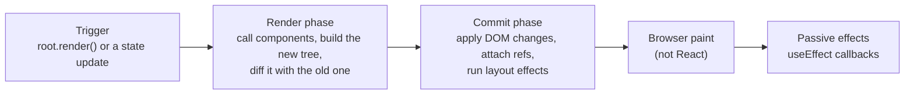
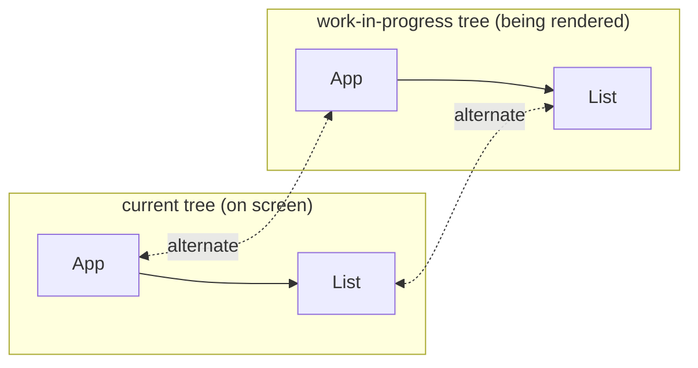

## چرا این فصل مهم است

شعار [مبانی React](/react/fundamentals#مدل-ذهنی-ui--fstate) را می‌شناسید: **UI = f(state)**. State را عوض می‌کنید، React «دوباره Render می‌کند» و صفحه به‌روز می‌شود. این فصل در همان جعبه را باز می‌کند. دقیقاً بین `setCount(1)` و پیکسل جدید روی صفحه چه اتفاقی می‌افتد؟ کدام Componentها دوباره اجرا می‌شوند، کدام Nodeهای DOM عوض می‌شوند و Refها و Effectها به چه ترتیبی اجرا می‌شوند؟

مصاحبه‌کننده‌ها عاشق این سوال‌ها هستند، چون جوابشان کسی را که فقط از React *استفاده می‌کند* از کسی که آن را *می‌فهمد* جدا می‌کند: «چه چیزی باعث Re-render می‌شود؟»، «Reconciliation چیست؟»، «Fiber چیست؟»، «فرق فاز Render و Commit چیست؟». باگ‌های واقعی هم از همین‌جا می‌آیند: متن یک input که ناگهان پاک می‌شود، Effectهایی که با ترتیب غیرمنتظره اجرا می‌شوند، یا کل صفحه‌ای که با هر کلید دوباره Render می‌شود.

## سه مرحله: Trigger، Render، Commit

React را مثل آشپزخانه‌ی یک رستوران تصور کنید:

1. **Trigger**: مشتری سفارش می‌دهد (چیزی یک UI جدید می‌خواهد).
2. **Render**: آشپز غذا را آماده می‌کند (React Componentهای شما را صدا می‌زند تا بفهمد UI باید چه شکلی باشد).
3. **Commit**: گارسون غذا را سر میز می‌گذارد (React تغییرات را روی DOM واقعی اعمال می‌کند).

بعد از Commit نوبت **مرورگر** است که پیکسل‌ها را Paint کند؛ این بخش دیگر کار React نیست ([Rendering Pipeline مرورگر](/browser/rendering-pipeline) را ببینید).



کلمه‌ی **Render** در React به معنی «کشیدن روی صفحه» *نیست*. یعنی «صدا زدن تابع Component برای گرفتن JSX آن». یک Component می‌تواند Render شود بدون اینکه چیزی روی صفحه عوض شود.

### مرحله‌ی ۱: چه چیزی Render را شروع می‌کند

React فقط به دو دلیل Render را شروع می‌کند:

- **Render اولیه.** وقتی برنامه بالا می‌آید، یک بار `createRoot(container).render(<App />)` را صدا می‌زنید.
- **به‌روزرسانی State** در جایی از درخت. این شامل همه‌ی راه‌های تغییر State است: Setter در `useState`، `dispatch` در `useReducer`، Storeای که با `useSyncExternalStore` خوانده می‌شود و تغییرش را اعلام می‌کند، و Providerای از Context که `value`ش عوض می‌شود (که در واقع State همان Component بالایی است).

دقت کنید چه چیزی در این لیست *نیست*: **تغییر props**. props شروع‌کننده نیست، *ورودی* است. props فقط وقتی عوض می‌شود که والد دوباره Render شده و props جدید فرستاده، و آن والد هم به خاطر یک به‌روزرسانی State، Render شده است.

### مرحله‌ی ۲: فاز Render

React از Componentی که State آن عوض شده شروع می‌کند و **آن را صدا می‌زند**. خروجی، JSX است؛ یعنی درختی از React Elementها. اگر بین این Elementها Component دیگری باشد، React آن را هم صدا می‌زند و همین‌طور تا پایین درخت می‌رود تا به Elementهای ساده‌ی DOM مثل `<div>` و `<p>` برسد.

در همین حین React، Elementهای جدید را با چیزی که دفعه‌ی قبل Render کرده بود مقایسه می‌کند. اسم این مقایسه **Reconciliation** است و نتیجه‌اش لیستی از تغییرات است («این متن را عوض کن»، «این Attribute را اضافه کن»، «آن Node را حذف کن»). هنوز به DOM دست نخورده است.

دو ویژگی فاز Render خیلی مهم است:

- **باید خالص باشد.** React ممکن است Component شما را صدا بزند و نتیجه را دور بریزد (StrictMode عمداً این کار را می‌کند و Concurrent Rendering وقتی کار فوری‌تری برسد). پس Render نباید چیزی بیرون از خودش را عوض کند؛ [Componentها باید خالص باشند](/react/fundamentals#componentها-باید-خالص-باشند) را ببینید.
- **می‌تواند قطع شود.** از React 18 به بعد، یک Render کم‌اولویت می‌تواند وسط کار متوقف شود تا مرورگر به یک کلیک جواب بدهد، و بعد ادامه پیدا کند یا از اول شروع شود. برای همین هیچ Side Effectی نباید داخل Render اتفاق بیفتد.

### مرحله‌ی ۳: فاز Commit

وقتی کل درخت جدید مشخص شد، React آن را **Commit** می‌کند. این فاز همگام (Synchronous) است و قطع نمی‌شود، پس کاربر هیچ‌وقت UI نیمه‌کاره نمی‌بیند. سه زیرمرحله دارد:

<Steps>
<Step title="Before mutation">
React هر چیزی را که از DOM لازم دارد *قبل از* تغییرش می‌خواند. در Class Componentها این همان لحظه‌ی اجرای `getSnapshotBeforeUpdate` است (مثلاً برای به خاطر سپردن موقعیت Scroll).
</Step>
<Step title="Mutation">
React، Nodeهای DOM را اضافه، به‌روز و حذف می‌کند، `useInsertionEffect`ها را اجرا می‌کند، Refهای قدیمی را جدا می‌کند و Cleanup مربوط به Layout Effectهایی را که عوض می‌شوند اجرا می‌کند.
</Step>
<Step title="Layout">
React، Refها را وصل می‌کند (Ref Callbackهای DOM و `ref.current`)، بعد `useLayoutEffect`ها (و `componentDidMount`/`componentDidUpdate`) را اجرا می‌کند. DOM به‌روز شده ولی مرورگر هنوز Paint نکرده، پس یک Layout Effect می‌تواند اندازه‌ی یک Element را بگیرد و Layout را بدون چشمک زدن درست کند.
</Step>
</Steps>

بعد مرورگر Paint می‌کند. پس از آن React سراغ **Passive Effectها** می‌رود: اول Cleanupهای `useEffect` و بعد Callbackهای جدید `useEffect`. این‌ها جلوی Paint را نمی‌گیرند و برای همین `useEffect` انتخاب پیش‌فرض است (جزئیات در [Effectها](/react/effects)).

<Callout type="note">
«بعد از Paint» حالت معمول است، نه یک قول. اگر به‌روزرسانی از یک Event گسسته‌ی کاربر مثل کلیک یا فشردن کلید آمده باشد، React، Passive Effectها را همان آخر Commit و قبل از Paint به‌صورت همگام اجرا می‌کند تا نتیجه‌ی کلیک قبل از Event بعدی کامل باشد. هیچ‌وقت روی اجرای `useEffect` قبل یا بعد از Paint حساب نکنید؛ هر جا زمان‌بندی مهم است از `useLayoutEffect` استفاده کنید.
</Callout>

### ترتیب را خودتان ببینید

هر مرحله در Console زیر لاگ می‌شود. اول ترتیب Mount را بخوانید، بعد دکمه را بزنید و ترتیب Update را بخوانید. این Demo بیرون از StrictMode است تا هر خط فقط یک بار چاپ شود.

```jsx live nostrict
import { useState, useEffect, useLayoutEffect } from 'react'

function Child({ count }) {
  console.log(`render Child (count=${count})`)          // فاز Render
  useLayoutEffect(() => {
    console.log('  layout effect Child')                 // Commit، قبل از Paint
    return () => console.log('  layout cleanup Child')
  }, [count])
  useEffect(() => {
    console.log('    effect Child')                      // بعد از Commit
    return () => console.log('    effect cleanup Child')
  }, [count])
  return (
    <p ref={(node) => { if (node) console.log('  ref attached <p>') }}>
      Child sees {count}
    </p>
  )
}

export default function App() {
  const [count, setCount] = useState(0)
  console.log(`render App (count=${count})`)
  useLayoutEffect(() => {
    console.log('  layout effect App')
    return () => console.log('  layout cleanup App')
  }, [count])
  useEffect(() => {
    console.log('    effect App')
    return () => console.log('    effect cleanup App')
  }, [count])
  return (
    <>
      <button onClick={() => { console.clear(); setCount(count + 1) }}>
        Re-render ({count})
      </button>
      <Child count={count} />
    </>
  )
}
```

لاگ چه چیزی نشان می‌دهد:

- **Render از بالا به پایین است**: اول `App` و بعد `Child`، چون والد باید اجرا شود تا React بفهمد چه فرزندانی Render می‌شوند.
- **کارهای Commit از پایین به بالاست**: اول Ref مربوط به `<p>`، بعد Layout Effect مربوط به `Child` و بعد `App`. Effectهای والد بعد از Effectهای فرزندانش اجرا می‌شوند، پس وقتی Effect والد اجرا می‌شود، فرزندانش کاملاً آماده‌اند.
- **همه‌ی Layout Effectها قبل از شروع اولین Passive Effect تمام می‌شوند.**
- در Update، React اول **همه‌ی Cleanupهای** آن نوع را اجرا می‌کند (با مقدارهای Render قبلی) و فقط بعد از آن **همه‌ی Effectهای جدید** را: `layout cleanup Child`، `layout cleanup App`، بعد `layout effect Child`، `layout effect App`.
- Ref Callback داخل JSX در هر Render یک تابع جدید است، پس React هر بار قبلی را جدا می‌کند (با `null` صدایش می‌زند) و جدید را وصل می‌کند.

## یک Component کی دوباره Render می‌شود؟

این پرتکرارترین سوال Rendering در React است و جواب درستش سه بخش دارد. یک Component دوباره Render می‌شود وقتی:

1. **State خودش عوض شود** (Setter یا dispatch از `useState`/`useReducer`، یا Store بیرونی‌ای که به آن Subscribe کرده).
2. **والدش Render شود.** به‌طور پیش‌فرض وقتی یک Component، Render می‌شود، React **همه‌ی Componentهایی را که برمی‌گرداند، به‌صورت بازگشتی** Render می‌کند؛ چه propsشان عوض شده باشد چه نه.
3. **Contextی که می‌خواند عوض شود** (`useContext(SomeContext)` یا `use(SomeContext)` و نزدیک‌ترین Provider یک `value` جدید بگیرد).

قانون دوم خیلی‌ها را غافلگیر می‌کند. React قبل از Render کردن فرزند نمی‌پرسد «propsش عوض شده؟». Render معمولاً ارزان است و چک کردن props برای همه‌ی Componentها هم هزینه دارد، پس React فقط وقتی از کار صرف‌نظر می‌کند که خودتان بخواهید (با [`memo`](/react/performance) یا React Compiler) یا وقتی Element دقیقاً همان Object دفعه‌ی قبل باشد (پایین‌تر می‌بینید).

```jsx live nostrict
import { useState } from 'react'

function Title() {
  console.log('render Title (it has no props at all!)')
  return <h4 style={{ margin: 0 }}>Counter</h4>
}

function Display({ value }) {
  console.log('render Display', value)
  return <p>Value: {value}</p>
}

export default function App() {
  const [count, setCount] = useState(0)
  const [, setNothing] = useState(0)
  console.log('render App')
  return (
    <>
      <Title />
      <Display value={count} />
      <button onClick={() => setCount(count + 1)}>Change count</button>{' '}
      {/* مقدار State جدید است ولی کسی آن را نمی‌خواند: باز هم App و همه‌ی فرزندانش Render می‌شوند */}
      <button onClick={() => setNothing((n) => n + 1)}>Change unused state</button>
    </>
  )
}
```

هر کدام از دکمه‌ها را بزنید: `Title` هر بار Render می‌شود با اینکه اصلاً props ندارد، و دکمه‌ی دوم همه چیز را دوباره Render می‌کند در حالی که هیچ چیز قابل‌دیدنی عوض نمی‌شود.

<Callout type="mistake">
**«Component وقتی propsش عوض شود دوباره Render می‌شود.»** دقیق نیست. فرزند به این دلیل Render می‌شود که *والدش* Render شده، چه props جدید داشته باشد چه نه. با `memo` قضیه برعکس می‌شود: فرزند فقط وقتی Render می‌شود که propsش عوض شده باشد (با `Object.is` روی تک‌تک propsها). گفتن دقیق همین نکته در مصاحبه یک امتیاز سریع است.
</Callout>

### Re-render با تغییر DOM یکی نیست

Render فقط UI را *محاسبه* می‌کند. بعد React نتیجه را با قبلی مقایسه می‌کند و فقط جایی که فرق دارد به DOM دست می‌زند. در Demo زیر یک [`MutationObserver`](/browser/dom) مراقب DOM واقعی است. هر کلیک کل Component را دوباره Render می‌کند، ولی فقط یک Text Node عوض می‌شود:

```jsx live
import { useState, useEffect, useRef } from 'react'

export default function App() {
  const [count, setCount] = useState(0)
  const [log, setLog] = useState([])
  const box = useRef(null)

  useEffect(() => {
    // هر تغییر واقعی DOM داخل box را ثبت کن
    const observer = new MutationObserver((records) => {
      const changes = records.map((r) =>
        r.type === 'characterData' ? `text changed to "${r.target.data}"` : r.type)
      setLog((old) => [...old, ...changes].slice(-4))
    })
    observer.observe(box.current, { subtree: true, childList: true, characterData: true, attributes: true })
    return () => observer.disconnect()
  }, [])

  return (
    <>
      <div ref={box}>
        <h4 style={{ margin: 0 }}>This heading is rendered every time</h4>
        <p className="static">So is this paragraph.</p>
        <p>Clicks: {count}</p>
      </div>
      <button onClick={() => setCount(count + 1)}>Re-render</button>
      <pre>{log.join('\n') || 'No DOM changes yet'}</pre>
    </>
  )
}
```

پس «دوباره Render شد» خودبه‌خود مشکل نیست. Renderی که خروجی یکسان بدهد کمی وقت JavaScript می‌گیرد و هیچ کاری روی DOM انجام نمی‌دهد. فقط وقتی مشکل می‌شود که Component کند Render شود یا هزاران نمونه از آن باشد؛ این موضوع فصل [Performance](/react/performance) است.

### وقتی React از Render صرف‌نظر می‌کند (Bailout)

React چند راه داخلی برای انجام ندادن کار اضافه دارد که به آن‌ها **Bailout** می‌گویند:

| موقعیت | React چه می‌کند |
| --- | --- |
| State را با **همان مقدار** Set می‌کنید (`Object.is(old, new)`) | از Render فرزندان آن Component صرف‌نظر می‌کند. ممکن است خود Component را یک بار صدا بزند و بعد تصمیم بگیرد ([صرف‌نظر از Render](/react/hooks#صرفنظر-از-render-set-کردن-همان-مقدار) را ببینید). |
| یک Element فرزند **همان Object** دفعه‌ی قبل است | کلاً از آن فرزند صرف‌نظر می‌کند (مگر State یا Context خودش عوض شده باشد). |
| فرزند داخل **`memo`** است و همه‌ی propsها با `Object.is` برابرند | از آن فرزند صرف‌نظر می‌کند ([Performance](/react/performance)). |
| **React Compiler** فعال است | خودش Memoization اضافه می‌کند تا JSXی که عوض نشده همان Identity را نگه دارد ([Performance](/react/performance)). |

ردیف دوم یک ترفند کاربردی را توضیح می‌دهد که اصلاً به `memo` نیاز ندارد.

### ترفند «children به‌عنوان props»

وقتی `App`، `<SlowTree />` را Render می‌کند، JSX در هر Render یک **Element Object جدید** می‌سازد، پس React دوباره `SlowTree` را Render می‌کند. اما اگر `SlowTree` را *والدِ* Componentی بسازد که State آن عوض می‌شود و به‌شکل `children` پاسش بدهد، آن Element در Render قبلی والد ساخته شده و همان Object باقی می‌ماند. React، Element یکسان را می‌بیند و از آن صرف‌نظر می‌کند.

```jsx live nostrict
import { useState } from 'react'

function SlowTree() {
  console.log('render SlowTree')                        // فرض کنید این گران است
  return <p>I am an expensive subtree.</p>
}

// ❌ State در همان Componentی است که <SlowTree /> را می‌سازد
function ColorPickerBad() {
  const [color, setColor] = useState('#2563eb')
  return (
    <div style={{ borderLeft: `6px solid ${color}`, paddingLeft: 8 }}>
      <input type="color" value={color} onChange={(e) => setColor(e.target.value)} />
      <SlowTree />                                       {/* در هر Render یک Element جدید */}
    </div>
  )
}

// ✅ State در یک Wrapper است و درخت گران از بیرون می‌آید
function ColorPicker({ children }) {
  const [color, setColor] = useState('#16a34a')
  return (
    <div style={{ borderLeft: `6px solid ${color}`, paddingLeft: 8 }}>
      <input type="color" value={color} onChange={(e) => setColor(e.target.value)} />
      {children}                                         {/* همان Element Object قبلی */}
    </div>
  )
}

export default function App() {
  return (
    <>
      <p>Drag the first picker: SlowTree renders on every change.</p>
      <ColorPickerBad />
      <p>Drag the second one: SlowTree doesn't render at all.</p>
      <ColorPicker>
        <SlowTree />
      </ColorPicker>
    </>
  )
}
```

توصیه‌ی مرتبط این است: **State را پایین ببرید**؛ یعنی State را در کوچک‌ترین Componentی که لازمش دارد نگه دارید تا تغییرش کمترین Render ممکن را ایجاد کند. هر دو ترفند مجانی‌اند و برای همین قبل از `memo` سراغشان بروید.

## Batching: چند به‌روزرسانی، یک Render

اگر هر `setState` یک Render جداگانه شروع می‌کرد، Handlerی که سه مقدار را Set می‌کند سه بار Render می‌شد و حتی ممکن بود کاربر حالت‌های بینابینی را ببیند. به‌جایش React کارها را **Batch** می‌کند: همه‌ی به‌روزرسانی‌هایی را که حین اجرای کد شما انجام می‌شود جمع می‌کند و آخر کار یک بار Render می‌کند.

از React 18 این کار همه‌جا خودکار است (**Automatic Batching**): در Event Handlerهای React، Callbackهای `setTimeout`، `.then` در Promiseها، ادامه‌ی کد بعد از `await` و Event Listenerهای Native. قبل از React 18 فقط به‌روزرسانی‌های داخل Event Handlerهای React، Batch می‌شدند.

```jsx live nostrict
import { useState } from 'react'
import { flushSync } from 'react-dom'

export default function App() {
  const [a, setA] = useState(0)
  const [b, setB] = useState(0)
  console.log(`render a=${a} b=${b}`)

  function inHandler() {
    console.clear()
    setA((x) => x + 1)
    setB((x) => x + 1)          // یک Render با هر دو تغییر
  }

  function inTimeout() {
    console.clear()
    setTimeout(() => {
      setA((x) => x + 1)
      setB((x) => x + 1)        // باز هم یک Render (از React 18)
    }, 0)
  }

  function withFlushSync() {
    console.clear()
    flushSync(() => setA((x) => x + 1))   // همین‌جا Render را اجباری می‌کند
    console.log('after flushSync, the DOM already shows the new a')
    setB((x) => x + 1)                    // یک Render دوم
  }

  return (
    <>
      <p>a = {a}, b = {b}</p>
      <button onClick={inHandler}>Two updates in a handler</button>{' '}
      <button onClick={inTimeout}>Two updates in a timeout</button>{' '}
      <button onClick={withFlushSync}>With flushSync</button>
    </>
  )
}
```

### خارج شدن از Batching با flushSync

<Api name="flushSync()" sig="flushSync(callback)" returns="هر چیزی که `callback` برگرداند." mutates="بله (Render و Commit را همگام انجام می‌دهد و DOM را قبل از برگشتن به‌روز می‌کند)">

- `callback`: تابعی که State را به‌روز می‌کند. React آن را اجرا می‌کند و بلافاصله، قبل از برگشتن `flushSync`، آن به‌روزرسانی‌ها را (به‌علاوه‌ی هر به‌روزرسانی معلقی که از قبل بوده) Render و Commit می‌کند.
- آن را از `react-dom` import کنید، نه از `react`؛ چون موضوعش به‌روز بودن DOM است.
- اگر وسط Render یا داخل یک Effect صدایش بزنید، هشدار می‌دهد: React از قبل مشغول است و نمی‌تواند Flush کند.

</Api>

به‌ندرت لازمش دارید. مثال کلاسیک، خواندن DOM درست بعد از یک به‌روزرسانی است؛ مثلاً Scroll کردن به آیتمی که همین الان به لیست اضافه شده:

```jsx
import { flushSync } from 'react-dom'

function addTodo(text) {
  flushSync(() => {
    setTodos((todos) => [...todos, { id: crypto.randomUUID(), text }])
  })
  // حالا <li> جدید در DOM هست و می‌شود به آن Scroll کرد
  listRef.current.lastElementChild.scrollIntoView({ behavior: 'smooth' })
}
```

<Callout type="warning">
`flushSync` هم Batching و هم قابلیت‌های Concurrent را کنار می‌گذارد (یک Transition داخل آن همگام Render می‌شود) و می‌تواند به Performance ضربه بزند. اول سراغ Ref Callback یا `useLayoutEffect` بروید و `flushSync` را فقط وقتی استفاده کنید که واقعاً باید DOM وسط یک تابع به‌روز شود.
</Callout>

## Virtual DOM

زیاد می‌شنوید که React از **Virtual DOM** استفاده می‌کند. این عبارت فقط یعنی React یک توصیف سبک از UI را به‌شکل Objectهای ساده‌ی JavaScript نگه می‌دارد (React Elementهایی که Componentهایتان برمی‌گردانند، به‌علاوه‌ی درخت داخلی Fiberها)، در هر Render توصیف بعدی را می‌سازد، این دو را مقایسه می‌کند و فقط جایی که فرق دارند به DOM واقعی دست می‌زند.

```js run
// عبارت JSXی مثل <p className="note">Hi {name}</p> به یک Object ساده تبدیل می‌شود:
const name = 'Ada'
const element = {
  $$typeof: Symbol.for('react.transitional.element'), // نشان می‌دهد این یک React Element است
  type: 'p',
  key: null,
  props: { className: 'note', children: ['Hi ', name] },
}
console.log(element.type, element.props) // p { className: 'note', children: [ 'Hi ', 'Ada' ] }
```

ساختن و مقایسه‌ی چنین Objectهایی خیلی ارزان‌تر از ساختن Nodeهای واقعی DOM است؛ Nodeهایی که صدها Property دارند و می‌توانند در مرورگر کار Style و Layout راه بیندازند.

<Callout type="mistake">
**«Virtual DOM باعث می‌شود React از DOM سریع‌تر باشد.»** نه: سریع‌ترین به‌روزرسانی ممکن یک `textNode.data = '5'` دست‌نویس است و React همیشه بیشتر از آن کار می‌کند (Render، مقایسه، و بعد همان فراخوانی DOM). ارزش Virtual DOM این است که اجازه می‌دهد UI را **Declarative** بنویسید (نتیجه را توصیف کنید، نه مراحل را) و کار روی DOM *به‌قدر کافی کم* بماند. کتابخانه‌هایی مثل Svelte و Solid اصلاً Virtual DOM ندارند و به‌روزرسانی‌ها را مستقیم Compile می‌کنند؛ برای همین تیم React امروز اصطلاح‌های «React Element» و «درخت Fiber» را ترجیح می‌دهد.
</Callout>

## Reconciliation: React دو درخت را چطور مقایسه می‌کند

**Reconciliation** الگوریتمی است که درخت قبلی و جدید را می‌گیرد و کوچک‌ترین مجموعه‌ی معقول از تغییرات DOM را پیدا می‌کند.

مسئله‌ی کاملاً کلی («کمترین ویرایش‌هایی که یک درخت را به درخت دیگر تبدیل کند») حدود **O(n³)** زمان می‌برد: برای 1000 Element، حدود یک میلیارد مقایسه. برای اجرا با هر کلید خیلی کند است. React به‌جایش یک الگوریتم **O(n)** دارد که روی دو فرض بنا شده و تقریباً برای همه‌ی UIهای واقعی درست است:

1. **Elementهایی با نوع (Type) متفاوت، درخت‌های متفاوتی می‌سازند.** `<div>`ی که `<section>` می‌شود، یا `<Counter>`ی که `<Timer>` می‌شود، «ویرایش» نمی‌شود؛ زیردرخت قبلی دور ریخته می‌شود و یک زیردرخت تازه ساخته می‌شود.
2. **keyها به React می‌گویند کدام فرزندها در Renderهای مختلف همان آیتم‌اند**، تا بشود یک لیست را بدون ساختن دوباره جابه‌جا کرد.

React هر دو درخت را هم‌زمان پیمایش می‌کند و هر جایگاه را با همان جایگاه در Render قبلی مقایسه می‌کند. در هر جایگاه چهار حالت داریم:

| Element قبلی | Element جدید | React چه می‌کند |
| --- | --- | --- |
| `<div className="a">` | `<div className="b">` (همان نوع DOM) | Node در DOM را نگه می‌دارد، فقط Attributeهای عوض‌شده (`className`) را به‌روز می‌کند و بعد سراغ فرزندان می‌رود. |
| `<Counter step={1}>` | `<Counter step={2}>` (همان نوع Component) | نمونه‌ی Component **و State آن** را نگه می‌دارد، آن را با props جدید Render می‌کند و بعد سراغ خروجی‌اش می‌رود. |
| `<div>` | `<section>` (نوع متفاوت) | زیردرخت قبلی را **Unmount** می‌کند (Cleanupها اجرا می‌شوند، Nodeهای DOM حذف می‌شوند و **همه‌ی Stateهای داخلش از بین می‌رود**) و یک زیردرخت جدید Mount می‌کند. |
| چیزی | هیچ چیز (`null`، `false`) | زیردرخت قبلی را Unmount می‌کند. |

### عوض شدن نوع، State را از بین می‌برد

اول چیزی در input تایپ کنید و بعد Wrapper را عوض کنید. فقط تگ بیرونی عوض می‌شود، ولی چون نوع Element در آن جایگاه فرق کرده، React همه چیز داخلش را دور می‌ریزد؛ از جمله متن input و State شمارنده.

```jsx live
import { useState } from 'react'

function Counter() {
  const [n, setN] = useState(0)
  return <button onClick={() => setN(n + 1)}>Clicked {n} times</button>
}

export default function App() {
  const [boxed, setBoxed] = useState(false)
  const content = (
    <>
      <input placeholder="Type here first" /> <Counter />
    </>
  )
  return (
    <>
      <label>
        <input type="checkbox" checked={boxed} onChange={(e) => setBoxed(e.target.checked)} />
        Wrap in &lt;section&gt; instead of &lt;div&gt;
      </label>
      {/* همان فرزندان، ولی نوع والد فرق دارد: کل زیردرخت از نو ساخته می‌شود */}
      {boxed
        ? <section style={{ border: '2px dashed', padding: 8 }}>{content}</section>
        : <div style={{ padding: 10 }}>{content}</div>}
    </>
  )
}
```

همین قانون اشتباهی را که در فصل مبانی دیدیم توضیح می‌دهد: [هرگز Component را داخل Component دیگر تعریف نکنید](/react/fundamentals#هرگز-component-را-داخل-component-دیگر-تعریف-نکنید). هر Render یک تابع کاملاً جدید می‌سازد، پس نوع هر بار «متفاوت» است و State فرزند با هر کلید Reset می‌شود.

### همان جایگاه، همان نوع: State حفظ می‌شود

برعکسش هم درست است و خیلی‌ها را غافلگیر می‌کند. برای React مهم نیست *کد شما* Element را چطور ساخته؛ فقط به نوع آن در آن جایگاه از خروجی نگاه می‌کند.

```jsx live
import { useState } from 'react'

function Counter({ fancy }) {
  const [n, setN] = useState(0)
  return (
    <button style={{ fontWeight: fancy ? 'bold' : 'normal' }} onClick={() => setN(n + 1)}>
      {fancy ? '✨ ' : ''}Clicked {n} times
    </button>
  )
}

export default function App() {
  const [fancy, setFancy] = useState(false)
  return (
    <>
      <label>
        <input type="checkbox" checked={fancy} onChange={(e) => setFancy(e.target.checked)} /> Fancy
      </label>
      <p>Two different JSX branches, same position and type: the count survives</p>
      {fancy ? <Counter fancy /> : <Counter />}

      <p>Two different positions: the count resets when you toggle</p>
      {fancy && <Counter fancy />}
      {!fancy && <Counter />}
    </>
  )
}
```

در جفت دوم، `{fancy && …}` و `{!fancy && …}` دو خانه‌ی جدا در آرایه‌ی فرزندان‌اند. وقتی یکی `false` باشد، خانه‌اش خالی است؛ پس با هر تغییر، شمارنده از خانه‌ی ۱ به خانه‌ی ۲ می‌رود: جایگاه متفاوت، یعنی State جدید. برای Reset اجباری حتی در همان جایگاه، به Element یک `key` متفاوت بدهید؛ همان‌طور که در [State مال یک جایگاه در درخت است](/react/hooks#state-مال-یک-جایگاه-در-درخت-است) دیدیم.

### لیست‌ها و key در Reconciliation

برای فرزندانی که از یک آرایه می‌آیند، مقایسه‌ی «بر اساس جایگاه» به محض اضافه، حذف یا جابه‌جا شدن آیتم‌ها خراب می‌شود. **key** به هر فرزند یک هویت می‌دهد: React اول فرزندان قبلی و جدید را **با key** جفت می‌کند، پس یک آیتم وقتی جابه‌جا می‌شود Node و Stateاش را نگه می‌دارد. باگ قابل‌دیدنی که key اشتباه می‌سازد در [چرا key وجود دارد](/react/fundamentals#چرا-key-وجود-دارد) آمده است. این هم کاری است که Reconciliation با keyها می‌کند:

```text
Before:  [ A(key=a) , B(key=b) , C(key=c) ]
After:   [ C(key=c) , A(key=a) , B(key=b) ]      ← C moved to the front

With keys:  match by key → a=a, b=b, c=c
            → no node is recreated; React only moves C's DOM node (1 insertBefore)

With index keys (0,1,2):  match by position → 0:A→C, 1:B→A, 2:C→B
            → every item gets the wrong props; inputs/state stay at the old position
```

keyها فقط باید **بین هم‌نیاها (Siblingها)** یکتا باشند و باید **پایدار** باشند: `Math.random()` یا `crypto.randomUUID()` که حین Render صدا زده شود، هر بار key جدید می‌سازد و هر آیتم در هر Render، Unmount و دوباره Mount می‌شود.

## Fiber: موتور React

تا اینجا از «درخت» خیلی کلی حرف زدیم. در واقع از React 16 (سال 2017)، این درخت از **Fiber**ها ساخته شده و موتوری که آن را پیمایش می‌کند **Fiber Reconciler** نام دارد. در مصاحبه‌های Senior زیاد درباره‌اش می‌پرسند.

### مشکلی که Fiber حل کرد

قبل از React 16، **Stack Reconciler** درخت را با بازگشت (Recursion) ساده Render می‌کرد: `render(App)` تابع `render(Child)` را صدا می‌زد و آن هم `render(Grandchild)` را... Recursion از Call Stack خود JavaScript استفاده می‌کند و Call Stack را نمی‌شود وسط کار نگه داشت: وقتی React یک به‌روزرسانی را شروع می‌کرد، باید کل درخت را یک‌جا تمام می‌کرد. برای یک درخت بزرگ این ممکن بود 100 میلی‌ثانیه طول بکشد و در تمام این مدت Main Thread قفل بود: تایپ کردن کند می‌شد و انیمیشن‌ها تکه‌تکه.

راه‌حل این بود که React دیگر از Call Stack استفاده نکند و ساختار داده‌ی *خودش* را داشته باشد؛ ساختاری که بشود قدم‌به‌قدم پیمایشش کرد، هر جا لازم بود متوقف شد و بعداً ادامه داد. هر قدم از این پیمایش یک Fiber است.

### Fiber چیست

**Fiber** یک Object ساده‌ی JavaScript است که React برای هر نمونه از Component و هر Element در DOM می‌سازد. همان «Instance» در [Element در برابر Component در برابر Instance](/react/fundamentals#element-در-برابر-component-در-برابر-instance) است: جایی که React همه‌ی اطلاعات آن تکه از UI را بین Renderها نگه می‌دارد. فیلدهای واقعی آن در React 19 از جمله این‌هاست:

| فیلد | چه چیزی نگه می‌دارد |
| --- | --- |
| `tag` | نوع Fiber: Function Component، Class Component، Element میزبان (DOM)، متن، Fragment، Context Provider و غیره. |
| `type`، `key` | از Element کپی می‌شوند: تابع Component یا اسم تگی مثل `'div'`، و key. |
| `stateNode` | چیز واقعی پشت Fiber: Node در DOM برای Fiberهای میزبان، و نمونه‌ی کلاس برای Class Componentها. |
| `child`، `sibling`، `return` | اشاره‌گر به اولین فرزند، هم‌نیای بعدی و والد. این‌ها درخت را به یک Linked List تبدیل می‌کنند که React بدون Recursion پیمایشش می‌کند. |
| `pendingProps`، `memoizedProps` | props این Render و props آخرین Renderی که کامل شد. |
| `memoizedState` | برای Function Componentها: **Linked List مربوط به Hookها** (همان «خانه‌ها» در [قوانین Hookها](/react/hooks#چرا-ترتیب-مهم-است-react-state-هر-hook-را-کجا-نگه-میدارد)). |
| `updateQueue` | به‌روزرسانی‌های معلق و برای Function Componentها، لیست Effectها. |
| `flags`، `subtreeFlags` | Bit Flagهایی که مشخص می‌کنند Commit این‌جا چه کاری باید بکند: `Placement`، `Update`، `ChildDeletion`، `Ref`، `Passive` (Effect دارد)... |
| `lanes`، `childLanes` | چه اولویت‌هایی از کار روی این Fiber و هر جایی زیر آن معلق است. |
| `alternate` | Fiber متناظر در درخت دیگر (Double Buffering را ببینید). |

```text
            App                        child   ↓  first child
             │                         sibling →  next sibling
             ↓ child                   return  ↑  parent
          Header ──sibling──→ Main ──sibling──→ Footer
                               │
                               ↓ child
                              List
                               │
                               ↓ child
                             Item1 ──sibling──→ Item2
   (every child also has a `return` pointer back up to its parent)
```

### Work Loop: پیمایش درخت، یک Fiber در هر قدم

React درخت را با یک حلقه پردازش می‌کند نه با Recursion. برای هر Fiber، **`beginWork`** را صدا می‌زند (Component را Render می‌کند، فرزندانش را Reconcile می‌کند و اولین فرزند را برمی‌گرداند). وقتی یک Fiber فرزند پردازش‌نشده‌ای نداشته باشد، React تابع **`completeWork`** را صدا می‌زند (برای Fiberهای میزبان: ساختن یا آماده کردن Node در DOM و جمع کردن Flagها) و می‌رود سراغ هم‌نیا، یا برمی‌گردد بالا پیش والد. این مدل اجرایی دقیقاً همان ترتیبی را دنبال می‌کند که React استفاده می‌کند:

```js run
// یک درخت Fiber کوچک با اشاره‌گرهای child / sibling / return بسازیم
function fiber(name, children = []) {
  const f = { name, child: null, sibling: null, return: null }
  children.forEach((c, i) => {
    c.return = f
    if (i === 0) f.child = c
    else children[i - 1].sibling = c
  })
  return f
}
const root = fiber('App', [
  fiber('Header'),
  fiber('Main', [fiber('List', [fiber('Item1'), fiber('Item2')])]),
  fiber('Footer'),
])

// حلقه‌ی React: هر بار یک واحد کار، بدون Recursion
function performUnitOfWork(f) {
  console.log('begin   ', f.name)        // beginWork: صدا زدن Component و Reconcile فرزندان
  if (f.child) return f.child            // اول برو پایین
  let node = f
  while (node) {
    console.log('complete', node.name)   // completeWork: آماده کردن DOM و بالا بردن Flagها
    if (node.sibling) return node.sibling // بعد برو سمت هم‌نیا
    node = node.return                    // بعد برگرد بالا
  }
  return null                             // به بالای درخت رسیدیم: کار تمام است
}

let next = root
while (next) next = performUnitOfWork(next) // React بین هر دو دور حلقه می‌تواند متوقف شود
```

خروجی را بخوانید: `begin` از بالا به پایین است (والدها قبل از فرزندان Render می‌شوند، مثل Demo لاگ بالاتر) و `complete` از پایین به بالا (فرزندان قبل از والدشان تمام می‌شوند؛ برای همین Effectهای فرزند در Commit اول اجرا می‌شوند).

مهم‌ترین خط، خط آخر است. چون تمام وضعیت پیمایش فقط در متغیر `next` است، React می‌تواند بین دو واحد کار متوقف شود، بگذارد مرورگر یک Event را پردازش کند و بعداً از همان `next` ادامه دهد. در Concurrent Rendering حلقه واقعاً این شکلی است:

```js
// ساده‌شده از react-reconciler
function workLoopConcurrent() {
  while (workInProgress !== null && !shouldYield()) {
    performUnitOfWork(workInProgress)
  }
}
```

`shouldYield()` از پکیج **Scheduler** خود React می‌آید. وقتی React حدود **5 میلی‌ثانیه** کار کرده باشد `true` برمی‌گرداند (همان `frameInterval` در `scheduler`)، پس React در هر فریم چند بار Main Thread را به مرورگر پس می‌دهد. به این کار **Time Slicing** می‌گویند. به‌روزرسانی‌های فوری (مثل تایپ کردن) از `workLoopSync` استفاده می‌کنند که چک `shouldYield` ندارد.

### Double Buffering: درخت current و work-in-progress

React **دو** درخت Fiber نگه می‌دارد:

- **current**: درختی که با چیزی که الان روی صفحه است مطابقت دارد.
- **work-in-progress**: درختی که حین Render در حال ساخته شدن است.

`alternate` در هر Fiber به جفتش در درخت دیگر اشاره می‌کند، پس React به‌جای ساختن Object جدید در هر بار، از همین‌ها دوباره استفاده می‌کند. Render کاملاً روی درخت work-in-progress انجام می‌شود. اگر Render قطع یا دور ریخته شود، درخت current (و صفحه) دست‌نخورده می‌ماند. وقتی Commit تمام شد، React فقط یک اشاره‌گر را عوض می‌کند: `root.current = finishedWork`. درخت work-in-progress می‌شود درخت current و درخت current قبلی، فضای کار Render بعدی.



این اسم از گرافیک کامپیوتری آمده: یک بازی فریم بعدی را در یک Buffer پنهان می‌کشد و بعد جایش را با Buffer قابل‌دیدن عوض می‌کند تا شما هیچ‌وقت یک فریم نیمه‌کاره نبینید.

### Laneها: اولویت به‌روزرسانی‌ها

همه‌ی به‌روزرسانی‌ها به یک اندازه فوری نیستند. فشردن یک کلید باید فوراً دیده شود؛ لیستی که با همان کلید فیلتر می‌شود می‌تواند چند میلی‌ثانیه صبر کند. React اولویت هر به‌روزرسانی را با **Lane**ها دنبال می‌کند: هر Lane یک بیت در یک عدد 31 بیتی است، پس مجموعه‌ای از اولویت‌های معلق فقط یک Bitmask است و چک کردن یا ترکیبشان یک عملیات بیتی سریع است.

| Lane | منبع معمول |
| --- | --- |
| `SyncLane` | Eventهای گسسته‌ی کاربر: `click`، `keydown`، `input`، `submit`. همین‌طور `flushSync`. |
| `InputContinuousLane` | Eventهای پیوسته: `mousemove`، `scroll`، `pointermove`، `wheel`. |
| `DefaultLane` | به‌روزرسانی‌هایی که از هیچ Eventی نمی‌آیند: `setTimeout`، یک `fetch` که Resolve شده، `root.render` اولیه. |
| `TransitionLanes` | به‌روزرسانی‌های داخل `startTransition` / `useTransition`، و Render عقب‌افتاده‌ی `useDeferredValue`. |
| `RetryLanes` | تلاش دوباره برای نمایش محتوا بعد از رسیدن داده‌ی یک [Suspense](/react/advanced). |
| `IdleLane` | کار با کمترین اولویت. |
| `OffscreenLane` | Render از پیش برای محتوای پنهان، مثلاً داخل [`<Activity mode="hidden">`](/react/performance). |

وقتی وسط یک Render کم‌اولویت یک به‌روزرسانی پراولویت برسد، React می‌تواند درخت work-in-progress کم‌اولویت را رها کند، به‌روزرسانی فوری را Render و Commit کند و بعد Render کم‌اولویت را روی State جدید از اول شروع کند. از این قدرت از طریق `useTransition` و `useDeferredValue` در [Concurrent React](/react/advanced) استفاده می‌کنید.

<Callout type="note">
Laneها، `beginWork` و `workLoopConcurrent` جزئیات داخلی پیاده‌سازی‌اند: هیچ‌وقت import نمی‌شوند و ممکن است بین نسخه‌ها عوض شوند. مفهوم‌ها را برای مصاحبه بلد باشید (واحدهای کار، Render قابل‌قطع، دو درخت، اولویت‌ها)؛ ولی چیزی روی این اسم‌ها نسازید.
</Callout>

### کنار هم گذاشتن همه چیز

<Steps>
<Step title="یک کلیک setCount(1) را صدا می‌زند">
React یک Update Object می‌سازد، آن را در صف Hook می‌گذارد، به آن `SyncLane` می‌دهد (کلیک یک Event گسسته است)، Fiber و `childLanes` همه‌ی اجدادش را علامت می‌زند و یک Render از Root را زمان‌بندی می‌کند. بقیه‌ی به‌روزرسانی‌های همان Handler هم به همین Batch اضافه می‌شوند.
</Step>
<Step title="Render: ساختن درخت work-in-progress">
React از Root پیمایش را شروع می‌کند. Fiberهایی که کار معلق ندارند و propsشان همان است **Bailout** می‌شوند (از current کپی می‌شوند، یا اگر `childLanes` هم خالی باشد کلاً رد می‌شوند). برای Fiberی که عوض شده، React، Component را صدا می‌زند، صف به‌روزرسانی Hook را پردازش می‌کند تا به `count = 1` برسد و Elementهای برگشتی را با Fiberهای فرزند قبلی Reconcile می‌کند و Flagهایی مثل `Update` یا `Placement` می‌گذارد.
</Step>
<Step title="Complete: آماده کردن کارهای DOM">
در مسیر برگشت به بالا، `completeWork` تغییرات DOM را آماده می‌کند (کدام props روی کدام Node عوض شده) و `subtreeFlags` را بالا می‌برد تا Commit بتواند از زیردرخت‌هایی که کاری ندارند رد شود.
</Step>
<Step title="Commit: اعمال همه چیز یک‌جا">
Before mutation، Mutation (تغییرات DOM)، عوض کردن `root.current`، Layout (Refها و Layout Effectها). همه همگام.
</Step>
<Step title="Paint و Passive Effectها">
مرورگر فریم جدید را Paint می‌کند؛ React، Cleanupها و Callbackهای `useEffect` را اجرا می‌کند (یا برای یک Event گسسته مثل همین کلیک، بلافاصله Flushشان می‌کند).
</Step>
</Steps>

## Rendering در StrictMode

در محیط Development، [`<StrictMode>`](/react/fundamentals#strictmode) هر Component را **دو بار** Render می‌کند (و از نتیجه‌ی Render دوم استفاده می‌کند)، و هر Component را Mount، Unmount و دوباره Mount می‌کند تا Cleanup هر Effect یک بار اجرا شود. React این‌طوری چک می‌کند که Render خالص است و Cleanupها درست‌اند؛ با همان توانایی «دور ریختن یک Render» که Concurrent Rendering به آن تکیه دارد. این در Production اتفاق نمی‌افتد. برای همین Demoهای لاگ‌دار این فصل `nostrict` دارند: در StrictMode هر خط Render دو بار چاپ می‌شد.

## اشتباهات رایج

<Callout type="mistake">
**خواندن State درست بعد از Set کردنش.** `setCount(count + 1); console.log(count)` مقدار قبلی را چاپ می‌کند. Setter فقط یک به‌روزرسانی در صف می‌گذارد؛ مقدار جدید در Render *بعدی* دیده می‌شود. اگر الان لازمش دارید، مقدار بعدی را در یک متغیر حساب کنید.
</Callout>

<Callout type="mistake">
**Side Effect داخل Render.** گرفتن داده، ساختن Timer یا نوشتن در `localStorage` در بدنه‌ی Component با هر Render اجرا می‌شود، در StrictMode دو بار، و شاید برای Renderهایی که دور ریخته می‌شوند. این‌ها را در Event Handler یا [Effect](/react/effects) بگذارید.
</Callout>

<Callout type="mistake">
**key یا نوع ناپایدار.** `key={Math.random()}`، `key={index}` روی لیستی که ترتیبش عوض می‌شود، یا Componentی که داخل Component دیگر تعریف شده، همه باعث می‌شوند React «یک آیتم دیگر» ببیند و آن را دوباره Mount کند؛ State، Focus و Nodeهای DOM از دست می‌روند.
</Callout>

<Callout type="mistake">
**جنگیدن با Re-render با `memo` همه‌جا.** بیشتر Re-renderها ارزان‌اند و به DOM دست نمی‌زنند. اول State را پایین ببرید یا درخت‌های گران را به‌شکل `children` پاس بدهید؛ قبل از Memoize کردن با Profiler در React DevTools اندازه بگیرید؛ یا بگذارید React Compiler این کار را بکند ([Performance](/react/performance)).
</Callout>

## سوالات مصاحبه

<QA q="بعد از صدا زدن setState چه اتفاقی می‌افتد؟" level="mid" n={1}>
<Answer>

Setter بلافاصله چیزی را عوض نمی‌کند. React یک Update در صف آن Hook می‌گذارد، Component را با یک اولویت (Lane) به‌عنوان «کار معلق دارد» علامت می‌زند و یک Render زمان‌بندی می‌کند. به‌روزرسانی‌های همان Event با هم Batch می‌شوند. در Render بعدی React دوباره Component را صدا می‌زند، صف را پردازش می‌کند تا State جدید به دست بیاید، Elementهای برگشتی را با قبلی‌ها Reconcile می‌کند، بعد کمترین تغییرات لازم را روی DOM Commit می‌کند، Refها را وصل می‌کند، Layout Effectها را اجرا می‌کند، می‌گذارد مرورگر Paint کند و `useEffect`ها را اجرا می‌کند. اگر State جدید با `Object.is` برابر قبلی باشد، React، Bailout می‌کند.

</Answer>
</QA>

<QA q="فرق فاز Render و فاز Commit چیست؟" level="mid" n={2}>
<Answer>

**فاز Render** Componentها را صدا می‌زند و حساب می‌کند چه چیزی عوض شده. باید خالص باشد، به DOM دست نمی‌زند و در حالت Concurrent می‌تواند متوقف، از نو شروع یا دور ریخته شود. **فاز Commit** تغییرات را روی DOM اعمال می‌کند، Refها را وصل می‌کند و Layout Effectها را اجرا می‌کند؛ همگام است و قطع نمی‌شود، پس کاربر هیچ‌وقت به‌روزرسانی نیمه‌کاره نمی‌بیند. Passive Effectها (`useEffect`) بعد از Commit و معمولاً بعد از Paint اجرا می‌شوند.

</Answer>
<Deep>

Commit زیرفازهایی دارد: Before mutation (`getSnapshotBeforeUpdate`)، Mutation (نوشتن در DOM، `useInsertionEffect`، جدا کردن Refها، Cleanupهای Layout)، بعد عوض شدن `root.current` و بعد Layout (وصل کردن Refها، `useLayoutEffect`، `componentDidMount/Update`). Effectها از فرزند به والد اجرا می‌شوند، چون در مسیر برگشت به بالای درخت جمع می‌شوند.

</Deep>
</QA>

<QA q="چه چیزی باعث Re-render یک Component می‌شود؟ آیا تغییر props آن را Re-render می‌کند؟" level="mid" n={3}>
<Answer>

یک Component وقتی دوباره Render می‌شود که State خودش عوض شود، والدش Render شود، یا Contextی که مصرف می‌کند عوض شود. تغییر props دلیل جداگانه‌ای نیست: props فقط وقتی عوض می‌شود که والد Render شده، و به‌طور پیش‌فرض فرزند با هر Render والد Render می‌شود، حتی با props یکسان. `memo` این را عوض می‌کند تا فرزند فقط وقتی Render شود که یکی از propsها عوض شده باشد (مقایسه‌ی سطحی با `Object.is`).

</Answer>
<FollowUp>

*بدون `memo` چطور از Re-render یک فرزند گران جلوگیری کنیم؟* State را به یک Component کوچک‌تر پایین ببرید، یا بخش گران را بالا ببرید و به‌شکل `children` پاس بدهید: Element را والد ساخته، Identityاش حفظ می‌شود و React از آن رد می‌شود.

</FollowUp>
</QA>

<QA q="Virtual DOM چیست؟ آیا دلیل سرعت React همین است؟" level="junior" n={4}>
<Answer>

یک توصیف داخل حافظه از UI به‌شکل Objectهای ساده‌ی JavaScript است (React Elementها و درخت Fiber). در هر به‌روزرسانی React توصیف جدید را می‌سازد، با قبلی مقایسه می‌کند و فقط تفاوت‌ها را روی DOM واقعی اعمال می‌کند. از به‌روزرسانی دستی و دقیق DOM سریع‌تر نیست؛ فایده‌اش این است که کد Declarative می‌نویسید و باز هم کار روی DOM به‌قدر معقول کم می‌ماند.

</Answer>
</QA>

<QA q="Reconciliation را توضیح دهید. چرا Diff در React از مرتبه‌ی O(n) است؟" level="mid" n={5}>
<Answer>

Reconciliation درخت Elementهای جدید را با قبلی مقایسه می‌کند تا تغییرات DOM را پیدا کند. Diff کلی درخت O(n³) است، پس React از دو فرض استفاده می‌کند: Elementهایی با نوع متفاوت زیردرخت کاملاً متفاوتی می‌سازند (به‌جای Diff، Unmount و Mount دوباره)، و آیتم‌های لیست با `key` جفت می‌شوند. همان نوع DOM یعنی «Attributeها را به‌روز کن»؛ همان نوع Component یعنی «Instance و State را نگه دار و با props جدید Render کن».

</Answer>
<Mistake>

گفتن اینکه React «DOM واقعی را Diff می‌کند». React هیچ‌وقت برای مقایسه DOM را نمی‌خواند؛ Elementهای جدید را با Fiberهای Render قبلی مقایسه می‌کند.

</Mistake>
</QA>

<QA q="چرا وقتی والد یک input از <div> به <section> عوض می‌شود، متن input پاک می‌شود؟" level="mid" n={6}>
<Answer>

چون نوع Element در آن جایگاه عوض شده و قانون React این است: «نوع متفاوت، درخت متفاوت». کل زیردرخت قبلی Unmount می‌شود (State و Nodeهای DOM، از جمله input و متنش، از بین می‌روند) و یک زیردرخت جدید Mount می‌شود. همین اتفاق برای Componentی می‌افتد که داخل Component دیگر تعریف شده، چون تابعش و در نتیجه نوعش در هر Render جدید است.

</Answer>
</QA>

<QA q="Automatic Batching چیست؟" level="mid" n={7}>
<Answer>

React همه‌ی به‌روزرسانی‌های State را که در یک Tick انجام می‌شوند در یک Render جمع می‌کند. قبل از React 18 این فقط داخل Event Handlerهای React اتفاق می‌افتاد؛ از React 18 (با `createRoot`) برای Timeoutها، Promiseها و Event Handlerهای Native هم هست. Batching جلوی Renderهای بیهوده را می‌گیرد و نمی‌گذارد UI حالت نیمه‌به‌روز نشان دهد. وقتی لازم است DOM فوراً به‌روز شود، با `flushSync` از آن خارج می‌شوید.

</Answer>
</QA>

<QA q="React Fiber چیست و چرا معرفی شد؟" level="senior" n={8}>
<Answer>

Fiber معماری Reconciler است که در React 16 معرفی شد. هر نمونه‌ی Component و هر Element در DOM یک Fiber Object دارد (نوع، props، State/Hookها، Flagها، Laneهای اولویت و اشاره‌گرهای `child`/`sibling`/`return`). Stack Reconciler قدیمی به‌صورت بازگشتی Render می‌کرد و نمی‌توانست متوقف شود؛ Fiber، Render را به حلقه‌ای از واحدهای کار تبدیل می‌کند که می‌تواند Main Thread را به مرورگر پس بدهد، متوقف شود، ادامه پیدا کند، از نو شروع شود یا رها شود. همین قابلیت‌های Concurrent را ممکن کرد: Time Slicing، Transitionها، Suspense و به‌روزرسانی بر اساس اولویت.

</Answer>
<Deep>

React دو درخت `current` و `work-in-progress` نگه می‌دارد که با `alternate` به هم وصل‌اند (Double Buffering)، پس Renderی که قطع شود هیچ‌وقت به چیزی که روی صفحه است دست نمی‌زند؛ Commit آن‌ها را با یک انتساب اشاره‌گر جابه‌جا می‌کند. Work Loop در مسیر پایین `beginWork` و در مسیر بالا `completeWork` را صدا می‌زند و در حالت Concurrent بین Fiberها `shouldYield()` از Scheduler را چک می‌کند (برش‌های حدود 5 میلی‌ثانیه‌ای).

</Deep>
</QA>

<QA q="Laneها چه هستند؟" level="senior" n={9}>
<Answer>

Laneها مدل اولویت React هستند: هر به‌روزرسانی یک Lane می‌گیرد که یک بیت در یک Mask سی‌ویک بیتی است (`SyncLane` برای کلیک و کلید، `InputContinuousLane` برای حرکت ماوس، `DefaultLane` برای Timerها و نتیجه‌ی شبکه، Laneهای Transition برای `startTransition`، به‌علاوه‌ی Laneهای Retry، Idle و Offscreen). Bitmask باعث می‌شود Batch کردن به‌روزرسانی‌های هم‌اولویت، پیدا کردن فوری‌ترین کار معلق و قطع کردن Render یک Transition با یک به‌روزرسانی فوری ارزان باشد.

</Answer>
</QA>

## جمع‌بندی

<Recap>

- هر به‌روزرسانی سه مرحله دارد: **Trigger** (Render اولیه یا تغییر State)، **Render** (صدا زدن Componentها و مقایسه) و **Commit** (اعمال تغییرات DOM)؛ بعد مرورگر Paint می‌کند.
- «Render» یعنی صدا زدن Component، نه دست زدن به DOM؛ Re-renderی با خروجی یکسان هیچ تغییری در DOM نمی‌دهد.
- Render خالص و قابل‌قطع است؛ Commit همگام است. ترتیب Commit: تغییر DOM ← Refها ← `useLayoutEffect` (فرزند قبل از والد) ← Paint ← `useEffect`.
- Component وقتی Re-render می‌شود که Stateش عوض شود، والدش Render شود، یا Contextی که می‌خواند عوض شود. props به‌تنهایی شروع‌کننده نیست.
- قبل از `memo`، با پایین بردن State یا پاس دادن درخت‌های گران به‌شکل `children` از Renderهای اضافه جلوگیری کنید.
- از React 18 به‌روزرسانی‌ها همه‌جا Batch می‌شوند؛ `flushSync` یک Render همگام را اجباری می‌کند.
- Reconciliation از مرتبه‌ی O(n) است: نوع متفاوت، زیردرخت و Stateاش را از بین می‌برد؛ همان نوع در همان جایگاه State را نگه می‌دارد؛ keyها آیتم‌های لیست را جفت می‌کنند.
- Fiber، Object مخصوص هر Instance در React است با اشاره‌گرهای `child`/`sibling`/`return`، Hookها در `memoizedState`، Flagها و Laneها.
- Work Loop (`beginWork` رو به پایین، `completeWork` رو به بالا) می‌تواند هر حدود 5 میلی‌ثانیه Yield کند؛ درخت‌های current و work-in-progress در Commit جابه‌جا می‌شوند.
- Laneها اولویت‌هایی به‌شکل Bitmask هستند که به به‌روزرسانی‌های فوری اجازه می‌دهند Transitionها را قطع کنند.

</Recap>
