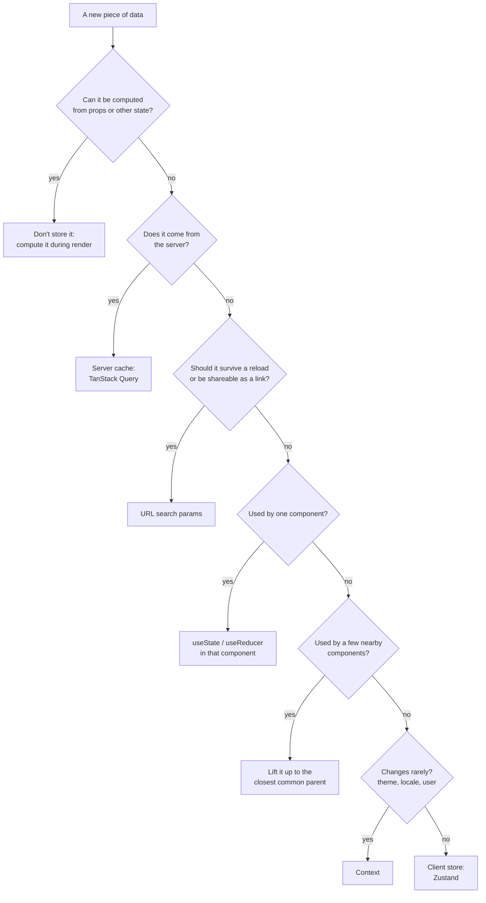
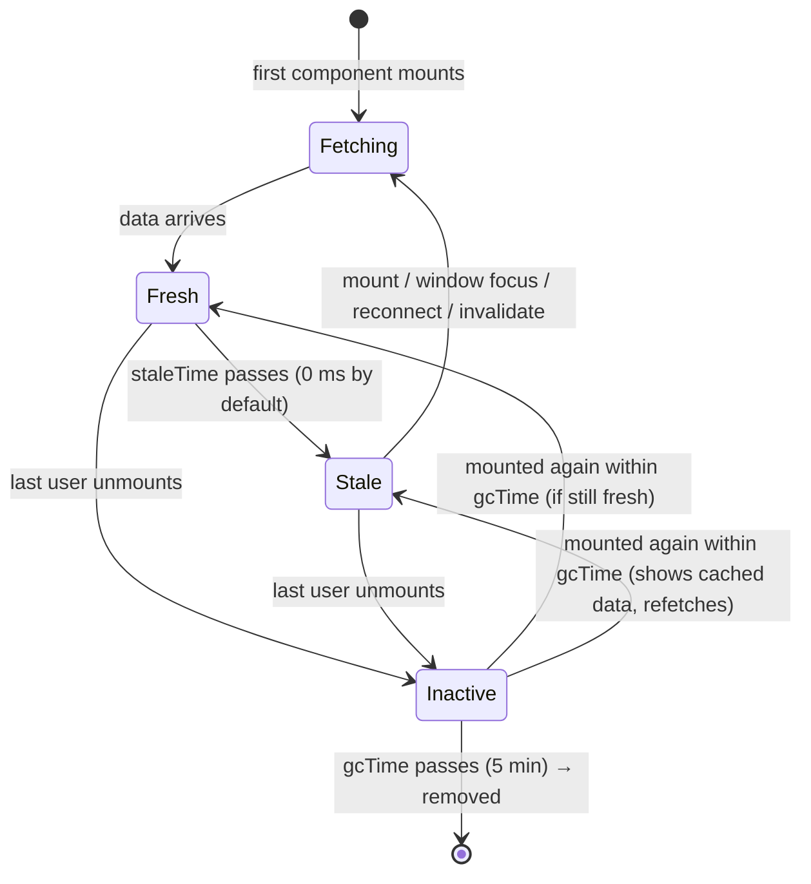

## اصلاً چرا «مدیریت State» یک موضوع جداست

ابزارهای یک Component را بلدید: [`useState`](/react/hooks#usestate-با-جزئیات)، [`useReducer`](/react/hooks#usereducer) و [`useContext`](/react/hooks#usecontext). «مدیریت State» سوالی است که وقتی برنامه بزرگ می‌شود پیش می‌آید: **هر تکه داده کجا باید زندگی کند، چه کسی اجازه دارد عوضش کند و Componentهایی که لازمش دارند چطور به آن می‌رسند؟**

اشتباه در همین تصمیم ریشه‌ی بیشتر کدهای شلوغ React است: یک داده که در سه جا کپی شده و کم‌کم با هم فرق پیدا می‌کنند، یک `useEffect` که دو State را «همگام» نگه می‌دارد، Contextی که با هر کلید کل برنامه را Re-render می‌کند، یا یک Cache دست‌ساز برای پاسخ‌های API که پر از Race Condition است. مصاحبه‌کننده‌ها مدام درباره‌اش می‌پرسند («Context یا Redux؟»، «Server State چیست؟»، «چرا TanStack Query؟»)، چون جواب شما نشان می‌دهد درباره‌ی معماری چطور فکر می‌کنید.

این فصل از کوچک‌ترین تصمیم (چه چیزی را در `useState` بگذاریم) شروع می‌کند و به بزرگ‌ترین (یک Store سراسری و یک Cache برای داده‌ی سرور) می‌رسد، و با نقشه‌ای تمام می‌شود که می‌گوید هر ابزار به درد چه کاری می‌خورد.

## انواع State

همه‌ی Stateها یک‌جور نیستند. قبل از انتخاب ابزار، **نوع** داده‌ای را که دارید مشخص کنید:

| نوع | مثال | صاحب حقیقت کیست | بهترین جا |
| --- | --- | --- | --- |
| **State محلی UI** | این Dropdown باز است؟ متن این input. تب فعلی. | همین Component | `useState` / `useReducer` در همان Component |
| **State مشترک سمت Client** | کاربر واردشده، Theme، سبد خرید، مراحل یک Wizard، آیتم انتخاب‌شده‌ای که دو پنل از آن استفاده می‌کنند | خود برنامه در مرورگر | State بالابرده‌شده، Context، یا یک Client Store (Zustand) |
| **Server State** | محصولات، کامنت‌ها، سفارش‌های کاربر: هر چیزی که در دیتابیس است | **سرور**؛ شما فقط یک کپی Cacheشده دارید | یک کتابخانه‌ی Server State (TanStack Query) |
| **URL State** | عبارت جستجو، فیلترها، شماره‌ی صفحه، id آیتم باز | نوار آدرس | Search Params یا مسیر در Router |
| **Form State** | مقدار فیلدها، خطاهای اعتبارسنجی، فلگ «لمس‌شده» | خود فرم، تا وقتی Submit شود | State محلی، یک کتابخانه‌ی فرم، یا [Form Actionها](/react/react-19) |
| **State مشتق‌شده (Derived)** | لیست فیلترشده، قیمت کل، «فرم معتبر است؟» | هیچ‌کس: محاسبه می‌شود | **State نیست.** حین Render حسابش کنید |

دو ردیف از این جدول بیشترین کار را در برنامه‌های واقعی انجام می‌دهند. **State مشتق‌شده State نیست**: اگر می‌شود از مقدارهای دیگر حسابش کرد، حسابش کنید. و **Server State، Client State نیست**: داده‌ای که از API می‌گیرید *Cache* داده‌ی کس دیگری است، با مشکلاتی (کهنه شدن، دریافت دوباره، حذف درخواست‌های تکراری) که `useState` هیچ‌وقت برایشان طراحی نشده بود.

### انتخاب جای مناسب



هر بار از بالا شروع کنید. بیشتر داده‌ها با همان سه سوال اول تکلیفشان روشن می‌شود و خیلی کمتر از چیزی که انتظار دارید «سراسری» از آب درمی‌آید.

## ساختار دادن به State محلی

حتی داخل یک Component هم *شکل* State تعیین می‌کند چند نوع باگ می‌توانید بنویسید. مستندات React پنج اصل می‌گوید که هر کدام یک دسته‌ی کامل از باگ‌ها را حذف می‌کند.

### Stateهای مرتبط را با هم نگه دارید

اگر دو مقدار همیشه با هم عوض می‌شوند، آن‌ها را در یک متغیر State بگذارید. آن وقت هیچ‌وقت از هم جا نمی‌مانند.

```jsx
// ❌ دو متغیر که باید همیشه با هم به‌روز شوند
const [x, setX] = useState(0)
const [y, setY] = useState(0)

// ✅ یک Object که با یک فراخوانی به‌روز می‌شود
const [position, setPosition] = useState({ x: 0, y: 0 })
setPosition({ x: e.clientX, y: e.clientY })
```

### از تناقض دوری کنید: به‌جای چند Boolean یک status

چند Boolean که یک فرایند را توصیف می‌کنند می‌توانند ترکیب‌های غیرممکن بسازند: `isSending` و `isSent` هر دو `true`؟ همه را با یک مقدار **status** عوض کنید که در هر لحظه فقط یک چیز می‌تواند باشد.

```jsx live
import { useState } from 'react'

const wait = (ms) => new Promise((r) => setTimeout(r, ms))

export default function Feedback() {
  const [text, setText] = useState('')
  // ✅ یک مقدار با ۴ حالت ممکن به‌جای isTyping/isSending/isSent/isError
  const [status, setStatus] = useState('typing')   // 'typing' | 'sending' | 'sent' | 'error'

  async function handleSubmit(e) {
    e.preventDefault()
    setStatus('sending')
    await wait(800)                                  // فرض کنید یک API صدا زده می‌شود
    setStatus(text.includes('error') ? 'error' : 'sent')
  }

  if (status === 'sent') return <p>Thanks for the feedback! ✅</p>

  return (
    <form onSubmit={handleSubmit}>
      <textarea value={text} onChange={(e) => setText(e.target.value)}
        disabled={status === 'sending'} placeholder="Type 'error' to see the error state" />
      <br />
      <button disabled={text === '' || status === 'sending'}>
        {status === 'sending' ? 'Sending…' : 'Send'}
      </button>
      {status === 'error' && <p style={{ color: 'crimson' }}>Something went wrong.</p>}
    </form>
  )
}
```

این یک **State Machine** کوچک است: مجموعه‌ای ثابت از حالت‌ها و حرکت‌های مشخص بینشان. در TypeScript یک Union Type مثل `'typing' | 'sending' | 'sent' | 'error'` نوشتن حالت‌های غیرممکن را هم غیرممکن می‌کند.

### State تکراری نسازید: مشتقش کنید

اگر یک مقدار را می‌شود حین Render از props یا Stateهای دیگر حساب کرد، ذخیره‌اش نکنید. ذخیره کردنش یعنی باید یادتان بماند هر بار که منبعش عوض شد آن را هم به‌روز کنید، و یک روز یادتان می‌رود.

```jsx
// ❌ fullName را باید دستی همگام نگه داشت
const [firstName, setFirstName] = useState('')
const [lastName, setLastName] = useState('')
const [fullName, setFullName] = useState('')

// ✅ در هر Render محاسبه می‌شود و همیشه درست است
const fullName = firstName + ' ' + lastName
```

همین قاعده برای لیست‌های فیلترشده، شمارش‌ها، جمع‌ها و فلگ‌های «معتبر است» هم صدق می‌کند. اگر محاسبه واقعاً سنگین است، به‌جای State با [`useMemo`](/react/performance) Cacheش کنید.

<Callout type="mistake">
**کپی کردن prop در State.** `const [color, setColor] = useState(props.color)` فقط در Render **اول** prop را می‌خواند؛ وقتی والد رنگ جدیدی بفرستد، این Component همچنان رنگ قبلی را نشان می‌دهد. مستقیم از prop استفاده کنید. اگر واقعاً فقط مقدار اولیه را می‌خواهید، اسمش را هم همین بگذارید: `initialColor`.
</Callout>

### تکرار نکنید: id را نگه دارید، نه کپی را

وقتی یک State به آیتمی داخل State دیگر اشاره می‌کند، **id** آن را نگه دارید و آیتم را پیدا کنید. کپی Object به محض ویرایش نسخه‌ی اصلی کهنه می‌شود.

```jsx live
import { useState } from 'react'

const initial = [
  { id: 1, title: 'Pretzels' },
  { id: 2, title: 'Crispy seaweed' },
  { id: 3, title: 'Granola bar' },
]

export default function Menu() {
  const [items, setItems] = useState(initial)
  const [selectedId, setSelectedId] = useState(1)       // ✅ فقط id
  const selected = items.find((i) => i.id === selectedId) // مشتق‌شده و همیشه تازه

  function rename(id, title) {
    setItems(items.map((i) => (i.id === id ? { ...i, title } : i)))
  }

  return (
    <>
      {items.map((item) => (
        <div key={item.id}>
          <input value={item.title} onChange={(e) => rename(item.id, e.target.value)} />
          <button onClick={() => setSelectedId(item.id)}>Choose</button>
        </div>
      ))}
      <p>You picked: <b>{selected.title}</b> (edit it above: this updates too)</p>
    </>
  )
}
```

اگر `const [selected, setSelected] = useState(items[0])` را نگه داشته بودید، ویرایش عنوان آیتم انتخاب‌شده باعث می‌شد خط «You picked» همچنان عنوان قبلی را نشان دهد.

### از تودرتویی زیاد دوری کنید: Normalize کنید

State عمیقاً تودرتو (درختی از پوشه‌ها داخل پوشه‌ها) را به‌سختی می‌شود Immutable به‌روز کرد: عوض کردن یک برگ یعنی کپی کردن همه‌ی سطح‌های بالای آن. آن را مثل یک دیتابیس صاف کنید: آیتم‌ها را در یک Object **بر اساس id** نگه دارید و بگذارید هر آیتم idهای فرزندانش را فهرست کند.

```js run
// تودرتو: به‌روز کردن 'c' یعنی کپی root ← a ← c
const nested = { id: 'root', children: [{ id: 'a', children: [{ id: 'c', title: 'Old', children: [] }] }] }

// Normalizeشده: هر آیتم فقط یک کلید فاصله دارد
const byId = {
  root: { id: 'root', childIds: ['a'] },
  a:    { id: 'a', childIds: ['c'] },
  c:    { id: 'c', title: 'Old', childIds: [] },
}

// به‌روز کردن 'c' فقط Object بیرونی و خود 'c' را کپی می‌کند
const next = { ...byId, c: { ...byId.c, title: 'New' } }
console.log(next.c.title, next.a === byId.a) // New true  ← آیتم‌های دست‌نخورده همان Object قبلی‌اند
```

اینکه آیتم‌های دست‌نخورده *همان Objectها* بمانند به Performance هم کمک می‌کند: ردیف‌هایی که با `memo` پیچیده شده‌اند می‌توانند از Render صرف‌نظر کنند.

## اشتراک State بین Componentها

### بالا بردن State (Lifting State Up)

وقتی دو Component به یک داده نیاز دارند، State را به **نزدیک‌ترین والد مشترک** ببرید و آن را همراه با توابعی برای تغییرش به‌شکل props پایین بفرستید. اسم این کار **Lifting State Up** است و نتیجه‌اش یک **منبع واحد حقیقت (Single Source of Truth)** است: یک مالک، چند خواننده.

در این آکاردئون فقط یک پنل می‌تواند باز باشد. هیچ پنلی از دیگری خبر ندارد، پس والد صاحب `activeIndex` است:

```jsx live
import { useState } from 'react'

// یک پنل «Controlled»: هیچ Stateی ندارد و والد همه چیز را تعیین می‌کند
function Panel({ title, children, isActive, onShow }) {
  return (
    <section style={{ border: '1px solid #8884', padding: 8, marginBottom: 6 }}>
      <h4 style={{ margin: 0 }}>{title}</h4>
      {isActive ? <p>{children}</p> : <button onClick={onShow}>Show</button>}
    </section>
  )
}

export default function Accordion() {
  const [activeIndex, setActiveIndex] = useState(0)   // منبع واحد حقیقت
  return (
    <>
      <Panel title="About" isActive={activeIndex === 0} onShow={() => setActiveIndex(0)}>
        A handbook for frontend interviews.
      </Panel>
      <Panel title="Topics" isActive={activeIndex === 1} onShow={() => setActiveIndex(1)}>
        HTML, CSS, JavaScript, TypeScript, the browser and React.
      </Panel>
    </>
  )
}
```

Componentی که داده‌ی مهمش از props می‌آید توسط والدش **Controlled** (کنترل‌شده) است؛ Componentی که آن را در State خودش نگه می‌دارد **Uncontrolled** است. Lifting State Up یک Component غیرکنترل‌شده را کنترل‌شده می‌کند. (بیشتر درباره‌ی این بده‌بستان در [الگوهای Component](/react/patterns).)

بالا بردن هزینه هم دارد: وقتی State والد عوض شود، والد و هر چیزی زیرش Re-render می‌شود ([یک Component کی دوباره Render می‌شود؟](/react/rendering#یک-component-کی-دوباره-render-میشود) را ببینید). پس State را فقط تا جایی که لازم است بالا ببرید، نه بیشتر.

### Prop Drilling و Context

وقتی والد مشترک خیلی بالاتر از Componentهایی است که داده را لازم دارند، همه‌ی Componentهای وسط باید prop را بگیرند و بدون استفاده پاسش بدهند. به این **Prop Drilling** می‌گویند. برای دو سه سطح مشکلی نیست؛ بیشتر از آن، [Context](/react/hooks#usecontext) اجازه می‌دهد یک Provider مقداری را در دسترس کل زیردرختش بگذارد.

### بزرگ‌تر کردن: Reducer + Context

یک الگوی رایج و داخلی برای State در سطح برنامه این دو Hook را ترکیب می‌کند: یک [Reducer](/react/hooks#usereducer) منطق را نگه می‌دارد و **دو** Context آن را می‌رسانند؛ یکی برای State و یکی برای `dispatch`.

```jsx live
import { createContext, useContext, useReducer, useState } from 'react'

const TasksContext = createContext(null)
const DispatchContext = createContext(null)

function tasksReducer(tasks, action) {
  switch (action.type) {
    case 'added':   return [...tasks, { id: Date.now(), text: action.text, done: false }]
    case 'toggled': return tasks.map((t) => (t.id === action.id ? { ...t, done: !t.done } : t))
    case 'deleted': return tasks.filter((t) => t.id !== action.id)
    default: throw new Error('Unknown action: ' + action.type)
  }
}

// Provider نحوه‌ی نگه‌داری State را پنهان می‌کند
function TasksProvider({ children }) {
  const [tasks, dispatch] = useReducer(tasksReducer, [{ id: 1, text: 'Read the state chapter', done: false }])
  return (
    <TasksContext value={tasks}>
      <DispatchContext value={dispatch}>{children}</DispatchContext>
    </TasksContext>
  )
}

// Custom Hookها: Componentها هیچ‌وقت مستقیم به Contextها دست نمی‌زنند
const useTasks = () => useContext(TasksContext)
const useTasksDispatch = () => useContext(DispatchContext)

function AddTask() {
  const dispatch = useTasksDispatch()          // فقط dispatch لازم دارد
  const [text, setText] = useState('')
  return (
    <form onSubmit={(e) => { e.preventDefault(); dispatch({ type: 'added', text }); setText('') }}>
      <input value={text} onChange={(e) => setText(e.target.value)} placeholder="New task" />
      <button disabled={!text}>Add</button>
    </form>
  )
}

function TaskList() {
  const tasks = useTasks()
  const dispatch = useTasksDispatch()
  return (
    <ul>
      {tasks.map((t) => (
        <li key={t.id}>
          <label>
            <input type="checkbox" checked={t.done} onChange={() => dispatch({ type: 'toggled', id: t.id })} />
            {t.done ? <s>{t.text}</s> : t.text}
          </label>{' '}
          <button onClick={() => dispatch({ type: 'deleted', id: t.id })}>✕</button>
        </li>
      ))}
    </ul>
  )
}

export default function App() {
  return (
    <TasksProvider>
      <AddTask />
      <TaskList />
    </TasksProvider>
  )
}
```

چرا دو Context؟ `dispatch` هیچ‌وقت Identityاش عوض نمی‌شود، پس Componentهایی که فقط Action *می‌فرستند* (مثل `AddTask`) Contextی را می‌خوانند که مقدارش هرگز عوض نمی‌شود و وقتی Taskها عوض می‌شوند Context آن‌ها را Re-render نمی‌کند. (`<TasksContext value={…}>` خود Context را به‌عنوان Provider Render می‌کند که از React 19 کار می‌کند؛ کدهای قدیمی‌تر `<TasksContext.Provider value={…}>` می‌نویسند.)

### Context کجا دیگر جواب نمی‌دهد

Context یک ابزار **Dependency Injection** است، نه یک مدیر State با به‌روزرسانی هوشمند. محدودیت‌هایش را دقیق بدانید:

- **هر مصرف‌کننده با تغییر مقدار Re-render می‌شود**، حتی اگر فقط یک فیلد از یک Object بزرگ را استفاده کند. Selector وجود ندارد: نمی‌توانید بگویید «فقط وقتی `user.name` عوض شد مرا Re-render کن».
- یک Object Literal جدید به‌عنوان value (`value={{ user, setUser }}`) **در هر Render از Provider** یک مقدار جدید است، پس همه‌ی مصرف‌کننده‌ها Re-render می‌شوند حتی وقتی چیزی عوض نشده. Memoizeش کنید (یا بگذارید React Compiler این کار را بکند).
- شکستن به چند Context کوچک کمک می‌کند، ولی هر کدام Provider خودش را می‌خواهد و تودرتویی سریع زیاد می‌شود.

برای داده‌ای که کم عوض می‌شود (Theme، زبان، کاربر واردشده، Feature Flagها) Context عالی است. برای داده‌ای که زیاد عوض می‌شود و در جاهای مختلف تکه‌های مختلفش خوانده می‌شود، یک Store با **Selector** مناسب‌تر است.

## Client Storeها: Zustand

یک **Client Store** State را **بیرون** از درخت React، در یک Object ساده‌ی JavaScript نگه می‌دارد و اجازه می‌دهد Componentها **به همان تکه‌ای که لازم دارند Subscribe کنند**. React آن را از طریق [`useSyncExternalStore`](/react/hooks#usesyncexternalstore) می‌خواند؛ Hookی که دقیقاً برای همین ساخته شده. Storeهای محبوب شامل Redux Toolkit، Zustand، Jotai، MobX و Valtio هستند. این هندبوک از **Zustand** استفاده می‌کند: کوچک است (حدود 1 کیلوبایت)، Provider نمی‌خواهد و ایده‌هایش به همه‌ی Storeهای دیگر قابل انتقال است.

### ساختن یک Store

<Api name="create()" sig="const useStore = create((set, get, api) => initialState)" returns="یک Hook به اسم `useStore(selector?)` که API خود Store به آن وصل است: `getState`، `setState`، `subscribe`، `getInitialState`." mutates="نه (یک Store جدید می‌سازد)">

- `set(partial, replace?)`: State را به‌روز می‌کند. `partial` یک Object است، یا وقتی State بعدی به State فعلی وابسته است، تابعی به شکل `(state) => object`. نتیجه به‌صورت **سطحی (Shallow) با State ادغام** می‌شود (یک سطح، مثل `setState` در Class Componentها). اگر `replace = true` بدهید، به‌جای ادغام کل State جایگزین می‌شود.
- `get()`: State فعلی را برمی‌گرداند. داخل Actionها از آن استفاده کنید تا بدون Subscribe کردن مقدار بخوانید.
- `api`: خود API مربوط به Store (به‌ندرت لازم است و Middlewareها از آن استفاده می‌کنند).
- تابع، **State اولیه** را برمی‌گرداند: داده *و* توابعی (**Action**ها) که تغییرش می‌دهند. نگه داشتن Actionها داخل Store همه‌ی قوانین به‌روزرسانی را مثل یک Reducer در یک جا نگه می‌دارد.

</Api>

```jsx live
import { create } from 'zustand'

// Store بیرون از React زندگی می‌کند: یک Object که همه‌ی Componentها در آن شریک‌اند
const useCounter = create((set) => ({
  count: 0,
  step: 1,
  increment: () => set((state) => ({ count: state.count + state.step })), // با State ادغام می‌شود
  setStep: (step) => set({ step }),
  reset: () => set({ count: 0 }),
}))

function Count() {
  const count = useCounter((state) => state.count)   // فقط به count گوش می‌دهد
  console.log('render Count')
  return <h3 style={{ margin: 0 }}>Count: {count}</h3>
}

function StepPicker() {
  const step = useCounter((state) => state.step)     // فقط به step گوش می‌دهد
  const setStep = useCounter((state) => state.setStep)
  console.log('render StepPicker')
  return (
    <label>
      Step:{' '}
      <select value={step} onChange={(e) => setStep(Number(e.target.value))}>
        {[1, 5, 10].map((n) => <option key={n}>{n}</option>)}
      </select>
    </label>
  )
}

function Buttons() {
  const increment = useCounter((state) => state.increment) // توابع هیچ‌وقت عوض نمی‌شوند
  const reset = useCounter((state) => state.reset)
  console.log('render Buttons')
  return (
    <p>
      <button onClick={increment}>+ step</button> <button onClick={reset}>Reset</button>
    </p>
  )
}

// Provider لازم نیست: هر Componentی می‌تواند از این Hook استفاده کند
export default function App() {
  return (
    <>
      <Count />
      <StepPicker />
      <Buttons />
    </>
  )
}
```

Console را نگاه کنید و **+ step** را بزنید: فقط `Count` Render می‌شود. step را عوض کنید: فقط `StepPicker` Render می‌شود. `Buttons` بعد از Mount دیگر هیچ‌وقت Re-render نمی‌شود، چون Actionهایی که انتخاب کرده هرگز عوض نمی‌شوند. فرق اصلی با Context همین است: **یک Component فقط وقتی Re-render می‌شود که مقداری که Selectorش برمی‌گرداند عوض شود** (با `Object.is` مقایسه می‌شود).

### Selectorها و useShallow

تابعی که به Hook می‌دهید یک **Selector** است: از کل State همان چیزی را برمی‌دارد که Component لازم دارد. Zustand بعد از هر تغییر Store آن را اجرا می‌کند و فقط اگر نتیجه با دفعه‌ی قبل فرق داشته باشد (با `Object.is`) Component را Re-render می‌کند.

این قاعده یک تله دارد. Selectorی که یک **Object یا آرایه‌ی جدید** می‌سازد، هر بار مقدار متفاوتی برمی‌گرداند، حتی وقتی محتوایش یکسان است:

```jsx
// ❌ در هر فراخوانی یک Object جدید. در Zustand 5 این خطای
//    "Maximum update depth exceeded" می‌دهد: React برای همیشه یک مقدار «عوض‌شده» می‌بیند.
const { count, step } = useCounter((s) => ({ count: s.count, step: s.step }))

// ✅ راه ۱: برای هر مقدار یک Selector (مقدارهای Primitive با مقدار مقایسه می‌شوند)
const count = useCounter((s) => s.count)
const step = useCounter((s) => s.step)

// ✅ راه ۲: useShallow فیلدهای Object را یک سطح عمیق مقایسه می‌کند
import { useShallow } from 'zustand/shallow'
const { count, step } = useCounter(useShallow((s) => ({ count: s.count, step: s.step })))
```

`useShallow(selector)` دور Selector شما را می‌گیرد تا اگر نتیجه‌ی جدید **همان کلیدها را با مقدارهای برابر از نظر `Object.is`** داشت، Object *قبلی* را برگرداند. همان Object، پس Re-render نمی‌شود.

<Callout type="mistake">
**صدا زدن Hook بدون Selector.** `const state = useCounter()` به **کل** Store گوش می‌دهد، پس Component با هر تغییر در هر فیلدی Re-render می‌شود. در یک Demo کوچک راحت است و در برنامه‌ی واقعی یک باگ Performance. همیشه همان چیزی را انتخاب کنید که استفاده می‌کنید.
</Callout>

### استفاده از Store بیرون از React

چون Store یک Object ساده است، کدی که Component نیست هم می‌تواند از آن استفاده کند: Event Listenerها، Handlerهای WebSocket، توابع کمکی API و تست‌ها.

```js
useCounter.getState().count          // خواندن State فعلی (بدون Subscribe)
useCounter.getState().increment()    // صدا زدن یک Action
useCounter.setState({ count: 42 })   // نوشتن مستقیم (ادغام می‌شود)

const unsubscribe = useCounter.subscribe((state, prevState) => {
  if (state.count !== prevState.count) console.log('count changed to', state.count)
})
unsubscribe()                        // دیگر گوش نده

useCounter.setState(useCounter.getInitialState(), true) // Reset کامل (مثلاً بین تست‌ها)
```

### Middleware: persist، devtools و immer

Middleware دور تابع سازنده‌ی Store را می‌گیرد تا رفتاری اضافه کند. سه تایی که بیشتر می‌بینید از `zustand/middleware` می‌آیند:

```jsx
import { create } from 'zustand'
import { persist, createJSONStorage, devtools } from 'zustand/middleware'
import { immer } from 'zustand/middleware/immer'   // پکیج immer را لازم دارد

const useSettings = create(
  devtools(                               // Actionها و State را در Redux DevTools نشان می‌دهد
    persist(                              // State را ذخیره و بعد از Reload بازیابی می‌کند
      (set) => ({
        theme: 'light',
        fontSize: 16,
        setTheme: (theme) => set({ theme }),
      }),
      {
        name: 'settings',                 // کلید ذخیره‌سازی (اجباری)
        storage: createJSONStorage(() => localStorage), // پیش‌فرض؛ sessionStorage هم کار می‌کند
        partialize: (s) => ({ theme: s.theme }), // فقط بعضی فیلدها ذخیره شوند
        version: 1,                       // وقتی شکل State عوض شد بالا ببرید و migrate اضافه کنید
      },
    ),
  ),
)

// immer اجازه می‌دهد کد «تغییردهنده» بنویسید و یک به‌روزرسانی Immutable بگیرید
const useTodos = create(
  immer((set) => ({
    todos: [],
    toggle: (id) => set((state) => {
      const todo = state.todos.find((t) => t.id === id)
      todo.done = !todo.done            // شبیه Mutation است؛ immer یک کپی می‌سازد
    }),
  })),
)
```

ترتیب مهم است: `devtools` باید بیرونی‌ترین لایه باشد تا `set` نهایی را ببیند. با `persist`، ممکن است Render اول State پیش‌فرض را نشان دهد تا State ذخیره‌شده از یک Storage ناهمگام بارگذاری شود؛ `useSettings.persist.hasHydrated()` می‌گوید کی تمام شده است.

### Zustand با TypeScript

در TypeScript، Type مربوط به State را بنویسید و `create` را **دو بار** صدا بزنید: `create<State>()(…)`. آن `()` اضافه ترفندی است تا TypeScript بتواند Typeهای Middleware را Infer کند در حالی که شما Type خود State را مشخص می‌کنید.

```tsx
import { create } from 'zustand'

type CartState = {
  items: { id: string; qty: number }[]
  add: (id: string) => void
  total: () => number
}

const useCart = create<CartState>()((set, get) => ({
  items: [],
  add: (id) => set((s) => ({ items: [...s.items, { id, qty: 1 }] })),
  total: () => get().items.reduce((sum, i) => sum + i.qty, 0), // get() بدون Subscribe می‌خواند
}))
```

### شکستن یک Store بزرگ به Sliceها

یک Store بزرگ را می‌شود از چند تابع **Slice** ساخت که هر کدام صاحب بخشی از State و Actionهای آن است و بعد در یک Store ترکیب‌شان کرد:

```js
const createUserSlice = (set) => ({ user: null, login: (user) => set({ user }) })
const createCartSlice = (set) => ({ items: [], add: (item) => set((s) => ({ items: [...s.items, item] })) })

const useAppStore = create((...args) => ({
  ...createUserSlice(...args),
  ...createCartSlice(...args),
}))
```

راه دیگر این است که خیلی ساده **چند Store کوچک** بسازید (`useCartStore`، `useUiStore`). برخلاف Redux، در Zustand قانون «یک Store برای کل برنامه» وجود ندارد.

### Zustand، Redux Toolkit و بقیه

| کتابخانه | مدل | کجا می‌درخشد |
| --- | --- | --- |
| **Redux Toolkit** | یک Store، Reducerها («Slice»ها)، Actionها به‌شکل Object ساده، Middleware، DevTools با Time-travel | تیم‌های بزرگی که قواعد سخت‌گیرانه می‌خواهند، Codebaseهای Redux موجود، منطق پیچیده‌ی مبتنی بر رویداد |
| **Zustand** | Store مبتنی بر Hook، Actionها به‌شکل تابع، Selectorها، بدون Provider | بیشتر برنامه‌هایی که State مشترک Client با کمترین Boilerplate می‌خواهند |
| **Jotai** | تعداد زیادی **Atom** کوچک؛ Atomهای مشتق‌شده از بقیه حساب می‌شوند | Stateی که از تکه‌های مستقل زیاد با وابستگی‌های ریز ساخته شده |
| **MobX / Valtio** | Objectهای قابل‌تغییر و Observable؛ خواندن‌ها خودکار ردیابی می‌شوند | تیم‌هایی که کد به سبک Mutation را ترجیح می‌دهند |

همه‌ی این‌ها دو مشکلی را حل می‌کنند که Context حل نمی‌کند: **Subscribe انتخابی** و **Stateی که بیرون از درخت زندگی می‌کند**. در مصاحبه، توضیح دادن *همین* بیشتر از دانستن API یک کتابخانه‌ی خاص می‌ارزد.

## Server State: TanStack Query

### چرا داده‌ی سرور فرق دارد

داده‌ای که از API می‌آید واقعاً State *شما* نیست. صاحبش سرور است؛ شما یک **Snapshot** دارید که شاید همین الان هم قدیمی شده باشد. درست مدیریت کردنش یعنی حل کردن این فهرست از مشکلات:

- **Caching**: برگشتن به یک صفحه نباید برای داده‌ای که یک ثانیه پیش گرفته‌اید Spinner نشان دهد.
- **حذف درخواست‌های تکراری (Deduplication)**: سه Component که یک کاربر را می‌خواهند باید یک درخواست بفرستند، نه سه تا.
- **کهنه شدن (Staleness)**: داده‌ی Cacheشده کی باید دوباره گرفته شود؟ وقتی پنجره Focus می‌گیرد؟ وقتی اینترنت وصل می‌شود؟ بعد از یک تغییر؟
- **Race Condition**: پاسخ کند یک جستجوی قدیمی نباید پاسخ سریع جستجوی جدید را بازنویسی کند.
- وضعیت‌های **Loading، Error و Retry** برای هر درخواست.
- **Garbage Collection**: پاک کردن داده‌ی Cacheشده‌ای که دیگر کسی از آن استفاده نمی‌کند.

روش ساده‌لوحانه یک `fetch` داخل `useEffect` می‌گذارد و نتیجه را با `useState` نگه می‌دارد. برای یک Demo کار می‌کند و **هیچ‌کدام** از مشکلات بالا را حل نمی‌کند (فقط Race Condition خودش یک فلگ «ignore» لازم دارد؛ [Effectها](/react/effects) را ببینید). برای همین Server State معمولاً کتابخانه‌ی خودش را دارد: **TanStack Query** (که قبلاً React Query بود)، SWR، RTK Query یا Apollo برای GraphQL. با چنین کتابخانه‌ای Client Store شما خیلی کوچک‌تر می‌شود، چون بیشتر «State سراسری» در برنامه‌های معمولی در واقع داده‌ی سرور بود.

### راه‌اندازی

یک `QueryClient` Cache را نگه می‌دارد. یک بار در بالای برنامه Provideش کنید:

```jsx
import { QueryClient, QueryClientProvider } from '@tanstack/react-query'

const queryClient = new QueryClient()      // یک بار، بیرون از Componentها بسازید

export default function App() {
  return (
    <QueryClientProvider client={queryClient}>
      <Routes />
    </QueryClientProvider>
  )
}
```

### useQuery: خواندن داده

<Api name="useQuery()" sig="const result = useQuery({ queryKey, queryFn, ...options })" returns="یک Object با `data`، `error`، `status`، `fetchStatus`، فلگ‌های `is*`، `refetch` و موارد دیگر." mutates="نه (از Cache کوئری‌ها می‌خواند و در آن می‌نویسد)">

- `queryKey` (اجباری): یک **آرایه** که داده را شناسایی می‌کند، مثل `['todos']` یا `['todo', 5]` یا `['todos', { status: 'done', page: 2 }]`. به‌صورت قطعی Hash می‌شود (ترتیب کلیدهای Object مهم نیست). هر چیزی که تابع کوئری استفاده می‌کند باید در کلید باشد: وقتی کلید عوض شود، یک ورودی Cache دیگر است و کوئری آن را می‌گیرد.
- `queryFn` (اجباری، مگر به‌عنوان پیش‌فرض تعریف شده باشد): یک تابع async که داده را برمی‌گرداند یا در صورت خطا **throw** می‌کند. ورودی‌اش `{ queryKey, signal, meta, client }` است؛ `signal` را به `fetch` بدهید تا کوئری‌های لغوشده درخواست را Abort کنند. دقت کنید `fetch` برای HTTP 404/500 خطا throw نمی‌کند؛ `response.ok` را خودتان چک کنید.
- `staleTime` (پیش‌فرض `0`): داده‌ی تازه چقدر **تازه (Fresh)** می‌ماند. داده‌ی تازه از Cache تحویل داده می‌شود و دوباره گرفته نمی‌شود. `Infinity` یعنی «فقط وقتی Invalidate شد دوباره بگیر»؛ `'static'` یعنی «هیچ‌وقت دوباره نگیر، حتی با Invalidate».
- `gcTime` (پیش‌فرض ۵ دقیقه): داده‌ی **بی‌استفاده** بعد از Unmount شدن آخرین Componentی که از آن استفاده می‌کرد چقدر در Cache می‌ماند. بعد از آن Garbage Collect می‌شود.
- `enabled` (پیش‌فرض `true`): با `false` کوئری خودکار اجرا نمی‌شود (برای کوئری‌های وابسته؛ پایین‌تر).
- `select`: داده را تبدیل می‌کند یا تکه‌ای از آن را برمی‌دارد (`(todos) => todos.length`)؛ Component فقط وقتی نتیجه‌ی انتخاب‌شده عوض شود Re-render می‌شود.
- `placeholderData`: داده‌ای که تا رسیدن داده‌ی واقعی نشان داده می‌شود. `keepPreviousData` (که از خود کتابخانه import می‌شود) تا وقتی کلید جدید بارگذاری شود داده‌ی کلید قبلی را نشان می‌دهد و جلوی Spinner در هر تغییر صفحه را می‌گیرد.
- `retry` (پیش‌فرض `3` در مرورگر، با Exponential Backoff)، `refetchOnWindowFocus`، `refetchOnReconnect`، `refetchOnMount` (همه پیش‌فرض `true`، و فقط داده‌ی **کهنه** را دوباره می‌گیرند)، `refetchInterval` (Polling).

</Api>

Object نتیجه دو وضعیت مستقل دارد که اوایل همه را گیج می‌کند:

| فیلد | مقدارها | به این سوال جواب می‌دهد |
| --- | --- | --- |
| `status` | `'pending'` (هنوز داده نداریم)، `'error'`، `'success'` | **داده داریم؟** |
| `fetchStatus` | `'fetching'`، `'paused'` (آفلاین)، `'idle'` | **تابع کوئری همین الان در حال اجراست؟** |

فلگ‌ها میان‌بر هستند: `isPending` (هنوز داده نداریم)، `isError`، `isSuccess`، `isFetching` (یک درخواست در جریان است، از جمله Refetchهای پس‌زمینه)، و `isLoading` که دقیقاً `isPending && isFetching` است (اولین بارگذاری در جریان است). یک کوئری می‌تواند هم‌زمان `success` *و* `fetching` باشد: این یک **Refetch پس‌زمینه** است که در آن داده‌ی قبلی را نشان می‌دهید و شاید یک اشاره‌ی کوچک «در حال به‌روزرسانی».

یک مثال کامل با یک API ساختگی. بین کاربرها جابه‌جا شوید: اولین بازدید از هر کاربر حالت Loading نشان می‌دهد؛ برگشتن به آن داده‌ی Cacheشده را فوراً نشان می‌دهد و بعد چون `staleTime` صفر است در پس‌زمینه تازه‌اش می‌کند.

```jsx live
import { useState } from 'react'
import { QueryClient, QueryClientProvider, useQuery } from '@tanstack/react-query'

// یک API ساختگی: ۷۰۰ میلی‌ثانیه تأخیر و یک lastSeen تازه در هر فراخوانی
const wait = (ms) => new Promise((r) => setTimeout(r, ms))
async function fetchUser(id) {
  console.log('fetching user', id)
  await wait(700)
  if (id === 3) throw new Error('User 3 does not exist')
  return { id, name: ['Ada', 'Linus'][id - 1], lastSeen: new Date().toLocaleTimeString() }
}

function User({ id }) {
  const { data, error, isPending, isError, isFetching } = useQuery({
    queryKey: ['user', id],           // id متفاوت یعنی یک ورودی Cache دیگر
    queryFn: () => fetchUser(id),
    retry: false,                     // در این Demo سریع خطا بده (پیش‌فرض: ۳ تلاش دوباره)
  })

  if (isPending) return <p>Loading user {id}…</p>   // هنوز داده نداریم
  if (isError) return <p style={{ color: 'crimson' }}>Error: {error.message}</p>
  return (
    <p>
      <b>{data.name}</b>, last seen {data.lastSeen}
      {isFetching && ' (refreshing in the background…)'}
    </p>
  )
}

const queryClient = new QueryClient()

export default function App() {
  const [id, setId] = useState(1)
  return (
    <QueryClientProvider client={queryClient}>
      {[1, 2, 3].map((n) => (
        <button key={n} onClick={() => setId(n)} disabled={n === id}>User {n}</button>
      ))}
      <User id={id} />
    </QueryClientProvider>
  )
}
```

### چرخه‌ی عمر یک کوئری Cacheشده



این دو Timer پرتکرارترین سوال TanStack Query هستند:

- **`staleTime`** تعیین می‌کند **کی دوباره بگیریم**. تا وقتی داده تازه است، Mount شدن یک Component جدید که از آن استفاده می‌کند، Focus پنجره یا وصل شدن دوباره‌ی اینترنت هیچ درخواستی نمی‌فرستد.
- **`gcTime`** تعیین می‌کند **کی فراموش کنیم**. فقط وقتی شروع می‌شود که *هیچ* Componentی دیگر از کوئری استفاده نکند.

با `staleTime: 0` پیش‌فرض، هر Mount جدید و هر Focus پنجره یک Refetch پس‌زمینه می‌فرستد. امن است ولی پرحرف؛ بیشتر برنامه‌ها یک پیش‌فرض مثل `staleTime: 60_000` روی `QueryClient` می‌گذارند: `new QueryClient({ defaultOptions: { queries: { staleTime: 60_000 } } })`.

### Query Keyها

Query Keyها را مثل آرایه‌ی وابستگی‌ها ببینید: هر چیزی که `queryFn` می‌خواند در کلید می‌آید. کلیدها سلسله‌مراتبی‌اند و همین Invalidate کردن را قدرتمند می‌کند: Invalidate کردن `['todos']`، کلیدهای `['todos', 5]` و `['todos', { status: 'done' }]` را هم Invalidate می‌کند، چون **با آن شروع می‌شوند**. خیلی از تیم‌ها برای یکدست ماندن کلیدها از یک **Key Factory** استفاده می‌کنند:

```js
export const todoKeys = {
  all:    ['todos'],
  lists:  () => [...todoKeys.all, 'list'],
  list:   (filters) => [...todoKeys.lists(), filters],
  detail: (id) => [...todoKeys.all, 'detail', id],
}
// useQuery({ queryKey: todoKeys.detail(5), queryFn: () => getTodo(5) })
// queryClient.invalidateQueries({ queryKey: todoKeys.lists() }) → همه‌ی لیست‌ها دوباره گرفته می‌شوند
```

### کوئری‌های وابسته و موازی

کوئری‌ای که به نتیجه‌ی کوئری دیگری نیاز دارد با `enabled` صبر می‌کند:

```js
const { data: user } = useQuery({ queryKey: ['user', email], queryFn: () => getUser(email) })
const { data: projects } = useQuery({
  queryKey: ['projects', user?.id],
  queryFn: () => getProjects(user.id),
  enabled: !!user?.id,          // تا کاربر مشخص نشده اجرا نمی‌شود
})
```

دو `useQuery` در یک Component خودبه‌خود **موازی** اجرا می‌شوند. برای تعداد متغیری از کوئری‌ها از `useQueries({ queries: ids.map((id) => ({ queryKey: ['user', id], queryFn: … })) })` استفاده کنید.

### useMutation: تغییر دادن داده

خواندن‌ها **Query** هستند؛ ساختن، ویرایش و حذف **Mutation**. یک Mutation موقع Mount اجرا نمی‌شود و Cache نمی‌شود؛ آن را از یک Event صدا می‌زنید.

<Api name="useMutation()" sig="const mutation = useMutation({ mutationFn, onMutate?, onSuccess?, onError?, onSettled? })" returns="یک Object با `mutate(variables)`، `mutateAsync(variables)`، `status`، `isPending`، `isError`، `isSuccess`، `data`، `error`، `variables` و `reset()`." mutates="بله (تغییر شما را روی سرور اجرا می‌کند و Callbackهایش معمولاً Cache را به‌روز می‌کنند)">

- `mutationFn(variables, context)`: تابع async که با سرور حرف می‌زند. `variables` همان چیزی است که به `mutate` می‌دهید.
- `onMutate(variables, context)`: **قبل از** `mutationFn` اجرا می‌شود. برای به‌روزرسانی Optimistic از آن استفاده کنید؛ هر چه برگرداند به‌عنوان `onMutateResult` به بقیه‌ی Callbackها داده می‌شود (برای نگه داشتن یک Snapshot برای Rollback به‌دردبخور است).
- `onSuccess(data, variables, onMutateResult, context)`، `onError(error, variables, onMutateResult, context)`، `onSettled(data, error, variables, onMutateResult, context)`: بعد از موفقیت، بعد از شکست و بعد از هر کدام اجرا می‌شوند. اگر Promise برگردانند، منتظرش می‌ماند.
- `context` شامل `client` (همان `QueryClient`)، `meta` و `mutationKey` است.
- `mutate(variables, { onSuccess, onError, onSettled })` Mutation را اجرا می‌کند و هیچ‌وقت throw نمی‌کند؛ `mutateAsync` یک Promise برمی‌گرداند که می‌توانید `await` کنید (و باید `catch`ش کنید).

</Api>

بعد از یک Mutation موفق، داده‌ی Cacheشده قدیمی است. ساده‌ترین راه این است که کوئری‌های مربوط را **Invalidate** کنید: کهنه علامت می‌خورند و آن‌هایی که فعال‌اند فوراً دوباره گرفته می‌شوند.

```js
const queryClient = useQueryClient()
const addTodo = useMutation({
  mutationFn: (text) => api.post('/todos', { text }),
  onSuccess: () => queryClient.invalidateQueries({ queryKey: ['todos'] }), // لیست را دوباره بگیر
})
// <button onClick={() => addTodo.mutate('Buy milk')} disabled={addTodo.isPending}>
```

اگر سرور Object به‌روزشده را برمی‌گرداند، می‌توانید از Refetch صرف‌نظر کنید و خودتان آن را با `queryClient.setQueryData(['todo', id], updated)` در Cache بنویسید.

### به‌روزرسانی Optimistic

یک **به‌روزرسانی Optimistic** (خوش‌بینانه) نتیجه را *قبل از* تأیید سرور نشان می‌دهد و اگر سرور قبول نکرد آن را برمی‌گرداند (Rollback). باعث می‌شود UI فوری به نظر برسد. دستورش چهار قدم دارد؛ تیک «Make the server fail» را بزنید تا Rollback را ببینید:

```jsx live
import { useState } from 'react'
import { QueryClient, QueryClientProvider, useQuery, useMutation, useQueryClient } from '@tanstack/react-query'

// یک سرور ساختگی با یک «دیتابیس» واقعی
const wait = (ms) => new Promise((r) => setTimeout(r, ms))
const db = { todos: [{ id: 1, text: 'Learn TanStack Query', done: false }] }
let failNext = false
const api = {
  async getTodos() { await wait(400); return structuredClone(db.todos) },
  async toggle(id) {
    await wait(900)
    if (failNext) throw new Error('Server rejected the change')
    const t = db.todos.find((t) => t.id === id)
    t.done = !t.done
    return structuredClone(t)
  },
}

function Todos() {
  const queryClient = useQueryClient()
  const [fail, setFail] = useState(false)
  const { data: todos, isPending, isFetching } = useQuery({ queryKey: ['todos'], queryFn: api.getTodos })

  const toggle = useMutation({
    mutationFn: (id) => api.toggle(id),
    onMutate: async (id) => {
      await queryClient.cancelQueries({ queryKey: ['todos'] })     // ۱. Refetchهایی را که ممکن است تغییر ما را بازنویسی کنند متوقف کن
      const previous = queryClient.getQueryData(['todos'])          // ۲. یک Snapshot برای Rollback
      queryClient.setQueryData(['todos'], (old) =>                  // ۳. Cache را خوش‌بینانه به‌روز کن
        old.map((t) => (t.id === id ? { ...t, done: !t.done } : t)))
      return { previous }                                           //    → می‌شود onMutateResult
    },
    onError: (err, id, onMutateResult) => {
      queryClient.setQueryData(['todos'], onMutateResult.previous)  // ۴الف. در صورت شکست برگردان
      console.log('rolled back:', err.message)
    },
    onSettled: () => queryClient.invalidateQueries({ queryKey: ['todos'] }), // ۴ب. دوباره با سرور همگام شو
  })

  if (isPending) return <p>Loading…</p>
  return (
    <>
      <label>
        <input type="checkbox" checked={fail} onChange={(e) => { failNext = e.target.checked; setFail(e.target.checked) }} />
        Make the server fail
      </label>
      <ul>
        {todos.map((t) => (
          <li key={t.id}>
            <label>
              <input type="checkbox" checked={t.done} onChange={() => toggle.mutate(t.id)} /> {t.text}
            </label>
          </li>
        ))}
      </ul>
      <small>{toggle.isPending ? 'Saving…' : isFetching ? 'Syncing…' : 'Up to date'}</small>
    </>
  )
}

const queryClient = new QueryClient()
export default function App() {
  return (
    <QueryClientProvider client={queryClient}>
      <Todos />
    </QueryClientProvider>
  )
}
```

یک نسخه‌ی سبک‌تر هم هست که به Cache دست نمی‌زند: تا وقتی `toggle.isPending` درست است، `toggle.variables` را Render کنید تا UI مقدار در انتظار را تا پایان Mutation نشان دهد. React 19 هم Hook خودش، [`useOptimistic`](/react/react-19)، را برای همین ایده همراه با Actionها دارد.

### Suspense، Prefetch و SSR

- `useSuspenseQuery` همان Optionها را دارد ولی موقع بارگذاری **Suspend** می‌شود و خطاها را به نزدیک‌ترین Error Boundary **throw** می‌کند، پس `data` همیشه تعریف‌شده است. UI بارگذاری به یک مرز `<Suspense>` منتقل می‌شود ([Concurrent React و Suspense](/react/advanced)).
- `queryClient.prefetchQuery({ queryKey, queryFn })` Cache را از قبل پر می‌کند؛ مثلاً وقتی کاربر ماوس را روی یک لینک می‌برد.
- برای Server Rendering، روی سرور Prefetch می‌کنید، Cache را با `dehydrate(queryClient)` در HTML می‌گذارید و برنامه‌ی Client را داخل `<HydrationBoundary state={…}>` می‌پیچید تا Render اول از همان اول داده داشته باشد.

## URL State

بعضی Stateها جایشان در **نوار آدرس** است: عبارت جستجو، فیلترها، ترتیب، صفحه‌ی فعلی، تب یا آیتم باز. آنجا که باشند، بعد از Reload باقی می‌مانند، با دکمه‌ی Back کار می‌کنند و می‌شود آن‌ها را به‌شکل لینک به اشتراک گذاشت. کتابخانه‌های Router آن را به‌شکل یک Hook در اختیار می‌گذارند و `URLSearchParams` خود مرورگر Parse کردنش را انجام می‌دهد:

```jsx
import { useSearchParams } from 'react-router'

function ProductList() {
  const [params, setParams] = useSearchParams()
  const q = params.get('q') ?? ''                     // خواندن: ?q=shoes&page=2
  const page = Number(params.get('page') ?? 1)
  return (
    <input value={q} onChange={(e) => setParams({ q: e.target.value, page: '1' })} />
  )
}
```

آن وقت URL **منبع واحد حقیقت** است: `q` را در `useState` کپی نکنید. با گذاشتن پارامترها در Query Key آن را با TanStack Query ترکیب کنید: `['products', { q, page }]`.

## نقشه‌ی کامل

| ابزار | محدوده | چه کسی Re-render می‌شود | بهترین کاربرد |
| --- | --- | --- | --- |
| `useState` | یک Component | همان Component (+ فرزندان) | State محلی UI |
| `useReducer` | یک Component | همان | به‌روزرسانی‌های پیچیده‌ی محلی با Actionهای زیاد |
| State بالابرده‌شده | یک زیردرخت | مالک و زیردرختش | State مشترک بین چند Component نزدیک |
| Context | یک زیردرخت | **همه‌ی** مصرف‌کننده‌ها با هر تغییر | مقدارهای کم‌تغییر: Theme، زبان، کاربر، DI |
| Reducer + Context | یک زیردرخت | همه‌ی مصرف‌کننده‌های State | State متوسط برنامه بدون کتابخانه |
| Zustand / Redux Toolkit | کل برنامه، بیرون از React | فقط Componentهایی که مقدار انتخاب‌شده‌شان عوض شده | State مشترک Client که زیاد عوض می‌شود |
| TanStack Query | Cache کل برنامه | فقط Componentهایی که از آن کوئری استفاده می‌کنند (و فیلدهایی که می‌خوانند) | **هر چیزی که از سرور می‌آید** |
| پارامترهای URL | کل برنامه، در نوار آدرس | Componentهایی که پارامترها را می‌خوانند | فیلتر، جستجو، صفحه‌بندی، State قابل اشتراک |

<Callout type="tip">
یک برنامه‌ی مدرن React معمولاً به‌طرز غافلگیرکننده‌ای State سراسری Client کمی لازم دارد: داده‌ی سرور به TanStack Query می‌رود، State قابل اشتراک UI به URL، فرم‌ها از State محلی یا Form Actionها استفاده می‌کنند، و آنچه می‌ماند (Theme، احراز هویت، یک سبد خرید، چند فلگ UI) راحت در Context یا یک Store کوچک Zustand جا می‌شود.
</Callout>

## اشتباهات رایج

<Callout type="mistake">
**همگام کردن State با یک Effect.** `useEffect(() => setFiltered(items.filter(…)), [items])` دو بار Render می‌کند و ممکن است برای یک فریم داده‌ی کهنه نشان دهد. به‌جایش حین Render مشتقش کنید: `const filtered = items.filter(…)`.
</Callout>

<Callout type="mistake">
**گذاشتن داده‌ی سرور در یک Store سراسری.** کپی کردن نتیجه‌ی API در Redux یا Zustand یعنی دوباره ساختن دستی Caching، Refetch، Deduplication و وضعیت‌های Loading، و آن کپی هم کهنه می‌شود. داده‌ی سرور را در یک کتابخانه‌ی Server State نگه دارید و فقط State سمت Client را در Store.
</Callout>

<Callout type="mistake">
**یک Context غول‌پیکر برای همه چیز.** یک `AppContext` با کاربر، Theme، سبد خرید و وضعیت Modal، با تغییر هر کدام همه‌ی مصرف‌کننده‌ها را Re-render می‌کند. Contextها را بر اساس اینکه چقدر عوض می‌شوند جدا کنید، یا از یک Store با Selector استفاده کنید.
</Callout>

<Callout type="mistake">
**Query Keyی که یک وابستگی را جا انداخته.** `useQuery({ queryKey: ['todos'], queryFn: () => getTodos(filter) })` همه‌ی فیلترها را زیر یک کلید Cache می‌کند، پس عوض کردن فیلتر لیست قبلی را نشان می‌دهد. `filter` را در کلید بگذارید: `['todos', filter]`.
</Callout>

## سوالات مصاحبه

<QA q="چطور تصمیم می‌گیرید یک تکه State کجا زندگی کند؟" level="mid" n={1}>
<Answer>

اول چک می‌کنم اصلاً State هست یا نه: هر چیزی که از props یا Stateهای دیگر قابل محاسبه است حین Render مشتق می‌شود. بعد دسته‌بندی‌اش می‌کنم: داده‌ی سرور به یک Server Cache (TanStack Query) می‌رود؛ Stateی که باید بعد از Reload بماند یا قابل اشتراک باشد به URL؛ Stateی که یک Component استفاده می‌کند محلی می‌ماند؛ Stateی که چند Component استفاده می‌کنند به نزدیک‌ترین والد مشترکشان می‌رود؛ مقدارهای پرکاربرد و کم‌تغییر به Context؛ و State مشترک Client که زیاد عوض می‌شود به یک Store با Selector مثل Zustand.

</Answer>
</QA>

<QA q="فرق Client State و Server State چیست؟" level="mid" n={2}>
<Answer>

Client State مال خود برنامه در مرورگر و همگام است: باز بودن یک Modal، تب انتخاب‌شده، Theme. Server State مال یک سرور دور است؛ برنامه فقط یک کپی Cacheشده دارد که ناهمگام گرفته شده، ممکن است کهنه باشد و کاربران دیگر هم می‌توانند تغییرش دهند. Server State به Caching، Deduplication، Refetch پس‌زمینه، Invalidate بعد از Mutation، Retry و Garbage Collection نیاز دارد؛ برای همین با کتابخانه‌های مخصوص مثل TanStack Query یا SWR مدیریت می‌شود نه با `useState` یا Redux.

</Answer>
</QA>

<QA q="Context یا Redux/Zustand؟" level="mid" n={3}>
<Answer>

Context راهی است برای رساندن یک مقدار به یک زیردرخت بدون Prop Drilling؛ Selector ندارد، پس با تغییر مقدار همه‌ی مصرف‌کننده‌ها Re-render می‌شوند. این برای مقدارهای کم‌تغییر (Theme، زبان، کاربر فعلی، سرویس‌های تزریق‌شده) ایده‌آل است. یک Store مثل Zustand یا Redux Toolkit، State را بیرون از React نگه می‌دارد و اجازه می‌دهد هر Component فقط به تکه‌ای که استفاده می‌کند Subscribe کند؛ پس به‌روزرسانی‌های مکرر فقط Componentهای درگیر را Re-render می‌کنند، و بیرون از Componentها هم قابل خواندن و نوشتن است. Context برای داده‌ی کم‌تغییر و Dependency Injection، Store برای State مشترکی که زیاد عوض می‌شود.

</Answer>
<FollowUp>

*می‌شود Context را سریع‌تر کرد؟* value را Memoize کنید، آن را به چند Context بشکنید (مثلاً State و dispatch جدا)، بخش‌های پرتغییر را پایین ببرید، یا از کتابخانه‌هایی به سبک `use-context-selector` استفاده کنید. از یک جایی به بعد این یعنی دوباره اختراع کردن یک Store.

</FollowUp>
</QA>

<QA q="Lifting State Up یعنی چه؟" level="junior" n={4}>
<Answer>

یعنی بردن State از Componentهایی که باید آن را به اشتراک بگذارند به نزدیک‌ترین والد مشترکشان، و پایین فرستادن مقدار به‌شکل props همراه با Callbackهایی برای تغییرش. یک منبع واحد حقیقت می‌سازد تا Componentها نتوانند با هم اختلاف داشته باشند. هزینه‌اش این است که والد و زیردرختش با تغییرات Re-render می‌شوند، پس State را فقط تا جایی که لازم است بالا می‌بریم.

</Answer>
</QA>

<QA q="چرا Selectorی در Zustand که Object برمی‌گرداند مشکل‌ساز است و چطور درستش می‌کنید؟" level="mid" n={5}>
<Answer>

Zustand نتیجه‌ی Selector را با `Object.is` مقایسه می‌کند. Selectorی مثل `(s) => ({ a: s.a, b: s.b })` هر بار یک Object جدید برمی‌گرداند، پس نتیجه همیشه «عوض‌شده» به نظر می‌رسد: Component با هر به‌روزرسانی Store دوباره Render می‌شود و در Zustand 5 (که روی `useSyncExternalStore` ساخته شده) می‌تواند وارد حلقه شود تا React خطای «Maximum update depth exceeded» بدهد. راه‌حل: هر مقدار Primitive را جدا انتخاب کنید، یا Selector را داخل `useShallow` بپیچید که وقتی فیلدها به‌صورت سطحی برابرند Object قبلی را برمی‌گرداند.

</Answer>
</QA>

<QA q="فرق staleTime و gcTime در TanStack Query را توضیح دهید." level="mid" n={6}>
<Answer>

`staleTime` (پیش‌فرض 0) مدتی است که داده‌ی گرفته‌شده تازه حساب می‌شود؛ تا وقتی تازه است، Mount، Focus پنجره و وصل شدن دوباره آن را دوباره نمی‌گیرند. `gcTime` (پیش‌فرض ۵ دقیقه) مدتی است که داده بعد از اینکه دیگر هیچ Componentی از آن استفاده نکرد در Cache می‌ماند؛ بعد از آن حذف می‌شود. داده‌ی کهنه هم همچنان فوراً از Cache نشان داده می‌شود؛ فقط با Trigger بعدی در پس‌زمینه دوباره گرفته می‌شود.

</Answer>
<Mistake>

فکر کردن به اینکه `gcTime` (که در v4 اسمش `cacheTime` بود) Refetch را کنترل می‌کند. فقط تعیین می‌کند داده‌ی بی‌استفاده کی پاک شود.

</Mistake>
</QA>

<QA q="فرق isPending، isLoading و isFetching چیست؟" level="mid" n={7}>
<Answer>

`isPending` یعنی هنوز داده‌ای نداریم (`status === 'pending'`). `isFetching` یعنی تابع کوئری همین الان در حال اجراست، از جمله Refetchهای پس‌زمینه وقتی داده از قبل هست. `isLoading` برابر `isPending && isFetching` است: اولین بارگذاری در جریان است. یک کوئری غیرفعال بدون داده Pending هست ولی Loading نیست.

</Answer>
</QA>

<QA q="یک به‌روزرسانی Optimistic را با TanStack Query چطور پیاده می‌کنید؟" level="senior" n={8}>
<Answer>

در `onMutate`: Refetchهای در جریان را برای کلید مربوط لغو می‌کنم (`cancelQueries`) تا مقدار خوش‌بینانه را بازنویسی نکنند، با `getQueryData` از داده‌ی فعلی Snapshot می‌گیرم، نتیجه‌ی مورد انتظار را با `setQueryData` می‌نویسم و Snapshot را برمی‌گردانم. در `onError` همان Snapshot را (که به‌شکل `onMutateResult` می‌رسد) برمی‌گردانم. در `onSettled` کلید را Invalidate می‌کنم تا با سرور همگام شود. یک جایگزین ساده‌تر برای یک نقطه از UI این است که تا وقتی `isPending` است `mutation.variables` را Render کنیم.

</Answer>
</QA>

<QA q="چرا داده را با useEffect و useState نگیریم؟" level="mid" n={9}>
<Answer>

برای موارد ساده کار می‌کند ولی حل همه‌ی مشکلات Server State را به عهده‌ی خودتان می‌گذارد: Race Condition بین درخواست‌های هم‌پوشان، Caching بین Componentها و جابه‌جایی صفحه‌ها، حذف درخواست‌های تکراری، Refetch داده‌ی کهنه، Retry، وضعیت‌های Loading و Error و Cleanup. Waterfall درخواست‌ها هم می‌سازد، چون گرفتن داده تازه بعد از Render شروع می‌شود. کتابخانه‌هایی مثل TanStack Query (یا Data Loaderهای یک Framework و Server Componentها) این مشکلات را یک بار برای همیشه حل می‌کنند.

</Answer>
</QA>

## جمع‌بندی

<Recap>

- اول داده را دسته‌بندی کنید: UI محلی، Client مشترک، سرور، URL، فرم یا مشتق‌شده. مقدارهای مشتق‌شده حین Render حساب می‌شوند و هرگز ذخیره نمی‌شوند.
- به State ساختار درست بدهید: مقدارهای مرتبط را با هم نگه دارید، به‌جای چند Boolean یک status، به‌جای کپی id، و درخت‌های عمیق را Normalize کنید.
- برای اشتراک State آن را به نزدیک‌ترین والد مشترک ببرید؛ می‌شود منبع واحد حقیقت با فرزندان Controlled.
- Context، Prop Drilling را حذف می‌کند ولی با هر تغییر همه‌ی مصرف‌کننده‌ها را Re-render می‌کند؛ برای مقدارهای کم‌تغییر استفاده‌اش کنید و State را از dispatch جدا کنید.
- Client Storeها (Zustand، Redux Toolkit) بیرون از React زندگی می‌کنند و فقط Componentهایی را Re-render می‌کنند که مقدار **انتخاب‌شده**‌شان عوض شده.
- در Zustand: Actionها در خود Store هستند، `set` سطحی ادغام می‌کند، محدود انتخاب کنید، برای Selectorهای Object از `useShallow` استفاده کنید و `getState`/`subscribe` بیرون از React هم کار می‌کنند.
- Server State، Cache داده‌ی کس دیگری است؛ TanStack Query کارهای Caching، Deduplication، Refetch، Retry و Garbage Collection را انجام می‌دهد.
- `queryKey` داده را شناسایی می‌کند و باید همه‌ی ورودی‌ها را داشته باشد؛ `staleTime` Refetch را کنترل می‌کند و `gcTime` فراموش کردن را.
- Mutationها داده را عوض می‌کنند؛ بعدش Invalidate یا `setQueryData` کنید، و برای به‌روزرسانی Optimistic از `onMutate` به‌علاوه‌ی Rollback استفاده کنید.
- State قابل اشتراک UI (جستجو، فیلتر، صفحه) را در URL بگذارید و آن را منبع حقیقت بدانید.

</Recap>
