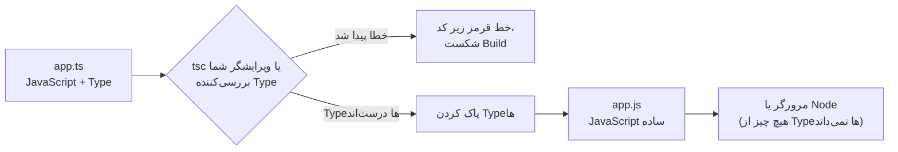
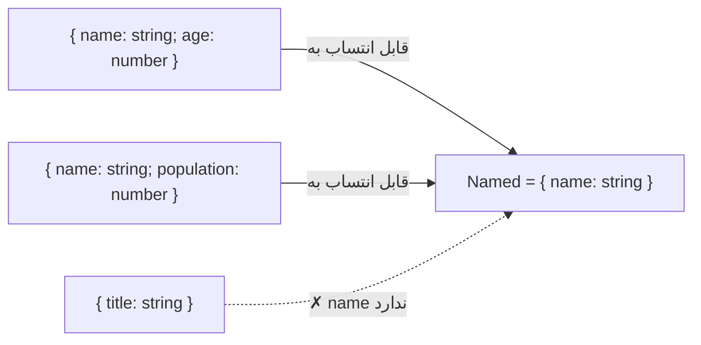

## TypeScript چیست؟

**TypeScript** یعنی JavaScript **به‌علاوه یک سیستم Type**. همان JavaScript معمولی را می‌نویسید و **Type Annotation** (حاشیه‌نویسی نوع) اضافه می‌کنید تا مشخص کنید متغیرها، پارامترها و مقدارهای بازگشتی چه نوع مقداری دارند. کامپایلر TypeScript (`tsc`) این توضیحات را **قبل از** اجرای کد بررسی می‌کند، بعد آن‌ها را **پاک می‌کند** و JavaScript ساده تحویل می‌دهد.



از همان روز اول دو واقعیت را بدانید:

1. **Typeها فقط در زمان کامپایل وجود دارند.** در زمان اجرا TypeScriptی در کار نیست: نه بررسی Type و نه `typeof User`. اگر داده از یک API بیاید، TypeScript به‌تنهایی نمی‌تواند درستی‌اش را بسنجد (به اعتبارسنجی زمان اجرا نیاز دارید، مثلاً با Zod).
2. **TypeScript ابرمجموعه (Superset) JavaScript است.** هر برنامه معتبر JavaScript (تقریباً همیشه) TypeScript معتبر هم هست؛ می‌توانید آن را فایل به فایل وارد پروژه کنید.

### چرا تیم‌ها از آن استفاده می‌کنند

| مزیت | مثال |
| --- | --- |
| گرفتن باگ قبل از اجرا | `user.nmae` ← «Property 'nmae' does not exist. Did you mean 'name'?» |
| قابلیت‌های قوی ویرایشگر | تکمیل خودکار، رفتن به تعریف، تغییر نام امن در کل پروژه |
| کدی که خودش را توضیح می‌دهد | امضای یک تابع می‌گوید چه چیزی بدهید و چه چیزی پس بگیرید |
| Refactor با اطمینان | یک Type را عوض کنید تا کامپایلر همه جاهایی را که باید اصلاح شوند فهرست کند |
| قرارداد بین تیم‌ها | Typeهای پاسخ API که بین Frontend و Backend مشترک‌اند |

```ts
function formatPrice(amount: number, currency: string): string {
  return new Intl.NumberFormat("en-US", { style: "currency", currency }).format(amount);
}

formatPrice(19.9, "USD");      // ✓
formatPrice("19.9", "USD");    // ❌ Argument of type 'string' is not assignable to parameter of type 'number'.
formatPrice(19.9);             // ❌ Expected 2 arguments, but got 1.
```

## Type Annotationهای پایه

Syntax آن `name: Type` است، بعد از نام متغیر یا پارامتر.

```ts
let username: string = "Sara";
let age: number = 34;             // عدد صحیح و اعشاری هر دو `number` هستند
let isAdmin: boolean = false;
let big: bigint = 10n;
let id: symbol = Symbol("id");
let nothing: null = null;
let notSet: undefined = undefined;

let scores: number[] = [90, 85];          // آرایه‌ای از عددها
let tags: Array<string> = ["ts", "js"];   // همان، با Syntax جنریک
let point: [number, number] = [10, 20];   // Tuple: طول ثابت و Type مشخص برای هر جایگاه
```

### استنتاج Type (Inference): لازم نیست همه چیز را Annotate کنید

TypeScript نوع را از روی مقدار **استنتاج** می‌کند. **پارامترهای توابع** و **APIهای عمومی** را Annotate کنید و متغیرهای محلی را به استنتاج بسپارید.

```ts
let city = "Tehran";        // استنتاج: string
city = 42;                  // ❌ Type 'number' is not assignable to type 'string'.

const pi = 3.14;            // استنتاج: 3.14 (یک Literal Type؛ const هیچ‌وقت عوض نمی‌شود)
const items = [1, 2, 3];    // استنتاج: number[]
const user = { name: "Ali", age: 30 };   // استنتاج: { name: string; age: number }

function add(a: number, b: number) {
  return a + b;             // نوع بازگشتی استنتاج شد: number
}
```

| Annotate کنید | بگذارید TypeScript استنتاج کند |
| --- | --- |
| پارامترهای توابع | متغیرهای محلی که مقدار اولیه دارند |
| نوع بازگشتی توابع export‌شده (قرارداد را مستند می‌کند) | نوع بازگشتی توابع کوچک داخلی |
| آرایه‌ها یا Objectهای خالی که بعداً پر می‌شوند (`const ids: number[] = []`) | Callbackهایی که به توابع Typeدار داده می‌شوند (`arr.map(x => …)`؛ نوع x استنتاج می‌شود) |
| مقدارهایی که از بیرون می‌آیند (`JSON.parse`، `fetch`) | |

## Typeهای Object: یعنی `type` و `interface`

```ts
// یک Type Alias
type User = {
  id: number;
  name: string;
  email?: string;            // اختیاری: ممکن است وجود نداشته باشد (string | undefined)
  readonly createdAt: Date;  // بعد از ساخته شدن قابل انتساب دوباره نیست
};

// یک Interface: برای شکل Objectها تقریباً همان کار را می‌کند
interface Product {
  id: number;
  title: string;
  price: number;
  tags: string[];
}

const u: User = { id: 1, name: "Ali", createdAt: new Date() };
u.name = "Reza";             // ✓
u.createdAt = new Date();    // ❌ Cannot assign to 'createdAt' because it is a read-only property.

const p: Product = { id: 1, title: "Mouse", price: 25 };
// ❌ Property 'tags' is missing in type '{ id: number; title: string; price: number; }'
```

### `type` در مقابل `interface`

| | `interface` | `type` |
| --- | --- | --- |
| شکل Objectها | ✓ | ✓ |
| Union، Primitive، Tuple، Typeهای Mapped و Conditional | ✗ | ✓ (`type Id = string \| number`) |
| گسترش | `interface B extends A {}` | `type B = A & { … }` (Intersection) |
| Declaration Merging (دو تعریف هم‌نام ادغام می‌شوند) | ✓ (برای گسترش Typeهای کتابخانه‌ها) | ✗ (خطا) |
| پیام‌های خطا | نام Interface را نشان می‌دهند | گاهی ساختار باز‌شده را نشان می‌دهند |

**قاعده عملی:** برای شکل Objectهایی که ممکن است دیگران گسترششان دهند (APIهای عمومی، و در بعضی تیم‌ها Props کامپوننت‌ها) از `interface` و برای بقیه (Unionها، Utility Typeها) از `type` استفاده کنید. یکدستی در کدبیس مهم‌تر از خود انتخاب است.

```ts
interface Animal { name: string }
interface Dog extends Animal { breed: string }     // extends

type WithTimestamps = { createdAt: Date; updatedAt: Date };
type Post = { title: string } & WithTimestamps;    // Intersection: **همه** اعضا را دارد

// Declaration Merging: اضافه کردن یک Property به یک Type سراسری
interface Window { analytics?: { track(event: string): void } }
window.analytics?.track("page_view");
```

### Index Signature و `Record`

وقتی کلیدها از قبل معلوم نیستند:

```ts
type Scores = { [studentName: string]: number };   // هر کلید رشته‌ای ← عدد
const scores: Scores = { ali: 18, sara: 20 };

type Locale = "fa" | "en";
const titles: Record<Locale, string> = { fa: "سلام", en: "Hello" };   // دقیقاً همین کلیدها
```

## توابع

```ts
// نوع پارامترها و نوع بازگشتی
function divide(a: number, b: number): number {
  return a / b;
}

// پارامترهای اختیاری و پیش‌فرض
function greet(name: string, greeting?: string): string {      // greeting: string | undefined
  return `${greeting ?? "Hello"}, ${name}`;
}
function repeat(text: string, times = 2): string {              // نوع times استنتاج شد: number
  return text.repeat(times);
}

// Rest Parameter
function sum(...values: number[]): number {
  return values.reduce((a, b) => a + b, 0);
}

// Function Type: توصیف یک مقدار تابعی
type Comparator<T> = (a: T, b: T) => number;
const byAge: Comparator<{ age: number }> = (a, b) => a.age - b.age;

// Callbackها
function onEvent(name: string, handler: (payload: { id: number }) => void): void {
  handler({ id: 1 });
}

// void در مقابل never
function log(message: string): void { console.log(message); }       // چیز به‌دردبخوری برنمی‌گرداند
function fail(message: string): never { throw new Error(message); } // اصلاً برنمی‌گردد
```

## Union و Literal Type

**Union** به شکل `A | B` یعنی «مقداری از نوع A **یا** B». **Literal Type** نوعی است که دقیقاً یک مقدار دارد؛ مثل `"dark"` یا `42`. این دو با هم مجموعه ثابتی از مقدارهای مجاز را توصیف می‌کنند که خیلی امن‌تر از رشته‌های ساده است.

```ts
type Theme = "light" | "dark" | "system";        // فقط همین سه رشته
type Id = string | number;

let theme: Theme = "dark";
theme = "blue";                                   // ❌ Type '"blue"' is not assignable to type 'Theme'.

function printId(id: Id) {
  // id.toUpperCase();                            // ❌ Property 'toUpperCase' does not exist on type 'number'.
  if (typeof id === "string") {
    console.log(id.toUpperCase());                // ✓ اینجا TypeScript می‌داند id رشته است
  } else {
    console.log(id.toFixed(0));                   // ✓ و اینجا عدد
  }
}
```

به آن ترفند `if (typeof …)` **Narrowing** (محدود کردن نوع) می‌گویند؛ موضوع [فصل بعد](/typescript/narrowing).

## Typeهای ویژه: `any`، `unknown`، `never` و `void`

| Type | معنا | قابل انتساب به هر چیزی؟ | بدون بررسی قابل استفاده؟ | کاربرد |
| --- | --- | --- | --- | --- |
| `any` | «بررسی Type را خاموش کن» | ✓ | ✓ (هیچ چیز بررسی نمی‌شود) | راه فرار اضطراری، مهاجرت از JS. پرهیز کنید |
| `unknown` | «یک مقدار، هنوز نمی‌دانم چیست» | ✗ (فقط به `unknown` و `any`) | ✗ اول باید Narrow کنید | داده از `JSON.parse`، `fetch`، `catch (e)` |
| `never` | «این اتفاق ممکن نیست» | ✓ (به همه چیز قابل انتساب است) | — | توابعی که خطا پرتاب می‌کنند، بررسی کامل بودن (Exhaustive) |
| `void` | «مقدار بازگشتی معناداری ندارد» | — | — | نوع بازگشتی توابعی که چیزی برنمی‌گردانند |

```ts
const fromApi: unknown = JSON.parse('{"name":"Ali"}');

fromApi.name;                       // ❌ 'fromApi' is of type 'unknown'.

if (typeof fromApi === "object" && fromApi !== null && "name" in fromApi) {
  console.log(fromApi.name);        // ✓ Narrow شد
}

const dangerous: any = JSON.parse("123");
dangerous.foo.bar.baz();            // بدون خطا کامپایل می‌شود و در زمان اجرا Crash می‌کند: این هزینه `any` است
```

<Callout type="interview">
«`any` در مقابل `unknown`؟» یکی از سوال‌های محبوب است. `any` بررسی را غیرفعال می‌کند و بی‌صدا پخش می‌شود (هر چیزی که از آن مشتق کنید هم `any` می‌شود). `unknown` همتای امن آن است: هر چیزی را می‌توانید در آن نگه دارید، اما قبل از استفاده باید ثابت کنید چیست.
</Callout>

## Type Assertion و Non-null Assertion

**Assertion** به کامپایلر می‌گوید «به من اعتماد کن، من نوع را بهتر از تو می‌دانم». در زمان اجرا هیچ چیز را تغییر نمی‌دهد؛ اگر اشتباه کنید، در زمان اجرا Crash می‌گیرید.

```ts
const input = document.querySelector("#email") as HTMLInputElement;   // Assertion
input.value = "a@b.c";

const el = document.getElementById("app")!;   // ! یعنی «null یا undefined نیست، به من اعتماد کن»
el.textContent = "Hello";

const n = "hello" as unknown as number;        // Assertion دوتایی: کامپایل می‌شود، اما دروغ است
```

به‌جای Assertion، Narrowing (`if (el)`، `instanceof HTMLInputElement`) یا یک کتابخانه اعتبارسنجی را ترجیح دهید. البته از `as const` (پایین) بی‌دغدغه استفاده کنید؛ قابلیتی متفاوت و امن است.

### `as const` و `satisfies`

```ts
// as const: مقدار را با Literal Typeها و به شکل عمیق readonly می‌کند
const ROLES = ["admin", "editor", "viewer"] as const;
type Role = (typeof ROLES)[number];            // "admin" | "editor" | "viewer"

// satisfies: مقدار را با یک Type می‌سنجد، **بدون** اینکه آن را عمومی‌تر (Widen) کند
type ColorMap = Record<string, `#${string}`>;
const palette = {
  primary: "#2459e0",
  danger: "#c0352f",
} satisfies ColorMap;                          // ✓ اعتبارسنجی شد…
palette.primary;                               // …و همچنان دقیقاً از نوع "#2459e0" است و کلیدها تکمیل خودکار دارند
```

## کلاس‌ها در TypeScript

```ts
class Account {
  readonly id: number;
  private balance = 0;            // خصوصی بودن فقط در TS (در زمان کامپایل بررسی می‌شود)
  #pin: string;                   // #private در JS (در زمان اجرا تضمین می‌شود)
  protected owner: string;        // در Subclassها قابل مشاهده است

  constructor(id: number, owner: string, pin: string) {
    this.id = id;
    this.owner = owner;
    this.#pin = pin;
  }

  deposit(amount: number): this { this.balance += amount; return this; }
  get total(): number { return this.balance; }
}

// Parameter Property: تعریف و مقداردهی در یک قدم
class Point {
  constructor(public x: number, public y: number) {}
}

// پیاده‌سازی یک Interface
interface Shape { area(): number }
class Circle implements Shape {
  constructor(private r: number) {}
  area() { return Math.PI * this.r ** 2; }
}

abstract class Repository<T> {          // مستقیماً قابل نمونه‌سازی نیست
  abstract findById(id: string): Promise<T | undefined>;
}
```

## Enum (و چرا بسیاری از تیم‌ها Union را ترجیح می‌دهند)

```ts
enum Direction { Up, Down, Left, Right }        // عددی: Up = 0، Down = 1…
enum Status { Active = "ACTIVE", Banned = "BANNED" }   // Enum رشته‌ای

const s: Status = Status.Active;

// جایگزینی که بیشتر کدبیس‌ها ترجیح می‌دهند: Union از Literalها (+ یک Object با as const اگر به مقدارها نیاز دارید)
const STATUS = { Active: "ACTIVE", Banned: "BANNED" } as const;
type StatusValue = (typeof STATUS)[keyof typeof STATUS];   // "ACTIVE" | "BANNED"
```

Enum یکی از معدود قابلیت‌های TypeScript است که **کد زمان اجرا تولید می‌کند**؛ Enumهای عددی هر عددی را می‌پذیرند و با ابزارهای «Type Stripping» (پشتیبانی داخلی Node از TS، `erasableSyntaxOnly`) کار نمی‌کنند. Union از رشته‌های Literal سبک‌تر است و با JSON بهتر کنار می‌آید.

## سیستم Type چطور فکر می‌کند: Structural Typing

TypeScript نوع‌ها را بر اساس **شکل** مقایسه می‌کند، نه نام. اگر مقداری همه Propertyهای لازم را با نوع سازگار داشته باشد، جا می‌شود؛ اسمش هر چه باشد. به این **Structural Typing** (یا «Duck Typing»: اگر مثل اردک راه می‌رود…) می‌گویند.

```ts
interface Named { name: string }

class Person { constructor(public name: string, public age: number) {} }
const city = { name: "Shiraz", population: 1_900_000 };

function hello(x: Named) { return `Hello ${x.name}`; }

hello(new Person("Ali", 30));   // ✓ یک name: string دارد
hello(city);                    // ✓ این هم name: string دارد — اسم Person یا city مهم نیست

hello({ name: "Sara", extra: true });
// ❌ Object literal may only specify known properties ('excess property check'
//    فقط برای Object Literalهای تازه اعمال می‌شود تا غلط تایپی را بگیرد)
```



نوعی که Propertyهای **بیشتری** دارد، به نوعی با Propertyهای **کمتر** قابل انتساب است (زیرنوع یا Subtype آن است). به همین دلیل می‌توانید یک `User` کامل را به تابعی بدهید که فقط `{ id: number }` لازم دارد.

## راه‌اندازی TypeScript

```bash
npm install --save-dev typescript
npx tsc --init          # فایل tsconfig.json را می‌سازد
npx tsc --noEmit        # فقط بررسی Type (Bundlerهایی مثل Vite خروجی JS را می‌سازند)
```

مهم‌ترین گزینه‌های `tsconfig.json`:

| گزینه | کارکرد | توصیه |
| --- | --- | --- |
| `strict` | همه بررسی‌های سخت‌گیرانه را فعال می‌کند (`strictNullChecks`، `noImplicitAny`، …) | **همیشه `true`** |
| `noUncheckedIndexedAccess` | `arr[i]` و `obj[key]` شامل `undefined` هم می‌شوند | ✓ خیلی از باگ‌های واقعی را می‌گیرد |
| `target` | خروجی برای کدام نسخه JS | برای برنامه‌های امروزی `ES2022` یا بالاتر |
| `module` / `moduleResolution` | نحوه پیدا کردن importها | `"ESNext"` + `"Bundler"` همراه با Vite یا webpack |
| `jsx` | مدیریت JSX | `"react-jsx"` |
| `noEmit` | فقط بررسی Type، بدون نوشتن فایل | ✓ وقتی Bundler کامپایل می‌کند |
| `skipLibCheck` | رد شدن از بررسی فایل‌های `.d.ts` وابستگی‌ها | ✓ Build سریع‌تر |

با `strictNullChecks` (که بخشی از `strict` است)، `null` و `undefined` بخشی از Typeهای دیگر **نیستند**، مگر اینکه خودتان بگویید. این باارزش‌ترین بررسی TypeScript است:

```ts
function getLength(text: string | null) {
  return text.length;            // ❌ 'text' is possibly 'null'.
  return text?.length ?? 0;      // ✓
}
```

### فایل‌های Declaration و `@types`

کتابخانه‌هایی که با JavaScript نوشته شده‌اند، Typeهایشان را در **فایل‌های Declaration با پسوند `.d.ts`** توصیف می‌کنند. خیلی‌ها این فایل‌ها را همراه خودشان منتشر می‌کنند؛ برای بقیه، جامعه برنامه‌نویسی آن‌ها را به شکل بسته‌های `@types/*` منتشر می‌کند:

```bash
npm install --save-dev @types/lodash
```

```ts
// global.d.ts: توصیف یک متغیر سراسری یا ماژولی که Type ندارد
declare const __APP_VERSION__: string;
declare module "*.svg" {
  const url: string;
  export default url;
}
```

## اشتباهات رایج

- فکر کردن به اینکه Typeها در زمان اجرا وجود دارند (پاک می‌شوند؛ داده بیرونی را اعتبارسنجی کنید).
- استفاده از `any` برای ساکت کردن خطاها، به‌جای `unknown` به‌همراه Narrowing.
- استفاده بیش از حد از Assertion با `as` و عملگر `!`.
- Annotate کردن همه چیز، حتی چیزهایی که استنتاج خودش می‌داند (شلوغی بی‌فایده).
- خاموش کردن `strict` برای «کامپایل شدن».
- نوشتن دستی Type پاسخ‌های API و اعتماد به آن‌ها بدون اعتبارسنجی.
- استفاده از Enum عددی و پاس دادن عددهای دلخواه به آن.

## سوالات مصاحبه

<QA q="TypeScript چیست و در زمان اجرا چه کاری انجام می‌دهد؟" level="junior" n={1}>
<Answer>

TypeScript یک ابرمجموعه Typeدار از JavaScript است. کامپایلرش در زمان توسعه و Build نوع‌ها را بررسی می‌کند، بعد آن‌ها را حذف می‌کند و JavaScript ساده تولید می‌کند. در زمان اجرا هیچ اثری از TypeScript باقی نمی‌ماند: بررسی Typeی انجام نمی‌شود، پس داده‌ای که از بیرون می‌آید (API، ورودی کاربر، `localStorage`) همچنان باید در زمان اجرا اعتبارسنجی شود.

</Answer>
<Deep>

چند قابلیت کد تولید می‌کنند (Enumها، Namespaceها، Parameter Propertyها، Decoratorهای قدیمی)؛ به همین دلیل ابزارهای «Type Stripping» (پشتیبانی داخلی Node از TS، حالت isolatedModules در esbuild) آن‌ها را محدود می‌کنند. کتابخانه‌هایی مثل Zod یا Valibot اجازه می‌دهند یک Schema را یک بار تعریف کنید و هم اعتبارسنج زمان اجرا و هم Type ایستا (`z.infer<typeof schema>`) را از آن بگیرید.

</Deep>
<Mistake>

باور به اینکه `function f(x: number)` اگر کسی در زمان اجرا رشته بدهد خطا می‌دهد.

</Mistake>
<FollowUp>

پاسخ یک `fetch` را چطور به شکل امن Type می‌دهید و اعتبارسنجی می‌کنید؟

</FollowUp>
</QA>

<QA q="تفاوت `any`، `unknown` و `never` چیست؟" level="mid" n={2}>
<Answer>

`any` بررسی Type را غیرفعال می‌کند: هر چیزی به آن قابل انتساب است و هر کاری با آن می‌شود کرد. `unknown` هم هر مقداری را می‌پذیرد، اما تا وقتی Narrowش نکنید (با typeof، instanceof یا یک Type Guard) نمی‌توانید از آن استفاده کنید. `never` نوع خالی است: هیچ مقداری از این نوع نیست؛ نوع بازگشتی توابعی است که هیچ‌وقت برنمی‌گردند و چیزی است که بعد از Narrow کردن کامل یک Union باقی می‌ماند.

</Answer>
<Deep>

`unknown` بالاترین نوع (Top Type) و `never` پایین‌ترین نوع (Bottom Type) سیستم Type است: همه چیز به `unknown` قابل انتساب است و `never` به همه چیز. `any` هم‌زمان هر دوست؛ به همین دلیل درستی (Soundness) سیستم را می‌شکند و مقدارهای مشتق‌شده از خودش را «آلوده» می‌کند. در `catch (e)`، با `useUnknownInCatchVariables` (بخشی از `strict`) نوع `e` برابر `unknown` است.

</Deep>
<Mistake>

استفاده از `any` برای «هنوز نوع را نمی‌دانم»، جایی که `unknown` مناسب است.

</Mistake>
<FollowUp>

`never` چطور امکان بررسی کامل بودن (Exhaustiveness) را در یک `switch` روی Union فراهم می‌کند؟

</FollowUp>
</QA>

<QA q="`type` یا `interface`؟ کدام را کی استفاده می‌کنید؟" level="mid" n={3}>
<Answer>

هر دو شکل Objectها را توصیف می‌کنند. Interfaceها Declaration Merging و `extends` دارند و پیام خطای واضح‌تری می‌دهند؛ Type Aliasها می‌توانند هر چیزی را توصیف کنند، از جمله Union، Tuple، Primitive و Typeهای Mapped و Conditional. یک قرارداد رایج: Interface برای شکل Objectهای عمومی و قابل گسترش و Type برای Unionها و Typeهای محاسبه‌شده.

</Answer>
<Deep>

Declaration Merging روشی است که با آن Typeهای کتابخانه‌های دیگر یا Typeهای سراسری را گسترش می‌دهید (`interface Window { … }`، Module Augmentation). Intersection (`A & B`) و `extends` بیشتر وقت‌ها رفتار یکسانی دارند، اما `extends` تداخل‌ها را زودتر به شکل خطا گزارش می‌کند، درحالی‌که Intersectionهای متناقض ممکن است بی‌صدا Propertyهایی از نوع `never` بسازند.

</Deep>
<Mistake>

ادعای اینکه Interfaceها به‌طور کلی سریع‌تر یا «درست‌تر» هستند.

</Mistake>
<FollowUp>

چطور یک Property سفارشی به Type سراسری `Window` اضافه می‌کنید؟

</FollowUp>
</QA>

<QA q="Structural Typing چیست؟ مثالی بزنید که آدم‌ها را غافلگیر می‌کند." level="senior" n={4}>
<Answer>

TypeScript سازگاری را بر اساس شکل بررسی می‌کند: مقداری به یک نوع قابل انتساب است اگر همه Propertyهای لازم را با نوع سازگار داشته باشد، صرف‌نظر از نام یا کلاسی که با آن تعریف شده. پس یک Object از `Person` را می‌شود جایی پاس داد که `{ name: string }` انتظار می‌رود. نکته غافلگیرکننده: دو نوع بی‌ربط با شکل یکسان جایگزین هم‌اند؛ مثلاً اگر `UserId` و `OrderId` هر دو `string` باشند، جابه‌جا کردنشان بدون خطا کامپایل می‌شود.

</Answer>
<Deep>

راه‌حل، Typeهای «Branded» (شبه‌اسمی) است: `type UserId = string & { readonly __brand: "UserId" }` که فقط از طریق یک تابع اعتبارسنج ساخته می‌شود. بررسی Property اضافه (Excess Property Check) یک استثنای ویژه است که فقط برای Object Literalهای تازه اعمال می‌شود تا غلط‌های تایپی را بگیرد.

</Deep>
<Mistake>

انتظار اینکه `class A {}` و `class B {}` با اعضای یکسان با هم ناسازگار باشند.

</Mistake>
<FollowUp>

یک Type Branded به نام `Email` با یک تابع سازنده که قالب ایمیل را اعتبارسنجی می‌کند پیاده‌سازی کنید.

</FollowUp>
</QA>

## جمع‌بندی

<Recap>

- TypeScript یک Superset از JavaScript است که Type را **قبل از اجرا** بررسی می‌کند و در خروجی کاملاً پاک می‌شود.
- TypeScript Type را تا جای ممکن خودش استنتاج (Infer) می‌کند؛ Annotation را برای پارامترها و مرزهای عمومی بنویسید.
- `type` و `interface` هر دو شکل Object را توصیف می‌کنند؛ `interface` قابل ادغام و `extends` است، `type` برای Union و ترکیب‌ها انعطاف بیشتری دارد.
- Union (`A | B`) یعنی «یکی از این‌ها» و Literal Type (`"sm" | "md"`) مقدارهای مجاز را دقیق محدود می‌کند.
- `any` بررسی را خاموش می‌کند؛ `unknown` امن است و قبل از استفاده Narrowing می‌خواهد؛ `never` یعنی «هرگز رخ نمی‌دهد»؛ `void` یعنی «مقدار برگشتی مهم نیست».
- Type Assertion (`as`) و `!` فقط به کامپایلر قول می‌دهند و در Runtime هیچ بررسی‌ای انجام نمی‌دهند.
- Typeها ساختاری‌اند (Structural): هر Objectی که شکل لازم را داشته باشد قابل قبول است، اسمش هر چه باشد.
- Union از رشته‌ها اغلب جایگزین سبک‌تر و قابل پیش‌بینی‌تری برای `enum` است.
- `strict: true` در `tsconfig.json` را از روز اول فعال کنید.

</Recap>
