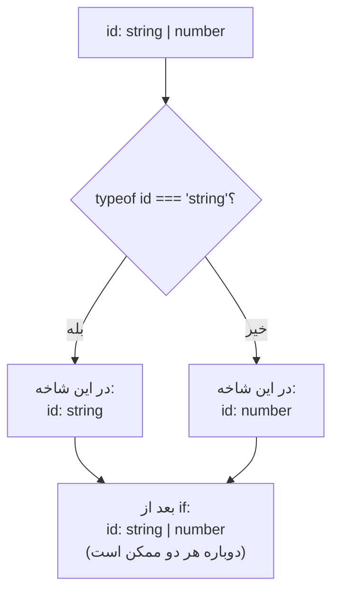

## مسئله: مقداری که «یکی از چند چیز» است

در دنیای واقعی خیلی از مقدارها فقط یک شکل ندارند. شناسه کاربر ممکن است عدد باشد یا رشته. نتیجه یک درخواست ممکن است داده باشد یا خطا. ورودی یک فیلد ممکن است متن باشد یا خالی (`null`). در فصل [مبانی](/typescript/fundamentals#union-و-literal-type) دیدیم که TypeScript این‌ها را با **Union Type** (نوع اجتماع؛ «یکی از این‌ها») نشان می‌دهد: `string | number`.

اما همین که یک Union دارید، با یک دیوار روبه‌رو می‌شوید:

```ts
function printId(id: string | number) {
  console.log(id.toUpperCase());
  // ❌ Property 'toUpperCase' does not exist on type 'string | number'.
  //    Property 'toUpperCase' does not exist on type 'number'.
}
```

چرا خطا؟ چون TypeScript فقط به چیزی اجازه می‌دهد که روی **همه** اعضای Union معتبر باشد. `toUpperCase` روی `string` هست ولی روی `number` نیست؛ اگر `id` در زمان اجرا عدد باشد، برنامه کرش می‌کند. پس کامپایلر از شما **مدرک** می‌خواهد: «ثابت کن که الان رشته است.»

به این کار که با یک بررسی در کد، نوع یک متغیر را در یک بخش از کد **باریک‌تر** (دقیق‌تر) می‌کنید، **Narrowing** (باریک کردن نوع) می‌گویند:

```ts
function printId(id: string | number) {
  if (typeof id === "string") {
    console.log(id.toUpperCase()); // ✓ اینجا id از نوع string است
  } else {
    console.log(id.toFixed(2));    // ✓ اینجا فقط number باقی مانده
  }
}
```

نکته مهم: اینجا هیچ Syntax مخصوص TypeScript ننوشتیم. `typeof id === "string"` همان JavaScript معمولی است. TypeScript کد شما را **می‌خواند** و از روی شرط‌ها می‌فهمد در هر شاخه چه نوعی ممکن است. Narrowing یعنی TypeScript به منطق خود شما اعتماد می‌کند.

## Narrowing چطور کار می‌کند: Control Flow Analysis

TypeScript برای هر متغیر دو نوع در نظر می‌گیرد:

- **Declared Type** (نوع اعلام‌شده): نوعی که موقع تعریف گفته‌اید، مثلاً `string | number`. این هیچ‌وقت عوض نمی‌شود.
- **Narrowed Type** (نوع باریک‌شده): نوعی که متغیر **در همین نقطه از کد** می‌تواند داشته باشد. این با هر شرط، `return`، انتساب و `throw` تغییر می‌کند.

ابزاری که این کار را انجام می‌دهد **Control Flow Analysis** (تحلیل جریان کنترل) نام دارد. TypeScript همه مسیرهایی را که اجرا ممکن است طی کند دنبال می‌کند، درست مثل وقتی که شما با انگشت روی کد مسیر اجرا را دنبال می‌کنید:



بعد از اینکه دو شاخه دوباره به هم می‌رسند، TypeScript نوع‌های دو شاخه را با هم جمع می‌کند و دوباره `string | number` می‌شود. حالا ببینیم چه چیزهایی می‌توانند نوع را باریک کنند. به این بررسی‌ها **Type Guard** (محافظ نوع) می‌گویند.

## Type Guard اول: `typeof`

عملگر `typeof` در JavaScript یک رشته برمی‌گرداند که نوع زمان اجرای مقدار را می‌گوید. TypeScript این هشت مقدار را می‌شناسد و با هر کدام نوع را باریک می‌کند:

| `typeof x` | چه چیزی باقی می‌ماند |
| --- | --- |
| `"string"` | `string` |
| `"number"` | `number` (شامل `NaN` و `Infinity`) |
| `"bigint"` | `bigint` |
| `"boolean"` | `boolean` |
| `"symbol"` | `symbol` |
| `"undefined"` | `undefined` |
| `"function"` | هر چیز قابل صدا زدن |
| `"object"` | Objectها، آرایه‌ها **و `null`** |

```ts
function describe(value: string | number | boolean | (() => void)) {
  if (typeof value === "function") {
    value();                       // value: () => void
  } else if (typeof value === "boolean") {
    console.log(value ? "yes" : "no"); // value: boolean
  } else {
    console.log(value);            // value: string | number
  }
}
```

### دام معروف: `typeof null === "object"`

این یک باگ تاریخی در JavaScript است که هیچ‌وقت درست نشد (چون اصلاحش کدهای قدیمی را می‌شکست):

```js run
console.log(typeof null);       // "object" ← نه "null"!
console.log(typeof []);         // "object" ← آرایه هم Object است
console.log(typeof {});         // "object"
```

TypeScript این را می‌داند و شما را از یک باگ نجات می‌دهد:

```ts
function printAll(strs: string | string[] | null) {
  if (typeof strs === "object") {
    for (const s of strs) {}
    // ❌ 'strs' is possibly 'null'.
    // در این شاخه strs از نوع string[] | null است، نه فقط string[]
  }
}
```

<Callout type="mistake" title="فکر کنید typeof x === &quot;object&quot; یعنی «Object واقعی»">
`typeof x === "object"` هم برای آرایه درست است و هم برای `null`. اگر واقعاً «یک Object غیر null» می‌خواهید، بنویسید `x !== null && typeof x === "object"`، و برای آرایه از `Array.isArray(x)` استفاده کنید.
</Callout>

## Type Guard دوم: Truthiness

در JavaScript هر مقداری در `if` به `true` یا `false` تبدیل می‌شود. مقدارهای **Falsy** (آن‌هایی که `false` حساب می‌شوند) دقیقاً این‌ها هستند: `false`، `0`، `-0`، `0n`، `""` (رشته خالی)، `null`، `undefined` و `NaN`. بقیه همه **Truthy** هستند.

TypeScript از این استفاده می‌کند: وقتی می‌نویسید `if (x)`، در شاخه `true` حتماً `null` و `undefined` حذف شده‌اند.

```ts
function greet(name: string | undefined) {
  if (name) {
    console.log("Hi " + name.toUpperCase()); // ✓ name: string
  } else {
    // name: string | undefined ← چرا هنوز string؟
  }
}
```

چرا در `else` هنوز `string` هست؟ چون رشته خالی `""` هم Falsy است. TypeScript دقیق است: در `else` ممکن است `name` برابر `""` باشد یا `undefined`. این دقت بعضی وقت‌ها یک باگ واقعی را نشان می‌دهد:

```ts
function setVolume(level: number | undefined) {
  if (!level) {
    level = 50;        // 🐞 اگر کاربر صدا را عمداً 0 کرده باشد، ما آن را 50 می‌کنیم!
  }
}

function setVolumeFixed(level: number | undefined) {
  if (level === undefined) {
    level = 50;        // ✓ فقط وقتی واقعاً مقداری داده نشده
  }
  // یا کوتاه‌تر: level ??= 50;
}
```

<Callout type="mistake" title="Truthiness برای عدد و رشته">
برای `number` و `string` با `if (x)` بررسی نکنید، مگر اینکه واقعاً بخواهید `0` و `""` را هم «خالی» حساب کنید. به‌جایش `x !== undefined`، `x != null` یا عملگر `??` (که فقط به `null` و `undefined` واکنش نشان می‌دهد) را به کار ببرید. همین دام در React هم هست: `{count && <Badge />}` وقتی `count` صفر باشد، خود عدد `0` را روی صفحه نشان می‌دهد.
</Callout>

عملگر `!` (نقیض) هم Narrowing را برعکس می‌کند و `!!x` یا `Boolean(x)` هم مثل `if (x)` رفتار می‌کنند.

## Type Guard سوم: Equality (مقایسه برابری)

مقایسه با `===`، `!==`، `==` و `!=` هم نوع را باریک می‌کند. TypeScript از مقدار مقایسه‌شده نتیجه می‌گیرد چه چیزی ممکن است:

```ts
function compare(a: string | number, b: string | boolean) {
  if (a === b) {
    // تنها نوع مشترک بین دو طرف string است؛ پس اینجا هر دو string‌اند
    a.toUpperCase(); // ✓
    b.toUpperCase(); // ✓
  }
}

function pick(size: "sm" | "md" | "lg" | 0) {
  if (size === 0) {
    // size: 0
  } else {
    size.toUpperCase(); // ✓ size: "sm" | "md" | "lg"
  }
}
```

### `== null`: تنها جایی که `==` مفید است

در JavaScript، `x == null` برای **هر دو** `null` و `undefined` درست است (و برای هیچ چیز دیگری نه). TypeScript هم همین را می‌داند، پس `x != null` با یک مقایسه هر دو را حذف می‌کند:

```ts
function len(text: string | null | undefined) {
  if (text != null) {
    return text.length; // ✓ text: string
  }
  return 0;
}
```

| بررسی | چه چیزی را حذف می‌کند |
| --- | --- |
| `x !== null` | فقط `null` |
| `x !== undefined` | فقط `undefined` |
| `x != null` | `null` و `undefined` (و نه `0` یا `""`) |
| `if (x)` | `null`، `undefined` **و** `0`، `""`، `false`، `NaN` |

## Type Guard چهارم: عملگر `in`

`"key" in obj` در JavaScript می‌پرسد: «آیا این Object (یا زنجیره Prototype آن) Propertyای به این نام دارد؟» TypeScript با آن بین اعضای Union بر اساس **وجود یک Property** فرق می‌گذارد:

```ts
type Fish = { swim(): void };
type Bird = { fly(): void };

function move(animal: Fish | Bird) {
  if ("swim" in animal) {
    animal.swim(); // animal: Fish
  } else {
    animal.fly();  // animal: Bird
  }
}
```

قاعده دقیق: در شاخه `true` اعضایی باقی می‌مانند که آن Property را دارند (اجباری یا اختیاری)، و در شاخه `false` اعضایی که آن را ندارند یا اختیاری دارند. یعنی Typeی که Property را **اختیاری** (`swim?`) دارد در **هر دو** شاخه می‌ماند، چون ممکن است داشته باشد یا نداشته باشد.

`in` مخصوصاً وقتی مفید است که Typeها را خودتان ننوشته‌اید (مثلاً از یک کتابخانه می‌آیند) و نمی‌توانید یک Property مشترک برای تشخیص به آن‌ها اضافه کنید.

## Type Guard پنجم: `instanceof`

`x instanceof C` در زمان اجرا بررسی می‌کند که آیا `C.prototype` در زنجیره Prototype مقدار `x` هست یا نه (این را در فصل [Prototype](/javascript/objects-prototypes) دیدیم). TypeScript نوع را به نوع Instanceهای آن کلاس باریک می‌کند:

```ts
function toTimestamp(input: Date | string) {
  if (input instanceof Date) {
    return input.getTime();         // input: Date
  }
  return new Date(input).getTime(); // input: string
}
```

پرکاربردترین جای `instanceof` بلوک `catch` است. با `strict`، متغیر `catch` از نوع `unknown` است، چون در JavaScript هر چیزی را می‌شود `throw` کرد (حتی یک رشته یا عدد):

```ts
try {
  JSON.parse("{bad json");
} catch (e) {
  console.log(e.message);   // ❌ 'e' is of type 'unknown'.
  if (e instanceof Error) {
    console.log(e.message); // ✓ e: Error
  } else {
    console.log(String(e)); // یک چیز غیر Error پرتاب شده بود
  }
}
```

<Callout type="note">
`instanceof` فقط با چیزهایی کار می‌کند که در زمان اجرا وجود دارند: کلاس‌ها و توابع سازنده. `x instanceof User` وقتی `User` یک `interface` یا `type` باشد ممکن نیست، چون Typeها بعد از کامپایل پاک می‌شوند. برای آن‌ها از `in`، یک Discriminant یا یک Type Predicate (پایین‌تر) استفاده کنید.
</Callout>

## Type Guard ششم: `Array.isArray`

`typeof` برای آرایه `"object"` می‌دهد، پس آرایه را با `Array.isArray` تشخیص می‌دهیم. TypeScript این تابع را به‌عنوان Type Guard می‌شناسد:

```ts
function joinAll(input: string | string[]) {
  if (Array.isArray(input)) {
    return input.join(", "); // input: string[]
  }
  return input;              // input: string
}
```

یک الگوی رایج این است که ورودی «یکی یا چندتا» را نرمال کنید تا بقیه تابع فقط با یک شکل کار کند:

```ts
function addTags(tags: string | string[]) {
  const list = Array.isArray(tags) ? tags : [tags]; // list: string[]
  list.forEach((t) => console.log(t));
}
```

## Narrowing با انتساب، `return` و `throw`

Narrowing فقط از `if` نمی‌آید. هر چیزی که مسیر اجرا را تغییر دهد روی نوع اثر می‌گذارد.

### انتساب (Assignment)

وقتی به یک متغیر `let` مقدار می‌دهید، نوع باریک‌شده‌اش همان نوع مقدار جدید می‌شود، **ولی** فقط در محدوده Declared Type:

```ts
let value: string | number = "hello";
value.toUpperCase(); // ✓ الان string است

value = 42;
value.toFixed(1);    // ✓ الان number است

value = true;        // ❌ Type 'boolean' is not assignable to type 'string | number'.
```

### خروج زودهنگام (Early Return)

الگویی که در کدهای واقعی بیشتر از همه می‌بینید: موارد نامعتبر را اول کار با `return` یا `throw` کنار بگذارید تا بقیه تابع با نوع تمیز کار کند. این کار تو‌در‌تویی `if` را هم از بین می‌برد:

```ts
function getUserName(user: { name?: string } | null): string {
  if (user === null) return "Guest";       // از اینجا به بعد user: { name?: string }
  if (!user.name) throw new Error("No name"); // از اینجا به بعد user.name: string
  return user.name.toUpperCase();          // ✓
}
```

<Steps>
<Step title="شروع تابع">
`user` از نوع `{ name?: string } | null` است. هیچ کاری نمی‌شود با آن کرد، چون ممکن است `null` باشد.
</Step>
<Step title="بعد از if اول">
اگر `null` بود، تابع برگشت. پس هر کدی که بعد از این خط اجرا شود، حتماً `user` غیر `null` دارد. TypeScript `null` را از نوع حذف می‌کند.
</Step>
<Step title="بعد از if دوم">
اگر `name` خالی یا `undefined` بود، `throw` اجرا شد و تابع ادامه پیدا نکرد. پس از اینجا `user.name` حتماً یک `string` غیر خالی است.
</Step>
<Step title="خط آخر">
هر دو حالت خطرناک حذف شده‌اند و `user.name.toUpperCase()` بدون هیچ `!` یا `as` معتبر است.
</Step>
</Steps>

TypeScript Narrowing روی Propertyها (مثل `user.name`) را هم دنبال می‌کند، نه فقط روی خود متغیرها.

## Discriminated Union: مهم‌ترین الگوی این فصل

تا اینجا Narrowing بر اساس «نوع زمان اجرا» بود. اما وقتی همه اعضای Union، Object هستند (مثلاً «دایره» و «مربع» یا «در حال بارگذاری» و «موفق» و «خطا»)، `typeof` همه را `"object"` می‌بیند. راه حل این است که به هر عضو یک **برچسب** بدهید.

**Discriminated Union** (Union تفکیک‌شده، یا Tagged Union) یک Union از Objectهاست که همه یک Property مشترک دارند و مقدار آن Property در هر عضو یک **Literal Type** متفاوت است. به آن Property **Discriminant** (تفکیک‌کننده) می‌گویند. اسمش معمولاً `kind`، `type` یا `status` است.

```ts
type Circle = { kind: "circle"; radius: number };
type Square = { kind: "square"; size: number };
type Rect   = { kind: "rect"; width: number; height: number };

type Shape = Circle | Square | Rect;

function area(shape: Shape): number {
  switch (shape.kind) {
    case "circle":
      return Math.PI * shape.radius ** 2;    // shape: Circle
    case "square":
      return shape.size ** 2;                // shape: Square
    case "rect":
      return shape.width * shape.height;     // shape: Rect
  }
}
```

چه اتفاقی افتاد؟ با بررسی `shape.kind === "circle"`، TypeScript در Union می‌گردد و فقط عضوهایی را نگه می‌دارد که `kind` آن‌ها می‌تواند `"circle"` باشد. فقط `Circle` چنین است، پس `shape` دقیقاً `Circle` می‌شود و `radius` در دسترس است.

```text
 shape.kind === "circle" ?

 ┌───────────────────────┐   kind: "circle"  ✓  ──► نگه داشته می‌شود
 │ Circle | Square | Rect│   kind: "square"  ✗  ──► حذف
 └───────────────────────┘   kind: "rect"    ✗  ──► حذف

 نتیجه:  shape: Circle
```

### چرا این الگو این‌قدر مهم است: State در UI

مثال کلاسیک مصاحبه، State یک درخواست شبکه است. روش ضعیف این است که چند Property مستقل بگذارید:

```ts
// ❌ مدل ضعیف: ترکیب‌های غیرممکن را مجاز می‌کند
type BadState = {
  loading: boolean;
  data?: User[];
  error?: string;
};
// { loading: true, data: [...], error: "x" } ← هم در حال بارگذاری، هم موفق، هم خطا؟!
```

با این مدل `2 × 2 × 2 = 8` ترکیب ممکن است که فقط ۳ تایش معنا دارد. Discriminated Union حالت‌های غیرممکن را **غیرقابل نوشتن** می‌کند:

```ts
type User = { id: number; name: string };

// ✓ مدل درست: هر حالت دقیقاً داده‌های خودش را دارد
type RequestState =
  | { status: "idle" }
  | { status: "loading" }
  | { status: "success"; data: User[] }
  | { status: "error"; error: string };

function render(state: RequestState): string {
  switch (state.status) {
    case "idle":    return "Press the button";
    case "loading": return "Loading…";
    case "success": return state.data.map((u) => u.name).join(", "); // data فقط اینجا وجود دارد
    case "error":   return "Failed: " + state.error;                 // error فقط اینجا وجود دارد
  }
}
```

به این ایده می‌گویند **Make impossible states impossible** («حالت‌های غیرممکن را غیرممکن کنید»). همین الگو در Reducerهای React (`action.type`)، پاسخ‌های API و ماشین‌های حالت (State Machine) استفاده می‌شود.

### قواعد Discriminant

- Discriminant باید یک **Literal Type** باشد: رشته (`"circle"`)، عدد (`1`)، `true`/`false`، یا `null`/`undefined`. اگر `kind: string` باشد Narrowing کار نمی‌کند، چون هر عضو هر رشته‌ای می‌تواند داشته باشد.
- با `if`، `switch`، `===` و `!==` کار می‌کند.
- Destructure کردن هم کار می‌کند: `const { kind } = shape; if (kind === "circle") shape.radius` معتبر است (به شرطی که `shape` و `kind` بعداً عوض نشوند).

## Exhaustiveness Checking: کامپایلر یادت می‌اندازد

فرض کنید شش ماه بعد کسی یک شکل جدید اضافه می‌کند:

```ts
type Triangle = { kind: "triangle"; base: number; height: number };
type Shape = Circle | Square | Rect | Triangle;
```

تابع `area` هیچ `case`ی برای `"triangle"` ندارد و در زمان اجرا `undefined` برمی‌گرداند. ما می‌خواهیم کامپایلر **همه** `switch`هایی را که باید به‌روز شوند نشانمان دهد. برای این کار از نوع `never` استفاده می‌کنیم.

یادآوری: `never` نوع خالی است؛ هیچ مقداری از این نوع وجود ندارد. وقتی همه اعضای یک Union را Narrow و حذف کنید، چیزی که باقی می‌ماند `never` است. پس در `default` می‌گوییم: «اینجا باید `never` باشد»:

```ts
function area(shape: Shape): number {
  switch (shape.kind) {
    case "circle": return Math.PI * shape.radius ** 2;
    case "square": return shape.size ** 2;
    case "rect":   return shape.width * shape.height;
    default: {
      const unreachable: never = shape;
      // ❌ Type 'Triangle' is not assignable to type 'never'.
      return unreachable;
    }
  }
}
```

پیام خطا دقیقاً می‌گوید کدام عضو فراموش شده (`Triangle`). وقتی `case "triangle"` را اضافه کنید، در `default` دیگر چیزی باقی نمی‌ماند، `shape` از نوع `never` می‌شود و خطا از بین می‌رود.

در پروژه‌ها معمولاً یک تابع کمکی می‌نویسند که هم در زمان کامپایل خطا بدهد و هم در زمان اجرا (اگر داده نامعتبری از بیرون آمد) یک خطای واضح پرتاب کند:

```ts
function assertNever(value: never): never {
  throw new Error("Unexpected value: " + JSON.stringify(value));
}

// ...
default:
  return assertNever(shape); // اگر case فراموش شده باشد، کامپایل نمی‌شود
```

<Callout type="tip">
راه دیگر این است که نوع بازگشتی تابع را صریحاً بنویسید (`: number`) و `default` نگذارید. با `strict` اگر یک `case` جا بیفتد، TypeScript می‌گوید «Function lacks ending return statement and return type does not include 'undefined'». ولی این روش فقط برای توابعی که مقدار برمی‌گردانند کار می‌کند؛ `assertNever` همه جا کار می‌کند.
</Callout>

## Type Predicate: Type Guard خودتان را بسازید

گاهی بررسی پیچیده‌تر از یک `typeof` است و می‌خواهید آن را در یک تابع بگذارید و چند جا استفاده کنید. ولی یک مشکل هست:

```ts
function isFish(animal: Fish | Bird): boolean {
  return "swim" in animal;
}

if (isFish(pet)) {
  pet.swim(); // ❌ TypeScript فقط می‌داند isFish یک boolean برگرداند، نه اینکه چه چیزی را ثابت کرد
}
```

راه حل یک **Type Predicate** (گزاره نوع) است: به‌جای `boolean` می‌نویسید `parameterName is Type`.

<Api name="Type Predicate" sig="function guard(param: A): param is B" returns="یک `boolean` در زمان اجرا. در زمان کامپایل: اگر `true` برگرداند، آرگومان در شاخه `true` از نوع `B` حساب می‌شود و در شاخه `false` از نوع «A منهای B»." mutates="no">

- `param`: باید دقیقاً نام یکی از پارامترهای همین تابع باشد (یا `this` در متدها).
- `B`: نوعی که ادعا می‌کنید؛ باید با نوع پارامتر سازگار باشد (معمولاً زیرمجموعه‌ای از آن).
- بدنه تابع **هر** منطقی می‌تواند داشته باشد؛ TypeScript درستی آن را بررسی **نمی‌کند**.

</Api>

```ts
function isFish(animal: Fish | Bird): animal is Fish {
  return "swim" in animal;
}

function move(pet: Fish | Bird) {
  if (isFish(pet)) {
    pet.swim(); // ✓ pet: Fish
  } else {
    pet.fly();  // ✓ pet: Bird (TypeScript خودش Fish را از Union کم کرد)
  }
}
```

### کاربرد واقعی: اعتبارسنجی داده‌ای که از بیرون می‌آید

داده‌ای که از `fetch`، `JSON.parse` یا `localStorage` می‌آید `unknown` (یا بدتر، `any`) است. یک Type Predicate می‌تواند آن را بررسی و Narrow کند:

```ts
type User = { id: number; name: string };

function isUser(value: unknown): value is User {
  return (
    typeof value === "object" &&
    value !== null &&                                   // typeof null === "object" را یادتان هست؟
    "id" in value && typeof value.id === "number" &&
    "name" in value && typeof value.name === "string"
  );
}

const data: unknown = JSON.parse('{"id":1,"name":"Sara"}');
if (isUser(data)) {
  console.log(data.name); // ✓ data: User
}
```

### فیلتر کردن آرایه با Type Predicate

`Array.prototype.filter` یک Overload دارد که Type Predicate می‌گیرد و نوع آرایه خروجی را باریک می‌کند:

```ts
const pets: (Fish | Bird)[] = getPets();
const fishes: Fish[] = pets.filter(isFish); // ✓
```

از TypeScript 5.5 به بعد، اگر بدنه یک Arrow Function ساده یک Type Guard باشد، TypeScript خودش Predicate را **استنتاج** می‌کند:

```ts
const mixed = [1, null, 2, undefined];      // (number | null | undefined)[]
const nums = mixed.filter((x) => x != null); // number[] ✓ (قبل از 5.5: (number | null | undefined)[])
```

<Callout type="mistake" title="Type Predicate دروغگو">
TypeScript فقط امضای تابع را باور می‌کند و بدنه را با آن مقایسه نمی‌کند. این کد بدون هیچ خطایی کامپایل می‌شود و در زمان اجرا کرش می‌کند:

```ts
function isString(x: unknown): x is string {
  return typeof x === "number"; // 🐞 اشتباه؛ ولی کامپایلر چیزی نمی‌گوید
}
```

یک Type Predicate قدرتی شبیه `as` دارد: به کامپایلر قول می‌دهید. پس آن‌ها را کوچک، ساده و تست‌شده نگه دارید. برای داده‌های پیچیده از کتابخانه‌ای مثل Zod استفاده کنید که اعتبارسنجی و Type را از یک Schema می‌سازد.
</Callout>

## Assertion Function: «اگر نبود، پرتاب کن»

یک Type Predicate نوع را **داخل یک `if`** باریک می‌کند. گاهی می‌خواهید بگویید: «این باید درست باشد، و اگر نبود اصلاً ادامه نده». برای این کار **Assertion Function** (تابع ادعا) دارید:

<Api name="Assertion Function" sig="function assert(cond: unknown): asserts cond · function assertIsT(v: unknown): asserts v is T" returns="`void`. اگر شرط برقرار نباشد باید `throw` کند. در زمان کامپایل: بعد از صدا زدن، شرط (یا نوع `T`) برای **بقیه** همان محدوده درست فرض می‌شود." mutates="no">

- `asserts cond`: بعد از صدا زدن، عبارت `cond` درست فرض می‌شود (مثل این است که بعد از یک `if (!cond) throw` باشید).
- `asserts v is T`: بعد از صدا زدن، `v` از نوع `T` است.
- باید با `function` یا یک متغیر با Type صریح تعریف شود؛ صدا زدنش باید مستقیم باشد (`assert(x)`، نه `const a = assert; a(x)` بدون Annotation).

</Api>

```ts
function assert(condition: unknown, message = "Assertion failed"): asserts condition {
  if (!condition) throw new Error(message);
}

function assertIsDefined<T>(value: T, name = "value"): asserts value is NonNullable<T> {
  if (value === null || value === undefined) {
    throw new Error(`${name} must be defined`);
  }
}

function init() {
  const root = document.getElementById("root"); // HTMLElement | null
  assertIsDefined(root, "#root");
  root.append("ready");                         // ✓ از اینجا root: HTMLElement

  const config = loadConfig();                  // { port?: number }
  assert(config.port !== undefined, "port is required");
  config.port.toFixed();                        // ✓ port: number
}
```

| | Type Predicate (`x is T`) | Assertion Function (`asserts x is T`) |
| --- | --- | --- |
| خروجی زمان اجرا | `true` / `false` | چیزی برنمی‌گرداند؛ یا ادامه می‌دهد یا `throw` |
| کجا Narrow می‌کند | داخل شاخه‌های `if` | از خط بعد تا آخر محدوده |
| مناسب برای | انتخاب بین چند حالت | شرط‌هایی که «باید» درست باشند (Invariant) |

## Narrowing `unknown`

`unknown` امن‌ترین نوع برای داده ناشناخته است: هر مقداری قبول می‌کند ولی تا Narrowش نکنید **هیچ** کاری با آن نمی‌شود کرد. همه Guardهایی که دیدیم روی آن کار می‌کنند:

```ts
function toText(value: unknown): string {
  if (typeof value === "string") return value;
  if (typeof value === "number") return value.toFixed(2);
  if (value instanceof Date)     return value.toISOString();
  if (Array.isArray(value))      return value.map(toText).join(", "); // value: any[]
  if (typeof value === "object" && value !== null && "toString" in value) {
    return String(value);
  }
  return "";
}
```

به همین دلیل توصیه می‌شود برای ورودی‌های خارجی به‌جای `any` از `unknown` استفاده کنید: `any` به شما اجازه می‌دهد بدون بررسی هر کاری بکنید و باگ را تا زمان اجرا پنهان می‌کند، اما `unknown` مجبورتان می‌کند اول بررسی کنید.

## جاهایی که Narrowing از دست می‌رود

Control Flow Analysis باهوش است، اما محافظه‌کار است: هر جا نتواند **ثابت کند** که نوع عوض نشده، Narrowing را دور می‌اندازد.

### ۱. Callbackها و متغیری که بعداً عوض می‌شود

```ts
function example() {
  let value: string | number = Math.random() > 0.5 ? "a" : 1;

  if (typeof value === "string") {
    const shout = () => value.toUpperCase();
    // ❌ Property 'toUpperCase' does not exist on type 'string | number'.
    value = 3; // ← به خاطر این خط
  }
}
```

چرا؟ Callback ممکن است **بعداً** صدا زده شود، وقتی `value` دیگر رشته نیست. چون `value` بعد از ساخت Callback دوباره مقدار می‌گیرد، TypeScript نمی‌تواند به Narrowing اعتماد کند. از TypeScript 5.4 به بعد، اگر بعد از آخرین انتساب هیچ تغییری نباشد (یا متغیر `const` یا یک پارامتر دست‌نخورده باشد)، Narrowing داخل Closure حفظ می‌شود. راه حل ساده: مقدار را در یک `const` بگذارید.

```ts
if (typeof value === "string") {
  const text = value;                 // text: string و هرگز عوض نمی‌شود
  const shout = () => text.toUpperCase(); // ✓
}
```

### ۲. Narrowing روی بررسی‌ای که در یک متغیر جدا ذخیره شده

از TypeScript 4.4 به بعد این کار می‌کند، به شرطی که هم شرط و هم متغیر `const` (یا پارامتری که دوباره مقدار نمی‌گیرد) باشند:

```ts
function f(x: string | number) {
  const isString = typeof x === "string";
  if (isString) {
    x.toUpperCase(); // ✓ (Aliased Condition)
  }
}
```

### ۳. Type Assertion فقط یک قول است

`value as string` و `value!` نوع را عوض می‌کنند ولی **هیچ** بررسی‌ای انجام نمی‌دهند. آن‌ها Narrowing نیستند؛ در واقع خاموش کردن Narrowing هستند. هر جا می‌توانید، به‌جای آن‌ها یک Guard واقعی بنویسید.

## همه Guardها در یک نگاه

| Guard | مثال | مناسب برای |
| --- | --- | --- |
| `typeof` | `typeof x === "string"` | Primitiveها و تابع |
| Truthiness | `if (x)` | حذف `null`/`undefined` (حواستان به `0` و `""` باشد) |
| Equality | `x === "a"`، `x != null` | Literal Typeها، `null`/`undefined` |
| `in` | `"swim" in animal` | Objectهایی که با یک Property متفاوت‌اند |
| `instanceof` | `e instanceof Error` | کلاس‌ها (`Date`، `Error`، `HTMLElement`) |
| `Array.isArray` | `Array.isArray(x)` | آرایه در برابر غیر آرایه |
| Discriminant | `switch (s.kind)` | Union از Objectها؛ الگوی اصلی مدل‌سازی State |
| Type Predicate | `isUser(x)` | منطق قابل استفاده دوباره، اعتبارسنجی `unknown` |
| Assertion Function | `assertIsDefined(x)` | Invariantها؛ «اگر نبود، ادامه نده» |
| `never` | `const n: never = x` | تضمین اینکه همه حالت‌ها پوشش داده شده‌اند |

## اشتباهات رایج

- استفاده از `if (x)` برای `number` یا `string` و از دست دادن `0` و `""`.
- فراموش کردن اینکه `typeof null === "object"` است.
- مدل کردن State با چند Boolean و Property اختیاری به‌جای Discriminated Union.
- `default` بدون بررسی `never` در `switch`ها؛ اضافه شدن یک حالت جدید هیچ خطایی نمی‌دهد.
- Type Predicateی که بدنه‌اش با امضایش نمی‌خواند (کامپایلر نمی‌گیرد).
- استفاده از `as` یا `!` برای ساکت کردن خطا به‌جای نوشتن یک Guard.
- تلاش برای `instanceof` با یک `interface` یا `type` (در زمان اجرا وجود ندارند).

## سوالات مصاحبه

<QA q="Narrowing در TypeScript چیست؟ چند روش برایش نام ببرید." level="junior" n={1}>
<Answer>

Narrowing یعنی TypeScript با تحلیل جریان کنترل کد (`if`، `switch`، `return`، `throw`، انتساب) نوع یک متغیر را در هر بخش از کد دقیق‌تر از نوع اعلام‌شده‌اش در نظر بگیرد. روش‌ها: `typeof`، Truthiness، مقایسه برابری (`===`، `!= null`)، عملگر `in`، `instanceof`، `Array.isArray`، Discriminated Union، Type Predicate (`x is T`) و Assertion Function (`asserts x is T`).

</Answer>
<Deep>

نکته کلیدی این است که بیشتر این‌ها JavaScript معمولی‌اند و در زمان اجرا هم واقعاً بررسی انجام می‌دهند. برعکس، `as` و `!` فقط نوع را در زمان کامپایل عوض می‌کنند و بررسی زمان اجرا ندارند، پس Narrowing محسوب نمی‌شوند.

</Deep>
</QA>

<QA q="Discriminated Union چیست و چرا برای State در UI مفید است؟" level="mid" n={2}>
<Answer>

یک Union از Objectهاست که همه یک Property مشترک (Discriminant، مثل `status` یا `kind`) با مقدار Literal متفاوت دارند. با بررسی آن Property، TypeScript دقیقاً می‌فهمد با کدام عضو سروکار دارید و Propertyهای مخصوص آن عضو در دسترس می‌شوند. برای State در UI مفید است چون حالت‌های غیرممکن (مثلاً هم‌زمان `loading` و `error`) را غیرقابل نمایش می‌کند و هر حالت فقط داده‌های خودش را دارد.

</Answer>
<Deep>

همراه با بررسی `never` در `default` (Exhaustiveness Checking)، اضافه کردن یک حالت جدید باعث می‌شود کامپایلر همه `switch`هایی را که باید به‌روز شوند نشان دهد. این همان الگوی Reducer در React و Redux است (`action.type`).

</Deep>
<Mistake>

مدل کردن State با `{ loading: boolean; data?: T; error?: string }` که ۸ ترکیب دارد و فقط ۳ تایش معتبر است.

</Mistake>
<FollowUp>

Exhaustiveness Checking را چطور پیاده می‌کنید؟

</FollowUp>
</QA>

<QA q="Exhaustiveness Checking با `never` چطور کار می‌کند؟" level="mid" n={3}>
<Answer>

در `default` یک `switch` روی Discriminant، متغیر را به یک متغیر از نوع `never` نسبت می‌دهیم (یا به تابع `assertNever(x: never)` می‌دهیم). اگر همه حالت‌ها پوشش داده شده باشند، بعد از حذف همه اعضا چیزی جز `never` باقی نمی‌ماند و کد کامپایل می‌شود. اگر حالتی جا افتاده باشد، نوع باقی‌مانده آن عضو است و چون هیچ نوعی به جز `never` به `never` قابل انتساب نیست، خطای کامپایل می‌گیریم که نام عضو جا افتاده را هم نشان می‌دهد.

</Answer>
</QA>

<QA q="تفاوت Type Predicate (`x is T`) با Type Assertion (`as T`) چیست؟" level="mid" n={4}>
<Answer>

Type Assertion فقط به کامپایلر می‌گوید «این را T فرض کن» و هیچ کدی در زمان اجرا ندارد. Type Predicate یک تابع واقعی است که در زمان اجرا بررسی می‌کند و `true`/`false` برمی‌گرداند و TypeScript بر اساس نتیجه آن در هر شاخه نوع را باریک می‌کند (در شاخه `false` هم T را از Union کم می‌کند).

</Answer>
<Deep>

هر دو در یک چیز مشترک‌اند: TypeScript درستی‌شان را بررسی نمی‌کند. بدنه یک Type Predicate می‌تواند اشتباه باشد و کامپایلر چیزی نمی‌گوید. پس Predicateها باید کوچک و تست‌شده باشند. از TS 5.5، Predicateهای ساده (مثل `x => x != null` در `filter`) خودکار استنتاج می‌شوند.

</Deep>
<Mistake>

فرض اینکه نوشتن `value is User` باعث می‌شود TypeScript خودش بررسی‌های لازم را انجام دهد.

</Mistake>
</QA>

<QA q="چرا Narrowing داخل یک Callback گاهی از بین می‌رود؟" level="senior" n={5}>
<Answer>

چون Callback ممکن است بعداً اجرا شود. اگر متغیر یک `let` باشد که بعد از ساخت Callback دوباره مقدار می‌گیرد، TypeScript نمی‌تواند ثابت کند که در لحظه اجرای Callback هنوز همان نوع باریک‌شده را دارد، پس به Declared Type برمی‌گردد. راه حل: کپی کردن مقدار باریک‌شده در یک `const` قبل از ساختن Callback.

</Answer>
<Deep>

از TypeScript 5.4 به بعد، Narrowing در Closureها حفظ می‌شود اگر Closure بعد از آخرین انتساب به متغیر ساخته شده باشد. برای `const`ها و پارامترهایی که دوباره مقدار نمی‌گیرند همیشه حفظ می‌شد. Narrowing روی Propertyها (`obj.a`) بعد از صدا زدن توابع از بین نمی‌رود، که از نظر تئوری Unsound است (تابع می‌تواند `obj.a` را عوض کند)؛ TypeScript این را برای کاربردی بودن قبول کرده است.

</Deep>
</QA>

<QA q="چرا در `catch (e)` نمی‌توانید مستقیم `e.message` بنویسید؟" level="junior" n={6}>
<Answer>

با `strict` (گزینه `useUnknownInCatchVariables`) نوع `e` برابر `unknown` است، چون JavaScript اجازه می‌دهد هر چیزی را `throw` کنید: رشته، عدد، `null` یا یک Object دلخواه. باید اول آن را Narrow کنید، معمولاً با `if (e instanceof Error)`، و برای حالت‌های دیگر `String(e)` را نشان دهید.

</Answer>
</QA>

## جمع‌بندی

<Recap>

- Narrowing یعنی TypeScript با Control Flow Analysis نوع متغیر را در هر نقطه از کد دقیق‌تر از Declared Type آن می‌داند.
- Guardهای داخلی: `typeof`، Truthiness، `===` و `!= null`، `in`، `instanceof` و `Array.isArray`؛ همه JavaScript معمولی‌اند.
- `typeof null === "object"` است و `if (x)` مقدارهای `0` و `""` را هم حذف می‌کند؛ برای «خالی نبودن» از `x != null` استفاده کنید.
- خروج زودهنگام با `return` و `throw` بقیه تابع را با نوع تمیز ادامه می‌دهد.
- Discriminated Union (یک Property Literal مشترک مثل `status`) بهترین راه مدل‌سازی State است و حالت‌های غیرممکن را حذف می‌کند.
- با `const x: never = value` یا `assertNever` در `default` مطمئن می‌شوید هیچ حالتی جا نیفتاده است.
- Type Predicate (`x is T`) Guard قابل استفاده دوباره می‌سازد ولی TypeScript بدنه‌اش را بررسی نمی‌کند.
- Assertion Function (`asserts x is T`) نوع را از خط بعد تا آخر محدوده باریک می‌کند و در صورت شکست `throw` می‌کند.
- برای داده بیرونی `unknown` را به `any` ترجیح دهید و آن را با Guard باریک کنید.
- Narrowing یک `let` در Callback از بین می‌رود اگر بعداً دوباره مقدار بگیرد؛ مقدار را در یک `const` بگذارید.

</Recap>
